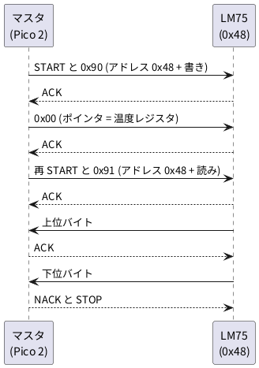

# 7-5 I2C のマスタ — 温度センサーを読む

> [!WARNING]
> **この題は実機で組んでいない。** Verilog は Verilator の lint を通し、PC のシミュレーション
> (LM75 の動きを真似た模型) で 5 回の読み出しを確かめた。Pico 2 への書き込みと、LM75・AD3 での測定はしていない。
> 「見るべき値」はシミュレーションの値と計算値。温度センサーのレジスタの形式はデータシートで確かめた (出典に書く)。

I2C は、**2 本の線 (SDA と SCL) に何台もつなぐ**通信。SPI (7-4) のように相手ごとの CS の線を引かず、
**アドレス**で相手を選ぶ。この題では Pico 2 の Soft-FPGA がマスタになり、温度センサー LM75 (アドレス 0x48) の温度を 0.5 秒ごとに読む。
読んだ値は、7-1 の UART で 16 進の文字にして出す (AD3 の Logic か、Protocol で見る)。

## I2C の決まり

| 決まり | 内容 |
| --- | --- |
| 線 | SDA (データ) と SCL (クロック)。どちらも**オープンドレイン**で、0 を出すか放すかの 2 通りしかない。1 は外のプルアップ抵抗が作る |
| START | SCL が 1 の間に SDA を 1 → 0 にする。通信の始まり |
| STOP | SCL が 1 の間に SDA を 0 → 1 にする。通信の終わり |
| データ | SCL が 0 の間に SDA を変え、SCL が 1 の間は SDA を動かさない。1 バイト = 8 ビット (上位から)。SCL の立ち上がりで読む |
| ACK | 1 バイトの後の 9 つ目のクロックで、受けた側が SDA を 0 に引く。1 のままなら NACK (返事なし、または「もう要らない」) |
| アドレス | START の後の最初のバイト = 7 ビットのアドレス + 読み書きの 1 ビット (0 = 書き、1 = 読み) |

(START・STOP・ACK の定義は Texas Instruments [SLVA704 Understanding the I2C Bus](https://www.ti.com/lit/an/slva704/slva704.pdf) による。)

## 温度センサー LM75 の決まり

この題の温度センサーは Texas Instruments の **LM75B** (データシート SNIS153D、2015-10)。次は、データシートで確かめた値。

| 項目 | 値 | データシートの箇所 |
| --- | --- | --- |
| 電源電圧 | 3 V〜5.5 V | 1 Features・6.3 |
| スレーブアドレス (7 ビット) | 1001 A2 A1 A0。A2・A1・A0 を GND に落とすと **0x48** | 7.5.1 |
| ポインタレジスタ | 0 = 温度 (読み出し専用)、1 = 設定、2 = THYST、3 = TOS。**電源投入直後は 0** | 7.5.8・7.4 |
| 温度の形式 | 9 ビット、2 の補数、**1 ビット = 0.5 ℃**。2 バイトで返り、最初のバイトが上位。データは 16 ビットの上位 9 ビット (下位バイトの最上位ビットが 0.5 ℃) | 7.5.2・7.5.8 |
| 精度 | −25 ℃〜100 ℃ で ±2 ℃ (最大) | 6.5 |
| 変換の間隔 | 標準 100 ms、最大 300 ms。**300 ms より短い間隔で続けて読まない** | 6.5 の注 (5) |
| SCL | 400 kHz まで (周期 2.5 µs 以上) | 3 Description・6.7 (t1) |
| SDA の Low | 3 mA で 0.4 V 以下 | 6.6 |
| プルアップ | SDA・SCL に **10 kΩ** (設計の前提として書かれている) | 8.2.1.1 |
| バイパスコンデンサ | 100 nF (と 10 µF) | 8.2.1.1 |

データシートに載っている温度の値 (7.5.2 の表) を、読み出す 2 バイトに直すと次のようになる。
9 ビットの値 V から、上位バイト = V の上位 8 ビット、下位バイト = V の最下位ビットを 0x80 にしたもの (0 なら 0x00)。

| 温度 | 9 ビットの値 | 上位バイト | 下位バイト |
| --- | --- | --- | --- |
| +125 ℃ | 0 1111 1010 (0x0FA) | 0x7D | 0x00 |
| +25 ℃ | 0 0011 0010 (0x032) | 0x19 | 0x00 |
| +0.5 ℃ | 0 0000 0001 (0x001) | 0x00 | 0x80 |
| 0 ℃ | 0 0000 0000 (0x000) | 0x00 | 0x00 |
| −0.5 ℃ | 1 1111 1111 (0x1FF) | 0xFF | 0x80 |
| −25 ℃ | 1 1100 1110 (0x1CE) | 0xE7 | 0x00 |
| −55 ℃ | 1 1001 0010 (0x192) | 0xC9 | 0x00 |

**変換の式**: 温度 [℃] = (上位バイトを符号付き 8 ビットとして読んだ値 × 2 + 下位バイトの最上位ビット) × 0.5。
例: 0x19 0x80 → (25 × 2 + 1) × 0.5 = 25.5 ℃。0xE7 0x00 → (−25 × 2 + 0) × 0.5 = −25.0 ℃。

**確かめた範囲と、確かめていないこと。**

- 確かめた: 上の表の値。LM75B (TI) のデータシート 1 冊だけから読んだ
- 注意: 本文 (7.3.1・8.2.1.1) には動作電圧 2.7 V とも書かれているが、規格の表 (6.3) は 3 V から。3.3 V の電源はどちらでも範囲に入る
- 確かめていない: 他社の LM75 や、同じ名前の互換品 (NXP などの LM75B は、温度が 11 ビット = 0.125 ℃ の品がある)。買った品のデータシートで、アドレスと形式を見直す
- データシートでは、3.3 V 用の品は型番の末尾が `-3` の品 (LM75BIM-3 など) で、3.3 V の規格を当てている。実際に売っている型番は、買う前に確かめる
- LM75 は SO-8 か MSOP-8 の面実装で、ブレッドボードには DIP 化の変換基板 (`dip8/sop`) に載せる。電源が 5 V の例は 02-analog-discovery/07-logic/04-i2c-temperature.md

## SCL の速さとプルアップの抵抗

クロックは 7-1〜7-3 と同じ **13 µs (76.923 kHz)**。SCL の 1 周期を 4 つの 1/4 周期に分け、1 つを 1 クロックにする。
**SCL の周期は 4 クロック = 52 µs (19.23 kHz)** (計算値)。LM75B の上限 400 kHz よりずっと遅い。

プルアップ抵抗 R<sub>p</sub> の範囲は、Texas Instruments の
[SLVA689 I2C Bus Pullup Resistor Calculation](https://www.ti.com/lit/an/slva689/slva689.pdf) の式で計算する。

| 量 | 式 | 値 (3.3 V) |
| --- | --- | --- |
| 下限 R<sub>p(min)</sub> | (V<sub>CC</sub> − V<sub>OL(max)</sub>) ÷ I<sub>OL</sub> = (3.3 − 0.4) ÷ 3 mA | 967 Ω |
| 上限 R<sub>p(max)</sub> | t<sub>r</sub> ÷ (0.8473 × C<sub>b</sub>) = 1000 ns ÷ (0.8473 × 50 pF) | 23.6 kΩ |
| 選ぶ値 | データシートの前提に合わせた E24 の値 | **10 kΩ** |
| 低いときの電流 | 3.3 V ÷ 10 kΩ | 0.33 mA |
| 立ち上がり時間 | 0.8473 × 10 kΩ × 50 pF | 424 ns |

- t<sub>r</sub> = 1000 ns は I2C のスタンダードモードの上限 (SLVA689 の表 2-1)。**C<sub>b</sub> = 50 pF はブレッドボードと配線の見積り**で、測っていない (I2C の上限は 400 pF)
- 10 kΩ は上の範囲の中にある。立ち上がりは 424 ns で、1/4 周期 (13 µs) よりずっと短い
- 0 を出す側の電圧は、LM75 が 0.4 V 以下 (3 mA)、Pico 2 が 0.5 V 以下 (RP2350 データシート 14.9.4、IOVDD = 3.3 V)。受ける側の VIL 最大は、
  LM75 が 0.3 × V<sub>S</sub> = 0.99 V、Pico 2 が 0.8 V なので、どちらからも 0 と読める

## 通信の順




- 先にポインタを 0 にしてから読む。電源投入直後はポインタが 0 なので書きを省いてもよいが、設定を変えた後でも読めるように毎回書く
- 再 START (STOP を挟まない START) で書きから読みへ向きを変える
- 最後のバイトには NACK を返し、「もう要らない」と伝えてから STOP

## 回路図

```circuit
title: 図1 GP4 を SDA、GP5 を SCL につなぎ、LM75 を 3.3 V で読む
parts:
  MCU: pico2 3,7 mirror
  SDA: port 7.5,5.4
  SCL: port 7.5,5.8
  U1:
    type: device
    at: 17,6.2
    label: LM75
    pins: [VDD, SDA, SCL, OS, A0, A1, A2, GND]
  V1: vcc 12,3 3.3V
  R1: resistor 9,3.2 9,5.4 10k
  R2: resistor 10.5,3.2 10.5,5.8 10k
  C1: capacitor 13.4,3 13.4,4.3 100n
  G3: ground 13.4,4.3
  G1: ground 13.8,8.4
  TXD: port 6.5,11
  AD:
    type: device
    at: 24,9
    label: AD3
    pins: [DIO0, DIO1, DIO2, GND]
  SCL: port 22.5,8.17
  SDA: port 22.5,8.58
  TXD: port 22.5,9
  G2: ground 22.5,10.4
wires:
  - MCU.GP4 -- 7.5,5.4 -- 9,5.4 -- U1.SDA
  - MCU.GP5 -- 7.5,5.8 -- 10.5,5.8 -- U1.SCL
  - 9,3.2 -- 9,3 -- 13.4,3
  - 10.5,3.2 -- 10.5,3
  - U1.VDD -- 12,5 -- 12,3
  - U1.A0 -- 13.8,6.6
  - U1.A1 -- 13.8,7
  - U1.A2 -- 13.8,7.4
  - U1.GND -- 13.8,7.8
  - 13.8,6.6 -- 13.8,8.4
  - MCU.GP15 |- 6.5,11
  - AD.DIO0 |- 22.5,8.17
  - AD.DIO1 |- 22.5,8.58
  - AD.DIO2 |- 22.5,9
  - AD.GND |- 22.5,9.42 -- 22.5,10.4
style:
  pitch: 1.2
  grid: on
```


- 同じ名前の端子どうしがつながっている (6-2 と同じ描き方)。SDA と SCL は Pico 2 の GP4・GP5 から LM75 へ、R1・R2 (10 kΩ) で +3.3 V へ
- R2 の縦の線は SDA の線を横切るが、点が無いので交わっていない
- A0・A1・A2 は GND に落として、アドレスを 0x48 に決める。OS (過温度の出力) は使わず開けておく
- C1 (100 nF) は LM75 の電源のすぐそばに置く。電源は Pico 2 の 3V3 (0-3)
- AD3 は DIO0 (SCL)・DIO1 (SDA)・DIO2 (UART の TXD) を読むだけ。何も出さない。AD3 から I2C を叩くときは、DIO を出力にして同時に Pico 2 を動かさない

## 部品表

| 部品 | 値・型番 | 数 | 役 |
| --- | --- | --- | --- |
| U1 | Raspberry Pi Pico 2 | 1 | Soft-FPGA を動かす。USB から給電 |
| U2 | LM75B (SO-8 を DIP 化の変換基板に載せる。型番の末尾が -3 の 3.3 V 品) | 1 | 温度センサー (I2C のスレーブ) |
| R1・R2 | 10 kΩ (E24)、1/4 W | 2 | SDA・SCL のプルアップ |
| C1 | 100 nF (E12)、セラミック | 1 | LM75 の電源のバイパス |
| — | ブレッドボード (full、63 列) | 1 | |
| — | ジャンパ線 | 約 15 本 | |
| AD | Analog Discovery 3 | 1 | Logic と Protocol で読む |

データシートの 10 µF のバルクコンデンサは、USB 電源の Pico 2 の基板に載っているので、この図では省く。

## 実体配線図

```bread
title: 図2 Pico 2 の GP4・GP5 を LM75 につなぎ、AD3 の DIO0 から DIO2 で読む
board: full
parts:
  MCU: pico2 @ h5
  U1: dip8/sop @ e30 LM75
  R1: resistor j30 +b30 10k
  R2: resistor j31 +b31 10k
  C1: capacitor c34 c37 100n
  AD:
    type: device
    at: bottom
    label: AD3 Logic
    pins: [DIO1, DIO0, DIO2, GND]
wires:
  - a9 -- +t9 red
  - +t63 -- +b63 red
  - -t63 -- -b63 black
  - a7 -- -t7 black
  - a30 -- +t30 red
  - a31 -- -t31 black
  - a32 -- -t32 black
  - a33 -- -t33 black
  - a34 -- +t34 red
  - a37 -- -t37 black
  - j33 -- -b33 black
  - i10 -- g30 yellow
  - i11 -- h31 green
  - AD.DIO1 -- j10 yellow
  - AD.DIO0 -- j11 green
  - AD.DIO2 -- j24 blue
  - AD.GND -- -b14 black
```


- Pico 2 は USB を左に向けて `@ h5` に挿す (0-4 と同じ)。下の列 (h 行) の 6 番 GP4 が 10 列、7 番 GP5 が 11 列、20 番 GP15 が 24 列。上の列 (c 行) の 36 番 3V3 が 9 列、38 番 GND が 7 列
- LM75 の変換基板は溝をまたいで `@ e30` に挿す。上の列に 8 番 VDD (30 列)・7 番 A0 (31 列)・6 番 A1 (32 列)・5 番 A2 (33 列)、下の列に 1 番 SDA (30 列)・2 番 SCL (31 列)・3 番 OS (32 列)・4 番 GND (33 列)
- SDA は GP4 (10 列) から黄の線で 30 列へ、SCL は GP5 (11 列) から緑の線で 31 列へ。R1 (SDA)・R2 (SCL) は下の + レールへ立てる
- 電源: 3V3 (9 列) から上の + レールへ赤。VDD (30 列) と C1 の一端 (34 列) を上の + レールへ赤。上下の + レールは右端 (63 列) でつなぐ
- GND: Pico 2 の 38 番 (7 列) から上の − レールへ。A0・A1・A2 (31・32・33 列) と C1 の他端 (37 列) を上の − レールへ。4 番 GND (33 列) は下の − レールへ。AD3 の GND は下の − レールへ。黒の線
- AD3 は DIO1 (SDA) を 10 列、DIO0 (SCL) を 11 列、DIO2 (TXD) を 24 列に、それぞれ j 行で挿す。線の色は SDA が黄、SCL が緑、TXD が青
- C1 (100 nF) は 34 列と 37 列の間に横に置き、LM75 の VDD (30 列) のすぐ近くの + レールと − レールから取る
- 流れる電流は 1 mA 以下 (プルアップ 2 本で最大 0.66 mA、LM75 の電源電流は標準 0.25 mA)。信号は 19 kHz で、ブレッドボードの範囲 (3 MHz 以下) に収まる

## Verilog

### i2c_read.v — マスタ

```verilog
// I2C のマスタ (100 kHz 以下のスタンダードモード、7 ビットアドレス)。
// LM75 のレジスタを 1 つ読む決まった手順だけを行う:
//   START - (ADDR<<1|0) - ACK - PTR - ACK - 再START - (ADDR<<1|1) - ACK - 上位バイト - ACK - 下位バイト - NACK - STOP
// SDA と SCL は「0 を引く」か「放す」かだけ。1 は外のプルアップが作る (オープンドレイン)
module i2c_read #(
    parameter [6:0] ADDR = 7'h48,   // LM75 は A2・A1・A0 を GND に落とすと 0x48
    parameter [7:0] PTR  = 8'h00,   // 読むレジスタ。0 が温度
    parameter integer QTR = 1       // SCL の 1/4 周期のクロック数。1 なら SCL = クロック / 4
) (
    input            clk,
    input            rst,
    input            start,         // 1 クロック 1 で読み始める
    input            sda_in,        // SDA 線の今の値 (GPIO の入力)
    output reg       sda_low,       // 1 のとき SDA を GND へ引く。0 なら放す
    output reg       scl_low,       // 1 のとき SCL を GND へ引く。0 なら放す
    output           busy,
    output reg       done,          // 読み終えたクロックだけ 1
    output reg       nack,          // done のとき 1 なら、アドレスかレジスタ番号に ACK が返らなかった
    output reg [7:0] data_hi,       // 温度の上位バイト
    output reg [7:0] data_lo        // 温度の下位バイト
);
    localparam integer QW = (QTR > 1) ? $clog2(QTR) : 1;

    reg            active;
    reg [5:0]      slot;            // 0〜47
    reg [1:0]      ph;              // 枠の中の 1/4 周期 0〜3
    reg [QW-1:0]   qcnt;
    reg            nack_acc;
    reg [7:0]      sh_in;

    assign busy = active;

    // 枠 slot の種類。
    //  0: START  1〜8: アドレス(書き)  9: ACK  10〜17: レジスタ番号  18: ACK  19: 再START
    //  20〜27: アドレス(読み)  28: ACK  29〜36: 上位バイトを受ける  37: ACK を返す
    //  38〜45: 下位バイトを受ける  46: NACK を返す  47: STOP
    wire [7:0] addr_w = {ADDR, 1'b0};
    wire [7:0] addr_r = {ADDR, 1'b1};

    // 枠の番号から、8 ビットのうち何ビット目 (7 が最初) を出すか。3 ビットで足りるので下位だけ使う
    wire [2:0] bit_a = 3'd0 - slot[2:0];   // 枠 1〜8   → 7〜0
    wire [2:0] bit_p = 3'd1 - slot[2:0];   // 枠 10〜17 → 7〜0
    wire [2:0] bit_r = 3'd3 - slot[2:0];   // 枠 20〜27 → 7〜0

    // 枠が出すビット (master → slave の枠だけ意味がある)。
    reg out_bit;
    always @(*) begin
        out_bit = 1'b1;
        if (slot >= 6'd1  && slot <= 6'd8)  out_bit = addr_w[bit_a];
        if (slot >= 6'd10 && slot <= 6'd17) out_bit = PTR[bit_p];
        if (slot >= 6'd20 && slot <= 6'd27) out_bit = addr_r[bit_r];
        if (slot == 6'd37)                  out_bit = 1'b0;     // 上位バイトに ACK を返す (0 を引く)
        if (slot == 6'd46)                  out_bit = 1'b1;     // 下位バイトに NACK を返す (放す)
    end

    wire is_start = (slot == 6'd0)  || (slot == 6'd19);
    wire is_stop  = (slot == 6'd47);
    wire is_ackin = (slot == 6'd9)  || (slot == 6'd18) || (slot == 6'd28);
    wire is_din   = (slot >= 6'd29 && slot <= 6'd36) || (slot >= 6'd38 && slot <= 6'd45);
    wire q_last   = (qcnt == QTR[QW-1:0] - 1'b1);

    always @(posedge clk)
        if (rst) begin
            active   <= 1'b0;
            slot     <= 6'd0;
            ph       <= 2'd0;
            qcnt     <= {QW{1'b0}};
            sda_low  <= 1'b0;
            scl_low  <= 1'b0;
            done     <= 1'b0;
            nack     <= 1'b0;
            nack_acc <= 1'b0;
            sh_in    <= 8'h00;
            data_hi  <= 8'h00;
            data_lo  <= 8'h00;
        end else begin
            done <= 1'b0;
            if (!active) begin
                if (start) begin
                    active   <= 1'b1;
                    slot     <= 6'd0;
                    ph       <= 2'd0;
                    qcnt     <= {QW{1'b0}};
                    nack_acc <= 1'b0;
                    sda_low  <= 1'b0;     // バスは両方放した状態から始める
                    scl_low  <= 1'b0;
                end
            end else begin
                // ---- 1/4 周期ごとに線を動かす (枠の頭 ph == 0 で SDA、ph == 1 で SCL を上げる、…)
                if (qcnt == {QW{1'b0}}) begin
                    case (ph)
                        2'd0: begin
                            // SCL を低くしたまま SDA を決める
                            if (is_stop) begin scl_low <= 1'b1; sda_low <= 1'b1; end
                            else begin
                                scl_low <= 1'b1;
                                if (is_start)      sda_low <= 1'b0;          // 放す (1)
                                else if (is_ackin || is_din) sda_low <= 1'b0;  // 相手に任せる
                                else               sda_low <= ~out_bit;
                            end
                        end
                        2'd1: scl_low <= 1'b0;                                // SCL を放して上げる
                        2'd2: begin
                            if (is_start) sda_low <= 1'b1;                    // SCL が高いうちに SDA を下げる = START
                            if (is_ackin && sda_in) nack_acc <= 1'b1;         // ACK の枠で 1 なら返事が無い
                            if (is_din) sh_in <= {sh_in[6:0], sda_in};        // SCL の高い真ん中で読む
                        end
                        default: begin
                            if (is_stop) sda_low <= 1'b0;                     // SCL が高いうちに SDA を放す = STOP
                            else scl_low <= 1'b1;                             // SCL を下げる
                        end
                    endcase
                end
                // ---- 時間を進める
                if (!q_last) qcnt <= qcnt + 1'b1;
                else begin
                    qcnt <= {QW{1'b0}};
                    if (ph != 2'd3) ph <= ph + 2'd1;
                    else begin
                        ph <= 2'd0;
                        // 枠の終わりで、読んだバイトを置く
                        if (slot == 6'd36) data_hi <= sh_in;
                        if (slot == 6'd45) data_lo <= sh_in;
                        if (slot == 6'd47) begin
                            active <= 1'b0;
                            done   <= 1'b1;
                            nack   <= nack_acc;
                        end else
                            slot <= slot + 6'd1;
                    end
                end
            end
        end
endmodule
```

- 1 ビットぶんの時間を **枠** (slot) と数え、枠を 48 個並べて、START から STOP までの全部の手順を決まった順に出す。枠の中は 1/4 周期 (ph) が 4 つ
- 各枠の中では、ph 0 で SCL を 0 にしたまま SDA を決め、ph 1 で SCL を放して 1 にし、ph 2 (SCL が 1 の真ん中) で SDA を読み、ph 3 で SCL を 0 に戻す
- `sda_low` と `scl_low` は「0 を引く」ときだけ 1。1 を出す代わりに**放す**。1 は外のプルアップが作る (オープンドレイン)
- ACK の枠 (9・18・28) では SDA を放し、ph 2 で 1 が見えたら `nack_acc` を立てる。NACK は `nack` で外へ出す
- SCL を引き延ばす相手 (クロックストレッチ) には使えない。LM75B のデータシートには引き延ばしの記述が見つからなかった

### i2c_temp_top.v — 0.5 s ごとに読んで UART に出す

```verilog
// 0.5 s ごとに LM75 の温度レジスタを読み、2 バイトを 16 進で UART に出す。Pico 2 に載せる最上位
//   読めたとき  "19 80\r\n"   (上位バイト 下位バイト)
//   返事が無いとき "ERR\r\n"
module i2c_temp_top #(
    parameter CLK_HZ = 76_923,
    parameter BAUD   = 4800
) (
    input  clk,
    input  rst,
    input  sda_in,      // GP4  SDA の線の値
    output sda_low,     // GP4  1 のとき出力 0 を出し、0 のとき入力にする (外のプルアップが 1 を作る)
    output scl_low,     // GP5  同上
    output txd          // GP15 UART の TXD
);
    localparam integer HALF = CLK_HZ / 2;
    localparam integer W    = $clog2(HALF);

    reg [W-1:0] tcnt;
    reg         rd_start;
    wire        rd_busy, rd_done, rd_nack;
    wire [7:0]  t_hi, t_lo;

    i2c_read #(.ADDR(7'h48), .PTR(8'h00), .QTR(1)) u_rd (
        .clk(clk), .rst(rst), .start(rd_start), .sda_in(sda_in),
        .sda_low(sda_low), .scl_low(scl_low), .busy(rd_busy), .done(rd_done),
        .nack(rd_nack), .data_hi(t_hi), .data_lo(t_lo));

    // ---- 結果を 1 行にして UART へ
    reg [7:0] hi, lo;
    reg       err;
    reg [2:0] idx;       // 次に送る字の番号
    reg [2:0] len;       // 1 行の字数。7 (16 進 2 桁 + 空白 + 2 桁 + CR LF) か 5 (ERR + CR LF)
    reg       sending;
    reg       tx_start;
    reg [7:0] tx_data;
    wire      tx_busy;

    uart_tx #(.CLK_HZ(CLK_HZ), .BAUD(BAUD)) u_tx (
        .clk(clk), .rst(rst), .data(tx_data), .start(tx_start), .txd(txd), .busy(tx_busy));

    function [7:0] hex(input [3:0] n);
        hex = (n < 4'd10) ? (8'h30 + {4'd0, n}) : (8'h37 + {4'd0, n});   // 0-9 は 0x30〜、A-F は 0x41〜
    endfunction

    function [7:0] ch(input [2:0] i, input [7:0] h, input [7:0] l, input e);
        if (e)
            case (i)
                3'd0:    ch = "E";
                3'd1:    ch = "R";
                3'd2:    ch = "R";
                3'd3:    ch = 8'h0D;
                default: ch = 8'h0A;
            endcase
        else
            case (i)
                3'd0:    ch = hex(h[7:4]);
                3'd1:    ch = hex(h[3:0]);
                3'd2:    ch = " ";
                3'd3:    ch = hex(l[7:4]);
                3'd4:    ch = hex(l[3:0]);
                3'd5:    ch = 8'h0D;
                default: ch = 8'h0A;
            endcase
    endfunction

    always @(posedge clk)
        if (rst) begin
            tcnt     <= {W{1'b0}};
            rd_start <= 1'b0;
            hi       <= 8'h00;
            lo       <= 8'h00;
            err      <= 1'b0;
            idx      <= 3'd0;
            len      <= 3'd0;
            sending  <= 1'b0;
            tx_start <= 1'b0;
            tx_data  <= 8'h00;
        end else begin
            rd_start <= 1'b0;
            tx_start <= 1'b0;

            // 0.5 s ごとに読み始める (LM75 の変換は 100 ms 程度。300 ms 以内に続けて読まない)
            if (tcnt == HALF[W-1:0] - 1'b1) begin
                tcnt <= {W{1'b0}};
                if (!rd_busy && !sending) rd_start <= 1'b1;
            end else
                tcnt <= tcnt + 1'b1;

            // 読めたら 1 行にする
            if (rd_done) begin
                hi      <= t_hi;
                lo      <= t_lo;
                err     <= rd_nack;
                len     <= rd_nack ? 3'd5 : 3'd7;
                idx     <= 3'd0;
                sending <= 1'b1;
            end

            // 1 字ずつ送る
            if (sending && !tx_busy && !tx_start) begin
                if (idx == len)
                    sending <= 1'b0;
                else begin
                    tx_data  <= ch(idx, hi, lo, err);
                    tx_start <= 1'b1;
                    idx      <= idx + 3'd1;
                end
            end
        end
endmodule
```

- 読む間隔は 0.5 s (38 461 クロック)。LM75B の変換は標準 100 ms、最大 300 ms なので、300 ms より長い
- 出す行は `19 80` と CR LF (7 字)。返事が無いときは `ERR` と CR LF (5 字)。7-1 の `uart_tx.v` をそのまま使う
- 16 進の桁は 0〜9 を 0x30 から、A〜F を 0x41 から (`hex` 関数)。0x0A は 0x37 + 10 = 0x41 で 'A'

Verilator の lint は警告なしで通る (`verilator --lint-only -Wall --top-module i2c_temp_top i2c_temp_top.v i2c_read.v uart_tx.v`、確かめた)。

### Pico 2 のピンの割り当て

組み方は 5-3 と 5-7 (手本は [Soft-FPGA-TD4](https://github.com/tommie-jp/Soft-FPGA-TD4) の `verilator-TD4/main.cpp`)。

| Verilog | Pico 2 | 向き | 設定 |
| --- | --- | --- | --- |
| `clk` | (ピンなし) | — | **13 µs ごと**のタイマ割り込みで 0 → 1 と変えて評価する (5-7) |
| `rst` | (ピンなし) | — | 起動して最初の 1 クロックだけ 1 |
| `sda_in` | GP4 | 入力 | SDA の線の値。内部のプルアップは使わない (外の 10 kΩ に任せる) |
| `sda_low` | GP4 | 出力 (0 を出す) / 入力 | 1 のとき**出力にして 0 を出す**。0 のとき**入力に戻す** (1 を出さない) |
| `scl_low` | GP5 | 出力 (0 を出す) / 入力 | 同上 |
| `txd` | GP15 | 出力 | 起動直後から 1 を出す (アイドル) |

`sda_low` と `scl_low` で GPIO の向きを毎クロック切り替える組み方は、この題では動かして確かめていない
(Soft-FPGA の 5-3 の方法の応用。GPIO の出力値は常に 0 にしておき、向きだけを切り替えるのがいちばん単純)。

## 動かす — PC のシミュレーション

LM75 の動きを真似たテストベンチの模型 (アドレス一致で ACK を返し、ポインタを受け、上位・下位の順に 2 バイトを返す) と、
UART の出力を 4800 bps で読む受け手を `i2c_temp_top` につなぐ。SDA と SCL は、マスタと模型のどちらかが 0 を引けば 0、
どちらも放せば 1 (外のプルアップ)。温度の値を途中で変えて、読み出しごとに出る行を見る。

```verilog
`timescale 1ns / 1ps
// LM75 の動きを真似た模型 (アドレス ADDR、ポインタで温度レジスタを選び、上位・下位の順に 2 バイト返す) に
// i2c_temp_top をつなぎ、UART の出力 (4800 bps) を読んで書き出す。SDA と SCL はオープンドレイン (どちらかが 0 を引けば 0)
module tb_i2c;
    parameter [6:0] MODEL_ADDR = 7'h48;

    reg clk;
    initial begin
        clk = 1'b0;
        forever #6500 clk = ~clk;          // 13 us
    end
    reg rst;

    wire sda_low, scl_low, txd;
    reg  slv_low;                           // 模型が SDA を 0 に引く
    wire sda = ~(sda_low | slv_low);        // 外のプルアップが 1 を作る
    wire scl = ~scl_low;

    i2c_temp_top dut (.clk(clk), .rst(rst), .sda_in(sda),
                      .sda_low(sda_low), .scl_low(scl_low), .txd(txd));

    // ---- LM75 の模型
    reg [7:0] t_hi, t_lo, ptr_reg;
    integer   n_read;
    task automatic recv_byte(output [7:0] b);
        integer i;
        begin
            b = 8'h00;
            for (i = 0; i < 8; i = i + 1) begin
                @(posedge scl);
                b = {b[6:0], sda};
            end
        end
    endtask
    task automatic send_ack;
        begin
            @(negedge scl); slv_low = 1'b1;     // 8 ビット目の次の SCL の間、0 を引く
            @(negedge scl); slv_low = 1'b0;
        end
    endtask
    task automatic send_byte(input [7:0] v, output ack);
        integer i;
        begin
            slv_low = ~v[7];                    // 直前の negedge の直後なので、最上位ビットをここで出す
            for (i = 6; i >= 0; i = i - 1) begin
                @(negedge scl);
                slv_low = ~v[i];
            end
            @(negedge scl);
            slv_low = 1'b0;                     // 9 つ目のクロックは放す。マスタが ACK か NACK を返す
            @(posedge scl);
            ack = ~sda;
            @(negedge scl);                     // この negedge の直後に次のバイトの最上位ビットを出す
        end
    endtask

    reg [7:0] rb;
    reg       a;
    initial begin
        slv_low = 1'b0; t_hi = 8'h19; t_lo = 8'h80; ptr_reg = 8'h00; n_read = 0;
        forever begin
            @(negedge sda);
            if (scl) begin                          // START
                recv_byte(rb);
                if (rb[7:1] == MODEL_ADDR && !rb[0]) begin
                    send_ack;
                    recv_byte(rb);                  // ポインタ
                    ptr_reg = rb;
                    send_ack;
                    @(negedge sda);                 // 再 START
                    recv_byte(rb);
                    if (rb[7:1] == MODEL_ADDR && rb[0]) begin
                        send_ack;
                        send_byte(t_hi, a);
                        send_byte(t_lo, a);         // マスタの NACK のあとは何もしない
                        slv_low = 1'b0;
                        n_read = n_read + 1;
                    end
                end else begin
                    // 自分のアドレスでなければ ACK を返さない (SDA は 1 のまま)
                end
            end
        end
    end

    // ---- UART の受信 (4800 bps ちょうど)
    localparam real BIT_NS = 1.0e9 / 4800.0;
    reg [7:0] rx;
    integer   b;
    integer   nchar = 0;
    reg [8*8-1:0] line;
    integer   ll = 0;
    initial begin
        #1000;
        forever begin
            @(negedge txd);
            #(BIT_NS * 1.5);
            for (b = 0; b < 8; b = b + 1) begin
                rx[b] = txd;
                #(BIT_NS);
            end
            nchar = nchar + 1;
            if (rx == 8'h0A) begin
                $display("  uart line (%0d reads): %0s", n_read, line);
                line = 0; ll = 0;
            end else if (rx != 8'h0D) begin
                line = {line[8*7-1:0], rx};
                ll = ll + 1;
            end
        end
    end

    // ---- 変わり目の記録 (最初の 1 回の読み出し。logic の図の元)
    realtime t0, tlast;
    integer  go = 0;
    always @(sda or scl) begin
        if (!rst && n_read < 2 && (go == 0 || $realtime - t0 < 2700000.0)) begin
            if (go == 0) t0 = $realtime;
            $display("EDGE %9.1f scl=%b sda=%b", ($realtime - t0) / 1000.0, scl, sda);
            go = go + 1;
        end
    end

    // ---- UART の TXD の変わり目 (最初の 1 行。最初の START からの時刻)
    realtime tstart_i2c;
    reg got_start = 0;
    always @(negedge sda) if (scl && !got_start && !rst) begin tstart_i2c = $realtime; got_start = 1; end
    always @(txd)
        if (got_start && n_read < 2 && $realtime - tstart_i2c < 22000000.0)
            $display("TXD %9.1f %b", ($realtime - tstart_i2c) / 1000.0, txd);

    initial begin
        #4000000000 $finish;               // 返事が無い試験のための打ち切り (4 s)
    end

    initial begin
        rst = 1'b1;
        #26000 rst = 1'b0;
        wait (n_read == 1);
        #(12 * BIT_NS * 7);
        $display("--- 温度を -25.0 C (0xE7 0x00) に変える");
        t_hi = 8'hE7; t_lo = 8'h00;
        wait (n_read == 2); wait (n_read == 3);
        #(12 * BIT_NS * 7);
        $display("--- 0x7D 0x00 (+125 C)");
        t_hi = 8'h7D; t_lo = 8'h00;
        wait (n_read == 5);
        #(12 * BIT_NS * 7);
        $finish;
    end
endmodule
```

```bash
verilator --binary --timing --top-module tb_i2c tb_i2c.v i2c_temp_top.v i2c_read.v uart_tx.v
./obj_dir/Vtb_i2c
```

```text
  uart line (1 reads): 19 80
--- 温度を -25.0 C (0xE7 0x00) に変える
  uart line (2 reads): E7 00
  uart line (3 reads): E7 00
--- 0x7D 0x00 (+125 C)
  uart line (4 reads): 7D 00
  uart line (5 reads): 7D 00
```

(Verilator 5.042 で実行。`EDGE` と `TXD` の行 (図の元になる変わり目の時刻) は省いた。読み出しは 0.5 s ごとなので、温度を変えた後の行が 2 回ずつ続く。)

| 模型の温度レジスタ | 1 行に出た字 | 式で直した温度 |
| --- | --- | --- |
| 0x19 0x80 | `19 80` | 25.5 ℃ |
| 0xE7 0x00 | `E7 00` | −25.0 ℃ |
| 0x7D 0x00 | `7D 00` | +125.0 ℃ |
| (模型のアドレスを 0x49 にした) | `ERR` | 返事なし |

- 読み出しは 0.5 s ごと。1 回の通信は START から STOP まで 2.457 ms (48 枠 × 52 µs から、前後の半枠を引いた長さ)
- 返事が無いとき (アドレスが違うとき) は、アドレスの ACK で SDA が 1 のままなので `ERR` になる (`-GMODEL_ADDR=7'h49` で再現)

## 計器の設定

| 計器 | 設定 |
| --- | --- |
| Logic | DIO0 = SCL、DIO1 = SDA、DIO2 = TXD を Enable。DIO は 3.3 V。GND を共通にする (0-4) |
| 時間軸 (I2C) | 250 µs/div (10 目盛で 2.5 ms。1 回の通信が 2.46 ms)。標本化 1 MS/s (SCL の 1 周期に 52 標本) |
| トリガ | DIO1 (SDA) の立ち下がり (START)。トリガの前を 40 µs 見せる |
| 時間軸 (UART) | 2 ms/div (10 目盛で 20 ms)。標本化 100 kS/s (1 ビット 208 µs に 21 標本)。トリガは DIO2 の立ち下がり |
| Protocol | I2C。SCL = DIO0、SDA = DIO1。Rate = 19 kHz (SCL の速さに合わせる)。Spy で読む。操作は Digilent の [Using the Protocol Analyzer](https://digilent.com/reference/test-and-measurement/guides/waveforms-protocol-analyzer)。UART を読むときは Protocol を UART にして RX = DIO2、4800 bps、8 ビット、パリティなし、ストップ 1 |

## Logic に見えるはずの画面

シミュレーションの変わり目の時刻をそのまま写した。最初の読み出しの START (SDA の立ち下がり) を 0 s とした。

```logic
title: 図3 LM75 の温度を読む 1 回の通信。START から STOP まで 2.46 ms
device: ad3
time: 250us/div
start: -40us
sample: 1MHz
signals:
  SCL: dio0 edges -40us=1 -26us=0 -13us=1 13us=0 39us=1 65us=0 91us=1 117us=0 143us=1 169us=0 195us=1 221us=0 247us=1 273us=0 299us=1 325us=0 351us=1 377us=0 403us=1 429us=0 455us=1 481us=0 507us=1 533us=0 559us=1 585us=0 611us=1 637us=0 663us=1 689us=0 715us=1 741us=0 767us=1 793us=0 819us=1 845us=0 871us=1 897us=0 923us=1 949us=0 975us=1 1001us=0 1027us=1 1053us=0 1079us=1 1105us=0 1131us=1 1157us=0 1183us=1 1209us=0 1235us=1 1261us=0 1287us=1 1313us=0 1339us=1 1365us=0 1391us=1 1417us=0 1443us=1 1469us=0 1495us=1 1521us=0 1547us=1 1573us=0 1599us=1 1625us=0 1651us=1 1677us=0 1703us=1 1729us=0 1755us=1 1781us=0 1807us=1 1833us=0 1859us=1 1885us=0 1911us=1 1937us=0 1963us=1 1989us=0 2015us=1 2041us=0 2067us=1 2093us=0 2119us=1 2145us=0 2171us=1 2197us=0 2223us=1 2249us=0 2275us=1 2301us=0 2327us=1 2353us=0 2379us=1 2405us=0 2431us=1
  SDA: dio1 edges -40us=1 0us=0 26us=1 78us=0 182us=1 234us=0 481us=1 494us=0 949us=1 988us=0 1014us=1 1066us=0 1170us=1 1222us=0 1378us=1 1417us=0 1625us=1 1729us=0 1833us=1 1898us=0 1950us=1 1989us=0 2353us=1 2418us=0 2457us=1
cursors: [455us, 507us]
trigger: SDA falling at 0us
```


- SCL は START の前に 1 クロックだけ 0 になる (この回路は、START の枠の頭で SCL を 0 に下げてから SDA を決める。正しい START になる)
- SDA が SCL の 1 の間に 1 → 0 になる 0 s が START。続く 8 クロックで 0x90 = 1001 0000 を送る。9 クロック目 (442〜494 µs の SCL = 1 の間) に SDA が 0 になっているのが LM75 の ACK
- 次の 8 クロックでポインタ 0x00、その ACK、949 µs の SDA の 0 → 1 のあと 988 µs の 1 → 0 が再 START (SCL が 1 の間に SDA が 1 → 0)、続いて 0x91 = 1001 0001 と ACK
- そのあとの 16 クロックで 2 バイトが返る。最後の STOP は 2457 µs の SDA の 0 → 1 (SCL は 1 のまま)
- X1 (455 µs) と X2 (507 µs) は連続する SCL の立ち上がりで、ΔX = 52 µs、1/ΔX = 19.23 kHz が SCL の周波数。X1 の SDA = 0 は、アドレスの ACK

読み終えた約 40 µs 後に、結果を UART で出す。

```logic
title: 図4 読み終えた後に UART で出す 1 行。"19 80" と CR LF
device: ad3
time: 2ms/div
start: -1ms
sample: 100kHz
signals:
  TXD: dio2 edges -1ms=1 2496us=0 2704us=1 2912us=0 3536us=1 3952us=0 4368us=1 4602us=0 4810us=1 5018us=0 5434us=1 6058us=0 6474us=1 6708us=0 7956us=1 8164us=0 8580us=1 8814us=0 9646us=1 10270us=0 10686us=1 10920us=0 11960us=1 12376us=0 12792us=1 13026us=0 13234us=1 13442us=0 13650us=1 14066us=0 14898us=1 15132us=0 15548us=1 15756us=0 15964us=1 16172us=0 17004us=1
decode:
  UART: uart TXD baud 4800 8N1 ascii
cursors: [2496us, 4602us]
trigger: TXD falling at 2496us
```


- STOP (2.457 ms) の 39 µs 後、2.496 ms から "1" "9" " " "8" "0" CR LF の 7 字が出る。1 字は 2.106 ms (10 ビット 2.08 ms + 字のすき間 26 µs、7-1 と同じ)
- 1 行を出し終えるのは約 17.2 ms。次の読み出しは 0.5 s 後

## 見るべき値

シミュレーションの値と計算値。実機では測っていない。Logic のカーソルで読み、表に書き加える。

| 見る所 | シミュレーション・計算値 | 実機 (測って書く) |
| --- | --- | --- |
| SCL の周期 | 52 µs (4 クロック × 13 µs) | |
| SCL の周波数 | 19.23 kHz (計算値) | |
| 1 回の通信 (START から STOP) | 2.457 ms | |
| 読み出しの間隔 | 0.5 s | |
| 送るアドレスのバイト | 0x90 (書き)、0x91 (読み) | |
| ACK (9 クロック目の SDA) | 3 か所とも 0 | |
| 2 バイトの値 (室温のとき) | 25 ℃ なら 0x19 0x00 の付近 | |
| 温度 (式で直す) | 室温 (温度計と ±2 ℃ 以内が目安) | |
| 指で触ったときの変化 | 数 ℃ 上がる (変換の間隔 100 ms で更新) | |
| SDA・SCL の High | 3.3 V (3.3 V ± 0.1 V の目安) | |
| SDA・SCL の Low | LM75 が 0.4 V 以下 (3 mA)、Pico 2 が 0.5 V 以下 | |
| SDA・SCL の立ち上がり時間 | 424 ns (計算値。C<sub>b</sub> = 50 pF と置いた) | |
| UART の 1 行 | `19 80` のような 16 進 + CR LF。約 14.7 ms | |

プルアップを外すと (R1 か R2 を抜くと) SDA か SCL が 1 に戻れず、アドレスの ACK が見えなくなって `ERR` になるはず
(実機で確かめる)。AD3 の Protocol の I2C が NACK を示す。

## 出典

自作。LM75B のアドレス・レジスタ・温度の形式・電圧・変換時間・プルアップの値は Texas Instruments
[LM75B, LM75C データシート (SNIS153D、2015-10)](https://www.ti.com/lit/ds/symlink/lm75b.pdf) の表と本文から読んだ。
I2C の START・STOP・ACK は [SLVA704 Understanding the I2C Bus](https://www.ti.com/lit/an/slva704/slva704.pdf)、
プルアップの式は [SLVA689 I2C Bus Pullup Resistor Calculation](https://www.ti.com/lit/an/slva689/slva689.pdf)。
Pico 2 (RP2350) の入出力電圧は [RP2350 データシート](https://datasheets.raspberrypi.com/rp2350/rp2350-datasheet.pdf) の 14.9.4。
AD3 の Protocol の使い方は Digilent の
[Using the Protocol Analyzer](https://digilent.com/reference/test-and-measurement/guides/waveforms-protocol-analyzer)。
LM75 を AD3 から叩く題は 02-analog-discovery/07-logic/04-i2c-temperature.md (5 V、AD3 がマスタ)。
