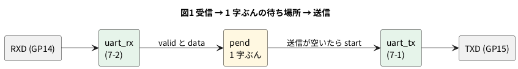

# 7-7 エコーバック — 受けた字を返す

> [!WARNING]
> **この題は実機で組んでいない。** Verilog は Verilator の lint を通し、PC のシミュレーションで
> 256 字を送って、返ってきた字を数えた。Pico 2 への書き込みと、AD3 での測定はしていない。
> 「見るべき値」はシミュレーションの値と計算値。

エコーバックは、受けた字をそのまま送り返す回路。端末 (シリアルモニタ) で打った字が画面に出るのは、この仕組みが相手側にあるから、
という使い方がよくある。ほかにも、通信路がつながっているかを確かめる (行って戻る) のに使う。

7-1 の送信と 7-2 の受信を **1 つの最上位でつなぐ**だけで作れる。ただし、受信が字を渡してから送信が空くまで待つ必要がある。
この待ち方で、字を取りこぼすか、取りこぼさないかが決まる。

クロックとボーレートは 7-1〜7-3 と同じ **13 µs と 4800 bps**。

## つなぎ方




- `uart_rx` は、字を受け終えると `valid` を 1 クロックだけ 1 にして、`data` に字を置く
- `pend` は、送信が使用中のときだけ字を待たせる場所 (1 字ぶん)。送信が空いていれば、そのまま `uart_tx` に渡る
- 待たせる場所がふさがっているところへ、もう 1 字来たら、取りこぼす。そのときは `err` を 1 にして残す

## 回路図

```circuit
title: 図1 AD3 の DIO0 から GP14 へ字を送り、GP15 から返る字を DIO1 で読む
parts:
  MCU: pico2 3,6 mirror
  RXD: port 6.5,9.8
  TXD: port 6.5,10.2
  G1: ground 1.2,9.2
  AD:
    type: device
    at: 12,9
    label: AD3
    pins: [DIO0, DIO1, GND]
  RXD: port 10,8.58
  TXD: port 10,9
  G2: ground 10,10.2
wires:
  - MCU.GP14 |- 6.5,9.8
  - MCU.GP15 |- 6.5,10.2
  - MCU.GND23 -- 1.2,9.2
  - AD.DIO0 |- 10,8.58
  - AD.DIO1 |- 10,9
  - AD.GND |- 10,9.42 -- 10,10.2
style:
  pitch: 1.2
  grid: on
```


- 同じ名前の端子どうしがつながっている (6-2 と同じ描き方)。AD3 の DIO0 が出す字を Pico 2 の GP14 が受け、GP15 が返す字を DIO1 で読む
- AD3 の GND と Pico 2 の GND (18 番) を共通にする (0-4)
- 部品は Pico 2 と AD3 だけ。AD3 の DIO は出力も 3.3 V なので、そのまま GP14 に入れてよい。電源は Pico 2 の USB で、ピンは 3.3 V (0-3)
- 受信が線を読んだ時刻 `smp` は GP16 に出す。この題では配線しない (7-2 で見た)

## 実体配線図

```bread
title: 図2 DIO0 から GP14 へ字を送り、GP15 の返りを DIO1 で読む
board: half
parts:
  MCU: pico2 @ h5
  AD:
    type: device
    at: bottom
    label: AD3 Protocol・Logic
    pins: [GND, DIO0, DIO1]
wires:
  - AD.GND -- j22 black
  - AD.DIO0 -- j23 yellow
  - AD.DIO1 -- j24 green
```


- `pico2 @ h5` は 0-4 と同じ向き。GP14 (19 番) は 23 列、GP15 (20 番) は 24 列、GND (18 番) は 22 列。同じ列の j 行の穴から線を取る
- DIO0 (AD3 が字を出す) は黄で 23 列へ、DIO1 (返りを読む) は緑で 24 列へ、GND は黒で 22 列へ。赤は使わない
- 流れる電流は DIO の入出力のごく小さなもの。信号は 4800 bps で、ブレッドボードの範囲 (3 MHz 以下) に収まる

## Verilog

7-1 の `uart_tx.v` と 7-2 の `uart_rx.v` をそのまま使い、2 つをつなぐ最上位 `echo_top.v` を足す。

```verilog
// エコーバック: 受けた字をそのまま送り返す。Pico 2 に載せる最上位。
// 受信 (uart_rx) が valid を出したら、送信 (uart_tx) が空くのを待って送る。
// 送り返す字は 1 字ぶんだけ待たせられる (pend)。もう 1 字来たら取りこぼす。
// 取りこぼしと、ストップビットが 0 だったこと (フレームエラー) は err を 1 にして残す
module echo_top #(
    parameter CLK_HZ = 76_923,
    parameter BAUD   = 4800
) (
    input  clk,
    input  rst,
    input  rxd,          // GP14
    output txd,          // GP15
    output smp,          // GP16 受信が線を読んだ直後だけ 1 (7-2 の sample)
    output err           // GP25 (Pico 2 の基板の LED)。取りこぼしかフレームエラーがあれば 1 のまま
);
    wire [7:0] rdata;
    wire       valid, frame_err, sample;

    uart_rx #(.CLK_HZ(CLK_HZ), .BAUD(BAUD)) u_rx (
        .clk(clk), .rst(rst), .rxd(rxd),
        .data(rdata), .valid(valid), .frame_err(frame_err), .sample(sample));

    reg  [7:0] pend;       // 送るのを待っている字
    reg        pend_v;     // pend に字が入っている
    reg        err_r;
    reg  [7:0] tx_data;
    reg        tx_start;
    wire       tx_busy;

    uart_tx #(.CLK_HZ(CLK_HZ), .BAUD(BAUD)) u_tx (
        .clk(clk), .rst(rst), .data(tx_data), .start(tx_start), .txd(txd), .busy(tx_busy));

    assign smp = sample;
    assign err = err_r;

    always @(posedge clk)
        if (rst) begin
            pend     <= 8'h00;
            pend_v   <= 1'b0;
            err_r    <= 1'b0;
            tx_data  <= 8'h00;
            tx_start <= 1'b0;
        end else begin
            tx_start <= 1'b0;

            // 送信が空いていて、待っている字があれば送る
            if (pend_v && !tx_busy && !tx_start) begin
                tx_data  <= pend;
                tx_start <= 1'b1;
                pend_v   <= 1'b0;
            end

            // 受けた字を待たせる。待たせる場所がふさがっていたら取りこぼし
            if (frame_err) err_r <= 1'b1;
            if (valid) begin
                if (pend_v && (tx_busy || tx_start)) err_r <= 1'b1;   // 待たせる場所がふさがっている
                else begin
                    pend   <= rdata;
                    pend_v <= 1'b1;
                end
            end
        end
endmodule
```

- 受けた字 (`valid`) が来たとき、送信が使用中 (`tx_busy` か、渡した直後の `tx_start`) なら `pend` に置いて待たせる。すでに `pend` に字があれば、取りこぼし
- 送信が空き、`pend` に字があれば、`tx_start` を 1 クロックだけ 1 にして渡す。`pend_v` を 0 に戻すのは同じクロック
- `err` は、取りこぼしかフレームエラー (ストップビットが 0) があれば 1 のまま残る。Pico 2 の基板の LED (GP25) につなぐ

Verilator の lint は警告なしで通る (`verilator --lint-only -Wall --top-module echo_top echo_top.v uart_rx.v uart_tx.v`、確かめた)。

### Pico 2 のピンの割り当て

組み方は 5-3 と 5-7 (手本は [Soft-FPGA-TD4](https://github.com/tommie-jp/Soft-FPGA-TD4) の `verilator-TD4/main.cpp`)。

| Verilog | Pico 2 | 向き | 設定 |
| --- | --- | --- | --- |
| `clk` | (ピンなし) | — | **13 µs ごと**のタイマ割り込みで 0 → 1 と変えて評価する (5-7) |
| `rst` | (ピンなし) | — | 起動して最初の 1 クロックだけ 1 |
| `rxd` | GP14 | 入力 | 中のプルアップを有効に (AD3 をつなぐ前もアイドルの 1 にしておく) |
| `txd` | GP15 | 出力 | 起動直後から 1 を出す (アイドル) |
| `smp` | GP16 | 出力 | この題では配線しない |
| `err` | GP25 | 出力 | Pico 2 の基板の LED |

## 動かす — PC のシミュレーション

送り手 (AD3 の Protocol の代わり) から 0x00〜0xFF の 256 字を送り、`echo_top` が返す字を 4800 bps で読んで数える。
次の 5 通りを試す。

1. 4800 bps ちょうどの送り手が、**字の間をあけずに**続けて送る
2. 同じ送り手が、字の間に **4 クロック (52 µs)** のすき間をあけて送る
3. 送り手が 1 % 速い (1 ビットが 1 % 短い)
4. 送り手が 4 % 速い
5. 送り手が 4 % 遅い

```verilog
`timescale 1ns / 1ps
// 送り手 (AD3 の Protocol の代わり) から 0x00〜0xFF を送り、echo_top が返す字を 4800 bps で受けて数える。
// SKEW   : 送り手の 1 ビットの長さ / 受け手の 1 ビット (208 us = 16 クロック x 13 us)
// GAP_CLK: 字と字の間にあける時間 (クロック数)
module tb_echo;
    parameter real    SKEW    = 1.0;
    parameter integer GAP_CLK = 0;
    localparam real BIT_NS = 208000.0;

    reg clk;
    initial begin
        clk = 1'b0;
        forever #6500 clk = ~clk;              // 13 us
    end
    reg  rst;
    reg  line;
    wire txd, smp, err;
    echo_top dut (.clk(clk), .rst(rst), .rxd(line), .txd(txd), .smp(smp), .err(err));

    task automatic send(input [7:0] b);
        integer k;
        begin
            line = 1'b0; #(BIT_NS * SKEW);
            for (k = 0; k < 8; k = k + 1) begin
                line = b[k]; #(BIT_NS * SKEW);
            end
            line = 1'b1; #(BIT_NS * SKEW);
            if (GAP_CLK > 0) #(GAP_CLK * 13000.0);
        end
    endtask

    // 返ってきた字を読む。送った順に増えていれば正しい (取りこぼした字は抜ける)
    reg [7:0] rx;
    integer   b, nback = 0, last = -1, nbad = 0;
    initial begin
        #1000;
        forever begin
            @(negedge txd);
            #(BIT_NS * 1.5);
            for (b = 0; b < 8; b = b + 1) begin
                rx[b] = txd;
                #(BIT_NS);
            end
            if (rx > last[7:0] || last < 0) nback = nback + 1;
            else                            nbad  = nbad + 1;
            last = rx;
        end
    end

    // 最初の字の頭と、返しの頭の時刻
    realtime t_in, t_out;
    reg      seen_in = 1'b0, seen_out = 1'b0;
    always @(negedge line) if (!seen_in && !rst) begin t_in = $realtime; seen_in = 1'b1; end
    always @(negedge txd)  if (!seen_out && !rst) begin t_out = $realtime; seen_out = 1'b1; end

    integer i;
    initial begin
        line = 1'b1; rst = 1'b1;
        #26000 rst = 1'b0;
        #(5 * BIT_NS);
        for (i = 0; i < 256; i = i + 1) send(i[7:0]);
        #(30 * BIT_NS);
        $display("SKEW %5.2f  GAP %2d クロック: 送った 256 字、返った %3d 字、順番の乱れ %0d、err (LED) = %b",
                 SKEW, GAP_CLK, nback, nbad, err);
        if (SKEW == 1.0 && GAP_CLK == 0)
            $display("最初の字の頭から返しの頭まで %0.1f us", (t_out - t_in) / 1000.0);
        $finish;
    end
endmodule
```

```bash
for cfg in "1.0 0" "1.0 4" "0.99 0" "0.96 0" "1.04 0"; do set -- $cfg
  verilator --binary --timing --top-module tb_echo -GSKEW=$1 -GGAP_CLK=$2 \
            tb_echo.v echo_top.v uart_rx.v uart_tx.v
  ./obj_dir/Vtb_echo
done
```

```text
SKEW  1.00  GAP  0 クロック: 送った 256 字、返った 253 字、順番の乱れ 0、err (LED) = 1
最初の字の頭から返しの頭まで 2047.5 us
SKEW  1.00  GAP  4 クロック: 送った 256 字、返った 256 字、順番の乱れ 0、err (LED) = 0
SKEW  0.99  GAP  0 クロック: 送った 256 字、返った 251 字、順番の乱れ 0、err (LED) = 1
SKEW  0.96  GAP  0 クロック: 送った 256 字、返った 243 字、順番の乱れ 0、err (LED) = 1
SKEW  1.04  GAP  0 クロック: 送った 256 字、返った 256 字、順番の乱れ 0、err (LED) = 0
```

(Verilator 5.042 で実行。`SKEW` は送り手の 1 ビットの長さ ÷ 受け手の 1 ビット (208 µs)。)

- **字の間をあけずに 256 字続けて送ると、同じ 4800 bps でも 3 字を取りこぼす** (253 字しか返らない)。`err` が 1 になる
- 字の間に 4 クロックのすき間があれば、256 字とも返る (人がキーボードで打つ速さなら、字の間は数 ms 以上あるので起きない)
- 送り手が 1 % 速いと 251 字、4 % 速いと 243 字。遅いほう (4 % 遅い) は 256 字とも返る
- 受信の側は、±4 % では字を読み違えていない (7-6)。取りこぼすのは、返す側の待ち場所が足りないため

### なぜ取りこぼすのか

7-1 の送信は、1 字を送り終えてから**次の字を始めるまでに 2 クロック (26 µs) のすき間**ができる。受け手の側では 10 ビット = 2080 µs ごとに字が来るので、
返す側は 1 字ごとに 26 µs ずつ遅れていく。遅れが 1 字の長さ (2080 µs) に達するのは、2080 ÷ 26 = 80 字後。
そこで、待ち場所 (1 字ぶん) に入りきらなくなり、1 字落ちる。256 字では 3 回 (3 字) 起きる。

- 送り手が速いほど、遅れのたまり方が速くなる。1 % 速いと 1 字ごとに約 47 µs ずつ、約 44 字に 1 字落ちる (256 字で 5 字)
- 直し方は 2 つ。(1) 待ち場所を何字ぶんにも増やす (FIFO。7-10)。(2) 送信が字を続けて始められるようにして、すき間を無くす
- どちらも付けないときは、**この回路は端末のように字の間にすき間がある相手専用**

最初の字については、送り手の 1 字目の頭 (スタートビットの立ち下がり) から、返しの頭までが **2047.5 µs**。
受信がストップビットの真ん中 (9.5 ビット = 1976 µs) で字を確定し、送信がそこから約 72 µs (5〜6 クロック) 後に始めるため。

## 計器の設定

| 計器 | 設定 |
| --- | --- |
| Protocol (送る側) | UART。**TX = DIO0**、4800 bps、8 ビット、パリティなし、ストップ 1。Send で `Hello` や `ABC` などの文字列を送る。DIO は 3.3 V |
| Logic | DIO0 (送る字)・DIO1 (返る字) を Enable。GND を共通にする (0-4) |
| 時間軸 | 500 µs/div (10 目盛で 5 ms。1 字 10 ビット 2.08 ms と、返りの遅れ 2.05 ms が入る)。標本化 1 MS/s |
| トリガ | DIO0 の立ち下がり (スタートビット) |
| 読み下し | Logic に UART を 2 つ足す (DIO0・DIO1。どちらも 4800 bps、8 ビット、パリティなし、ストップ 1) |
| 操作の手順 | Digilent の [Using the Protocol Analyzer](https://digilent.com/reference/test-and-measurement/guides/waveforms-protocol-analyzer) |

## Logic に見えるはずの画面

シミュレーションの変わり目の時刻をそのまま写した。`A` (0x41) を 1 字送った。DIO0 の立ち下がりを 0 s とした。

```logic
title: 図3 "A" (0x41) を送ると、約 2.05 ms 後に同じ "A" が返る
device: ad3
time: 500us/div
start: -500us
sample: 1MHz
signals:
  RXD: dio0 edges -500us=1 0s=0 208us=1 416us=0 1456us=1 1664us=0 1872us=1
  TXD: dio1 edges -500us=1 2047.5us=0 2255.5us=1 2463.5us=0 3503.5us=1 3711.5us=0 3919.5us=1
decode:
  IN: uart RXD baud 4800 8N1 ascii
  ECHO: uart TXD baud 4800 8N1 ascii
cursors: [0us, 2047.5us]
trigger: RXD falling at 0s
```


- `A` = 0x41 = 0100 0001 は下位ビットから送るので、スタートの後は 1・0・0・0・0・0・1・0、最後にストップの 1。DIO0 と DIO1 は同じ並び
- DIO1 (返り) の立ち下がりは 2047.5 µs。DIO0 の字がまだストップビットの途中 (2080 µs まで) のうちに、返りが始まる。UART は送信と受信が別の線なので、同時に動いてよい
- X1 (0 s) から X2 (2047.5 µs) までが、返りの遅れ。1/ΔX の 488 Hz は意味を持たない (周波数ではなく時間)

## 見るべき値

シミュレーションの値と計算値。実機では測っていない。Logic のカーソルで読み、表に書き加える。

| 見る所 | シミュレーション・計算値 | 実機 (測って書く) |
| --- | --- | --- |
| 1 ビットの長さ (DIO0・DIO1 とも) | 208 µs (16 クロック × 13 µs) | |
| 1 字 (10 ビット) の長さ | 2.080 ms | |
| 返りの遅れ (字の頭から返りの頭まで) | 2047.5 µs | |
| 読み下し | 送った字と同じ字が返る | |
| 字の間をあけずに 256 字送ったときの返り | 253 字 (3 字を取りこぼす) | |
| 字の間に 52 µs あけたとき | 256 字 | |
| 取りこぼしのとき Pico 2 の LED (GP25) | 点く (`err` = 1) | |
| 返りの 1 ビットの長さの誤差 | +0.16 % (4808 bps。計算値) | |

7-6 の続きとして、**AD3 の Protocol の UART の Rate を 4800 bps からずらして**、Pico 2 の受信が読み違える境目を測れる。
Rate = 4807.7 ÷ (1 + ずれ) で、ずれ +5.0 % なら 4579 bps、+5.55 % なら 4555 bps、−4.0 % なら 5008 bps、−4.35 % なら 5026 bps (計算値)。
返った字が送った字と違ったら、境目を越えている。AD3 の Rate がこの細かさで設定でき、精度がどれほどかは測っていない。

## 出典

自作。UART の送信の形は [tommie-jp/soft-fpga](https://github.com/tommie-jp/soft-fpga) の `examples/03-uart`
(`uart_tx.v`) と同じ考え方で、この題では 7-1・7-2 の `uart_tx.v`・`uart_rx.v` をつないだ。AD3 の Logic・Protocol の使い方は Digilent の
[Using the Logic Analyzer](https://digilent.com/reference/test-and-measurement/guides/waveforms-logic-analyzer)・
[Using the Protocol Analyzer](https://digilent.com/reference/test-and-measurement/guides/waveforms-protocol-analyzer)。
