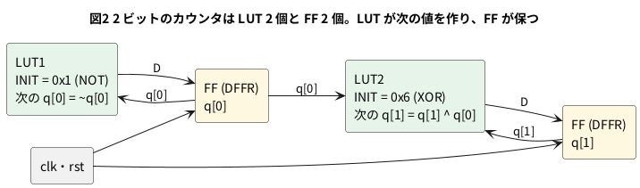

# 8-1 FPGA の中身 — LUT とフリップフロップと配線

**組まない題である。** 実体配線図・Analog Discovery 3・`logic` の図は入れない
(FPGA の中の作りを、合成の結果で読むだけの題で、ボードも計器も使わないため)。

第 1〜7 章で書いた Verilog は、ブラウザと Pico 2 では C++ の計算として動いた (0-1)。
実物の FPGA では、同じ Verilog が**回路として**並ぶ。並べる材料は 3 つしかない。

| 材料 | 何をするか | Tang Nano 9K の FPGA (GW1NR-9) の数 |
| --- | --- | --- |
| LUT (ルックアップテーブル) | 入力の組み合わせごとの出力を覚えておく小さな表。組み合わせ回路を受け持つ | 4 入力の LUT4 が 8,640 個 |
| フリップフロップ (FF) | クロックの立ち上がりで値を取り込んで保つ。順序回路を受け持つ (2-1) | 6,480 個 |
| 配線 | LUT・FF・ピンの間をつなぐ線と、どれとどれをつなぐかを選ぶスイッチ | 数は公開されていない |

数は Sipeed の Tang Nano 9K のページの値 (8-2 と同じ)。
このほかに、桁上げの専用の回路・ブロック RAM・PLL・掛け算器も入っているが、それは 8-8 以降で扱う。

この題では、1-1 のゲートと、ゲート 5 個の回路と、2 ビットのカウンタを yosys の `synth_gowin` で合成し、
LUT と FF に何が入るかを読む。

## LUT は真理値表そのもの

LUT4 は 4 本の入力と 1 本の出力を持ち、中に 16 ビットの表を持つ。
4 本の入力の値 (0〜15) で表の 1 ビットを選び、その値を出力に出す。
表の中身を書き換えれば、4 入力までのどんな論理関数にもなる。
AND も OR も XOR も、LUT の上では表の中身が違うだけで、同じ部品である。

表の中身は合成の結果に `INIT` という数で出る。`INIT` のビット i が、入力を 2 進数で読んだ値 i のときの出力になる。

### ゲート 5 個が LUT 1 個に入る

3 入力の多数決 (2 つ以上が 1 なら 1) を例にする。ゲートで描くと AND 3 個と OR 2 個になる。

```circuit
# 回路図 (tommie-fence の circuit フェンス)
title: 図1 3 入力の多数決をゲートで描くと AND 3 個と OR 2 個
parts:
  a: port 1,2
  b: port 1,5
  c: port 1,8
  A1: and 10,3
  A2: and 10,7
  A3: and 10,11
  O1: or 16,5
  O2: or 22,8
  y: port 27,8
wires:
  - 1,2 -- 3,2
  - A1.a -| 3,2
  - A3.a -| 3,2
  - 1,5 -- 5,5
  - A1.b -| 5,5
  - A2.a -| 5,5
  - 1,8 -- 7,8
  - A2.b -| 7,8
  - A3.b -| 7,8
  - A1.out -| O1.a
  - A2.out -| O1.b
  - O1.out -| O2.a
  - A3.out -| O2.b
  - O2.out -- 27,8
style:
  grid: off
  pitch: 1.2
```


```verilog
// maj3.v — 3 入力の多数決。ゲートなら AND 3 個と OR 2 個
module maj3 (
    input  wire a,
    input  wire b,
    input  wire c,
    output wire y
);
    assign y = (a & b) | (b & c) | (a & c);
endmodule
```

```bash
verilator --lint-only -Wall maj3.v
yosys -p "read_verilog maj3.v; synth_gowin -top maj3; stat; write_verilog -noattr maj3_net.v"
```

lint は警告 0 件。合成した結果は **LUT3 が 1 個**だけになった (ほかは入出力のバッファ IBUF 3 個と OBUF 1 個)。
`maj3_net.v` に書き出したネットリストの中の LUT は次のとおり。

```verilog
  LUT3 #(
    .INIT(8'he8)
  ) y_OBUF_O_I_LUT3_F (
    .F(y_OBUF_O_I),
    .I0(a_IBUF_I_O[0]),
    .I1(a_IBUF_I_O[1]),
    .I2(a_IBUF_I_O[2])
```

`I0`〜`I2` は a・b・c (yosys が 3 本を 1 つの束にまとめて名前を付けた)。
`INIT` の 0xE8 を 2 進数で書くと 1110 1000。下のビットから表に並べると、多数決の真理値表そのものになる。

| 入力 c b a (I2 I1 I0) | 番号 i | INIT のビット i = 出力 y |
| --- | --- | --- |
| 0 0 0 | 0 | 0 |
| 0 0 1 | 1 | 0 |
| 0 1 0 | 2 | 0 |
| 0 1 1 | 3 | 1 |
| 1 0 0 | 4 | 0 |
| 1 0 1 | 5 | 1 |
| 1 1 0 | 6 | 1 |
| 1 1 1 | 7 | 1 |

ゲートの数で考えると 5 個、2 段の回路だが、LUT では 1 個・1 段で済む。
**FPGA の回路の大きさは、ゲートの数ではなく LUT の数で数える。**

### 1-1 のゲート

1-1 の `gates.v` (AND・OR・NOT) を同じ打ち方で合成すると、LUT2 が 2 個と LUT1 が 1 個になった。

| 出力 | LUT | INIT | 表 (入力 b a = 00, 01, 10, 11 の順の出力) |
| --- | --- | --- | --- |
| `y_and` | LUT2 | 0x8 (1000) | 0, 0, 0, 1 |
| `y_or` | LUT2 | 0xE (1110) | 0, 1, 1, 1 |
| `y_not` | LUT1 | 0x1 (01) | a = 0 で 1、a = 1 で 0 |

3 つとも LUT で、違うのは `INIT` だけである。

## フリップフロップは LUT の後ろに付く

順序回路は「次の値を作る組み合わせ回路」と「値を保つ FF」に分けられる (2-1)。
FPGA では、前の半分を LUT が、後ろの半分を FF が受け持つ。2-4 のカウンタを 2 ビットにした回路で確かめる。

```verilog
// count2.v — 2 ビットのカウンタ (2-4 を 2 ビットにしたもの)
module count2 (
    input  wire       clk,
    input  wire       rst,
    output reg  [1:0] q
);
    always @(posedge clk)
        if (rst) q <= 2'd0;
        else     q <= q + 2'd1;
endmodule
```

```bash
verilator --lint-only -Wall count2.v
yosys -p "read_verilog count2.v; synth_gowin -top count2; stat; write_verilog -noattr count2_net.v"
```

lint は警告 0 件。合成した結果は **FF (DFFR) が 2 個、LUT1 が 1 個、LUT2 が 1 個**だった。
DFFR は、リセットの入力 (`RESET`) を持つ FF である。ネットリストを読むと、つながりは次の図になる。




- q[0] は毎クロック反転するので、次の値は NOT (LUT1 の INIT 0x1)
- q[1] は q[0] が 1 のときだけ反転するので、次の値は q[1] と q[0] の XOR (LUT2 の INIT 0x6 = 0110)
- `rst` は FF のリセットの入力に直に入る。LUT は使わない

`q + 2'd1` という足し算は、2 ビットなら NOT と XOR の 2 つの LUT で済む。
ビットが増えると、足し算は桁上げの専用の回路 (ALU) に割り当てられる。8-4 の 24 ビットのカウンタでは ALU が使われる。

## 配線は「どれとどれをつなぐか」の設定

LUT と FF は FPGA の中に格子のように並んでいて、その間を配線の束が通る。
配線の交わる所にはスイッチがあり、オンにした所だけがつながる。
**合成** は Verilog を LUT と FF のつながり (ネットリスト) に直す手順、
**配置配線** はネットリストの LUT と FF を FPGA の中のどの場所に置き、どのスイッチをオンにするかを決める手順である。

FPGA に書き込む設定 (ビットストリーム) の中身は、次の 3 つに分けられる。

| 設定 | 例 |
| --- | --- |
| LUT ごとの表の中身 | 多数決なら 0xE8 |
| FF ごとの使い方 | リセットを使うか、クロックをどれにするか |
| 配線のスイッチのオン・オフ | LUT の出力を、どの FF の D につなぐか |

8-4 では、この 3 つを作る道具 (合成・配置配線・書き込み) を順に通す。

## 4 入力より多い関数

LUT4 の入力は 4 本まで。5 本以上の入力に関わる関数は、LUT を 2 個以上組み合わせて作る。
Gowin の FPGA には LUT の出力を 2 つから 1 つ選ぶ専用の切り替え (`MUX2_LUT5` など) があり、
LUT4 を 2 個とこの切り替えで 5 入力の関数を作る。8-4 の点滅の回路を合成すると、`MUX2_LUT5` が 6 個出てくる。

## 見るべき値

この題は組まない。合成して出た数を、自分の手元でも同じに出せるかを確かめる。

| 回路 | 合成した結果 (yosys 0.33 の `synth_gowin`) | 読み取ること |
| --- | --- | --- |
| 多数決 `maj3` | LUT3 × 1 (INIT 0xE8) | ゲート 5 個が LUT 1 個に入る |
| 1-1 の `gates` | LUT2 × 2 (0x8・0xE)、LUT1 × 1 (0x1) | AND・OR・NOT は `INIT` が違うだけ |
| 2 ビットのカウンタ `count2` | DFFR × 2、LUT1 × 1 (0x1)、LUT2 × 1 (0x6) | 次の値を LUT が作り、FF が保つ |

LUT の数は、同じ Verilog でも合成の道具と版で変わることがある。数が違っても、`INIT` の表が同じ真理値表になっていればよい。

## シミュレーションでの確かめ

Verilator 5.042 と Yosys 0.33 で、本文の `maj3.v` `count2.v` と 1-1 の `gates.v` を走らせ直した。
置き場は `sim/01-lut-ff-routing-maj3.v` と `sim/01-lut-ff-routing-count2.v` (`gates.v` は 1-1 のもの)。

| 項目 | 本文の数字 | 実行結果 | 判定 |
| --- | --- | --- | --- |
| lint (`-Wall`、3 つとも) | 警告 0 件 | 0 件 | 合った |
| `maj3` の合成 | LUT3 × 1 (INIT 0xE8)、IBUF 3・OBUF 1 | 同じ | 合った |
| `gates` の合成 | LUT2 × 2 (0x8・0xE)、LUT1 × 1 (0x1) | 同じ | 合った |
| `count2` の合成 | DFFR × 2、LUT1 × 1 (0x1)、LUT2 × 1 (0x6) | 同じ | 合った |

Tang Nano 9K の LUT・FF の総数 (8,640・6,480) と、点滅の回路で `MUX2_LUT5` が 6 個出るという記述は、
前者はメーカーの資料の値で、後者は 8-4 で確かめた (この環境の nextpnr は無い)。

## 出典

自作。

- GW1NR-9 の LUT とフリップフロップの数: Sipeed の [Tang Nano 9K のページ](https://wiki.sipeed.com/hardware/en/tang/Tang-Nano-9K/Nano-9K.html)
- 合成: [Yosys](https://github.com/YosysHQ/yosys) の `synth_gowin` (手元の yosys 0.33 で実行した)
- lint: [Verilator](https://veripool.org/guide/latest/) 5.042
