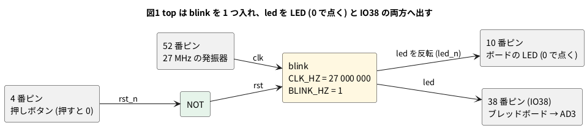

# 8-4 LED の点滅 — 合成・配置配線・書き込みの一巡り

> [!WARNING]
> **この題は実機で組んでいない。** 合成・配置配線・ビットストリーム作りの 3 手は手元の PC で通したが、
> 書き込み (`openFPGALoader`) と、LED の点滅・AD3 での測定は実行していない。
> 「見るべき値」は計算値と道具の見積りで、測った値ではない。

2-7 で書いた `blink` を、Verilog を 1 行も変えずに Tang Nano 9K に載せる。
変えるのは `CLK_HZ` に渡す値だけで、ボードの発振器の 27 MHz を渡す。
2-7 の WEB の題では Verilator で数えるだけだったが、ここでは実物の LED が 1 Hz で点滅する。

FPGA に載せるまでには 4 つの手順がある。

| 手順 | 道具 | 入るもの | 出るもの |
| --- | --- | --- | --- |
| 1. 合成 | yosys (`synth_gowin`) | Verilog | LUT と FF のネットリスト (`top.json`) |
| 2. 配置配線 | nextpnr-himbaechel | ネットリストと制約ファイル (`top.cst`) | 置き場所と配線を決めたネットリスト (`pnr.json`) |
| 3. ビットストリームを作る | gowin_pack (Apicula) | `pnr.json` | 書き込む設定 (`top.fs`) |
| 4. 書き込む | openFPGALoader | `top.fs` | 動いている FPGA |

題名の「合成・配置配線・書き込み」の 3 手は、このうち 1・2・4 に当たる。3 は配置配線の結果をファイルの形に直すだけの手順。
道具は 8-3 で入れた OSS CAD Suite。

## 論理図

`blink` の中身は 2-7 の図1 と同じ (カウンタが `HALF` 回数えるたびに `led` を反転する)。
ここでは、それをボードのピンにつなぐ最上位 (`top`) の図を描く。




- ボードの押しボタンは押すと 0 になるので、NOT を通して `blink` の `rst` (1 でリセット) に合わせる
- ボードの LED は 0 で点く。Sipeed の例 (`9K_LED_project.cst` と `LED.v`) は、リセットで 6 個のうち 1 個のビットだけ 0 を入れて 1 個を点けている。そこで LED へは `led` を反転して出す
- 同じ `led` を反転せずに IO38 にも出し、ブレッドボードから AD3 で測る

## Verilog

`blink.v` は 2-7 のものをそのまま使う (ここには写さない)。最上位の `top.v` だけを新しく書く。

```verilog
// Tang Nano 9K に載せる最上位。2-7 の blink をそのまま入れる
module top (
    input  clk,        // 52 番ピン。ボードの 27 MHz
    input  rst_n,      // 4 番ピン。ボードの押しボタン (押すと 0)
    output led_n,      // 10 番ピン。ボードの LED (0 で点く)
    output blink_out   // 38 番ピン。ブレッドボードへ出して AD3 で測る
);
    wire led;

    blink #(.CLK_HZ(27_000_000), .BLINK_HZ(1)) u (.clk(clk), .rst(~rst_n), .led(led));

    assign led_n     = ~led;
    assign blink_out = led;
endmodule
```

ピンの割り当ては制約ファイル `top.cst` に書く。書き方は 8-5 で読む。

```text
IO_LOC "clk" 52;
IO_PORT "clk" IO_TYPE=LVCMOS33 PULL_MODE=UP;
IO_LOC "rst_n" 4;
IO_PORT "rst_n" PULL_MODE=UP;
IO_LOC "led_n" 10;
IO_PORT "led_n" PULL_MODE=UP DRIVE=8;
IO_LOC "blink_out" 38;
IO_PORT "blink_out" IO_TYPE=LVCMOS33 DRIVE=8;
```

52 番 (クロック)・4 番 (ボタン)・10 番 (LED) は、Sipeed の例 (TangNano-9K-example の `led/src/9K_LED_project.cst`) と同じ番号と書き方にした。

```bash
verilator --lint-only -Wall top.v blink.v
```

lint は警告 0 件。

## 1. 合成

```bash
yosys -p "read_verilog top.v blink.v; synth_gowin -top top -json top.json; stat"
```

`stat` の表 (yosys 0.33。`/usr/bin/yosys` で実行した) から、回路の部品を抜き出す。

| 部品 | 数 | 何か |
| --- | --- | --- |
| DFFR・DFFRE | 24 + 1 | フリップフロップ。24 ビットのカウンタ `cnt` と `led` |
| ALU | 24 | 桁上げの専用の回路。`cnt + 1` の 24 ビット |
| LUT1・LUT4 | 12 + 8 | `cnt == LAST` の比べなどの組み合わせ回路 |
| MUX2_LUT5・MUX2_LUT6・MUX2_LUT7 | 6 + 3 + 1 | 4 入力より多い関数を LUT を組み合わせて作る切り替え (8-1) |
| IBUF・OBUF | 2 + 2 | 入出力のピンのバッファ |

OSS CAD Suite に入っている yosys 0.69 で同じことをすると、LUT1 が 8、MUX2_LUT5 が 4、MUX2_LUT6 が 1 と少し減り、
MUX2_LUT7 は無くなった (FF と ALU の数は同じ)。**合成の結果は道具の版で変わる。** 数を書くときは版を添える。

## 2. 配置配線

```bash
nextpnr-himbaechel --json top.json --write pnr.json \
    --device GW1NR-LV9QN88PC6/I5 --vopt family=GW1N-9C \
    --vopt cst=top.cst --freq 27
```

- `--device` は Tang Nano 9K の FPGA の型番。`--vopt family=GW1N-9C` は、型番の末尾の C が型番に入っていない品のために、
  系列を別に渡すもの (Apicula の README の Tang Nano 9K の打ち方)
- `--freq 27` は、クロックが 27 MHz で間に合うかを確かめさせる指定。書かないと 12 MHz で確かめる

出力の最後の方に、使った量と、クロックの最高の周波数の見積りが出る。手元の結果 (nextpnr 0.11.1-54) を抜き出す。

```text
Info:                   IOB:       4/    276     1%
Info:                  LUT4:      46/   8640     0%
Info:                   ALU:      26/   6480     0%
Info:                   DFF:      25/   6480     0%
Info: Max frequency for clock 'u.clk': 150.31 MHz (PASS at 27.00 MHz)
```

- `PASS at 27.00 MHz` は、27 MHz なら信号が 1 クロックの間に間に合う、という意味。配線を引いたあとの見積りで、最高 150 MHz ほど
- LUT4 の 46 は合成の表 (LUT1 + LUT4 = 20) より多い。nextpnr は合成と別の数え方をしている。どれが何に使われたかは 8-8 で読む
- 配置配線は毎回同じ結果になるとは限らない。最高の周波数の見積りは打ち直すと変わることがある

## 3. ビットストリームを作る

```bash
gowin_pack -d GW1N-9C -o top.fs pnr.json
```

`top.fs` ができる。手元では 2,069,320 バイトの文字のファイルだった (`0` と `1` の並び)。
8-1 の 3 つの設定 (LUT の表・FF の使い方・配線のスイッチ) が、この中に全部入っている。
`numpy` が無いと遅くなる、という警告が出るが、結果は変わらない。

## 4. 書き込む

```bash
openFPGALoader -b tangnano9k top.fs
```

**未実行。** この打ち方は FPGA の中の SRAM に書く。すぐ書けるが、電源を切ると消える。
電源を切っても残すには、フラッシュに書く。Tang Nano 9K で `-f` がそのまま使えるかは**未確認**で、調べた結果は 06-fpga/08-fpga-board/12-sram-vs-flash.md (8-12) にある。
試すうちは SRAM に書き、残す回路が決まってからフラッシュに書く。

書き込んだら、ボードの LED が 1 秒に 1 回点滅する。4 番ピンの押しボタンを押している間は止まる (リセット中は `led` が 0 なので、LED は消えたまま)。

## 回路図

接続は 8-3 と同じ。この題では IO38 だけを測り、IO37 は 8-5 で使う。

```circuit
# 回路図 (tommie-fence の circuit フェンス)
title: 図2 IO38 の点滅を AD3 の DIO0 で読む。接続は 8-3 と同じ
parts:
  AD:
    type: device
    at: 1,3.8
    label: AD3
    pins: [DIO0, DIO1, GND]
    turn: mirror
  U1: tang-nano-9k 8,6
  G1: ground 3.5,4.8
  G2: ground 10.5,9
wires:
  - AD.DIO0 -| 5,3.24
  - U1.IO38 |- 5,3.24
  - AD.DIO1 -| 5.5,3.48
  - U1.IO37 |- 5.5,3.48
  - AD.GND -| 3.5,4.8
  - U1.GND -| 10.5,9
```


ボードの LED (10 番ピン) とクロック (52 番)・押しボタン (4 番) は、ボードの上で FPGA につながっていて、ヘッダには出ていない。

## 部品表

| 部品 | 値・型番 | 数 | 役 |
| --- | --- | --- | --- |
| U1 | Sipeed Tang Nano 9K (GW1NR-9) | 1 | FPGA ボード。USB-C から給電と書き込み |
| — | ブレッドボード (half、30 列) | 1 | |
| — | ジャンパ線 | 5 本 | |
| AD | Analog Discovery 3 | 1 | Logic で IO38 を測る |

電源は教科書の既定の 5 V ではなく **3.3 V** (FPGA のピン)。FPGA のピンに 5 V を入れると壊れるため (0-3)。

## 実体配線図

```bread
# ブレッドボードの実体配線図 (tommie-fence の bread フェンス)
title: 図3 配線は 8-3 のまま。IO38 (j1) を DIO0 へ
board: half
parts:
  U1: tang-nano-9k @ b1
  AD:
    type: device
    at: bottom
    label: AD3 Logic
    pins: [DIO0, DIO1, GND]
wires:
  - a23 -- -t23 black
  - -t29 -- -b29 black
  - AD.GND -- -b27 black
  - AD.DIO0 -- j1 green
  - AD.DIO1 -- j2 yellow
notes:
  - text: 給電は Tang Nano 9K の USB-C (5 V)。電源レールは GND (−) だけ使う
```


- 置き方と線の色は 8-3 と同じ。IO38 は 1 番ピンで、下の列の 1 列 (j1)
- 流れる電流は AD3 の DIO の入力へ向かうごく小さなもの。信号は 1 Hz で、ブレッドボードの範囲 (3 MHz 以下) に収まる

## 計器の設定

| 計器 | 設定 |
| --- | --- |
| Logic | DIO0 を Enable。DIO は 3.3 V。GND を共通にする (0-4) |
| 時間軸 | 250 ms/div (窓 2.5 s)。トリガの前を 250 ms 見せる |
| 標本化 | 1 kS/s。見る一番速い変化 (0.5 s ごとの反転) よりずっと速い |
| トリガ | DIO0 の立ち上がり |

## Logic に見えるはずの画面

```logic
# ロジックアナライザの画面 (tommie-fence の logic フェンス)
title: 図4 IO38 は 1 s の周期で 0.5 s ずつ H と L をくり返す
device: ad3
time: 250ms/div
start: -250ms
sample: 1kHz
signals:
  blink_out: dio0 clock 1Hz
cursors: [250ms, 1250ms]
trigger: blink_out rising at 0s
```


カーソルは H の真ん中 (立ち上がりから 250 ms 後) に 2 本、1 周期あけて置いた。ΔX が 1 周期、1/ΔX が点滅の周波数になる。

## 見るべき値

計算値と道具の見積り。実機で測っていない。

| 項目 | 見るべき値 | どこで得たか |
| --- | --- | --- |
| 点滅の周期 (ΔX) | 1.000 s (計算値) | `HALF` = 13 500 000 クロック × 2 ÷ 27 MHz (2-7) |
| 点滅の周波数 (1/ΔX) | 1.000 Hz (計算値) | 同上 |
| H の幅 | 0.500 s (計算値) | 同上 |
| クロックの最高の周波数 | 150.31 MHz (nextpnr の見積り) | 配置配線の出力 |
| 使った量 | LUT4 46・ALU 26・DFF 25・IOB 4 (nextpnr の数え方) | 配置配線の出力 |
| `top.fs` の大きさ | 2,069,320 バイト | gowin_pack の出力 |

周期は Logic で 1 回測って ΔX を書き加える。1.000 s から外れる分は、ボードの 27 MHz の発振器のずれ (ppm) である。
1 秒の周期を 1 kS/s で測ると 1 ms 刻みでしか読めないので、ずれを ppm で見るには 5-12・12-4 の長い測り方が要る。

## シミュレーションでの確かめ (対象外を含む)

Verilator 5.042 と Yosys 0.33 で、本文の `top.v` と 2-7 の `blink.v` を走らせ直した。
置き場は `sim/04-blink-flow.v` `sim/04-blink-flow-blink.v` `sim/04-blink-flow-tb.v` (27 MHz で 2.3 s 回して `blink_out` の変わり目を書く試験)。

| 項目 | 本文の数字 | 実行結果 | 判定 |
| --- | --- | --- | --- |
| lint (`-Wall`、`top.v` と `blink.v`) | 警告 0 件 | 0 件 | 合った |
| 点滅の周期 | 1.000 s、H の幅 0.500 s | 0.5 s ごとに反転 (1.000026 s。試験のクロックの半周期を 18.5185 ns と丸めたぶん) | 合った |
| `led_n` | `blink_out` の反転 | 反転している | 合った |
| 合成の部品 | DFFR 24・DFFRE 1・ALU 24・LUT1 12・LUT4 8・MUX2_LUT5/6/7 が 6・3・1・IBUF 2・OBUF 2 | 同じ | 合った |

確かめていない数: nextpnr の使用量 (LUT4 46・ALU 26・DFF 25)・最高の周波数 150.31 MHz・`top.fs` の大きさ
(nextpnr・gowin_pack が無い)、yosys 0.69 の数、書き込みと AD3 の測定 (実機が要る)。

## 出典

自作。

- 打ち方 (nextpnr の `--device` と `--vopt family`、gowin_pack の `-d GW1N-9C`): [Apicula](https://github.com/YosysHQ/apicula) の README の Tang Nano 9K の節
- クロック (52 番)・ボタン (4 番)・LED (10 番) の番号と制約の書き方: Sipeed の [TangNano-9K-example](https://github.com/sipeed/TangNano-9K-example) の `led/src/9K_LED_project.cst` と `led/src/LED.v`
- openFPGALoader の SRAM とフラッシュの書き分け (`-f`): [openFPGALoader](https://github.com/trabucayre/openFPGALoader) の `--help`
