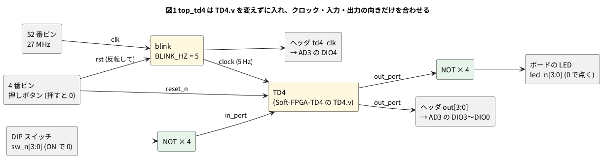

# 8-6 Pico 2 で動かした同じ Verilog を FPGA で動かす

> [!WARNING]
> **この題は実機で組んでいない。** 2 つの回路とも、Verilator で動かして値を確かめ、合成・配置配線・ビットストリーム作りまで
> 手元の PC で通した。書き込みと、DIP スイッチ・LED・AD3 での確かめは実行していない。
> 「見るべき値」はシミュレーションの値と計算値で、測った値ではない。

第 5 章では、1-1 のゲート (5-4) と 4 ビット CPU の TD4 (5-8) を Pico 2 の Soft-FPGA で動かした。
この題では、**同じ `gates.v` と `TD4.v` を 1 行も変えずに** Tang Nano 9K に載せる。

変えるのは、Verilog の外側だけである。
Pico 2 では C++ の主ループ (`main.cpp`) が、GPIO を読んで Verilog の入力に渡し、出力を GPIO に書き、クロックを刻んでいた (5-3)。
FPGA では、その役を最上位のモジュール (`top_*.v`) と制約ファイル (`*.cst`) が受け持つ。

| 役 | Pico 2 (Soft-FPGA-TD4 の `main.cpp`) | Tang Nano 9K |
| --- | --- | --- |
| ピンを決める | `pins[4] = {2, 3, 4, 5}` などの配列 | 制約ファイルの `IO_LOC` (8-5) |
| DIP スイッチのプルアップ | `gpio_pull_up()` | 制約ファイルの `PULL_MODE=UP` |
| ON を 1 にする | `!gpio_get()` で反転 | 最上位で `~sw_n` |
| クロック | 主ループで `top->clock` を反転し `sleep_ms(100)` (周期 200 ms) | 2-7 の `blink` を 5 Hz で回した信号 (周期 200 ms) |
| リセット | 主ループの 1・2 クロック目で `reset_n` を 0 にする | ボードの押しボタン (4 番ピン、押すと 0) をそのまま `reset_n` へ |
| LED | ブレッドボードの LED 4 個 | ボードに載っている LED 6 個のうち 4 個 (0 で点く) |

Pico 2 の列は [Soft-FPGA-TD4](https://github.com/tommie-jp/Soft-FPGA-TD4) の `verilator-TD4/main.cpp` から読んだ。
LED はボードに載っている物を使うので、ブレッドボードには DIP スイッチだけを挿す。
同じ値をヘッダのピンにも出し、AD3 で読む。

## 論理図




## Verilog

`TD4.v` は Soft-FPGA-TD4 の `verilator-TD4/TD4.v`、`gates.v` は 1-1、`blink.v` は 2-7 のものをそのまま使う (ここには写さない)。
新しく書くのは最上位の 2 つだけ。

### top_gates.v — 1-1 のゲート

```verilog
// Tang Nano 9K に 1-1 の gates を載せる最上位。gates.v は 1-1 のまま変えない
module top_gates (
    input  [3:2] sw_n,      // DIP スイッチの 1 番と 2 番。ON で 0 (FPGA の中でプルアップ)
    output [3:0] led_n,     // ボードの LED。0 で点く
    output [3:0] out        // 同じ値をヘッダにも出す。AD3 で読む
);
    wire       a = ~sw_n[3];    // DIP の 1 番
    wire       b = ~sw_n[2];    // DIP の 2 番
    wire [3:0] y;

    gates g (.a(a), .b(b), .y_and(y[3]), .y_or(y[2]), .y_not(y[1]));
    assign y[0] = 1'b0;         // 4 つ目は使わない

    assign led_n = ~y;
    assign out   = y;
endmodule
```

### top_td4.v — TD4

```verilog
// Tang Nano 9K に TD4 を載せる最上位。TD4.v は Soft-FPGA-TD4 のまま変えない
module top_td4 #(
    parameter CLK_HZ = 27_000_000
) (
    input        clk,       // 52 番ピン。ボードの 27 MHz
    input        rst_n,     // 4 番ピン。ボードの押しボタン (押すと 0)
    input  [3:0] sw_n,      // DIP スイッチ。ON で 0 (FPGA の中でプルアップ)
    output [3:0] led_n,     // ボードの LED。0 で点く
    output [3:0] out,       // out_port をヘッダにも出す。AD3 で読む
    output       td4_clk    // TD4 のクロック。AD3 で読む
);
    wire       slow;
    wire [3:0] out_port;

    // 2-7 の blink を 5 Hz で回して TD4 のクロックにする (Pico 2 の 100 ms ごとの反転と同じ 200 ms の周期)
    blink #(.CLK_HZ(CLK_HZ), .BLINK_HZ(5)) div (.clk(clk), .rst(~rst_n), .led(slow));

    /* verilator lint_off PINCONNECTEMPTY */    // pc_out・op・alu_data はピンに出さない
    TD4 cpu (.clock(slow), .reset_n(rst_n), .in_port(~sw_n), .out_port(out_port),
             .pc_out(), .op(), .alu_data());
    /* verilator lint_on PINCONNECTEMPTY */

    assign led_n   = ~out_port;
    assign out     = out_port;
    assign td4_clk = slow;
endmodule
```

**TD4 のクロックに、分周した信号 (`slow`) をそのまま使っている。** 2-17 で「やってはいけない」とする書き方である。
`TD4.v` はクロックイネーブルの入力を持たないので、変えずに載せるにはこうするしかない。
5 Hz なら間に合いの心配は無いが、速い回路ではクロックイネーブル (2-5) に書き直す。

### 制約ファイル

`td4.cst` (TD4 用)。`gates.cst` は、このうち `sw_n[3]` `sw_n[2]` `led_n` `out` の行だけを残した物。

```text
IO_LOC "clk" 52;
IO_PORT "clk" IO_TYPE=LVCMOS33 PULL_MODE=UP;
IO_LOC "rst_n" 4;
IO_PORT "rst_n" PULL_MODE=UP;
IO_LOC "sw_n[3]" 51;
IO_PORT "sw_n[3]" IO_TYPE=LVCMOS33 PULL_MODE=UP;
IO_LOC "sw_n[2]" 53;
IO_PORT "sw_n[2]" IO_TYPE=LVCMOS33 PULL_MODE=UP;
IO_LOC "sw_n[1]" 54;
IO_PORT "sw_n[1]" IO_TYPE=LVCMOS33 PULL_MODE=UP;
IO_LOC "sw_n[0]" 55;
IO_PORT "sw_n[0]" IO_TYPE=LVCMOS33 PULL_MODE=UP;
IO_LOC "led_n[0]" 10;
IO_PORT "led_n[0]" PULL_MODE=UP DRIVE=8;
IO_LOC "led_n[1]" 11;
IO_PORT "led_n[1]" PULL_MODE=UP DRIVE=8;
IO_LOC "led_n[2]" 13;
IO_PORT "led_n[2]" PULL_MODE=UP DRIVE=8;
IO_LOC "led_n[3]" 14;
IO_PORT "led_n[3]" PULL_MODE=UP DRIVE=8;
IO_LOC "out[3]" 38;
IO_PORT "out[3]" IO_TYPE=LVCMOS33 DRIVE=8;
IO_LOC "out[2]" 37;
IO_PORT "out[2]" IO_TYPE=LVCMOS33 DRIVE=8;
IO_LOC "out[1]" 36;
IO_PORT "out[1]" IO_TYPE=LVCMOS33 DRIVE=8;
IO_LOC "out[0]" 39;
IO_PORT "out[0]" IO_TYPE=LVCMOS33 DRIVE=8;
IO_LOC "td4_clk" 25;
IO_PORT "td4_clk" IO_TYPE=LVCMOS33 DRIVE=8;
```

- DIP スイッチは 17〜20 番ピン (IO51・IO53・IO54・IO55)。FPGA の中でプルアップし、ON にすると GND に落ちて 0 になる
- ボードの LED は Sipeed の例の `led[0]`〜`led[3]` と同じ 10・11・13・14 番
- AD3 で読むピンは、ヘッダの 1〜5 番 (IO38・IO37・IO36・IO39・IO25)。どれも 3.3 V のピン

### lint

```bash
verilator --lint-only -Wall top_gates.v gates.v
verilator --lint-only -Wall --no-timing top_td4.v blink.v TD4.v
verilator --lint-only --no-timing TD4.v
```

- `top_gates.v` と `gates.v` は警告 0 件
- `TD4.v` だけを `-Wall` 無しで lint すると警告 0 件 (Soft-FPGA-TD4 と同じ `--no-timing`)
- `-Wall` を付けると、`TD4.v` の中に 9 件 (`#1` の遅れを無視する `ASSIGNDLY` 5 件、初期値のある変数への代入 `PROCASSINIT` 2 件、
  非同期のリセットとの混ざり `SYNCASYNCNET` 2 件) と、`top_td4.v` の `slow` に `SYNCASYNCNET` が 1 件、計 10 件出る。
  `TD4.v` の分はこの題では直さない (変えずに載せるのが題の主旨)。`slow` の 1 件は、上の「分周した信号をクロックに使う」ことを言っている

## 動かす (シミュレーション)

### ゲート

DIP スイッチの 1 番・2 番の 4 通りで、`out` を見る。

```verilog
// DIP の 1 番・2 番の 4 通りで、out (AND・OR・NOT・0) を見る
module tb_gates;
    reg  [3:2] sw_n;
    wire [3:0] led_n;
    wire [3:0] out;
    integer i;

    top_gates u (.sw_n(sw_n), .led_n(led_n), .out(out));

    initial begin
        for (i = 0; i < 4; i = i + 1) begin
            sw_n = ~i[1:0];           // i の 1 のビットの DIP を ON にする
            #1 $display("DIP1=%b DIP2=%b  out=%b (AND OR NOT 0)  led_n=%b", i[1], i[0], out, led_n);
        end
        $finish;
    end
endmodule
```

```bash
verilator --binary --timing --top-module tb_gates tb_gates.v top_gates.v gates.v
./obj_dir/Vtb_gates
```

```text
DIP1=0 DIP2=0  out=0010 (AND OR NOT 0)  led_n=1101
DIP1=0 DIP2=1  out=0110 (AND OR NOT 0)  led_n=1001
DIP1=1 DIP2=0  out=0100 (AND OR NOT 0)  led_n=1011
DIP1=1 DIP2=1  out=1100 (AND OR NOT 0)  led_n=0011
```

1-1 の真理値表と同じ (`out[1]` の NOT は DIP の 1 番だけを見る)。`led_n` は `out` の反転で、1 の LED が点く。

### TD4

`CLK_HZ` を 10 にして、TD4 のクロックを 1 クロックおきに反転させ、`out` の並びを見る。

```verilog
// CLK_HZ = 10 にして、TD4 のクロック (5 Hz の分周) を 1 クロックおきに反転させ、out の並びを見る
module tb_td4;
    reg clk = 0;
    reg rst_n = 0;
    wire [3:0] led_n;
    wire [3:0] out;
    wire       td4_clk;
    integer n = 0;

    top_td4 #(.CLK_HZ(10)) u (.clk(clk), .rst_n(rst_n), .sw_n(4'b1111),
                              .led_n(led_n), .out(out), .td4_clk(td4_clk));

    always #1 clk = ~clk;

    always @(posedge td4_clk) if (rst_n) begin
        #2 $display("after TD4 clock %2d: pc=%h out=%b", n, u.cpu.pc, out);
        n = n + 1;
        if (n == 12) $finish;
    end

    initial #5 rst_n = 1;
endmodule
```

```bash
verilator --binary --timing -Wno-fatal --top-module tb_td4 tb_td4.v top_td4.v blink.v TD4.v
./obj_dir/Vtb_td4 | grep after
```

```text
after TD4 clock  0: pc=1 out=0011
after TD4 clock  1: pc=2 out=0110
after TD4 clock  2: pc=3 out=1100
after TD4 clock  3: pc=4 out=1000
after TD4 clock  4: pc=5 out=1000
after TD4 clock  5: pc=6 out=1100
after TD4 clock  6: pc=7 out=0110
after TD4 clock  7: pc=8 out=0011
after TD4 clock  8: pc=9 out=0001
after TD4 clock  9: pc=0 out=0001
after TD4 clock 10: pc=1 out=0011
after TD4 clock 11: pc=2 out=0110
```

- `TD4.v` の ROM の中身は、`OUT` を 9 回並べて最後に `JMP 0000` で頭に戻る LED の模様。10 クロックで 1 巡りする
- この ROM は入力ポートを読まないので、DIP スイッチを動かしても模様は変わらない。DIP スイッチが効くのは、ROM を `IN` を使うプログラムに替えたとき (10-1)
- `TD4.v` には `$monitor` があり、シミュレーションでは毎クロックの行も出る (上では `grep` で外した)。合成では yosys が無視する

## 合成・配置配線

8-4 と同じ 3 手を通した (yosys 0.33・nextpnr 0.11.1-54・gowin_pack。書き込みは未実行)。

```bash
yosys -p "read_verilog top_td4.v blink.v TD4.v; synth_gowin -top top_td4 -json top_td4.json; stat"
nextpnr-himbaechel --json top_td4.json --write pnr_td4.json \
    --device GW1NR-LV9QN88PC6/I5 --vopt family=GW1N-9C --vopt cst=td4.cst --freq 27
gowin_pack -d GW1N-9C -o top_td4.fs pnr_td4.json
openFPGALoader -b tangnano9k top_td4.fs
```

| 回路 | 合成した結果 (yosys 0.33) | nextpnr の最高の周波数の見積り |
| --- | --- | --- |
| `top_gates` | LUT1 × 1・LUT2 × 4。FF は 0 | クロックが無い |
| `top_td4` | LUT 50 (LUT1 25・LUT2 8・LUT3 8・LUT4 9)・FF 35 (DFFC 4・DFFCE 8・DFFR 22・DFFRE 1)・ALU 30 | 27 MHz のクロック 150.74 MHz、TD4 のクロック 226.24 MHz |

- `top_td4` の FF のうち DFFR・DFFRE の 23 個は `blink` (22 ビットのカウンタと `slow`)、DFFC・DFFCE の 12 個が TD4 の分
- TD4 のレジスタは A・B・OUT・PC の 4 ビット × 4 と桁上げの 1 ビットで 17 ビットあるが、合成すると 12 個になった。
  ROM の中身が決まっていて、どこにも効かないレジスタを yosys が消したと見られる。どう消えたかは 8-8 で報告を読む
- TD4 のクロックは 5 Hz で使うので、最高の周波数の見積りより 4 千万倍以上遅い。間に合いの心配は無い

## 回路図

```circuit
# 回路図 (tommie-fence の circuit フェンス)
title: 図2 DIP スイッチで FPGA のピンを GND に落とす。AD3 は出力 4 本と TD4 のクロックを読む
parts:
  AD:
    type: device
    at: 1,4.6
    label: AD3
    pins: [DIO3, DIO2, DIO1, DIO0, DIO4, GND]
    turn: mirror
  U1: tang-nano-9k 10,6
  G1: ground 3.2,6.6
  G2: ground 12.5,9
  DIP1: port 7.5,7.08
  DIP2: port 7.5,7.32
  DIP3: port 7.5,7.56
  DIP4: port 7.5,7.8
  SW1: dip-switch4 5,8.8
  DIP1: port 3,8.42
  DIP2: port 3,8.67
  DIP3: port 3,8.92
  DIP4: port 3,9.17
  G3: ground 6.5,10
wires:
  - AD.DIO3 -| 4.5,3.24
  - U1.IO38 |- 4.5,3.24
  - AD.DIO2 -| 5,3.48
  - U1.IO37 |- 5,3.48
  - AD.DIO1 -| 5.5,3.72
  - U1.IO36 |- 5.5,3.72
  - AD.DIO0 -| 6,3.96
  - U1.IO39 |- 6,3.96
  - AD.DIO4 -| 6.5,4.2
  - U1.IO25 |- 6.5,4.2
  - AD.GND -| 3.2,6.6
  - U1.GND |- 12.5,8.52 -- 12.5,9
  - U1.IO51 |- 7.5,7.08
  - U1.IO53 |- 7.5,7.32
  - U1.IO54 |- 7.5,7.56
  - U1.IO55 |- 7.5,7.8
  - SW1.A1 |- 3,8.42
  - SW1.A2 |- 3,8.67
  - SW1.A3 |- 3,8.92
  - SW1.A4 |- 3,9.17
  - SW1.B1 -| 6.5,10
  - SW1.B2 -| 6.5,10
  - SW1.B3 -| 6.5,10
  - SW1.B4 -| 6.5,10
```


- 線で結ぶ代わりに、**同じ名前の端子 (白丸と名前) どうしがつながっている**。U1 の 17 番ピン (IO51) の `DIP1` は、SW1 の A1 の `DIP1` とつながる
- DIP スイッチの k 番は `Ak` と `Bk` の間の接点。B の側をまとめて GND に落とす。プルアップの抵抗は FPGA の中 (`PULL_MODE=UP`) なので、図に抵抗は無い
- 図に無い物: ボードの LED (10・11・13・14 番)・27 MHz のクロック (52 番)・押しボタン (4 番) は、ボードの上で FPGA につながっている

## 部品表

| 部品 | 値・型番 | 数 | 役 |
| --- | --- | --- | --- |
| U1 | Sipeed Tang Nano 9K (GW1NR-9) | 1 | FPGA ボード。USB-C から給電と書き込み。LED はボードの物を使う |
| SW1 | DIP スイッチ 4 連 (2.54 mm ピッチ、8 ピン) | 1 | TD4 の入力 (gates では 1 番と 2 番だけ) |
| — | ブレッドボード (full、63 列) | 1 | |
| — | ジャンパ線 | 約 16 本 | |
| AD | Analog Discovery 3 | 1 | Logic で `out` と `td4_clk` を読む |

電源は教科書の既定の 5 V ではなく **3.3 V** (FPGA のピン)。FPGA のピンに 5 V を入れると壊れるため (0-3)。
ブレッドボードに電源は配らない。DIP スイッチは FPGA のピンを GND に落とすだけで、電源の線は要らない。

## 実体配線図

```bread
# ブレッドボードの実体配線図 (tommie-fence の bread フェンス)
title: 図3 DIP スイッチは j 行の 4 本で、AD3 はヘッダの 1〜5 番から
board: full
parts:
  U1: tang-nano-9k @ b1
  SW1: dip-switch4 @ e28 r180
  AD:
    type: device
    at: bottom
    label: AD3 Logic
    pins: [DIO3, DIO2, DIO1, DIO0, DIO4, GND]
wires:
  - a23 -- -t23 black
  - -t33 -- -b33 black
  - a28 -- -t28 black
  - a29 -- -t29 black
  - a30 -- -t30 black
  - a31 -- -t31 black
  - j17 -- j31 yellow [v24]
  - j18 -- j30 orange [v17]
  - j19 -- j29 yellow [v10]
  - j20 -- j28 orange [v3]
  - AD.DIO3 -- j1 green
  - AD.DIO2 -- j2 green
  - AD.DIO1 -- j3 green
  - AD.DIO0 -- j4 green
  - AD.DIO4 -- j5 purple
  - AD.GND -- -b10 black
notes:
  - text: 給電は Tang Nano 9K の USB-C (5 V)。電源レールは GND (−) だけ使う
```


- Tang Nano 9K の置き方は 8-3 と同じ (`@ b1`)。DIP スイッチは溝をまたいで 28〜31 列に挿す。1〜4 番 (A の側) が下の列
- 下の列 (A) に FPGA の 17〜20 番ピンから黄と橙の線を交互に引く。上の列 (B) は a 行から上の − レールへ落とす
- 上の − レールは a23 で GND (26 番) につながる。下の − レールとは 33 列でつなぐ。AD3 の GND は下の − レールへ
- 線の色: 黒は GND だけ。黄と橙は DIP スイッチ、緑は AD3 の DIO0〜DIO3、紫は TD4 のクロック。赤は使わない
- 63 列の full のブレッドボードで、レールが中央で切れている品は、切れ目を線でまたぐ (この図では 33 列までしか − レールを使わない)
- 半分 (30 列) のブレッドボードには収まらない。Tang Nano 9K が 26 列まで覆うので、DIP スイッチの 4 列が入らない
- 流れる電流は、ON の DIP スイッチ 1 個につき FPGA の中のプルアップの電流だけで、ごく小さい。信号は 5 Hz で、ブレッドボードの範囲 (3 MHz 以下) に収まる

## 計器の設定

| 計器 | 設定 |
| --- | --- |
| Logic | DIO0〜DIO4 を Enable。DIO は 3.3 V。GND を共通にする (0-4) |
| バス | `OUT` を DIO3 (上位)〜DIO0 (下位) で作り、2 進で表示 |
| 時間軸 | 250 ms/div (窓 2.5 s)。10 クロック (2 s) の 1 巡りが入る |
| 標本化 | 1 kS/s。見る一番速い変化 (5 Hz のクロックの 100 ms ごとの切り替え) よりずっと速い |
| トリガ | DIO4 (`td4_clk`) の立ち上がり。`JMP` で頭に戻るクロックに合わせる (下の図の t = 0) |

ゲートの回路は時間で変わらないので、Logic の図は描かない。DIP スイッチを動かし、`out` と LED が上のシミュレーションの表のとおりかを見る。

## Logic に見えるはずの画面

```logic
# ロジックアナライザの画面 (tommie-fence の logic フェンス)
title: 図4 TD4 の out は 5 Hz のクロックの立ち上がりで変わり、10 クロック (2 s) で 1 巡りする
device: ad3
time: 250ms/div
start: -150ms
sample: 1kHz
signals:
  td4_clk: dio4 clock 5Hz
  out3: dio3 pattern 0000111100000 bit 200ms from -200ms
  out2: dio2 pattern 0001100110000 bit 200ms from -200ms
  out1: dio1 pattern 0011000011001 bit 200ms from -200ms
  out0: dio0 pattern 1110000001111 bit 200ms from -200ms
buses:
  OUT: out3..out0 bin
cursors: [150ms, 2150ms]
trigger: td4_clk rising at 0s
```


- t = 0 の立ち上がりは `JMP 0000` を実行するクロック。`OUT` は 0001 のまま残り、次の立ち上がり (200 ms) から 0011 → 0110 → 1100 → 1000 と進む
- カーソルはクロックの L の真ん中 (立ち上がりから 150 ms) に、10 クロックあけて置いた。ΔX が 1 巡りの 2 s になる
- 値の並びは、上の Verilator の表 (`after TD4 clock 0`〜) と同じ

## 見るべき値

シミュレーションの値と計算値。実機で測っていない。

| 項目 | 見るべき値 | どこで得たか |
| --- | --- | --- |
| `td4_clk` の周期 | 200 ms (5 Hz) (計算値) | `blink` の `HALF` = 27 000 000 / 10 = 2 700 000 クロック |
| `OUT` の並び | 0011 → 0110 → 1100 → 1000 → 1000 → 1100 → 0110 → 0011 → 0001 → 0001 | TD4 のシミュレーション |
| 1 巡りの時間 (ΔX) | 2.000 s (10 クロック) (計算値) | 同上 |
| ゲートの `out` | DIP 1・2 が ON・ON で 1100、ON・OFF で 0100、OFF・ON で 0110、OFF・OFF で 0010 | ゲートのシミュレーション |
| Pico 2 と比べて変えた Verilog の行 | 0 行 (`gates.v`・`TD4.v` とも) | 書いた物 |

実機で組んだら、`OUT` の並びが Pico 2 の 5-8 の並びと同じかを、Logic の図を並べて比べる。
並びは同じで、違うのは時間の刻み (Pico 2 は主ループの `sleep_ms`、FPGA は 27 MHz の水晶) だけのはずである。

## シミュレーションでの確かめ (対象外を含む)

Verilator 5.042・Yosys 0.33・Yosys 0.70+16・nextpnr-himbaechel 0.11.1-63 で、本文の `top_gates.v` `top_td4.v` `tb_gates.v` `tb_td4.v` を走らせ直した。
`gates.v` は 1-1、`blink.v` は 2-7、`TD4.v` は Soft-FPGA-TD4 の `verilator-TD4/TD4.v` (コミット b74bed1) を使った。
置き場は `sim/06-same-verilog-on-fpga-gates.v` `sim/06-same-verilog-on-fpga-td4.v`
`sim/06-same-verilog-on-fpga-gates-tb.v` `sim/06-same-verilog-on-fpga-td4-tb.v`。

| 項目 | 本文の数字 | 実行結果 | 判定 |
| --- | --- | --- | --- |
| lint (`top_gates.v`、`-Wall`) | 警告 0 件 | 0 件 | 合った |
| lint (`TD4.v`、`--no-timing`、`-Wall` なし) | 警告 0 件 | 0 件 | 合った |
| lint (`top_td4.v blink.v TD4.v`、`-Wall`) | 10 件 (ASSIGNDLY 5・PROCASSINIT 2・SYNCASYNCNET 3) | 同じ 10 件。`top_td4.v` の `slow` が 1 件 | 合った |
| ゲート 4 通り | out = 0010・0110・0100・1100、led_n はその反転 | 同じ | 合った |
| TD4 の `out` の並び (12 クロック) | 0011 0110 1100 1000 1000 1100 0110 0011 0001 0001 0011 0110 | 同じ。pc は 1〜9、0、1、2 | 合った |
| 図4 の 4 本の pattern | `out3`〜`out0` の 13 個ずつ | 上の並びから読み直して同じ | 合った |
| 合成 `top_gates` | LUT1 × 1・LUT2 × 4・FF 0 | 同じ | 合った |
| 合成 `top_td4` | LUT 50 (25・8・8・9)・FF 35 (DFFC 4・DFFCE 8・DFFR 22・DFFRE 1)・ALU 30 | 同じ | 合った |
| nextpnr `top_gates` | クロックが無い | `No Fmax available; no interior timing paths found`。LUT4 5・IOB 10 (どちらの版でも) | 合った |
| nextpnr `top_td4` (0.33 の `json`) | 27 MHz のクロック 150.74 MHz、TD4 のクロック 226.24 MHz | 同じ (`div.clk` 150.74・`slow` 226.24。使用量は LUT4 86・ALU 36・DFF 35・IOB 15) | 合った |
| nextpnr `top_td4` (0.70+16 の `json`) | (記載なし) | LUT 28 (LUT1 8・LUT2 1・LUT3 5・LUT4 14)・ALU 29・FF 35。LUT4 62。`div.clk` 207.34 MHz・`cpu.clock` 182.25 MHz (クロックの名前も版で変わる) | 近い (版の差。TD4 のクロックの数は 0.33 より低い) |

確かめていない数: 実機の DIP スイッチ・LED・AD3 の測定。

## 出典

自作。

- TD4 の Verilog と Pico 2 での動かし方: [tommie-jp/Soft-FPGA-TD4](https://github.com/tommie-jp/Soft-FPGA-TD4) の `verilator-TD4/TD4.v` と `main.cpp`。
  TD4.v の元は [asfdrwe/simpleTD4](https://github.com/asfdrwe/simpleTD4) (MIT ライセンス)。simpleTD4 の README は、
  初代の Sipeed Tang Nano (Tang Nano 9K の前の機種) で動かす手順を書いている
- ボードの LED (10・11・13・14 番)・クロック (52 番)・押しボタン (4 番): Sipeed の [TangNano-9K-example](https://github.com/sipeed/TangNano-9K-example) の `led/src/9K_LED_project.cst`
