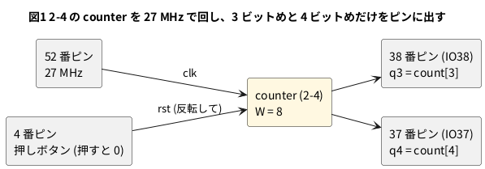

# 8-7 Soft-FPGA と FPGA の速さを AD3 で比べる

> [!WARNING]
> **この題は実機で組んでいない。** カウンタを Verilator で回して数を確かめ、合成・配置配線・ビットストリーム作りまで
> 手元の PC で通した。書き込みと AD3 での測定は実行していない。**Soft-FPGA の速さ (5-5) も測っていない**ので、
> 「何倍速いか」の数はこの題には書かない。測ってから表に書き加える。

この本の山場である。同じ Verilog を、計算で真似る所 (Pico 2 の Soft-FPGA) と、回路として並べる所 (Tang Nano 9K) で動かし、
**1 秒に何クロック進むか**を同じ AD3 の Logic で測って並べる。

題材は 2-4 の 8 ビットのカウンタ。5-5 で Pico 2 のクロックを測ったのと同じ回路を、FPGA では 27 MHz のクロックで回す。

| | Pico 2 の Soft-FPGA (5-5) | Tang Nano 9K |
| --- | --- | --- |
| 1 クロックの進め方 | CPU が `eval()` を呼び、回路の全部を順に計算する | 27 MHz の発振器の立ち上がりで、全部の FF が同時に値を取り込む |
| 1 クロックの長さを決める物 | 計算にかかる時間。回路が大きいほど長い (5-6) | 発振器の周期 (37.04 ns)。回路の遅れがそれより短ければ、回路の大きさで変わらない |
| AD3 で測る物 | クロックのピンの周期 (5-5) | カウンタの 3 ビットめ (`count[3]`) の周期 |

## なぜ 3 ビットめを測るか

27 MHz のクロックそのものや、カウンタの 0 ビットめ (13.5 MHz) はブレッドボードに出さない。
ブレッドボードに出す信号は 3 MHz 以下にする決まりがある (README。速いクロックの出し方は 8-13)。

カウンタのビット k は 2^(k+1) クロックの周期で 0 と 1 をくり返す (2-4)。27 MHz で回したときの周波数は次のとおり (計算値)。

| ビット | 周期 (クロックの数) | 周波数 | ブレッドボードに出すか |
| --- | --- | --- | --- |
| `count[0]` | 2 | 13.5 MHz | 出さない |
| `count[1]` | 4 | 6.75 MHz | 出さない |
| `count[2]` | 8 | 3.375 MHz | 出さない (3 MHz を超える) |
| `count[3]` | 16 | 1.6875 MHz | **出す** (IO38 → DIO0) |
| `count[4]` | 32 | 0.84375 MHz | 出す (IO37 → DIO1) |

`count[3]` の周波数を 16 倍すれば、FPGA のクロックの周波数になる。
`count[4]` は `count[3]` の半分の周波数で、カウンタとして数えていること (3 ビットめが 1 から 0 になるたびに 4 ビットめが変わる) を見るために出す。

## 論理図




## Verilog

`counter.v` は 2-4 のものをそのまま使う (ここには写さない)。最上位だけを書く。

```verilog
// Tang Nano 9K で 2-4 の counter を 27 MHz のまま回し、3 ビットめと 4 ビットめをブレッドボードへ出す
module top_count (
    input  clk,        // 52 番ピン。ボードの 27 MHz
    input  rst_n,      // 4 番ピン。ボードの押しボタン (押すと 0)
    output q3,         // 38 番ピン。27 MHz / 16 = 1.6875 MHz
    output q4          // 37 番ピン。27 MHz / 32 = 0.84375 MHz
);
    /* verilator lint_off UNUSEDSIGNAL */    // 外に出すのは 3 ビットめと 4 ビットめだけ
    wire [7:0] count;
    /* verilator lint_on UNUSEDSIGNAL */

    counter #(.W(8)) u (.clk(clk), .rst(~rst_n), .count(count));

    assign q3 = count[3];
    assign q4 = count[4];
endmodule
```

制約ファイル `count.cst`。

```text
IO_LOC "clk" 52;
IO_PORT "clk" IO_TYPE=LVCMOS33 PULL_MODE=UP;
IO_LOC "rst_n" 4;
IO_PORT "rst_n" PULL_MODE=UP;
IO_LOC "q3" 38;
IO_PORT "q3" IO_TYPE=LVCMOS33 DRIVE=8;
IO_LOC "q4" 37;
IO_PORT "q4" IO_TYPE=LVCMOS33 DRIVE=8;
```

```bash
verilator --lint-only -Wall top_count.v counter.v
```

lint は警告 0 件。

### クロックの数を確かめる

`q3` と `q4` が何クロックごとに変わるかを Verilator で数えた。

```verilog
// q3 と q4 が何クロックごとに変わるかを数える
module tb_count;
    reg clk = 0;
    reg rst_n = 0;
    wire q3, q4;
    integer cycles = 0, last3 = 0, last4 = 0, n3 = 0, n4 = 0;
    reg p3 = 0, p4 = 0;

    top_count u (.clk(clk), .rst_n(rst_n), .q3(q3), .q4(q4));

    always #1 clk = ~clk;

    always @(posedge clk) if (rst_n) begin
        cycles <= cycles + 1;
        p3 <= q3;
        p4 <= q4;
        if (q3 !== p3 && n3 < 4) begin $display("q3=%b at clock %0d (%0d clocks)", q3, cycles, cycles - last3); last3 <= cycles; n3 <= n3 + 1; end
        if (q4 !== p4 && n4 < 3) begin $display("q4=%b at clock %0d (%0d clocks)", q4, cycles, cycles - last4); last4 <= cycles; n4 <= n4 + 1; end
    end

    initial begin
        #5 rst_n = 1;
        #200 $finish;
    end
endmodule
```

```bash
verilator --binary --timing --top-module tb_count tb_count.v top_count.v counter.v
./obj_dir/Vtb_count
```

```text
q3=1 at clock 8 (8 clocks)
q3=0 at clock 16 (8 clocks)
q4=1 at clock 16 (16 clocks)
q3=1 at clock 24 (8 clocks)
q3=0 at clock 32 (8 clocks)
q4=0 at clock 32 (16 clocks)
q4=1 at clock 48 (16 clocks)
```

`q3` は 8 クロックごと (周期 16 クロック)、`q4` は 16 クロックごと (周期 32 クロック) に変わる。
`q4` は `q3` が 1 から 0 になるのと同じクロックで変わる。

### 合成・配置配線

8-4 と同じ 3 手を通した (yosys 0.33・nextpnr 0.11.1-54・gowin_pack。書き込みは未実行)。

```bash
yosys -p "read_verilog top_count.v counter.v; synth_gowin -top top_count -json top_count.json; stat"
nextpnr-himbaechel --json top_count.json --write pnr_count.json \
    --device GW1NR-LV9QN88PC6/I5 --vopt family=GW1N-9C --vopt cst=count.cst --freq 27
gowin_pack -d GW1N-9C -o top_count.fs pnr_count.json
openFPGALoader -b tangnano9k top_count.fs
```

- 合成した結果は FF (DFFR) 5 個・ALU 5 個・LUT1 5 個。8 ビットのうち、ピンに出ない上の 3 ビット (`count[7:5]`) は yosys が消した
- 配置配線の見積りでは、このカウンタは最高 **295.60 MHz** まで回る。27 MHz はその 1/10 ほどで、間に合いの心配は無い
- 8-6 の TD4 も、配置配線の見積りでは最高 226.24 MHz で回る。Soft-FPGA と違い、TD4 にしても 27 MHz のまま回せる

## 回路図

接続は 8-3 と同じ。

```circuit
title: 図2 q3 (IO38) を DIO0、q4 (IO37) を DIO1 で読む。接続は 8-3 と同じ
parts:
  AD:
    type: device
    at: 1,3.8
    label: AD3
    pins: [DIO0, DIO1, GND]
    turn: mirror
  U1: tang-nano-9k 8,6
  G1: ground 3.5,4.8
  G2: ground 10.5,9
wires:
  - AD.DIO0 -| 5,3.24
  - U1.IO38 |- 5,3.24
  - AD.DIO1 -| 5.5,3.48
  - U1.IO37 |- 5.5,3.48
  - AD.GND -| 3.5,4.8
  - U1.GND |- 10.5,8.52 -- 10.5,9
```


## 部品表

| 部品 | 値・型番 | 数 | 役 |
| --- | --- | --- | --- |
| U1 | Sipeed Tang Nano 9K (GW1NR-9) | 1 | FPGA ボード。USB-C から給電と書き込み |
| — | ブレッドボード (half、30 列) | 1 | |
| — | ジャンパ線 | 5 本 | |
| AD | Analog Discovery 3 | 1 | Logic で q3・q4 を測る |
| — | Raspberry Pi Pico 2 と 5-5 の配線 | 1 式 | 比べる相手。5-5 の題のまま |

電源は教科書の既定の 5 V ではなく **3.3 V** (FPGA のピン)。FPGA のピンに 5 V を入れると壊れるため (0-3)。

## 実体配線図

```bread
title: 図3 配線は 8-3 のまま。q3 (j1) を DIO0、q4 (j2) を DIO1 へ
board: half
parts:
  U1: tang-nano-9k @ b1
  AD:
    type: device
    at: bottom
    label: AD3 Logic
    pins: [DIO0, DIO1, GND]
wires:
  - a23 -- -t23 black
  - -t29 -- -b29 black
  - AD.GND -- -b27 black
  - AD.DIO0 -- j1 green
  - AD.DIO1 -- j2 yellow
notes:
  - text: 給電は Tang Nano 9K の USB-C (5 V)。電源レールは GND (−) だけ使う
```


- 速い方の `q3` は 1.6875 MHz で、ブレッドボードの範囲 (3 MHz 以下) に収まる
- Pico 2 の Soft-FPGA は、5-5 の題の配線のまま別のブレッドボードで測る。AD3 は付け替える

## 計器の設定

| 計器 | 設定 |
| --- | --- |
| Logic | DIO0・DIO1 を Enable。DIO は 3.3 V。GND を共通にする (0-4) |
| 時間軸 | 400 ns/div (窓 4 µs (マイクロ秒))。`q3` が 6 周期あまり、`q4` が 3 周期あまり入る |
| 標本化 | 100 MS/s。見る一番速い変化 (`q3` の 1.6875 MHz) の約 60 倍。1 標本 = 10 ns |
| トリガ | DIO0 (`q3`) の立ち上がり |

5-5 の Soft-FPGA を測るときは、時間軸と標本化を、Soft-FPGA のクロックの周期に合わせて選び直す (5-5 の題の設定)。

## Logic に見えるはずの画面

```logic
title: 図4 q3 は 27 MHz の 16 分の 1 (1.6875 MHz)。q4 はその半分
device: ad3
time: 400ns/div
start: -200ns
sample: 100MHz
signals:
  q3: dio0 clock 1.6875MHz
  q4: dio1 pattern 00110011001100110 bit 296.3ns from -296.3ns
cursors: [148.1ns, 740.7ns]
trigger: q3 rising at 0s
```


カーソルは `q3` の H の真ん中に、1 周期あけて置いた。ΔX が `q3` の 1 周期 (16 クロック) で、1/ΔX を 16 倍するとクロックの周波数になる。
`q4` は `q3` が下がる所で変わる (Verilator の結果と同じ)。

## 比べる

測ったら次の表を埋める。**Soft-FPGA の列は 5-5 で測った値を写す。** この本では、まだどちらも測っていない。

| 項目 | Pico 2 の Soft-FPGA (5-5) | Tang Nano 9K (この題) |
| --- | --- | --- |
| 測った周期 | 5-5 のクロックのピンの周期 (測って書く) | `q3` の ΔX (計算値 592.6 ns) |
| 1 クロックの時間 | 5-5 の値 (測って書く) | ΔX ÷ 16 (計算値 37.04 ns) |
| クロックの周波数 | 5-5 の値 (測って書く) | 1/ΔX × 16 (計算値 27.000 MHz) |
| 何倍速いか | — | FPGA の周波数 ÷ Soft-FPGA の周波数 (測ってから書く) |
| 周期のばらつき (最小〜最大) | 5-10 の測り方で (測って書く) | 同じ測り方で (測って書く) |
| 回路を大きくしたとき | 遅くなる (5-6) | 変わらない (最高の周波数の見積りより遅く回す限り) |

- **何倍かは、測った 2 つの数で割り算して出す。** 机の上の見積りでは書かない
- FPGA の周期は、AD3 の標本化 (10 ns 刻み) より細かくは読めない。592.6 ns は 590 ns か 600 ns と読める。1 周期だけでなく、カーソルを 10 周期あけて (5926 ns) 読むと、刻みの影響が 1/10 になる
- 周期のばらつきは、FPGA では水晶の発振器が決める。ばらつきが 10 ns より小さければ、AD3 の Logic では見えない。そのときは「10 ns の刻みの中に収まった」と書く

## 見るべき値

計算値と道具の見積り。実機で測っていない。

| 項目 | 見るべき値 | どこで得たか |
| --- | --- | --- |
| `q3` の周期 (ΔX) | 592.6 ns (計算値) | 16 クロック ÷ 27 MHz |
| `q3` の周波数 (1/ΔX) | 1.6875 MHz (計算値) | 27 MHz ÷ 16 |
| FPGA のクロック | 27.000 MHz (計算値) | 1/ΔX × 16 |
| `q4` の周期 | 1185.2 ns (計算値) | 32 クロック ÷ 27 MHz |
| このカウンタの最高の周波数 | 295.60 MHz (nextpnr の見積り) | 配置配線の出力 |
| Soft-FPGA と比べて何倍か | 測ってから書く | 上の「比べる」の表 |

## 出典

自作。

- カウンタ: 2-4 の `counter.v`。Soft-FPGA の測り方: 5-5・5-6・5-10 の題
- 開いた道具での合成から配置配線まで: [Apicula](https://github.com/YosysHQ/apicula) の README の Tang Nano 9K の打ち方 (8-4)
- AD3 の Logic の標本化の上限 (125 MS/s): logic-fence の早見表の `ad3` の欄
