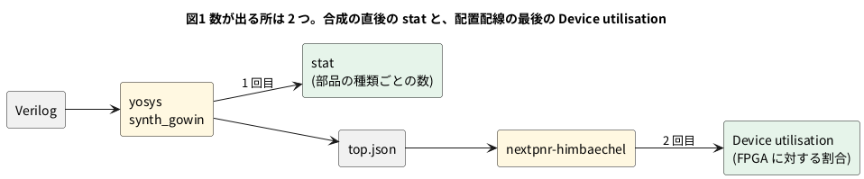

# 8-8 合成の報告を読む — LUT とフリップフロップの数

> [!WARNING]
> **この題は実機が要らない。** 合成 (yosys) と配置配線 (nextpnr) は手元の PC で実際に回して数を取った。
> ボードへの書き込みと AD3 での測定は、この題では行わない。数はすべて「合成の結果」で、測った値ではない。

8-4 で写した合成と配置配線の表を、この題では**読む**。「このボードに入るか」の答えは合成の報告に書いてある。

実体配線図・Analog Discovery 3・`logic` の図は入れない (**組まない題**。道具の出力を読むだけで、配線も信号も無い)。

## 報告が出る 2 か所

LUT とフリップフロップ (FF) の数は 2 回出る。




| 場所 | 出る物 | 分かること |
| --- | --- | --- |
| yosys の `stat` | 部品の種類ごとの数 (`LUT4` `DFFR` `ALU` など) | 回路が FPGA のどの部品に分かれたか |
| nextpnr の `Device utilisation` | 使った量 / FPGA にある量 | 入ったか。何 % 使ったか |

## 部品の名前の読み方

`stat` の名前は Gowin の FPGA の部品の名前で、yosys の部品の模型 (OSS CAD Suite の `share/yosys/gowin/cells_sim.v`) の説明から読める。

| 名前 | 何か | 8-4 との関係 |
| --- | --- | --- |
| `LUT1`〜`LUT4` | 入力が 1〜4 本の LUT (8-1)。4 入力までの関数が 1 個に入る | `cnt == LAST` の比べなど |
| `MUX2_LUT5`〜`MUX2_LUT8` | LUT の出力を 2 つから 1 つ選ぶ切り替え。LUT4 を組み合わせて 5〜8 入力の関数を作る | 4 入力で足りない関数 |
| `ALU` | 桁上げの専用の回路の 1 ビット分 (8-1) | `cnt + 1` の 24 ビットで 24 個 |
| `DFF` `DFFE` | FF。`E` の付く品はクロックイネーブルの入力を持つ (2-5) | `led` |
| `DFFR` `DFFS` | `R` はクロックに合わせて 0 にする**同期**のリセット、`S` は 1 にする同期のセット (2-3) | 8-4 の `blink` は `DFFR` |
| `DFFC` `DFFP` | `C` は**非同期**のクリア (0 にする)、`P` は非同期のプリセット (1 にする) (2-3) | TD4 は `negedge reset_n` なので `DFFC` |
| `IBUF` `OBUF` | 入出力のピンのバッファ | 入力 1 本・出力 1 本につき 1 個 |
| `GND` `VCC` | 定数の 0 と 1 を作る部品 | 数に入れない |

FF の名前は `DFF` + 非同期の指定 (`C` か `P`、無ければ同期の `R` `S`) + 有効にする `E`。`DFFRE` なら「同期リセット付きで、クロックイネーブルもある FF」。

## 3 つの回路を合成する

8-4 の `top`、8-22 の `top_td4`、1-8 の `seg7_decoder` を合成する。コマンドは 8-4 と同じ。

```bash
yosys -p "read_verilog top.v blink.v; synth_gowin -top top -json top.json; stat"
yosys -p "read_verilog top_td4.v blink.v TD4.v; synth_gowin -top top_td4 -json top_td4.json; stat"
yosys -p "read_verilog seg7_decoder.v; synth_gowin -top seg7_decoder; stat"
```

`stat` の表を LUT・切り替え・ALU・FF・入出力のバッファに寄せて並べる。道具は 2 つの版で回した。8-4・8-22 に書いた yosys 0.33 (`/usr/bin/yosys`) と、OSS CAD Suite (2026-10-10) の yosys 0.69+274。

| 回路 | LUT (LUT1〜4 の合計) | MUX2_LUT | ALU | FF | IBUF / OBUF |
| --- | --- | --- | --- | --- | --- |
| `seg7_decoder` | 7 / 7 | 0 / 0 | 0 / 0 | 0 / 0 | 4 / 7 |
| `top` (8-4 の点滅) | 20 / 16 | 10 / 5 | 24 / 24 | 25 / 25 | 2 / 2 |
| `top_td4` (8-22) | 50 / 28 | 7 / 0 | 30 / 29 | 35 / 35 | 6 / 9 |

各欄は「yosys 0.33 / yosys 0.69」の順。

- **`seg7_decoder` は LUT4 が 7 個で、FF が 0 個。** 出力 7 本はどれも入力 4 本 (`d[3:0]`) だけで決まり、1 本が LUT4 1 個になる。
  1-8 の `case` の 16 行は、LUT の中身の 16 行そのもの (8-1)
- **`top` は FF が 25 個。** `cnt` の 24 ビットと `led` の 1 ビット。ALU も 24 個で、`cnt + 1` の 1 ビットが ALU 1 個に当たる
- **FF の数 (回路が持つ記憶の数) は版で変わらない。LUT の数は版で変わる。**
  `top_td4` は 50 個から 28 個に減り、切り替え (`MUX2_LUT`) は 7 個から 0 個になった。同じ Verilog からの結果である
- **数を書くときは、道具の版を添える。** この本の 8-4・8-7・8-22 の数は 0.33 のもの

## 配置配線の報告と突き合わせる

8-4 と同じ打ち方で配置配線を通し (nextpnr-himbaechel 0.11.1-54)、最後の `Device utilisation` から主な行を抜く。

```bash
nextpnr-himbaechel --json top_td4.json --write pnr.json \
    --device GW1NR-LV9QN88PC6/I5 --vopt family=GW1N-9C \
    --vopt cst=td4.cst --freq 27
```

| 回路 (どの版の yosys の結果か) | IOB | LUT4 | MUX2_LUT5 / 6 / 7 | ALU | DFF |
| --- | --- | --- | --- | --- | --- |
| `top` (0.33) | 4 / 276 | 46 / 8,640 | 6 / 3 / 1 | 26 / 6,480 | 25 / 6,480 |
| `top` (0.69) | 4 / 276 | 42 / 8,640 | 4 / 1 / 0 | 26 / 6,480 | 25 / 6,480 |
| `top_td4` (0.33) | 15 / 276 | 86 / 8,640 | 5 / 2 / 0 | 36 / 6,480 | 35 / 6,480 |
| `top_td4` (0.69) | 15 / 276 | 62 / 8,640 | 0 / 0 / 0 | 34 / 6,480 | 35 / 6,480 |

`top_td4` (0.33) の `stat` とこの表を並べる。

| 見る所 | stat (yosys 0.33) | Device utilisation (nextpnr) |
| --- | --- | --- |
| LUT | 50 (LUT1 25・LUT2 8・LUT3 8・LUT4 9) | LUT4 が 86 |
| ALU | 30 | 36 |
| FF | 35 | 35 |
| 入出力のバッファ | IBUF 6 + OBUF 9 = 15 | IOB が 15 |

- **`LUT4` の行は、LUT と ALU を足した数である。** 50 + 36 = 86。ほかの 5 つ (`top` の 0.33・0.69、`top_td4` の 0.69 と、8-23 の変種の 2 つ) でも、
  「`stat` の LUT + nextpnr の ALU = nextpnr の LUT4」が合った (46 = 20 + 26、42 = 16 + 26、62 = 28 + 34、92 = 56 + 36、80 = 44 + 36)。
  8-4 の「nextpnr は合成と別の数え方をしている」は、この足し算のこと
- **ALU は、`stat` より nextpnr の数のほうが多い。** 配置配線のあとの回路に、`HEAD` や `DUMMY` の付く名前の ALU が
  桁上げの鎖ごとに足されていた (`pnr.json` の部品の名前を読んだ)。足す理由 (Apicula の中身) は確かめていない
- **`MUX2_LUT` (LUT4 の出力を選ぶ部品) は `LUT4` の数に入らず、別に数える**
- **入った割合は 1 % 前後。** `top_td4` の LUT4 は 86 / 8,640 で 1.0 % (0.33)、62 / 8,640 で 0.7 % (0.69)。
  TD4 のような小さな CPU は Tang Nano 9K の 100 分の 1。8-2 の「どこまで載るか」の答えである

## 報告を読むときの手順

1. `stat` の FF (`DFF…`) の合計を、Verilog の `reg` の数と見比べる。**少なければ、回路が読んでいないレジスタが消えている** (例は 8-23)
2. `LUT` と `ALU` を足して、nextpnr の `LUT4` と合うことを確かめる
3. `IBUF` `OBUF` を入出力の数 (8-5 の制約ファイル) と見比べる
4. 使った量を FPGA の量 (LUT4 8,640・DFF 6,480。8-2) で割る

## 見るべき値

合成と配置配線の結果 (測った値ではない)。道具は yosys 0.33 と 0.69+274、nextpnr-himbaechel 0.11.1-54。

| 項目 | 見るべき値 | どこで得たか |
| --- | --- | --- |
| `seg7_decoder` の LUT4 と FF | 7 個と 0 個 | yosys の `stat` |
| `top` (8-4) の FF と ALU | 25 個と 24 個 (版によらない) | 同上 |
| `top_td4` (8-22) の LUT | 50 個 (0.33)、28 個 (0.69) | 同上 |
| `top_td4` の使った量 | LUT4 86 / 8,640 (0.33)、62 / 8,640 (0.69) | nextpnr の `Device utilisation` |
| LUT4 の足し算 | `stat` の LUT + nextpnr の ALU = nextpnr の LUT4 | 6 つの結果で合った |

数は書き込む前の道具の出力で、実機で書き込んでも変わらない。

## シミュレーションでの確かめ

Yosys 0.33・Yosys 0.70+16 と nextpnr-himbaechel 0.11.1-63 で、8-4 の `top.v`・8-22 の `top_td4.v`・1-8 の `seg7_decoder.v` を合成し直した。新しく起こした Verilog は無いので、`sim/` には置いていない。
`TD4_b.v` は 8-23 で ROM の 3 行を替えた物。

| 項目 | 本文の数字 | 実行結果 | 判定 |
| --- | --- | --- | --- |
| `seg7_decoder` | LUT 7・FF 0・IBUF 4・OBUF 7 | 同じ (LUT4 × 7) | 合った |
| `top` (8-4) | LUT 20・MUX 10・ALU 24・FF 25・IBUF 2・OBUF 2 | 同じ | 合った |
| `top_td4` (8-22) | LUT 50・MUX 7・ALU 30・FF 35・IBUF 6・OBUF 9 | 同じ | 合った |
| yosys 0.70+16 の `stat` の LUT / MUX2_LUT / ALU / FF | `seg7_decoder` 7・0・0・0、`top` 16・5・24・25、`top_td4` 28・0・29・35 | 同じ | 合った |
| nextpnr `top` | 0.33: LUT4 46・MUX 6/3/1・ALU 26・DFF 25。0.69: 42・4/1/0・26・25 | 同じ (IOB 4) | 合った |
| nextpnr `top_td4` | 0.33: LUT4 86・MUX 5/2/0・ALU 36・DFF 35。0.69: 62・0/0/0・34・35 | 同じ (IOB 15) | 合った |
| 「LUT4 = stat の LUT + nextpnr の ALU」 | 20 + 26 = 46・16 + 26 = 42・50 + 36 = 86・28 + 34 = 62 | 同じ。`TD4_b.v` でも 56 + 36 = 92 (0.33)・44 + 36 = 80 (0.70+16) | 合った |

表の 0.69 の列は、手元の 0.70+16 でも本文の 0.69+274 と同じ数だった。

## 出典

自作。

- 部品の名前と意味 (`DFFC` の非同期クリア、`DFFR` の同期リセット、`ALU` ほか): OSS CAD Suite (2026-10-10) に入っている yosys の
  `share/yosys/gowin/cells_sim.v` の模型と、その中のコメント
- `TD4.v`: [tommie-jp/Soft-FPGA-TD4](https://github.com/tommie-jp/Soft-FPGA-TD4) の `verilator-TD4/TD4.v`。元は
  [asfdrwe/simpleTD4](https://github.com/asfdrwe/simpleTD4) (MIT ライセンス)
- 打ち方 (`synth_gowin`、nextpnr の `--device` と `--vopt family`): 8-4 と同じ。[Apicula](https://github.com/YosysHQ/apicula) の README の Tang Nano 9K の節
- 規模 (LUT4 8,640・FF 6,480): 8-2 の表 (Sipeed の [Tang Nano 9K のページ](https://wiki.sipeed.com/hardware/en/tang/Tang-Nano-9K/Nano-9K.html))
