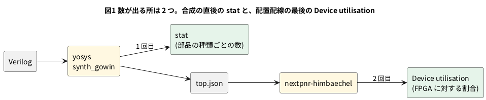

# 8-8 合成の報告を読む — LUT とフリップフロップの数

> [!WARNING]
> **この題は実機が要らない。** 合成 (yosys) と配置配線 (nextpnr) は手元の PC で実際に回して数を取った。
> ボードへの書き込みと AD3 での測定は、この題では行わない。数はすべて「合成の結果」で、測った値ではない。

8-4 では、合成と配置配線を通したあとに出てくる表の数を、そのまま写した。
この題では、その表を**読む**。
FPGA に回路を載せるとき、最初に気にするのは「このボードに入るか」で、答えは合成の報告に書いてある。

**組まない題である。** 実体配線図・Analog Discovery 3・`logic` の図は入れない。
道具の出力を読むだけで、配線も信号も無いため。

## 報告が出る 2 か所

LUT とフリップフロップ (FF) の数は、手順の途中で 2 回出る。




| 場所 | 出る物 | 分かること |
| --- | --- | --- |
| yosys の `stat` | 部品の種類ごとの数 (`LUT4` `DFFR` `ALU` など) | 回路が FPGA のどの部品に分かれたか |
| nextpnr の `Device utilisation` | 使った量 / FPGA にある量 | 入ったか。何 % 使ったか |

## 部品の名前の読み方

`stat` の表に出る名前は、Gowin の FPGA の部品の名前である。
yosys に入っている部品の模型 (OSS CAD Suite の `share/yosys/gowin/cells_sim.v`) の中の説明から読める。

| 名前 | 何か | 8-4 との関係 |
| --- | --- | --- |
| `LUT1`〜`LUT4` | 入力が 1〜4 本の LUT (8-1)。4 入力までの関数が 1 個に入る | `cnt == LAST` の比べなど |
| `MUX2_LUT5`〜`MUX2_LUT8` | LUT の出力を 2 つから 1 つ選ぶ切り替え。LUT4 を組み合わせて 5〜8 入力の関数を作る | 4 入力で足りない関数 |
| `ALU` | 桁上げの専用の回路の 1 ビット分 (8-1) | `cnt + 1` の 24 ビットで 24 個 |
| `DFF` `DFFE` | FF。`E` の付く品はクロックイネーブルの入力を持つ (2-5) | `led` |
| `DFFR` `DFFS` | `R` はクロックに合わせて 0 にする**同期**のリセット、`S` は 1 にする同期のセット (2-3) | 8-4 の `blink` は `DFFR` |
| `DFFC` `DFFP` | `C` は**非同期**のクリア (0 にする)、`P` は非同期のプリセット (1 にする) (2-3) | TD4 は `negedge reset_n` なので `DFFC` |
| `IBUF` `OBUF` | 入出力のピンのバッファ | 入力 1 本・出力 1 本につき 1 個 |
| `GND` `VCC` | 定数の 0 と 1 を作る部品 | 数に入れない |

FF の名前の読み方は、`DFF` + 非同期の指定 (`C` か `P`、無ければ同期の `R` `S`) + 有効にする `E`。
`DFFRE` なら「同期リセット付きで、クロックイネーブルもある FF」である。

## 3 つの回路を合成する

8-4 の `top`、8-6 の `top_td4`、1-8 の `seg7_decoder` を合成する。コマンドは 8-4 と同じ。

```bash
yosys -p "read_verilog top.v blink.v; synth_gowin -top top -json top.json; stat"
yosys -p "read_verilog top_td4.v blink.v TD4.v; synth_gowin -top top_td4 -json top_td4.json; stat"
yosys -p "read_verilog seg7_decoder.v; synth_gowin -top seg7_decoder; stat"
```

結果を、`stat` の表から LUT・切り替え・ALU・FF・入出力のバッファに寄せて並べる。
道具は 2 つの版で回した。8-4・8-6 に書いた yosys 0.33 (`/usr/bin/yosys`) と、OSS CAD Suite (2026-10-10) の yosys 0.69+274。

| 回路 | LUT (LUT1〜4 の合計) | MUX2_LUT | ALU | FF | IBUF / OBUF |
| --- | --- | --- | --- | --- | --- |
| `seg7_decoder` | 7 / 7 | 0 / 0 | 0 / 0 | 0 / 0 | 4 / 7 |
| `top` (8-4 の点滅) | 20 / 16 | 10 / 5 | 24 / 24 | 25 / 25 | 2 / 2 |
| `top_td4` (8-6) | 50 / 28 | 7 / 0 | 30 / 29 | 35 / 35 | 6 / 9 |

各欄は「yosys 0.33 / yosys 0.69」の順。

読み取れること。

- **`seg7_decoder` は LUT4 が 7 個で、FF が 0 個。** 出力 7 本はどれも入力 4 本 (`d[3:0]`) だけで決まるので、1 本につき LUT4 が 1 個になる。
  1-8 の `case` の 16 行は、LUT の中身の 16 行そのもの (8-1)
- **`top` は FF が 25 個。** `cnt` の 24 ビットと `led` の 1 ビット。ALU も 24 個で、`cnt + 1` の 1 ビットが ALU 1 個に当たる
- **FF の数は、版が変わっても変わらない。** 回路が持つ記憶の数だからである。**LUT の数は版で変わる。**
  `top_td4` は 50 個から 28 個に減り、切り替え (`MUX2_LUT`) は 7 個から 0 個になった。どちらも同じ Verilog から出た結果である
- **数を書くときは、道具の版を添える。** この本の 8-4・8-6 の数は 0.33 のもの。8-7 の数も 0.33 で数えている

## 配置配線の報告と突き合わせる

8-4 と同じ打ち方で配置配線を通し、最後に出る `Device utilisation` の欄から主な行を抜く。
使った道具は nextpnr-himbaechel (nextpnr-0.11.1-54)。

```bash
nextpnr-himbaechel --json top_td4.json --write pnr.json \
    --device GW1NR-LV9QN88PC6/I5 --vopt family=GW1N-9C \
    --vopt cst=td4.cst --freq 27
```

| 回路 (どの版の yosys の結果か) | IOB | LUT4 | MUX2_LUT5 / 6 / 7 | ALU | DFF |
| --- | --- | --- | --- | --- | --- |
| `top` (0.33) | 4 / 276 | 46 / 8,640 | 6 / 3 / 1 | 26 / 6,480 | 25 / 6,480 |
| `top` (0.69) | 4 / 276 | 42 / 8,640 | 4 / 1 / 0 | 26 / 6,480 | 25 / 6,480 |
| `top_td4` (0.33) | 15 / 276 | 86 / 8,640 | 5 / 2 / 0 | 36 / 6,480 | 35 / 6,480 |
| `top_td4` (0.69) | 15 / 276 | 62 / 8,640 | 0 / 0 / 0 | 34 / 6,480 | 35 / 6,480 |

`top_td4` の 0.33 で、`stat` の数とこの表を並べる。

| 見る所 | stat (yosys 0.33) | Device utilisation (nextpnr) |
| --- | --- | --- |
| LUT | 50 (LUT1 25・LUT2 8・LUT3 8・LUT4 9) | LUT4 が 86 |
| ALU | 30 | 36 |
| FF | 35 | 35 |
| 入出力のバッファ | IBUF 6 + OBUF 9 = 15 | IOB が 15 |

- **`LUT4` の行は、LUT と ALU を足した数である。** 50 + 36 = 86。ほかの 5 つ (`top` の 0.33・0.69、`top_td4` の 0.69 と、下の変種の 2 つ) でも、
  「`stat` の LUT + nextpnr の ALU = nextpnr の LUT4」が合った (46 = 20 + 26、42 = 16 + 26、62 = 28 + 34、92 = 56 + 36、80 = 44 + 36)。
  8-4 で「nextpnr は合成と別の数え方をしている」と書いたのは、この足し算のことだった
- **ALU は、`stat` より nextpnr の数のほうが多い。** 配置配線のあとの回路に、`HEAD` や `DUMMY` の付く名前の ALU が
  桁上げの鎖ごとに足されていた (`pnr.json` の部品の名前を読んだ)。足す理由は Apicula の中身で、この題では確かめていない
- **`MUX2_LUT` は `LUT4` の数に入っていない。** LUT4 の出力を選ぶ部品で、LUT4 とは別に数えられる
- **入った割合は 1 % 前後。** `top_td4` の LUT4 は 86 / 8,640 で 1.0 % (0.33)、62 / 8,640 で 0.7 % (0.69)。
  TD4 のような小さな CPU は、Tang Nano 9K の 100 分の 1 にしかならない。8-2 に書いた「どこまで載るか」の答えがこの数である

## FF が消える — 17 ビットが 12 個になる理由

8-6 では、TD4 のレジスタが A・B・OUT・PC の 4 ビット × 4 と桁上げの 1 ビットで 17 ビットあるのに、
合成した FF の中で TD4 の分は 12 個だと書いた (DFFC 4 + DFFCE 8)。何が消えたかを、`top_td4.json` の FF の名前から読む。

| TD4 のレジスタ | 合成後 | 理由 |
| --- | --- | --- |
| `pc` (4) | **残る** (DFFC) | 次の命令の番地。出力に効く |
| `reg_out` (4) | **残る** (DFFCE) | 出力ポートそのもの |
| `reg_a` (4) | **残る** (DFFCE) | NOP の行 (`A ← A + 0`) が自分の値を読んでいる |
| `reg_b` (4) | **消える** | ROM に B を書く命令 (`MOV B`・`ADD B`) が無く、読む命令 (`MOV A,B`・`OUT B`) も無い |
| `cflag` (1) | **消える** | 桁上げを見る `JNC` が ROM に無く、ジャンプは `JMP` だけ |

消えた理由が「ROM の中身」であることは、ROM に 3 行足して確かめた。
`TD4.v` の ROM の 10〜12 番地 (NOP) を、B を使う命令と桁上げを使う命令に替える (`TD4_b.v`)。

```verilog
    rom[4'b1010] = 8'b0111_0101; // 1010: MOV B,0101
    rom[4'b1011] = 8'b1001_0000; // 1011: OUT B
    rom[4'b1100] = 8'b1110_0000; // 1100: JNC 0000
```

```bash
verilator --lint-only --no-timing TD4_b.v
yosys -p "read_verilog top_td4.v blink.v TD4_b.v; synth_gowin -top top_td4; stat"
```

lint は警告 0 件。合成の結果は次のとおり。

| 回路 | FF の内訳 (yosys 0.33) | FF の合計 | LUT (0.33 / 0.69) |
| --- | --- | --- | --- |
| `top_td4` (元の ROM) | DFFC 4・DFFCE 8・DFFR 22・DFFRE 1 | 35 | 50 / 28 |
| `top_td4` (ROM に 3 行足した) | DFFC 4・DFFCE **12**・DFFP **1**・DFFR 22・DFFRE 1 | **40** | 56 / 44 |

- FF は 5 個増えた。`reg_b` の 4 個 (DFFCE) と、`cflag` の 1 個 (DFFP。リセットで 1 になるので、非同期プリセットの `P`)
- **足した 3 行は実行されない。** 9 番地の `JMP 0000` で頭に戻るので、10 番地には来ない。
  それでも FF は残った。**合成の道具は、その行が実行されるかを調べない。** ROM に書いてあれば、読む部品が必要だと見なす
- 逆に言うと、`reg_a` は実際には 0 のままだが、残った。合成は、命令の流れを追って「ここは常に 0」と証明する所までは行かない

## 報告を読むときの手順

1. `stat` の FF (`DFF…`) の合計を、Verilog の `reg` の数と見比べる。**少なければ、使われないレジスタが消えている**。
   書いたのに無い FF は、回路が読んでいない印である
2. `LUT` と `ALU` を足して、nextpnr の `LUT4` と合うことを確かめる
3. `IBUF` `OBUF` を入出力の数と見比べる。8-5 の制約ファイルに書いた数と合う
4. 使った量を FPGA の量 (LUT4 8,640・DFF 6,480。8-2) で割る

## 見るべき値

すべて合成と配置配線の結果で、実機で測った値ではない。道具は yosys 0.33 と 0.69+274、nextpnr-himbaechel 0.11.1-54。

| 項目 | 見るべき値 | どこで得たか |
| --- | --- | --- |
| `seg7_decoder` の LUT4 と FF | 7 個と 0 個 | yosys の `stat` |
| `top` (8-4) の FF と ALU | 25 個と 24 個 (版によらない) | 同上 |
| `top_td4` (8-6) の LUT | 50 個 (0.33)、28 個 (0.69) | 同上 |
| `top_td4` の FF と、TD4 の分 | 35 個、うち TD4 は 12 個 | 同上と `top_td4.json` |
| `top_td4` の使った量 | LUT4 86 / 8,640 (0.33)、62 / 8,640 (0.69) | nextpnr の `Device utilisation` |
| LUT4 の足し算 | `stat` の LUT + nextpnr の ALU = nextpnr の LUT4 | 6 つの結果で合った |
| ROM に B と `JNC` を足したときの FF | +5 個 (35 → 40) | yosys の `stat` |

実機で書き込んでも、この数は変わらない (数は書き込む前の道具の出力である)。
自分のボードの数を取るときは、同じコマンドを回して `stat` と `Device utilisation` を読む。

## シミュレーションでの確かめ

Yosys 0.33・Yosys 0.70+16 と nextpnr-himbaechel 0.11.1-63 で、8-4 の `top.v`・8-6 の `top_td4.v`・1-8 の `seg7_decoder.v` を合成し直した。新しく起こした Verilog は無いので、`sim/` には置いていない。
TD4 を変えた `TD4_b.v` は、`TD4.v` の ROM の 10〜12 番地を `sed` で書き換えて作った (本文の 3 行)。

| 項目 | 本文の数字 | 実行結果 | 判定 |
| --- | --- | --- | --- |
| `seg7_decoder` | LUT 7・FF 0・IBUF 4・OBUF 7 | 同じ (LUT4 × 7) | 合った |
| `top` (8-4) | LUT 20・MUX 10・ALU 24・FF 25・IBUF 2・OBUF 2 | 同じ | 合った |
| `top_td4` (8-6) | LUT 50・MUX 7・ALU 30・FF 35・IBUF 6・OBUF 9 | 同じ | 合った |
| `TD4_b.v` の lint | 警告 0 件 | 0 件 | 合った |
| `top_td4` + `TD4_b.v` | FF 40 (DFFC 4・DFFCE 12・DFFP 1・DFFR 22・DFFRE 1)、LUT 56 | 同じ | 合った |
| yosys 0.70+16 の `stat` の LUT / MUX2_LUT / ALU / FF | `seg7_decoder` 7・0・0・0、`top` 16・5・24・25、`top_td4` 28・0・29・35 | 同じ | 合った |
| `top_td4` + `TD4_b.v` (0.70+16) | LUT 44 (0.69) | LUT 44・FF 40 | 合った |
| nextpnr `top` | 0.33: LUT4 46・MUX 6/3/1・ALU 26・DFF 25。0.69: 42・4/1/0・26・25 | 同じ (IOB 4) | 合った |
| nextpnr `top_td4` | 0.33: LUT4 86・MUX 5/2/0・ALU 36・DFF 35。0.69: 62・0/0/0・34・35 | 同じ (IOB 15) | 合った |
| 「LUT4 = stat の LUT + nextpnr の ALU」 | 20 + 26 = 46・16 + 26 = 42・50 + 36 = 86・28 + 34 = 62 | 同じ。`TD4_b.v` でも 56 + 36 = 92 (0.33)・44 + 36 = 80 (0.70+16) | 合った |

表の 0.69 の列は、手元の 0.70+16 で数が同じだった (本文の 0.69+274 と同じ数。版の差は見えなかった)。

## 出典

自作。

- 部品の名前と意味 (`DFFC` の非同期クリア、`DFFR` の同期リセット、`ALU` ほか): OSS CAD Suite (2026-10-10) に入っている yosys の
  `share/yosys/gowin/cells_sim.v` の模型と、その中のコメント
- `TD4.v`: [tommie-jp/Soft-FPGA-TD4](https://github.com/tommie-jp/Soft-FPGA-TD4) の `verilator-TD4/TD4.v`。元は
  [asfdrwe/simpleTD4](https://github.com/asfdrwe/simpleTD4) (MIT ライセンス)
- 打ち方 (`synth_gowin`、nextpnr の `--device` と `--vopt family`): 8-4 と同じ。[Apicula](https://github.com/YosysHQ/apicula) の README の Tang Nano 9K の節
- 規模 (LUT4 8,640・FF 6,480): 8-2 の表 (Sipeed の [Tang Nano 9K のページ](https://wiki.sipeed.com/hardware/en/tang/Tang-Nano-9K/Nano-9K.html))
