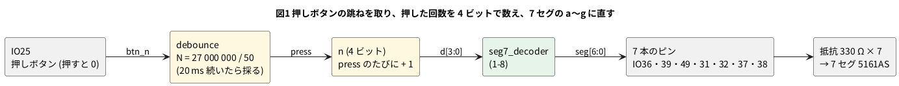

# 8-9 押しボタンと 7 セグをつなぐ

> [!WARNING]
> **この題は実機で組んでいない。** Verilog は Verilator で動かして値を確かめ、合成・配置配線・ビットストリーム作りまで
> 手元の PC で通した。書き込みと、ボタン・7 セグ・AD3 での確かめは実行していない。
> 「見るべき値」は計算値とシミュレーションの値で、測った値ではない。

8-4 では、FPGA のピンから LED の点滅を外に出した。この題では、**外から入れる信号 (押しボタン) と、
7 本のピンで光らせる表示器 (7 セグ) をブレッドボードにつなぐ**。
ボタンを 1 回押すたびに、7 セグの数字が 0 → 1 → 2 … → F と 1 つ進む。

作る回路は、すでに書いた 3 つの部品をつなぐだけである。新しく書くのは最上位の `top_btn_seg` だけ。

| 部品 | 題 | 役 |
| --- | --- | --- |
| `debounce` | 6-3 (`06-fpga/06-state-machines/03-debounce.md`) | 押しボタンの跳ね (チャタリング) を取り、1 回押すと 1 クロックだけ `press` を 1 にする |
| `seg7_decoder` | 1-8 (`06-fpga/01-combinational/08-seg7-decoder.md`) | 4 ビットの数を 7 セグの a〜g に直す (1 で点灯) |
| 4 ビットのカウンタ | 2-4 | `press` のたびに 1 進む |

押しボタンは、FPGA の入力ピンと GND の間に挿す。離しているあいだは FPGA の中のプルアップ (`PULL_MODE=UP`) で 1、押すと 0 になる。
プルアップの抵抗は FPGA の中にあるので、ブレッドボードに抵抗は要らない (8-5)。

## 論理図




## Verilog

`debounce.v` は 6-3、`seg7_decoder.v` は 1-8 のものをそのまま使う (ここには写さない)。

```verilog
// 押しボタンを押すたびに 7 セグの数字が 1 つ進む (0 から F まで。F の次は 0)
module top_btn_seg #(
    parameter CLK_HZ = 27_000_000
) (
    input        clk,       // 52 番ピン。ボードの 27 MHz
    input        rst_n,     // 4 番ピン。ボードの押しボタン (押すと 0)
    input        btn_n,     // IO25。ブレッドボードの押しボタン (押すと 0)
    output [6:0] seg        // {g, f, e, d, c, b, a}。1 で点灯
);
    wire press;

    /* verilator lint_off PINCONNECTEMPTY */
    debounce #(.N(CLK_HZ / 50)) db (       // 1/50 s = 20 ms
        .clk(clk), .rst(~rst_n), .btn_n(btn_n), .clean_n(), .press(press));
    /* verilator lint_on PINCONNECTEMPTY */

    reg [3:0] n;
    always @(posedge clk)
        if (!rst_n)     n <= 4'h0;
        else if (press) n <= n + 4'h1;

    seg7_decoder dec (.d(n), .seg(seg));
endmodule
```

- ボードの押しボタン (4 番ピン) はリセットに使う。ブレッドボードの押しボタンが数えるボタン
- 7 セグは**共通カソード**なので、`seg` の 1 が点灯。共通アノードの表示器なら `~seg` にして出す (1-8)
- 6-3 の `debounce` は、同じ値が `N` クロック続いたら採る。27 MHz で 20 ms にするので `N` = 27 000 000 / 50 = 540 000

制約ファイル `top.cst`。7 セグの a〜g は `seg[0]`〜`seg[6]`。

```text
IO_LOC "clk" 52;
IO_PORT "clk" IO_TYPE=LVCMOS33 PULL_MODE=UP;
IO_LOC "rst_n" 4;
IO_PORT "rst_n" PULL_MODE=UP;
IO_LOC "btn_n" 25;
IO_PORT "btn_n" IO_TYPE=LVCMOS33 PULL_MODE=UP;
IO_LOC "seg[0]" 36;
IO_PORT "seg[0]" IO_TYPE=LVCMOS33 DRIVE=8;
IO_LOC "seg[1]" 39;
IO_PORT "seg[1]" IO_TYPE=LVCMOS33 DRIVE=8;
IO_LOC "seg[2]" 49;
IO_PORT "seg[2]" IO_TYPE=LVCMOS33 DRIVE=8;
IO_LOC "seg[3]" 31;
IO_PORT "seg[3]" IO_TYPE=LVCMOS33 DRIVE=8;
IO_LOC "seg[4]" 32;
IO_PORT "seg[4]" IO_TYPE=LVCMOS33 DRIVE=8;
IO_LOC "seg[5]" 37;
IO_PORT "seg[5]" IO_TYPE=LVCMOS33 DRIVE=8;
IO_LOC "seg[6]" 38;
IO_PORT "seg[6]" IO_TYPE=LVCMOS33 DRIVE=8;
```

使うピンはすべて 3.3 V のピン (IO79〜IO86 の 1.8 V のバンクは使わない。0-3)。
HDMI につながる IO68〜IO77 も避けた。ピンの番号は 8-5 の読み方で、ヘッダの番号ではなく FPGA のピンの番号である。

```bash
verilator --lint-only -Wall top_btn_seg.v debounce.v seg7_decoder.v
```

lint は警告 0 件。

## 動かす (シミュレーション)

クロックを 1 kHz (`CLK_HZ` = 1000。`N` = 20) にして、押し方を 3 回入れる。1 回の押し方は、押して 3 回跳ね、100 ms 押したまま、
離すときにも跳ねる。値は押すごとに 200 ms あとに読む。

```verilog
`timescale 1us / 100ns
// 1 kHz のクロック。跳ねながら押す 3 回を入れ、押すたびに seg が 1 つ進むかを見る
module tb_btn_seg;
    reg clk = 1'b0;
    reg rst_n = 1'b0;
    reg btn_n = 1'b1;
    wire [6:0] seg;

    top_btn_seg #(.CLK_HZ(1000)) dut (.clk(clk), .rst_n(rst_n), .btn_n(btn_n), .seg(seg));

    always #500 clk = ~clk;                       // 1 kHz

    task press_with_bounce;
        begin
            btn_n = 1'b0; #700;  btn_n = 1'b1; #600;
            btn_n = 1'b0; #500;  btn_n = 1'b1; #900;
            btn_n = 1'b0;                          // ここから押したまま
            #100000;                               // 100 ms
            btn_n = 1'b1; #600; btn_n = 1'b0; #700; btn_n = 1'b1; // 離すときも跳ねる
            #100000;
            $display("%8.1f ms  n=%h  seg=%b", $realtime / 1000.0, dut.n, seg);
        end
    endtask

    integer i;
    initial begin
        #3000 rst_n = 1'b1;
        $display("%8.1f ms  n=%h  seg=%b", $realtime / 1000.0, dut.n, seg);
        for (i = 0; i < 3; i = i + 1) press_with_bounce;
        $finish;
    end
endmodule
```

```bash
verilator --binary --timing --top-module tb_btn_seg tb.v top_btn_seg.v debounce.v seg7_decoder.v
./obj_dir/Vtb_btn_seg
```

```text
     3.0 ms  n=0  seg=0111111
   207.0 ms  n=1  seg=0000110
   411.0 ms  n=2  seg=1011011
   615.0 ms  n=3  seg=1001111
```

押すごとに `n` が 1 ずつ進み、`seg` は 1-8 の表の 0・1・2・3 の並び (`0111111` `0000110` `1011011` `1001111`) になった。

### 跳ねを取らないと

比べるために、`debounce` を外して、押しボタンの立ち下がりをそのまま数える回路 (`top_raw`) を同じ押し方で動かした。
`btn_n` を 2 段で受けて、立ち下がりを 1 クロックだけ 1 にするところは `top_btn_seg` と同じである。

```verilog
// 比べるための回路。チャタリングを取らず、btn_n の立ち下がりをそのまま数える
module top_raw (
    input        clk,
    input        rst_n,
    input        btn_n,
    output [6:0] seg
);
    reg [2:0] sync;
    reg [3:0] n;
    wire press = sync[2] & ~sync[1];

    always @(posedge clk)
        if (!rst_n) begin
            sync <= 3'b111;
            n    <= 4'h0;
        end else begin
            sync <= {sync[1:0], btn_n};
            if (press) n <= n + 4'h1;
        end

    seg7_decoder dec (.d(n), .seg(seg));
endmodule
```

```text
     3.0 ms  n=0  seg=0111111
   207.0 ms  n=2  seg=1011011
   411.0 ms  n=4  seg=1100110
   615.0 ms  n=6  seg=1111101
```

1 回押すたびに 2 つ進んだ。**押し始めの跳ねを別の押下として数えている。** 数字が 1 つずつ進まない配線が実機の「ボタンが
あやしい」の正体であることが多い。跳ねの数は押し方で変わるので、実機では 2 とは限らない。

## 合成・配置配線

8-4 と同じ 3 手を通した (書き込みは未実行)。道具は yosys 0.33 と OSS CAD Suite の yosys 0.69+274、nextpnr-himbaechel 0.11.1-54。

```bash
yosys -p "read_verilog top_btn_seg.v debounce.v seg7_decoder.v; synth_gowin -top top_btn_seg -json top.json; stat"
nextpnr-himbaechel --json top.json --write pnr.json \
    --device GW1NR-LV9QN88PC6/I5 --vopt family=GW1N-9C --vopt cst=top.cst --freq 27
gowin_pack -d GW1N-9C -o top.fs pnr.json
```

| 見る所 | yosys 0.33 | yosys 0.69 |
| --- | --- | --- |
| LUT (LUT1〜4) | 39 | 45 |
| MUX2_LUT | 10 | 24 |
| ALU | 24 | 24 |
| FF | 35 | 35 |
| nextpnr の LUT4 (LUT + ALU) | 67 / 8,640 | 73 / 8,640 |
| nextpnr の IOB | 10 / 276 | 10 / 276 |
| nextpnr の最高の周波数の見積り | 126.39 MHz (27 MHz で PASS) | 167.73 MHz (27 MHz で PASS) |

- FF は 35 個。内訳は、`debounce` が 24 個 (20 ビットの数え + 受けの 2 段 + `clean_n` と `clean_d`)、`n` が 4 個、残りの **7 個は
  `dec.seg[0]`〜`[6]`** という名前の FF だった (`top.json` の名前を読んだ)。Verilog に書いていない FF を、yosys が
  `seg7_decoder` の出力に付けている。表示が 1 クロック遅れるだけで、27 MHz では見えない。書いていない FF が出たら、`stat` で名前を読む (8-8)
- IOB の 10 は、入力 3 (`clk` `rst_n` `btn_n`) と出力 7 (`seg`)
- `top.fs` は 2,069,320 バイト (gowin_pack)。8-4 と同じ大きさになる

## 回路図

```circuit
title: 図2 FPGA の 7 本のピンから抵抗を通して 7 セグを光らせる。押しボタンは IO25 と GND の間
parts:
  U1: tang-nano-9k 6,6
  SG: port 4.5,3.24
  SF: port 4.5,3.49
  SA: port 4.5,3.74
  SB: port 4.5,3.99
  BTN: port 4.5,4.24
  SC: port 7.5,7.99
  SD: port 7.5,8.24
  SE: port 7.5,8.49
  G0: ground 7.5,9.3
  SA: port 11,1.6
  R3: resistor 11,1.6 12.5,1.6 330
  SB: port 11,2.3
  R4: resistor 11,2.3 12.5,2.3 330
  SC: port 11,3
  R7: resistor 11,3 12.5,3 330
  SD: port 11,3.7
  R6: resistor 11,3.7 12.5,3.7 330
  SE: port 11,4.4
  R5: resistor 11,4.4 12.5,4.4 330
  SF: port 11,5.1
  R2: resistor 11,5.1 12.5,5.1 330
  SG: port 11,5.8
  R1: resistor 11,5.8 12.5,5.8 330
  DS1: seg7 18,6 5161AS
  G1: ground 15,8.6
  BTN: port 11,9.5
  SW1: button 11,10.5 11,12.5
  G2: ground 11,12.5
  AD:
    type: device
    at: 1,2.5
    label: AD3
    pins: [DIO0, DIO1, DIO2, DIO3, DIO4, DIO5, DIO6, DIO7, GND]
    turn: mirror
  BTN: port 2.5,1.5
  SG: port 2.5,1.75
  SF: port 2.5,2
  SA: port 2.5,2.25
  SB: port 2.5,2.5
  SE: port 2.5,2.75
  SD: port 2.5,3
  SC: port 2.5,3.25
  G3: ground 2.5,4.2
wires:
  - U1.IO38 |- 4.5,3.24
  - U1.IO37 |- 4.5,3.49
  - U1.IO36 |- 4.5,3.74
  - U1.IO39 |- 4.5,3.99
  - U1.IO25 |- 4.5,4.24
  - U1.IO49 |- 7.5,7.99
  - U1.IO31 |- 7.5,8.24
  - U1.IO32 |- 7.5,8.49
  - U1.GND |- 7.5,8.74 -- 7.5,9.3
  - 12.5,1.6 -- 16.8,1.6 -- 16.8,5.03 -| DS1.a
  - 12.5,2.3 -- 16.5,2.3 -- 16.5,5.28 -| DS1.b
  - 12.5,3 -- 16.2,3 -- 16.2,5.53 -| DS1.c
  - 12.5,3.7 -- 15.9,3.7 -- 15.9,5.78 -| DS1.d
  - 12.5,4.4 -- 15.6,4.4 -- 15.6,6.03 -| DS1.e
  - 12.5,5.1 -- 15.3,5.1 -- 15.3,6.28 -| DS1.f
  - 12.5,5.8 -- 15,5.8 -- 15,6.53 -| DS1.g
  - DS1.COM1 -| 15,8.6
  - 11,9.5 -- 11,10.5
  - AD.DIO0 |- 2.5,1.5
  - AD.DIO1 |- 2.5,1.75
  - AD.DIO2 |- 2.5,2
  - AD.DIO3 |- 2.5,2.25
  - AD.DIO4 |- 2.5,2.5
  - AD.DIO5 |- 2.5,2.75
  - AD.DIO6 |- 2.5,3
  - AD.DIO7 |- 2.5,3.25
  - AD.GND |- 2.5,3.5 -- 2.5,4.2
```


- 線で結ぶ代わりに、**同じ名前の端子 (白丸と名前) どうしがつながっている**。U1 の `SA` は R3 の左の `SA` につながる
- セグメント a〜g は FPGA のピン IO36・IO39・IO49・IO31・IO32・IO37・IO38 から。R1〜R7 で電流を決めて 7 セグ DS1 の a〜g へ
- DS1 の `COM1` (共通のカソード) を GND に落とす。`COM2` は部品の中で `COM1` とつながっているので、1 本で足りる
- 押しボタン SW1 は IO25 (`BTN`) と GND の間。押すと IO25 が GND につながって 0 になる
- AD3 は DIO0 でボタン、DIO1〜DIO7 で g・f・a・b・e・d・c の 7 本を、抵抗の FPGA 側で読む
- 図に無いピン: 27 MHz のクロック (52 番) とリセットの押しボタン (4 番) は、ボードの上で FPGA につながっている

## 部品表

| 部品 | 値・型番 | 数 | 役 |
| --- | --- | --- | --- |
| U1 | Sipeed Tang Nano 9K (GW1NR-9) | 1 | FPGA ボード。USB-C から給電と書き込み |
| DS1 | 5161AS (0.56 インチ 1 桁 7 セグ、カソード共通、赤) | 1 | 表示 |
| R1〜R7 | 330 Ω (オーム)、E24、1/4 W | 7 | セグメント 1 本の電流を決める |
| SW1 | タクトスイッチ (4 ピン) | 1 | 数えるボタン |
| — | ブレッドボード (full、63 列) | 1 | |
| — | ジャンパ線 | 約 25 本 | |
| AD | Analog Discovery 3 | 1 | Logic で 8 本を読む |

電源は教科書の既定の 5 V ではなく **3.3 V** (FPGA のピン)。FPGA のピンに 5 V を入れると壊れるため (0-3)。
ブレッドボードには電源を配らず、7 セグは FPGA のピンの 3.3 V で光らせる。電源レールは GND だけ使う。

### 抵抗の値

赤色 LED の順方向電圧 Vf を **2.0 V (目安。5161AS のデータシートでは確かめていない)** と置く。

- 1 セグメントの電流 = (3.3 V − 2.0 V) ÷ 330 Ω = 3.9 mA (計算値)
- 8 を表示すると 7 本が点き、COM1 には 7 × 3.9 mA = 27 mA (計算値) が流れる。8-6 の DIP スイッチや 8-4 の LED 1 個より多い電流なので、GND の線は太めの短い線にする
- 制約ファイルの `DRIVE=8` は、1 ピンが流せる電流を 8 mA にする設定 (8-5)。3.9 mA はこの内側。
  **FPGA 全体で何 mA まで流せるかは、この題では確かめていない**。Gowin の資料で確かめてから、抵抗を小さくする

## 実体配線図

```bread
title: 図3 7 セグと抵抗を 1 枚のブレッドボードに組む。電源は USB-C から Tang Nano 9K へ
board: full
parts:
  U1: tang-nano-9k @ b1
  SW1: button @ e28
  R1: resistor e34 f34 330
  R2: resistor e35 f35 330
  R3: resistor e36 f36 330
  R4: resistor e37 f37 330
  R5: resistor e39 f39 330
  R6: resistor e40 f40 330
  R7: resistor e41 f41 330
  DS1: seg7 @ b46
  AD:
    type: device
    at: bottom
    label: AD3 Logic
    pins: [DIO0, DIO1, DIO2, DIO3, DIO4, DIO5, DIO6, DIO7, GND]
wires:
  - a23 -- -t23 black
  - a28 -- -t28 black
  - a48 -- -t48 black
  - -t60 -- -b60 black
  - j5 -- j30 purple
  - j1 -- j34 blue
  - j2 -- j35 blue
  - j3 -- j36 blue
  - j4 -- j37 blue
  - a22 -- a39 orange
  - a21 -- a40 orange
  - a20 -- a41 orange
  - a34 -- a46 yellow
  - a35 -- a47 yellow
  - a36 -- a49 yellow
  - a37 -- a50 yellow
  - g39 -- g46 white
  - g40 -- g47 white
  - g41 -- g49 white
  - AD.DIO0 -- i30 green
  - AD.DIO1 -- i34 green
  - AD.DIO2 -- i35 green
  - AD.DIO3 -- i36 green
  - AD.DIO4 -- i37 green
  - AD.DIO5 -- d39 green
  - AD.DIO6 -- d40 green
  - AD.DIO7 -- d41 green
  - AD.GND -- -b55 black
notes:
  - text: 給電は Tang Nano 9K の USB-C (5 V)。電源レールは GND (−) だけ使う
```


- Tang Nano 9K の置き方は 8-3 と同じ (`@ b1`)。1〜24 番が下の列 (j 行から線を取る)、25〜48 番が上の列 (a 行から線を取る)
- ボードは 27 列あたりまで覆うので、押しボタンは 28 列から、抵抗と 7 セグはその右に置く
- 抵抗は溝をまたいで縦に挿す。R1〜R4 の下の端 (f〜j 行) に FPGA の線 (青)、上の端 (a〜e 行) から 7 セグの上のピン (黄) へ。
  R5〜R7 は逆で、上の端に FPGA の線 (橙)、下の端から 7 セグの下のピン (白) へ
- 7 セグ (DS1) も溝をまたぐ。胴の下 (b〜f 行) の穴は使えないので、上のピンは a 行、下のピンは g 行から線を取る。
  上の列は g・f・COM2・a・b、下の列は e・d・COM1・c・dp (5161AS の並び)
- 黒は GND だけ。FPGA の GND (26 番) は a23、押しボタンは 28 列、7 セグの COM2 は 48 列から上の − レールへ。上と下の − レールは 60 列でつなぐ。赤は使わない
- AD3 の緑の線は、抵抗の FPGA 側の穴から取る。R5〜R7 の FPGA 側は上の列にあるので、線は溝をこえて上の d 行まで上がる
- 抵抗の後ろ (7 セグ側) では読まない。そこは LED の電圧 (2 V 前後) になり、Logic の H の判定にかからないことがある
- 信号は押したときだけ変わる低い周波数で、ブレッドボードの範囲 (3 MHz 以下) に収まる

## 計器の設定

| 計器 | 設定 |
| --- | --- |
| Logic | DIO0〜DIO7 を Enable。DIO は 3.3 V。GND を共通にする (0-4) |
| バス | `SEG` を g (DIO1)・f (DIO2)・e (DIO5)・d (DIO6)・c (DIO7)・b (DIO4)・a (DIO3) の順に並べ、2 進で表示 |
| 時間軸 | 5 ms/div (窓 50 ms)。トリガの前を 5 ms 見せる |
| 標本化 | 100 kS/s。見る一番速い変化 (ボタンの跳ね。0.5 ms ほど) の 50 倍 |
| トリガ | DIO0 (ボタン) の立ち下がり。単発 (Single) で待つ |

## Logic に見えるはずの画面

```logic
title: 図4 ボタンを押すと 20 ms 後に 0 の形 (0111111) から 1 の形 (0000110) へ変わる
device: ad3
time: 5ms/div
start: -5ms
sample: 100kHz
signals:
  BTN: dio0 edges -5ms=1 0s=0 600us=1 1.3ms=0 1.9ms=1 2.6ms=0
  g:   dio1 edges -5ms=0
  f:   dio2 edges -5ms=1 22.6ms=0
  a:   dio3 edges -5ms=1 22.6ms=0
  b:   dio4 edges -5ms=1
  e:   dio5 edges -5ms=1 22.6ms=0
  d:   dio6 edges -5ms=1 22.6ms=0
  c:   dio7 edges -5ms=1
buses:
  SEG: g f e d c b a bin
cursors: [2.6ms, 22.6ms]
trigger: BTN falling at 0s
```


- ボタンは 0 s で最初に落ち、3 回跳ねて 2.6 ms から押したままになる (跳ね方は説明のための例で、実物では押すたびに違う)
- 数字は、押したままになってから `debounce` の 20 ms あとに変わる。カーソルは押したままになった時刻 (2.6 ms) と、数字が変わる時刻 (22.6 ms) に置いた。ΔX が 20 ms
- 変わるのは a・d・e・f の 4 本 (1 → 0)。b と c は 1 のまま、g は 0 のまま

## 見るべき値

シミュレーションの値と計算値。実機で測っていない。

| 項目 | 見るべき値 | どこで得たか |
| --- | --- | --- |
| 押したままになってから数字が変わるまで (ΔX) | 20 ms (目安) | `N` / 27 MHz = 540 000 / 27 000 000 (計算値) |
| 1 回押したときの数字の進み | 1 つ (0 → 1 → 2 → 3) | シミュレーション (跳ねあり) |
| `SEG` (g〜a、2 進) | 0 → 0111111、1 → 0000110、2 → 1011011、3 → 1001111 | シミュレーション。1-8 の表 |
| 跳ねを取らないとき | 1 回の押しで 2 つ進む (跳ね方で変わる) | `top_raw` のシミュレーション |
| 1 セグメントの電流 | 3.9 mA (目安) | (3.3 − 2.0) V ÷ 330 Ω の計算値。Vf は目安 |
| 抵抗の FPGA 側の H | 3.3 V 前後 (目安) | LVCMOS33 の出力。実機で Logic の H を確かめる |
| 使った量 | LUT4 67 (0.33) / 73 (0.69)・FF 35・IOB 10 | nextpnr |

実機で組んだら、DIO0 の跳ねの回数を数えて表に書き加える。跳ねは押すたびに変わるので、10 回ほど押して最大と最小を書く。
リセットの押しボタン (4 番) を押すと数字は 0 に戻る。

## 出典

自作。

- `debounce`: 6-3。`seg7_decoder`: 1-8。ピンの番号と制約の書き方: 8-5
- 5161AS のピンの並び (切り欠きを左に、下の 5 本が e・d・COM・c・dp、上の 5 本が g・f・COM・a・b): tommie-fence の `seg7` の表
  (breadboard-fence の `docs/01-syntax.md`)
- ボードのリセットの押しボタン (4 番)・クロック (52 番): Sipeed の [TangNano-9K-example](https://github.com/sipeed/TangNano-9K-example) の制約ファイル
