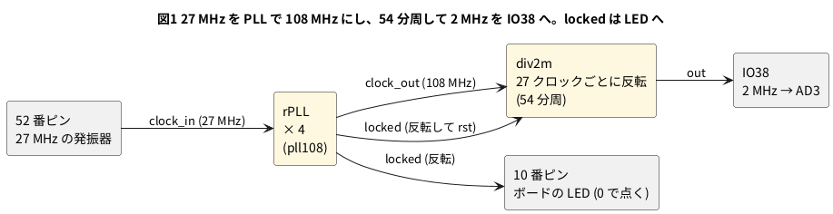

# 8-10 PLL でクロックを作る

> [!WARNING]
> **この題は実機で組んでいない。** PLL の設定値は Apicula の道具 (`gowin_pll`) で求め、分周の回路は Verilator で動かし、
> 合成・配置配線・ビットストリーム作りまで手元の PC で通した。書き込みと、LED・AD3 での測定は実行していない。
> 「見るべき値」は計算値と道具の値で、測った値ではない。

Tang Nano 9K の水晶は 27 MHz の 1 つだけである。回路が別の周波数のクロックを欲しいとき、FPGA の中の **PLL** で作る。
PLL は、入ってきたクロックを整数倍・整数分の 1 にして出す回路で、Tang Nano 9K の FPGA には 2 つ載っている (8-2、nextpnr の報告で `rPLL: 1/2`)。

この題で作るのは **2 MHz の方形波**である。27 MHz を整数で割って 2 MHz にはならない (27 ÷ 2 = 13.5)。
そこで、PLL で 27 MHz を 108 MHz (4 倍) にしてから、54 分周する。2 MHz はブレッドボードの範囲 (3 MHz 以下) に収まる。

## PLL の設定値の求め方

Gowin の FPGA の PLL (`rPLL`) は、3 つの分周比で出力を決める。

```text
CLKOUT = FCLKIN × (FBDIV_SEL + 1) ÷ (IDIV_SEL + 1)
VCO    = CLKOUT × ODIV_SEL
```

`IDIV_SEL` は入口の分周、`FBDIV_SEL` は戻しの分周 (倍率に当たる)、`ODIV_SEL` は出口の分周である。
`VCO` は PLL の中の発振器の周波数で、決まった範囲の中に入れる。
値は手で計算せず、OSS CAD Suite に入っている `gowin_pll` (Apicula の道具) に頼む。

```bash
gowin_pll -d "GW1NR-9 C6/I5" -i 27 -o 108 -f pll108.v -m pll108
```

`-d` の名前は `gowin_pll -l` の一覧にある。Tang Nano 9K の FPGA は `GW1NR-9 C6/I5` の行で、
一覧には「tested on TangNano9K Board」と書いてあった。出る `pll108.v` の中身は次のとおり。

```verilog
module pll108(
        input  clock_in,
        output clock_out,
        output locked
    );

    rPLL #(
        .FCLKIN("27.0"),
        .IDIV_SEL(0), // -> PFD = 27.0 MHz (range: 3-400 MHz)
        .FBDIV_SEL(3), // -> CLKOUT = 108.0 MHz (range: 3.125-600 MHz)
        .ODIV_SEL(4) // -> VCO = 432.0 MHz (range: 400-1200 MHz)
    ) pll (.CLKOUTP(), .CLKOUTD(), .CLKOUTD3(), .RESET(1'b0), .RESET_P(1'b0), .CLKFB(1'b0), .FBDSEL(6'b0), .IDSEL(6'b0), .ODSEL(6'b0), .PSDA(4'b0), .DUTYDA(4'b0), .FDLY(4'b0),
        .CLKIN(clock_in), // 27.0 MHz
        .CLKOUT(clock_out), // 108.0 MHz
        .LOCK(locked)
    );

endmodule
```

- 108 MHz = 27 MHz × (3 + 1) ÷ (0 + 1)。VCO は 108 × 4 = 432 MHz
- コメントの `range` は、道具が持っている範囲の値。入口 (PFD) が 3〜400 MHz、出力 (CLKOUT) が 3.125〜600 MHz、VCO が 400〜1200 MHz
- `LOCK` (`locked`) は、PLL が安定して出力が使えるようになったら 1 になる。それまでの出力は使わない

### 作れる周波数は飛び飛び

27 MHz から作れる周波数を、`gowin_pll` に頼んだ結果で並べる。

| 頼んだ周波数 | 作れた周波数 | `IDIV_SEL` | `FBDIV_SEL` | `ODIV_SEL` | VCO |
| --- | --- | --- | --- | --- | --- |
| 54 MHz | 54.000 MHz | 0 | 1 | 8 | 432 MHz |
| 108 MHz | 108.000 MHz | 0 | 3 | 4 | 432 MHz |
| 100 MHz | **100.286 MHz** | 6 | 25 | 4 | 401.14 MHz |
| 50 MHz | **50.143 MHz** | 6 | 12 | 8 | 401.14 MHz |
| 2 MHz | **3.375 MHz** | 7 | 0 | 128 | 432 MHz |
| 600 MHz | **594.000 MHz** | 0 | 21 | 2 | 1188 MHz |

- **100 MHz は作れない。** 27 MHz からだと 100.286 MHz が最も近い。0.29 % の差で、UART のボーレートなど周波数を合わせたい回路では効く
- 2 MHz は、PLL の出力の下限 (3.125 MHz) より低いので直接は作れない。道具は 3.375 MHz を返した。この題で一度 108 MHz にしてから割るのは、これが理由
- 数字を手で見積もるより、先に `gowin_pll` に頼み、頼んだ値と作れた値が違わないかを見る

## 論理図




## Verilog

PLL の部品 (`pll108.v`) は上の `gowin_pll` の出力をそのまま使う。新しく書くのは分周の `div2m.v` と最上位の `top_pll.v`。

```verilog
// 108 MHz のクロックを 54 分周して 2 MHz (50 %) を作る。27 クロックごとに反転する
module div2m (
    input  clk,       // PLL の 108 MHz
    input  rst,       // 1 のあいだ 0 に保つ (PLL の locked を反転して渡す)
    output reg out
);
    reg [4:0] cnt;    // 0 から 26 まで

    always @(posedge clk)
        if (rst) begin
            cnt <= 5'd0;
            out <= 1'b0;
        end else if (cnt == 5'd26) begin
            cnt <= 5'd0;
            out <= ~out;
        end else begin
            cnt <= cnt + 5'd1;
        end
endmodule
```

```verilog
// 27 MHz を PLL で 108 MHz にし、54 分周した 2 MHz を IO38 に出す。locked はボードの LED (0 で点く)
module top_pll (
    input  clk,        // 52 番ピン。ボードの 27 MHz
    output out_2m,     // IO38。ブレッドボードへ出して AD3 で測る
    output led_n       // 10 番ピン。PLL が locked したら点く
);
    wire clk108;
    wire locked;

    pll108 pll (.clock_in(clk), .clock_out(clk108), .locked(locked));

    div2m div (.clk(clk108), .rst(~locked), .out(out_2m));

    assign led_n = ~locked;
endmodule
```

- 27 クロックごとに反転するので、周期は 54 クロック。半周期が整数のクロック数になるので、デューティ比は 50 % になる。
  54 MHz から作ると半周期が 13.5 クロックで割り切れない。108 MHz を選んだ理由
- `locked` はクロックと関係なく変わる信号を `div2m` のリセットにつないでいる。2 MHz の信号を出すだけの回路なので、このままにした

制約ファイル `top.cst` は、クロック・LED・IO38 の 3 行だけ。

```text
IO_LOC "clk" 52;
IO_PORT "clk" IO_TYPE=LVCMOS33 PULL_MODE=UP;
IO_LOC "out_2m" 38;
IO_PORT "out_2m" IO_TYPE=LVCMOS33 DRIVE=8;
IO_LOC "led_n" 10;
IO_PORT "led_n" PULL_MODE=UP DRIVE=8;
```

### lint とシミュレーション

```bash
verilator --lint-only -Wall div2m.v
```

`div2m.v` は警告 0 件。`top_pll.v` 自体も警告 0 件だったが、`rPLL` は Gowin の部品で Verilator に中身が無い。
`pll108.v` も合わせて lint すると、出力の接続の空き (`CLKOUTP` ほか) やパラメータを使っていない警告が `pll108.v` と部品の模型の側に出る。
Verilator には `rPLL` の模型が無いので、最後は `Cannot find file containing module: 'rPLL'` (MODMISSING) のエラーで止まる。
**PLL の中身はシミュレーションできない。** 分周の `div2m` だけを、108 MHz に当たるクロックで動かして確かめる。

```verilog
// 108 MHz のクロックで div2m を動かし、out の変わり目の間のクロック数を数える
module tb_div2m;
    reg clk = 1'b0;
    reg rst = 1'b1;
    wire out;
    integer n = 0;
    integer last = 0;
    integer toggles = 0;
    reg prev = 1'b0;

    div2m dut (.clk(clk), .rst(rst), .out(out));

    always #1 clk = ~clk;            // 1 周期 = 2 時間単位

    always @(posedge clk) begin
        n <= n + 1;
        prev <= out;
        if (out != prev && toggles < 6) begin
            $display("out=%b  前の変わり目から %0d クロック", out, n - last);
            last <= n;
            toggles <= toggles + 1;
        end
    end

    initial begin
        #10 rst = 1'b0;
        #1000 $finish;
    end
endmodule
```

```bash
verilator --binary --timing --top-module tb_div2m tb.v div2m.v
./obj_dir/Vtb_div2m
```

```text
out=1  前の変わり目から 32 クロック
out=0  前の変わり目から 27 クロック
out=1  前の変わり目から 27 クロック
out=0  前の変わり目から 27 クロック
out=1  前の変わり目から 27 クロック
out=0  前の変わり目から 27 クロック
```

最初の 32 は、リセットを解くまでの待ちを含む。2 回目からは 27 クロックごとに反転している。108 MHz なら 27 クロックは 250 ns なので、
周期は 500 ns、2 MHz になる (計算値)。

## 合成・配置配線

8-4 と同じ 3 手を通した (書き込みは未実行)。PLL を使うので、配置配線のクロックの指定は PLL の出力に合わせて 108 MHz にした。

```bash
yosys -p "read_verilog top_pll.v pll108.v div2m.v; synth_gowin -top top_pll -json top.json; stat"
nextpnr-himbaechel --json top.json --write pnr.json \
    --device GW1NR-LV9QN88PC6/I5 --vopt family=GW1N-9C --vopt cst=top.cst --freq 108
gowin_pack -d GW1N-9C -o top.fs pnr.json
```

| 見る所 | 結果 (yosys 0.33 と 0.69+274 は同じ数) |
| --- | --- |
| `stat` の部品 | rPLL 1・ALU 5・DFFR 5・DFFRE 1・LUT1 7・LUT4 2・MUX2_LUT5 3・MUX2_LUT6 1 |
| nextpnr の使った量 | IOB 3 / 276・LUT4 15 / 8,640・ALU 6 / 6,480・DFF 6 / 6,480・**rPLL 1 / 2** |
| `pnr.json` の rPLL の設定 | `FCLKIN` 27.0・`IDIV_SEL` 0・`FBDIV_SEL` 3・`ODIV_SEL` 4 |
| 108 MHz の最高の周波数の見積り | 216.73 MHz (0.69 の結果。PASS at 108.00 MHz) |

- 配置配線のあとの `pnr.json` で、`gowin_pll` の出した 3 つの設定値がそのまま rPLL に入っていることを確かめた
- 27 MHz の入口 (`pll.clock_in`) は、nextpnr が「専用のクロックの配線だけで通した」と報告した
- 108 MHz の PASS は配線後の見積り。最高の見積り値は打ち直すと変わる (8-4)

## 回路図

接続は 8-3 と同じ。この題では IO38 だけを測る。

```circuit
# 回路図 (tommie-fence の circuit フェンス)
title: 図2 IO38 の 2 MHz を AD3 の DIO0 で読む。接続は 8-3 と同じ
parts:
  AD:
    type: device
    at: 1,3.8
    label: AD3
    pins: [DIO0, DIO1, GND]
    turn: mirror
  U1: tang-nano-9k 8,6
  G1: ground 3.5,4.8
  G2: ground 10.5,9.3
wires:
  - AD.DIO0 -| 5,3.24
  - U1.IO38 |- 5,3.24
  - AD.GND -| 3.5,4.8
  - U1.GND |- 10.5,8.74 -- 10.5,9.3
```


ボードの LED (10 番ピン) とクロック (52 番) は、ボードの上で FPGA につながっていて、ヘッダには出ていない。
`DIO1` は使わない。

## 部品表

| 部品 | 値・型番 | 数 | 役 |
| --- | --- | --- | --- |
| U1 | Sipeed Tang Nano 9K (GW1NR-9) | 1 | FPGA ボード。USB-C から給電と書き込み |
| — | ブレッドボード (half、30 列) | 1 | |
| — | ジャンパ線 | 3 本 | GND の 2 本と IO38 の 1 本 |
| AD | Analog Discovery 3 | 1 | Logic で IO38 を測る |

電源は教科書の既定の 5 V ではなく **3.3 V** (FPGA のピン)。FPGA のピンに 5 V を入れると壊れるため (0-3)。

## 実体配線図

```bread
# ブレッドボードの実体配線図 (tommie-fence の bread フェンス)
title: 図3 配線は 8-3 のまま。IO38 (j1) を DIO0 へ
board: half
parts:
  U1: tang-nano-9k @ b1
  AD:
    type: device
    at: bottom
    label: AD3 Logic
    pins: [DIO0, DIO1, GND]
wires:
  - a23 -- -t23 black
  - -t29 -- -b29 black
  - AD.GND -- -b27 black
  - AD.DIO0 -- j1 green
notes:
  - text: 給電は Tang Nano 9K の USB-C (5 V)。電源レールは GND (−) だけ使う
```


- 置き方と線の色は 8-3 と同じ。IO38 は 1 番ピンで、下の列の 1 列 (j1)
- 108 MHz の信号はボードの中だけを走る。ブレッドボードに出る信号は 2 MHz で、範囲 (3 MHz 以下) に収まる。PLL の出力 108 MHz を
  ピンに出すと範囲を超えるので、出さない (8-13)

## 計器の設定

| 計器 | 設定 |
| --- | --- |
| Logic | DIO0 を Enable。DIO は 3.3 V。GND を共通にする (0-4) |
| 時間軸 | 500 ns/div (窓 5 µs (マイクロ秒))。数周期が入る |
| 標本化 | 50 MS/s。見る一番速い変化 (2 MHz の半周期 250 ns) の 12 標本 |
| トリガ | DIO0 の立ち上がり |

## Logic に見えるはずの画面

```logic
# ロジックアナライザの画面 (tommie-fence の logic フェンス)
title: 図4 IO38 は周期 500 ns の方形波。H と L が 250 ns ずつ
device: ad3
time: 500ns/div
start: -500ns
sample: 50MHz
signals:
  out_2m: dio0 clock 2MHz
cursors: [250ns, 750ns]
trigger: out_2m rising at 0s
```


カーソルは H の真ん中 (立ち上がりから 250 ns 後) に 2 本、1 周期あけて置いた。ΔX が 1 周期、1/ΔX が周波数になる。

## 見るべき値

計算値と道具の値。実機で測っていない。

| 項目 | 見るべき値 | どこで得たか |
| --- | --- | --- |
| PLL の出力 | 108 MHz (27 MHz × 4) | `gowin_pll` の出力 |
| `IDIV_SEL`・`FBDIV_SEL`・`ODIV_SEL` | 0・3・4 | 同上 |
| VCO | 432 MHz (400〜1200 MHz の内側) | 同上 |
| 2 MHz の周期 (ΔX) | 500 ns (計算値) | 27 クロック × 2 ÷ 108 MHz |
| 周波数 (1/ΔX) | 2.000 MHz (目安) | 同上。実際はボードの 27 MHz の水晶のずれ (ppm) の分だけずれる |
| H の幅 | 250 ns (目安) | 27 クロック ÷ 108 MHz |
| ボードの LED | PLL が locked してから点く (目安) | `led_n = ~locked` |
| nextpnr の使った量 | rPLL 1 / 2・LUT4 15・DFF 6 | 配置配線の出力 |

実機で測ったら、周期の ΔX を書き加える。1 周期 500 ns を 50 MS/s で測ると 20 ns 刻みで読むので、
周波数のずれを ppm で見るには、より長い区間の測り方 (5-12・12-4) が要る。

## シミュレーションでの確かめ (対象外を含む)

Verilator 5.042・Yosys 0.33・Yosys 0.70+16・nextpnr-himbaechel 0.11.1-63・gowin_pack・`gowin_pll` で、本文の `div2m.v` `top_pll.v` `pll108.v` `tb_div2m.v` を走らせ直した。
置き場は `sim/10-pll-div2m.v` `sim/10-pll.v` `sim/10-pll-pll108.v` `sim/10-pll-tb.v`。

| 項目 | 本文の数字 | 実行結果 | 判定 |
| --- | --- | --- | --- |
| lint (`div2m.v`、`-Wall`) | 警告 0 件 | 0 件 | 合った |
| lint (`top_pll.v pll108.v div2m.v`) | `pll108.v` 側に出力の空き (`CLKOUTP` ほか) の警告 | PINCONNECTEMPTY 3 件。さらに `rPLL` の模型が無く MODMISSING のエラーで止まる | 合った (エラーの記述を補足) |
| `div2m` の変わり目 | 32 クロック、その後 27 クロックごと | 同じ | 合った |
| 合成 | rPLL 1・ALU 5・DFFR 5・DFFRE 1・LUT1 7・LUT4 2・MUX2_LUT5 3・MUX2_LUT6 1 | 同じ | 合った |
| PLL の設定 (27 MHz × 4 = 108 MHz、VCO 432 MHz) | IDIV 0・FBDIV 3・ODIV 4 | 式で確かめた (27 × (3 + 1) ÷ (0 + 1) = 108、108 × 4 = 432) | 合った |
| `gowin_pll` の表 (54・108・100・50・2・600 MHz) | 作れた周波数と IDIV・FBDIV・ODIV・VCO | 6 行とも同じ (100.286・50.143・3.375・594.000 MHz を含む) | 合った |
| nextpnr の使用量 | IOB 3・LUT4 15・ALU 6・DFF 6・rPLL 1 / 2 | 同じ (0.33 と 0.70+16 の `json` で同じ) | 合った |
| `pnr.json` の rPLL の設定 | `FCLKIN` 27.0・`IDIV_SEL` 0・`FBDIV_SEL` 3・`ODIV_SEL` 4 | 同じ | 合った |
| `pll.clock_in` の配線 | 専用のクロックの配線だけで通る | `net was routed using global resources only` | 合った |
| 108 MHz の最高の周波数 | 216.73 MHz (PASS at 108.00 MHz) | 216.73 MHz (0.70+16 の `json`)。0.33 の `json` では 202.88 MHz | 合った (0.33 は版の差で近い) |
| `top.fs` の大きさ | (記載なし) | 2,069,320 バイト | 合った |

PLL の中身はシミュレーションできないので、108 MHz が実際に出ることは確かめていない。
確かめていない数: AD3 の測定 (実機が要る)。

## 出典

自作。

- PLL の設定値と範囲 (PFD 3〜400 MHz・CLKOUT 3.125〜600 MHz・VCO 400〜1200 MHz)、`GW1NR-9 C6/I5` が TangNano9K で試された品という一覧:
  OSS CAD Suite (2026-10-10) の `gowin_pll` ([Apicula](https://github.com/YosysHQ/apicula) の道具) の出力。**Gowin の資料では確かめていない**
- `rPLL` のパラメータの意味 (`IDIV_SEL`・`FBDIV_SEL`・`ODIV_SEL`、`ODIV_SEL` が 2・4・8・16 … 128 の値): yosys の `share/yosys/gowin/cells_sim.v` のコメント
- PLL が 2 つ載っていること: 8-2 の表 (Sipeed の [Tang Nano 9K のページ](https://wiki.sipeed.com/hardware/en/tang/Tang-Nano-9K/Nano-9K.html)) と、nextpnr の `rPLL: 1/2`
