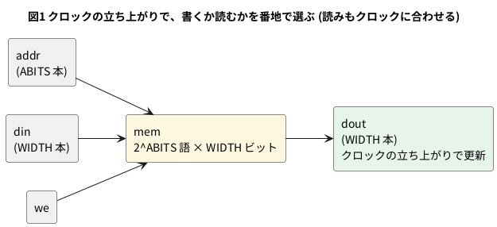

# 8-11 ブロック RAM

> [!WARNING]
> **この題は実機が要らない。** 数はすべて合成 (yosys) と配置配線 (nextpnr) の結果で、書き込みと測定は行っていない。
> Verilog は Verilator で動かして確かめた。

FPGA には、LUT と FF のほかに、データを溜めるための**ブロック RAM** が入っている。
Tang Nano 9K の FPGA (GW1NR-9) は、nextpnr の報告で `BSRAM: 26` 個 (8-8 の表)、8-2 では 468 kbit と書いた。
468 kbit ÷ 26 = **1 個が 18 kbit (18,432 ビット)** である。

この題では、Verilog の書き方でブロック RAM に入るか LUT で作られるかが変わることを、合成の報告で読む。

**組まない題である。** 実体配線図・Analog Discovery 3・`logic` の図は入れない。
メモリの配置の話で、ピンを使う回路は作らないため。

## ブロック RAM に入る形

yosys が Gowin のブロック RAM に対応づける形は、yosys の `share/yosys/gowin/brams.txt` に書いてある。
その中の 1 ポートの RAM (`$__GOWIN_SP_`) を読むと、次のとおり。

```text
ram block $__GOWIN_SP_ {
    abits 14;
    widths 1 2 4 9 18 36 per_port;
    ...
    port srsw "A" {
        clock posedge;
        ...
```

- 1 個のブロックは、**番地 14 ビット (16,384 語)** までで、**語の幅が 1・2・4・9・18・36 ビット**のどれか。
  16K × 1、8K × 2、4K × 4、2K × 9、1K × 18、512 × 36 の 6 通りで、容量はどれも 18,432 ビットまで
- ポートは `clock posedge` と書いてある。**クロックの立ち上がりに合わせて読み書きする**形だけが、ブロック RAM になる
- 同じファイルに、2 ポートの RAM (`$__GOWIN_DP_`。幅は 1・2・4・9・18) もある。この題では 1 ポートだけ扱う

## 論理図

RAM の中身は、番地を入れると 1 語が出る箱で、書くときは `we` を 1 にして `din` を入れる。




## Verilog

```verilog
// 1 つの読み書きポートの RAM。クロックに合わせて書き、クロックに合わせて読む
module ram #(
    parameter ABITS = 8,
    parameter WIDTH = 8
) (
    input                  clk,
    input                  we,
    input      [ABITS-1:0] addr,
    input      [WIDTH-1:0] din,
    output reg [WIDTH-1:0] dout
);
    reg [WIDTH-1:0] mem [0:(1 << ABITS) - 1];

    always @(posedge clk) begin
        if (we) mem[addr] <= din;
        dout <= mem[addr];
    end
endmodule
```

- `mem` の 2 次元の配列が RAM になる。`ABITS` が番地のビット数、`WIDTH` が語の幅
- **読み (`dout <= mem[addr]`) もクロックの `always` の中に書いた。** これがブロック RAM に入る形である
- 書いたのと同じクロックで同じ番地を読むと、`dout` には書く前の古い値が出る (`<=` なので)

```bash
verilator --lint-only -Wall ram.v
```

lint は警告 0 件。

### 動かす

256 語 × 8 ビット (`ABITS` = 8、`WIDTH` = 8) に 3 つ書き、読み出す。

```verilog
// ram (256 語 × 8 ビット) に 3 つ書き、読み出しが 1 クロック遅れることを見る
module tb_ram;
    reg        clk = 1'b0;
    reg        we = 1'b0;
    reg  [7:0] addr = 8'd0;
    reg  [7:0] din = 8'd0;
    wire [7:0] dout;

    ram #(.ABITS(8), .WIDTH(8)) dut (.clk(clk), .we(we), .addr(addr), .din(din), .dout(dout));

    always #5 clk = ~clk;

    task step(input w, input [7:0] a, input [7:0] d);
        begin
            we = w; addr = a; din = d;
            @(posedge clk); #1;
            $display("t=%0t  we=%b addr=%h din=%h  dout=%h", $time, w, a, d, dout);
        end
    endtask

    initial begin
        @(posedge clk); #1;
        step(1'b1, 8'h10, 8'hA5);   // 0x10 番地に A5 を書く
        step(1'b1, 8'h11, 8'h3C);
        step(1'b1, 8'h12, 8'h7E);
        step(1'b0, 8'h10, 8'h00);   // 0x10 番地を読む
        step(1'b0, 8'h11, 8'h00);
        step(1'b0, 8'h12, 8'h00);
        step(1'b0, 8'h20, 8'h00);   // 書いていない番地
        $finish;
    end
endmodule
```

```bash
verilator --binary --timing --top-module tb_ram tb.v ram.v
./obj_dir/Vtb_ram
```

```text
t=16  we=1 addr=10 din=a5  dout=00
t=26  we=1 addr=11 din=3c  dout=00
t=36  we=1 addr=12 din=7e  dout=00
t=46  we=0 addr=10 din=00  dout=a5
t=56  we=0 addr=11 din=00  dout=3c
t=66  we=0 addr=12 din=00  dout=7e
t=76  we=0 addr=20 din=00  dout=00
```

- 書いたクロックの `dout` は 00 (書く前の値)。読むときは、**番地を与えたクロックの立ち上がりのあとに** 書いた値が出る
- 書いていない番地 (0x20) は 00。シミュレーションでは `mem` の初期値が 0 になるだけで、実物の RAM が 0 から始まるとは限らない (下の ROM の節)

## 合成して、何に入ったかを読む

`ABITS` と `WIDTH` を変えて合成した。コマンドは 8-4 と同じ形で、`chparam` で値を渡す。

```bash
yosys -p "read_verilog ram.v; chparam -set ABITS 8 -set WIDTH 8 ram; synth_gowin -top ram; stat"
```

配置配線は、ピンの数を少なくするため、番地と書く値を 1 本のシフトレジスタで入れる小さな最上位で包んで通した
(`stat` の数にはこの包みの FF や LUT が入らない。下の表は RAM の部品の数だけ)。

| 番地 × 幅 | 容量 | yosys の部品 | nextpnr の BSRAM |
| --- | --- | --- | --- |
| 16 語 × 8 | 128 ビット | RAM16SDP4 × 2 + DFF × 8 | 0 / 26 |
| 256 語 × 8 | 2,048 ビット | SPX9 × 1 | 1 / 26 |
| 1,024 語 × 16 | 16,384 ビット | SPX9 × 1 | 1 / 26 |
| 2,048 語 × 16 | 32,768 ビット | SPX9 × 2 | 2 / 26 |
| 8,192 語 × 8 | 65,536 ビット | SP × 4 | 4 / 26 |
| 16,384 語 × 8 | 131,072 ビット | SP × 8 | 8 / 26 |
| 32,768 語 × 8 | 262,144 ビット | SP × 16 + LUT 10 + DFF 1 | 16 / 26 |
| 65,536 語 × 8 | 524,288 ビット | SP × 32 + LUT 36 + MUX2_LUT 24 + DFF 2 | 32 / 26 → **置けない** |

- yosys 0.33 と 0.69+274 で、RAM の部品の数は同じだった (LUT の数は版で変わる。8-8)
- **16 語の小さな RAM は、ブロック RAM を使わない。** LUT で作る RAM (`RAM16SDP4` = 16 語 × 4 ビット) が 2 個で、
  読みの出力に FF が 8 個付く。ブロックは 18 kbit 単位なので、128 ビットの RAM は LUT のほうに回された
- **256 語 × 8 は 1 ブロック。** 2,048 ビットしか使わないが、ブロックは 1 個丸ごと使う。残りの 16 kbit は、ほかの RAM と共有できない
- 容量が大きくなると、ブロックの数は容量 ÷ 16,384 に近い数で増える (8 ビット幅の 65,536 ビットで 4 個)
- **65,536 語 × 8 (512 kbit) は FPGA に入らない。** 合成は通るが、配置配線が `Unable to place cell ... no BELs remaining to implement cell type 'SP'` と言って止まった。
  ブロックが 26 個しか無い。8-2 の 468 kbit の中に入る RAM を設計する
- 512 語 × 32 ビットは、合成は SPX9 1 個で通ったが、配置配線 (上の包みを付けた形) が hold 時間の違反で止まった。
  原因は包みの作りか、この題では調べていない

### 読みをクロックに合わせないと

`dout` を `assign dout = mem[addr];` と書いて、読みをクロックから外した RAM (`ramasync`) を同じ値で合成した。

| 番地 × 幅 | ブロック RAM | LUT で作る RAM (RAM16SDP4) | LUT (0.33 / 0.69) | MUX2_LUT (0.33 / 0.69) |
| --- | --- | --- | --- | --- |
| 16 語 × 8 | 0 | 2 | 0 / 0 | 0 / 0 |
| 256 語 × 8 | 0 | 32 | 180 / 148 | 120 / 56 |
| 1,024 語 × 16 | 0 | 256 | 2,064 / 2,754 | 1,312 / 2,180 |

読みを組み合わせ回路で出す形は、ブロック RAM に入らない。LUT で RAM を作って、読み出しの選択を LUT と切り替えで組む。
**256 語 × 8 は、読みをクロックに合わせればブロック RAM 1 個と LUT 0 個で済むのに、LUT 180 個ほどになった。**
8,640 個の LUT しかない FPGA で 1,024 語 × 16 は 2 千個を超え、LUT 全体の 1/4〜1/3 になる。

## 初期値を入れる — `$readmemh`

ROM の中身は、16 進のファイルから `$readmemh` で入れる (10-1)。ここでは、中身が `i × 7 + 3` の下位 8 ビットのファイル (`rom.hex`。
0 番地から 03・0a・11・18 …) で、256 語 × 8 の ROM を作る。

```verilog
// 256 語 × 8 ビットの ROM。中身は rom.hex から読む
module rom256 (
    input            clk,
    input      [7:0] addr,
    output reg [7:0] dout
);
    reg [7:0] mem [0:255];

    initial $readmemh("rom.hex", mem);

    always @(posedge clk) dout <= mem[addr];
endmodule
```

lint は警告 0 件。0・1・2・255 番地を読むと、`03` `0a` `11` `fc` が出た (255 × 7 + 3 = 1788 の下位 8 ビットは 0xfc)。

合成した結果は、**ブロック RAM でなく LUT** だった。

| 書き方 | yosys 0.33 | yosys 0.69 |
| --- | --- | --- |
| そのまま (`reg [7:0] mem [0:255];`) | LUT 33 + MUX2_LUT 26 + DFF 8 | LUT 33 + MUX2_LUT 26 + DFF 8 |
| `(* rom_style = "block" *)` を付ける | SPX9 × 1 | SPX9 × 1 |

- 書き込みのポートが無い (ROM の) メモリは、yosys は LUT の表に直す。256 語では LUT が 33 個ほど
- `(* rom_style = "block" *)` を `reg` の前に付けると、ブロック RAM 1 個になった。`(* ram_style = "block" *)` でも同じ結果だった (yosys 0.33 で確かめた)
- 付けたときの SPX9 の初期値のパラメータ (`INIT_RAM_00`) の先頭の 3 語は、`rom.hex` と同じ `03` `0a` `11` だった (`top.json` の中身を読んだ)。
  ブロック RAM の初期値はビットストリームに入って、電源を入れたときから入っている
- 小さな ROM は LUT に直すほうが、読みが速く、ブロックを使わない。大きな ROM を `block` にすると、LUT が空く

## 見るべき値

すべて合成と配置配線の結果で、実機で測った値ではない。道具は yosys 0.33 と 0.69+274、nextpnr-himbaechel 0.11.1-54。

| 項目 | 見るべき値 | どこで得たか |
| --- | --- | --- |
| ブロック RAM の数と大きさ | 26 個。1 個 18 kbit | nextpnr の `BSRAM: 26` と 8-2 の 468 kbit |
| 256 語 × 8 (クロックで読む) | SPX9 1 個。nextpnr で BSRAM 1 / 26 | yosys の `stat`・nextpnr |
| 16 語 × 8 | ブロックを使わず RAM16SDP4 2 個 | 同上 |
| 8,192 語 × 8 | SP 4 個。BSRAM 4 / 26 | 同上 |
| 65,536 語 × 8 | BSRAM 32 / 26 で置けない | nextpnr のエラー |
| 読みをクロックに合わせない 256 語 × 8 | ブロックを使わず LUT 180 個 (0.33) | yosys の `stat` |
| 256 語 × 8 の ROM | 既定で LUT 33 個、`rom_style = "block"` で SPX9 1 個 | yosys の `stat` |

実機で RAM を書き込んで読み戻し、読み出しの 1 クロックの遅れと初期値を Logic で見るのは、この題では行っていない。
この題の数は、書き込む前に分かる範囲に限る。

## シミュレーションでの確かめ (対象外を含む)

Verilator 5.042 と Yosys 0.33 で、本文の `ram.v` `tb_ram.v` `rom256.v` を走らせ直した。
`ramasync` は本文の記述 (`assign dout = mem[addr];`) から書き、`rom.hex` は `i × 7 + 3` の下位 8 ビットで作った。
置き場は `sim/11-block-ram.v` `sim/11-block-ram-async.v` `sim/11-block-ram-rom.v` `sim/11-block-ram-rom.hex`
`sim/11-block-ram-tb.v` `sim/11-block-ram-rom-tb.v`。

| 項目 | 本文の数字 | 実行結果 | 判定 |
| --- | --- | --- | --- |
| lint (`ram.v`・`rom256.v`) | 警告 0 件 | 0 件 | 合った |
| `tb_ram` の 7 行 | dout = 00・00・00・a5・3c・7e・00 | 同じ | 合った |
| 合成 16 × 8 | RAM16SDP4 × 2 + DFF × 8 | 同じ | 合った |
| 合成 256 × 8・1024 × 16 | SPX9 × 1 | 同じ | 合った |
| 合成 2048 × 16 | SPX9 × 2 | 同じ | 合った |
| 合成 8192 × 8・16384 × 8 | SP × 4・SP × 8 | 同じ | 合った |
| 合成 32768 × 8 | SP × 16 + LUT 10 + DFF 1 | 同じ | 合った |
| 合成 65536 × 8 | SP × 32 + LUT 36 + MUX2_LUT 24 + DFF 2 | 同じ | 合った |
| 合成 512 × 32 | SPX9 × 1 | 同じ | 合った |
| 読みを組み合わせにした (16 × 8・256 × 8・1024 × 16) | RAM16SDP4 が 2・32・256、LUT 0・180・2,064、MUX2_LUT 0・120・1,312 | 同じ | 合った |
| ROM 0・1・2・255 番地 | 03・0a・11・fc | 同じ | 合った |
| ROM の合成 (そのまま) | LUT 33 + MUX2_LUT 26 + DFF 8 | 同じ | 合った |
| ROM に `rom_style` / `ram_style = "block"` | SPX9 × 1 | 同じ | 合った |

この表は `-json` を付けずに合成した結果である。10-2 の RAM の表は `-json` を付けた 0.33 で LUT になっていた
(`-json` の有無で 512 語以上が LUT になるか SPX9 になるかが変わった。10-2 の確かめを参照)。

確かめていない数: yosys 0.69 の列、nextpnr の BSRAM の数と「32 / 26 で置けない」エラー、512 × 32 の hold 違反 (nextpnr が無い)。

## 出典

自作。

- ブロック RAM の形 (番地 14 ビット・幅 1・2・4・9・18・36、`clock posedge`): OSS CAD Suite (2026-10-10) の yosys の
  `share/yosys/gowin/brams.txt`。LUT RAM (`$__GOWIN_LUTRAM_`、`abits 4`・`width 4`) は同じ場所の `lutrams.txt`
- 個数 (26 個)・容量 (468 kbit): nextpnr の `Device utilisation` の `BSRAM` の行と、8-2 の表
  (Sipeed の [Tang Nano 9K のページ](https://wiki.sipeed.com/hardware/en/tang/Tang-Nano-9K/Nano-9K.html))
- `rom_style` / `ram_style` の属性: yosys の `memory_libmap` が受けた (結果を `stat` で確かめた)
