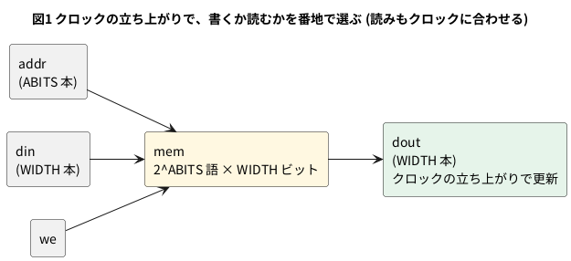

# 8-11 ブロック RAM

> [!WARNING]
> **この題は実機が要らない。** 数はすべて合成 (yosys) と配置配線 (nextpnr) の結果で、書き込みと測定は行っていない。
> Verilog は Verilator で動かして確かめた。

FPGA には LUT と FF のほかに、データを溜める**ブロック RAM** がある。
Tang Nano 9K の GW1NR-9 は nextpnr の報告で `BSRAM: 26` 個 (8-8 の表)、8-2 では 468 kbit。
468 kbit ÷ 26 = **1 個が 18 kbit (18,432 ビット)** である。
Verilog の書き方でブロック RAM に入るか LUT になるかが変わることを、合成の報告で読む。

実体配線図・Analog Discovery 3・`logic` の図は入れない (**組まない題**。メモリの配置の話で、ピンを使う回路は作らない)。

## ブロック RAM に入る形

yosys が Gowin のブロック RAM に対応づける形は `share/yosys/gowin/brams.txt` にある。1 ポートの RAM (`$__GOWIN_SP_`) は次のとおり。

```text
ram block $__GOWIN_SP_ {
    abits 14;
    widths 1 2 4 9 18 36 per_port;
    ...
    port srsw "A" {
        clock posedge;
        ...
```

- 1 個のブロックは、**番地 14 ビット (16,384 語)** までで、**語の幅が 1・2・4・9・18・36 ビット**のどれか。
  16K × 1、8K × 2、4K × 4、2K × 9、1K × 18、512 × 36 の 6 通りで、容量はどれも 18,432 ビットまで
- ポートは `clock posedge` と書いてある。**クロックの立ち上がりに合わせて読み書きする**形だけが、ブロック RAM になる
- 同じファイルに 2 ポートの RAM (`$__GOWIN_DP_`。幅は 1・2・4・9・18) もある。ここでは 1 ポートだけ扱う

## 論理図

RAM は番地を入れると 1 語が出る箱で、書くときは `we` を 1 にして `din` を入れる。




## Verilog

```verilog
// 1 つの読み書きポートの RAM。クロックに合わせて書き、クロックに合わせて読む
module ram #(
    parameter ABITS = 8,
    parameter WIDTH = 8
) (
    input                  clk,
    input                  we,
    input      [ABITS-1:0] addr,
    input      [WIDTH-1:0] din,
    output reg [WIDTH-1:0] dout
);
    reg [WIDTH-1:0] mem [0:(1 << ABITS) - 1];

    always @(posedge clk) begin
        if (we) mem[addr] <= din;
        dout <= mem[addr];
    end
endmodule
```

- `mem` の配列が RAM になる。`ABITS` が番地のビット数、`WIDTH` が語の幅
- **読み (`dout <= mem[addr]`) もクロックの `always` の中に書いた。** これがブロック RAM に入る形である
- 書いたのと同じクロックで同じ番地を読むと、`dout` には書く前の古い値が出る (`<=` なので)

```bash
verilator --lint-only -Wall ram.v
```

lint は警告 0 件。

### 動かす

256 語 × 8 ビット (`ABITS` = 8、`WIDTH` = 8) に 3 つ書き、読み出す。

```verilog
// ram (256 語 × 8 ビット) に 3 つ書き、読み出しが 1 クロック遅れることを見る
module tb_ram;
    reg        clk = 1'b0;
    reg        we = 1'b0;
    reg  [7:0] addr = 8'd0;
    reg  [7:0] din = 8'd0;
    wire [7:0] dout;

    ram #(.ABITS(8), .WIDTH(8)) dut (.clk(clk), .we(we), .addr(addr), .din(din), .dout(dout));

    always #5 clk = ~clk;

    task step(input w, input [7:0] a, input [7:0] d);
        begin
            we = w; addr = a; din = d;
            @(posedge clk); #1;
            $display("t=%0t  we=%b addr=%h din=%h  dout=%h", $time, w, a, d, dout);
        end
    endtask

    initial begin
        @(posedge clk); #1;
        step(1'b1, 8'h10, 8'hA5);   // 0x10 番地に A5 を書く
        step(1'b1, 8'h11, 8'h3C);
        step(1'b1, 8'h12, 8'h7E);
        step(1'b0, 8'h10, 8'h00);   // 0x10 番地を読む
        step(1'b0, 8'h11, 8'h00);
        step(1'b0, 8'h12, 8'h00);
        step(1'b0, 8'h20, 8'h00);   // 書いていない番地
        $finish;
    end
endmodule
```

```bash
verilator --binary --timing --top-module tb_ram tb.v ram.v
./obj_dir/Vtb_ram
```

```text
t=16  we=1 addr=10 din=a5  dout=00
t=26  we=1 addr=11 din=3c  dout=00
t=36  we=1 addr=12 din=7e  dout=00
t=46  we=0 addr=10 din=00  dout=a5
t=56  we=0 addr=11 din=00  dout=3c
t=66  we=0 addr=12 din=00  dout=7e
t=76  we=0 addr=20 din=00  dout=00
```

- 書いたクロックの `dout` は 00 (書く前の値)。読むときは、**番地を与えたクロックの立ち上がりのあとに** 書いた値が出る
- 書いていない番地 (0x20) は 00。シミュレーションでは `mem` の初期値が 0 になるだけで、実物の RAM が 0 から始まるとは限らない (初期値は 8-24)

## 合成して、何に入ったかを読む

`ABITS` と `WIDTH` を `chparam` で変えて合成した (ほかは 8-4 と同じ)。

```bash
yosys -p "read_verilog ram.v; chparam -set ABITS 8 -set WIDTH 8 ram; synth_gowin -top ram; stat"
```

配置配線は、ピンを減らすため、番地と書く値を 1 本のシフトレジスタで入れる小さな最上位で包んで通した
(下の表は RAM の部品の数だけで、包みの FF や LUT は入らない)。

| 番地 × 幅 | 容量 | yosys の部品 | nextpnr の BSRAM |
| --- | --- | --- | --- |
| 16 語 × 8 | 128 ビット | RAM16SDP4 × 2 + DFF × 8 | 0 / 26 |
| 256 語 × 8 | 2,048 ビット | SPX9 × 1 | 1 / 26 |
| 1,024 語 × 16 | 16,384 ビット | SPX9 × 1 | 1 / 26 |
| 2,048 語 × 16 | 32,768 ビット | SPX9 × 2 | 2 / 26 |
| 8,192 語 × 8 | 65,536 ビット | SP × 4 | 4 / 26 |
| 16,384 語 × 8 | 131,072 ビット | SP × 8 | 8 / 26 |
| 32,768 語 × 8 | 262,144 ビット | SP × 16 + LUT 10 + DFF 1 | 16 / 26 |
| 65,536 語 × 8 | 524,288 ビット | SP × 32 + LUT 36 + MUX2_LUT 24 + DFF 2 | 32 / 26 → **置けない** |

- yosys 0.33 と 0.69+274 で、RAM の部品の数は同じだった (LUT の数は版で変わる。8-8)
- **16 語の小さな RAM は、ブロック RAM を使わない。** LUT で作る RAM (`RAM16SDP4` = 16 語 × 4 ビット) が 2 個で、
  読みの出力に FF が 8 個付く。ブロックは 18 kbit 単位なので、128 ビットの RAM は LUT のほうに回された
- **256 語 × 8 は 1 ブロック。** 2,048 ビットしか使わないが、ブロックは 1 個丸ごと使い、残りの 16 kbit はほかの RAM と共有できない
- 容量が大きくなると、ブロックの数は容量 ÷ 16,384 に近い数で増える (8 ビット幅の 65,536 ビットで 4 個)
- **65,536 語 × 8 (512 kbit) は FPGA に入らない。** 合成は通るが、配置配線が `Unable to place cell ... no BELs remaining to implement cell type 'SP'` と言って止まった。
  ブロックが 26 個しか無い。8-2 の 468 kbit の中に入る RAM を設計する
- 512 語 × 32 ビットは、合成は SPX9 1 個で通ったが、配置配線 (上の包みを付けた形) が hold 時間の違反で止まった。
  原因 (包みの作りか) は調べていない

### 読みをクロックに合わせないと

`dout` を `assign dout = mem[addr];` と書いて、読みをクロックから外した RAM (`ramasync`) を同じ値で合成した。

| 番地 × 幅 | ブロック RAM | LUT で作る RAM (RAM16SDP4) | LUT (0.33 / 0.69) | MUX2_LUT (0.33 / 0.69) |
| --- | --- | --- | --- | --- |
| 16 語 × 8 | 0 | 2 | 0 / 0 | 0 / 0 |
| 256 語 × 8 | 0 | 32 | 180 / 148 | 120 / 56 |
| 1,024 語 × 16 | 0 | 256 | 2,064 / 2,754 | 1,312 / 2,180 |

読みを組み合わせ回路で出す形は、ブロック RAM に入らない。LUT で RAM を作って、読み出しの選択を LUT と切り替えで組む。
**256 語 × 8 は、読みをクロックに合わせればブロック RAM 1 個と LUT 0 個で済むのに、LUT 180 個ほどになった。**
LUT が 8,640 個の FPGA で、1,024 語 × 16 は 2 千個を超え、全体の 1/4〜1/3 になる。

ROM に `$readmemh` で初期値を入れ、ブロック RAM に入るか LUT になるかを読むのは 8-24 に分けた。

## 見るべき値

合成と配置配線の結果 (測った値ではない)。道具は yosys 0.33 と 0.69+274、nextpnr-himbaechel 0.11.1-54。

| 項目 | 見るべき値 | どこで得たか |
| --- | --- | --- |
| ブロック RAM の数と大きさ | 26 個。1 個 18 kbit | nextpnr の `BSRAM: 26` と 8-2 の 468 kbit |
| 256 語 × 8 (クロックで読む) | SPX9 1 個。nextpnr で BSRAM 1 / 26 | yosys の `stat`・nextpnr |
| 16 語 × 8 | ブロックを使わず RAM16SDP4 2 個 | 同上 |
| 8,192 語 × 8 | SP 4 個。BSRAM 4 / 26 | 同上 |
| 65,536 語 × 8 | BSRAM 32 / 26 で置けない | nextpnr のエラー |
| 読みをクロックに合わせない 256 語 × 8 | ブロックを使わず LUT 180 個 (0.33) | yosys の `stat` |

実機で RAM を書いて読み戻し、読み出しの 1 クロックの遅れを Logic で見るのは行っていない。数は書き込む前に分かる範囲に限る。

## シミュレーションでの確かめ

Verilator 5.042・Yosys 0.33・Yosys 0.70+16・nextpnr-himbaechel 0.11.1-63 で、本文の `ram.v` `tb_ram.v` を走らせ直した。
`ramasync` は本文の記述 (`assign dout = mem[addr];`) から書いた。
置き場は `sim/11-block-ram.v` `sim/11-block-ram-async.v` `sim/11-block-ram-tb.v` (ROM の分は 8-24)。
配置配線の包みは `sim/11-block-ram-wrap.v` (`ramwrap`。番地・書く値・`we` を 1 本のシフトレジスタで入れ、読んだ値の排他的論理和を 1 本で出す) と `sim/11-block-ram-wrap.cst`。

| 項目 | 本文の数字 | 実行結果 | 判定 |
| --- | --- | --- | --- |
| lint (`ram.v`) | 警告 0 件 | 0 件 | 合った |
| `tb_ram` の 7 行 | dout = 00・00・00・a5・3c・7e・00 | 同じ | 合った |
| 合成 16 × 8 | RAM16SDP4 × 2 + DFF × 8 | 同じ | 合った |
| 合成 256 × 8・1024 × 16 | SPX9 × 1 | 同じ | 合った |
| 合成 2048 × 16 | SPX9 × 2 | 同じ | 合った |
| 合成 8192 × 8・16384 × 8 | SP × 4・SP × 8 | 同じ | 合った |
| 合成 32768 × 8 | SP × 16 + LUT 10 + DFF 1 | 同じ | 合った |
| 合成 65536 × 8 | SP × 32 + LUT 36 + MUX2_LUT 24 + DFF 2 | 同じ | 合った |
| 合成 512 × 32 | SPX9 × 1 | 同じ | 合った |
| 読みを組み合わせにした (16 × 8・256 × 8・1024 × 16) | RAM16SDP4 が 2・32・256、LUT 0・180・2,064、MUX2_LUT 0・120・1,312 | 同じ | 合った |
| yosys 0.70+16 の RAM の部品 (16×8 から 65,536×8、512×32) | 上の 0.33 の表と同じ部品の数 | 同じ。LUT・DFF・MUX2_LUT の付随の数も同じ | 合った |
| 読みを組み合わせにした (0.70+16) | LUT 148・2,754、MUX2_LUT 56・2,180 (256 × 8・1,024 × 16) | 同じ | 合った |
| nextpnr の BSRAM (16×8・256×8・1,024×16・2,048×16・8,192×8・16,384×8・32,768×8) | 0・1・1・2・4・8・16 / 26 | 同じ (0.70+16 の `json`) | 合った |
| nextpnr の 65,536 × 8 | BSRAM 32 / 26 で置けない (`no BELs remaining to implement cell type 'SP'`) | 同じ | 合った |
| nextpnr の 512 × 32 | 合成は SPX9 1 個、配置配線は hold 時間の違反で止まる | `ERROR: Hold/min time violation for clock 'posedge u.clk'` (BSRAM 1 / 26) で止まった | 合った |

この表は `-json` を付けずに合成した結果である。10-2 の RAM の表は `-json` を付けた 0.33 で LUT になっていた
(`-json` の有無で 512 語以上が LUT になるか SPX9 になるかが変わった。10-2 の確かめを参照)。

yosys 0.33 の `json` を nextpnr に通すと、512 語以上が LUT の RAM (`RAM16SDP4`) になっているため、1,024 × 16 以上は配置が通らない
(`Unable to place cell ... RAM16SDP4`)。上の `-json` の差と同じ現象で、本文の BSRAM の数は 0.69+274 の結果である。
手元の 0.70+16 はこの表の数を再現した。

## 出典

自作。

- ブロック RAM の形 (番地 14 ビット・幅 1・2・4・9・18・36、`clock posedge`): OSS CAD Suite (2026-10-10) の yosys の
  `share/yosys/gowin/brams.txt`。LUT RAM (`$__GOWIN_LUTRAM_`、`abits 4`・`width 4`) は同じ場所の `lutrams.txt`
- 個数 (26 個)・容量 (468 kbit): nextpnr の `Device utilisation` の `BSRAM` の行と、8-2 の表
  (Sipeed の [Tang Nano 9K のページ](https://wiki.sipeed.com/hardware/en/tang/Tang-Nano-9K/Nano-9K.html))
