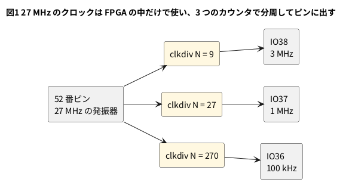

# 8-13 ブレッドボードに出す信号は 3 MHz まで — 速いクロックは分周して出す

> [!WARNING]
> **この題は実機で組んでいない。** Verilog は Verilator で動かして値を確かめ、合成・配置配線・ビットストリーム作りまで
> 手元の PC で通した。書き込みと、AD3 での測定は実行していない。
> 「見るべき値」は計算値とシミュレーションの値で、測った値ではない。

Tang Nano 9K の中のクロックは 27 MHz で、8-10 の PLL を使えば 108 MHz にもなる。
FPGA の中ならこの速さで動く。しかし、**ブレッドボードに出して AD3 で測る信号は 3 MHz 以下**にする。
この本の入門までの題の決まりで、理由は、ブレッドボードの浮遊容量と AD3 のオシロの帯域 (9 MHz) の内側なら、
組んだとおりに測れるからである (`.claude/skills/workbook-writing/SKILL.md` の「段と周波数」)。

ピンに出す信号は、速いクロックを**分周して**作る。この題では 27 MHz から 3 MHz・1 MHz・100 kHz の 3 本を作る。

## 出せる周波数

27 MHz を N 分周すると、周期は N クロック、周波数は 27 MHz ÷ N になる。3 MHz 以下にするには N ≧ 9 である。

| N | 周波数 | H と L のクロック数 | デューティ比 |
| --- | --- | --- | --- |
| 9 | 3 MHz | H 4・L 5 | 44.4 % |
| 10 | 2.7 MHz | H 5・L 5 | 50 % |
| 18 | 1.5 MHz | H 9・L 9 | 50 % |
| 27 | 1 MHz | H 13・L 14 | 48.1 % |
| 54 | 500 kHz | H 27・L 27 | 50 % |
| 270 | 100 kHz | H 135・L 135 | 50 % |

- **N が奇数だと、H と L が同じ長さにならない。** 1 クロックを半分にはできないので、片方が 1 クロック長い。
  3 MHz (N = 9) は H 4 クロック (148 ns)・L 5 クロック (185 ns)
- 27 MHz をそのままピンに出すと、Logic の標本化 (AD3 の上限は 125 MS/s) では 1 周期が 4.6 標本にしかならない (125 ÷ 27 = 4.63、計算値)。
  標本化は一番速い変化の 4 倍以上、というのが `instrument-screen` の目安で、1 周期の中に H と L が 1 標本ずつしか入らない
- 108 MHz は上限を超える (125 ÷ 108 = 1.2 標本)。108 MHz の PLL の出力 (8-10) は、ピンに出さずに分周して使う

## 論理図




3 つの `clkdiv` は、どれも 27 MHz のクロック (`clk`) で動くカウンタで、出力は FF の出力そのまま。
**分周した信号をほかの回路のクロックにしない。** ピンへ出すだけにする (2-17)。

## Verilog

```verilog
// クロックを N 分周した方形波を出す。カウンタが 0 から N - 1 まで数え、前半の N / 2 クロックだけ 1 にする
module clkdiv #(
    parameter N = 9
) (
    input      clk,
    input      rst,
    output reg out
);
    localparam W = $clog2(N);
    localparam [W-1:0] LAST = N[W-1:0] - 1'b1;
    localparam [W-1:0] HIGH = N[W-1:0] / 2;     // 1 にするクロック数 (N が奇数なら切り捨て)

    reg  [W-1:0] cnt;
    wire [W-1:0] nxt = (cnt == LAST) ? {W{1'b0}} : cnt + 1'b1;

    always @(posedge clk)
        if (rst) begin
            cnt <= {W{1'b0}};
            out <= 1'b1;
        end else begin
            cnt <= nxt;
            out <= (nxt < HIGH);                // 1 つ先のカウンタの値で決める (out は FF の出力)
        end
endmodule
```

```verilog
// 27 MHz を分周して、ブレッドボードに出せる周波数 (3 MHz 以下) の信号を 3 本出す
module top_div (
    input  clk,        // 52 番ピン。ボードの 27 MHz
    input  rst_n,      // 4 番ピン。ボードの押しボタン (押すと 0)
    output out_3m,     // IO38。27 MHz ÷ 9   = 3 MHz
    output out_1m,     // IO37。27 MHz ÷ 27  = 1 MHz
    output out_100k    // IO36。27 MHz ÷ 270 = 100 kHz
);
    wire rst = ~rst_n;

    clkdiv #(.N(9))   d3m   (.clk(clk), .rst(rst), .out(out_3m));
    clkdiv #(.N(27))  d1m   (.clk(clk), .rst(rst), .out(out_1m));
    clkdiv #(.N(270)) d100k (.clk(clk), .rst(rst), .out(out_100k));
endmodule
```

- `out` は `nxt` (1 つ先のカウンタの値) で決めて FF に入れる。カウンタの値の比べ (`cnt < HIGH`) をそのままピンに出すと、
  カウンタの桁が変わる瞬間にひげが出ることがある。FF の出力だけを出す
- リセット中は `out` を 1 にし、カウンタの 0 で H から始まる。3 つの出力は、リセットが解けたとき立ち上がりがそろう
- `HIGH` を `N / 2` (切り捨て) にしたので、N が奇数なら H が短い。50 % にしたければ偶数の N にする

制約ファイル `top.cst` は、クロック・リセット・3 つの出力の 5 組。

```text
IO_LOC "clk" 52;
IO_PORT "clk" IO_TYPE=LVCMOS33 PULL_MODE=UP;
IO_LOC "rst_n" 4;
IO_PORT "rst_n" PULL_MODE=UP;
IO_LOC "out_3m" 38;
IO_PORT "out_3m" IO_TYPE=LVCMOS33 DRIVE=8;
IO_LOC "out_1m" 37;
IO_PORT "out_1m" IO_TYPE=LVCMOS33 DRIVE=8;
IO_LOC "out_100k" 36;
IO_PORT "out_100k" IO_TYPE=LVCMOS33 DRIVE=8;
```

```bash
verilator --lint-only -Wall top_div.v clkdiv.v
```

lint は警告 0 件。

## 動かす (シミュレーション)

クロックをそのまま 1 クロックずつ数え、2700 クロック (270 クロックの 10 倍。3 つの周期 9・27・270 の最小公倍数が 270) のあいだの
H と L のクロック数を合計する。

```verilog
// 27 MHz の代わりに 1 クロック = 2 時間単位で動かし、out_3m・out_1m・out_100k の H と L のクロック数を数える
module tb_div;
    reg clk = 1'b0;
    reg rst_n = 1'b0;
    wire out_3m, out_1m, out_100k;
    integer n = 0;
    integer h3 = 0, l3 = 0, h1 = 0, l1 = 0, hk = 0, lk = 0;

    top_div dut (.clk(clk), .rst_n(rst_n), .out_3m(out_3m), .out_1m(out_1m), .out_100k(out_100k));

    always #1 clk = ~clk;

    always @(posedge clk) if (rst_n) begin
        if (out_3m)   h3 = h3 + 1; else l3 = l3 + 1;
        if (out_1m)   h1 = h1 + 1; else l1 = l1 + 1;
        if (out_100k) hk = hk + 1; else lk = lk + 1;
        n = n + 1;
    end

    initial begin
        #10 rst_n = 1'b1;
        // 2700 クロック = 270 クロック (3 つの周期 9・27・270 の最小公倍数) の 10 倍を数える
        wait (n == 2700);
        $display("out_3m   : H %0d クロック・L %0d クロック (2700 クロックの合計)", h3, l3);
        $display("out_1m   : H %0d クロック・L %0d クロック", h1, l1);
        $display("out_100k : H %0d クロック・L %0d クロック", hk, lk);
        $finish;
    end
endmodule
```

```bash
verilator --binary --timing --top-module tb_div tb.v top_div.v clkdiv.v
./obj_dir/Vtb_div
```

```text
out_3m   : H 1200 クロック・L 1500 クロック (2700 クロックの合計)
out_1m   : H 1300 クロック・L 1400 クロック
out_100k : H 1350 クロック・L 1350 クロック
```

- 3 MHz は 300 周期で、1 周期あたり H 4・L 5 (1200 ÷ 300 = 4、1500 ÷ 300 = 5)。1 MHz は 100 周期で H 13・L 14。100 kHz は 10 周期で H 135・L 135
- 上の表の H と L のクロック数と合う

## 合成・配置配線

8-4 と同じ 3 手を通した (書き込みは未実行)。

```bash
yosys -p "read_verilog top_div.v clkdiv.v; synth_gowin -top top_div -json top.json; stat"
nextpnr-himbaechel --json top.json --write pnr.json \
    --device GW1NR-LV9QN88PC6/I5 --vopt family=GW1N-9C --vopt cst=top.cst --freq 27
gowin_pack -d GW1N-9C -o top.fs pnr.json
```

| 見る所 | yosys 0.33 | yosys 0.69+274 |
| --- | --- | --- |
| LUT (LUT1〜4) | 56 | 33 |
| MUX2_LUT | 4 | 12 |
| ALU | 32 | 30 |
| FF | 21 | 21 |
| nextpnr の LUT4 (LUT + ALU) | 98 / 8,640 | 75 / 8,640 |
| nextpnr の最高の周波数の見積り | 151.38 MHz (27 MHz で PASS) | 222.22 MHz (27 MHz で PASS) |

FF は 21 個で、カウンタ 4 + 5 + 9 ビットと、出力の FF 3 個 (4 + 5 + 9 + 3 = 21、版によらない)。

### 27 MHz をそのままピンに出すと

`assign out_raw = clk;` だけの回路 (`top_raw`) も、道具は通した。

| 回路 | 結果 |
| --- | --- |
| `top_raw` (27 MHz をそのままピンへ) | 合成・配置配線・ビットストリーム作りとも**エラー無しで通った** (IOB 2 / 276、`.fs` は 2,069,320 文字) |

**道具は、速すぎる信号をブレッドボードへ出すことを止めない。** 8-5 の 1.8 V のピンと同じで、自分で見張る。
ピンに出す前に、`assign` で出す信号が 27 MHz のクロックそのものでないかを `top.v` で確かめる。

## 回路図

接続は 8-3 と同じ。この題では IO38・IO37・IO36 の 3 本を測る。

```circuit
# 回路図 (tommie-fence の circuit フェンス)
title: 図2 IO38・IO37・IO36 を AD3 の DIO0・DIO1・DIO2 で読む。GND は共通
parts:
  AD:
    type: device
    at: 1,3.8
    label: AD3
    pins: [DIO0, DIO1, DIO2, GND]
    turn: mirror
  U1: tang-nano-9k 8,6
  G1: ground 3.5,5
  G2: ground 10.5,9.3
wires:
  - AD.DIO0 -| 5,3.24
  - U1.IO38 |- 5,3.24
  - AD.DIO1 -| 5.5,3.49
  - U1.IO37 |- 5.5,3.49
  - AD.DIO2 -| 6,3.74
  - U1.IO36 |- 6,3.74
  - AD.GND -| 3.5,5
  - U1.GND |- 10.5,8.74 -- 10.5,9.3
```


- 27 MHz のクロック (52 番) とリセットの押しボタン (4 番) は、ボードの上で FPGA につながっている

## 部品表

| 部品 | 値・型番 | 数 | 役 |
| --- | --- | --- | --- |
| U1 | Sipeed Tang Nano 9K (GW1NR-9) | 1 | FPGA ボード。USB-C から給電と書き込み |
| — | ブレッドボード (half、30 列) | 1 | |
| — | ジャンパ線 | 5 本 | GND の 2 本と DIO の 3 本 |
| AD | Analog Discovery 3 | 1 | Logic で IO38・IO37・IO36 を測る |

電源は教科書の既定の 5 V ではなく **3.3 V** (FPGA のピン)。FPGA のピンに 5 V を入れると壊れるため (0-3)。

## 実体配線図

```bread
# ブレッドボードの実体配線図 (tommie-fence の bread フェンス)
title: 図3 配線は 8-3 のまま。j1〜j3 を DIO0〜DIO2 へ
board: half
parts:
  U1: tang-nano-9k @ b1
  AD:
    type: device
    at: bottom
    label: AD3 Logic
    pins: [DIO0, DIO1, DIO2, GND]
wires:
  - a23 -- -t23 black
  - -t29 -- -b29 black
  - AD.GND -- -b27 black
  - AD.DIO0 -- j1 green
  - AD.DIO1 -- j2 yellow
  - AD.DIO2 -- j3 orange
notes:
  - text: 給電は Tang Nano 9K の USB-C (5 V)。電源レールは GND (−) だけ使う
```


- 置き方と線の色は 8-3 と同じ。IO38・IO37・IO36 は 1・2・3 番ピンで、下の列の 1・2・3 列
- 出す信号は 3 MHz 以下。線は短いほうがよい

## 計器の設定

| 計器 | 設定 |
| --- | --- |
| Logic | DIO0〜DIO2 を Enable。DIO は 3.3 V。GND を共通にする (0-4) |
| 時間軸 | 200 ns/div (窓 2 µs (マイクロ秒))。3 MHz が 6 周期、1 MHz が 2 周期入る |
| 標本化 | 100 MS/s。3 MHz の H (148 ns) の中に 14 標本 |
| トリガ | DIO0 (3 MHz) の立ち上がり |

## Logic に見えるはずの画面

```logic
# ロジックアナライザの画面 (tommie-fence の logic フェンス)
title: 図4 同じ 27 MHz から、3 MHz・1 MHz・100 kHz が立ち上がりをそろえて出る
device: ad3
time: 200ns/div
start: -200ns
sample: 100MHz
signals:
  out_3m:   dio0 clock 3MHz duty 44%
  out_1m:   dio1 clock 1MHz duty 48%
  out_100k: dio2 clock 100kHz
cursors: [74ns, 1.074us]
trigger: out_3m rising at 0s
```


- 3 つの信号は、リセットが解けたクロックで同時に立ち上がる (t = 0)。画面は、この立ち上がりにトリガをかけた形
- カーソルは H の中 (立ち上がりから 74 ns 後) と、そこから 1 µs あとに置いた。ΔX が 1 µs、1/ΔX が 1 MHz
- 3 MHz は 1 µs のあいだに 3 周期、100 kHz はこの窓の中では H のまま。100 kHz の周期 10 µs を見るには窓を 20 µs (2 µs/div) 以上にする

## 見るべき値

計算値とシミュレーションの値。実機で測っていない。

| 項目 | 見るべき値 | どこで得たか |
| --- | --- | --- |
| IO38 の周期と周波数 | 333 ns・3.000 MHz (目安) | 27 MHz ÷ 9 (計算値)。実際は水晶のずれ (ppm) の分だけずれる |
| IO38 の H と L | 148 ns・185 ns (目安。デューティ比 44.4 %) | 4 クロック・5 クロック ÷ 27 MHz (計算値) |
| IO37 の周期 | 1.000 µs (目安) | 27 クロック ÷ 27 MHz (計算値) |
| IO37 の H と L | 481 ns・519 ns (目安) | 13 クロック・14 クロック (計算値。シミュレーションで 13・14 を確かめた) |
| IO36 の周期 | 10.00 µs (目安) | 270 クロック ÷ 27 MHz (計算値) |
| 3 本の立ち上がりのずれ | 0 (そろう。目安) | リセット中は 3 本とも 1、解けたクロックで同時に数え始める |
| 使った量 | LUT4 98 (0.33) / 75 (0.69)・FF 21・IOB 5 | nextpnr |

実機で測ったら、3 MHz の H の幅 (予想 148 ns) を書き加える。ΔX の読み (1 µs の窓の中の 3 周期) を 100 MS/s の 10 ns 刻みで確かめられる。
もし 27 MHz (または 108 MHz) をピンに出して測るなら、それはこの本の範囲外で、題を分けて扱う。

## シミュレーションでの確かめ

Verilator 5.042・Yosys 0.33・Yosys 0.70+16・nextpnr-himbaechel 0.11.1-63・gowin_pack で、本文の `clkdiv.v` `top_div.v` `tb_div.v` を走らせ直した。
置き場は `sim/13-divide-for-breadboard-clkdiv.v` `sim/13-divide-for-breadboard.v`
`sim/13-divide-for-breadboard-tb.v` `sim/13-divide-for-breadboard-raw.v` (`top_raw`)。

| 項目 | 本文の数字 | 実行結果 | 判定 |
| --- | --- | --- | --- |
| lint (`-Wall`) | 警告 0 件 | 0 件 | 合った |
| `out_3m` の H・L (2700 クロック) | 1200・1500 | 同じ | 合った |
| `out_1m` の H・L | 1300・1400 | 同じ | 合った |
| `out_100k` の H・L | 1350・1350 | 同じ | 合った |
| 合成 (0.33) | LUT 56・MUX2_LUT 4・ALU 32・FF 21 | 同じ (DFFR 18・DFFS 3) | 合った |
| `top_raw` (27 MHz をそのままピンへ) | 合成が通る | 通った (IBUF 1・OBUF 1) | 合った |
| 合成 (0.70+16) | LUT 33・MUX2_LUT 12・ALU 30・FF 21 | 同じ | 合った |
| nextpnr (0.33 の `json`) | LUT4 98・151.38 MHz (27 MHz で PASS) | 同じ (ALU 42・DFF 21・IOB 5) | 合った |
| nextpnr (0.70+16 の `json`) | LUT4 75・222.22 MHz | 同じ | 合った |
| `top_raw` の配置配線・ビットストリーム | エラー無し・IOB 2 / 276・`.fs` 2,069,320 | 同じ (`No Fmax available`。どちらの版でも) | 合った |

本文の 0.69+274 の列の数は、手元の 0.70+16 で同じだった。確かめていない数は無い。

## 出典

自作。

- 3 MHz の決まり: この本の `README.md` の「段と周波数」と、`.claude/skills/workbook-writing/SKILL.md` の段と周波数の表
- 標本化の目安 (一番速い変化の 4 倍以上): `instrument-screen` の手引き。AD3 の Logic の上限 125 MS/s: tommie-fence の logic フェンスの早見表 (`device: ad3`)
- クロックは 27 MHz (52 番ピン)・リセットの押しボタン (4 番): Sipeed の [TangNano-9K-example](https://github.com/sipeed/TangNano-9K-example) の制約ファイル
