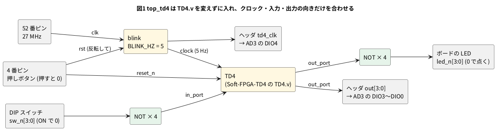

# 8-22 TD4 を FPGA で動かす — TD4.v を変えずに、分周した 5 Hz をクロックに

> [!WARNING]
> **この題は実機で組んでいない。** Verilator で動かして値を確かめ、合成・配置配線・ビットストリーム作りまで
> 手元の PC で通した。書き込みと、DIP スイッチ・LED・AD3 での確かめは実行していない。
> 「見るべき値」はシミュレーションの値と計算値で、測った値ではない。

8-6 では 1-1 のゲートを、Verilog を変えずに Tang Nano 9K に載せた。この題では 5-8 の 4 ビット CPU の TD4 を、
**`TD4.v` を 1 行も変えずに**載せる。Pico 2 の主ループの役 (クロック・リセット・ピン) を最上位と制約ファイルが受け持つのは 8-6 の表のとおり。

## 回路図・実体配線図

回路・部品・制約ファイル (`td4.cst`) は 8-6 と同じ (8-6 の図1 が回路図、図2 が実体配線図)。前の題と同じ基板なので再掲しない。
DIP スイッチの 4 本が TD4 の `in_port`、AD3 の DIO3〜DIO0 が `out`、DIO4 が `td4_clk` (ヘッダの 5 番、IO25) を読む。

## 論理図




## Verilog

`TD4.v` は Soft-FPGA-TD4 の `verilator-TD4/TD4.v`、`blink.v` は 2-7 のものをそのまま使う (ここには写さない)。

### top_td4.v — TD4

```verilog
// Tang Nano 9K に TD4 を載せる最上位。TD4.v は Soft-FPGA-TD4 のまま変えない
module top_td4 #(
    parameter CLK_HZ = 27_000_000
) (
    input        clk,       // 52 番ピン。ボードの 27 MHz
    input        rst_n,     // 4 番ピン。ボードの押しボタン (押すと 0)
    input  [3:0] sw_n,      // DIP スイッチ。ON で 0 (FPGA の中でプルアップ)
    output [3:0] led_n,     // ボードの LED。0 で点く
    output [3:0] out,       // out_port をヘッダにも出す。AD3 で読む
    output       td4_clk    // TD4 のクロック。AD3 で読む
);
    wire       slow;
    wire [3:0] out_port;

    // 2-7 の blink を 5 Hz で回して TD4 のクロックにする (Pico 2 の 100 ms ごとの反転と同じ 200 ms の周期)
    blink #(.CLK_HZ(CLK_HZ), .BLINK_HZ(5)) div (.clk(clk), .rst(~rst_n), .led(slow));

    /* verilator lint_off PINCONNECTEMPTY */    // pc_out・op・alu_data はピンに出さない
    TD4 cpu (.clock(slow), .reset_n(rst_n), .in_port(~sw_n), .out_port(out_port),
             .pc_out(), .op(), .alu_data());
    /* verilator lint_on PINCONNECTEMPTY */

    assign led_n   = ~out_port;
    assign out     = out_port;
    assign td4_clk = slow;
endmodule
```

**TD4 のクロックに、分周した信号 (`slow`) をそのまま使っている。** 2-17 で「やってはいけない」とする書き方である。
`TD4.v` はクロックイネーブルの入力を持たないので、変えずに載せるにはこうするしかない。
5 Hz なら間に合いの心配は無いが、速い回路ではクロックイネーブル (2-5) に書き直す。

### lint

```bash
verilator --lint-only -Wall --no-timing top_td4.v blink.v TD4.v
verilator --lint-only --no-timing TD4.v
```

- `TD4.v` だけを `-Wall` 無しで lint すると警告 0 件 (Soft-FPGA-TD4 と同じ `--no-timing`)
- `-Wall` を付けると、`TD4.v` の中に 9 件 (`#1` の遅れを無視する `ASSIGNDLY` 5 件、初期値のある変数への代入 `PROCASSINIT` 2 件、
  非同期のリセットとの混ざり `SYNCASYNCNET` 2 件) と、`top_td4.v` の `slow` に `SYNCASYNCNET` が 1 件、計 10 件出る。
  `TD4.v` の分は直さない (変えずに載せるのが題の主旨)。`slow` の 1 件は、上の「分周した信号をクロックに使う」ことを言っている

## 動かす (シミュレーション)

`CLK_HZ` を 10 にして、TD4 のクロックを 1 クロックおきに反転させ、`out` の並びを見る。

```verilog
// CLK_HZ = 10 にして、TD4 のクロック (5 Hz の分周) を 1 クロックおきに反転させ、out の並びを見る
module tb_td4;
    reg clk = 0;
    reg rst_n = 0;
    wire [3:0] led_n;
    wire [3:0] out;
    wire       td4_clk;
    integer n = 0;

    top_td4 #(.CLK_HZ(10)) u (.clk(clk), .rst_n(rst_n), .sw_n(4'b1111),
                              .led_n(led_n), .out(out), .td4_clk(td4_clk));

    always #1 clk = ~clk;

    always @(posedge td4_clk) if (rst_n) begin
        #2 $display("after TD4 clock %2d: pc=%h out=%b", n, u.cpu.pc, out);
        n = n + 1;
        if (n == 12) $finish;
    end

    initial #5 rst_n = 1;
endmodule
```

```bash
verilator --binary --timing -Wno-fatal --top-module tb_td4 tb_td4.v top_td4.v blink.v TD4.v
./obj_dir/Vtb_td4 | grep after
```

```text
after TD4 clock  0: pc=1 out=0011
after TD4 clock  1: pc=2 out=0110
after TD4 clock  2: pc=3 out=1100
after TD4 clock  3: pc=4 out=1000
after TD4 clock  4: pc=5 out=1000
after TD4 clock  5: pc=6 out=1100
after TD4 clock  6: pc=7 out=0110
after TD4 clock  7: pc=8 out=0011
after TD4 clock  8: pc=9 out=0001
after TD4 clock  9: pc=0 out=0001
after TD4 clock 10: pc=1 out=0011
after TD4 clock 11: pc=2 out=0110
```

- `TD4.v` の ROM の中身は、`OUT` を 9 回並べて最後に `JMP 0000` で頭に戻る LED の模様。10 クロックで 1 巡りする
- この ROM は入力ポートを読まないので、DIP スイッチを動かしても模様は変わらない。DIP スイッチが効くのは、ROM を `IN` を使うプログラムに替えたとき (10-1)
- `TD4.v` には `$monitor` があり、シミュレーションでは毎クロックの行も出る (上では `grep` で外した)。合成では yosys が無視する

## 合成・配置配線

8-4 と同じ 3 手を通した (yosys 0.33・nextpnr 0.11.1-54・gowin_pack。書き込みは未実行)。

```bash
yosys -p "read_verilog top_td4.v blink.v TD4.v; synth_gowin -top top_td4 -json top_td4.json; stat"
nextpnr-himbaechel --json top_td4.json --write pnr_td4.json \
    --device GW1NR-LV9QN88PC6/I5 --vopt family=GW1N-9C --vopt cst=td4.cst --freq 27
gowin_pack -d GW1N-9C -o top_td4.fs pnr_td4.json
openFPGALoader -b tangnano9k top_td4.fs
```

| 回路 | 合成した結果 (yosys 0.33) | nextpnr の最高の周波数の見積り |
| --- | --- | --- |
| `top_td4` | LUT 50 (LUT1 25・LUT2 8・LUT3 8・LUT4 9)・FF 35 (DFFC 4・DFFCE 8・DFFR 22・DFFRE 1)・ALU 30 | 27 MHz のクロック 150.74 MHz、TD4 のクロック 226.24 MHz |

- `top_td4` の FF のうち DFFR・DFFRE の 23 個は `blink` (22 ビットのカウンタと `slow`)、DFFC・DFFCE の 12 個が TD4 の分
- TD4 のレジスタは A・B・OUT・PC の 4 ビット × 4 と桁上げの 1 ビットで 17 ビットあるが、合成すると 12 個になった。
  ROM の中身が決まっていて、どこにも効かないレジスタを yosys が消したと見られる。どう消えたかは 8-23 で報告を読む
- TD4 のクロックは 5 Hz で使うので、最高の周波数の見積りより 4 千万倍以上遅い。間に合いの心配は無い

## 計器の設定

| 計器 | 設定 |
| --- | --- |
| Logic | DIO0〜DIO4 を Enable。DIO は 3.3 V。GND を共通にする (0-4) |
| バス | `OUT` を DIO3 (上位)〜DIO0 (下位) で作り、2 進で表示 |
| 時間軸 | 250 ms/div (窓 2.5 s)。10 クロック (2 s) の 1 巡りが入る |
| 標本化 | 1 kS/s。見る一番速い変化 (5 Hz のクロックの 100 ms ごとの切り替え) よりずっと速い |
| トリガ | DIO4 (`td4_clk`) の立ち上がり。`JMP` で頭に戻るクロックに合わせる (下の図の t = 0) |

## Logic に見えるはずの画面

```logic
# ロジックアナライザの画面 (tommie-fence の logic フェンス)
title: 図2 TD4 の out は 5 Hz のクロックの立ち上がりで変わり、10 クロック (2 s) で 1 巡りする
device: ad3
time: 250ms/div
start: -150ms
sample: 1kHz
signals:
  td4_clk: dio4 clock 5Hz
  out3: dio3 pattern 0000111100000 bit 200ms from -200ms
  out2: dio2 pattern 0001100110000 bit 200ms from -200ms
  out1: dio1 pattern 0011000011001 bit 200ms from -200ms
  out0: dio0 pattern 1110000001111 bit 200ms from -200ms
buses:
  OUT: out3..out0 bin
cursors: [150ms, 2150ms]
trigger: td4_clk rising at 0s
```


- t = 0 の立ち上がりは `JMP 0000` を実行するクロック。`OUT` は 0001 のまま残り、次の立ち上がり (200 ms) から 0011 → 0110 → 1100 → 1000 と進む
- カーソルはクロックの L の真ん中 (立ち上がりから 150 ms) に、10 クロックあけて置いた。ΔX が 1 巡りの 2 s になる
- 値の並びは、上の Verilator の表 (`after TD4 clock 0`〜) と同じ

## 見るべき値

シミュレーションの値と計算値。実機で測っていない。

| 項目 | 見るべき値 | どこで得たか |
| --- | --- | --- |
| `td4_clk` の周期 | 200 ms (5 Hz) (計算値) | `blink` の `HALF` = 27 000 000 / 10 = 2 700 000 クロック |
| `OUT` の並び | 0011 → 0110 → 1100 → 1000 → 1000 → 1100 → 0110 → 0011 → 0001 → 0001 | TD4 のシミュレーション |
| 1 巡りの時間 (ΔX) | 2.000 s (10 クロック) (計算値) | 同上 |
| Pico 2 と比べて変えた Verilog の行 | 0 行 (`TD4.v`) | 書いた物 |

実機で組んだら、`OUT` の並びが Pico 2 の 5-8 の並びと同じかを、Logic の図を並べて比べる。
並びは同じで、違うのは時間の刻み (Pico 2 は主ループの `sleep_ms`、FPGA は 27 MHz の水晶) だけのはずである。

## シミュレーションでの確かめ (対象外を含む)

Verilator 5.042・Yosys 0.33・Yosys 0.70+16・nextpnr-himbaechel 0.11.1-63 で、本文の `top_td4.v` `tb_td4.v` を走らせ直した。
`blink.v` は 2-7、`TD4.v` は Soft-FPGA-TD4 の `verilator-TD4/TD4.v` (コミット b74bed1) を使った。
置き場は 8-6 と同じ `sim/06-same-verilog-on-fpga-td4.v` `sim/06-same-verilog-on-fpga-td4-tb.v`。

| 項目 | 本文の数字 | 実行結果 | 判定 |
| --- | --- | --- | --- |
| lint (`TD4.v`、`--no-timing`、`-Wall` なし) | 警告 0 件 | 0 件 | 合った |
| lint (`top_td4.v blink.v TD4.v`、`-Wall`) | 10 件 (ASSIGNDLY 5・PROCASSINIT 2・SYNCASYNCNET 3) | 同じ 10 件。`top_td4.v` の `slow` が 1 件 | 合った |
| TD4 の `out` の並び (12 クロック) | 0011 0110 1100 1000 1000 1100 0110 0011 0001 0001 0011 0110 | 同じ。pc は 1〜9、0、1、2 | 合った |
| 図2 の 4 本の pattern | `out3`〜`out0` の 13 個ずつ | 上の並びから読み直して同じ | 合った |
| 合成 `top_td4` | LUT 50 (25・8・8・9)・FF 35 (DFFC 4・DFFCE 8・DFFR 22・DFFRE 1)・ALU 30 | 同じ | 合った |
| nextpnr `top_td4` (0.33 の `json`) | 27 MHz のクロック 150.74 MHz、TD4 のクロック 226.24 MHz | 同じ (`div.clk` 150.74・`slow` 226.24。使用量は LUT4 86・ALU 36・DFF 35・IOB 15) | 合った |
| nextpnr `top_td4` (0.70+16 の `json`) | (記載なし) | LUT 28 (LUT1 8・LUT2 1・LUT3 5・LUT4 14)・ALU 29・FF 35。LUT4 62。`div.clk` 207.34 MHz・`cpu.clock` 182.25 MHz (クロックの名前も版で変わる) | 近い (版の差。TD4 のクロックの数は 0.33 より低い) |

確かめていない数: 実機の DIP スイッチ・LED・AD3 の測定。

## 出典

自作。

- TD4 の Verilog と Pico 2 での動かし方: [tommie-jp/Soft-FPGA-TD4](https://github.com/tommie-jp/Soft-FPGA-TD4) の `verilator-TD4/TD4.v` と `main.cpp`。
  TD4.v の元は [asfdrwe/simpleTD4](https://github.com/asfdrwe/simpleTD4) (MIT ライセンス)。simpleTD4 の README は、
  初代の Sipeed Tang Nano (Tang Nano 9K の前の機種) で動かす手順を書いている
- ボードのクロック (52 番)・押しボタン (4 番)・LED (10・11・13・14 番): Sipeed の [TangNano-9K-example](https://github.com/sipeed/TangNano-9K-example) の `led/src/9K_LED_project.cst`
