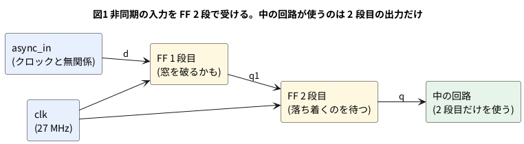

# 9-2 外から来る信号はフリップフロップ 2 段で受ける

> [!WARNING]
> **この題は実機で組んでいない。** 回路を Verilator で動かして値を確かめ、合成・配置配線・ビットストリーム作りまで
> 手元の PC で通した。書き込みと、AD3 での測定は実行していない。
> 「見るべき値」はシミュレーションの値と計算値で、測った値ではない。
> **シミュレーションでは、メタステーブル (9-1) は起きない。** 2 段で受ける理由の中心は、実機でしか見えない。

押しボタン・外の IC・別のクロックで動く回路の信号は、FPGA のクロックとは無関係な時刻に変わる。
こういう信号を**非同期の入力**と呼ぶ。2-10 の立ち上がりの検出も、この信号をそのままは受けられないと言っていた。

非同期の入力を FF の D につなぐと、窓 (9-1) の中で D が変わることがある。
そのとき FF の出力は 0 とも 1 とも決まらず、決まるまで時間がかかることがある (メタステーブル。9-6 で見る)。
この不確かな出力を、FPGA の中の回路が何本もの線で受けると、**線によって 0 と読むものと 1 と読むものが分かれる**ことがある。
そうなると、回路は想定していない状態に入る。

対策は、FF を **2 段つなぐ**こと (2 段の同期回路、2-FF シンクロナイザ)。

- 1 段目は、窓を破るかもしれない。出力が不確かになってもよい
- 2 段目は、1 段目の出力が落ち着くのを 1 クロック待ってから取り込む。2 段目の出力は 0 か 1 に決まっている (確率が十分に小さい)
- 中の回路は、**2 段目の出力だけ**を使う。1 段目の出力を直接使ってはいけない

この題では、2 段の同期回路を作り、AD3 の Patterns で作った非同期の信号を通して、入力から出力までの遅れを測る。
測るのは、1 段目と 2 段目の出力と、入力が変わってからの時間である。

## 説明

- 入力が変わってから、2 段目の出力が変わるまでの時間は、**1 クロックより長く 2 クロック以下**になる。
  入力はクロックと無関係に変わるので、1 段目が取り込む立ち上がりは、入力の変化の 0 から 1 クロック後のどこかで、
  2 段目はそのさらに 1 クロック後だから
- 27 MHz のクロックの周期は 37.04 ns。したがって 2 段目の出力は、入力の変化から 37.04 ns より後、74.07 ns 以内に変わる (計算値)。
  ピンの入出力のバッファの遅れが、これに足される (この数は測って書く)
- 1 段目と 2 段目の出力の差は、位相に関係なく**ちょうど 1 クロック** (37.04 ns) になる
- 窓を破らなくても、**1 クロックより短い入力のパルスは、取りこぼすことがある**。立ち上がりが 1 回も入らなければ、1 段目は 1 を取り込めない。
  逆に、1 クロックより短くても、立ち上がりが入れば取り込まれて、出力は 1 クロックの幅になる
- 2 段で受けるのは **1 ビットの信号**だけ。バス (複数ビット) を 1 ビットずつ 2 段で受けると、ビットごとに取り込む立ち上がりがずれて、
  値が壊れる。バスは 9-8 の方法を使う

## 論理図




## Verilog

```verilog
// sync2.v  外から来る信号を、フリップフロップ 2 段で受ける
module sync2 (
    input  wire clk,
    input  wire d_async,   // クロックと無関係に変わる信号
    output wire q1,        // 1 段目の出力 (観察用に外へ出す)
    output wire q          // 2 段目の出力。中の回路にはこれを使う
);
    reg r1;
    reg r2;

    always @(posedge clk) begin
        r1 <= d_async;     // 1 段目: 窓を破るかもしれない
        r2 <= r1;          // 2 段目: 1 段目が落ち着くのを 1 クロック待つ
    end

    assign q1 = r1;
    assign q  = r2;
endmodule
```

- `q1` を外へ出したのは、この題で 1 段目を測るため。**普通の回路では出さない**。1 段目の出力に別の線をつなぐと、
  その線にも不確かな値が行く
- 2 段が離れた場所に置かれると、1 段目から 2 段目までの線が長くなり、落ち着く時間を食う。
  同期回路の FF は近くに置くのがよい。配置配線の道具に、その指定をする書き方は道具ごとに違う (この題では扱わない)

Tang Nano 9K に載せる最上位。

```verilog
// top_sync2.v  Tang Nano 9K に載せる最上位。AD3 の Patterns からの信号を 2 段で受け、1 段目と 2 段目を外へ出す
module top_sync2 (
    input  clk,        // 52 番ピン。ボードの 27 MHz
    input  async_in,   // 36 番ピン。AD3 の DIO2 (Patterns) から来る、クロックと無関係な信号
    output sync_out,   // 38 番ピン。2 段で受けた信号 (AD3 の DIO0 で読む)
    output ff1_out     // 37 番ピン。1 段目の出力 (AD3 の DIO1 で読む)
);
    sync2 u (.clk(clk), .d_async(async_in), .q1(ff1_out), .q(sync_out));
endmodule
```

制約ファイル `sync2.cst`。書き方は 8-5。

```text
IO_LOC "clk" 52;
IO_PORT "clk" IO_TYPE=LVCMOS33 PULL_MODE=UP;
IO_LOC "async_in" 36;
IO_PORT "async_in" IO_TYPE=LVCMOS33 PULL_MODE=DOWN;
IO_LOC "sync_out" 38;
IO_PORT "sync_out" IO_TYPE=LVCMOS33 DRIVE=8;
IO_LOC "ff1_out" 37;
IO_PORT "ff1_out" IO_TYPE=LVCMOS33 DRIVE=8;
```

```bash
verilator --lint-only -Wall top_sync2.v sync2.v
```

lint は警告 0 件で通った (Verilator 5.042)。

## テストベンチ (シミュレーション)

27 MHz のクロックと、**クロックと無関係な時刻**に変わる入力を作る。入力は 100 ns に 1 になり、400 ns に 0 になる。
そのあとに細いパルスを 3 つ入れる (10 ns・30 ns・30 ns)。入力が変わってから出力が変わるまでの時間を数える。

```verilog
// tb_sync2.v  クロックと無関係な入力を 2 段で受ける。変わった時刻と、出てくる時刻を比べる
module tb_sync2;
    localparam real HALF = 18.5185;   // 27 MHz の半周期 (ns)。周期 37.037 ns

    reg  clk = 0;
    reg  d_async = 0;
    wire q1, q;
    real t_rise = 0, t_fall = 0;     // 入力が最後に 1 になった時刻、0 になった時刻
    integer n_edge = 0;

    sync2 u (.clk(clk), .d_async(d_async), .q1(q1), .q(q));

    always #(HALF) clk = ~clk;        // 立ち上がりは 18.5185 + 37.037 × k ns

    // 入力が変わってから、q が変わるまでの時間 (ns とクロック数) を出す
    always @(posedge d_async) t_rise = $realtime;
    always @(negedge d_async) t_fall = $realtime;
    always @(posedge q) begin
        n_edge = n_edge + 1;
        $display("%7.1f ns: Q が 1 に。入力が 1 になってから %5.1f ns (%4.2f クロック)",
                 $realtime, $realtime - t_rise, ($realtime - t_rise) / (2 * HALF));
    end
    always @(negedge q) begin
        n_edge = n_edge + 1;
        $display("%7.1f ns: Q が 0 に。入力が 0 になってから %5.1f ns (%4.2f クロック)",
                 $realtime, $realtime - t_fall, ($realtime - t_fall) / (2 * HALF));
    end

    // 入力は 27 MHz のクロックとは無関係な時刻に変える
    initial begin
        $dumpfile("sync2.vcd");
        $dumpvars(0, tb_sync2);
        #100.0 d_async = 1;           // 長く 1
        #300.0 d_async = 0;           // 400 ns
        #300.0 d_async = 1;           // 700 ns: 10 ns の細いパルス
        #10.0  d_async = 0;           // 710 ns
        #90.0  d_async = 1;           // 800 ns: 30 ns のパルス (1 クロックより短い)
        #30.0  d_async = 0;           // 830 ns
        #30.0  d_async = 1;           // 860 ns: 30 ns のパルス
        #30.0  d_async = 0;           // 890 ns
        #100.0 d_async = 1;           // 990 ns: 長く 1
        #200.0 $display("Q の変わり目 %0d 回", n_edge);
        $finish;
    end
endmodule
```

```bash
verilator --timescale 1ns/1ps --binary --timing --trace --top-module tb_sync2 sync2.v tb_sync2.v
./obj_dir/Vtb_sync2
```

```text
  166.7 ns: Q が 1 に。入力が 1 になってから  66.7 ns (1.80 クロック)
  463.0 ns: Q が 0 に。入力が 0 になってから  63.0 ns (1.70 クロック)
  907.4 ns: Q が 1 に。入力が 1 になってから  47.4 ns (1.28 クロック)
  944.5 ns: Q が 0 に。入力が 0 になってから  54.5 ns (1.47 クロック)
 1055.6 ns: Q が 1 に。入力が 1 になってから  65.6 ns (1.77 クロック)
Q の変わり目 5 回
```

## シミュレーションの波形

VCD を読んで、ロジックアナライザの画面と同じ形に描いた。実機で測った波形ではなく、シミュレーションの値だ。
IN はクロックと無関係に変わる入力、Q1 は 1 段目、Q は 2 段目の出力。

```logic
# ロジックアナライザの画面 (tommie-fence の logic フェンス)
title: 図2 Q は Q1 のちょうど 1 クロック後。700 ns と 800 ns のパルスは取りこぼされた
device: generic
time: 120ns/div
signals:
  CLK: edges 0s=0 18.519ns=1 37.038ns=0 55.557ns=1 74.076ns=0 92.595ns=1 111.114ns=0 129.633ns=1 148.152ns=0 166.671ns=1 185.19ns=0 203.709ns=1 222.228ns=0 240.747ns=1 259.266ns=0 277.785ns=1 296.304ns=0 314.823ns=1 333.342ns=0 351.861ns=1 370.38ns=0 388.899ns=1 407.418ns=0 425.937ns=1 444.456ns=0 462.975ns=1 481.494ns=0 500.013ns=1 518.532ns=0 537.051ns=1 555.57ns=0 574.089ns=1 592.608ns=0 611.127ns=1 629.646ns=0 648.165ns=1 666.684ns=0 685.203ns=1 703.722ns=0 722.241ns=1 740.76ns=0 759.279ns=1 777.798ns=0 796.317ns=1 814.836ns=0 833.355ns=1 851.874ns=0 870.393ns=1 888.912ns=0 907.431ns=1 925.95ns=0 944.469ns=1 962.988ns=0 981.507ns=1 1000.03ns=0 1018.54ns=1 1037.06ns=0 1055.58ns=1 1074.1ns=0 1092.62ns=1 1111.14ns=0 1129.66ns=1 1148.18ns=0 1166.7ns=1 1185.22ns=0
  IN: edges 0s=0 100ns=1 400ns=0 700ns=1 710ns=0 800ns=1 830ns=0 860ns=1 890ns=0 990ns=1
  Q1: edges 0s=0 129.633ns=1 425.937ns=0 870.393ns=1 907.431ns=0 1018.54ns=1
  Q: edges 0s=0 166.671ns=1 462.975ns=0 907.431ns=1 944.469ns=0 1055.58ns=1
cursors: [140ns, 180ns]
```


## 見るべき値 (シミュレーションを実行して得た値)

| 入力の変化 | Q1 が変わる | Q が変わる | 入力から Q まで | 起きたこと |
| --- | --- | --- | --- | --- |
| 100 ns (0 → 1) | 129.6 ns | 166.7 ns | 66.7 ns (1.80 クロック) | 取り込まれた |
| 400 ns (1 → 0) | 425.9 ns | 463.0 ns | 63.0 ns (1.70 クロック) | 取り込まれた |
| 700 ns から 10 ns のパルス | — | — | — | **取りこぼした** (立ち上がりの 685.2 ns と 722.2 ns の間に入った) |
| 800 ns から 30 ns のパルス | — | — | — | **取りこぼした** (立ち上がりの 796.3 ns と 833.3 ns の間に入った) |
| 860 ns から 30 ns のパルス | 870.4 ns で 1、907.4 ns で 0 | 907.4 ns で 1、944.5 ns で 0 | 47.4 ns (1 になる側) | 取り込まれ、出力は 1 クロック (37 ns) の幅になった |
| 990 ns (0 → 1) | 1018.5 ns | 1055.6 ns | 65.6 ns (1.77 クロック) | 取り込まれた |

- 取り込まれた 5 回の遅れは、47.4〜66.7 ns で、すべて 37.04 ns より長く 74.07 ns 以下に入った (計算値の範囲)
- Q は Q1 の**ちょうど 1 クロック (37.04 ns) 後**に変わる。たとえば 129.6 ns の Q1 に対して Q は 166.7 ns
- 図2のカーソル X1 = 140 ns では IN = 1・Q1 = 1・Q = 0。X2 = 180 ns では Q = 1 になっている
- 30 ns のパルスは、同じ幅でも 800 ns からは取りこぼされ、860 ns からは取り込まれた。
  1 クロックより短いパルスは、入るかどうかが**クロックとの位相で決まる**。取りこぼしたくなければ、パルスを 1 クロック以上の幅にする
- クロックの半周期は `#(18.5185)` と書いたが、時間の精度 1 ps で丸められて 18.519 ns になった (周期は 37.038 ns)

**見せられたこと**: 入力から出力までの遅れの範囲と、短いパルスの取りこぼし。

**見せられないこと**: 窓を破ったときの 1 段目の不確かな出力 (メタステーブル)。Verilator は 0 と 1 の 2 値で、
窓の中で入力が変わっても、1 段目はきれいに 0 か 1 に決まる。この題の波形は、2 段にしなかった場合の壊れ方を見せられない。
そこは 9-6 で、実機の波形を測って見る。

## 合成と配置配線

8-4 と同じ 3 手を通した (OSS CAD Suite の yosys 0.69+274・nextpnr 0.11.1-54・gowin_pack。書き込みは未実行)。

```bash
yosys -p "read_verilog top_sync2.v sync2.v; synth_gowin -top top_sync2 -json t.json; stat"
nextpnr-himbaechel --json t.json --write p.json \
    --device GW1NR-LV9QN88PC6/I5 --vopt family=GW1N-9C --vopt cst=sync2.cst --freq 27
gowin_pack -d GW1N-9C -o t.fs p.json
```

- 合成した結果は DFF 2 個・IBUF 2 個・OBUF 2 個。LUT は 0 個。FF が 2 段とも残った
- 配置配線の見積りでは、`Max frequency for clock` は 1166.86 MHz と出た。FF から FF へ直に線が 1 本あるだけの経路の値である。
  実機でここまで回るという意味ではない (9-3)
- 入力のピン (`async_in`) からの経路は、この見積りに含まれない

## 回路図

接続は 8-3 に、AD3 の DIO2 から IO36 への線を足したもの。DIO2 は Patterns の出力で、FPGA の入力につながる。
DIO0・DIO1 は Logic の入力で、IO38・IO37 を読む。

```circuit
# 回路図 (tommie-fence の circuit フェンス)
title: 図3 DIO2 を IO36 へ。DIO0 は 2 段目、DIO1 は 1 段目を読む
parts:
  AD:
    type: device
    at: 1,3.8
    label: AD3
    pins: [DIO0, DIO1, DIO2, GND]
    turn: mirror
  U1: tang-nano-9k 8,6
  G1: ground 3.5,5.2
  G2: ground 10.5,9
wires:
  - AD.DIO0 -| 5,3.24
  - U1.IO38 |- 5,3.24
  - AD.DIO1 -| 5.5,3.48
  - U1.IO37 |- 5.5,3.48
  - AD.DIO2 -| 6,3.72
  - U1.IO36 |- 6,3.72
  - AD.GND -| 3.5,5.2
  - U1.GND -| 10.5,9
```


## 部品表

| 部品 | 値・型番 | 数 | 役 |
| --- | --- | --- | --- |
| U1 | Sipeed Tang Nano 9K (GW1NR-9) | 1 | FPGA ボード。USB-C から給電と書き込み |
| — | ブレッドボード (half、30 列) | 1 | |
| — | ジャンパ線 | 6 本 | GND の 3 本と DIO の 3 本 |
| AD | Analog Discovery 3 | 1 | DIO2 は Patterns (出力)、DIO0・DIO1 は Logic (入力) |

電源は教科書の既定の 5 V ではなく **3.3 V** (FPGA のピン)。FPGA のピンに 5 V を入れると壊れるため (0-3)。
AD3 の DIO は **3.3 V** にそろえる (0-4)。

## 実体配線図

```bread
# ブレッドボードの実体配線図 (tommie-fence の bread フェンス)
title: 図4 配線は 8-3 のまま、DIO2 (j3) を足す。IO36 は下の列の 3 番ピン
board: half
parts:
  U1: tang-nano-9k @ b1
  AD:
    type: device
    at: bottom
    label: AD3 Logic・Patterns
    pins: [DIO0, DIO1, DIO2, GND]
wires:
  - a23 -- -t23 black
  - -t29 -- -b29 black
  - AD.GND -- -b27 black
  - AD.DIO0 -- j1 green
  - AD.DIO1 -- j2 yellow
  - AD.DIO2 -- j3 blue
notes:
  - text: 給電は Tang Nano 9K の USB-C (5 V)。電源レールは GND (−) だけ使う
```


- 置き方と GND の線は 8-3 と同じ。足したのは、DIO2 から j3 (IO36) への 1 本だけ
- 緑 (IO38・2 段目)・黄 (IO37・1 段目) は Logic の入力、青 (IO36) は Patterns の出力
- 信号は 1 MHz 以下で、ブレッドボードの範囲 (3 MHz 以下) に収まる。27 MHz のクロックの線は、ボードの上だけを通り、ブレッドボードには出ない

## 計器の設定

| 計器 | 設定 |
| --- | --- |
| Patterns | DIO2 を Enable。種類は Clock、周波数 1 MHz、デューティ 50 %。出力は 3.3 V (0-4)。AD3 の内部のクロックで動くので、FPGA の 27 MHz とは無関係になる |
| Logic | DIO0・DIO1・DIO2 を Enable。DIO は 3.3 V。GND を共通にする (0-4) |
| 時間軸 | 20 ns/div (窓 200 ns)。DIO2 の立ち上がりの前を 40 ns 見せる |
| 標本化 | 125 MS/s (AD3 の Logic の上限)。1 標本 = 8 ns |
| トリガ | DIO2 の立ち上がり。繰り返して何回も取る |

## Logic に見えるはずの画面

図5は、図2の最初の変化 (100 ns。IN → Q1 が 29.6 ns、IN → Q が 66.7 ns) を、AD3 の標本化 (8 ns 刻み) で読んだ形である。
標本は 8 ns ごとなので、DIO1 は 32 ns の標本で、DIO0 は 72 ns の標本で初めて 1 になる。
実機では、AD3 の内部のクロックと FPGA の 27 MHz は独立なので、トリガのたびに位相が変わり、DIO1 と DIO0 の遅れは毎回違う。
**図の値はシミュレーションの位相の例で、実測ではない。**

```logic
# ロジックアナライザの画面 (tommie-fence の logic フェンス)
title: 図5 DIO2 の立ち上がりを 0 に。DIO1 は 32 ns、DIO0 は 72 ns の標本で 1
device: ad3
time: 20ns/div
start: -40ns
sample: 125MHz
signals:
  IN:  dio2 pattern 000001 bit 8ns from -40ns
  FF1: dio1 pattern 0000000001 bit 8ns from -40ns
  OUT: dio0 pattern 000000000000001 bit 8ns from -40ns
cursors: [48ns, 88ns]
trigger: IN rising at 0s
```


## 見るべき値

シミュレーションの値と計算値。実機で測っていない。

| 項目 | 見るべき値 | どこで得たか |
| --- | --- | --- |
| クロックの周期 | 37.04 ns | 1 ÷ 27 MHz (計算値) |
| IN → DIO1 (1 段目) | 0 より大きく 37.04 ns 以下 (+ ピンの遅れ) | 計算値。**ピンの遅れは測って書く** |
| IN → DIO0 (2 段目) | 37.04 ns より大きく 74.07 ns 以下 (+ ピンの遅れ) | 計算値。シミュレーションでは 47.4〜66.7 ns だった |
| DIO0 − DIO1 | 37.04 ns (計算値)。Logic の刻み 8 ns の範囲で読む | 同上 |
| 細いパルスの取りこぼし | 1 クロック (37 ns) より短いパルスで起きうる | シミュレーションで確かめた |
| 取りこぼしが実機で起きる割合 | 測って書く | Patterns のパルス幅を 10〜60 ns で変えて、DIO0 が反応する割合を数える |

実機で測ったら、DIO1 と DIO0 の遅れを 10 回ほど取り、最小と最大を表に書き加える。
遅れの範囲が上の計算値に収まり、DIO0 − DIO1 が 37.04 ns に近いことを確かめる。
AD3 の標本化は 8 ns 刻みなので、1 回の値は ±8 ns ほど読み取りがぶれる。

## 出典

自作。2 段の同期回路 (2-FF シンクロナイザ) は、非同期の 1 ビットの信号をクロックに合わせる定番の作り方である。
シミュレーションは Verilator 5.042 で実行した。AD3 の Logic の標本化の上限 (125 MS/s) は logic-fence の早見表の `ad3` の欄による。
