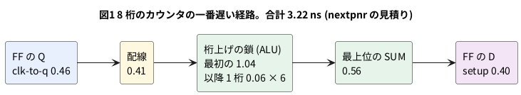

# 9-3 最高の動作周波数 — タイミングの報告を読む

> [!WARNING]
> **この題の数は、すべて PC の配置配線 (nextpnr) の見積りである。実機では測っていない。**
> 合成・配置配線・ビットストリーム作りを手元の PC で通して、nextpnr が出す報告を読んだ。
> nextpnr の遅れの値が実物の FPGA とどれだけ合うかは、この題では確かめていない。
> 実機で「ここまで速く回る」と確かめるときは、最後の節の手順で測り、結果をこの表に書き加える。

9-1 では、クロックの前後に D を動かしてはいけない窓 (セットアップとホールド) を見た。
FPGA の道具は、回路の中のすべてのフリップフロップ (FF) の間で、この窓が守られるかを調べる。
守れる一番速いクロックが、その回路の**最高の動作周波数**だ。

この題では、2-4 のカウンタを桁数を変えて 3 つ作り、配置配線の報告から次の 3 つを読む。

- 最高の動作周波数は何 MHz か
- 一番遅い経路 (**クリティカルパス**) は、どこを通って何 ns かかるか
- 桁数を増やすと、なぜ遅くなるか

この題は組まない題である。実体配線図・Analog Discovery 3・`logic` の図は入れない。
ブレッドボードにつなぐ回路は、次の 9-4 から出てくる。

## 説明

- FF から FF までの 1 本の経路の遅れは、次の 4 つの和になる

| 区間 | 何か |
| --- | --- |
| clk-to-q | クロックの立ち上がりから、FF の出力 Q が変わるまで |
| 配線 (routing) | FF の出力から、次の部品の入力までの線 |
| 論理 (logic) | LUT や加算器 (ALU) の中。1 つ通るごとに足される |
| setup | 次の FF の D が、立ち上がりの前に落ち着いていなければならない時間 (9-1 のセットアップ) |

- 1 クロックの長さ (周期) は、**一番遅い経路の遅れより長くなければならない**。短いと、D が落ち着く前に次の立ち上がりが来る
- 最高の動作周波数 = 1 ÷ 一番遅い経路の遅れ。nextpnr はこれを `Max frequency for clock` の行に出す
- 一番遅い 1 本だけが効く。ほかの経路がどれだけ速くても、周波数は上がらない
- 道具に目標の周波数を教えるのが `--freq` である。書かなければ 12 MHz で確かめる (8-4)。
  目標は**合否の判定の基準**で、回路の速さそのものは変えない (下の「目標を上げると」)

## ブロック図

図1は、8 桁のカウンタで nextpnr が報告した一番遅い経路。数は下の報告から写した。




## Verilog

カウンタは 2-4 の `counter.v` をそのまま使う。桁数 `W` を変えられる最上位だけを書く。
出力は最上位のビット `msb` の 1 本にした。途中の桁を捨てると、合成の道具が使わない桁を消してしまうので、
全部の桁が必要な「最上位ビット」だけを出す。

```verilog
// top_fmax.v  最高の動作周波数を調べる最上位。W を変えて、カウンタの桁数ごとの値を並べる
module top_fmax #(
    parameter W = 16
) (
    input  clk,        // 52 番ピン。ボードの 27 MHz
    input  rst_n,      // 4 番ピン。ボードの押しボタン (押すと 0)
    output msb         // 38 番ピン。カウンタの最上位ビット
);
    wire [W-1:0] count;

    counter #(.W(W)) u (.clk(clk), .rst(~rst_n), .count(count));

    assign msb = count[W-1];
endmodule
```

制約ファイル `fmax.cst`。書き方は 8-5。

```text
IO_LOC "clk" 52;
IO_PORT "clk" IO_TYPE=LVCMOS33 PULL_MODE=UP;
IO_LOC "rst_n" 4;
IO_PORT "rst_n" PULL_MODE=UP;
IO_LOC "msb" 38;
IO_PORT "msb" IO_TYPE=LVCMOS33 DRIVE=8;
```

```bash
verilator --lint-only -Wall top_fmax.v counter.v
```

lint は警告 0 件で通った。

## 合成と配置配線

道具は OSS CAD Suite の yosys 0.69+274 と nextpnr-himbaechel 0.11.1-54 (8-3)。
桁数は yosys の `chparam` で変える。

```bash
yosys -p "read_verilog top_fmax.v counter.v; chparam -set W 32 top_fmax; \
          synth_gowin -top top_fmax -json t32.json"
nextpnr-himbaechel --json t32.json --write p32.json \
    --device GW1NR-LV9QN88PC6/I5 --vopt family=GW1N-9C \
    --vopt cst=fmax.cst --freq 27
```

`W` を 8・16・32 にして 3 回回した結果を並べる。「最高の周波数」は、配置配線の最後に出る `Max frequency` の値である。

| 桁数 W | LUT4 | ALU | DFF | 最高の周波数 (配置配線の見積り) | 一番遅い経路 |
| --- | --- | --- | --- | --- | --- |
| 8 | 12 | 10 | 8 | 310.75 MHz | 3.22 ns |
| 16 | 20 | 18 | 16 | 272.18 MHz | 3.67 ns |
| 32 | 36 | 34 | 32 | 218.05 MHz | 4.59 ns |

- 3 つとも 27 MHz (周期 37.04 ns) で PASS した。一番遅い 32 桁でも、27 MHz の 8 倍ほどの余裕がある
- 桁数が 2 倍になるたびに、最高の周波数は下がる。8 → 16 で 0.45 ns、16 → 32 で 0.92 ns 遅くなった。
  どちらも 1 桁あたり 0.06 ns ほどである
- 一番遅い経路の遅れの合計から 1 ÷ 3.22 ns = 310.6 MHz のように計算すると、報告の値と (丸めの範囲で) 合う

## 報告を読む

32 桁のときの一番遅い経路の報告を抜き出す (同じ種類の行は途中を省いた)。

```text
Info: Critical path report for clock 'u.clk' (posedge -> posedge):
Info:       type curr  total name
Info:   clk-to-q  0.46  0.46 Source count_DFFR_Q_31.Q
Info:    routing  0.41  0.87 Net count[0] (23,16) -> (23,15)
Info:      logic  1.04  1.91 Source count_DFFR_Q_30_D_ALU_SUM_CIN_ALU_COUT.COUT
Info:      logic  0.06  1.97 Source count_DFFR_Q_30_D_ALU_SUM.COUT
Info:      logic  0.06  2.03 Source count_DFFR_Q_29_D_ALU_SUM.COUT
   ... (0.06 ns の行が 27 回続く)
Info:      logic  0.06  3.62 Source count_DFFR_Q_1_D_ALU_SUM.COUT
Info:      logic  0.56  4.19 Source count_DFFR_Q_D_ALU_SUM.SUM
Info:      setup  0.40  4.59 Source count_DFFR_Q.D
Info: 4.17 ns logic, 0.41 ns routing
Info: Max frequency for clock 'u.clk': 218.05 MHz (PASS at 27.00 MHz)
```

- `curr` はその区間の遅れ、`total` は始まりからの合計。最後の `total` の 4.59 ns が、この経路の遅れ
- 通っているのは **加算器の桁上げの鎖**である。`r + 1` の最下位から最上位まで、桁上げが 1 桁ずつ伝わる。
  Gowin の FPGA には、この鎖を速く通す専用の回路 (ALU) があり、1 桁 0.06 ns で進む
- 経路の初めの 1.04 ns は、最初の ALU の入力から桁上げの出力まで。鎖の途中の線 (routing) は、nextpnr の見積りでは 0.00 ns と出ている
- 配線 (routing) の 0.41 ns は、FF の出力から鎖の入口までの 1 本だけ。3 つの回路で同じだった
- 桁数が増えると、鎖が長くなる。これが遅くなる理由である

## 毎回同じではない

配置配線は、部品を置く場所を探索で決める。乱数の種 (`--seed`) を変えると、置き場所が変わり、数も変わることがある。
`--seed` を 1〜5 にして、最高の周波数を比べた (指定しないときの値は 310.75・272.18・218.05 MHz で、表の seed 2〜5 と同じ)。

| 桁数 W | seed 1 | seed 2 | seed 3 | seed 4 | seed 5 |
| --- | --- | --- | --- | --- | --- |
| 8 | 316.36 | 310.75 | 310.75 | 310.75 | 310.75 |
| 16 | 272.18 | 272.18 | 272.18 | 272.18 | 272.18 |
| 32 | 218.05 | 220.80 | 218.05 | 218.05 | 218.05 |

単位は MHz。同じ回路でも、種で 1〜2 % ほど変わることがあった。**数を書くときは、道具の版と `--seed` を添える。**
この小さな回路では差は小さいが、大きな回路では置き場所の違いで大きく変わることがある。

## 目標を上げると

32 桁のカウンタに `--freq 300` を渡すと、見積りの 218.05 MHz は目標に届かない。

```text
ERROR: Max frequency for clock 'u.clk': 218.05 MHz (FAIL at 300.00 MHz)
```

nextpnr は終了コード 1 で止まった (`--write` のファイル `p300.json` は書かれていた)。
**FAIL は「回路が壊れる」ではなく、「この目標では窓を守れない見込みだ」という意味である。**
`--freq` を書かないと 12 MHz で判定されるので、実際に使うクロックを必ず渡す (8-4)。
このボードのクロックは 27 MHz なので、27 を渡す。

## この数が言わないこと

- ここで出るのは、**クロック `clk` で動く FF から FF までの経路**の見積りだけである。
  ピンから入る信号や、ピンへ出す信号の遅れ (9-13) は含まない
- nextpnr の遅れの値が、実物の FPGA の遅れとどれだけ合うかは、この題では確かめていない。
  Gowin の純正の道具 (Gowin EDA) の報告とも比べていない
- 温度や電圧、チップごとのばらつきは、この見積りに含まれない。余裕を持って使う
- シミュレーション (Verilator) は遅れを持たないので、この数を出せない (9-1)

## 実機で確かめるなら (測って書く)

この題では測っていない。測るなら、次の手順になる。

1. ボードの発振器 (27 MHz) では、最高の周波数の 1/8 までしか回さないので、限界は見えない。
   FPGA の中の PLL で、27 MHz より速いクロックを作る。PLL の使い方は、この題では扱わない
2. 回路の出力は、AD3 の Logic で読める速さまで**分周してから**ブレッドボードへ出す。
   ブレッドボードに出す信号は 3 MHz 以下にする (README)
3. クロックを段階的に上げて、カウンタの出力の周期が計算どおりか (数えこぼしが出ないか) を見る。
   計算と合わなくなった周波数が、実機の限界の目安になる
4. 結果を、この題の表の隣に「実測」の列として書き加える

## 見るべき値

計算値と道具の見積り。実機で測っていない。

| 項目 | 見るべき値 | どこで得たか |
| --- | --- | --- |
| 8 桁の最高の周波数 | 310.75 MHz | nextpnr 0.11.1-54 の出力 (`--seed` 既定) |
| 16 桁の最高の周波数 | 272.18 MHz | 同上 |
| 32 桁の最高の周波数 | 218.05 MHz | 同上 |
| 32 桁の一番遅い経路 | 4.59 ns (論理 4.17 ns + 配線 0.41 ns) | 同上 |
| ALU 1 段の遅れ | 0.06 ns | 同上 |
| 27 MHz の周期 | 37.04 ns (計算値) | 1 ÷ 27 MHz |
| 実機の最高の周波数 | 測って書く | 上の手順 |

## シミュレーションでの確かめ (対象外を含む)

この題の数は、ほとんどが nextpnr の見積りである。この環境には nextpnr が無いので、
最高の周波数 (310.75・272.18・218.05 MHz)、一番遅い経路の内訳、`--seed` の表、`--freq 300` の FAIL は確かめていない。
確かめたのは、回路の lint と、合成の部品の数だけである。

Verilator 5.042 と Yosys 0.33 で、本文の `top_fmax.v` と、2-4 の `counter.v` を取り出した。
置き場は `sim/03-fmax-report.v` と `sim/03-fmax-report-counter.v`。

| 項目 | 本文の数字 | 実行結果 | 判定 |
| --- | --- | --- | --- |
| lint (`-Wall`) | 警告 0 件 | 0 件 | 合った |
| FF の数 (W = 8・16・32) | DFF 8・16・32 | DFFR 8・16・32 | 合った |
| ALU の数 | 10・18・34 | 8・16・32 | 版の違い (本文は 0.69。0.33 は W 個) |
| LUT4 の数 | 12・20・36 | LUT4 は 0。LUT1 が W 個 | 版の違い (0.69 は再現できない) |

ALU と LUT の数は、合成の道具の版で変わる。この環境の 0.33 では、本文の表の数にならなかった。
本文の表は 0.69+274 の値で、この環境に 0.69 は無いので再確認していない。

## 出典

自作。

- `Max frequency`・クリティカルパスの報告の形: nextpnr-himbaechel 0.11.1-54 の出力 (上のとおり実行した)
- 打ち方 (`--device`・`--vopt family`): [Apicula](https://github.com/YosysHQ/apicula) の README の Tang Nano 9K の節 (8-4)
- セットアップとホールド: 9-1
