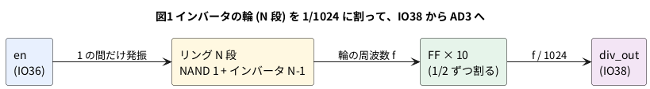

# 9-4 伝搬の遅れを測る — インバータを並べたリングオシレータ

> [!WARNING]
> **この題は実機で組んでいない。** 回路を合成・配置配線・ビットストリーム作りまで手元の PC で通したが、
> 書き込みと AD3 での測定は実行していない。**インバータ 1 段の遅れ (伝搬遅延) の数は、この題に書いていない。**
> 測ってから表に書き加える。シミュレーションで出てくる遅れは、**わざと入れた仮の値の模型**である。

9-3 では、配置配線の道具が見積もった遅れを読んだ。この題では、FPGA の中の**インバータ 1 段の遅れ**を自分で測る。
遅れは速すぎて、1 回の変化を AD3 で見ることはできない。そこで、**インバータを奇数個、輪にして**自分で発振させる。
輪を信号が 1 周するのに、段数 N の 2 倍の遅れがかかる。その周波数から、1 段の遅れが逆算できる。

## 説明

- インバータを奇数個、輪につなぐ。どこかの出力が 1 になれば、1 周してきたときは 0、さらに 1 周したら 1 に戻る。止まれず、振動し続ける。
  これが**リングオシレータ**である
- 1 段の遅れを t<sub>pd</sub> とすると、変化は 1 周に N × t<sub>pd</sub> かかる。1 → 0 と 0 → 1 の 2 回で 1 周期なので、
  **周期 = 2 × N × t<sub>pd</sub>**、周波数 f = 1 ÷ (2 × N × t<sub>pd</sub>)
- 輪の周波数は、段数 N に反比例する。N を 3・5・7・9 と変えて測ると、t<sub>pd</sub> が N によらない定数かどうかも確かめられる
- 1 段の遅れの中身は、**LUT の中の遅れと、LUT から次の LUT までの配線の遅れ**の和である (9-3 の「論理」と「配線」)。
  配線は配置で変わるので、同じ N でも配置配線のたびに値が変わりうる
- 輪の周波数は、ブレッドボードに出せる 3 MHz を超えると考えられる (測るまでは分からない)。そこで輪の出力を、FF を 10 段つないだ
  カウンタ (非同期に 1/2 ずつ割る) で 1/1024 にして外へ出す。AD3 で読んだ周波数に 1024 を掛ければ、輪の周波数になる

| 項目 | この題での値 |
| --- | --- |
| 輪の段数 N | 3・5・7・9 (`chparam` で変える) |
| 分周の段数 K | 10 (1/1024) |
| 外へ出す信号 | `div_out` (輪の周波数 ÷ 1024) |
| 1 段の遅れ | 周期 ÷ (2 × N)、輪の周波数 = 外の周波数 × 1024 から。**測って書く** |

## ブロック図




## Verilog

### 輪 (ring.v)

合成の道具は、「0 → 反転 → 反転」のような余計な回路を、気を利かせて消してしまう。
輪のインバータもまとめて消えて、2 つの LUT の小さな輪になった (下の「消されてしまう」)。
そこで、Gowin の LUT を直に置く書き方にした。`LUT1` の `INIT` が `2'b01` ならインバータ、
`LUT2` の `INIT` が `4'b0111` なら NAND になる。置いた LUT は、合成の道具が消したり、まとめたりしない。

```verilog
// ring.v  インバータを奇数個、輪にしたリングオシレータ。en が 1 の間だけ発振する
// 段ごとに Gowin の LUT (LUT1・LUT2) を 1 個ずつ直に置く。合成の道具は、置いた LUT を消したりまとめたりしない

`ifdef VERILATOR
/* verilator lint_off DECLFILENAME */
// シミュレータには Gowin の部品が無いので、同じ働きの模型を置く (合成の道具には読ませない)
module LUT1 #(parameter [1:0] INIT = 2'b00) (input wire I0, output wire F);
    assign F = INIT[I0];
endmodule
module LUT2 #(parameter [3:0] INIT = 4'b0000) (input wire I0, input wire I1, output wire F);
    assign F = INIT[{I1, I0}];
endmodule
/* verilator lint_on DECLFILENAME */
`endif

module ring #(
    parameter N = 5            // 段数 (奇数)
) (
    input  wire en,
    output wire y              // 輪の最後の段の出力
);
    /* verilator lint_off UNOPTFLAT */    // 輪は循環した組み合わせ回路。それが目的
    wire [N-1:0] w;                       // 各段の出力
    /* verilator lint_on UNOPTFLAT */

    // 1 段目だけ NAND (en = 0 なら w[0] は 1 に止まる)。INIT = 4'b0111 は F = ~(I0 & I1)
    LUT2 #(.INIT(4'b0111)) nand0 (.I0(w[N-1]), .I1(en), .F(w[0]));

    genvar i;
    generate
        for (i = 1; i < N; i = i + 1) begin : stage
            // INIT = 2'b01 は F = ~I0 (インバータ)
            LUT1 #(.INIT(2'b01)) inv (.I0(w[i-1]), .F(w[i]));
        end
    endgenerate

    assign y = w[N-1];
endmodule
```

- 1 段目だけを NAND にしたのは、`en` が 0 の間は輪を止めておけるようにするため (`w[0]` が 1 に止まり、輪が回らない)
- N は奇数にする。偶数だと輪は 2 つの安定した状態の一方に止まり、発振しない
- `/* verilator lint_off UNOPTFLAT */` は、「循環した組み合わせ回路」の警告を、わざと外している。
  この 2 行を消して `verilator --lint-only -Wall` を掛けると、次の警告が出る

```text
%Warning-UNOPTFLAT: ring.v:22:18: Signal unoptimizable: Circular combinational logic: 'top_ring.r.w[0]'
```

### 分周 (half.v) と最上位 (top_ring.v)

```verilog
// half.v  入力の立ち上がりごとに反転する FF 1 個。出力は入力の 1/2 の周波数
module half (
    input  wire clk,
    output reg  q
);
    initial q = 1'b0;

    always @(posedge clk)
        q <= ~q;
endmodule
```

```verilog
// top_ring.v  リングオシレータを、1/2^K に分けて外へ出す
module top_ring #(
    parameter N = 5,           // リングの段数 (奇数)
    parameter K = 10           // 分周の段数 (出力は リングの周波数 / 2^K)
) (
    input  wire en,            // 36 番ピン。1 の間だけ発振する (AD3 の DIO1)
    output wire div_out        // 38 番ピン。AD3 の DIO0 で読む
);
    wire y;
    wire [K:0] c;              // c[0] がリングの出力。c[j] は c[j-1] の 1/2

    ring #(.N(N)) r (.en(en), .y(y));
    assign c[0] = y;

    genvar j;
    generate
        for (j = 0; j < K; j = j + 1) begin : div
            half h (.clk(c[j]), .q(c[j+1]));
        end
    endgenerate

    assign div_out = c[K];
endmodule
```

制約ファイル `ring.cst`。書き方は 8-5。

```text
IO_LOC "en" 36;
IO_PORT "en" IO_TYPE=LVCMOS33 PULL_MODE=UP;
IO_LOC "div_out" 38;
IO_PORT "div_out" IO_TYPE=LVCMOS33 DRIVE=8;
```

```bash
verilator --lint-only -Wall top_ring.v ring.v half.v
```

lint は警告 0 件で通った (Verilator 5.042)。

## シミュレーションでは発振しない

遅れを持たない Verilator に、この輪を動かさせると、次のエラーで止まる。

```text
%Error: tb_ring_nodelay.v:1: Active region did not converge after 100 tries
Aborting...
```

`en` を 1 にした瞬間、輪の値は時間が進まないまま、反転を繰り返す。Verilator は 100 回で諦める。
**シミュレーションの中の信号は、遅れが 0 なので、輪は「動いた」とは言えない。**
輪の周波数は、実物の LUT と配線の遅れで決まる。

### 遅れを入れた模型

1 段に `#` で遅れを入れた**模型**なら、輪は動く。ただし、これは遅れを自分で決めたもので、FPGA の遅れではない。
ここでは 1 段を 0.5 ns と決めた。この 0.5 ns は、模型を動かすために置いた数であり、実物の値と関係がない。

```verilog
// ring_model.v  リングオシレータの「模型」。インバータ 1 段に tpd だけの遅れを # で与える (実物の遅れではない)
module ring_model #(
    parameter N = 5,
    parameter real TPD = 0.5     // 1 段の遅れ (ns)。模型のために決めた値
) (
    input  wire en,
    output wire y
);
    wire [N-1:0] w;

    assign #(TPD) w[0] = ~(w[N-1] & en);

    genvar i;
    generate
        for (i = 1; i < N; i = i + 1) begin : stage
            assign #(TPD) w[i] = ~w[i-1];
        end
    endgenerate

    assign y = w[N-1];
endmodule
```

```verilog
// tb_ring_model.v  遅れを # で入れた模型。段数を 3・5・7・9 にして、周期が 2 × 段数 × 遅れ になるかを見る
module tb_ring_model;
    localparam real TPD = 0.5;    // 1 段の遅れ (ns)。模型のために決めた値で、実物の値ではない

    reg  en = 0;
    wire y3, y5, y7, y9;
    real t_prev3 = 0, t_last3 = 0, t_prev5 = 0, t_last5 = 0;
    real t_prev7 = 0, t_last7 = 0, t_prev9 = 0, t_last9 = 0;

    ring_model #(.N(3), .TPD(TPD)) u3 (.en(en), .y(y3));
    ring_model #(.N(5), .TPD(TPD)) u5 (.en(en), .y(y5));
    ring_model #(.N(7), .TPD(TPD)) u7 (.en(en), .y(y7));
    ring_model #(.N(9), .TPD(TPD)) u9 (.en(en), .y(y9));

    always @(posedge y3) begin t_prev3 = t_last3; t_last3 = $realtime; end
    always @(posedge y5) begin t_prev5 = t_last5; t_last5 = $realtime; end
    always @(posedge y7) begin t_prev7 = t_last7; t_last7 = $realtime; end
    always @(posedge y9) begin t_prev9 = t_last9; t_last9 = $realtime; end

    initial begin
        $dumpfile("ring_model.vcd");
        $dumpvars(0, tb_ring_model.u5);
        #10 en = 1;               // 10 ns で発振を許す
        #200;
        $display("N = 3: 周期 %0.3f ns (2 x N x TPD = %0.3f ns)", t_last3 - t_prev3, 2.0 * 3 * TPD);
        $display("N = 5: 周期 %0.3f ns (2 x N x TPD = %0.3f ns)", t_last5 - t_prev5, 2.0 * 5 * TPD);
        $display("N = 7: 周期 %0.3f ns (2 x N x TPD = %0.3f ns)", t_last7 - t_prev7, 2.0 * 7 * TPD);
        $display("N = 9: 周期 %0.3f ns (2 x N x TPD = %0.3f ns)", t_last9 - t_prev9, 2.0 * 9 * TPD);
        $finish;
    end
endmodule
```

```bash
verilator --lint-only --timing -Wall ring_model.v
verilator --timescale 1ns/1ps --binary --timing --trace --top-module tb_ring_model ring_model.v tb_ring_model.v
./obj_dir/Vtb_ring_model
```

`ring_model.v` の lint は警告 0 件で通った。実行した結果は次のとおり。

```text
N = 3: 周期 3.000 ns (2 x N x TPD = 3.000 ns)
N = 5: 周期 5.000 ns (2 x N x TPD = 5.000 ns)
N = 7: 周期 7.000 ns (2 x N x TPD = 7.000 ns)
N = 9: 周期 9.000 ns (2 x N x TPD = 9.000 ns)
```

模型の周期は、`2 × N × TPD` と一致した。模型は式を確かめただけで、実物の遅れについては何も言っていない。
図2は、N = 5 の模型の各段の出力。模型の時刻で 10 ns に `en` を 1 にしたあと、変化が 0.5 ns ずつずれて輪を回る。

```logic
# ロジックアナライザの画面 (tommie-fence の logic フェンス)
title: 図2 模型 (TPD = 0.5 ns, N = 5)。変化は 1 段ずつ 0.5 ns ずれ、周期は 5 ns
device: generic
time: 4ns/div
start: 10ns
signals:
  EN: edges 0s=1
  W0: edges 0s=1 10.5ns=0 13ns=1 15.5ns=0 18ns=1 20.5ns=0 23ns=1 25.5ns=0 28ns=1 30.5ns=0 33ns=1 35.5ns=0 38ns=1 40.5ns=0 43ns=1 45.5ns=0 48ns=1
  W1: edges 0s=0 11ns=1 13.5ns=0 16ns=1 18.5ns=0 21ns=1 23.5ns=0 26ns=1 28.5ns=0 31ns=1 33.5ns=0 36ns=1 38.5ns=0 41ns=1 43.5ns=0 46ns=1 48.5ns=0
  W2: edges 0s=1 11.5ns=0 14ns=1 16.5ns=0 19ns=1 21.5ns=0 24ns=1 26.5ns=0 29ns=1 31.5ns=0 34ns=1 36.5ns=0 39ns=1 41.5ns=0 44ns=1 46.5ns=0 49ns=1
  W3: edges 0s=0 12ns=1 14.5ns=0 17ns=1 19.5ns=0 22ns=1 24.5ns=0 27ns=1 29.5ns=0 32ns=1 34.5ns=0 37ns=1 39.5ns=0 42ns=1 44.5ns=0 47ns=1 49.5ns=0
  W4: edges 0s=1 12.5ns=0 15ns=1 17.5ns=0 20ns=1 22.5ns=0 25ns=1 27.5ns=0 30ns=1 32.5ns=0 35ns=1 37.5ns=0 40ns=1 42.5ns=0 45ns=1 47.5ns=0 50ns=1
cursors: [12.6ns, 17.6ns]
```


W0〜W4 は各段の出力 (W0 が NAND、W4 が最後のインバータ)。カーソル X1 = 12.6 ns と X2 = 17.6 ns は W4 の立ち下がりの 2 つで、
ΔX = 5.00 ns、1/ΔX = 200 MHz。`2 × 5 × 0.5 ns = 5 ns` と合う。**模型の値であって、FPGA の値ではない。**

## 合成と配置配線

8-4 と同じ 3 手を通した (OSS CAD Suite の yosys 0.69+274・nextpnr 0.11.1-54・gowin_pack。書き込みは未実行)。

```bash
yosys -p "read_verilog top_ring.v ring.v half.v; chparam -set N 5 top_ring; \
          synth_gowin -top top_ring -json r5.json; stat"
nextpnr-himbaechel --json r5.json --write pr5.json \
    --device GW1NR-LV9QN88PC6/I5 --vopt family=GW1N-9C --vopt cst=ring.cst
gowin_pack -d GW1N-9C -o r5.fs pr5.json
```

| 段数 N | LUT1 | LUT2 | DFF | nextpnr の LUT4 の数 |
| --- | --- | --- | --- | --- |
| 3 | 12 | 1 | 10 | 13 |
| 5 | 14 | 1 | 10 | 15 |
| 7 | 16 | 1 | 10 | 17 |
| 9 | 18 | 1 | 10 | 19 |

- LUT1 の数は (N − 1) + 10。輪のインバータ N − 1 個と、分周の FF の入力を反転する LUT1 の 10 個の和
- LUT2 の 1 個は、輪の NAND
- nextpnr の最後に `No Fmax available; no interior timing paths found in design.` と出た。
  **輪は組み合わせ回路の循環で、FF の出力が別の FF の入力へ戻る経路ではない。** 道具は輪の遅れを数えられない。
  9-3 のようには、見積りも出ない。測るしか無い理由である

### 消されてしまう

`ring.v` を、LUT を直に置かずに、`assign w[i] = ~w[i-1];` と `(* keep *)` で書くと、どうなるか。
yosys に通した結果は、輪にあたる LUT が `LUT2` の 2 個 (NAND と AND) だけで、
分周の 1 段目の FF は反転側のクロックで動くもの (`DFFN`) に変わっていた。5 段の輪は 2 つの LUT に減っていた。
`(* keep *)` を付けても同じだった (K = 8 の版で確かめた)。
輪を残すには、LUT を直に置くか、モジュールの境界を残す方法 (`keep_hierarchy`) を使う。
境界を残す方法は、モジュールごとに入出力のバッファを足してしまったので、この題では LUT を直に置いた。

## 回路図

AD3 の DIO0 (Logic) で IO38 の `div_out` を読み、DIO1 (Static IO の出力) から IO36 の `en` を 1 にする。

```circuit
# 回路図 (tommie-fence の circuit フェンス)
title: 図3 DIO0 で div_out (IO38) を読み、DIO1 から en (IO36) を 1 にする
parts:
  AD:
    type: device
    at: 1,3.8
    label: AD3
    pins: [DIO0, DIO1, GND]
    turn: mirror
  U1: tang-nano-9k 8,6
  G1: ground 3.5,4.8
  G2: ground 10.5,9
wires:
  - AD.DIO0 -| 5,3.24
  - U1.IO38 |- 5,3.24
  - AD.DIO1 -| 5.5,3.72
  - U1.IO36 |- 5.5,3.72
  - AD.GND -| 3.5,4.8
  - U1.GND -| 10.5,9
```


## 部品表

| 部品 | 値・型番 | 数 | 役 |
| --- | --- | --- | --- |
| U1 | Sipeed Tang Nano 9K (GW1NR-9) | 1 | FPGA ボード。USB-C から給電と書き込み |
| — | ブレッドボード (half、30 列) | 1 | |
| — | ジャンパ線 | 5 本 | GND の 3 本と DIO の 2 本 |
| AD | Analog Discovery 3 | 1 | DIO0 は Logic で読む、DIO1 は Static IO で 1 にする |

電源は教科書の既定の 5 V ではなく **3.3 V** (FPGA のピン)。FPGA のピンに 5 V を入れると壊れるため (0-3)。
AD3 の DIO は **3.3 V** にそろえる (0-4)。

## 実体配線図

```bread
# ブレッドボードの実体配線図 (tommie-fence の bread フェンス)
title: 図4 DIO0 (j1) で div_out を読み、DIO1 (j3) から en を 1 にする
board: half
parts:
  U1: tang-nano-9k @ b1
  AD:
    type: device
    at: bottom
    label: AD3 Logic・Static IO
    pins: [DIO0, DIO1, GND]
wires:
  - a23 -- -t23 black
  - -t29 -- -b29 black
  - AD.GND -- -b27 black
  - AD.DIO0 -- j1 green
  - AD.DIO1 -- j3 blue
notes:
  - text: 給電は Tang Nano 9K の USB-C (5 V)。電源レールは GND (−) だけ使う
```


- 置き方と GND の線は 8-3 と同じ。IO38 は 1 番ピン (j1)、IO36 は 3 番ピン (j3)
- 輪の信号 (数十〜数百 MHz のはず) は FPGA の中だけにある。ブレッドボードに出るのは、1/1024 に割った `div_out` だけで、3 MHz 以下に収まる

## 計器の設定

| 計器 | 設定 |
| --- | --- |
| Static IO | DIO1 を出力にして 1 (H)。DIO は 3.3 V (0-4) |
| Logic | DIO0 を Enable。GND を共通にする (0-4) |
| 時間軸 | 輪の周波数で変わる。`div_out` の 1 周期の 1/5 くらいを 1 目盛にして、10 周期ほど入る窓にする |
| 標本化 | 125 MS/s (AD3 の Logic の上限)。`div_out` の 1 周期の 1/50 以下の刻みで読めること |
| トリガ | DIO0 の立ち上がり |

## Logic に見えるはずの画面

輪の周波数は測るまで分からない。下の図は、**模型の 1 段 0.5 ns・N = 5 の場合の例**で、輪が 200 MHz、`div_out` が 195.3 kHz (周期 5.12 µs) になる。
FPGA の実物がこの値になる、という意味ではない。

```logic
# ロジックアナライザの画面 (tommie-fence の logic フェンス)
title: 図5 模型の例 (1 段 0.5 ns, N = 5)。div_out は 195.3 kHz。実物の値は測って書く
device: ad3
time: 2us/div
sample: 50MHz
signals:
  div_out: dio0 clock 195.3kHz
cursors: [1.28us, 6.4us]
trigger: div_out rising at 0s
```


カーソルは H の真ん中 (立ち上がりから 1.28 µs 後) に 1 周期あけて置いた。ΔX が `div_out` の周期で、1/ΔX が周波数になる。
10 周期をあけて読むと、AD3 の 8 ns の刻みの影響が 1/10 になる。

## 見るべき値

測るまで書けない数が主である。計算の式と、模型の値を並べる。

| 項目 | 値 | どこで得たか |
| --- | --- | --- |
| 周期 | 2 × N × t<sub>pd</sub> | 式 |
| `div_out` の周波数 | 1 ÷ (2 × N × t<sub>pd</sub>) ÷ 1024 | 式 |
| 1 段の遅れ t<sub>pd</sub> | 1 ÷ (2 × N × 1024 × `div_out` の周波数) | 測った周波数から逆算 |
| 模型 (1 段 0.5 ns, N = 5) の周期 | 5.000 ns | シミュレーションの値 |
| 模型の `div_out` | 195.3 kHz (計算値) | 200 MHz ÷ 1024 |
| 配置配線の見積り | 出ない (`No Fmax available`) | nextpnr の出力 |

実機で測って、次の表を埋める。

| 段数 N | `div_out` の周波数 (測って書く) | 輪の周波数 (× 1024) | 1 段の遅れ t<sub>pd</sub> |
| --- | --- | --- | --- |
| 3 | 測って書く | 測って書く | 測って書く |
| 5 | 測って書く | 測って書く | 測って書く |
| 7 | 測って書く | 測って書く | 測って書く |
| 9 | 測って書く | 測って書く | 測って書く |

- **N を変えても t<sub>pd</sub> がほぼ同じになれば**、遅れは段数に比例している。N が大きいほうが値が小さいときは、
  最初の分周の FF が輪の速さに付いてこれなくなっている疑いがある。N = 9 のほうが信用できる
- 同じ N でも、配置配線のたびに値が変わりうる。`nextpnr-himbaechel` に `--seed` を渡して、2〜3 回やり直して比べる
- 電源電圧や温度で遅れは変わる。測った日の室温をいっしょに書く
- AD3 の Logic の周波数の読み取りは、8 ns の刻みで決まる。**1 周期だけでなく、10 周期をまとめて読む**

## シミュレーションでの確かめ (対象外を含む)

Verilator 5.042 と Yosys 0.33 で、本文の `ring.v` `half.v` `top_ring.v` `ring_model.v` `tb_ring_model.v` を取り出して走らせ直した。
置き場は `sim/04-ring-oscillator.v` `sim/04-ring-oscillator-half.v` `sim/04-ring-oscillator-top.v`
`sim/04-ring-oscillator-model.v` `sim/04-ring-oscillator-model-tb.v`。
遅れの無い輪が止まる実行には、最上位 `top_ring` に `en` を与えるだけの `sim/04-ring-oscillator-nodelay-tb.v` を書いた。

| 項目 | 本文の数字 | 実行結果 | 判定 |
| --- | --- | --- | --- |
| lint (`top_ring.v` `ring.v` `half.v`) | 警告 0 件 | 0 件 | 合った |
| `lint_off UNOPTFLAT` を消した lint | UNOPTFLAT の警告 | UNOPTFLAT (`top_ring.r.w[0]`) | 合った |
| 遅れの無い輪の実行 | Active region did not converge after 100 tries | 同じエラーで止まった | 合った |
| 模型の周期 N = 3・5・7・9 | 3.000・5.000・7.000・9.000 ns | 同じ | 合った |
| 模型 N = 5 の波形 (図2) | 10 ns に en = 1。W4 の立ち下がりは 12.5 ns、周期 5 ns | 同じ (W0 は 10.5 ns で 0、W4 は 12.5 ns で 0、15 ns で 1) | 合った |
| 合成の LUT1 (N = 3・5・7・9) | 12・14・16・18 | 同じ | 合った |
| 合成の LUT2・DFF | 1・10 | 1・10 | 合った |
| 図5 の `div_out` | 200 MHz ÷ 1024 = 195.3 kHz | 計算どおり (模型の値) | 合った |

確かめていない数: nextpnr の LUT4 の数と `No Fmax available`、「消されてしまう」の合成結果 (`DFFN` など)、
実物の 1 段の遅れと `div_out` の周波数 (実機が要る。本文も「測って書く」)。

## 出典

自作。

- リングオシレータで遅れを測る考え方は、CMOS の回路の定番の測り方である。この題では式 (周期 = 2 × N × t<sub>pd</sub>) と、
  シミュレーションの模型で式を確かめた。
- LUT の `INIT` の読み方 (インバータは `2'b01`、NAND は `4'b0111`): yosys の `synth_gowin` が出した LUT の `INIT` の値
  (`LUT1` は `01`、NAND の `LUT2` は `0111`) を、実行して確かめた
- 打ち方 (nextpnr の `--device`・`--vopt family`、gowin_pack の `-d GW1N-9C`): [Apicula](https://github.com/YosysHQ/apicula) の README (8-4)
