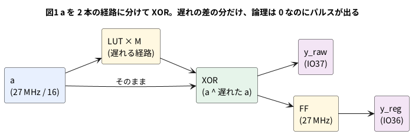

# 9-5 グリッチ — 組み合わせの出力に出る細いパルス

> [!WARNING]
> **この題は実機で組んでいない。** 回路を合成・配置配線・ビットストリーム作りまで手元の PC で通したが、
> 書き込みと AD3 での測定は実行していない。
> **パルスの幅は書いていない。** 実機の遅れは測ってから表に書き加える。
> シミュレーションで出てくる 2 ns と 45 ns は、**わざと入れた仮の値の模型**である。

2-11 の PWM のところで、「`out` をもう 1 段の FF で受けるとひげ (グリッチ) が減る」と書いた。
この題では、そのひげを実際に作る。

**グリッチ**は、組み合わせ回路の出力に、ほんの短い間だけ出る細いパルスである。
論理の式では 0 のままのはずの出力が、入力が変わった瞬間に、一瞬だけ 1 になる。

原因は、同じ入力が**別々の経路を通って**、組み合わせ回路に**違う時刻に**着くこと。
たとえば `y = a ^ a` は、式の上では常に 0 だが、片方の `a` が少し遅れて着くと、
その遅れの間だけ `a ^ (遅れる前の a)` と `a ^ (遅れた後の a)` が食い違い、`y` が 1 になる。

## 説明

- **シミュレーションで見えるもの**: Verilator は遅れを持たないので、`y = a ^ a` は常に 0。グリッチは**出ない**。
  遅れを `#` で入れた模型を作れば出る
- **実機で見えるもの**: LUT と配線には必ず遅れがある。遅れの差の分だけ、パルスが出る。
  ただし、幅は数 ns と**速すぎて**、AD3 の Logic (標本化 125 MS/s、1 標本 8 ns) では、**見えないか、取りこぼす**ことがある
- グリッチは、**クロックの立ち上がりを避けていれば害にならない**。FF で受けるとき、立ち上がりの時点で落ち着いていればよい
  (9-1 の窓、9-3 の最高の周波数)
- 害になるのは、組み合わせの出力を**クロックに使う**とき、**非同期のリセットやセットに使う**とき、
  **外の機器に直に出す**とき。グリッチの 1 発が、FF を 1 回余計に動かしてしまう
- 対策は 2 つ。**(1) 組み合わせの出力を FF で受けて、FF の出力を使う。(2) 信号を変えるのを 1 本だけにする** (カウンタをグレイコードにする、など)

## ブロック図




## Verilog

### glitch.v

遅れる側は、Gowin の LUT (`LUT1`) を M 個、直に置いて作る。9-4 と同じ理由で、合成の道具は、
`a ^ a` を見つけると 0 に畳んで消してしまう。直に置いた LUT は消されない。

```verilog
// glitch.v  論理は常に 0 (a ^ a) なのに、遅れの差で細いパルスが出る回路
// 遅れる側の経路は、Gowin の LUT1 を M 個、直に置いて作る (合成の道具に消されないようにする)

`ifdef VERILATOR
/* verilator lint_off DECLFILENAME */
module LUT1 #(parameter [1:0] INIT = 2'b00) (input wire I0, output wire F);
    assign F = INIT[I0];
endmodule
/* verilator lint_on DECLFILENAME */
`endif

module glitch #(
    parameter M = 16           // 遅れる側に入れる LUT の数
) (
    input  wire a,
    output wire y              // 論理は a ^ a = 0
);
    wire [M:0] d;              // d[0] = a。d[i] は i 段通った a
    assign d[0] = a;

    genvar i;
    generate
        for (i = 0; i < M; i = i + 1) begin : dly
            LUT1 #(.INIT(2'b10)) buffer (.I0(d[i]), .F(d[i+1]));   // INIT = 2'b10 は F = I0 (そのまま通す)
        end
    endgenerate

    assign y = a ^ d[M];
endmodule
```

- `INIT = 2'b10` の LUT1 は、`F = I0` (入力をそのまま通す) 。M 個並べると、a が M 段遅れて着く
- `y = a ^ d[M]` は、式の上では `a ^ a` と同じで、常に 0

### 最上位 (top_glitch.v)

```verilog
// top_glitch.v  27 MHz を割った a から、glitch の出力と、それを FF で受けた出力を作る
module top_glitch #(
    parameter M = 16
) (
    input  wire clk,           // 52 番ピン。ボードの 27 MHz
    output wire a_out,         // 38 番ピン。a (27 MHz / 16 = 1.6875 MHz)
    output wire y_raw,         // 37 番ピン。組み合わせの出力をそのまま出す
    output reg  y_reg          // 36 番ピン。同じ出力を FF で受けて出す
);
    reg [3:0] cnt;
    initial cnt = 4'd0;
    always @(posedge clk)
        cnt <= cnt + 4'd1;

    wire a = cnt[3];           // 8 クロックごとに反転 (27 MHz / 16)
    wire y;

    glitch #(.M(M)) g (.a(a), .y(y));

    assign a_out = a;
    assign y_raw = y;

    always @(posedge clk)
        y_reg <= y;
endmodule
```

制約ファイル `glitch.cst`。書き方は 8-5。

```text
IO_LOC "clk" 52;
IO_PORT "clk" IO_TYPE=LVCMOS33 PULL_MODE=UP;
IO_LOC "a_out" 38;
IO_PORT "a_out" IO_TYPE=LVCMOS33 DRIVE=8;
IO_LOC "y_raw" 37;
IO_PORT "y_raw" IO_TYPE=LVCMOS33 DRIVE=8;
IO_LOC "y_reg" 36;
IO_PORT "y_reg" IO_TYPE=LVCMOS33 DRIVE=8;
```

```bash
verilator --lint-only -Wall top_glitch.v glitch.v
```

lint は警告 0 件で通った (Verilator 5.042)。

## シミュレーション

### 遅れの模型

遅れ DLY を `#` で入れた模型。**実物の遅れではない。** 遅れの小さい場合 (2 ns) と、1 クロック (37 ns) より大きい場合 (45 ns) の
2 つを作る。

```verilog
// glitch_model.v  glitch の「模型」。遅れる側に # で遅れ DLY を入れる (実物の遅れではない)
module glitch_model #(
    parameter real DLY = 2.0   // 遅れる側の遅れ (ns)。模型のために決めた値
) (
    input  wire a,
    output wire y,             // 論理は a ^ a = 0
    output wire d              // 遅れた a (波形で見るために出す)
);
    assign #(DLY) d = a;
    assign y = a ^ d;
endmodule
```

テストベンチは、同じ `a` を、(1) 遅れ無しの `glitch.v`、(2) 遅れ 2 ns の模型、(3) 遅れ 45 ns の模型に通す。
(2) と (3) の出力は、27 MHz の FF でも受けて、パルスの数を数える。

```verilog
// tb_glitch.v  同じ a を、遅れ無しの回路・遅れ 2 ns の模型・遅れ 45 ns の模型に通し、パルスの数を数える
module tb_glitch;
    localparam real HALF = 18.5185;    // 27 MHz の半周期 (ns)

    reg        clk = 0;
    reg  [3:0] cnt = 4'd0;
    wire       a = cnt[3];             // 8 クロックごとに反転 (27 MHz / 16)
    wire       y_zero;                 // 遅れ 0 (glitch.v の LUT 列。シミュレータでは遅れ 0)
    wire       y_2, d_2;               // 遅れ 2 ns の模型
    wire       y_45, d_45;             // 遅れ 45 ns の模型 (1 クロック 37 ns より長い)
    reg        yr_2 = 0, yr_45 = 0;    // それぞれを 27 MHz の FF で受けたもの
    integer    n_a = 0, n_zero = 0, n_2 = 0, n_45 = 0, n_r2 = 0, n_r45 = 0;

    glitch #(.M(16)) g0 (.a(a), .y(y_zero));
    glitch_model #(.DLY(2.0))  g2  (.a(a), .y(y_2),  .d(d_2));
    glitch_model #(.DLY(45.0)) g45 (.a(a), .y(y_45), .d(d_45));

    always #(HALF) clk = ~clk;
    always @(posedge clk) begin
        cnt  <= cnt + 4'd1;
        yr_2  <= y_2;
        yr_45 <= y_45;
    end

    always @(posedge a or negedge a) n_a = n_a + 1;
    always @(posedge y_zero) n_zero = n_zero + 1;
    always @(posedge y_2)    n_2    = n_2 + 1;
    always @(posedge y_45)   n_45   = n_45 + 1;
    always @(posedge yr_2)   n_r2   = n_r2 + 1;
    always @(posedge yr_45)  n_r45  = n_r45 + 1;

    initial begin
        $dumpfile("glitch.vcd");
        $dumpvars(0, tb_glitch);
        #10000;
        $display("a の変化 %0d 回", n_a);
        $display("遅れ 0 の回路           : y のパルス %0d 個", n_zero);
        $display("遅れ 2 ns の模型        : y のパルス %0d 個、FF で受けた出力のパルス %0d 個", n_2, n_r2);
        $display("遅れ 45 ns の模型       : y のパルス %0d 個、FF で受けた出力のパルス %0d 個", n_45, n_r45);
        $finish;
    end
endmodule
```

```bash
verilator --lint-only --timing -Wall glitch_model.v
verilator --timescale 1ns/1ps --binary --timing --trace --top-module tb_glitch glitch.v glitch_model.v tb_glitch.v
./obj_dir/Vtb_glitch
```

`glitch_model.v` の lint は警告 0 件で通った。実行した結果は次のとおり (10 µs のあいだ)。

```text
a の変化 33 回
遅れ 0 の回路           : y のパルス 0 個
遅れ 2 ns の模型        : y のパルス 33 個、FF で受けた出力のパルス 0 個
遅れ 45 ns の模型       : y のパルス 33 個、FF で受けた出力のパルス 33 個
```

### 波形

VCD を読んで、ロジックアナライザの画面と同じ形に描いた。模型の波形であって、実機で測った波形ではない。
D2・D45 は、a を 2 ns・45 ns 遅らせたもの。Y2・Y45 は `a ^ D`。YR2・YR45 は、それを 27 MHz の FF で受けた出力。
YZ は遅れ無しの `glitch.v` の出力。

```logic
# ロジックアナライザの画面 (tommie-fence の logic フェンス)
title: 図2 a が変わるたびに Y2 は 2 ns、Y45 は 45 ns のパルス。FF が拾うのは Y45 だけ
device: generic
time: 12ns/div
start: 270ns
signals:
  CLK: edges 0s=0 277.785ns=1 296.304ns=0 314.823ns=1 333.342ns=0 351.861ns=1 370.38ns=0 388.899ns=1
  A: edges 0s=0 277.785ns=1
  D2: edges 0s=0 279.785ns=1
  Y2: edges 0s=0 277.785ns=1 279.785ns=0
  D45: edges 0s=0 322.785ns=1
  Y45: edges 0s=0 277.785ns=1 322.785ns=0
  YR2: edges 0s=0
  YR45: edges 0s=0 314.823ns=1 351.861ns=0
  YZ: edges 0s=0
cursors: [279ns, 318ns]
```


## 見るべき値 (シミュレーションを実行して得た値)

| 時刻 | 起きたこと |
| --- | --- |
| 277.8 ns | a が 0 → 1。Y2 と Y45 が同時に 1 になる (遅れ側がまだ 0 なので `a ^ 0 = 1`) |
| 279.8 ns | D2 が 1 になり、Y2 が 0 に戻る。幅 2 ns |
| 314.8 ns | 立ち上がり。Y45 がまだ 1 なので、FF (YR45) が 1 を拾う。YR2 は 0 のまま |
| 322.8 ns | D45 が 1 になり、Y45 が 0 に戻る。幅 45 ns |
| 351.9 ns | 立ち上がり。Y45 は 0 に戻っているので、YR45 も 0 に戻る。YR45 の幅は 1 クロック (37 ns) |

- 図2のカーソル X1 = 279 ns では、A = 1・D2 = 0・Y2 = 1 (2 ns パルスの中)。X2 = 318 ns では、D45 = 0・Y45 = 1・YR45 = 1
- 遅れ 0 の回路 (YZ) は、a が 33 回変わっても、パルスが 0 個。**シミュレーションでは、この回路のグリッチは見えない**
- 遅れ 2 ns のパルスは、FF (YR2) に拾われなかった。a が変わるのは立ち上がりの直後で、パルスは次の立ち上がりの前に終わるため
- 遅れ 45 ns のパルスは、1 クロック (37 ns) より長いので、必ず立ち上がりをまたぎ、FF が拾った。
  **FF で受けても、組み合わせの遅れが 1 クロックを超えれば、グリッチは消えない** (9-1 の窓を破る)

**見せられたこと**: 遅れの差の分のパルスが出ること。FF が拾うか拾わないかは、パルスの幅とクロックの周期の関係で決まること。

**見せられないこと**: 実物のパルスの幅。模型の 2 ns と 45 ns は、わざと決めた値である。

## 合成と配置配線

8-4 と同じ 3 手を通した (OSS CAD Suite の yosys 0.69+274・nextpnr 0.11.1-54・gowin_pack。書き込みは未実行)。

```bash
yosys -p "read_verilog top_glitch.v glitch.v; synth_gowin -top top_glitch -json g.json; stat"
nextpnr-himbaechel --json g.json --write pg.json \
    --device GW1NR-LV9QN88PC6/I5 --vopt family=GW1N-9C --vopt cst=glitch.cst --freq 27
gowin_pack -d GW1N-9C -o g.fs pg.json
```

- 合成した結果は DFF 5 個 (cnt の 4 個と `y_reg`)・ALU 4 個・LUT1 17 個 (遅れる経路 16 個 + 1 個)・LUT2 1 個 (XOR)。
  置いた 16 個の LUT は消えなかった
- **nextpnr の `Max frequency` は、M を 4・16・64・256・1024 のどれにしても 334.45 MHz のまま動かなかった。**
  遅れる経路の長さは、見積りに反映されていない (理由は確かめていない)。この遅れは、道具の数を当てにせず、測る
- 遅れる経路の LUT が 16 個のとき、実物の遅れは **測って書く**

## 回路図

AD3 の DIO0・DIO1・DIO2 を Logic の入力にして、IO38 (`a_out`)・IO37 (`y_raw`)・IO36 (`y_reg`) を読む。

```circuit
# 回路図 (tommie-fence の circuit フェンス)
title: 図3 DIO0・DIO1・DIO2 で a_out・y_raw・y_reg を読む
parts:
  AD:
    type: device
    at: 1,3.8
    label: AD3
    pins: [DIO0, DIO1, DIO2, GND]
    turn: mirror
  U1: tang-nano-9k 8,6
  G1: ground 3.5,5.2
  G2: ground 10.5,9
wires:
  - AD.DIO0 -| 5,3.24
  - U1.IO38 |- 5,3.24
  - AD.DIO1 -| 5.5,3.48
  - U1.IO37 |- 5.5,3.48
  - AD.DIO2 -| 6,3.72
  - U1.IO36 |- 6,3.72
  - AD.GND -| 3.5,5.2
  - U1.GND -| 10.5,9
```


## 部品表

| 部品 | 値・型番 | 数 | 役 |
| --- | --- | --- | --- |
| U1 | Sipeed Tang Nano 9K (GW1NR-9) | 1 | FPGA ボード。USB-C から給電と書き込み |
| — | ブレッドボード (half、30 列) | 1 | |
| — | ジャンパ線 | 6 本 | GND の 3 本と DIO の 3 本 |
| AD | Analog Discovery 3 | 1 | Logic で IO38・IO37・IO36 を読む |

電源は教科書の既定の 5 V ではなく **3.3 V** (FPGA のピン)。FPGA のピンに 5 V を入れると壊れるため (0-3)。
AD3 の DIO は **3.3 V** にそろえる (0-4)。

## 実体配線図

```bread
# ブレッドボードの実体配線図 (tommie-fence の bread フェンス)
title: 図4 配線は 8-3 のまま、DIO2 (j3) を足す。IO38・IO37・IO36 を DIO0〜DIO2 へ
board: half
parts:
  U1: tang-nano-9k @ b1
  AD:
    type: device
    at: bottom
    label: AD3 Logic
    pins: [DIO0, DIO1, DIO2, GND]
wires:
  - a23 -- -t23 black
  - -t29 -- -b29 black
  - AD.GND -- -b27 black
  - AD.DIO0 -- j1 green
  - AD.DIO1 -- j2 yellow
  - AD.DIO2 -- j3 blue
notes:
  - text: 給電は Tang Nano 9K の USB-C (5 V)。電源レールは GND (−) だけ使う
```


- 置き方と GND の線は 8-3 と同じ。足したのは DIO2 から j3 (IO36) への 1 本
- a は 1.6875 MHz で、ブレッドボードの範囲 (3 MHz 以下) に収まる。細いパルスの中身は、それより速い成分を含む。
  **ブレッドボードの線の寄生容量が、ns のパルスをなまらせる**ことがある。見えなくなった場合は、線を短くする

## 計器の設定

| 計器 | 設定 |
| --- | --- |
| Logic | DIO0・DIO1・DIO2 を Enable。DIO は 3.3 V。GND を共通にする (0-4) |
| 時間軸 | 100 ns/div (窓 1 µs)。a の半周期 (296 ns) が 3 目盛ほど |
| 標本化 | 125 MS/s (AD3 の Logic の上限)。1 標本 = 8 ns。**8 ns より細いパルスは取りこぼす** |
| トリガ | DIO0 (a_out) の立ち上がり。繰り返して何回も取る |

## Logic に見えるはずの画面

図5は、**パルスの幅を仮に 24 ns (3 標本) とした例**である。実物の幅は、遅れる経路の LUT 16 個の遅れで決まり、測るまで分からない。
8 ns より細ければ、Logic の画面には出ないか、1 標本だけ現れる。

```logic
# ロジックアナライザの画面 (tommie-fence の logic フェンス)
title: 図5 仮の例 (幅 24 ns)。y_raw は a_out の変わり目に細いパルス。y_reg は 0 のまま
device: ad3
time: 100ns/div
start: -100ns
sample: 125MHz
signals:
  a_out: dio0 clock 1.6875MHz
  y_raw: dio1 pattern 0000000000000000000000000111111000000000000000000000000000000000000000000000000000000000000000000001111110000000000000000000000000000000000000000000000000000000000000000000011111100000000000000000000000000000000000000000000000000000000000000000000111111 bit 4ns from -100ns
  y_reg: dio2 low
cursors: [8ns, 200ns]
trigger: a_out rising at 0s
```


## 見るべき値

シミュレーションの値と計算値。実機で測っていない。

| 項目 | 見るべき値 | どこで得たか |
| --- | --- | --- |
| a の周波数 | 1.6875 MHz (周期 592.6 ns) | 27 MHz ÷ 16 (計算値) |
| a が変わる間隔 | 296.3 ns | 計算値 |
| 遅れ無しのシミュレーションの y | 常に 0 (パルス 0 個) | シミュレーション |
| `y_raw` のパルスの幅 (M = 16) | 測って書く | AD3 の Logic。8 ns 刻みで読めなければ Scope |
| `y_raw` のパルスの数 | a が変わるたびに 1 個 (計算値)。**見えない場合は、見えなかったと書く** | 実機 |
| `y_reg` のパルス | 幅が 37 ns より小さければ出ない (計算値)。**測って書く** | 実機 |

実機で測ったら、M を 4・16・64 に変えて、パルスの幅が M に比例して長くなるかを見る。
幅が 37.04 ns を超えると、`y_reg` にもパルスが出るはずである (シミュレーションの 45 ns の模型と同じ)。
AD3 の Logic で見えない幅の場合は、同じ AD3 の Scope で `y_raw` を読むことを検討する。
その場合も、Scope の帯域と標本化が足りるかは、先に確かめる。

## 出典

自作。

- グリッチ (ハザード) の説明は、ディジタル回路の教科書にある定番の話である
- LUT の `INIT` の読み方 (`2'b10` が F = I0): yosys の `synth_gowin` が出した LUT の `INIT` を、実行して確かめた (9-4)
- 打ち方 (nextpnr の `--device`・`--vopt family`、gowin_pack の `-d GW1N-9C`): [Apicula](https://github.com/YosysHQ/apicula) の README (8-4)
