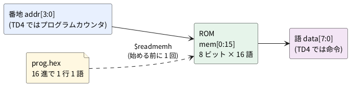

# 10-1 ROM — 配列と $readmemh

CPU はプログラムを ROM (読むだけのメモリ) から 1 語ずつ読んで動く。
4 ビット CPU の TD4 (5-8・第 11 章) の ROM は、8 ビットの語が 16 個の小さなものだ。
番地 (4 ビット) を入れると、その番地の語 (8 ビット) が出る。

この題では、その ROM を Verilog の**配列**で書き、中身を別のファイルから `$readmemh` で読み込む。
プログラムを変えるときに Verilog を書き換えずに済む。

この題は PC の Verilator だけで動かす。組まない題なので、実体配線図と Analog Discovery 3 は入れない。

## 説明

- `reg [7:0] mem [0:15];` は「8 ビットの語を 16 個並べた配列」だ。名前の前の `[7:0]` が 1 語の幅、後ろの `[0:15]` が番地の範囲
- `$readmemh("prog.hex", mem);` は、16 進で書いたテキストのファイルを 1 行 1 語として、番地 0 から順に配列へ入れる。
  `//` の後ろは注釈として読み飛ばす。`h` は 16 進で、2 進で書くなら `$readmemb` を使う
- `$readmemh` は `initial` の中に書く。シミュレーションでは始める前に 1 回だけ読む。
  FPGA に焼くときは、合成の道具がこのファイルを読んで中身を回路に埋め込む
- 読み出しは `assign data = mem[addr];` の 1 行だ。クロックは無く、番地を変えればすぐ語が変わる。
  TD4 の ROM はこの形をしている。クロックに合わせて読む形は 10-2 (RAM) で扱う

Soft-FPGA-TD4 の `TD4.v` は、ROM の 16 語を `rom[4'b0000] = 8'b1011_0011;` のように Verilog の中に 1 行ずつ書いている。
この題では、同じ 16 語をファイルに移す。

## ブロック図

図 1 は、ROM と中身のファイルの関係だ。番地を入れると語が出る。ファイルは始める前に 1 回だけ読まれる。




## Verilog

```verilog
// rom16x8.v  16 語 × 8 ビットの ROM。中身はファイルから読む
module rom16x8 #(
    parameter INIT = "prog.hex"     // 中身のファイル (16 進で 1 行 1 語)
) (
    input  wire [3:0] addr,
    output wire [7:0] data
);
    reg [7:0] mem [0:15];           // 8 ビットの語を 16 個並べた配列

    initial $readmemh(INIT, mem);   // 始める前にファイルから中身を入れる

    assign data = mem[addr];        // 番地を入れれば、すぐ語が出る
endmodule
```

- ファイルの名前は `parameter` にした。呼ぶ側で `#(.INIT("別の.hex"))` と書けば、同じ ROM に別のプログラムを入れられる

中身のファイルは次のとおり。Soft-FPGA-TD4 の `TD4.v` に書いてある 16 語を、そのまま 16 進に直した。
LED を左右に往復させるプログラムで、命令の読み方は第 11 章で扱う。

```text
// prog.hex  TD4 の LED を往復させるプログラム (番地 0 から順に 1 行 1 語)
b3  // 0: OUT 0011
b6  // 1: OUT 0110
bc  // 2: OUT 1100
b8  // 3: OUT 1000
b8  // 4: OUT 1000
bc  // 5: OUT 1100
b6  // 6: OUT 0110
b3  // 7: OUT 0011
b1  // 8: OUT 0001
f0  // 9: JMP 0000
00  // a: (使わない)
00  // b
00  // c
00  // d
00  // e
00  // f
```

## テストベンチ

番地を 0 から 15 まで 1 µs ごとに進め、出た語を期待値と比べる。期待値は `TD4.v` に書いてある値を写した。
ファイルから読んだ中身が、Verilog に直に書いた中身と同じになるかを確かめる。

```verilog
// tb_rom.v  番地を 0 から 15 まで進め、読んだ語を期待値と比べる
module tb_rom;
    reg  [3:0] addr;
    wire [7:0] data;
    reg  [7:0] expected [0:15];
    integer i;
    integer ng;

    rom16x8 #(.INIT("prog.hex")) u (.addr(addr), .data(data));

    initial begin
        // 期待値は Soft-FPGA-TD4 の TD4.v に書いてある ROM の中身
        expected[0] = 8'hb3; expected[1] = 8'hb6; expected[2]  = 8'hbc; expected[3]  = 8'hb8;
        expected[4] = 8'hb8; expected[5] = 8'hbc; expected[6]  = 8'hb6; expected[7]  = 8'hb3;
        expected[8] = 8'hb1; expected[9] = 8'hf0; expected[10] = 8'h00; expected[11] = 8'h00;
        expected[12] = 8'h00; expected[13] = 8'h00; expected[14] = 8'h00; expected[15] = 8'h00;

        $dumpfile("rom.vcd");
        $dumpvars(0, tb_rom);
        ng = 0;
        for (i = 0; i < 16; i = i + 1) begin
            addr = i[3:0];
            #1;                                   // 1 us ごとに番地を進める
            $display("番地 %h: %h (%b)", addr, data, data);
            if (data !== expected[i]) ng = ng + 1;
        end
        if (ng == 0) $display("PASS: 16 語とも期待値と同じ");
        else         $display("FAIL: %0d 語が違う", ng);
        $finish;
    end
endmodule
```

## 動かす

`prog.hex` は、実行するディレクトリ (`obj_dir` の 1 つ上) に置く。

```bash
verilator --lint-only -Wall rom16x8.v
verilator --timescale 1us/1ns --binary --timing --trace --top-module tb_rom rom16x8.v tb_rom.v
./obj_dir/Vtb_rom
```

1 行目の lint は、ROM (`rom16x8.v`) を警告 0 件で通った。Verilator は 5.042 を使った。
実行すると次のように出た。

```text
番地 0: b3 (10110011)
番地 1: b6 (10110110)
番地 2: bc (10111100)
番地 3: b8 (10111000)
番地 4: b8 (10111000)
番地 5: bc (10111100)
番地 6: b6 (10110110)
番地 7: b3 (10110011)
番地 8: b1 (10110001)
番地 9: f0 (11110000)
番地 a: 00 (00000000)
番地 b: 00 (00000000)
番地 c: 00 (00000000)
番地 d: 00 (00000000)
番地 e: 00 (00000000)
番地 f: 00 (00000000)
PASS: 16 語とも期待値と同じ
```

### ファイルを変えて試す

同じ実行ファイル (`./obj_dir/Vtb_rom`) のまま、`prog.hex` だけを変えて 3 通り試した。

| `prog.hex` | 画面に出たこと | 結果 |
| --- | --- | --- |
| 番地 0 と 7 の `b3` を `a5` に書き換えた | 番地 0 と 7 が `a5` | `FAIL: 2 語が違う`。組み直さずに中身が変わった |
| 番地 9 (`f0`) までの 10 行で終わる | 番地 a〜f は `00` | `PASS`。足りない行について何も言われない |
| ファイルが無い | `%Warning: prog.hex:0: $readmem file not found` のあと全部 `00` | `FAIL: 10 語が違う`。シミュレーションは止まらない |

- Verilator は `$readmemh` を実行のときに読む。中身を変えるだけなら、Verilator で組み直さなくてよい
- 読まれなかった語は 0 になった。0 は TD4 では `ADD A,0` という命令として読まれる
  (TD4.v は上位 4 ビット `0000` を A に即値を足す命令として解く)。
  ファイルが足りなくても気づきにくいので、テストベンチで全部の番地を期待値と比べておく
- ファイルが無いときは警告が 1 行出るだけで、シミュレーションは最後まで走った。警告を見落とさない

## シミュレーションの波形

上の実行の値を、ロジックアナライザの画面と同じ形に描いた。実機で測った波形ではない。
A3〜A0 は `addr`、D7〜D0 は `data` の各ビットで、バスの値は 16 進で読む。
窓は最初の 10 µs で、プログラムのある番地 0〜9 を描いた。番地 3 と 4 は同じ `b8` なので、DATA の箱は 1 つにつながる。

```logic
# ロジックアナライザの画面 (tommie-fence の logic フェンス)
title: 図2 番地 (ADDR) を 1 us ごとに進めると、prog.hex の語が DATA に出る
device: generic
time: 1us/div
signals:
  A3: pattern 0000000011111111 bit 1us
  A2: pattern 0000111100001111 bit 1us
  A1: pattern 0011001100110011 bit 1us
  A0: pattern 0101010101010101 bit 1us
  D7: pattern 1111111111000000 bit 1us
  D6: pattern 0000000001000000 bit 1us
  D5: pattern 1111111111000000 bit 1us
  D4: pattern 1111111111000000 bit 1us
  D3: pattern 0011110000000000 bit 1us
  D2: pattern 0110011000000000 bit 1us
  D1: pattern 1100001100000000 bit 1us
  D0: pattern 1000000110000000 bit 1us
buses:
  ADDR: A3..A0 hex
  DATA: D7..D0 hex
cursors: [0.5us, 9.5us]
```


## 見るべき値 (シミュレーションを実行して得た値)

| 番地 | 語 (16 進) | 語 (2 進) | TD4 の命令 |
| --- | --- | --- | --- |
| 0 | b3 | 1011 0011 | OUT 0011 |
| 1 | b6 | 1011 0110 | OUT 0110 |
| 2 | bc | 1011 1100 | OUT 1100 |
| 3 | b8 | 1011 1000 | OUT 1000 |
| 4 | b8 | 1011 1000 | OUT 1000 |
| 5 | bc | 1011 1100 | OUT 1100 |
| 6 | b6 | 1011 0110 | OUT 0110 |
| 7 | b3 | 1011 0011 | OUT 0011 |
| 8 | b1 | 1011 0001 | OUT 0001 |
| 9 | f0 | 1111 0000 | JMP 0000 |
| a〜f | 00 | 0000 0000 | (使わない) |

- 図2のカーソル X1 = 0.5 µs で ADDR = 0x0・DATA = 0xB3、X2 = 9.5 µs で ADDR = 0x9・DATA = 0xF0
- DATA は ADDR が変わった同じ時刻に変わる。クロックを待たない
- D7・D5・D4 は番地 0〜9 でずっと 1 で、D6 は番地 9 (JMP) だけ 1。上位 4 ビットが命令の種類 (`1011` = OUT、`1111` = JMP) だからだ

### 合成するとどうなるか

FPGA に焼くと、この ROM は何になるか。合成の道具 Yosys 0.33 で、Tang Nano 9K の品種 (Gowin) 向けに合成だけしてみた。

```bash
yosys -p "read_verilog rom16x8.v; synth_gowin -top rom16x8; stat"
```

部品の数の報告は次のとおりだった (抜き出し)。

```text
   Number of memories:               0
   Number of cells:                 18
     IBUF                            4
     LUT3                            4
     LUT4                            2
     OBUF                            8
```

- メモリは 0 個で、ROM は 6 個の LUT (論理を表で引く部品) になった。IBUF と OBUF はピンの入出力の部品だ
- 中身が決まっている小さな ROM は、合成の道具が `prog.hex` を読んで論理の式に直してしまう。
  8 ビットのうち 3 本 (D7・D5・D4) は同じ式で、残りも少ない LUT で書ける
- 中身を変えたら合成からやり直す。シミュレーションのように実行のときに読むのではない
- 配置配線と、実物の Tang Nano 9K での確かめは行っていない (未実行)

## シミュレーションでの確かめ

Verilator 5.042 と Yosys 0.33 で、本文の `rom16x8.v` `tb_rom.v` と `prog.hex` を取り出して走らせ直した。
置き場は `sim/01-rom-readmemh.v` (回路)、`sim/01-rom-readmemh-tb.v` (テストベンチ)、`sim/01-rom-readmemh.hex` (`prog.hex` の中身)。
テストベンチは `prog.hex` を読むので、実行するディレクトリにこの名前で置く。

| 項目 | 本文の数字 | 実行結果 | 判定 |
| --- | --- | --- | --- |
| 番地 0〜9 の語 | b3 b6 bc b8 b8 bc b6 b3 b1 f0 | 同じ | 合った |
| 番地 a〜f の語 | 00 | 00 | 合った |
| 検査の結果 | PASS: 16 語とも期待値と同じ | 同じ | 合った |
| lint (`-Wall`) | 警告 0 件 | 0 件 | 合った |
| `a5` に書き換え | FAIL: 2 語が違う | FAIL: 2 語が違う | 合った |
| 10 行で終わるファイル | PASS (a〜f は 00) | PASS | 合った |
| ファイルが無い | 警告 1 行のあと FAIL: 10 語が違う | 同じ | 合った |
| 合成 (`synth_gowin`) | メモリ 0・LUT3 が 4・LUT4 が 2・IBUF 4・OBUF 8 | 同じ (cells 18) | 合った |
| 図2 (D6 は番地 9 だけ 1、D3 は番地 3〜6 で 1) | 本文のとおり | 番地ごとの語から読み直して同じ | 合った |

配置配線 (nextpnr) と実機は無いので、そこから出る数は確かめていない。

## 出典

自作。ROM の 16 語は [Soft-FPGA-TD4](https://github.com/tommie-jp/Soft-FPGA-TD4) の `verilator-TD4/TD4.v` から写した
(MIT License。この TD4.v は [asfdrwe/simpleTD4](https://github.com/asfdrwe/simpleTD4) の TD4.v を Verilator 向けに直したもの)。
`$readmemh` の書き方は IEEE 1364-2005 (Verilog) のシステムタスク (17 章、ファイルからメモリへの読み込み) による。
Verilator のマニュアルは [https://verilator.org/guide/latest/](https://verilator.org/guide/latest/)。
