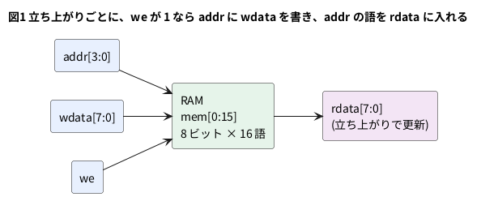

# 10-2 RAM — クロックに合わせて読み書きする

10-1 の ROM は、中身が決まっていて読むだけだった。RAM は、同じ形の配列に**書く**こともできる。
書いた語は次に読めるので、CPU の作業用のメモリや、LED の表示データの置き場に使う。

この題では、16 語 × 8 ビットの RAM を Verilog で書く。ROM と違うのは 2 点で、
書くかどうかを決める入力 `we` (write enable) があることと、読むのも**クロックの立ち上がり**に合わせることである。

この題は PC の Verilator だけで動かす。組まない題なので、実体配線図と Analog Discovery 3 は入れない。

## 説明

- `we` が 1 の立ち上がりで、`addr` の番地に `wdata` が書かれる。`we` が 0 なら、配列は変わらない
- 読み出しも立ち上がりで行う。立ち上がりの時点の `addr` の語が `rdata` に入り、次の立ち上がりまで残る。
  10-1 の ROM は `assign` で番地を変えればすぐ語が出たが、この RAM は**番地を入れてから 1 クロック後**に語が出る
- この形にするのは、FPGA の中のメモリ用の部品 (ブロック RAM) が、読み出しにクロックを使う作りだからである。
  この書き方なら、合成の道具が部品に割り当てやすい (下の「FPGA に載せるとき」)
- 同じクロックで、同じ番地を書きながら読むとどうなるか。ここで書いた形では、**書く前の語**が読める。
  `<=` (ノンブロッキング) の代入は、立ち上がりの時点の右辺を取り込んで、立ち上がりの終わりにまとめて更新するからである (2-2)。
  書いた語が読めるのは、その次のクロックになる

## ブロック図




## Verilog

```verilog
// ram16x8.v  16 語 × 8 ビットの RAM。書くのも読むのもクロックの立ち上がり
module ram16x8 (
    input  wire       clk,
    input  wire       we,        // 1 のとき、この立ち上がりで addr に wdata を書く
    input  wire [3:0] addr,
    input  wire [7:0] wdata,
    output reg  [7:0] rdata
);
    reg [7:0] mem [0:15];

    always @(posedge clk) begin
        if (we)
            mem[addr] <= wdata;
        rdata <= mem[addr];      // 読んだ語は、次の立ち上がりまで rdata に残る
    end
endmodule
```

- 配列の宣言は 10-1 の ROM と同じ。違いは、`always @(posedge clk)` の中で `mem[addr]` に代入している所
- `rdata` は `reg` で、立ち上がりでしか変わらない。`rdata` は 8 ビットのフリップフロップ 8 個になる
- この RAM には初期値を入れていない。Verilator は 2 値なので 0 から始まるが、実物の FPGA でどうなるかは、
  部品と合成の道具の設定で変わる。読む前に必ず書く、という使い方にしておく

## テストベンチ

番地 3 に A5、番地 7 に 3C を書き、読み戻す。次に番地 3 を 5A に書き換えながら同じ番地を読み、書く前の語 A5 が読めることを確かめる。
入力は立ち上がりの 1 µs 後に変える (2-10 と同じ)。

```verilog
// tb_ram.v  書く → 読む → 同じ番地を書きながら読む → 読み直す
module tb_ram;
    reg        clk = 0;
    reg        we = 0;
    reg  [3:0] addr = 0;
    reg  [7:0] wdata = 0;
    wire [7:0] rdata;
    integer    ng = 0;

    ram16x8 u (.clk(clk), .we(we), .addr(addr), .wdata(wdata), .rdata(rdata));

    always #5 clk = ~clk;        // 立ち上がりは 5, 15, 25, ... us

    // 入力は立ち上がりの 1 us 後に変え、次の立ち上がりを 1 回待つ
    task step(input w, input [3:0] a, input [7:0] d);
        begin
            we = w; addr = a; wdata = d;
            @(posedge clk); #1;
        end
    endtask

    task expect_rdata(input [7:0] e);
        begin
            if (rdata !== e) begin
                ng = ng + 1;
                $display("NG: rdata=%h (期待 %h)", rdata, e);
            end
        end
    endtask

    initial begin
        $dumpfile("ram.vcd");
        $dumpvars(0, tb_ram);
        @(posedge clk); #1;          // 6 us
        step(1, 4'h3, 8'hA5);        // 番地 3 に A5 を書く
        step(1, 4'h7, 8'h3C);        // 番地 7 に 3C を書く
        step(0, 4'h3, 8'h00);        // 番地 3 を読む (立ち上がりで rdata に入る)
        expect_rdata(8'hA5);
        step(0, 4'h7, 8'h00);        // 番地 7 を読む
        expect_rdata(8'h3C);
        step(1, 4'h3, 8'h5A);        // 番地 3 を 5A に書き換えながら、同じ番地を読む
        expect_rdata(8'hA5);         // 読めたのは書く前の語
        step(0, 4'h3, 8'h00);        // もう一度読む
        expect_rdata(8'h5A);
        step(0, 4'h7, 8'h00);        // 書いていない番地 7 は、まだ 3C
        expect_rdata(8'h3C);
        if (ng == 0) $display("PASS");
        else         $display("FAIL: %0d 件", ng);
        $finish;
    end
endmodule
```

## 動かす

```bash
verilator --lint-only -Wall ram16x8.v
verilator --timescale 1us/1ns --binary --timing --trace --top-module tb_ram ram16x8.v tb_ram.v
./obj_dir/Vtb_ram
```

`ram16x8.v` の lint は警告 0 件で通った (Verilator 5.042)。実行すると `PASS` と出て、`$finish` は 80 µs だった。

## シミュレーションの波形

VCD を読んで、ロジックアナライザの画面と同じ形に描いた。実機で測った波形ではなく、シミュレーションの値だ。

```logic
title: 図2 55 us に 5A を書いても RDATA は書く前の A5。5A は 65 us
device: generic
time: 8us/div
signals:
  CLK: edges 0s=0 5us=1 10us=0 15us=1 20us=0 25us=1 30us=0 35us=1 40us=0 45us=1 50us=0 55us=1 60us=0 65us=1 70us=0 75us=1 80us=0
  WE: edges 0s=0 6us=1 26us=0 46us=1 56us=0
  A3: edges 0s=0
  A2: edges 0s=0 16us=1 26us=0 36us=1 46us=0 66us=1
  A1: edges 0s=0 6us=1
  A0: edges 0s=0 6us=1
  W7: edges 0s=0 6us=1 16us=0
  W6: edges 0s=0 46us=1 56us=0
  W5: edges 0s=0 6us=1 26us=0
  W4: edges 0s=0 16us=1 26us=0 46us=1 56us=0
  W3: edges 0s=0 16us=1 26us=0 46us=1 56us=0
  W2: edges 0s=0 6us=1 26us=0
  W1: edges 0s=0 46us=1 56us=0
  W0: edges 0s=0 6us=1 16us=0
  R7: edges 0s=0 35us=1 45us=0 55us=1 65us=0
  R6: edges 0s=0 65us=1 75us=0
  R5: edges 0s=0 35us=1 65us=0 75us=1
  R4: edges 0s=0 45us=1 55us=0 65us=1
  R3: edges 0s=0 45us=1 55us=0 65us=1
  R2: edges 0s=0 35us=1 65us=0 75us=1
  R1: edges 0s=0 65us=1 75us=0
  R0: edges 0s=0 35us=1 45us=0 55us=1 65us=0
buses:
  ADDR: A3..A0 hex
  WDATA: W7..W0 hex
  RDATA: R7..R0 hex
cursors: [60us, 70us]
```


## 見るべき値 (シミュレーションを実行して得た値)

| 立ち上がり | WE | ADDR | WDATA | この立ち上がりの後の RDATA | 起きたこと |
| --- | --- | --- | --- | --- | --- |
| 15 µs | 1 | 3 | A5 | 00 | 番地 3 に A5 を書く。RDATA はまだ 0 (書く前の語) |
| 25 µs | 1 | 7 | 3C | 00 | 番地 7 に 3C を書く |
| 35 µs | 0 | 3 | — | A5 | 番地 3 を読む |
| 45 µs | 0 | 7 | — | 3C | 番地 7 を読む |
| 55 µs | 1 | 3 | 5A | A5 | 番地 3 を 5A に書きながら読む。RDATA は書く前の A5 |
| 65 µs | 0 | 3 | — | 5A | 番地 3 を読み直す。5A に変わっている |
| 75 µs | 0 | 7 | — | 3C | 書いていない番地 7 は 3C のまま |

- 最初の書き込み (6 µs に `we`・`addr`・`wdata` を置き、15 µs の立ち上がりで書かれる) の前は、`mem` は 0 から始まる。
  15 µs の立ち上がりで読んだのは番地 0 の語で、RDATA は 00 のまま
- 図2のカーソル X1 = 60 µs では、WE = 0・ADDR = 3・RDATA = A5。5A を書いたのは 55 µs なのに、RDATA はまだ書く前の語を出している。
  X2 = 70 µs では RDATA = 5A に変わっている
- 番地を入れてから語が出るまで、必ず立ち上がり 1 回分かかる。ADDR が 3 に変わったのは 26 µs だが、RDATA が A5 になるのは 35 µs である

## FPGA に載せるとき

合成の道具が、この書き方をどの部品にするかを yosys で確かめた。コマンドは次のとおり。

```bash
yosys -p "read_verilog ram16x8.v; synth_gowin -top ram16x8 -json r.json; stat"
```

| 語の数 (8 ビット幅) | yosys 0.33 (`/usr/bin/yosys`) | yosys 0.69+274 (OSS CAD Suite) |
| --- | --- | --- |
| 16 (この題のもの) | RAM16SDP4 が 2 個、DFF が 8 個 | 同じ |
| 64 | RAM16SDP4 が 8 個、DFF が 8 個、LUT と MUX2_LUT が 60 個 | 同じ個数 (LUT の種類の名前だけ違う) |
| 512 | RAM16SDP4 が 64 個、DFF が 8 個、LUT と MUX2_LUT が 368 個 | SPX9 が 1 個 |
| 2048 | RAM16SDP4 が 256 個、DFF が 8 個、LUT と MUX2_LUT が 2 360 個 | SPX9 が 1 個 |

- 16 語は、LUT で作る小さな RAM (RAM16SDP4。4 ビット幅 × 16 語) が 2 個になった。8 ビットの DFF は `rdata` である
- 512 語以上は、0.69 では SPX9 (Gowin のブロック RAM を 1 ポートで使う部品) 1 個になった。0.33 では、ブロック RAM を使わず LUT で組んだ。
  **合成の道具の版で、同じ Verilog が別の部品になる。**
- 数は「合成の結果」で、配置配線は通していない。Tang Nano 9K のブロック RAM の数や容量は、この題では確かめていない (8-1 と、メーカーの資料で読む)
- 実機で動かして、読み出しの遅れや消費電力を測ったものではない

## 出典

自作。`<=` で書く前の値が読める振る舞いは、Verilog の言語としての決まり (IEEE 1364-2005 の 9 章、ノンブロッキング代入) による。
部品名 (RAM16SDP4・SPX9) は yosys の `synth_gowin` が出した名前で、実行して確かめた (上の表)。
