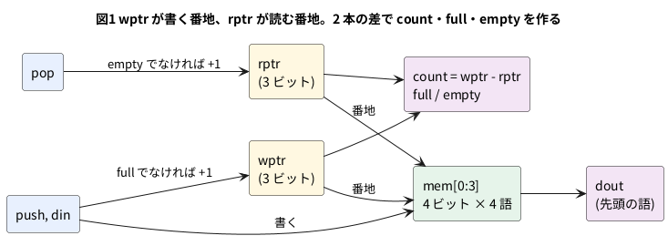

# 10-3 FIFO

FIFO (First In, First Out) は、**入れた順に出てくる**メモリだ。
UART で受けた文字を、CPU が取りに来るまで溜めておく。速さの違う 2 つの回路のあいだに挟んで、受け渡しの揺れを吸う。
この FIFO を UART の受信に挟む題は 7-10 にある。

作りは 10-2 の RAM に、**書く番地** (`wptr`) と**読む番地** (`rptr`) の 2 本を足したものだ。
入れるたびに `wptr`、出すたびに `rptr` が 1 つ進む。2 本が追いついたら空 (`empty`)、
`wptr` が `rptr` を 1 周追い越したら満杯 (`full`) である。

この題では、4 ビット幅 × 4 語の小さな FIFO を作る。語が少ないのは、波形に全部を載せるためで、仕組みは何語でも同じだ。

この題は PC の Verilator だけで動かす。組まない題なので、実体配線図と Analog Discovery 3 は入れない。

## 説明

- `push` が 1 の立ち上がりで、`din` を入れる。ただし `full` のときは**無視**する (`do_push`)
- `pop` が 1 の立ち上がりで、先頭の語を捨てる。ただし `empty` のときは**無視**する (`do_pop`)
- `dout` は、いまの先頭の語を常に見せる。`pop` を 1 にした立ち上がりで、その語が捨てられ、次の語に変わる。
  `empty` のときの `dout` は意味が無い (古い語が見えているだけ)
- `wptr` と `rptr` は **3 ビット**にした。語は 4 つなので番地は下位 2 ビットで足りるが、
  上の 1 ビットで「何周したか」を持つ。これが無いと、`wptr == rptr` が「空」なのか「満杯」なのか区別できない
  - 下位 2 ビットが同じで、上の 1 ビットも同じ: **空**
  - 下位 2 ビットが同じで、上の 1 ビットが違う: **満杯**
  - `wptr - rptr` が、入っている語の数 (`count`)
- 同じ立ち上がりに `push` と `pop` が両方 1 なら、入れる動きと出す動きが同時に起きる。`count` は変わらない
  (満杯でも空でもないとき)

## ブロック図




## Verilog

```verilog
// fifo4x4.v  4 ビット幅 × 4 語の FIFO。dout は先頭の語を常に見せる
module fifo4x4 (
    input  wire       clk,
    input  wire       rst,
    input  wire       push,      // 1 のとき、立ち上がりで din を入れる (full なら無視)
    input  wire [3:0] din,
    input  wire       pop,       // 1 のとき、立ち上がりで先頭を捨てる (empty なら無視)
    output wire [3:0] dout,      // 先頭の語。empty のときは意味が無い
    output wire       full,
    output wire       empty,
    output wire [2:0] count      // 入っている語の数 (0〜4)
);
    reg [3:0] mem [0:3];
    reg [2:0] wptr;              // 書く番地。下位 2 ビットが番地、最上位は「何周したか」
    reg [2:0] rptr;              // 読む番地。同じ形

    assign empty = (wptr == rptr);
    assign full  = (wptr[1:0] == rptr[1:0]) && (wptr[2] != rptr[2]);
    assign count = wptr - rptr;
    assign dout  = mem[rptr[1:0]];

    wire do_push = push && !full;
    wire do_pop  = pop  && !empty;

    always @(posedge clk) begin
        if (rst) begin
            wptr <= 3'd0;
            rptr <= 3'd0;
        end else begin
            if (do_push) begin
                mem[wptr[1:0]] <= din;
                wptr <= wptr + 3'd1;
            end
            if (do_pop)
                rptr <= rptr + 3'd1;
        end
    end
endmodule
```

- `mem` はリセットしない。中身は `wptr` と `rptr` が決めるので、リセットで 2 本を 0 に戻せば足りる
- `dout` は `assign` で、番地を変えればすぐ変わる (10-1 の ROM と同じ形)。10-2 の RAM のように、クロックで読む形にすることもできる。
  その場合、`pop` の 1 クロック後に次の語が出る。受け取る側が 1 クロック待てるなら、その形のほうが FPGA のブロック RAM に載せやすい
- `wptr + 3'd1` と幅を書いたのは、Verilator の `-Wall` が「3 ビットに 32 ビットを足している」と警告するため

## テストベンチ

次の順に入れて出す。出てくるはずの語は、表 `exp` に先に並べておく。

1. A・B・C・D を入れる (4 語入って満杯)
2. 満杯のまま E を入れようとする (捨てられる)
3. A・B を出す
4. 6 を入れながら C を出す (同時)
5. D・6 を出す (空になる)
6. 空のまま出そうとする (何も起きない)

```verilog
// tb_fifo.v  入れる → いっぱいで入れる → 出す → 入れながら出す → 空まで出す → 空で出す
module tb_fifo;
    reg        clk = 0;
    reg        rst = 1;
    reg        push = 0;
    reg  [3:0] din = 0;
    reg        pop = 0;
    wire [3:0] dout;
    wire       full, empty;
    wire [2:0] count;
    integer    ng = 0;
    integer    n_pop = 0;
    reg  [3:0] exp [0:7];        // 出てくるはずの語を、出る順に並べた表

    fifo4x4 u (.clk(clk), .rst(rst), .push(push), .din(din), .pop(pop),
               .dout(dout), .full(full), .empty(empty), .count(count));

    always #5 clk = ~clk;        // 立ち上がりは 5, 15, 25, ... us

    // 実際に捨てられる語 (pop が 1 で empty でない立ち上がり) を、表と比べる
    always @(posedge clk)
        if (!rst && pop && !empty) begin
            if (dout !== exp[n_pop]) begin
                ng = ng + 1;
                $display("NG: %0d 語目 dout=%h (期待 %h)", n_pop, dout, exp[n_pop]);
            end
            n_pop = n_pop + 1;
        end

    // 入力は立ち上がりの 1 us 後に変え、次の立ち上がりを 1 回待つ
    task step(input p, input [3:0] d, input q);
        begin
            push = p; din = d; pop = q;
            @(posedge clk); #1;
        end
    endtask

    initial begin
        exp[0] = 4'hA; exp[1] = 4'hB; exp[2] = 4'hC; exp[3] = 4'hD; exp[4] = 4'h6;
        $dumpfile("fifo.vcd");
        $dumpvars(0, tb_fifo);
        @(posedge clk); #1;
        @(posedge clk); #1;
        rst = 0;                     // 16 us: リセットを放す
        step(1, 4'hA, 0);            // A を入れる
        step(1, 4'hB, 0);
        step(1, 4'hC, 0);
        step(1, 4'hD, 0);            // 4 語入って full
        step(1, 4'hE, 0);            // full で入れようとする: E は捨てられる
        step(0, 4'h0, 1);            // A を出す
        step(0, 4'h0, 1);            // B を出す
        step(1, 4'h6, 1);            // 6 を入れながら C を出す
        step(0, 4'h0, 1);            // D を出す
        step(0, 4'h0, 1);            // 6 を出す。empty になる
        step(0, 4'h0, 1);            // empty で出そうとする: 何も起きない
        step(0, 4'h0, 0);
        if (ng == 0 && n_pop == 5) $display("PASS: 5 語が入れた順に出た");
        else                       $display("FAIL: 違い %0d 件、出た語 %0d", ng, n_pop);
        $finish;
    end
endmodule
```

## 動かす

```bash
verilator --lint-only -Wall fifo4x4.v
verilator --timescale 1us/1ns --binary --timing --trace --top-module tb_fifo fifo4x4.v tb_fifo.v
./obj_dir/Vtb_fifo
```

`fifo4x4.v` の lint は警告 0 件で通った (Verilator 5.042)。実行すると `PASS: 5 語が入れた順に出た` と出て、`$finish` は 140 µs だった。

## シミュレーションの波形

VCD を読んで、ロジックアナライザの画面と同じ形に描いた。実機で測った波形ではなく、シミュレーションの値だ。

```logic
# ロジックアナライザの画面 (tommie-fence の logic フェンス)
title: 図2 満杯 (FULL) のとき E は入らず、空 (EMPTY) のとき POP は何も起こさない
device: generic
time: 14us/div
signals:
  CLK: edges 0s=0 5us=1 10us=0 15us=1 20us=0 25us=1 30us=0 35us=1 40us=0 45us=1 50us=0 55us=1 60us=0 65us=1 70us=0 75us=1 80us=0 85us=1 90us=0 95us=1 100us=0 105us=1 110us=0 115us=1 120us=0 125us=1 130us=0 135us=1 140us=0
  PUSH: edges 0s=0 16us=1 66us=0 86us=1 96us=0
  POP: edges 0s=0 66us=1 126us=0
  DI3: edges 0s=0 16us=1 66us=0
  DI2: edges 0s=0 36us=1 66us=0 86us=1 96us=0
  DI1: edges 0s=0 16us=1 36us=0 56us=1 66us=0 86us=1 96us=0
  DI0: edges 0s=0 26us=1 36us=0 46us=1 56us=0
  DO3: edges 0s=0 25us=1 105us=0 115us=1
  DO2: edges 0s=0 85us=1 115us=0
  DO1: edges 0s=0 25us=1 85us=0 105us=1
  DO0: edges 0s=0 75us=1 85us=0 95us=1 105us=0 115us=1
  FULL: edges 0s=0 55us=1 75us=0
  EMPTY: edges 0s=1 25us=0 115us=1
  C2: edges 0s=0 55us=1 75us=0
  C1: edges 0s=0 35us=1 55us=0 75us=1 105us=0
  C0: edges 0s=0 25us=1 35us=0 45us=1 55us=0 75us=1 85us=0 105us=1 115us=0
buses:
  DIN: DI3..DI0 hex
  DOUT: DO3..DO0 hex
  COUNT: C2..C0 dec
cursors: [60us, 120us]
```


## 見るべき値 (シミュレーションを実行して得た値)

| 立ち上がり | PUSH / DIN | POP | この立ち上がりの後の COUNT | DOUT | 起きたこと |
| --- | --- | --- | --- | --- | --- |
| 25 µs | 1 / A | 0 | 1 | A | A が入る。EMPTY が 0 になる |
| 35 µs | 1 / B | 0 | 2 | A | B が入る |
| 45 µs | 1 / C | 0 | 3 | A | C が入る |
| 55 µs | 1 / D | 0 | 4 | A | D が入る。FULL が 1 になる |
| 65 µs | 1 / E | 0 | 4 | A | **FULL なので E は捨てられる**。COUNT は 4 のまま |
| 75 µs | 0 | 1 | 3 | B | A が出る。FULL が 0 に戻る |
| 85 µs | 0 | 1 | 2 | C | B が出る |
| 95 µs | 1 / 6 | 1 | 2 | D | **6 を入れながら C を出す**。COUNT は変わらない |
| 105 µs | 0 | 1 | 1 | 6 | D が出る |
| 115 µs | 0 | 1 | 0 | B | 6 が出る。EMPTY が 1 になる (DOUT の B は意味の無い古い語) |
| 125 µs | 0 | 1 | 0 | B | **EMPTY なので何も起きない** |

- 図2のカーソル X1 = 60 µs では、PUSH = 1・FULL = 1・COUNT = 4・DOUT = A。E を入れようとしているが、入らない。
  X2 = 120 µs では、POP = 1・EMPTY = 1・COUNT = 0 で、次の立ち上がり (125 µs) でも COUNT は 0 のままである
- 出てきた語は A・B・C・D・6 の 5 つで、入れた順と同じだった。捨てた E は出てこない (テストベンチの `exp` と一致し、`PASS`)
- 95 µs の立ち上がりでは、COUNT が 2 のまま DOUT だけ C から D に変わる。入れる動きと出す動きが 1 クロックで済んでいる

## FPGA に載せるとき

合成の道具の結果を yosys で確かめた。コマンドは次のとおり。

```bash
yosys -p "read_verilog fifo4x4.v; synth_gowin -top fifo4x4 -json f.json; stat"
```

| 道具 | RAM16SDP4 | LUT と MUX2_LUT の合計 | ALU |
| --- | --- | --- | --- |
| yosys 0.33 (`/usr/bin/yosys`) | 1 個 | 137 個 | 9 個 |
| yosys 0.69+274 (OSS CAD Suite) | 1 個 | 18 個 | 9 個 |

- `mem` (4 ビット × 4 語) は、LUT で作る小さな RAM (RAM16SDP4) 1 個になった。10-2 と同じ部品
- **同じ Verilog でも、道具の版で組み合わせ回路の数が 7 倍ほど違った。** 数を書くときは版を添える。
  どちらが正しいという話ではなく、合成の結果の数は実機の速さや面積を決めるものではない
- 数は合成の結果で、配置配線は通していない。実機で動かしたものではない

## 出典

自作。ポインタを 1 ビット余分に持って空と満杯を見分ける形は、同期 FIFO の定番の作り方である
(例: Clifford E. Cummings の FIFO の論文 "Simulation and Synthesis Techniques for Asynchronous FIFO Design" にも、
ポインタを 1 ビット広げて空と満杯を比べる説明がある)。ここで作ったのは、読み書きが同じクロックの同期 FIFO で、
その論文が扱う非同期 FIFO (9-8) ではない。
