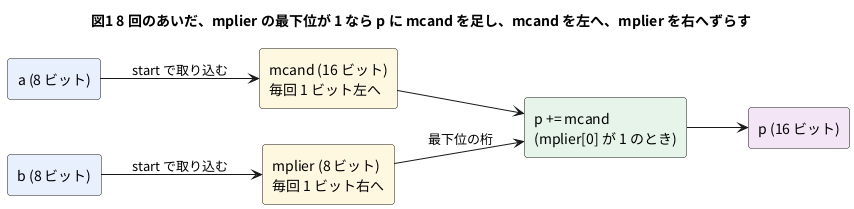

# 10-4 掛け算 — 演算子と、シフトと加算の繰り返し

Verilog で掛け算をするには、2 つの書き方がある。1 つは演算子 `*` を書くだけ。もう 1 つは、筆算と同じに、
**シフトと加算を繰り返す**回路を自分で書く。

どちらも同じ答えを出す。違うのは、使う回路の量と、答えが出るまでの時間である。
この題では 8 ビット × 8 ビットの 2 通りを作って、全部の組み合わせで答えが同じになることを確かめ、
合成の道具が `*` をどんな部品にするかを見る。

この題は PC の Verilator だけで動かす。組まない題なので、実体配線図と Analog Discovery 3 は入れない。

## 説明

- **演算子 `*`**: `assign p = a * b;` の 1 行。入力が変われば、出力はすぐ変わる (組み合わせ回路)。
  結果の幅は、`p` を 16 ビットにして受ければ、8 ビット × 8 ビットがあふれない
- **シフトと加算**: 筆算と同じで、掛ける数 `b` の下の桁から見ていく。
  その桁が 1 なら、掛けられる数 `a` を足し、桁が進むたびに `a` を 1 ビット左へずらす。
  8 ビットなら 8 回で終わる。毎回のずらしと足し算は 1 クロックでできる

| 回 | 見る桁 (b の最下位) | mcand (a を左へずらした数) | 足すか | p (足した後) |
| --- | --- | --- | --- | --- |
| 1 | 1 | 13 | 足す | 13 |
| 2 | 1 | 26 | 足す | 39 |
| 3 | 0 | 52 | 足さない | 39 |
| 4 | 1 | 104 | 足す | 143 |
| 5〜8 | 0 | 208 以降 | 足さない | 143 |

a = 13、b = 11 (2 進で 00001011) のとき。b は 1 回ごとに 1 ビット右へずらして最下位の桁を見る。
13 × 11 = 143 になる。

- **何が引き換えか**: 演算子 `*` は 1 クロック分の組み合わせ回路で、**回路は大きく**、遅れも長くなる (8-1・9-3)。
  シフトと加算は **8 クロックかかる**かわりに、回路は加算器 1 つとレジスタだけで済む
  (答えが出るまで `busy` で待つ。速さが要らなければこちらで足りる)

## ブロック図




## Verilog

演算子で書く方。

```verilog
// mul8_op.v  演算子 * で書く。8 ビット × 8 ビット = 16 ビット (符号なし)
module mul8_op (
    input  wire [7:0]  a,
    input  wire [7:0]  b,
    output wire [15:0] p
);
    assign p = a * b;
endmodule
```

シフトと加算で書く方。`start` を 1 クロックだけ 1 にすると、a と b を取り込んで 8 クロックで計算する。

```verilog
// mul8_seq.v  シフトと加算を 8 回くり返す。8 ビット × 8 ビット = 16 ビット (符号なし)
module mul8_seq (
    input  wire        clk,
    input  wire        rst,
    input  wire        start,    // 1 クロックだけ 1 にする。そのとき a と b を取り込む
    input  wire [7:0]  a,
    input  wire [7:0]  b,
    output reg  [15:0] p,        // 掛け算の結果。done が 1 の間だけ正しい
    output reg         busy,     // 計算中
    output reg         done      // 計算が終わった (1 クロックだけ 1)
);
    reg [15:0] mcand;            // 掛けられる数。1 回ごとに 1 ビット左へずらす
    reg [7:0]  mplier;           // 掛ける数。1 回ごとに 1 ビット右へずらす
    reg [3:0]  n;                // 残りの回数

    always @(posedge clk) begin
        done <= 1'b0;
        if (rst) begin
            p      <= 16'd0;
            busy   <= 1'b0;
            mcand  <= 16'd0;
            mplier <= 8'd0;
            n      <= 4'd0;
        end else if (start && !busy) begin
            p      <= 16'd0;
            mcand  <= {8'd0, a};
            mplier <= b;
            n      <= 4'd8;
            busy   <= 1'b1;
        end else if (busy) begin
            if (mplier[0])
                p <= p + mcand;           // 掛ける数の最下位が 1 なら、足す
            mcand  <= mcand << 1;
            mplier <= mplier >> 1;
            n      <= n - 4'd1;
            if (n == 4'd1) begin          // 8 回目
                busy <= 1'b0;
                done <= 1'b1;
            end
        end
    end
endmodule
```

- `mcand` は 16 ビットにした。a を 7 回左へずらすと 15 ビット目まで届くため
- `done` は 1 クロックだけ 1 になる。そのクロックに `p` を読む。次の `start` までは `p` が残るが、`done` の外では当てにしない
- 計算中 (`busy` が 1) に来た `start` は無視する
- 符号付きの掛け算は、この題では扱わない。符号付きは 1-11 の `signed` の宣言と、書き方に注意が要る

## テストベンチ

13 × 11 を 1 回だけ計算して波形に残す。`+full` を付けて動かすと、0〜255 × 0〜255 の 65 536 通りを全部、
演算子 `*` で書いた期待値と突き合わせる (どちらの回路も)。

```verilog
// tb_mul.v  13 × 11 の波形を取る。+full を付けると 0〜255 × 0〜255 の全部を * と突き合わせる
module tb_mul;
    reg         clk = 0;
    reg         rst = 1;
    reg         start = 0;
    reg  [7:0]  a = 0;
    reg  [7:0]  b = 0;
    wire [15:0] p_seq;
    wire        busy, done;
    wire [15:0] p_op;
    integer     i, j;
    integer     ng = 0;
    integer     clocks;
    reg  [15:0] want;

    mul8_seq us (.clk(clk), .rst(rst), .start(start), .a(a), .b(b),
                 .p(p_seq), .busy(busy), .done(done));
    mul8_op  uo (.a(a), .b(b), .p(p_op));

    always #5 clk = ~clk;        // 立ち上がりは 5, 15, 25, ... us

    // a × b を 1 回計算する。start を 1 クロック出し、done まで待つ
    task run(input [7:0] ta, input [7:0] tb);
        begin
            a = ta; b = tb; start = 1;
            @(posedge clk); #1;
            start = 0;
            clocks = 0;
            while (!done) begin
                @(posedge clk); #1;
                clocks = clocks + 1;
            end
        end
    endtask

    initial begin
        $dumpfile("mul.vcd");
        $dumpvars(0, tb_mul);
        @(posedge clk); #1;
        @(posedge clk); #1;
        rst = 0;
        run(8'd13, 8'd11);       // 波形に残す 1 回
        $display("13 x 11: seq=%0d op=%0d (start の次の立ち上がりから done まで %0d クロック)",
                 p_seq, p_op, clocks);
        if (p_seq !== 16'd143 || p_op !== 16'd143) ng = ng + 1;
        #20;
        if ($test$plusargs("full")) begin
            for (i = 0; i < 256; i = i + 1)
                for (j = 0; j < 256; j = j + 1) begin
                    run(i[7:0], j[7:0]);
                    want = i[7:0] * j[7:0];
                    if (p_seq !== want || p_op !== want) ng = ng + 1;
                end
            if (ng == 0) $display("PASS: 65536 通りとも * と同じ");
            else         $display("FAIL: %0d 件", ng);
        end else begin
            if (ng == 0) $display("PASS: 13 x 11");
            else         $display("FAIL");
        end
        $finish;
    end
endmodule
```

## 動かす

```bash
verilator --lint-only -Wall mul8_op.v
verilator --lint-only -Wall mul8_seq.v
verilator --timescale 1us/1ns --binary --timing --trace --top-module tb_mul mul8_op.v mul8_seq.v tb_mul.v
./obj_dir/Vtb_mul          # 13 x 11 だけ。波形 (mul.vcd) が残る
./obj_dir/Vtb_mul +full    # 65 536 通りの全部 (mul.vcd が大きくなるので、波形は上の実行で取る)
```

2 つの lint は警告 0 件で通った (Verilator 5.042)。実行した結果は次のとおり。

```text
13 x 11: seq=143 op=143 (start の次の立ち上がりから done まで 8 クロック)
PASS: 13 x 11
```

`+full` では `PASS: 65536 通りとも * と同じ` と出た。シフトと加算の回路は、全部の組み合わせで `*` と同じ答えを出した。

## シミュレーションの波形

VCD を読んで、ロジックアナライザの画面と同じ形に描いた。実機で測った波形ではなく、シミュレーションの値だ。
A・B は上位 4 ビット (7〜4) が常に 0 なので下位 4 ビットだけ、P は上位 8 ビット (15〜8) が常に 0 なので下位 8 ビットだけを出した。

```logic
# ロジックアナライザの画面 (tommie-fence の logic フェンス)
title: 図2 8 クロックで DONE。P は 13 × 11 = 143 (0x8F)
device: generic
time: 13us/div
signals:
  CLK: edges 0s=0 5us=1 10us=0 15us=1 20us=0 25us=1 30us=0 35us=1 40us=0 45us=1 50us=0 55us=1 60us=0 65us=1 70us=0 75us=1 80us=0 85us=1 90us=0 95us=1 100us=0 105us=1 110us=0 115us=1 120us=0 125us=1 130us=0
  START: edges 0s=0 16us=1 26us=0
  BUSY: edges 0s=0 25us=1 105us=0
  DONE: edges 0s=0 105us=1 115us=0
  A3: edges 0s=0 16us=1
  A2: edges 0s=0 16us=1
  A1: edges 0s=0
  A0: edges 0s=0 16us=1
  B3: edges 0s=0 16us=1
  B2: edges 0s=0
  B1: edges 0s=0 16us=1
  B0: edges 0s=0 16us=1
  P7: edges 0s=0 65us=1
  P6: edges 0s=0
  P5: edges 0s=0 45us=1 65us=0
  P4: edges 0s=0
  P3: edges 0s=0 35us=1 45us=0 65us=1
  P2: edges 0s=0 35us=1
  P1: edges 0s=0 45us=1
  P0: edges 0s=0 35us=1
buses:
  A: A3..A0 hex
  B: B3..B0 hex
  P: P7..P0 hex
cursors: [50us, 110us]
```


## 見るべき値 (シミュレーションを実行して得た値)

| 時刻 | 起きたこと | BUSY | P |
| --- | --- | --- | --- |
| 16 µs | START = 1、A = 0xD (13)、B = 0xB (11) を置く | 0 | 0x00 |
| 25 µs | 立ち上がりで a・b を取り込む | 1 | 0x00 |
| 35 µs | 1 回目。b の最下位が 1 なので 13 を足す | 1 | 0x0D (13) |
| 45 µs | 2 回目。26 を足す | 1 | 0x27 (39) |
| 55 µs | 3 回目。b の桁が 0 なので足さない | 1 | 0x27 (39) |
| 65 µs | 4 回目。104 を足す | 1 | 0x8F (143) |
| 75〜105 µs | 5〜8 回目。足さない | 1 | 0x8F (143) |
| 105 µs | 8 回目で終わる。DONE = 1、BUSY = 0 | 0 | 0x8F (143) |

- 図2のカーソル X1 = 50 µs では、BUSY = 1・P = 0x27 (39)。2 回目まで足し終えたところ。
  X2 = 110 µs では、DONE = 1・BUSY = 0・P = 0x8F (143) で、13 × 11 = 143 と一致する
- START が 1 になってから DONE まで、立ち上がりで 9 回。取り込みに 1 回、計算に 8 回かかる。
  13 × 11 の `b` は下位 4 ビットしか使わないが、8 ビットの回路は 8 回数えて終わる (桁が 0 でも回数は同じ)
- 演算子 `*` の `p_op` は、`a` と `b` が置かれた同じ時刻に 143 になっている (クロックを待たない)

## FPGA に載せるとき

2 つの回路を、合成の道具 (yosys) に通した結果を並べる。コマンドは次のとおり。

```bash
yosys -p "read_verilog mul8_op.v; synth_gowin -top mul8_op -json m.json; stat"
yosys -p "read_verilog mul8_seq.v; synth_gowin -top mul8_seq -json m.json; stat"
```

| 回路 | yosys 0.33 (`/usr/bin/yosys`) | yosys 0.69+274 (OSS CAD Suite) |
| --- | --- | --- |
| `mul8_op` (`*`) | ALU 16 個、LUT と MUX2_LUT の合計 484 個 | **MULT9X9 が 1 個** (LUT・ALU・DFF は 0) |
| `mul8_seq` (シフトと加算) | DFF 46 個、ALU 20 個、LUT と MUX2_LUT の合計 29 個 | DFF 46 個、ALU 20 個、LUT の合計 24 個 |

- 道具が古い (0.33) と、`*` は LUT と加算器をたくさん並べた回路になる。新しい (0.69) と、乗算器の部品 (MULT9X9) 1 個になった。
  **同じ `*` が、道具の版で全く別の回路になる。** 乗算器の部品を使うかどうかは、使う FPGA にその部品があるかにもよる
- シフトと加算は、DFF が 46 個 (p 16 + mcand 16 + mplier 8 + n 4 + busy + done) で、ALU は 20 個で、どちらの版でも同じ。
  回路の大きさが版にあまり左右されない
- 乗算器の部品が Tang Nano 9K にいくつあるかは、この題では確かめていない。最高の周波数 (9-3) と合わせて、
  配置配線まで通して確かめる
- 数は合成の結果で、配置配線は通していない。実機で動かしたものではない

## シミュレーションでの確かめ

Verilator 5.042 と Yosys 0.33 で、本文の `mul8_op.v` `mul8_seq.v` `tb_mul.v` を取り出して走らせ直した。
置き場は `sim/04-multiplier-op.v` `sim/04-multiplier-seq.v` `sim/04-multiplier-tb.v`。

| 項目 | 本文の数字 | 実行結果 | 判定 |
| --- | --- | --- | --- |
| lint (`-Wall`、2 つの回路) | 警告 0 件 | 0 件 | 合った |
| 13 × 11 | seq = 143、op = 143、8 クロック、PASS | 同じ | 合った |
| `+full` | PASS: 65536 通りとも * と同じ | 同じ | 合った |
| 25 µs〜105 µs の BUSY / P | 1 / 0x00、0x0D、0x27、0x27、0x8F … 105 µs で DONE = 1・BUSY = 0 | 同じ | 合った |
| 合成 `mul8_op` | ALU 16、LUT と MUX2_LUT 484 | 同じ | 合った |
| 合成 `mul8_seq` | DFF 46、ALU 20、LUT と MUX2_LUT 29 | 同じ | 合った |
| yosys 0.69 の列 (MULT9X9 など) | MULT9X9 1 個、LUT 24 個 | この環境に 0.69 は無い | 確かめていない |

配置配線 (nextpnr) と実機は無いので、そこから出る数は確かめていない。

## 出典

自作。シフトと加算の掛け算 (筆算と同じ形) は、ディジタル回路の教科書にある定番の作り方である。
`MULT9X9` は yosys の `synth_gowin` が出した部品名で、実行して確かめた (上の表)。
