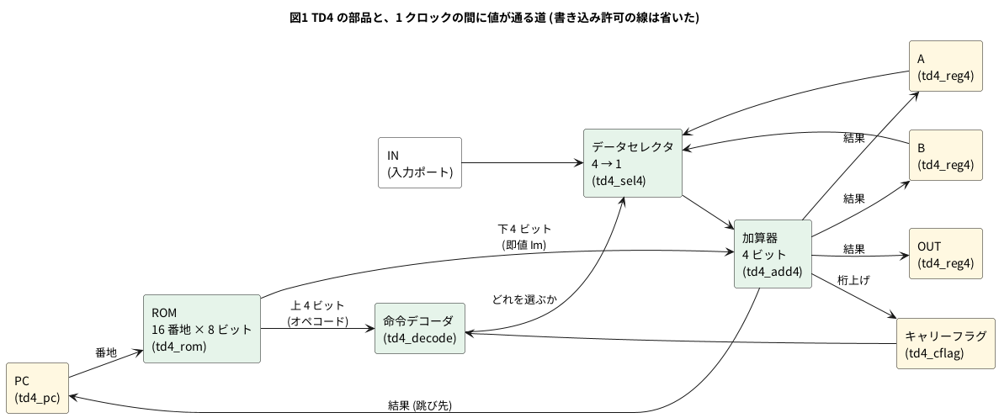

# 11-1 TD4 の構成 — 4 ビットのレジスタ・加算器・ROM

この題は実体配線図と Analog Discovery 3 の図を付けない。ブラウザの中で動く題で、組む物が無いから。

5-8 では、TD4 を 1 つの `TD4.v` のまま Pico 2 で動かした。命令表と動かし方はそちらで見た。
この題では、同じ TD4 を**部品に分けて書き直し**、CPU がどんな部品でできているかを見る。

分けると、TD4 は 6 種類の部品だけでできている。4 ビットのレジスタ、プログラムカウンタ、キャリーフラグ、
4 つから 1 つを選ぶデータセレクタ、4 ビットの加算器、命令デコーダ。それに ROM。
**足し算をする部品は加算器 1 つだけ**で、`MOV` も `OUT` も `JMP` も、この加算器を通って書き込まれる。

書き直した TD4 が 5-8 の `TD4.v` と同じ働きをすることは、Verilator で乱数のプログラムを 4000 本走らせて確かめる。
最後に、soft-fpga の 01-counter に載せてブラウザで動かす。

## 構成




黄色がクロックで値を覚える部品 (フリップフロップ)、緑がクロックの無い組み合わせ回路。命令デコーダは、A・B・OUT・PC のどれに書くかの信号 (`load_*_n`) も出す。線が込み入るので図では省いた。

- **1 命令が 1 クロックで済むのは、命令を読む・解く・足すの全部が組み合わせ回路だから。** PC が変わると、ROM → デコーダ → セレクタ → 加算器と値が流れ、
  次の立ち上がりまでに加算器の出口に結果がそろう。立ち上がりで、デコーダが「書く」と言ったレジスタ 1 つ (と PC・キャリーフラグ) が一斉に取り込む
- 加算器の出口は A・B・OUT・PC の 4 つ全部の入口につながっている。どれに書くかはデコーダの `load_*_n` が決める。書かれないレジスタは前の値を保つ
- PC は、書かれないときは自分で 1 を足す (次の番地へ進む)。`JMP` と `JNC` のときだけ、加算器の結果 (0 + Im = 跳び先) を取り込む
- 選ぶ入力の 4 番めは 0 につないである。`MOV A,Im` は「0 + Im を A へ」、`OUT Im` は「0 + Im を OUT へ」で、即値を書く命令も足し算で作る

| 部品 | Verilog | 中身 | 合成した大きさ (下の「規模」) |
| --- | --- | --- | --- |
| レジスタ A・B・OUT | `td4_reg4` × 3 | 4 ビット。`load_n` が 0 のときだけ取り込む | フリップフロップ 4 個ずつ |
| プログラムカウンタ | `td4_pc` | 4 ビット。書かれなければ +1 | フリップフロップ 4 個 + 10 ゲート |
| キャリーフラグ | `td4_cflag` | 1 ビット。**負論理** (1 で桁上げ無し)。毎クロック書き直す | フリップフロップ 1 個 + 1 ゲート |
| データセレクタ | `td4_sel4` | A・B・IN・0 から 1 つ | 15 ゲート |
| 加算器 | `td4_add4` | 4 ビット + 即値 4 ビット → 4 ビットと桁上げ | 20 ゲート |
| 命令デコーダ | `td4_decode` | オペコード 4 ビットとキャリーフラグ → 選ぶ入力 2 ビット、書く先 4 本 | 8 ゲート |
| ROM | `td4_rom` | 16 番地 × 8 ビット。プログラムそのもの | 15 ゲート (この題のプログラムの場合) |

本の TD4 (『CPU の創りかた』) は、この部品ごとに 74 シリーズの IC を当てて組む。IC との対応と比べ方は 11-4 の題。

## Verilog

`examples/01-counter/verilog/counter.v` の中身を、次に置き換える。1 つのファイルに 9 つのモジュールを入れてあり、
最上位の `counter` が soft-fpga の 01-counter と同じポート (`clk` `rst` `count[7:0]`) を持つ。4-3 と同じく、ハーネスと画面には手を入れない。

```verilog
// 11-1 TD4 を部品に分けて書く。5-8 の TD4.v と同じ働きを、
// レジスタ・PC・データセレクタ・加算器・命令デコーダ・ROM の 6 つのモジュールに分けた。
// soft-fpga の 01-counter に載せるため、最上位は counter (clk・rst・count[7:0]) の形にしてある。
// TD4 の命令の決め方は asfdrwe/simpleTD4 (MIT) の TD4.v に合わせた。
// 1 つのファイルに 9 つのモジュールを置くので、ファイル名とモジュール名の食い違いの警告を切る。
/* verilator lint_off DECLFILENAME */

// 4 ビットのレジスタ。load_n が 0 のときだけ d を取り込む (A・B・OUT に使う)
module td4_reg4 (
    input  wire       clk,
    input  wire       reset_n,
    input  wire       load_n,
    input  wire [3:0] d,
    output reg  [3:0] q
);
    always @(posedge clk or negedge reset_n)
        if (!reset_n)     q <= 4'd0;
        else if (!load_n) q <= d;
endmodule

// プログラムカウンタ。load_n が 0 なら d を取り込み、1 なら 1 を足す
module td4_pc (
    input  wire       clk,
    input  wire       reset_n,
    input  wire       load_n,
    input  wire [3:0] d,
    output reg  [3:0] q
);
    always @(posedge clk or negedge reset_n)
        if (!reset_n)     q <= 4'd0;
        else if (!load_n) q <= d;
        else              q <= q + 4'd1;
endmodule

// キャリーフラグ。負論理で持つ (c_n が 1 なら桁上げ無し)。毎クロック書き直す
module td4_cflag (
    input  wire clk,
    input  wire reset_n,
    input  wire carry,
    output reg  c_n
);
    always @(posedge clk or negedge reset_n)
        if (!reset_n) c_n <= 1'b1;
        else          c_n <= ~carry;
endmodule

// データセレクタ。4 つの入力から 1 つを選ぶ (3 番は 0 につないである)
module td4_sel4 (
    input  wire [1:0] sel,
    input  wire [3:0] a,
    input  wire [3:0] b,
    input  wire [3:0] in_port,
    output wire [3:0] y
);
    assign y = (sel == 2'd0) ? a       :
               (sel == 2'd1) ? b       :
               (sel == 2'd2) ? in_port :
                               4'd0;
endmodule

// 4 ビットの加算器。片方は即値 im
module td4_add4 (
    input  wire [3:0] x,
    input  wire [3:0] im,
    output wire [3:0] s,
    output wire       carry
);
    assign {carry, s} = x + im;
endmodule

// 命令デコーダ。上 4 ビット (オペコード) と c_n から、選ぶ入力と書く先を決める
module td4_decode (
    input  wire [3:0] opc,
    input  wire       c_n,
    output wire [1:0] sel,
    output wire       load_a_n,
    output wire       load_b_n,
    output wire       load_out_n,
    output wire       load_pc_n
);
    wire [1:0] dst = opc[3:2];          // 書く先: 00 A、01 B、10 OUT、11 PC
    assign sel = (dst == 2'b11) ? 2'b11 : opc[1:0];
    assign load_a_n   = ~(dst == 2'b00);
    assign load_b_n   = ~(dst == 2'b01);
    assign load_out_n = ~(dst == 2'b10);
    assign load_pc_n  = ~(dst == 2'b11 && (opc[0] || c_n));   // JMP か、桁上げ無しの JNC
endmodule

// CPU の本体。ROM は外に置く (番地 rom_addr を出し、命令 rom_data を受ける)
module td4_core (
    input  wire       clk,
    input  wire       reset_n,
    input  wire [3:0] in_port,
    output wire [3:0] rom_addr,
    input  wire [7:0] rom_data,
    output wire [3:0] out_port,
    output wire [3:0] reg_a,      // 観測用
    output wire [3:0] reg_b,      // 観測用
    output wire       c_n         // 観測用 (負論理の桁上げ)
);
    wire [1:0] sel;
    wire       load_a_n, load_b_n, load_out_n, load_pc_n;
    wire [3:0] alu_in, alu_out;
    wire       carry;

    td4_decode u_dec (.opc(rom_data[7:4]), .c_n(c_n), .sel(sel),
                      .load_a_n(load_a_n), .load_b_n(load_b_n),
                      .load_out_n(load_out_n), .load_pc_n(load_pc_n));
    td4_sel4   u_sel (.sel(sel), .a(reg_a), .b(reg_b), .in_port(in_port), .y(alu_in));
    td4_add4   u_add (.x(alu_in), .im(rom_data[3:0]), .s(alu_out), .carry(carry));
    td4_reg4   u_a   (.clk(clk), .reset_n(reset_n), .load_n(load_a_n),   .d(alu_out), .q(reg_a));
    td4_reg4   u_b   (.clk(clk), .reset_n(reset_n), .load_n(load_b_n),   .d(alu_out), .q(reg_b));
    td4_reg4   u_out (.clk(clk), .reset_n(reset_n), .load_n(load_out_n), .d(alu_out), .q(out_port));
    td4_pc     u_pc  (.clk(clk), .reset_n(reset_n), .load_n(load_pc_n),  .d(alu_out), .q(rom_addr));
    td4_cflag  u_c   (.clk(clk), .reset_n(reset_n), .carry(carry), .c_n(c_n));
endmodule

// 16 番地 × 8 ビットの ROM。この題のプログラム: A を 1 ずつ増やして OUT に出す
module td4_rom (
    input  wire [3:0] addr,
    output reg  [7:0] data
);
    always @(*)
        case (addr)
            4'h0:    data = 8'b0000_0001;  // ADD A,0001   A <- A + 1
            4'h1:    data = 8'b0100_0000;  // MOV B,A      B <- A
            4'h2:    data = 8'b1001_0000;  // OUT B        OUT <- B
            4'h3:    data = 8'b1111_0000;  // JMP 0000
            default: data = 8'b0000_0000;  // ADD A,0000 (何もしない)
        endcase
endmodule

// soft-fpga の 01-counter に合わせた最上位。count の上 4 ビットが PC、下 4 ビットが OUT
module counter (
    input  wire       clk,
    input  wire       rst,
    output wire [7:0] count
);
    wire [3:0] pc, op_out, a, b;
    wire [7:0] code;
    wire       c_n;

    td4_core u_cpu (.clk(clk), .reset_n(~rst), .in_port(4'd0),
                    .rom_addr(pc), .rom_data(code), .out_port(op_out),
                    .reg_a(a), .reg_b(b), .c_n(c_n));
    td4_rom  u_rom (.addr(pc), .data(code));

    assign count = {pc, op_out};

    wire unused = &{1'b0, a, b, c_n};   // 観測用の出力はここでは使わない
endmodule
```

- `td4_core` が CPU の本体で、ROM を外に出してある (`rom_addr` を出し、`rom_data` を受ける)。試験で乱数のプログラムを外から与えるため。`counter` が `td4_core` と `td4_rom` をつなぐ
- `reg_a` `reg_b` `c_n` は観測用の出力。試験台が A・B・キャリーフラグを読むのに使う。`counter` では使わないので、`unused` にまとめて lint を黙らせる (Verilator は `unused` を含む名前の信号を「使っていない」と言わない)
- `counter` の `rst` は 1 でリセット (01-counter のハーネスがそう駆動する)。TD4 の部品は 5-8 に合わせて `reset_n` (0 でリセット) なので、`~rst` を渡す
- 入力ポートは 0 につないだ。この題のプログラムは `IN` を使わない
- ファイルの頭の `/* verilator lint_off DECLFILENAME */` は、「ファイル名とモジュール名が違う」という警告を切る。モジュールを 1 つのファイルにまとめたため

### デコーダの読み方

5-8 の命令表の「書く先」と「足す元」は、オペコードの 4 ビットをそのまま 2 ビットずつに分けた物だ。

| オペコードのビット | 意味 | 値 |
| --- | --- | --- |
| 3〜2 (`dst`) | 書く先 | 00 A、01 B、10 OUT、11 PC |
| 1〜0 | 足す元 (セレクタの選び) | 00 A、01 B、10 IN、11 0。**書く先が PC のときは 11 (0) に固定** |
| 0 (書く先が PC のとき) | 跳び方 | 1 なら必ず跳ぶ (`JMP`)、0 ならキャリーフラグが 1 (桁上げ無し) のときだけ跳ぶ (`JNC`) |

`td4_decode` の 6 行は、この表を書いただけ。表の 12 命令は、このビットの決めの組み合わせの一部になっている。

16 通りのオペコードのうち、5-8 の表に無いのは 1000・1010・1100・1101 の 4 つ。この書き方のデコーダでは、次の働きになる
(試験台で 1 クロックずつ動かして確かめた。A = 5、IN = 3、Im = 1 のとき)。

| オペコード | ビットの決めで読むと | 動かした結果 |
| --- | --- | --- |
| 1000 | OUT ← A + Im | OUT = 6 |
| 1010 | OUT ← IN + Im | OUT = 4 |
| 1100 | PC が書く先で、跳び方のビットが 0 → `JNC` と同じ | 桁上げ無しなら PC = 1、有りなら次の番地 |
| 1101 | PC が書く先で、跳び方のビットが 1 → `JMP` と同じ | 桁上げに関わらず PC = 1 |

1000 は「A を直接 OUT へ出す」命令として使える (5-8 では `MOV B,A` と `OUT B` の 2 命令が要った)。
ただしこれは**このデコーダの書き方で決まった働き**で、本の TD4 の回路で同じになるとは限らない。命令を足す話は 11-5。

### この題のプログラム

`td4_rom` には 4 命令のプログラムを入れた。A を 1 ずつ増やして OUT に出す。

| 番地 | 機械語 | 命令 | 通る部品 |
| --- | --- | --- | --- |
| 0 | 0000 0001 | ADD A,0001 | セレクタが A を選び、加算器で +1、A に書く |
| 1 | 0100 0000 | MOV B,A | セレクタが A を選び、加算器で +0、B に書く |
| 2 | 1001 0000 | OUT B | セレクタが B を選び、加算器で +0、OUT に書く |
| 3 | 1111 0000 | JMP 0000 | セレクタが 0 を選び、加算器で +0、PC に書く |

4 クロックで 1 巡し、OUT は 4 クロックごとに 1 増える。0 から F まで数えて 0 に戻るまで 64 クロック。

## 規模

Yosys 0.33 で、部品ごとに汎用のゲートへ合成した (`synth -top counter`、階層を残したまま `stat`)。

| 部品 | フリップフロップ | ゲート (`$_AND_` `$_MUX_` など) |
| --- | --- | --- |
| `td4_reg4` (1 個ぶん) | 4 (`$_DFFE_PN0N_`、書き込み許可つき) | 0 |
| `td4_pc` | 4 (`$_DFF_PN0_`) | 10 (+1 の加算と、取り込むか足すかの `$_MUX_` 4 個) |
| `td4_cflag` | 1 (`$_DFF_PN1_`、リセットで 1) | 1 (`$_NOT_`) |
| `td4_sel4` | 0 | 15 (`$_MUX_` 8 個ほか) |
| `td4_add4` | 0 | 20 |
| `td4_decode` | 0 | 8 |
| `td4_rom` | 0 | 15 |
| `counter` | 0 | 1 (`rst` を反転する `$_NOT_`) |

全部で、フリップフロップが 4 × 3 + 4 + 1 = **17 個**、ゲートが 70 個ほど。
レジスタは書き込み許可つきのフリップフロップ 1 種類で済み、ゲートの多くは加算器とセレクタにある。ROM は中身が定数なので、合成ではゲートになる。

## 手順

1. soft-fpga を取ってくる (0-2)。`examples/01-counter/verilog/counter.v` を上の中身に置き換える
2. lint を掛ける

   ```bash
   verilator --lint-only -Wall examples/01-counter/verilog/counter.v
   ```

3. ブラウザ用にビルドする (4-1 のコマンド)

   ```bash
   docker compose -f docker/compose.yml run --rm build-wasm scripts/build-wasm.sh
   ```

4. Web サーバを立てて開く

   ```bash
   examples/01-counter/web/doStartWebServer.sh
   ```

   ブラウザで `http://localhost:8081/` を開き、Run を押す。`count` のレーンの 16 進の 2 桁が、上の桁が PC、下の桁が OUT になる

PC 用の自己検査 (`cxx/main_linux.cpp`) はカウンタを前提にしているので、4-3 と同じく FAIL を出す。差し替えが効いた印で、この題では使わない。
元のカウンタに戻すには `git checkout examples/01-counter/verilog/counter.v` を打ち、もう一度ビルドする。

## 画面に見えるはずのもの

1 クロックを 1 ms と置いて、リセットのあとの 16 クロックを `logic` のフェンスで描く。PC と OUT は `count` のビットを 4 本ずつまとめたバス。

```logic
# ロジックアナライザの画面 (tommie-fence の logic フェンス)
title: 図2 PC は 0→1→2→3 を回り、OUT は PC が 3 になる立ち上がりで 1 増える
device: generic
window: 16ms
signals:
  CLK: dio0 clock 1kHz
  P: counter bits 4 on CLK rising sequence 1 2 3 0 repeat
  O: counter bits 4 on CLK rising sequence 0 0 1 1 1 1 2 2 2 2 3 3 3 3 4 4 4 4 5 5 5 5 6 6
buses:
  PC: P3..P0 hex
  OUT: O3..O0 hex
cursors: [2.5ms, 6.5ms]
trigger: CLK rising at 0s
style:
  width: 1600
```


- 立ち上がりのたびに PC が 1 進み、3 の次は `JMP 0000` で 0 に戻る
- OUT が変わるのは、2 番地の `OUT B` を実行した立ち上がり。その立ち上がりで PC は 3 になる。だから OUT は PC が 3 になるのと同時に変わる
- 2 つのカーソルの間隔 4 ms (4 クロック) が 1 巡で、OUT は 1 から 2 に進む
- soft-fpga の画面の `count` のレーンは、リセットの 2 サンプル (`00` `00`) のあと `10` `20` `31` `01` `11` `21` `32` `02` … と並ぶ。`b7`〜`b4` が PC、`b3`〜`b0` が OUT

## 見るべき値

soft-fpga f89a885 (2026-10-13) の 01-counter に差し替えて、`sfa-dev-wasm:local` (Verilator 5.048・Emscripten 5.0.7) でビルドし、Playwright の Chromium で開いて `step()` を呼んで読んだ。

| 見る所 | 値 | 種類 |
| --- | --- | --- |
| lint (`-Wall`) | 警告なし | 動かして確かめた |
| 部品に分けた TD4 と 5-8 の命令表 | 乱数のプログラム 2000 本 × 200 クロックで食い違い 0 | 動かして確かめた (PC の Verilator) |
| 部品に分けた TD4 と 5-8 の `TD4.v` | プログラム A を 100 クロック並べて、PC と OUT の食い違い 0 | 動かして確かめた (PC の Verilator) |
| ブラウザの `count` (リセットのあと 26 サンプル) | `00 00 10 20 31 01 11 21 32 02 12 22 33 03 13 23 34 04 14 24 35 05 15 25 36 06` | 動かして確かめた (Chromium) |
| OUT が F から 0 に戻るクロック | 63 クロック目 (OUT は 4 × k − 1 クロック目に k になる) | 動かして確かめた (PC で harness.cpp を回した) |
| フリップフロップの数 | 17 (Yosys 0.33) | 合成して確かめた |

## シミュレーションでの確かめ (対象外を含む)

手元の Verilator 5.042 で回した。試験は `bash sim/01-td4-architecture-run.sh` で、`sim/01-td4-architecture.v` (本文の `counter.v`) と 5-8 の `sim/08-td4.v` を別々に C++ にして、
1 本の試験台 `sim/01-td4-architecture-tb.cpp` に link する。試験台は 1 クロックごとに PC・A・B・OUT・キャリーを比べ、食い違いを数えて合否を言う。

- **命令表の模型**: 5-8 の表の 12 命令をそのまま C++ で書いた物。乱数のプログラムは 12 命令だけから作る (表で「Im = 0」の命令は Im を 0 にする)。入力ポートにも毎クロック乱数を入れる
- **ビットの決めの模型**: 上の「デコーダの読み方」の表を C++ で書いた物。乱数のプログラムは 256 通りのオペコード全部から作る
- **5-8 の `TD4.v`**: ROM はプログラム A を中に持つので、`td4_core` にも同じ 16 バイトを外から与えて並べて回す

画面の側は、soft-fpga の `examples/01-counter/cxx/harness.cpp` を本文の `counter` と link し、ブラウザと同じ `step()` を 80 回呼んでリングバッファを読んだ
(`sim/01-td4-architecture-harness-tb.cpp`)。期待値は命令表どおりに PC で数えて作る。

```text
PASS 命令表の模型 (12 命令の乱数のプログラム 2000 本 x 200 クロック): 食い違い 0
PASS ビットの決めの模型 (256 通りの乱数のプログラム 2000 本 x 200 クロック): 食い違い 0
PASS 5-8 の TD4.v とプログラム A を 100 クロック並べる: 食い違い 0
PASS op=81 桁上げ=0: A 5->5  OUT 0->6  PC 3->4
PASS op=A1 桁上げ=0: A 5->5  OUT 0->4  PC 3->4
PASS op=C1 桁上げ=0: A 5->5  OUT 0->0  PC 3->1
PASS op=C1 桁上げ=1: A 4->4  OUT 0->0  PC 3->4
PASS op=D1 桁上げ=1: A 4->4  OUT 0->0  PC 3->1
ALL PASS
count (16 進、step 1 から): 10 20 31 01 11 21 32 02 12 22 33 03 13 23 34 04 14 24 35 05 15 25 36 06 ...
PASS step 1〜80 の count が命令表の並びと一致 (食い違い 0)
```

(未定義のオペコードの行は 8 行のうち 5 行を載せた。残りの 3 行 (81・A1 の桁上げ有り、D1 の桁上げ無し) も PASS。)

| 項目 | 本文の数字 | 実行結果 | 判定 |
| --- | --- | --- | --- |
| lint (`-Wall`、最上位 `counter` と `td4_core`) | 警告なし | 警告なし | 合った |
| 命令表の模型との食い違い | 0 | 0 (40 万クロック) | 合った |
| ビットの決めの模型との食い違い | 0 | 0 (40 万クロック) | 合った |
| 5-8 の `TD4.v` との食い違い | 0 | 0 (100 クロック) | 合った |
| 1000・1010・1100・1101 の働き | 表のとおり | 表のとおり (8 通りとも PASS) | 合った |
| 画面の `count` の並び | `10 20 31 01 …` | 80 クロックとも一致 | 合った |
| ブラウザでの `count` | 同じ並び | Chromium で同じ 26 サンプル | 合った |
| 図2 の PC・OUT の sequence | `count` の上と下の 4 ビット | 上の並びの 16 クロックぶんと一致 | 合った |
| フリップフロップ 17 個・部品ごとのゲート数 | 「規模」の表 | Yosys 0.33 の `stat` | 合った |

## 出典

- [simpleTD4](https://github.com/asfdrwe/simpleTD4) (asfdrwe、MIT) — 命令のビットの決め方 (書く先と足す元の分け方、負論理のキャリーフラグ)。部品に分けた Verilog は自作
- [Soft-FPGA-TD4](https://github.com/tommie-jp/Soft-FPGA-TD4) — 5-8 の `TD4.v` の出所
- [tommie-jp/soft-fpga](https://github.com/tommie-jp/soft-fpga) の `examples/01-counter` — 差し替え先。ビルドは `scripts/build-wasm.sh`
- TD4 そのものは、渡波郁『CPU の創りかた』(毎日コミュニケーションズ、2003) の CPU
