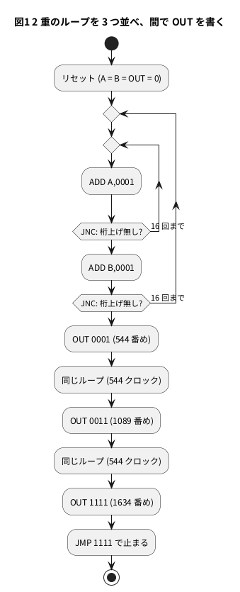

# 11-3 TD4 のプログラムを書く — タイマー

> [!WARNING]
> **この題は実機で組んでいない。** Pico 2 のプログラムは `.uf2` までのビルドを確かめたが、書き込んで動かしてはいない。
> 「見るべき値」のクロックの数は PC の Verilator で数えた値、時刻はその数と設計値の周期から計算した値で、測った値ではない。
> 1 kHz の速回しは picoemu (RP2350 のエミュレータ) でも数を確かめた。3 分の実時間と LED の見え方は確かめていない。

5-8 では、ROM に入っていたプログラムを TD4 に走らせた。この題では**自分でプログラムを書く**。
題材は TD4 の定番の**ラーメンタイマー**で、3 分たったら LED を全部点ける。途中の 1 分・2 分でも LED を 1 個ずつ増やす。

TD4 には時計もタイマもない。あるのは「1 クロックに 1 命令」だけだ。だから時間は
**時間 = 実行した命令の数 × クロックの周期** で決まる。
命令の数はプログラムで決まり、周期は 5-7 の繰り返しタイマで決まる。この題では、ループで命令の数を数え上げ、
それに合わせて周期を選ぶ。命令の数が式どおりかは、Verilator で回して数える。

TD4 の命令と `TD4.v` は 5-8 のとおり。各部の働きは 11-1、命令ごとの動きは 11-2 で見た。

## 決めたこと

| 項目 | 決め | 理由 |
| --- | --- | --- |
| 時間の作り方 | `ADD A,0001` と `JNC` の 2 命令のループを、`ADD B,0001` と `JNC` の外側のループで包む | レジスタが A と B の 2 つしかないので、2 重のループが最も長い |
| 1 分の区切り | 2 重のループを 3 つ並べ、間に `OUT` を置く | ROM の 16 番地にちょうど収まる |
| クロック | 半周期 55 080 µs (1 クロック 110.16 ms、約 9.08 Hz) | 3 分ぶんのループが 1634 クロックなので、180 s ÷ 1634 に合わせた |
| 速回し | SW4 を ON にして電源を入れると、半周期 500 µs (1 kHz、5-7 と同じ) | 3 分を待たずに確かめる。1 kHz なら 1 クロック = 1 ms で、時刻がそのまま命令の数になる |
| 終わりの印 | OUT が 1111 になったら GP17 (AUX) を H | AD3 の Logic で 3 分を測る目印 |
| 回路 | 5-8 と同じ (LED 4 個・DIP スイッチ・AD3) | プログラムと周期を替えるだけの題にする |

## プログラムの考え方

### 内側のループ — 32 クロック

```text
0: ADD A,0001
1: JNC 0000
```

A は 0 から始まる。`ADD A,0001` で 1 ずつ増え、15 までは桁上げが出ないので `JNC` が 0 番地へ戻す。
16 回めの足し算で A が 15 から 0 に戻り、桁上げが出る。`JNC` は跳ばずに 2 番地へ進む。

1 周は 2 命令で、16 周するので **2 × 16 = 32 クロック**。抜けたとき A は 0 に戻っている。

### 外側のループ — 544 クロック

```text
0: ADD A,0001
1: JNC 0000
2: ADD B,0001
3: JNC 0000
```

内側を抜けると `ADD B,0001` で B を 1 増やし、桁上げが無ければ `JNC 0000` で内側の頭へ戻る。
A は 0 に戻っているので、内側は毎回 32 クロックかかる。B も 16 回めで 0 に戻って桁上げを出し、4 番地へ抜ける。

1 周は 32 + 2 = 34 クロックで、16 周するので **34 × 16 = 544 クロック**。抜けたとき A も B も 0。

### 3 つ並べる — 1634 クロック

このループを 3 つ並べ、間に `OUT` を挟む。ループの頭の番地が違うので、`JNC` の跳び先だけを替える。

| 区切り | 中身 | クロック | OUT が変わるクロック |
| --- | --- | --- | --- |
| 1 分め | 0〜3 番地のループ | 544 | — |
| 1 分たった | 4 番地 `OUT 0001` + 5〜8 番地のループ | 1 + 544 | 544 番め |
| 2 分たった | 9 番地 `OUT 0011` + A〜D 番地のループ | 1 + 544 | 1 089 番め |
| 3 分たった | E 番地 `OUT 1111`、F 番地 `JMP 1111` で止まる | 1 | 1 634 番め |

最初の命令を実行する立ち上がりを 0 番めと数える。`OUT 1111` は 544 + 545 + 545 = **1634 番め**のクロックで実行される。
F 番地の `JMP 1111` は自分自身へ跳ぶので、TD4 はそこで止まり、LED は 1111 のまま残る。

### クロックを選ぶ

5-8 と同じ 10 Hz なら、1634 クロックは 163.4 s で、3 分に 16.6 s 足りない。
命令の数を増やそうにも、ROM は 16 番地を使い切っていて、2 重のループの長さは 16 で決まっている (A と B が 4 ビットなので)。
そこで周期のほうを合わせる。

T = 180 s ÷ 1634 = 110.159 ms。半周期は 55 079.6 µs で、タイマには整数の µs で渡すので **55 080 µs** にする。
このとき 3 分は 1634 × 110.160 ms = **180.001 s** になる (1 ms 長い)。1 分たったときは 544 × 110.160 ms = 59.927 s、2 分たったときは 1089 × 110.160 ms = 119.964 s。

区切りが 60 s ちょうどにならないのは、最初のループだけ `OUT` が無く 1 クロック短いため。
区切りどうしの間 (545 クロック) が 60.037 s で揃う。




## 回路図

図2・図3 は 5-8 と同じ。この題では GP17 (AUX) を、3 分たった印として AD3 の DIO1 で読む。

```circuit
# 回路図 (tommie-fence の circuit フェンス)
title: 図2 Pico 2 に LED 4 個・DIP スイッチ・AD3 の Logic をつなぐ (5-8 と同じ)
parts:
  U1: pico2 8,8 mirror
  R1: resistor 13,2 15,2 330
  D1: led 15,2 17,2
  R2: resistor 13,3.2 15,3.2 330
  D2: led 15,3.2 17,3.2
  R3: resistor 13,4.4 15,4.4 330
  D3: led 15,4.4 17,4.4
  R4: resistor 13,5.6 15,5.6 330
  D4: led 15,5.6 17,5.6
  G1: ground 17.6,6.4
  G3: ground 10.2,7.6
  SW1: dip-switch4 13,10
  G2: ground 15.4,11.2
  AD:
    type: device
    at: 2,10.8
    label: AD3
    pins: [DIO5, DIO4, DIO3, DIO2, GND, DIO1, DIO0]
    turn: mirror
wires:
  - U1.GP2 -| 10,2
  - 10,2 -- 13,2
  - U1.GP3 -| 10.5,3.2
  - 10.5,3.2 -- 13,3.2
  - U1.GP4 -| 11,4.4
  - 11,4.4 -- 13,4.4
  - U1.GP5 -| 11.5,5.6
  - 11.5,5.6 -- 13,5.6
  - 17,2 -- 17.6,2 -- 17.6,3.2
  - 17,3.2 -- 17.6,3.2 -- 17.6,4.4
  - 17,4.4 -- 17.6,4.4 -- 17.6,5.6
  - 17,5.6 -- 17.6,5.6 -- 17.6,6.4
  - U1.GND8 -| 10.2,7.6
  - U1.GP10 -| 9.8,9.4
  - 9.8,9.4 |- SW1.A1
  - U1.GP11 -| 10,9.8
  - 10,9.8 |- SW1.A2
  - U1.GP12 -| 10.2,10.2
  - 10.2,10.2 |- SW1.A3
  - U1.GP13 -| 10.4,10.6
  - 10.4,10.6 |- SW1.A4
  - SW1.B1 -| 15.4,9.4
  - SW1.B2 -| 15.4,9.8
  - SW1.B3 -| 15.4,10.2
  - SW1.B4 -| 15.4,10.6
  - 15.4,9.4 -- 15.4,9.8 -- 15.4,10.2 -- 15.4,10.6 -- 15.4,11.2
  - AD.DIO5 -- U1.GP21
  - AD.DIO4 -- U1.GP20
  - AD.DIO3 -- U1.GP19
  - AD.DIO2 -- U1.GP18
  - AD.GND -- U1.GND23
  - AD.DIO1 -- U1.GP17
  - AD.DIO0 -- U1.GP16
notes:
  - text 9,12.6: GP10-GP13 は Pico 2 の内蔵プルアップ (ON で L)
style:
  pitch: 1.2
```


## 実体配線図

```bread
# ブレッドボードの実体配線図 (tommie-fence の bread フェンス)
title: 図3 Pico 2 の左に LED、右に DIP スイッチ、上に AD3 の Logic (5-8 と同じ)
board: full
parts:
  U1: pico2 @ g15
  R4: resistor g3 c3 330
  D4: led b3(A) b4(K) red
  R3: resistor g6 c6 330
  D3: led b6(A) b7(K) red
  R2: resistor g9 c9 330
  D2: led b9(A) b10(K) red
  R1: resistor g12 c12 330
  D1: led b12(A) b13(K) red
  SW1: dip-switch4 @ e37 r180
  AD:
    type: device
    at: top
    label: AD3 Logic
    pins: [DIO5, DIO4, DIO3, DIO2, GND, DIO1, DIO0]
wires:
  - j22 -- -b22 black
  - -t1 -- -b1 black
  - a4 -- -t4 black
  - a7 -- -t7 black
  - a10 -- -t10 black
  - a13 -- -t13 black
  - h18 -- h12 yellow
  - i19 -- i9 yellow
  - j20 -- j6 yellow
  - j21 -- j3 yellow [v15]
  - a37 -- -t37 black
  - a38 -- -t38 black
  - a39 -- -t39 black
  - a40 -- -t40 black
  - h31 -- h37 blue
  - i30 -- i38 blue
  - j29 -- j39 blue
  - j28 -- j40 blue [v15]
  - AD.DIO5 -- a28 green
  - AD.DIO4 -- a29 green
  - AD.DIO3 -- a30 green
  - AD.DIO2 -- a31 green
  - AD.GND -- -t32 black
  - AD.DIO1 -- a33 orange
  - AD.DIO0 -- a34 white
```


- LED は左が下の桁 (OUT0)。1 分たつと左端、2 分で左の 2 個、3 分で 4 個全部が点く
- **SW4 はブレッドボードの左端**のスイッチ (5-8 のとおり、右端が SW1)。速回しにするときは、SW4 を ON にしてから Pico 2 の電源を入れる (USB を挿し直す)。動いている間に替えても効かない
- AD3 は DIO0 (CLK)・DIO1 (AUX、3 分たった印)・DIO2〜DIO5 (OUT0〜OUT3 の写し) を読む

## 部品表

5-8 と同じ (Pico 2、330 Ω (オーム) の抵抗 4 本、赤の LED 4 個、4 連の DIP スイッチ、full のブレッドボード、AD3)。
電源は USB の 5 V から Pico 2 が 3.3 V を作る。GPIO は 3.3 V (0-3)。

## Verilog

5-8 の `TD4.v` の `initial` の中の 16 行を、次に置き換える。ほかの行は替えない。

```verilog
        rom[4'b0000] = 8'b0000_0001; // ADD A,0001   1 分目: A を 16 回足す内側のループ
        rom[4'b0001] = 8'b1110_0000; // JNC 0000
        rom[4'b0010] = 8'b0101_0001; // ADD B,0001   外側のループ (16 回)
        rom[4'b0011] = 8'b1110_0000; // JNC 0000
        rom[4'b0100] = 8'b1011_0001; // OUT 0001     1 分たった
        rom[4'b0101] = 8'b0000_0001; // ADD A,0001   2 分目
        rom[4'b0110] = 8'b1110_0101; // JNC 0101
        rom[4'b0111] = 8'b0101_0001; // ADD B,0001
        rom[4'b1000] = 8'b1110_0101; // JNC 0101
        rom[4'b1001] = 8'b1011_0011; // OUT 0011     2 分たった
        rom[4'b1010] = 8'b0000_0001; // ADD A,0001   3 分目
        rom[4'b1011] = 8'b1110_1010; // JNC 1010
        rom[4'b1100] = 8'b0101_0001; // ADD B,0001
        rom[4'b1101] = 8'b1110_1010; // JNC 1010
        rom[4'b1110] = 8'b1011_1111; // OUT 1111     3 分たった。全部点ける
        rom[4'b1111] = 8'b1111_1111; // JMP 1111     ここで止まる
```

- 機械語は 5-8 の命令表から引く。`JNC` は `1110`、`JMP` は `1111` で、下 4 ビットが跳び先の番地
- 3 つのループは同じ形で、`JNC` の跳び先 (0000・0101・1010) だけが違う
- ループの頭に `MOV A,0000` を置かなくてよいのは、前のループを抜けたとき A も B も 0 に戻っているから。
  A・B を 0 に戻すのはリセットと、16 回めの桁上げ

置き換えた `TD4.v` は lint (`verilator --lint-only -Wall`) で警告 0 件だった。

## Pico 2 のプログラム

作業用のフォルダは 5-5 と共通で、`board.h` `verilate.sh` も 5-5 のまま。`TD4.v` は上の ROM に替えた物を使う。
ビルドの打ち方は [5-1 の「ビルドする」](../05-soft-fpga-pico/01-verilator-on-pico.md#ビルドする)。
`CMakeLists.txt` の最後に次の 1 行を足す。

```cmake
add_soft_fpga(td4_113 td4_113.cpp td4)
```

`td4_113.cpp`:

```cpp
// 11-3 TD4 のプログラムを書く — ラーメンタイマー
#include "board.h"
#include "VTD4.h"

constexpr int64_t HALF_US_TIMER = 55080;  // 半周期 55.08 ms → 1 クロック 110.16 ms。1634 クロックで 180 s
constexpr int64_t HALF_US_FAST  = 500;    // SW4 を ON: 半周期 500 µs → 1 kHz (5-7 と同じ)。1634 クロックで 1.634 s

static VTD4 top;
static unsigned g_count = 0;              // 呼ばれた回数 (半周期の数)

static bool on_half(repeating_timer_t*) {
    const unsigned clk = (g_count & 1u) ? 0u : 1u;   // 立ち上がり → 立ち下がり → …
    top.reset_n = (g_count < 2) ? 0 : 1;             // 初めの 1 クロックはリセット
    top.in_port = 0;                                 // このプログラムは IN を使わない
    top.clock = clk;
    top.eval();
    gpio_put(PIN_CLK, clk);
    put_leds(top.out_port);                          // OUT → LED
    gpio_put(PIN_AUX, top.out_port == 0xFu);         // 3 分たったら H (AD3 で時間を測る印)
    g_count++;
    return true;
}

int main() {
    board_init();
    sleep_ms(10);                                    // 内蔵プルアップが効くのを待つ
    const bool fast = (read_sw() & 0x1u) != 0;       // SW4 を ON にして電源を入れると速く回す
    repeating_timer_t timer;
    add_repeating_timer_us(-(fast ? HALF_US_FAST : HALF_US_TIMER), on_half, nullptr, &timer);
    while (true) tight_loop_contents();
}
```

- 5-8 の `td4_58.cpp` から替えたのは 3 つ。半周期 (`HALF_US_TIMER`)、起動したときに SW4 を読んで半周期を選ぶ所、AUX に終わりの印を出す所
- 半周期は**起動したときに 1 度だけ**決める。繰り返しタイマの周期は `add_repeating_timer_us` に渡した値のまま変わらないため
- `read_sw()` の bit0 が SW4 (5-5 の `board.h`)。ON で 1
- 負の周期は 5-7 と同じく「呼び出しの頭どうしの間隔」。`eval()` が半周期より十分短ければ、周期は計算の時間に左右されない (5-7・5-9)。
  TD4 の `eval()` は 500 µs に収まる見込みで、測っていない (5-9 の題で測る)

5-5 と共通のフォルダを空から作ってビルドし、`build/td4_113.uf2` (96 256 バイト) ができた。**実機では動かしていない。**

## 動かす

1. SW4 を ON にして USB を挿す (速回し)。1.6 s ほどで LED が 1 個、2 個、4 個と増え、4 個点いたまま止まる。AD3 で 1 kHz の数を確かめる
2. USB を抜き、SW4 を OFF にして挿し直す。3 分のタイマーになる
3. もう一度測るときは、Pico 2 をリセットする (USB を挿し直す)。TD4 は F 番地で止まっているので、ほかに戻す方法は無い

## 計器の設定

| 計器 | 設定 |
| --- | --- |
| Logic (速回し) | DIO0 (CLK)・DIO1 (AUX)・DIO2〜DIO5 (OUT0〜OUT3) を Enable。標本化 10 kHz、200 ms/div (窓 2 s) |
| Logic (3 分) | 同じ DIO。標本化 100 Hz、20 s/div (窓 200 s)。バッファは 20 000 標本で、AD3 の 32 768 に収まる |
| バス | DIO5・DIO4・DIO3・DIO2 の順 (上の桁が先) で 1 本にまとめ、16 進で見る |
| トリガ | DIO1 (AUX) の立ち上がり。トリガの位置を窓の右寄りにして、前の 1.8 s (3 分では 190 s) を残す |
| カーソル | X1 を OUT が 1 になる所、X2 を AUX の立ち上がりに置く。ΔX がクロック 1090 個ぶん |

速回しの CLK は 1 kHz で、10 kHz の標本化なら 1 周期に 10 標本入る。3 分の CLK (約 9.08 Hz) も 100 Hz の標本化で 1 周期に 11 標本入る。

## Logic に見えるはずの画面

時刻 0 は、最初の命令を実行する CLK の立ち上がり (リセットの次の立ち上がり)。OUT の変わるクロックの数は Verilator で数えた値、時刻はそれに周期の設計値を掛けた値。

### 速回し (SW4 ON、1 kHz)

```logic
# ロジックアナライザの画面 (tommie-fence の logic フェンス)
title: 図4 速回しの 1 kHz では、LED が 0.544 s・1.089 s・1.634 s に増える
device: ad3
time: 200ms/div
start: -200ms
sample: 10kHz
signals:
  CLK: dio0 clock 1kHz
  AUX: dio1 edges 0s=0 1.634s=1
  MON0: dio2 edges 0s=0 0.544s=1
  MON1: dio3 edges 0s=0 1.089s=1
  MON2: dio4 edges 0s=0 1.634s=1
  MON3: dio5 edges 0s=0 1.634s=1
buses:
  OUT: MON3 MON2 MON1 MON0 hex
cursors: [0.544s, 1.634s]
trigger: AUX rising at 1.634s
```


- CLK は 1 ms ごとで、2 s の窓には細かすぎて塗りに見える。数は CLK ではなく OUT と AUX の時刻で読む
- ΔX = 1.090 s は、1 分たった (544 番め) から 3 分たった (1634 番め) までの 1090 クロック。1 クロックが 1 ms なので、時刻の ms がそのまま命令の数になる

### 3 分のタイマー (SW4 OFF)

```logic
# ロジックアナライザの画面 (tommie-fence の logic フェンス)
title: 図5 半周期 55.08 ms では、LED が 59.9 s・120.0 s・180.0 s に増える
device: ad3
time: 20s/div
start: -10s
sample: 100Hz
signals:
  AUX: dio1 edges 0s=0 180.001s=1
  MON0: dio2 edges 0s=0 59.927s=1
  MON1: dio3 edges 0s=0 119.964s=1
  MON2: dio4 edges 0s=0 180.001s=1
  MON3: dio5 edges 0s=0 180.001s=1
buses:
  OUT: MON3 MON2 MON1 MON0 hex
cursors: [59.927s, 180.001s]
trigger: AUX rising at 180.001s
```


- CLK (DIO0) は図から外した。200 s の窓に 1 816 周期が入り、線にならないため
- ΔX = 120.074 s は 1090 クロック × 110.16 ms。図4 の 1.090 s のちょうど 110.16 倍になる

## 見るべき値

クロックの数は Verilator と picoemu で数えた値。時刻は数 × 周期の設計値。どれも実機では測っていない。

| 測る所 | 見るべき値 | 分かること |
| --- | --- | --- |
| 速回しの CLK の周期 | 1.000 ms (設計値) | SW4 で半周期 500 µs が選ばれた |
| 速回し、OUT が 1・3・F になる時刻 | 0.544 s・1.089 s・1.634 s (544・1089・1634 クロック、Verilator の値) | ループの式 (32・544・545) どおりに命令を実行している |
| 速回し、ΔX (OUT = 1 から AUX まで) | 1.090 s = 1090 クロック (計算値) | ループ 2 つ (544 × 2) と `OUT` 2 つ |
| 3 分の CLK の周期 | 110.16 ms (約 9.078 Hz、設計値) | 半周期 55 080 µs |
| 3 分、OUT が 1・3・F になる時刻 | 59.927 s・119.964 s・180.001 s (計算値) | 時間 = 命令の数 × 周期 |
| 3 分、ΔX | 120.074 s (計算値) | 速回しの ΔX の 110.16 倍 |
| OUT = F のあと | LED 4 個が点いたまま。AUX も H のまま (Verilator の値) | F 番地の `JMP 1111` で止まる |
| 10 Hz (5-8 の周期) で回したら | 163.4 s で 4 個点く (計算値) | 命令の数が同じでも、周期で時間が変わる |

水晶のずれが 20 ppm (5-12 の例の値) なら、3 分では 180 s × 20 ppm = 3.6 ms ずれる。半周期を整数の µs にしたぶんの 1 ms と同じ桁で、ラーメンには効かない (見積り)。

## シミュレーションでの確かめ (対象外を含む)

手元の Verilator 5.042 で回した。試験は `bash sim/03-td4-timer-run.sh` で、次の 3 つを順に行う。

1. `sim/03-td4-timer.v` が、5-8 の `sim/08-td4.v` と ROM の 16 行のほかは同じかを `diff` で確かめ、lint を掛ける
2. `sim/03-td4-timer-tb.cpp` で `TD4.v` を回し、リセットのあと OUT が変わるまでのクロックを数えて、本文の式 (32・544・1089・1634) と比べる
3. 本文の `td4_113.cpp` と 5-5 の `board.h` を Markdown から取り出し、5-8 と同じ替え玉の GPIO とタイマ (`05-soft-fpga-pico/sim/pcstub`) で PC で回す (`sim/03-td4-timer-pc.cpp`)。
   仮想時刻は「タイマの呼び出しの回数 × 半周期」で、SW4 を OFF と ON の 2 通りで回す

```text
PASS ROM の 16 行のほかは 5-8 の TD4.v と同じ
PASS lint (-Wall) 警告 0 件
PASS OUT が 1 になるのは 544 番めのクロック (式: 544)
PASS OUT が 3 になるのは 1089 番めのクロック (式: 1089)
PASS OUT が F になるのは 1634 番めのクロック (式: 1634)
PASS OUT 1111 のあと 1000 クロック、PC = F・OUT = F のまま
ALL PASS
```

| 項目 | 本文の数字 | 実行結果 | 判定 |
| --- | --- | --- | --- |
| lint (`TD4.v`) | 警告 0 件 | 警告 0 件 (Verilator 5.042。ビルドの Docker の 5.048 でも `-Wall` で通った) | 合った |
| OUT が 1・3・F になるクロック | 544・1089・1634 (式) | 544・1089・1634 | 合った |
| OUT = F のあと | 止まる | 1000 クロック、PC = F・OUT = F のまま | 合った |
| SW4 OFF の LED の時刻 | 59.927・119.964・180.001 s | 59.927 040・119.964 240・180.001 440 s (= 544・1089・1634 × 110 160 µs) | 合った |
| SW4 OFF の AUX | 180.001 s | 180.001 440 s | 合った |
| SW4 ON の半周期・LED・AUX | 500 µs、0.544・1.089・1.634 s | 500 µs、0.544・1.089・1.634 s、AUX 1.634 s | 合った |
| LED の変化の回数 | 3 回 | どちらも 3 回 | 合った |
| `.uf2` の大きさ | 96 256 バイト | 96 256 バイト (`sfa-dev:local` の Verilator 5.048、`wb-pico-sdk` の Pico SDK 2.2.0。`arm-none-eabi-size` の text 51 704 バイト) | 合った |

### エミュレータ (picoemu) での確かめ

picoemu (5-2 と同じ、`danish9661/pico-emulator` の `b83786f` に `05-soft-fpga-pico/sim/picoemu-m33.patch` を当てた版。Docker の `wb-picoemu` に入っている) に `td4_113.uf2` を載せ、SW4 を ON にして Cortex-M33 で 4 億命令ぶん回した。
確かめは `python3 -I sim/03-td4-timer-picoemu.py --picoemu picoemu --uf2 td4_113.uf2`。3 分のほうは、エミュレータで 180 s を回すと時間がかかりすぎるので回していない (PC の替え玉で確かめた)。

| 項目 | 本文の数字 | picoemu の結果 | 判定 |
| --- | --- | --- | --- |
| LED が 1・3・F になる立ち上がり | 544・1089・1634 番めのクロック (リセットの立ち上がりを足すと 546・1091・1636 番め) | 546・1091・1636 番め | 合った |
| AUX が H になる立ち上がり | 1636 番め | 1636 番め | 合った |
| LED の変化の回数 | 3 回 | 3 回 (5 327 クロックまで見た) | 合った |
| CLK の周期 | 1 ms | 1 000 µs (picoemu の模型の時刻) | 合った |
| 3 分の実時間・LED の見え方 | (計算値・見込み) | — | 対象外 (実時間・実機) |

確かめられなかったもの。

- 3 分の実際の長さ (AD3 で測る)。`eval()` が 500 µs に収まるか (5-9)
- LED が左から増えて見えること (実機)

## プログラムでの確かめ

本文の `td4_113.cpp` を PC で動かし、本文の表と同じ量 (LED の変わる時刻・AUX の時刻・半周期) を突き合わせた。**実機では動かしていない。**

| 見た物 | 結果 | 道具 |
| --- | --- | --- |
| SW4 OFF: LED が 1・3・F になる時刻 | 59.927・119.964・180.001 s。AUX は 180.001 s | C++: 5-8 の替え玉の GPIO とタイマ (`sim/03-td4-timer-pc.cpp`) |
| SW4 ON: 同じ | 0.544・1.089・1.634 s。AUX は 1.634 s | C++: 同上・picoemu (Cortex-M33、クロックの数で比べた) |

このプログラムは Verilator の出す C++ (`VTD4.h`) を呼ぶので、`tests/pico/` の層 A (Pico SDK のモック + gcc) では組めない。
第 5 章の題と同じく、題の `sim/` の替え玉と picoemu で確かめた。MicroPython 版は書かない (Verilator の C++ を呼べない。5-1)。

見ていない物: AD3 で見た波形・配線・3 分の実時間

## 出典

- [Soft-FPGA-TD4](https://github.com/tommie-jp/Soft-FPGA-TD4) — `verilator-TD4/TD4.v` と `main.cpp` (ピンの割り当て)
- [simpleTD4](https://github.com/asfdrwe/simpleTD4) (asfdrwe、MIT) — `TD4.v` の元
- TD4 とラーメンタイマーという題材は、渡波郁『CPU の創りかた』(毎日コミュニケーションズ、2003)。この題のプログラムとクロックの決め方は自作で、本のプログラムは写していない
