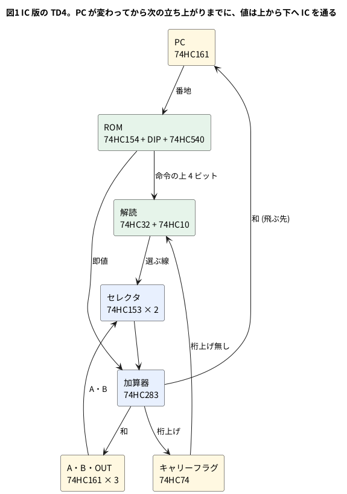

# 11-4 TD4 を 74 シリーズの IC で組んだ物と比べる

> [!WARNING]
> **この題は IC 版を組んでいない。** IC 版の遅れと最高のクロックは、TI のデータシートの最大値を足した**見積り**と、
> その値を入れた iverilog のシミュレーションの値である。測った値ではない。
> FPGA の数は yosys の合成と nextpnr の配置配線の見積りで、Tang Nano 9K に書き込んではいない。

この題は組まない題なので、実体配線図と Analog Discovery 3 は入れない。図は IC の模型のシミュレーションの波形を
ロジックアナライザの画面の形に描く。

TD4 はもともと、74HC シリーズの IC を基板に並べて組む CPU である。原典の書名にあるとおり、CPU の本体は **IC 10 個**で、
74HC161 が 4 個、74HC153 が 2 個、74HC283・74HC74・74HC10・74HC32 が 1 個ずつ。
5-8 と 11-1 の `TD4.v` は、その IC の働きを 60 行ほどの Verilog に書き直した物である。

この題では逆向きにたどる。`TD4.v` の各部がどの IC に当たるかを対応づけ、IC の働きを 1 つずつ Verilog の模型にして
TD4 を組み直す。そのうえで 3 つを数で比べる。

- 同じプログラムで、IC 版と `TD4.v` が同じに動くか (定義の無い命令ではどうか)
- IC 版は何 MHz まで回せるか (データシートの遅れを足す見積りと、遅れを入れたシミュレーション)
- 同じ TD4 を FPGA に載せると、LUT とフリップフロップはいくつで、何 MHz まで回るか

## IC と Verilog の対応

| IC | 個数 | 中身 | `TD4.v` の所 |
| --- | --- | --- | --- |
| 74HC161 (4 ビットの同期カウンタ) | 4 | A・B・OUT・PC。A・B・OUT は数えずに読み込みだけ、PC は +1 と読み込み | `reg_a` `reg_b` `reg_out` `pc` と `pc + 4'd1` |
| 74HC74 (D フリップフロップ 2 個入り) | 1 | 片方をキャリーフラグに使う | `cflag` |
| 74HC153 (4 入力のセレクタ 2 個入り) | 2 | A・B・IN・0 から 1 つを選ぶ。1 個で 2 ビット分 | `alu_in` の `? :` の並び |
| 74HC283 (4 ビットの全加算器) | 1 | 選んだ値 + 即値。桁上げ C4 がキャリーフラグへ | `{nextcflag, alu_out} = alu_in + im` |
| 74HC32 (2 入力 OR 4 個入り) | 1 | 命令の解読 | `alu_sel` `load_*` |
| 74HC10 (3 入力 NAND 3 個入り) | 1 | 命令の解読 | `load_*` |
| 74HC154・DIP スイッチ 16 個・ダイオード・74HC540 | 1 + 1 | ROM。PC を 16 本に解き、スイッチで 0 と 1 を作り、反転のバッファで受ける | `rom[0:15]` |
| 74HC14 (シュミットの反転 6 個入り) | 1 | クロックの発振とリセット | (無い。試験台か Pico 2 が与える) |

本体の 10 個に、ROM とクロックの IC が 3 個と、DIP スイッチ・ダイオード・抵抗が加わる。
ROM とクロックの IC は、TD4 を組んだ記録 (出典のやまもと氏のページ) の部品表にも見える。この題で数で比べるのは本体の 10 個である。

`TD4.v` では 1 行の `+` が 74HC283 の 1 個に、3 段の `? :` が 74HC153 の 2 個に当たる。
Verilog では部品の数を気にせずに書けるが、IC で組むときは「OR が 4 つで足りるか」を数える。次の節がその数え方である。

## ブロック図




解読から 74HC161 の LOAD (A・B・OUT・PC) への線は、図を見やすくするために省いた。

## 解読を 74HC32 と 74HC10 に割り付ける

命令の上 4 ビットを `op7`〜`op4` と書く。解読が作る信号は 6 本である。
74HC161 の LOAD は L で読み込むので、書き込みの許可はどれも負論理 (`_n`) になる。

| 信号 | 働き | 式 | IC |
| --- | --- | --- | --- |
| `s1` | セレクタの B | `op5` | (線だけ) |
| `s0` | セレクタの A | `op4 \| op7` | 74HC32 |
| `lda_n` | A に書く (00xx) | `op7 \| op6` | 74HC32 |
| `ldb_n` | B に書く (01xx) | `op7 \| ~op6` | 74HC32 |
| `ldo_n` | OUT に書く (10xx) | `~(op7 & ~op6)` | 74HC10 |
| `ldp_n` | PC に書く (11xx で、JMP か桁上げ無し) | `~(op7 & op6 & (op4 \| c_n))` | 74HC10 + 74HC32 |
| `op6_n` | `op6` の反転 | `~(op6 & op6 & op6)` | 74HC10 |

OR が 4 つ (`s0` `lda_n` `ldb_n` と `op4 | c_n`)、3 入力 NAND が 3 つ (`op6_n` `ldo_n` `ldp_n`) で、ちょうど 1 個ずつに収まる。
NAND の 1 つは、3 本の入力を束ねて反転に使う。

- `s0 = op4 | op7` は、ジャンプ (11xx) でセレクタを 11 (0) にするための工夫である。定義のある 12 命令では `op7` が 1 の命令は
  `op4` が 1 か、ジャンプかのどちらかなので、これで足りる
- `c_n` は 74HC74 の Q_n。D に 74HC283 の C4 を入れると、Q_n は「桁上げ無し」になる。`TD4.v` の `cflag` (負論理) と同じ向きである
- この割り付けは、この題で命令表から起こした物である。原典の回路図とは突き合わせていない。同じ 2 個に収まる別の割り付けもありうる

## IC の模型で組み直す

IC ごとに 1 つのモジュールを書き、上の表どおりにつなぐ。`TIMED = 1` にすると、各 IC に TI のデータシートの
4.5 V・25 °C・CL = 50 pF の**最大**の遅れを入れる。74HC161 と 74HC74 の準備時間 (setup) は、
D を準備時間だけ遅らせて真似る。遅れて着いた値は、その分だけ遅く見えるので、準備時間が足りないと前の値を取り込む。

`td4_74.v`:

```verilog
// td4_74.v  TD4 を 74HC の IC の模型でつないだもの (11-4 の割り付け)
// IC ごとに 1 つのモジュール。TIMED = 1 で、TI のデータシートの 4.5 V・25 °C の
// 最大の遅れ (CL = 50 pF) を入れる。TIMED = 0 なら遅れ 0 (働きだけを比べる)。
`timescale 1ns/1ps

// 74HC161 4 ビットの同期カウンタ。LOAD_n = 0 なら D を、ENP と ENT が 1 なら +1 を取り込む。
// 準備時間 (setup) は、D と LOAD_n を TSU だけ遅らせて真似る (遅れて着いた値は、その分だけ遅く見える)。
module hc161 #(parameter real TCO = 0.0, TSU_D = 0.0, TSU_L = 0.0) (
    input  wire       clk,
    input  wire       clr_n,
    input  wire       load_n,
    input  wire       enp,
    input  wire       ent,
    input  wire [3:0] d,
    output wire [3:0] q
);
    reg  [3:0] r;
    wire [3:0] d_s;
    wire       load_s;
    assign #(TSU_D) d_s    = d;
    assign #(TSU_L) load_s = load_n;
    always @(posedge clk or negedge clr_n)
        if (!clr_n)        r <= 4'd0;
        else if (!load_s)  r <= d_s;
        else if (enp && ent) r <= r + 4'd1;
    assign #(TCO) q = r;
endmodule

// 74HC74 の片方 (D フリップフロップ)。CLR_n で Q = 0、Q_n = 1
module hc74 #(parameter real TCO = 0.0, TSU = 0.0) (
    input  wire clk,
    input  wire clr_n,
    input  wire d,
    output wire q,
    output wire q_n
);
    reg  r;
    wire d_s;
    assign #(TSU) d_s = d;
    always @(posedge clk or negedge clr_n)
        if (!clr_n) r <= 1'b0;
        else        r <= d_s;
    assign #(TCO) q   = r;
    assign #(TCO) q_n = ~r;
endmodule

// 74HC153 の片方 (4 入力のセレクタ 1 つ)。G は L に固定した形
// 選ぶ線 (A・B) から Y までが TS、データ (C0〜C3) から Y までが TD
module hc153_half #(parameter real TS = 0.0, TD = 0.0) (
    input  wire [1:0] s,      // {B, A}
    input  wire [3:0] c,      // C3..C0
    output wire       y
);
    wire [1:0] s_d;
    assign #(TS - TD) s_d = s;
    assign #(TD) y = c[s_d];
endmodule

// 74HC283 4 ビットの全加算器
module hc283 #(parameter real TS = 0.0, TC = 0.0) (
    input  wire [3:0] a,
    input  wire [3:0] b,
    input  wire       cin,
    output wire [3:0] s,
    output wire       cout
);
    wire [4:0] t = {1'b0, a} + {1'b0, b} + {4'd0, cin};
    assign #(TS) s    = t[3:0];
    assign #(TC) cout = t[4];
endmodule

module td4_74 #(parameter TIMED = 0, parameter real T_ROM_RC = 0.0) (
    input  wire       clock,
    input  wire       reset_n,
    input  wire [3:0] in_port,
    output wire [3:0] pc_out,
    output wire [7:0] op,
    output wire [3:0] out_port
);
    // 4.5 V・25 °C の最大値 [ns] (TI のデータシート、CL = 50 pF)
    localparam real T161_CO = TIMED ? 41.0 : 0.0;  // CLK → Q
    localparam real T161_SD = TIMED ? 30.0 : 0.0;  // D の準備時間
    localparam real T161_SL = TIMED ? 27.0 : 0.0;  // LOAD_n の準備時間
    localparam real T74_CO  = TIMED ? 35.0 : 0.0;  // CLK → Q
    localparam real T74_SU  = TIMED ? 20.0 : 0.0;  // D の準備時間
    localparam real T154    = TIMED ? 35.0 : 0.0;  // 番地 → 出力
    localparam real T540    = TIMED ? 20.0 : 0.0;  // A → Y
    localparam real T32     = TIMED ? 20.0 : 0.0;  // OR
    localparam real T10     = TIMED ? 19.0 : 0.0;  // 3 入力 NAND
    localparam real T153_S  = TIMED ? 30.0 : 0.0;  // 選ぶ線 → Y
    localparam real T153_D  = TIMED ? 28.0 : 0.0;  // データ → Y
    localparam real T283_S  = TIMED ? 42.0 : 0.0;  // A・B → S
    localparam real T283_C  = TIMED ? 39.0 : 0.0;  // A・B → C4

    // ---- ROM: 74HC154 で PC を 16 本に解き、DIP スイッチとダイオードで 8 ビットを作り、74HC540 で受ける
    reg  [7:0] rom [0:15];
    wire [3:0] pc;
    wire [7:0] opcode;
    assign #(T154 + T540 + T_ROM_RC) opcode = rom[pc];
    assign op     = opcode;
    assign pc_out = pc;

    // ---- 命令の解読: 74HC32 (OR 4 つ) と 74HC10 (3 入力 NAND 3 つ)
    wire op7 = opcode[7], op6 = opcode[6], op5 = opcode[5], op4 = opcode[4];
    wire [3:0] im = opcode[3:0];
    wire c_n;                       // 74HC74 の Q_n。1 なら桁上げ無し
    wire op6_n, s0, s1;
    wire lda_n, ldb_n, ldo_n, ldp_n, x;
    assign #(T10) op6_n = ~(op6 & op6 & op6);      // 74HC10 の 1: 反転に使う
    assign #(T10) ldo_n = ~(op7 & op6_n & 1'b1);   // 74HC10 の 2: OUT に書く (10xx)
    assign #(T10) ldp_n = ~(op7 & op6 & x);        // 74HC10 の 3: PC に書く (11xx で、JMP か桁上げ無し)
    assign #(T32) s0    = op4 | op7;               // 74HC32 の 1: セレクタの A
    assign #(T32) lda_n = op7 | op6;               // 74HC32 の 2: A に書く (00xx)
    assign #(T32) ldb_n = op7 | op6_n;             // 74HC32 の 3: B に書く (01xx)
    assign #(T32) x     = op4 | c_n;               // 74HC32 の 4: JMP か、桁上げ無し
    assign s1 = op5;                               // セレクタの B は命令のビット 5 そのまま

    // ---- セレクタ: 74HC153 × 2 (C0 = A、C1 = B、C2 = IN、C3 = 0)
    wire [3:0] reg_a, reg_b, reg_out;
    wire [3:0] sel;
    genvar i;
    generate
        for (i = 0; i < 4; i = i + 1) begin : g_sel
            hc153_half #(.TS(T153_S), .TD(T153_D)) u153 (
                .s({s1, s0}), .c({1'b0, in_port[i], reg_b[i], reg_a[i]}), .y(sel[i]));
        end
    endgenerate

    // ---- 加算器: 74HC283 (B に即値、Cin は GND)
    wire [3:0] sum;
    wire       c4;
    hc283 #(.TS(T283_S), .TC(T283_C)) u283 (.a(sel), .b(im), .cin(1'b0), .s(sum), .cout(c4));

    // ---- レジスタ: 74HC161 × 4 と 74HC74
    hc161 #(.TCO(T161_CO), .TSU_D(T161_SD), .TSU_L(T161_SL)) ua (
        .clk(clock), .clr_n(reset_n), .load_n(lda_n), .enp(1'b0), .ent(1'b0), .d(sum), .q(reg_a));
    hc161 #(.TCO(T161_CO), .TSU_D(T161_SD), .TSU_L(T161_SL)) ub (
        .clk(clock), .clr_n(reset_n), .load_n(ldb_n), .enp(1'b0), .ent(1'b0), .d(sum), .q(reg_b));
    hc161 #(.TCO(T161_CO), .TSU_D(T161_SD), .TSU_L(T161_SL)) uo (
        .clk(clock), .clr_n(reset_n), .load_n(ldo_n), .enp(1'b0), .ent(1'b0), .d(sum), .q(reg_out));
    hc161 #(.TCO(T161_CO), .TSU_D(T161_SD), .TSU_L(T161_SL)) up (
        .clk(clock), .clr_n(reset_n), .load_n(ldp_n), .enp(1'b1), .ent(1'b1), .d(sum), .q(pc));
    wire c_q_unused;
    hc74 #(.TCO(T74_CO), .TSU(T74_SU)) uc (
        .clk(clock), .clr_n(reset_n), .d(c4), .q(c_q_unused), .q_n(c_n));

    assign out_port = reg_out;
endmodule
```

- ROM は `rom[pc]` を 74HC154 と 74HC540 の遅れの和 (55 ns) だけ遅らせて真似る。DIP スイッチとダイオードの所の遅れは `T_ROM_RC` で足す (下の「最高のクロックの見積り」)
- 74HC153 は、選ぶ線からの遅れ (30 ns) とデータからの遅れ (28 ns) が違う。選ぶ線を差の 2 ns だけ先に遅らせて、両方の道を真似る
- 試験台が ROM の中身を書き込む (`rom` に `initial` は無い)

ROM を外に出した `TD4.v` も用意する。中身は `TD4.v` と同じで、命令 (`op`) を外から受ける。
IC 版の「本体の 10 個」と同じ範囲を、FPGA の合成で数えるためである。

`td4_xrom.v`:

```verilog
// td4_xrom.v  TD4 の ROM を外に出した物 (11-4)。中身は 5-8 の TD4.v と同じ
// 命令 (op) を外から受け、番地 (pc_out) を外へ出す。IC 版の「IC 10 個」と同じ範囲を合成で数えるため
// 元: asfdrwe/simpleTD4 の TD4.v (MIT)。Copyright (c) 2020 asfdrwe
// SPDX-License-Identifier: MIT
module td4_xrom (
    input  wire       clock,
    input  wire       reset_n,
    input  wire [3:0] in_port,
    input  wire [7:0] op,        // ROM の出力
    output wire [3:0] pc_out,    // ROM の番地
    output wire [3:0] out_port
);
    reg [3:0] reg_a, reg_b, reg_out, pc;
    reg       cflag;
    assign out_port = reg_out;
    assign pc_out   = pc;

    wire [1:0] alu_sel  = (op[7:6] == 2'b11) ? 2'b11 : op[5:4];
    wire [1:0] load_sel = op[7:6];
    wire       jmp      = op[4];
    wire [3:0] im       = op[3:0];

    wire [3:0] alu_in = (alu_sel == 2'b00) ? reg_a   :
                        (alu_sel == 2'b01) ? reg_b   :
                        (alu_sel == 2'b10) ? in_port :
                                             4'b0000;
    wire [3:0] alu_out;
    wire       nextcflag;
    assign {nextcflag, alu_out} = alu_in + im;

    wire load_pc = (load_sel == 2'b11) && (jmp || cflag);

    always @(posedge clock or negedge reset_n) begin
        if (!reset_n) begin
            reg_a   <= 4'b0;
            reg_b   <= 4'b0;
            reg_out <= 4'b0;
            cflag   <= 1'b1;
            pc      <= 4'b0;
        end else begin
            if (load_sel == 2'b00) reg_a   <= alu_out;
            if (load_sel == 2'b01) reg_b   <= alu_out;
            if (load_sel == 2'b10) reg_out <= alu_out;
            cflag <= ~nextcflag;
            pc    <= load_pc ? alu_out : pc + 4'd1;
        end
    end
endmodule
```

## 試験台

試験台 (`sim/04-td4-74-tb.v`) は、IC の模型 (遅れ 0 と遅れ入り)・`td4_xrom`・5-8 の `TD4.v` を同じクロックで並べ、
同じ ROM と同じ入力で走らせる。比べるのは、クロックの終わりの PC・OUT・A・B・桁上げの 17 ビットである。3 つのことを確かめる。

1. **定義のある 12 命令**だけで乱数のプログラムを 500 本作り、64 クロックずつ走らせる。遅れ 0 の IC の模型と `TD4.v` が 1 クロックも違わないこと。`td4_xrom` も同じ
2. **定義の無い 4 命令** (1000・1010・1100・1101) を 4 分の 1 の割合で混ぜた 200 本で、違いが出る本数を数える
3. **遅れを入れた模型**で、クロックの周期を 300 ns から 1 ns ずつ縮め、乱数のプログラム 30 本 × 64 クロックがすべて `TD4.v` と合う最短の周期を探す

3 の探し方の部分を抜き出す。

```verilog
    // その周期で、乱数のプログラム 30 本 × 64 クロックがすべて合うか
    task try_period(input integer which, input real per, output integer ok);
        integer q, nb;
        begin
            period = per;
            seed = 2024;
            ok = 1;
            for (q = 0; q < 30; q = q + 1) begin
                make_prog(16);
                run_prog(which, 64, nb);
                if (nb != 0) ok = 0;
            end
        end
    endtask
```

`seed` を毎回同じにするので、どの周期でも同じ 30 本を走らせる。

## 動かす

```bash
cd 06-fpga/11-cpu/sim
sh 04-td4-74-run.sh
```

`04-td4-74-run.sh` は `td4_xrom` を Verilator で lint し、試験台を iverilog で回し、図の波形を取り、yosys と nextpnr で数える。
IC ごとに遅れの `#` を入れた模型なので、試験台は iverilog で回す。
`td4_xrom` の lint は警告 0 件で通った (Verilator 5.042、`-Wall`。sim の置き場ではファイル名に題の番号を付けたので `-Wno-DECLFILENAME` を足す)。

試験台の出力は次のとおり。

```text
1. 12 命令の乱数プログラム 500 本 x 64 クロック: 不一致 0 クロック
   同じ 500 本で td4_xrom (ROM を外に出した物) と TD4.v: 不一致 0 クロック
2. 命令 1000 を混ぜた 200 本: 違いが出た本数 165
2. 命令 1010 を混ぜた 200 本: 違いが出た本数 167
2. 命令 1100 を混ぜた 200 本: 違いが出た本数 120
2. 命令 1101 を混ぜた 200 本: 違いが出た本数 130
   例 1 命令目のあと: TD4.v は OUT = 0・PC = 1、IC 版は OUT = 0・PC = 1
   例 2 命令目のあと: TD4.v は OUT = 0・PC = 2、IC 版は OUT = 0・PC = 2
   例 3 命令目のあと: TD4.v は OUT = 3・PC = 3、IC 版は OUT = 5・PC = 3
   例 4 命令目のあと: TD4.v は OUT = 8・PC = 4、IC 版は OUT = 2・PC = 4
   例 5 命令目のあと: TD4.v は OUT = 8・PC = 1、IC 版は OUT = 2・PC = 6
3. 遅れ入り (ROM の RC なし): 合う最短の周期 218 ns
   遅れ入り (ROM の RC 140 ns を仮定): 合う最短の周期 358 ns
PASS
```

## 定義の無い命令は、作り方で動きが変わる

12 命令では IC 版と `TD4.v` は 1 クロックも違わなかった。違いが出たのは、命令表に無い 4 つだけである。
例は `MOV A,3` `MOV B,5` `1000_0000` `1010_0010` (IN = 6) `1101_0001` を順に走らせたもの。

| 命令 | `TD4.v` | この題の IC の割り付け | 例での違い |
| --- | --- | --- | --- |
| 1000 | OUT ← A + Im | OUT ← B + Im | OUT が 3 と 5 |
| 1010 | OUT ← IN + Im | OUT ← Im | OUT が 8 と 2 |
| 1100 | 桁上げ無しなら PC ← Im | 桁上げ無しなら PC ← B + Im | (例には無い) |
| 1101 | PC ← Im | PC ← B + Im | PC が 1 と 6 |

`TD4.v` はセレクタを `alu_sel = op[5:4]` (ジャンプだけ 11) で選び、IC 版は `s0 = op4 | op7` で選ぶ。
定義のある命令では同じ値になるが、定義の無い命令では食い違う。**定義の無い命令の動きは、作った人の回路の都合で決まる**。
プログラムでは使わない。11-5 では、この 4 つの空きに新しい命令を入れる。

## 最高のクロックの見積り

1 クロックの間に、値は図1の順に IC を通る。最も長い道は「PC が変わる → ROM が新しい命令を出す → 解読が `s0` を変える →
セレクタが選び直す → 加算器が足す → A の D に着く」である。データシートの最大値 (4.5 V・25 °C・CL = 50 pF) を足す。

| 区間 | IC | 最大 [ns] | 足した値 [ns] |
| --- | --- | --- | --- |
| CLK → Q (PC が変わる) | 74HC161 | 41 | 41 |
| 番地 → 出力 | 74HC154 | 35 | 76 |
| A → Y (ROM を受ける) | 74HC540 | 20 | 96 |
| OR (`s0`) | 74HC32 | 20 | 116 |
| 選ぶ線 → Y | 74HC153 | 30 | 146 |
| A・B → S | 74HC283 | 42 | 188 |
| D の準備時間 | 74HC161 | 30 | **218** |

**218 ns、最高のクロックは 4.59 MHz** (見積り)。遅れを入れたシミュレーションで探した最短の周期も 218 ns で、表の足し算と同じになった。
ほかの道は短い。

| 道 | 足し算 [ns] |
| --- | --- |
| 即値 → 加算器 → A の D | 41 + 55 + 42 + 30 = 168 |
| `op6` → 反転 → `ldb_n` → LOAD の準備時間 | 41 + 55 + 19 + 20 + 27 = 162 |
| `op4` → `op4 \| c_n` → `ldp_n` → LOAD の準備時間 | 41 + 55 + 20 + 19 + 27 = 162 |
| C4 → 74HC74 の D | 41 + 55 + 20 + 30 + 39 + 20 = 205 |

- 表は**最大値**である。同じデータシートの代表値 (typ) はおよそ半分から 7 割なので、手元の IC はもっと速く回る見込みが高い。
  逆に、電源が 4.5 V より低い、温度が高い、配線が長いと遅くなる
- **ROM の DIP スイッチとダイオードの所は、表に入れていない。** 74HC154 の出力が L に引くときは速いが、H に戻るのは引き上げ抵抗が線の容量を
  充電する速さで決まる。抵抗を 10 kΩ (オーム)、線とダイオードの容量を 20 pF と仮定すると、半分の電圧まで
  0.69 × 10 kΩ × 20 pF ≒ 140 ns かかる。これを足すと 358 ns、**2.79 MHz** になる (シミュレーションも 358 ns)。抵抗と容量は仮定で、測っていない
- 原典の TD4 は、手で押すクロックか 1 Hz・10 Hz の発振で動かす。MHz で回すことは考えていない。上の数は、IC で組んだ CPU の上限の目安である

## Logic に見えるはずの画面

遅れを入れた模型で、`MOV B,9` `MOV A,2` `ADD A,1` `MOV A,B` を周期 300 ns で走らせた波形 (`sim/04-td4-74-wave-tb.v`)。
3 つめの立ち上がり (`ADD A,1` の終わり) の 50 ns 前から 400 ns を描いた。シミュレーションの値で、測った波形ではない。
SUM は 74HC283 の和、SEL は 74HC153 の出力。

```logic
# ロジックアナライザの画面 (tommie-fence の logic フェンス)
title: 図2 PC が変わってから 188 ns で和が 9 に落ち着き、次の立ち上がりで A に入る
device: generic
time: 40ns/div
signals:
  CLK: edges 0s=0 50ns=1 200ns=0 350ns=1
  PC2: edges 0s=0 391ns=1
  PC1: edges 0s=1 391ns=0
  PC0: edges 0s=0 91ns=1 391ns=0
  OP7: low
  OP6: low
  OP5: low
  OP4: edges 0s=0 146ns=1
  OP3: low
  OP2: low
  OP1: low
  OP0: edges 0s=1 146ns=0
  S0: edges 0s=0 166ns=1
  SEL3: edges 0s=0 196ns=1
  SEL2: low
  SEL1: edges 0s=1 196ns=0
  SEL0: edges 0s=0 119ns=1
  SUM3: edges 0s=0 238ns=1
  SUM2: low
  SUM1: edges 0s=1 238ns=0
  SUM0: high
  A3: edges 0s=0 391ns=1
  A2: low
  A1: edges 0s=1 391ns=0
  A0: edges 0s=0 91ns=1
buses:
  PC: PC2..PC0 hex
  OP: OP7..OP0 hex
  SEL: SEL3..SEL0 hex
  SUM: SUM3..SUM0 hex
  A: A3..A0 hex
cursors: [50ns, 238ns]
```


- 50 ns の立ち上がりで、A が 2 から 3 に (91 ns)、PC が 2 から 3 に (91 ns) 変わる。74HC161 の 41 ns
- ROM の出力 (OP) が `0x01` (`ADD A,1`) から `0x10` (`MOV A,B`) に変わるのは 146 ns。PC から 55 ns
- `s0` が 1 になるのは 166 ns、セレクタが B (9) を出すのは 196 ns、和が 9 になるのは 238 ns
- 119 ns に SEL が 3 になるのは、A が 3 に変わったのをセレクタが通したため。和は 3 + 1 = 4 になりかけるが、
  146 ns に即値が 0 に変わるので、模型の加算器は 4 を出さずに 3 のまま 238 ns まで待つ (遅れより短い変化は出さない模型)
- 和が落ち着いてから次の立ち上がり (350 ns) まで 112 ns の余裕がある。準備時間 30 ns を引いて 82 ns。周期を 218 ns まで縮めると余裕が 0 になる

## FPGA に載せた数と比べる

`td4_xrom.v` (ROM を外に出した物、IC 版の本体と同じ範囲) と、5-8 の `TD4.v` (ROM と、その中のプログラム A を含む) を合成した。
LUT と DFF の数は yosys の `synth_gowin`、最高の周波数は nextpnr-himbaechel の見積り (Tang Nano 9K の GW1NR-9、`--freq 27`、ピンは仮の番号) である。

```bash
yosys -p "read_verilog td4_xrom.v; synth_gowin -top td4_xrom -json x.json; stat"
nextpnr-himbaechel --json x.json --write p.json --device GW1NR-LV9QN88PC6/I5 \
    --vopt family=GW1N-9C --vopt cst=td4_xrom.cst --freq 27
```

| | IC 版 (見積り) | `td4_xrom` (ROM は外) | `TD4.v` (ROM は中) |
| --- | --- | --- | --- |
| 部品 | IC 10 個 (+ ROM・クロックの IC 3 個) | LUT4 42、DFF 17 (8640 と 6480 のうち) | LUT4 28、DFF 12 |
| yosys 0.70+16 の内訳 | — | LUT 30、MUX2 16、ALU 9、DFF 17 | LUT 16、ALU 8、DFF 12 |
| yosys 0.33 の内訳 | — | LUT 78、MUX2 40、ALU 9、DFF 17 | LUT 46、MUX2 12、ALU 8、DFF 12 |
| 最高のクロック | 4.59 MHz (ROM の RC を入れると 2.79 MHz) | 203.87〜223.06 MHz | 191.24〜228.00 MHz |
| 1 クロックの最も長い道 | 218 ns | 4.89 ns (指定なしの 1 回) | — |

- DFF の 17 個は、A・B・OUT・PC の 4 × 4 と桁上げの 1。IC 版の 74HC161 4 個と 74HC74 の片方と同じ数である
- `TD4.v` の 12 個は、ROM の中のプログラム A が B に書かず、桁上げも起きないので、B と桁上げが消えた残り。
  **FPGA では ROM の中身も回路に溶けて、使わないレジスタは消える**。DIP スイッチで後から書き換える IC 版とは、ここが違う
- 最高のクロックは nextpnr の 4 回 (`--seed` 指定なしと 1・2・3) の幅。レジスタからレジスタへの道だけで、ピンの出入りの遅れは入っていない
- FPGA の 1 クロックの最も長い道は、IC 版のおよそ 45 分の 1 である。IC と IC の間を基板の配線で結ぶ代わりに、チップの中の短い配線で結ぶためである
- Tang Nano 9K の LUT の 0.5 % ほどで TD4 が収まる

## 見るべき値

| 項目 | 見るべき値 | 分かること |
| --- | --- | --- |
| 12 命令の乱数プログラム 500 本 | IC の模型と `TD4.v` の不一致 0 クロック (シミュレーションの値) | 表の割り付けで TD4 が組める |
| 定義の無い 4 命令 | 4 つとも違いが出る (200 本中 120〜167 本) | 定義の無い命令の動きは作りで変わる |
| IC 版の最も長い道 | 218 ns = 4.59 MHz (データシートの最大値の和。シミュレーションも 218 ns) | どの IC の遅れが効くか |
| ROM の RC を入れた IC 版 | 358 ns = 2.79 MHz (10 kΩ・20 pF の仮定) | 引き上げ抵抗の ROM は遅い |
| 図2の ΔX | 188 ns (シミュレーションの値) | PC が変わってから和が落ち着くまで |
| FPGA の DFF | 17 個 (`td4_xrom`) | IC 版のレジスタと同じ数 |
| FPGA の最高のクロック | 191〜228 MHz (nextpnr の見積り) | 同じ回路が IC 版のおよそ 45 倍で回る |

## シミュレーションでの確かめ

iverilog 12、Verilator 5.042、yosys 0.33 と OSS CAD Suite の Yosys 0.70+16・nextpnr-himbaechel 0.11.1-63 で、
`sim/04-td4-74-run.sh` を走らせた。本文の `td4_74.v` `td4_xrom.v` は `sim/04-td4-74.v` `sim/04-td4-xrom.v` と同じ物である。
試験台は `sim/04-td4-74-tb.v` と `sim/04-td4-74-wave-tb.v`、配置配線のピンは `sim/04-td4-xrom.cst` `sim/04-td4-full.cst`。

| 項目 | 本文の数字 | 実行結果 | 判定 |
| --- | --- | --- | --- |
| lint (`td4_xrom`、`-Wall`) | 警告 0 件 | 0 件 | 合った |
| 12 命令の乱数 500 本 × 64 クロック | 不一致 0 | IC の模型も `td4_xrom` も 0 クロック | 合った |
| 定義の無い命令 | 4 つとも違いが出る | 1000: 165 本、1010: 167 本、1100: 120 本、1101: 130 本 | 合った |
| 例の OUT・PC | 3 と 5、8 と 2、PC 1 と 6 | 同じ | 合った |
| 遅れ入りの最短の周期 | 218 ns (表の和) | 218 ns | 合った |
| ROM の RC 140 ns を入れた最短の周期 | 358 ns | 358 ns | 合った |
| 図2の波形 | PC 91 ns、OP 146 ns、`s0` 166 ns、SEL 196 ns、SUM 238 ns、A 391 ns | 同じ。最後に A = 9 で `PASS` | 合った |
| 合成 `td4_xrom` (Yosys 0.70+16) | LUT 30、MUX2 16、ALU 9、DFF 17 | LUT1 2 + LUT2 4 + LUT4 24、MUX2_LUT5 12 + MUX2_LUT6 4、ALU 9、DFFC 4 + DFFCE 12 + DFFP 1 | 合った |
| 合成 `td4_xrom` (yosys 0.33) | LUT 78、MUX2 40 | LUT1 50 + LUT2 24 + LUT4 4、MUX2 24 + 12 + 4 | 合った |
| 合成 `TD4.v` (Yosys 0.70+16 / 0.33) | DFF 12 | DFFC 4 + DFFCE 8 (両方) | 合った |
| 配置配線 `td4_xrom` | LUT4 42、DFF 17、203.87〜223.06 MHz | 204.29 (指定なし)・223.06・203.87・207.64 MHz、すべて PASS at 27.00 MHz | 合った |
| 配置配線 `TD4.v` | LUT4 28、DFF 12、191.24〜228.00 MHz | 191.61 (指定なし)・218.67・191.24・228.00 MHz | 合った |

確かめられなかったもの。

- IC 版を実際に組んだときの最高のクロック (組んでいない。データシートの最大値の和と、その値を入れたシミュレーションだけ)
- ROM の引き上げ抵抗と容量 (10 kΩ・20 pF は仮定)
- この題の解読の割り付けが、原典の回路図と同じかどうか (書籍の図とは突き合わせていない)
- Tang Nano 9K での動作 (書き込んでいない。ピンは仮の番号)

## 出典

- 渡波郁『CPU の創りかた — IC 10 個のお手軽 CPU 設計超入門』(毎日コミュニケーションズ、2003) — TD4 の元。IC の種類と個数。図と文は写していない
- [simpleTD4](https://github.com/asfdrwe/simpleTD4) (asfdrwe、MIT) — `TD4.v` の元。`td4_xrom.v` もこれを元にした
- [やまもと氏の電子工作作品集「4 bit CPU TD4」](http://xyama.sakura.ne.jp/hp/4bitCPU_TD4.html) — TD4 を組んだ記録と部品表 (74HC154 の代わりに 74HC138 を 2 個使った例など)
- TI のデータシート (遅れの値。4.5 V・25 °C の最大値):
  [SN74HC161](https://www.ti.com/lit/ds/symlink/sn74hc161.pdf)・
  [SN74HC153](https://www.ti.com/lit/ds/symlink/sn74hc153.pdf)・
  [CD74HC283](https://www.ti.com/lit/ds/symlink/cd74hc283.pdf)・
  [SN74HC74](https://www.ti.com/lit/ds/symlink/sn74hc74.pdf)・
  [SN74HC10](https://www.ti.com/lit/ds/symlink/sn74hc10.pdf)・
  [SN74HC32](https://www.ti.com/lit/ds/symlink/sn74hc32.pdf)・
  [CD74HC154](https://www.ti.com/lit/ds/symlink/cd74hc154.pdf)・
  [SN74HC540](https://www.ti.com/lit/ds/symlink/sn74hc540.pdf)
