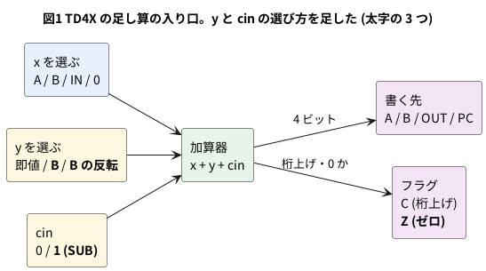

# 11-5 TD4 に命令を足す

この題は PC の Verilator (と iverilog) だけで動かす。組まない題なので、実体配線図と Analog Discovery 3 は入れない。
オシロの代わりに、シミュレーションの波形をロジックアナライザの画面の形に描く。

TD4 の命令は 12 個しかない。プログラムを書くと、すぐに足りなくなる。

- A と B を足せない。足せるのは即値だけ (`ADD A,Im` `ADD B,Im`)
- 引き算が無い。大小を比べられない
- 「0 になったら」で分かれられない。分かれる命令は桁上げを見る `JNC` だけ
- A を直に出せない。`MOV B,A` で B に移してから `OUT B` で出す

命令の上 4 ビットは 16 通りあり、TD4 が使うのは 12 通り。空きは 1000・1010・1100・1101 の 4 つである。
11-4 で見たとおり、この 4 つの動きは作り方で変わる (定義が無い)。そこに 4 つの命令を入れて、TD4 を少し強くする。
この TD4 を、この題では **TD4X** と呼ぶ。

## 足す命令

| オペコード | 命令 | 働き | 回路で足す物 |
| --- | --- | --- | --- |
| 1000 | OUT A | OUT ← A | (無し。`TD4.v` はもともとこう動く) |
| 1010 | ADD A,B | A ← A + B | 加算器のもう片方に B を入れる道 |
| 1100 | JZ Im | ゼロフラグが 1 なら PC ← Im | ゼロフラグ 1 ビット |
| 1101 | SUB A,B | A ← A − B | 加算器のもう片方に B の反転を入れ、桁の入りを 1 にする |

元の 12 命令は、そのままの働きで残す。5-8 のプログラム A・B も、TD4X でそのまま動く。

- **OUT A** の 1000 は、`TD4.v` では「OUT ← A + Im」に動く (11-4)。即値を 0 にすれば OUT A になるので、それを正式な命令にする。
  11-4 の IC 版の割り付けでは B が出るので、IC で組んだ TD4 に足すときは解読を直す
- **SUB A,B** は、2 の補数で A + (B の反転) + 1 を計算する。桁上げは「借りが無い」(A ≥ B) で 1 になる。
  `SUB A,B` のすぐ後の `JNC` は、A < B のときに飛ぶ
- **ゼロフラグ** は「書いた結果が 0」で 1 になる。TD4 の桁上げと同じく、**フラグは毎命令で書き直す**。
  `JZ` と `JNC` は、すぐ前の命令の結果を見る (間に別の命令を挟むと、その命令の結果で上書きされる)

## ブロック図




TD4 の加算器は「x + 即値」だった。TD4X では、もう片方 (y) と桁の入り (cin) も命令で選ぶ。
加算器は 1 つのまま、`ADD A,B` も `SUB A,B` も同じ加算器を通る。

## Verilog

`td4x.v` は、命令ごとに x・y・cin・書く先・飛ぶ条件を `case` で決める形に書き直した。
11-4 の `td4_xrom` と同じく ROM を外に置き、命令を受けて番地を出す。ROM をつないだ `td4x_rom` も同じファイルに置く。
ROM の中身は `$readmemh` で 16 進のファイルから読み、`+rom=<名前>` で替えられる (11-6 で使う)。

`td4x.v`:

```verilog
// td4x.v  TD4 に 4 つの命令 (OUT A・ADD A,B・JZ・SUB A,B) とゼロフラグを足した物 (11-5)
// 定義のある 12 命令は TD4.v (5-8) と同じに動く。ROM は外に置き、命令 (op) を受けて番地 (pc_out) を出す
module td4x (
    input  wire       clock,
    input  wire       reset_n,
    input  wire [3:0] in_port,
    input  wire [7:0] op,        // ROM の出力
    output wire [3:0] pc_out,    // ROM の番地
    output wire [3:0] out_port,
    output wire       flag_c,    // 桁上げ (1 で桁上げ有り。TD4.v と逆の向きで持つ)
    output wire       flag_z     // ゼロ (1 で結果が 0)
);
    localparam [1:0] TO_A = 2'd0, TO_B = 2'd1, TO_OUT = 2'd2, TO_PC = 2'd3;

    reg [3:0] reg_a, reg_b, reg_out, pc;
    reg       c, z;
    assign out_port = reg_out;
    assign pc_out   = pc;
    assign flag_c   = c;
    assign flag_z   = z;

    wire [3:0] code = op[7:4];
    wire [3:0] im   = op[3:0];

    // 足し算の 2 つの入り口 (x と y) と桁の入り (cin)、書く先 (dst)、飛ぶ条件 (take) を命令で決める
    reg [3:0] x, y;
    reg       cin, take;
    reg [1:0] dst;
    always @* begin
        x = 4'd0; y = im; cin = 1'b0; dst = TO_A; take = 1'b0;
        case (code)
            4'b0000: begin x = reg_a;   dst = TO_A;   end          // ADD A,Im
            4'b0001: begin x = reg_b;   dst = TO_A;   end          // MOV A,B
            4'b0010: begin x = in_port; dst = TO_A;   end          // IN  A
            4'b0011: begin              dst = TO_A;   end          // MOV A,Im
            4'b0100: begin x = reg_a;   dst = TO_B;   end          // MOV B,A
            4'b0101: begin x = reg_b;   dst = TO_B;   end          // ADD B,Im
            4'b0110: begin x = in_port; dst = TO_B;   end          // IN  B
            4'b0111: begin              dst = TO_B;   end          // MOV B,Im
            4'b1000: begin x = reg_a;   dst = TO_OUT; end          // OUT A      (足した)
            4'b1001: begin x = reg_b;   dst = TO_OUT; end          // OUT B
            4'b1010: begin x = reg_a; y = reg_b; dst = TO_A; end   // ADD A,B    (足した)
            4'b1011: begin              dst = TO_OUT; end          // OUT Im
            4'b1100: begin dst = TO_PC; take = z;  end             // JZ  Im     (足した)
            4'b1101: begin x = reg_a; y = ~reg_b; cin = 1'b1; dst = TO_A; end  // SUB A,B (足した)
            4'b1110: begin dst = TO_PC; take = ~c; end             // JNC Im
            default: begin dst = TO_PC; take = 1'b1; end           // JMP Im (1111)
        endcase
    end

    wire [4:0] sum = {1'b0, x} + {1'b0, y} + {4'd0, cin};

    always @(posedge clock or negedge reset_n) begin
        if (!reset_n) begin
            reg_a   <= 4'd0;
            reg_b   <= 4'd0;
            reg_out <= 4'd0;
            pc      <= 4'd0;
            c       <= 1'b0;
            z       <= 1'b0;
        end else begin
            if (dst == TO_A)   reg_a   <= sum[3:0];
            if (dst == TO_B)   reg_b   <= sum[3:0];
            if (dst == TO_OUT) reg_out <= sum[3:0];
            pc <= (dst == TO_PC && take) ? sum[3:0] : pc + 4'd1;
            c  <= sum[4];                 // フラグは TD4 と同じく毎命令で書き直す
            z  <= (sum[3:0] == 4'd0);
        end
    end
endmodule

// td4x_rom  td4x に 16 番地の ROM をつないだ物。ROM の中身は $readmemh で読む
// ファイルは +rom=<名前> で替えられる (既定は ROMFILE)
module td4x_rom #(parameter ROMFILE = "05-td4x-sum.hex") (
    input  wire       clock,
    input  wire       reset_n,
    input  wire [3:0] in_port,
    output wire [3:0] pc_out,
    output wire [7:0] op,
    output wire [3:0] out_port,
    output wire       flag_c,
    output wire       flag_z
);
    reg [7:0]       rom [0:15];
    reg [8*256-1:0] fname;
    initial begin
`ifdef SYNTHESIS
        fname = 0;
        $readmemh(ROMFILE, rom);
`else
        if ($value$plusargs("rom=%s", fname)) $readmemh(fname, rom);
        else                                  $readmemh(ROMFILE, rom);
`endif
    end
    assign op = rom[pc_out];
    td4x cpu (.clock(clock), .reset_n(reset_n), .in_port(in_port), .op(op),
              .pc_out(pc_out), .out_port(out_port), .flag_c(flag_c), .flag_z(flag_z));
endmodule
```

- 桁上げは `TD4.v` と逆の向き (1 で桁上げ有り) で持つ。`TD4.v` の `cflag` は 74HC74 の Q_n に合わせた負論理だった。
  外から見た働き (`JNC` が飛ぶ条件) は同じである
- `$value$plusargs` は yosys が読めないので、`SYNTHESIS` (yosys が定義する印) のときは既定のファイルだけを読む

## プログラム

アセンブラは 11-6 で作る。この題では、命令表を見て 16 進を手で書く。

5+4+3+2+1 を A に足して出すプログラム (`sum.hex`)。B を 5 から 1 ずつ減らし、0 になったら `JZ` で抜ける。

```text
// 05-td4x-sum.hex  5+4+3+2+1 を A に足して OUT に出す (11-5、手で書いた機械語)
30 // 0: MOV A,0
75 // 1: MOV B,5
A0 // 2: ADD A,B      (足した命令)
5F // 3: ADD B,15     B を 1 減らす。0 になればゼロフラグが立つ
C6 // 4: JZ  6        (足した命令)
F2 // 5: JMP 2
80 // 6: OUT A        (足した命令)
F7 // 7: JMP 7        ここで止まる
00 // 8
00 // 9
00 // 10
00 // 11
00 // 12
00 // 13
00 // 14
00 // 15
```

IN が 5 以上なら 1、5 より小さければ 0 を出すプログラム (`cmp.hex`)。`SUB A,B` の借りを `JNC` で見る。

```text
// 05-td4x-cmp.hex  IN が 5 以上なら OUT に 1、5 より小さければ 0 を出す (11-5、手で書いた機械語)
20 // 0: IN  A
75 // 1: MOV B,5
D0 // 2: SUB A,B      (足した命令) A >= B なら桁上げが立つ (借りが無い)
E6 // 3: JNC 6        借りが有った (A < 5)
B1 // 4: OUT 1
F0 // 5: JMP 0
B0 // 6: OUT 0
F0 // 7: JMP 0
00 // 8
00 // 9
00 // 10
00 // 11
00 // 12
00 // 13
00 // 14
00 // 15
```

- `ADD B,15` は B − 1 と同じである (4 ビットで 15 を足すと 1 を引いたことになる)。B が 1 以上なら桁上げが出る
- 元の TD4 で 5+4+3+2+1 をするには、A + B が無いので、ループの回数だけ `ADD A,Im` を並べるか、`JNC` で回数を数える工夫が要る

## テストベンチ

```verilog
// tb_td4x.v  td4x の試験 (11-5)
//  1. 5+4+3+2+1 のプログラム: OUT = 15、止まるまでのクロック数
//  2. 比べるプログラム: IN = 0〜15 で、OUT = (IN >= 5)
//  3. 両方にある 13 命令 (定義のある 12 と、TD4.v でも OUT A に動く 1000) の乱数プログラムで、
//     td4x と td4_xrom (11-4。5-8 の TD4.v と同じ動き) を比べる
`timescale 1us/1ns
module tb_td4x;
    reg        clock = 0;
    reg        reset_n = 1;
    reg  [3:0] in_port = 0;
    reg  [7:0] rom [0:15];
    integer    seed = 1;
    integer    n, c, bad, ng, rnd, clocks;
    reg  [3:0] shared [0:12];

    wire [3:0] pc_x, out_x, pc_r, out_r;
    wire       c_x, z_x;
    td4x     ux (.clock(clock), .reset_n(reset_n), .in_port(in_port), .op(rom[pc_x]),
                 .pc_out(pc_x), .out_port(out_x), .flag_c(c_x), .flag_z(z_x));
    td4_xrom ur (.clock(clock), .reset_n(reset_n), .in_port(in_port), .op(rom[pc_r]),
                 .pc_out(pc_r), .out_port(out_r));

    wire [3:0] pc_s, out_s, pc_m, out_m;
    wire [7:0] op_s, op_m;
    wire       c_s, z_s, c_m, z_m;
    td4x_rom #(.ROMFILE("05-td4x-sum.hex")) us (.clock(clock), .reset_n(reset_n), .in_port(in_port),
        .pc_out(pc_s), .op(op_s), .out_port(out_s), .flag_c(c_s), .flag_z(z_s));
    td4x_rom #(.ROMFILE("05-td4x-cmp.hex")) um (.clock(clock), .reset_n(reset_n), .in_port(in_port),
        .pc_out(pc_m), .op(op_m), .out_port(out_m), .flag_c(c_m), .flag_z(z_m));

    task tick;
        begin
            clock = 1; #5;
            clock = 0; #5;
        end
    endtask

    task do_reset;
        begin
            reset_n = 0; #5; reset_n = 1; #5;
        end
    endtask

    initial begin
        shared[0] = 4'h0; shared[1] = 4'h1; shared[2]  = 4'h2; shared[3]  = 4'h3;
        shared[4] = 4'h4; shared[5] = 4'h5; shared[6]  = 4'h6; shared[7]  = 4'h7;
        shared[8] = 4'h8; shared[9] = 4'h9; shared[10] = 4'hB; shared[11] = 4'hE;
        shared[12] = 4'hF;
        ng = 0;

        // ---- 1. 5+4+3+2+1 (+vcd を付けると、ここだけ波形を残す)
        if ($test$plusargs("vcd")) begin
            $dumpfile("td4x_sum.vcd");
            $dumpvars(0, us);
        end
        do_reset;
        clocks = 0;
        while (pc_s != 4'd7 && clocks < 100) begin tick; clocks = clocks + 1; end
        $display("1. 5+4+3+2+1: OUT = %0d、7 番地 (JMP 7) に着くまで %0d クロック", out_s, clocks);
        tick; tick;                  // 止まった後も OUT が変わらないことを波形に残す
        $dumpoff;
        if (out_s != 4'd15) ng = ng + 1;

        // ---- 2. IN と 5 を比べる
        bad = 0;
        for (n = 0; n < 16; n = n + 1) begin
            in_port = n[3:0];
            #1;
            do_reset;
            for (c = 0; c < 6; c = c + 1) tick;      // 0〜3 番地 + OUT の 5 命令 (余り 1)
            if (out_m !== ((n >= 5) ? 4'd1 : 4'd0)) bad = bad + 1;
        end
        $display("2. IN = 0〜15 と 5 を比べる: 違った数 %0d / 16", bad);
        if (bad != 0) ng = ng + 1;

        // ---- 3. 13 命令の乱数プログラム 500 本 x 64 クロック
        bad = 0;
        for (n = 0; n < 500; n = n + 1) begin
            for (c = 0; c < 16; c = c + 1) begin
                rnd = $random(seed);
                rom[c] = {shared[((rnd >>> 8) & 32'h00ff_ffff) % 13], rnd[3:0]};
            end
            do_reset;
            for (c = 0; c < 64; c = c + 1) begin
                rnd = $random(seed);
                in_port = rnd[3:0];
                #1;                      // 立ち上がりと同じ時刻に入力を変えない (競合を避ける)
                tick;
                if ({pc_x, out_x, ux.reg_a, ux.reg_b, c_x} !==
                    {pc_r, out_r, ur.reg_a, ur.reg_b, ~ur.cflag}) bad = bad + 1;
            end
        end
        $display("3. 13 命令の乱数プログラム 500 本 x 64 クロック: td4x と TD4 の不一致 %0d クロック", bad);
        if (bad != 0) ng = ng + 1;

        if (ng == 0) $display("PASS");
        else         $display("FAIL: %0d 件", ng);
        $finish;
    end
endmodule
```

- 3 では、TD4X と 11-4 の `td4_xrom` (5-8 の `TD4.v` と同じ動き) に同じ ROM を与え、毎クロック、PC・OUT・A・B・桁上げを比べる。
  両方にある 13 命令 (元の 12 と 1000) だけを使う
- 入力を変える時刻は、クロックの立ち上がりから 1 µs (マイクロ秒) ずらす。同じ時刻に変えると、シミュレータによって
  「変える前」と「変えた後」のどちらを取り込むかが違う (最初に書いたとき、iverilog だけ不一致が 15206 クロック出た)

## 動かす

```bash
cd 06-fpga/11-cpu/sim
sh 05-td4x-run.sh
```

`05-td4x-run.sh` は lint、Verilator と iverilog での試験、yosys での合成をまとめて回す。
本文の `td4x.v` `tb_td4x.v` `sum.hex` `cmp.hex` は、sim の置き場では `05-` を頭に付けた名前で置いた。
lint は `td4x` も `td4x_rom` も警告 0 件で通った (Verilator 5.042、`-Wall`、名前の都合で `-Wno-DECLFILENAME`)。

```text
1. 5+4+3+2+1: OUT = 15、7 番地 (JMP 7) に着くまで 22 クロック
2. IN = 0〜15 と 5 を比べる: 違った数 0 / 16
3. 13 命令の乱数プログラム 500 本 x 64 クロック: td4x と TD4 の不一致 0 クロック
PASS
```

Verilator と iverilog で同じ出力になった。

## シミュレーションの波形

`+vcd` を付けて走らせ、5+4+3+2+1 の 25 クロックを VCD に残した (`sim/05-td4x-tb.v` の 1)。
VCD を読んで、ロジックアナライザの画面と同じ形に描いた。クロックの 10 µs は試験台で決めた値で、意味は無い。
B は 5 より大きくならないので下位 3 ビットだけを出した。

```logic
# ロジックアナライザの画面 (tommie-fence の logic フェンス)
title: 図2 B が 0 になったクロックでゼロフラグが立ち、JZ で抜けて OUT に 15 が出る
device: generic
time: 25us/div
signals:
  CLK: edges 0s=0 10us=1 15us=0 20us=1 25us=0 30us=1 35us=0 40us=1 45us=0 50us=1 55us=0 60us=1 65us=0 70us=1 75us=0 80us=1 85us=0 90us=1 95us=0 100us=1 105us=0 110us=1 115us=0 120us=1 125us=0 130us=1 135us=0 140us=1 145us=0 150us=1 155us=0 160us=1 165us=0 170us=1 175us=0 180us=1 185us=0 190us=1 195us=0 200us=1 205us=0 210us=1 215us=0 220us=1 225us=0 230us=1 235us=0 240us=1 245us=0
  RST_N: edges 0s=0 5us=1
  PC3: low
  PC2: edges 0s=0 40us=1 60us=0 80us=1 100us=0 120us=1 140us=0 160us=1 180us=0 200us=1
  PC1: edges 0s=0 20us=1 40us=0 60us=1 80us=0 100us=1 120us=0 140us=1 160us=0 180us=1 200us=0 210us=1
  PC0: edges 0s=0 10us=1 20us=0 30us=1 40us=0 50us=1 60us=0 70us=1 80us=0 90us=1 100us=0 110us=1 120us=0 130us=1 140us=0 150us=1 160us=0 170us=1 180us=0 190us=1 200us=0 220us=1
  B2: edges 0s=0 20us=1 80us=0
  B1: edges 0s=0 80us=1 160us=0
  B0: edges 0s=0 20us=1 40us=0 80us=1 120us=0 160us=1 200us=0
  A3: edges 0s=0 70us=1
  A2: edges 0s=0 30us=1 70us=0 110us=1
  A1: edges 0s=0 150us=1
  A0: edges 0s=0 30us=1 110us=0 190us=1
  Z: edges 0s=0 10us=1 20us=0 200us=1 210us=0
  OUT3: edges 0s=0 220us=1
  OUT2: edges 0s=0 220us=1
  OUT1: edges 0s=0 220us=1
  OUT0: edges 0s=0 220us=1
buses:
  PC: PC3..PC0 hex
  B: B2..B0 hex
  A: A3..A0 hex
  OUT: OUT3..OUT0 hex
cursors: [205us, 225us]
```


## 見るべき値 (シミュレーションを実行して得た値)

| 時刻 | 起きたこと | PC (後) | A | B | Z | OUT |
| --- | --- | --- | --- | --- | --- | --- |
| 10 µs | `MOV A,0`。結果が 0 なのでゼロフラグが立つ | 1 | 0 | 0 | 1 | 0 |
| 20 µs | `MOV B,5` | 2 | 0 | 5 | 0 | 0 |
| 30 µs | `ADD A,B` (1 回目) | 3 | 5 | 5 | 0 | 0 |
| 70・110・150 µs | `ADD A,B` (2〜4 回目) | 3 | 9・C・E | 4・3・2 | 0 | 0 |
| 190 µs | `ADD A,B` (5 回目) | 3 | F | 1 | 0 | 0 |
| 200 µs | `ADD B,15` で B が 0。ゼロフラグが立つ | 4 | F | 0 | 1 | 0 |
| 210 µs | `JZ 6` が飛ぶ | 6 | F | 0 | 0 | 0 |
| 220 µs | `OUT A` | 7 | F | 0 | 0 | F |

- 図2のカーソル X1 = 205 µs では Z = 1、PC = 4 (次に `JZ` を実行する)。X2 = 225 µs では OUT = 0xF (15)
- 1 回のループは `ADD A,B` `ADD B,15` `JZ` `JMP` の 4 命令 = 4 クロック。5 回目は `JMP` を通らないので、
  頭の 2 命令 + 4 × 4 + 3 + `OUT A` の 1 で、7 番地に着くまで 22 クロックかかる
- `JZ 6` 自身も結果 (0 + 6) を書くので、210 µs でゼロフラグは 0 に戻る

## FPGA に載せるとき

11-4 の `td4_xrom` (元の TD4) と `td4x` を、yosys の `synth_gowin` で合成して比べた。

```bash
yosys -p "read_verilog td4x.v; synth_gowin -top td4x; stat"
```

| 回路 | Yosys 0.70+16 (OSS CAD Suite) | yosys 0.33 (`/usr/bin/yosys`) |
| --- | --- | --- |
| `td4_xrom` (元の TD4) | LUT 30、MUX2 16、ALU 9、DFF 17 | LUT 78、MUX2 40、ALU 9、DFF 17 |
| `td4x` | LUT 37、MUX2 11、ALU 9、DFF 18 | LUT 144、MUX2 100、ALU 9、DFF 18 |

- DFF が 1 つ増えたのはゼロフラグ。加算器 (ALU 9) は増えていない。命令が増えても、加算器を使い回せば回路はあまり増えない
- 新しい yosys では LUT と MUX2 の合計が 46 から 48 へ 2 つ増えただけだった。古い yosys は大きく数える (10-4 と同じ傾向)
- IC で組むなら、y を選ぶセレクタ (74HC153 をもう 2 個) か、B を反転する XOR (74HC86) と、ゼロを見る NOR (74HC4002 など) と
  フラグの D フリップフロップ (74HC74 の残りの片方) が要る (見積り。組んでいない)

## シミュレーションでの確かめ

Verilator 5.042・iverilog 12・yosys 0.33・Yosys 0.70+16 で `sim/05-td4x-run.sh` を走らせた。
置き場は `sim/05-td4x.v` `sim/05-td4x-tb.v` `sim/05-td4x-sum.hex` `sim/05-td4x-cmp.hex` (比べる相手は `sim/04-td4-xrom.v`)。

| 項目 | 本文の数字 | 実行結果 | 判定 |
| --- | --- | --- | --- |
| lint (`td4x`・`td4x_rom`、`-Wall`) | 警告 0 件 | 0 件 | 合った |
| 5+4+3+2+1 | OUT = 15、22 クロック | 同じ (Verilator・iverilog) | 合った |
| IN と 5 を比べる | 16 通りとも合う | 違った数 0 / 16 (両方) | 合った |
| 13 命令の乱数 500 本 × 64 クロック | TD4 と不一致 0 | 0 クロック (両方) | 合った |
| 図2の波形 | 上の表の時刻と値 | 同じ | 合った |
| 合成 `td4x` (Yosys 0.70+16) | LUT 37、MUX2 11、ALU 9、DFF 18 | LUT1 2 + LUT2 2 + LUT3 14 + LUT4 19、MUX2_LUT5 8 + LUT6 2 + LUT7 1、ALU 9、DFFC 6 + DFFCE 12 | 合った |
| 合成 `td4x` (yosys 0.33) | LUT 144、MUX2 100 | LUT1 86 + LUT2 12 + LUT3 20 + LUT4 26、MUX2 56 + 28 + 12 + 4 | 合った |

IC で組むときの部品の数は見積りで、確かめていない。

## 出典

自作。足した 4 命令は、TD4 の空きのオペコードに入れた。引き算を「反転して 1 を足す」で作るのは、2 の補数の定番の作り方である。
元の命令表は [simpleTD4](https://github.com/asfdrwe/simpleTD4) (asfdrwe、MIT) の `TD4.v` に合わせた。
TD4 そのものは渡波郁『CPU の創りかた』(毎日コミュニケーションズ、2003) の CPU。
