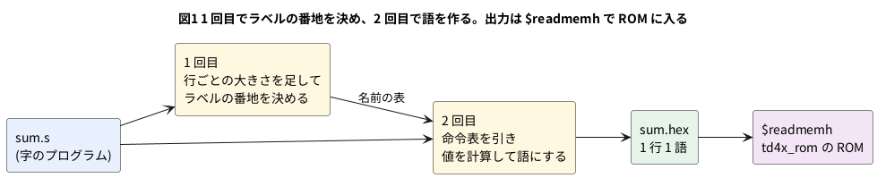

# 11-6 アセンブラを作る

この題は PC の Python と Verilator (と iverilog) だけで動かす。組まない題なので、実体配線図と Analog Discovery 3 は入れない。
オシロの代わりに、アセンブルしたプログラムを走らせた波形をロジックアナライザの画面の形に描く。

11-5 では、命令表を見ながら 16 進を手で書いた。8 命令でも、ジャンプ先の番地を数え直すのは面倒で、1 つずれると全部ずれる。
**アセンブラ**は、`JZ done` のような字の命令を機械語に直す道具である。ラベル (`done:`) の番地もアセンブラが数える。

この題では、Python で小さなアセンブラ `asm.py` を書く。

- **命令表を差し替える**作りにして、TD4 (5-8)・TD4X (11-5)・11-11 の 8 ビット CPU (`cpu8`)・11-10 の割り込み付き (`cpu8i`) の 4 つを扱う
- 出力は Verilog の `$readmemh` がそのまま読める 16 進 (1 行 1 語) にする
- 単体試験 (Python の `unittest`) を置き、出力を 11-5 の `td4x_rom` に読ませて、Verilator と iverilog で走らせて確かめる

## 書き方

```text
label:  命令 引数, 引数      ; 注釈
        .org  番地           ここから置く
        .db   値, 値, ...    1 語ずつ置く
        .equ  名前, 値       名前に値を付ける
```

- 値は 10 進 (`12`)・16 進 (`0x0C`)・2 進 (`0b1100`)・ラベル・`.equ` の名前と、それらを `+` と `-` でつないだもの
- 命令と引数の字は大文字でも小文字でもよい。レジスタの名前 (`A` `B`) はラベルにできない
- 負の数は 2 の補数にする。TD4 の `ADD B,-1` は `ADD B,15` と同じ語になる

## 2 回読む




ジャンプ先のラベルは、後ろに書いてあることが多い (`JZ done` のとき、`done:` はまだ読んでいない)。
そこで 1 回目は語を作らず、各行が何語になるかだけを足して、ラベルの番地を決める。2 回目で命令表を引いて語を作る。

## 命令表

命令表は「名前・引数の形・番号」の並びである。引数の形の `imm` は値 (即値か番地)、`A` `B` はその字そのものを表す。
`MOV A,B` と `MOV A,5` は名前も引数の数も同じだが、2 つめが `B` (レジスタの名前) か値かで別の命令になる。

| 命令表 | 1 語 | 命令の大きさ | メモリ | 題 |
| --- | --- | --- | --- | --- |
| `td4` | 8 ビット (上 4 が命令、下 4 が即値) | 1 語 | 16 語 | 5-8 |
| `td4x` | 同じ | 1 語 | 16 語 | 11-5 |
| `cpu8` | 8 ビット | 2 語 (命令 1 語 + 引数 1 語) | 256 語 | 11-11 |
| `cpu8i` | 同じ | 2 語 | 256 語 | 11-10 |

## Python

`asm.py`:

```python
#!/usr/bin/env python3
"""asm.py  小さな CPU のアセンブラ (11-6)。

命令表を差し替えて、TD4 (5-8)・TD4X (11-5)・cpu8 (11-11)・cpu8i (11-10) の 4 つを扱う。
出力は Verilog の $readmemh で読める 16 進 (1 行 1 語)。

    python3 asm.py --isa td4x sum.s -o sum.hex
    python3 asm.py --isa cpu8 mul.s --list

書き方 (1 行に 1 つ):
    label:  MNEMONIC 引数, 引数   ; 注釈
    .org  番地          ここから置く
    .db   値, 値, ...   1 語ずつ置く
    .equ  名前, 値      名前に値を付ける
値は 10 進・0x (16 進)・0b (2 進)・ラベル・.equ の名前と、それらの + と -。
"""
from __future__ import annotations

import argparse
import re
import sys
from dataclasses import dataclass

IMM = "imm"  # 引数の型: 値 (即値か番地)。ほかは "A" "B" のように、その字そのもの


@dataclass(frozen=True)
class Isa:
    """命令表。layout が "nibble" なら 1 語 = 上 4 ビットの命令 + 下 4 ビットの即値 (TD4)。
    "byte2" なら命令 1 語 + 引数 1 語の 2 語 (cpu8)。"""

    name: str
    mem_words: int
    layout: str
    table: tuple[tuple[str, tuple[str, ...], int], ...]

    @property
    def imm_bits(self) -> int:
        return 4 if self.layout == "nibble" else 8

    @property
    def size(self) -> int:
        return 1 if self.layout == "nibble" else 2

    def registers(self) -> set[str]:
        return {o for _, ops, _ in self.table for o in ops if o != IMM}


TD4_TABLE = (
    ("ADD", ("A", IMM), 0x0),
    ("MOV", ("A", "B"), 0x1),
    ("IN", ("A",), 0x2),
    ("MOV", ("A", IMM), 0x3),
    ("MOV", ("B", "A"), 0x4),
    ("ADD", ("B", IMM), 0x5),
    ("IN", ("B",), 0x6),
    ("MOV", ("B", IMM), 0x7),
    ("OUT", ("B",), 0x9),
    ("OUT", (IMM,), 0xB),
    ("JNC", (IMM,), 0xE),
    ("JMP", (IMM,), 0xF),
)
TD4X_EXTRA = (
    ("OUT", ("A",), 0x8),
    ("ADD", ("A", "B"), 0xA),
    ("JZ", (IMM,), 0xC),
    ("SUB", ("A", "B"), 0xD),
)
CPU8_TABLE = (
    ("NOP", (), 0x00),
    ("LDI", (IMM,), 0x01),
    ("LD", (IMM,), 0x02),
    ("ST", (IMM,), 0x03),
    ("ADD", (IMM,), 0x04),
    ("SUB", (IMM,), 0x05),
    ("ADDI", (IMM,), 0x06),
    ("SUBI", (IMM,), 0x07),
    ("AND", (IMM,), 0x08),
    ("OR", (IMM,), 0x09),
    ("XOR", (IMM,), 0x0A),
    ("SHL", (), 0x0B),
    ("SHR", (), 0x0C),
    ("JMP", (IMM,), 0x10),
    ("JZ", (IMM,), 0x11),
    ("JNZ", (IMM,), 0x12),
    ("JC", (IMM,), 0x13),
    ("JNC", (IMM,), 0x14),
    ("IN", (), 0x18),
    ("OUT", (), 0x19),
    ("HLT", (), 0x1F),
)
CPU8I_EXTRA = (
    ("EI", (), 0x20),
    ("DI", (), 0x21),
    ("RETI", (), 0x22),
)

ISAS = {
    "td4": Isa("td4", 16, "nibble", TD4_TABLE),
    "td4x": Isa("td4x", 16, "nibble", TD4_TABLE + TD4X_EXTRA),
    "cpu8": Isa("cpu8", 256, "byte2", CPU8_TABLE),
    "cpu8i": Isa("cpu8i", 256, "byte2", CPU8_TABLE + CPU8I_EXTRA),
}


class AsmError(Exception):
    """行の番号つきの誤り。"""

    def __init__(self, line_no: int, message: str):
        super().__init__(f"{line_no}: {message}")
        self.line_no = line_no
        self.message = message


@dataclass(frozen=True)
class Line:
    no: int          # 元の行の番号 (1 から)
    text: str        # 元の行から注釈 (; から後) を除いた字
    label: str | None
    op: str | None   # 命令か疑似命令 (大文字)
    args: tuple[str, ...]


@dataclass(frozen=True)
class Word:
    addr: int
    value: int
    line: Line


NAME_RE = re.compile(r"[A-Za-z_][A-Za-z0-9_]*$")
TOKEN_RE = re.compile(r"\s*([+-])?\s*([^+\-\s]+)")


def parse_line(no: int, raw: str) -> Line:
    code = raw.split(";", 1)[0].rstrip()
    text = code.strip()
    label = None
    if ":" in text:
        head, text = text.split(":", 1)
        head = head.strip()
        if not NAME_RE.match(head):
            raise AsmError(no, f"ラベルの名前にできない字です: {head!r}")
        label = head
        text = text.strip()
    if not text:
        return Line(no, code, label, None, ())
    parts = text.split(None, 1)
    op = parts[0].upper()
    args = tuple(a.strip() for a in parts[1].split(",")) if len(parts) > 1 else ()
    if any(a == "" for a in args):
        raise AsmError(no, "空の引数があります")
    return Line(no, code, label, op, args)


def parse_number(tok: str) -> int | None:
    t = tok.lower()
    try:
        if t.startswith("0x"):
            return int(t[2:], 16)
        if t.startswith("0b"):
            return int(t[2:], 2)
        if t.isdigit():
            return int(t, 10)
    except ValueError:
        return None
    return None


def evaluate(expr: str, symbols: dict[str, int], no: int) -> int:
    """値の式 (項を + と - でつないだもの) を計算する。"""
    pos, total, first = 0, 0, True
    expr = expr.strip()
    while pos < len(expr):
        m = TOKEN_RE.match(expr, pos)
        if not m or (m.group(1) is None and not first):
            raise AsmError(no, f"式が読めません: {expr!r}")
        sign = -1 if m.group(1) == "-" else 1
        tok = m.group(2)
        val = parse_number(tok)
        if val is None:
            if not NAME_RE.match(tok):
                raise AsmError(no, f"数でも名前でもありません: {tok!r}")
            if tok not in symbols:
                raise AsmError(no, f"定義されていない名前です: {tok}")
            val = symbols[tok]
        total += sign * val
        pos, first = m.end(), False
    if first:
        raise AsmError(no, "値がありません")
    return total


def fit(value: int, bits: int, no: int) -> int:
    """bits ビットに収める。負の数は 2 の補数にする (-1 → 全部 1)。"""
    lo, hi = -(1 << (bits - 1)), (1 << bits) - 1
    if not lo <= value <= hi:
        raise AsmError(no, f"値 {value} は {bits} ビットに入りません ({lo}〜{hi})")
    return value & ((1 << bits) - 1)


def match(isa: Isa, line: Line) -> tuple[int, tuple[str, ...]]:
    """命令表から、名前と引数の形が合う行を探す。(命令の番号, 値の引数) を返す。"""
    regs = isa.registers()
    names = {m for m, _, _ in isa.table}
    if line.op not in names:
        raise AsmError(line.no, f"知らない命令です: {line.op}")
    for mnem, pattern, code in isa.table:
        if mnem != line.op or len(pattern) != len(line.args):
            continue
        values = []
        for want, got in zip(pattern, line.args):
            if want == IMM:
                if got.upper() in regs:
                    break
                values.append(got)
            elif got.upper() != want:
                break
        else:
            return code, tuple(values)
    forms = [f"{m} {','.join(p)}".strip() for m, p, _ in isa.table if m == line.op]
    raise AsmError(line.no, f"{line.op} の引数の形が合いません。使える形: {' / '.join(forms)}")


def assemble(source: str, isa: Isa) -> tuple[list[Word], dict[str, int]]:
    """2 回読む。1 回目でラベルの番地を決め、2 回目で語を作る。"""
    lines = [parse_line(i + 1, raw) for i, raw in enumerate(source.splitlines())]
    regs = isa.registers()

    symbols: dict[str, int] = {}
    addr = 0
    for ln in lines:
        if ln.label is not None:
            if ln.label.upper() in regs:
                raise AsmError(ln.no, f"レジスタの名前はラベルにできません: {ln.label}")
            if ln.label in symbols:
                raise AsmError(ln.no, f"ラベルが 2 回定義されています: {ln.label}")
            symbols[ln.label] = addr
        if ln.op is None:
            continue
        if ln.op == ".ORG":
            if len(ln.args) != 1:
                raise AsmError(ln.no, ".org には値を 1 つ書きます")
            new = evaluate(ln.args[0], symbols, ln.no)
            if new < addr:
                raise AsmError(ln.no, f".org {new} は今の番地 {addr} より前です")
            addr = new
        elif ln.op == ".EQU":
            if len(ln.args) != 2 or not NAME_RE.match(ln.args[0]):
                raise AsmError(ln.no, ".equ は 名前, 値 と書きます")
            if ln.args[0].upper() in regs:
                raise AsmError(ln.no, f"レジスタの名前は .equ の名前にできません: {ln.args[0]}")
            if ln.args[0] in symbols:
                raise AsmError(ln.no, f"名前が 2 回定義されています: {ln.args[0]}")
            symbols[ln.args[0]] = evaluate(ln.args[1], symbols, ln.no)
        elif ln.op == ".DB":
            if not ln.args:
                raise AsmError(ln.no, ".db には値を 1 つ以上書きます")
            addr += len(ln.args)
        else:
            match(isa, ln)          # 1 回目でも知らない命令はここで止める
            addr += isa.size

    words: list[Word] = []
    addr = 0
    for ln in lines:
        if ln.op is None or ln.op == ".EQU":
            continue
        if ln.op == ".ORG":
            addr = evaluate(ln.args[0], symbols, ln.no)
            continue
        if ln.op == ".DB":
            for a in ln.args:
                words.append(Word(addr, fit(evaluate(a, symbols, ln.no), 8, ln.no), ln))
                addr += 1
            continue
        code, values = match(isa, ln)
        imm = fit(evaluate(values[0], symbols, ln.no), isa.imm_bits, ln.no) if values else 0
        if isa.layout == "nibble":
            words.append(Word(addr, (code << 4) | imm, ln))
        else:
            words.append(Word(addr, code, ln))
            words.append(Word(addr + 1, imm, ln))
        addr += isa.size

    for w in words:
        if w.addr >= isa.mem_words:
            raise AsmError(w.line.no, f"番地 {w.addr} はメモリ ({isa.mem_words} 語) の外です")
    return words, symbols


def to_image(words: list[Word], isa: Isa) -> list[int]:
    image = [0] * isa.mem_words
    for w in words:
        image[w.addr] = w.value
    return image


def to_readmemh(words: list[Word], isa: Isa, title: str) -> str:
    """$readmemh の形。メモリの全部の語を 1 行ずつ書き、各行の頭の語に元の行を注釈で添える。"""
    head: dict[int, Word] = {}
    seen: set[int] = set()
    for w in words:
        if w.line.no not in seen:
            seen.add(w.line.no)
            head[w.addr] = w
    out = [f"// {title}"]
    for addr, value in enumerate(to_image(words, isa)):
        w = head.get(addr)
        note = f" // {addr:02X}: {w.line.text.strip()}" if w else ""
        out.append(f"{value:02X}{note}")
    return "\n".join(out) + "\n"


def listing(words: list[Word]) -> str:
    """番地・語・元の行の表。2 語の命令 (cpu8) は 1 行にまとめる。"""
    rows, i = [], 0
    while i < len(words):
        w = words[i]
        if w.line.op != ".DB" and i + 1 < len(words) and words[i + 1].line is w.line:
            rows.append(f"{w.addr:02X}  {w.value:02X} {words[i + 1].value:02X}  {w.line.text}")
            i += 2
        else:
            rows.append(f"{w.addr:02X}  {w.value:02X}     {w.line.text}")
            i += 1
    return "\n".join(rows) + "\n"


def main(argv: list[str] | None = None) -> int:
    ap = argparse.ArgumentParser(description="小さな CPU のアセンブラ (11-6)")
    ap.add_argument("source")
    ap.add_argument("--isa", choices=sorted(ISAS), required=True)
    ap.add_argument("-o", "--output", help="$readmemh の 16 進を書くファイル (無ければ画面)")
    ap.add_argument("--list", action="store_true", help="番地・語・元の行の表を画面に出す")
    args = ap.parse_args(argv)
    isa = ISAS[args.isa]
    try:
        with open(args.source, encoding="utf-8") as f:
            source = f.read()
        words, _ = assemble(source, isa)
    except AsmError as e:
        print(f"{args.source}:{e.line_no}: {e.message}", file=sys.stderr)
        return 1
    except OSError as e:
        print(f"{args.source}: 読めません: {e.strerror}", file=sys.stderr)
        return 1
    text = to_readmemh(words, isa, f"asm.py --isa {isa.name} {args.source}")
    if args.list:
        sys.stdout.write(listing(words))
    if args.output:
        with open(args.output, "w", encoding="utf-8") as f:
            f.write(text)
    elif not args.list:
        sys.stdout.write(text)
    return 0


if __name__ == "__main__":
    sys.exit(main())
```

- 誤りは `AsmError` にまとめ、行の番号を付けて止める。画面には `ファイル:行: 何が悪いか` と出す (コンパイラと同じ形なので、エディタが行へ飛べる)
- 命令の大きさを `Isa.size` にまとめたので、1 回目のラベルの数え方は TD4 と cpu8 で同じコードで済む
- `$readmemh` のファイルは、メモリの全部の語を書く。足りない語を `00` で埋めておくと、シミュレータが「語が足りない」と言わない

## 単体試験

`test_asm.py` は 30 の試験を持つ。命令表の全部の命令、5-8 のプログラム A・B、11-5 の手書きの 16 進との一致、ラベルと疑似命令、
誤りの 9 通り、出力の形を確かめる。誤りの試験を抜き出す。

```python
class TestErrors(unittest.TestCase):
    def assert_error(self, src: str, isa, line_no: int, fragment: str):
        with self.assertRaises(asm.AsmError) as cm:
            asm.assemble(src, isa)
        self.assertEqual(cm.exception.line_no, line_no)
        self.assertIn(fragment, cm.exception.message)

    def test_unknown_mnemonic(self):
        self.assert_error("JMP 0\nFOO 1\n", TD4, 2, "知らない命令")

    def test_wrong_operand_form(self):
        self.assert_error("MOV B, B\n", TD4, 1, "引数の形")

    def test_immediate_out_of_range(self):
        self.assert_error("MOV A, 16\n", TD4, 1, "4 ビットに入りません")
        self.assert_error("LDI 256\n", CPU8, 1, "8 ビットに入りません")

    def test_undefined_label(self):
        self.assert_error("JMP nowhere\n", TD4, 1, "定義されていない")

    def test_duplicate_label(self):
        self.assert_error("x: JMP x\nx: JMP x\n", TD4, 2, "2 回")

    def test_register_name_as_label(self):
        # 引数は大文字・小文字を区別しないので、a も A と同じに扱う
        self.assert_error("a: JMP 0\n", TD4, 1, "レジスタの名前")
        self.assert_error(".equ B, 3\n", TD4, 1, "レジスタの名前")

    def test_program_too_big(self):
        self.assert_error("JMP 0\n" * 17, TD4, 17, "メモリ (16 語) の外")

    def test_org_backwards(self):
        self.assert_error(".org 4\nJMP 0\n.org 2\n", TD4, 3, "より前")

    def test_bad_expression(self):
        self.assert_error("MOV A, 1 2\n", TD4, 1, "式が読めません")

```

| 試験の組 | 数 | 確かめること |
| --- | --- | --- |
| `TestTd4` | 6 | 12 命令の語が 5-8 の命令表どおり。5-8 のプログラム A・B と同じ語。小文字・空白・負の数。TD4X の命令は `td4` では誤り |
| `TestTd4x` | 4 | 足した 4 命令の語。`sum.s` `cmp.s` が 11-5 の手書きの `sum.hex` `cmp.hex` と 16 語とも同じ |
| `TestLabelsAndDirectives` | 5 | 前と後ろのラベル、`.equ` と式、`.org` と `.db`、ラベルだけの行、名前の表 |
| `TestErrors` | 9 | 上の抜き出し |
| `TestCpu8` | 4 | 2 語の命令、全 21 命令の番号、`EI` `DI` `RETI` は `cpu8i` だけ、負の引数 |
| `TestOutput` | 2 | `$readmemh` の行の数と注釈、誤りのときの画面の出力と戻り値 |

## アセンブルするプログラム

11-5 の 2 本を字で書き直した `sum.s` と `cmp.s`。

```text
; sum.s  5+4+3+2+1 を A に足して OUT に出す (11-5 の 05-td4x-sum.hex と同じ機械語になる)
        MOV A, 0
        MOV B, 5
loop:   ADD A, B        ; A ← A + B
        ADD B, -1       ; B ← B - 1 (15 を足すのと同じ)。0 になればゼロフラグ
        JZ  done
        JMP loop
done:   OUT A
halt:   JMP halt
```

```text
; cmp.s  IN が LIMIT 以上なら OUT に 1、小さければ 0 (11-5 の 05-td4x-cmp.hex と同じ)
        .equ LIMIT, 5
start:  IN  A
        MOV B, LIMIT
        SUB A, B        ; 借りが無い (A >= LIMIT) なら桁上げが立つ
        JNC less
        OUT 1
        JMP start
less:   OUT 0
        JMP start
```

TD4 の 12 命令だけで書いた 2 本。`led.s` は 5-8 のプログラム A を字で書いた物、`timer.s` は B を 0 から 15 まで数えて OUT に出し、
桁上げで止まる物である。

```text
; led.s  5-8 のプログラム A (LED の点き方を 9 通り出して頭に戻る)。TD4 の 12 命令だけで書く
start:  OUT 0b0011
        OUT 0b0110
        OUT 0b1100
        OUT 0b1000
        OUT 0b1000
        OUT 0b1100
        OUT 0b0110
        OUT 0b0011
        OUT 0b0001
        JMP start
```

```text
; timer.s  OUT を 1 つずつ増やし、15 の次に桁上げで 0 へ戻るのを JNC で見分ける (TD4 の 12 命令)
;          B を OUT に出し、B に 1 を足す。桁上げが無ければ頭へ、有れば OUT を 0b1111 にして止まる
start:  OUT B
        ADD B, 1
        JNC start
        OUT 0b1111
halt:   JMP halt
```

`--list` で番地と語を見る。

```bash
python3 asm.py --isa td4x sum.s --list
python3 asm.py --isa td4x sum.s -o sum.hex
```

```text
00  30             MOV A, 0
01  75             MOV B, 5
02  A0     loop:   ADD A, B
03  5F             ADD B, -1
04  C6             JZ  done
05  F2             JMP loop
06  80     done:   OUT A
07  F7     halt:   JMP halt
```

11-5 で手で書いた `30 75 A0 5F C6 F2 80 F7` と同じ語になった。`sum.hex` の頭は次のとおり。

```text
// asm.py --isa td4x sum.s
30 // 00: MOV A, 0
75 // 01: MOV B, 5
A0 // 02: loop:   ADD A, B
5F // 03: ADD B, -1
```

誤りのあるプログラムでは、行の番号と理由を出して止まる (戻り値 1)。

```text
bad.s:1: 値 16 は 4 ビットに入りません (-8〜15)
bad.s:2: 定義されていない名前です: strat
bad.s:1: ADD の引数の形が合いません。使える形: ADD A,imm / ADD B,imm
```

3 行目は、TD4X の `ADD A,B` を `--isa td4` でアセンブルしたときの物である。

## ROM に読ませて走らせる

試験台 `tb_asm.v` は、11-5 の `td4x_rom` に `+rom=` でファイルを読ませ、決めたクロック数だけ走らせて OUT を確かめる。
TD4X は TD4 の 12 命令をそのまま含むので、`td4` でアセンブルした `led.s` `timer.s` も同じ回路で走る。

```verilog
// tb_asm.v  アセンブラの出力 (.hex) を td4x_rom (11-5) に読ませて走らせる (11-6)
//   +rom=<.hex>  読ませるファイル        +in=<0〜15>     入力ポート
//   +cycles=<N>  走らせるクロック数      +expect=<0〜15> 最後の OUT
//   +seq=<16 進の字の並び>  1 クロックごとの OUT の並び (先頭から。書けば突き合わせる)
//   +vcd         波形を asm.vcd に残す
`timescale 1us/1ns
module tb_asm;
    reg        clock = 0;
    reg        reset_n = 1;
    reg  [3:0] in_port = 0;
    wire [3:0] pc, out_port;
    wire [7:0] op;
    wire       fc, fz;
    td4x_rom #(.ROMFILE("none.hex")) dut (.clock(clock), .reset_n(reset_n), .in_port(in_port),
        .pc_out(pc), .op(op), .out_port(out_port), .flag_c(fc), .flag_z(fz));

    integer        cycles, expect_out, in_val, i, nseq, ng;
    reg [8*64-1:0] seq;
    reg [7:0]      ch;
    reg [3:0]      want;

    initial begin
        ng = 0;
        if (!$value$plusargs("cycles=%d", cycles)) cycles = 32;
        if (!$value$plusargs("in=%d", in_val)) in_val = 0;
        if (!$value$plusargs("expect=%d", expect_out)) expect_out = -1;
        seq = 0;
        nseq = 0;
        if ($value$plusargs("seq=%s", seq))
            for (i = 0; i < 64; i = i + 1) if (seq[8*i +: 8] != 8'd0) nseq = i + 1;
        in_port = in_val[3:0];
        if ($test$plusargs("vcd")) begin
            $dumpfile("asm.vcd");
            $dumpvars(0, tb_asm);
        end
        #1 reset_n = 0;
        #4 reset_n = 1;
        #5;
        for (i = 0; i < cycles; i = i + 1) begin
            clock = 1; #5; clock = 0; #5;
            if (i < nseq) begin
                ch = seq[8*(nseq-1-i) +: 8];             // 左の字が 1 クロック目
                want = (ch >= "a") ? ch - "a" + 10 : (ch >= "A") ? ch - "A" + 10 : ch - "0";
                if (out_port !== want) begin
                    $display("  %0d クロック目の OUT = %h (期待 %h)", i + 1, out_port, want);
                    ng = ng + 1;
                end
            end
        end
        if (expect_out >= 0 && out_port !== expect_out[3:0]) ng = ng + 1;
        $display("%0d クロック後: PC = %0d、OUT = %0d%s", cycles, pc, out_port,
                 (ng == 0) ? "  PASS" : "  FAIL");
        $finish;
    end
endmodule
```

## 動かす

```bash
cd 06-fpga/11-cpu/sim
sh 06-asm-run.sh
```

`06-asm-run.sh` は、単体試験 → 4 本のアセンブル → 試験台を Verilator と iverilog で組む → 6 通りを両方で走らせる、を順に行う。
本文の `asm.py` `test_asm.py` `tb_asm.v` と 4 本の `.s` は、sim の置き場では `06-` を頭に付けた名前で置いた。

```text
Ran 30 tests in 0.003s

OK
sum.s            (verilator): 30 クロック後: PC = 7、OUT = 15  PASS
sum.s            (iverilog): 30 クロック後: PC = 7、OUT = 15  PASS
cmp.s  IN=3      (verilator): 6 クロック後: PC = 0、OUT = 0  PASS
cmp.s  IN=3      (iverilog): 6 クロック後: PC = 0、OUT = 0  PASS
cmp.s  IN=5      (verilator): 6 クロック後: PC = 0、OUT = 1  PASS
cmp.s  IN=5      (iverilog): 6 クロック後: PC = 0、OUT = 1  PASS
cmp.s  IN=12     (verilator): 6 クロック後: PC = 0、OUT = 1  PASS
cmp.s  IN=12     (iverilog): 6 クロック後: PC = 0、OUT = 1  PASS
led.s  (5-8 の A) (verilator): 20 クロック後: PC = 0、OUT = 1  PASS
led.s  (5-8 の A) (iverilog): 20 クロック後: PC = 0、OUT = 1  PASS
timer.s          (verilator): 52 クロック後: PC = 4、OUT = 15  PASS
timer.s          (iverilog): 52 クロック後: PC = 4、OUT = 15  PASS
PASS (全部)
```

- `led.s` は 20 クロックの OUT の並びを `+seq=36C88C631136C88C6311` と突き合わせた。5-8 で見た 3・6・C・8・8・C・6・3・1・1 の 2 巡である
- `timer.s` は 1 クロックごとの OUT を `+seq=000111…FFFFF` (50 字) と突き合わせた。`+seq` や `+expect` をわざと違えると `FAIL` になることも確かめた

## シミュレーションの波形

`timer.s` を `+vcd` を付けて走らせ、VCD を読んでロジックアナライザの画面と同じ形に描いた (シミュレーションの値)。
クロックの 10 µs (マイクロ秒) は試験台で決めた値。

```logic
# ロジックアナライザの画面 (tommie-fence の logic フェンス)
title: 図2 timer.s は 3 クロックで OUT を 1 増やし、15 の次の桁上げで止まる
device: generic
time: 60us/div
signals:
  CLK: edges 0s=0 10us=1 15us=0 20us=1 25us=0 30us=1 35us=0 40us=1 45us=0 50us=1 55us=0 60us=1 65us=0 70us=1 75us=0 80us=1 85us=0 90us=1 95us=0 100us=1 105us=0 110us=1 115us=0 120us=1 125us=0 130us=1 135us=0 140us=1 145us=0 150us=1 155us=0 160us=1 165us=0 170us=1 175us=0 180us=1 185us=0 190us=1 195us=0 200us=1 205us=0 210us=1 215us=0 220us=1 225us=0 230us=1 235us=0 240us=1 245us=0 250us=1 255us=0 260us=1 265us=0 270us=1 275us=0 280us=1 285us=0 290us=1 295us=0 300us=1 305us=0 310us=1 315us=0 320us=1 325us=0 330us=1 335us=0 340us=1 345us=0 350us=1 355us=0 360us=1 365us=0 370us=1 375us=0 380us=1 385us=0 390us=1 395us=0 400us=1 405us=0 410us=1 415us=0 420us=1 425us=0 430us=1 435us=0 440us=1 445us=0 450us=1 455us=0 460us=1 465us=0 470us=1 475us=0 480us=1 485us=0 490us=1 495us=0 500us=1 505us=0 510us=1 515us=0 520us=1 525us=0
  RST_N: edges 0s=1 1us=0 5us=1
  PC2: edges 0s=0 490us=1
  PC1: edges 0s=0 20us=1 30us=0 50us=1 60us=0 80us=1 90us=0 110us=1 120us=0 140us=1 150us=0 170us=1 180us=0 200us=1 210us=0 230us=1 240us=0 260us=1 270us=0 290us=1 300us=0 320us=1 330us=0 350us=1 360us=0 380us=1 390us=0 410us=1 420us=0 440us=1 450us=0 470us=1 490us=0
  PC0: edges 0s=0 10us=1 20us=0 40us=1 50us=0 70us=1 80us=0 100us=1 110us=0 130us=1 140us=0 160us=1 170us=0 190us=1 200us=0 220us=1 230us=0 250us=1 260us=0 280us=1 290us=0 310us=1 320us=0 340us=1 350us=0 370us=1 380us=0 400us=1 410us=0 430us=1 440us=0 460us=1 470us=0 480us=1 490us=0
  C: edges 0s=0 470us=1 480us=0
  OUT3: edges 0s=0 250us=1
  OUT2: edges 0s=0 130us=1 250us=0 370us=1
  OUT1: edges 0s=0 70us=1 130us=0 190us=1 250us=0 310us=1 370us=0 430us=1
  OUT0: edges 0s=0 40us=1 70us=0 100us=1 130us=0 160us=1 190us=0 220us=1 250us=0 280us=1 310us=0 340us=1 370us=0 400us=1 430us=0 460us=1
buses:
  PC: PC2..PC0 hex
  OUT: OUT3..OUT0 hex
cursors: [45us, 465us]
```


## 見るべき値 (シミュレーションを実行して得た値)

| 測る所 | 見るべき値 | 分かること |
| --- | --- | --- |
| `sum.s` の語 | `30 75 A0 5F C6 F2 80 F7` | 11-5 の手書きと同じ。ラベルの番地をアセンブラが数えた |
| `cmp.s` の語 | `20 75 D0 E6 B1 F0 B0 F0` | `.equ LIMIT, 5` が即値に入った |
| 図2の X1 (45 µs) | OUT = 1、PC = 1 | 4 クロック目の `OUT B` で 1 が出た |
| 図2の X2 (465 µs) | OUT = 0xF、ΔX = 420 µs = 42 クロック | 1 増えるのに 3 命令 (`OUT B` `ADD B,1` `JNC`) × 14 回 |
| 図2の C | 470〜480 µs だけ 1 | 15 + 1 で桁上げが出て、`JNC` が飛ばずに抜けた |
| 図2の PC | 490 µs から 4 のまま | `JMP halt` で止まった |

## シミュレーションでの確かめ

Python 3.12・Verilator 5.042・iverilog 12 で `sim/06-asm-run.sh` を走らせた。
置き場は `sim/06-asm.py` `sim/06-asm-test.py` `sim/06-asm-tb.v` と `sim/06-td4x-sum.s` `sim/06-td4x-cmp.s` `sim/06-td4-led.s` `sim/06-td4-timer.s`
(走らせる回路は `sim/05-td4x.v`)。

| 項目 | 本文の数字 | 実行結果 | 判定 |
| --- | --- | --- | --- |
| 単体試験 | 30 件 | `Ran 30 tests` `OK` | 合った |
| `sum.s` `cmp.s` と 11-5 の手書き | 16 語とも同じ | 単体試験の 2 件が通った | 合った |
| 誤りの出力 | 行の番号と理由 | 本文の 3 行 | 合った |
| Verilator / iverilog での 6 通り | すべて PASS | すべて PASS (12 回) | 合った |
| わざと違えた `+seq` `+expect` | FAIL になる | `5 クロック目の OUT = 8 (期待 9)` と出て FAIL | 合った |
| 図2の波形 | OUT が 40 µs から 30 µs ごとに 1 増え、460 µs で F、C は 470〜480 µs | 同じ | 合った |

アセンブラは PC の Python で動く道具なので、実機の確かめは無い。

## 出典

自作。2 回読んでラベルを解くアセンブラは、アセンブラの定番の作り方である。
`$readmemh` の形 (16 進を空白か改行で区切り、`//` から後は注釈) は IEEE 1364 の Verilog の規格による。

参考: [アセンブラ (Wikipedia)](https://ja.wikipedia.org/wiki/アセンブラ)
