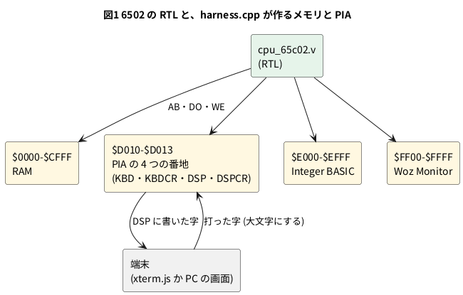

# 11-7 6502 を読む — Apple-I の wozmon を動かす

この題は実体配線図と Analog Discovery 3 の図を付けない。ブラウザと PC の中で動く題で、組む物が無いから。

> [!NOTE]
> この題の数は、soft-fpga の 04-6502 を PC にビルドし、自分で合否を言う試験台 (`sim/07-wozmon-tb.cpp`) で取った。
> ブラウザ版 ([04-6502](https://tommie-jp.github.io/soft-fpga/04-6502/)) は、開くと端末に `\` が出るところまでを確かめた。
> 打ち込みと実行は PC だけで確かめた。

4-11 では、6502 の RTL が 1 命令を何クロックで進め、バスに何を出すかを数えた。
この題では一段上がって、**256 バイトのプログラム Woz Monitor (wozmon) が、キーボードと画面をどう扱っているか**を、同じ RTL のバスから読む。
wozmon は Steve Wozniak が 1976 年に Apple-1 のために書いたモニタで、電源を入れると `\` を出し、16 進でメモリを見る・書く・実行する。
11-8 の Integer BASIC も、この wozmon から `E000R` で起こす。

## Apple-I のメモリの並び

soft-fpga の `harness.cpp` は、64 KB の配列 1 つで Apple-I のメモリを作る。
6502 から見ると、次のように並ぶ。




- RAM は実物の Apple-I (4 KB か 8 KB) より広い。`harness.cpp` は $0000〜$CFFF をすべて RAM にしている
- **PIA** (Peripheral Interface Adapter、Motorola の 6820) は、実物ではキーボードと画面の回路をつなぐ IC。
  `harness.cpp` は 4 つの番地だけを真似る
- ROM の 2 つは、`harness.cpp` に C の配列として入っている。この題では ROM のバイト列を写さない。バスに出た値を読むだけにする

PIA の 4 つの番地は、wozmon と BASIC が次のように使う (soft-fpga の `docs/04-6502/52-メモリマップ.md` と、下で取ったバスの値から)。

| 番地 | 名前 | 読むと | 書くと |
| --- | --- | --- | --- |
| $D010 | KBD | 打った字。最上位ビットが 1 | (使わない) |
| $D011 | KBDCR | ビット 7 が 1 なら字がある。KBD を読むと 0 に戻る | 初めに 1 回設定を書く |
| $D012 | DSP | ビット 7 が 1 なら画面が字を受けている最中 | 最上位ビットを 1 にした字を書くと画面に出る |
| $D013 | DSPCR | (使わない) | 初めに 1 回設定を書く |

Apple-I の字は ASCII の最上位ビットを 1 にした値で扱う。`\` (ASCII で $5C) は $DC、CR ($0D) は $8D になる。

## wozmon がしていること

wozmon は大きく 4 つの部分に分けて読める。名前は soft-fpga の `docs/04-6502/52-メモリマップ.md` (Apple-1 Operation Manual の掲載のリストから) による。

| 部分 | 番地 | すること |
| --- | --- | --- |
| RESET | $FF00 | リセットのベクタ ($FFFC・$FFFD) が指す入口。PIA に設定を書き、`\` を出して 1 行を待つ |
| 1 行を読む | (RESET の続き) | KBDCR を読み続けて字を待つ。来た字を ECHO で画面に返し、CR まで $0200 からの入力バッファにためる |
| 行を解く | (同上) | 16 進の数と `.` `:` `R` を左から読む。`XXXX` は 1 バイトを見る、`XXXX.YYYY` は範囲を見る、`XXXX: BB BB …` は書く、`XXXXR` は実行する |
| ECHO | $FFEF | A の字を DSP に書く。DSP のビット 7 が 0 になるまで待ってから書く |

ここからは、このうち **字を待つ所**と**字を出す所 (ECHO)** を、RTL のバスで見る。

## 試験台 — C++ で wozmon と話す

soft-fpga の `examples/04-6502/cxx/harness.cpp` をそのまま使い、`main` だけを書く (4-11 と同じ組み方)。
ハーネスは `send_key()` で打った字を KBD に入れ、DSP に書かれた字を `get_display_char()` で返す。
`step()` 1 回が 6502 の 1 クロック。

```cpp
// 11-7 の試験台。soft-fpga の examples/04-6502/cxx/harness.cpp をそのまま使い、
// Woz Monitor (wozmon) を 6502 の RTL で動かして、次を自分で確かめる。
//   1. リセットから '\' のプロンプトが出る (何クロック目か)
//   2. キーを待つ間、$D011 (KBDCR) を何クロックごとに読むか
//   3. '\' を出すとき、$D012 (DSP) へ何を書くか
//   4. 自分で打ち込んだプログラムが動いて HELLO を出す
// 終わりに PASS か FAIL: n を出す。
#include <cstdint>
#include <cstdio>
#include <string>
#include <vector>

extern "C" {
void      sim_init();
void      step();
void      send_key(uint8_t ch);
int       get_display_char();
uint32_t  get_cycles();
uint32_t* get_ring_ptr();
uint32_t  get_head();
int       get_ring_size();
}

static int         errors = 0;
static std::string screen;  // 端末に出た字 (0x7F は捨てる)

static void check(bool ok, const char* what) {
    printf("%s %s\n", ok ? "ok" : "NG", what);
    if (!ok) ++errors;
}

// n クロック進め、出た字を screen に足す
static void run(long n) {
    for (long i = 0; i < n; ++i) {
        step();
        for (int ch; (ch = get_display_char()) >= 0;)
            if (ch != 0x7F) screen += (char)ch;
    }
}

// want が screen に現れるまで回す。現れたクロック数を返す (現れなければ -1)
static long run_until(const std::string& want, long limit) {
    const size_t from = screen.size();
    for (long i = 0; i < limit; ++i) {
        run(1);
        if (screen.find(want, from) != std::string::npos) return (long)get_cycles();
    }
    return -1;
}

static void type(const std::string& s) {
    for (char c : s) send_key((uint8_t)c);
}

// リングバッファの直近 n サンプルの Word0 (AB・DB・WE・SYNC)
static std::vector<uint32_t> last_samples(int n) {
    const uint32_t* ring = get_ring_ptr();
    const uint32_t  mask = (uint32_t)get_ring_size() - 1;
    std::vector<uint32_t> v;
    for (int k = n; k >= 1; --k) v.push_back(ring[((get_head() - k) & mask) * 2]);
    return v;
}

int main() {
    sim_init();

    // 1. '\' のプロンプト
    const long prompt_at = run_until("\\\n", 100000);
    printf("prompt '\\' at cycle %ld\n", prompt_at);
    check(prompt_at > 0, "wozmon prints '\\' and a new line after reset");

    // 3. '\' を出したクロックを探す: WE = 1 で addr = $D012
    sim_init();
    screen.clear();
    long dsp_write_cycle = -1;
    uint8_t dsp_data = 0;
    for (long i = 0; i < 1000 && dsp_write_cycle < 0; ++i) {
        run(1);
        const uint32_t w = last_samples(1)[0];
        const uint8_t  data = (w >> 16) & 0xFF;
        if (((w >> 24) & 1) && (w & 0xFFFF) == 0xD012 && (data & 0x80)) {
            dsp_write_cycle = (long)get_cycles();
            dsp_data = data;
        }
    }
    printf("first write to $D012 with bit7=1: cycle %ld data=%02X\n", dsp_write_cycle, dsp_data);
    run(4);
    printf("around the write (addr data we sync):");
    for (uint32_t w : last_samples(14))
        printf(" %04X/%02X%s%s", w & 0xFFFF, (w >> 16) & 0xFF, ((w >> 24) & 1) ? "W" : "", ((w >> 25) & 1) ? "*" : "");
    printf("\n");
    check(dsp_data == 0xDC, "the prompt is written to $D012 as $DC ('\\' + $80)");

    // 2. キー待ちのループ: 直近 21 クロックで $D011 を読んだクロックの間隔
    run(5000);
    const std::vector<uint32_t> s = last_samples(21);
    std::vector<int> at;
    for (int i = 0; i < (int)s.size(); ++i)
        if ((s[i] & 0xFFFF) == 0xD011 && !((s[i] >> 24) & 1)) at.push_back(i);
    printf("wait loop (21 clocks):");
    for (uint32_t w : s) printf(" %04X/%02X%s", w & 0xFFFF, (w >> 16) & 0xFF, ((w >> 25) & 1) ? "*" : "");
    printf("\n");
    bool every7 = at.size() >= 2;
    for (size_t k = 1; k < at.size(); ++k) every7 = every7 && (at[k] - at[k - 1] == 7);
    printf("reads of $D011: %zu, interval %d clocks\n", at.size(), at.size() >= 2 ? at[1] - at[0] : -1);
    check(every7, "the wait loop reads $D011 every 7 clocks (LDA abs 4 + BPL taken 3)");

    // 4. プログラムを打ち込んで走らせる
    //   0300: LDX #0 / LDA $0310,X / BEQ +6 / JSR $FFEF (ECHO) / INX / BNE -11 / JMP $FF00
    //   0310: "HELLO" と CR (最上位ビットを 1 にした Apple-I の字) と 0
    type("0300: A2 00 BD 10 03 F0 06 20 EF FF E8 D0 F5 4C 00 FF\r");
    run(300000);
    type("0310: C8 C5 CC CC CF 8D 00\r");
    run(300000);
    printf("--- store ---\n%s-------------\n", screen.c_str());
    // ':' の行は、書く前に番地と今の中身 (00) を 1 回出す
    check(screen.find("4C 00 FF\n\n0300: 00\n") != std::string::npos &&
              screen.find("8D 00\n\n0310: 00\n") != std::string::npos,
          "store lines are echoed and show the old byte (00)");

    screen.clear();
    type("0300.0316\r");
    run(300000);
    printf("--- dump ---\n%s------------\n", screen.c_str());
    check(screen == "0300.0316\n\n0300: A2 00 BD 10 03 F0 06 20"
                    "\n0308: EF FF E8 D0 F5 4C 00 FF\n0310: C8 C5 CC CC CF 8D 00\n",
          "the dump shows the same 23 bytes");

    screen.clear();
    type("0300R");
    run(300000);
    type("\r");
    const long cr_at = (long)get_cycles();
    const long h_at = run_until("H", 200000);
    const long done_at = run_until("\\\n", 200000);
    run(1000);
    printf("--- run ---\n%s-----------\n", screen.c_str());
    printf("CR typed at cycle %ld, 'H' at %ld (+%ld), back to '\\' at %ld (+%ld)\n", cr_at, h_at,
           h_at - cr_at, done_at, done_at - cr_at);
    check(screen == "0300R\n\n0300: A2HELLO\n\\\n", "0300R prints \"0300: A2\", HELLO and '\\'");

    if (errors == 0) printf("PASS\n");
    else             printf("FAIL: %d\n", errors);
    return errors == 0 ? 0 : 1;
}
```

- `0x7F` を捨てるのは、RESET が初めに DSP へ $7F を書くため (実物では PIA の設定。最上位ビットが 0 なので字ではない)。`harness.cpp` はこれも字として返す
- 打ち込むプログラムは 23 バイト。`$0310` からの字を 1 字ずつ ECHO ($FFEF) で出し、0 で止まって wozmon の入口 ($FF00) に戻る。
  ECHO の番地は、Apple-1 のプログラムが画面に字を出すときの決まった入口

| 番地 | バイト | 命令 | すること |
| --- | --- | --- | --- |
| $0300 | A2 00 | `LDX #$00` | X を 0 に |
| $0302 | BD 10 03 | `LDA $0310,X` | X 番目の字を読む |
| $0305 | F0 06 | `BEQ $030D` | 0 なら終わり |
| $0307 | 20 EF FF | `JSR $FFEF` | ECHO で 1 字出す |
| $030A | E8 | `INX` | 次の字へ |
| $030B | D0 F5 | `BNE $0302` | 戻る |
| $030D | 4C 00 FF | `JMP $FF00` | wozmon へ戻る (`\` が出る) |
| $0310 | C8 C5 CC CC CF 8D 00 | (字) | `HELLO`・CR・0 |

## 手順

### ブラウザで見る

1. [04-6502](https://tommie-jp.github.io/soft-fpga/04-6502/) を開く。端末に `\` が出る
2. 端末をクリックし、`0300: A2 00 BD 10 03 F0 06 20 EF FF E8 D0 F5 4C 00 FF` と打って Enter
3. `0310: C8 C5 CC CC CF 8D 00` と打って Enter
4. `0300.0316` と打って Enter。打ち込んだ 23 バイトが 8 バイトずつ出る
5. `0300R` と打って Enter。`0300: A2` の後に `HELLO` が出て、`\` に戻る
6. **Pause** を押し、Logic Analyzer の `addr` と `data` で、`$D011` を 7 クロックごとに読む並び (下の図 3) を探す

### PC で回す

soft-fpga を取ってきて (0-2)、RTL のサブモジュールを入れる (4-11 と同じ)。
上の C++ を `07-wozmon-tb.cpp` に保存し、ハーネスと一緒にビルドする。

```bash
git submodule update --init examples/04-6502/verilog/hoglet
SRC=examples/04-6502
verilator --cc --exe --build -j 8 --top-module apple1_top --prefix Vapple1_top \
  -Wno-CASEX -Wno-CASEINCOMPLETE -Wno-WIDTHEXPAND -Wno-WIDTHTRUNC -Wno-CASEOVERLAP \
  $SRC/verilog/apple1_top.v $SRC/verilog/hoglet/cpu_65c02.v $SRC/verilog/hoglet/ALU.v \
  $SRC/cxx/harness.cpp 07-wozmon-tb.cpp -o tb07
./obj_dir/tb07
```

```text
prompt '\' at cycle 79
ok wozmon prints '\' and a new line after reset
first write to $D012 with bit7=1: cycle 54 data=DC
around the write (addr data we sync): FFEF/FF FFF0/2C* FFF1/12 D012/D0 FFF2/00 FFF3/30* FFF4/FB FFF5/8D* FFF6/12 D012/DCW FFF7/00 FFF8/60* 01FB/00 01FC/00
ok the prompt is written to $D012 as $DC ('\' + $80)
wait loop (21 clocks): FF2D/10* FF2E/FB FF29/AD FF2A/AD* FF2B/11 D011/D0 FF2C/00 FF2D/10* FF2E/FB FF29/AD FF2A/AD* FF2B/11 D011/D0 FF2C/00 FF2D/10* FF2E/FB FF29/AD FF2A/AD* FF2B/11 D011/D0 FF2C/00
reads of $D011: 3, interval 7 clocks
ok the wait loop reads $D011 every 7 clocks (LDA abs 4 + BPL taken 3)
--- store ---
\
0300: A2 00 BD 10 03 F0 06 20 EF FF E8 D0 F5 4C 00 FF

0300: 00
0310: C8 C5 CC CC CF 8D 00

0310: 00
-------------
ok store lines are echoed and show the old byte (00)
--- dump ---
0300.0316

0300: A2 00 BD 10 03 F0 06 20
0308: EF FF E8 D0 F5 4C 00 FF
0310: C8 C5 CC CC CF 8D 00
------------
ok the dump shows the same 23 bytes
--- run ---
0300R

0300: A2HELLO
\
-----------
CR typed at cycle 1205058, 'H' at 1205973 (+915), back to '\' at 1206233 (+1175)
ok 0300R prints "0300: A2", HELLO and '\'
PASS
```

- 端末の改行は 1 字 (`harness.cpp` が CR を LF に替える)
- `XXXX: …` の行は、書く前に**その番地の今の中身を 1 回出す** (`0300: 00`)。書いた後の中身は、`0300.0316` で見て確かめる
- `0300R` は、実行の前に `0300: A2` (その番地の中身) を出してから飛ぶ。`HELLO` が同じ行に続くのはそのため
- 走り出してから `H` が出るまでのクロック数は、キーを読むときの位相で数クロック揺れる (手元の 2 回で 912 と 915)

## Logic に見えるはずの画面

PC で取ったバスを `logic` のフェンスで描く。4-11 と同じく、1 クロックを 1 ms と置いた仮の目盛。
アドレスは下位 8 ビットだけをバスにし、上位が $D0 (PIA の番地) のクロックだけ `PIA` のレーンを 1 にした (上位は、ほかのクロックでは $FF か $01)。sync は opcode が CPU に届くクロック (4-11 の「読み方」) で 1 になる。

### ECHO が `\` を書く

```logic
# ロジックアナライザの画面 (tommie-fence の logic フェンス)
title: 図2 ECHO は DSP を読んで空きを確かめ、$DC を書く
device: generic
window: 14ms
signals:
  CLK: dio0 clock 1kHz
  SYNC: dio1 edges 0s=0 1ms=1 2ms=0 5ms=1 6ms=0 7ms=1 8ms=0 11ms=1 12ms=0
  WE: dio2 edges 0s=0 9ms=1 10ms=0
  PIA: dio3 edges 0s=0 3ms=1 4ms=0 9ms=1 10ms=0
  A: dio4..dio11 counter on CLK rising sequence 0xEF 0xF0 0xF1 0x12 0xF2 0xF3 0xF4 0xF5 0xF6 0x12 0xF7 0xF8 0xFB 0xFC
  D: dio12..dio19 counter on CLK rising sequence 0xFF 0x2C 0x12 0xD0 0x00 0x30 0xFB 0x8D 0x12 0xDC 0x00 0x60 0x00 0x00
buses:
  addr: A7..A0 hex
  data: D7..D0 hex
cursors: [4.5ms, 9.5ms]
trigger: WE rising at 9ms
```


| 時刻 (ms) | addr | data | 何をしているか |
| --- | --- | --- | --- |
| 1〜4 | $FFF0・$FFF1・$D012・$FFF2 | 2C → 12 → D0 → **00** | `BIT $D012` (4 クロック)。DSP を読みに出し、その中身 00 が次のクロック (X1、4.5 ms) に届く |
| 5〜6 | $FFF3・$FFF4 | 30 → FB | `BMI` (2 クロック)。ビット 7 が 0 なので飛ばない |
| 7〜10 | $FFF5・$FFF6・**$D012**・$FFF7 | 8D → 12 → **DC** | `STA $D012` (4 クロック)。X2 (9.5 ms) で WE = 1、$DC (`\`) を書く |
| 11〜 | $FFF8・$01FB・$01FC | 60 → … | `RTS`。スタックから戻り先を読む |

### キーを待つ

```logic
# ロジックアナライザの画面 (tommie-fence の logic フェンス)
title: 図3 字が来るまで、$D011 を 7 クロックごとに読み続ける
device: generic
window: 14ms
signals:
  CLK: dio0 clock 1kHz
  SYNC: dio1 edges 0s=0 1ms=1 2ms=0 5ms=1 6ms=0 8ms=1 9ms=0 12ms=1 13ms=0
  PIA: dio3 edges 0s=0 3ms=1 4ms=0 10ms=1 11ms=0
  A: dio4..dio11 counter on CLK rising sequence 0x29 0x2A 0x2B 0x11 0x2C 0x2D 0x2E 0x29 0x2A 0x2B 0x11 0x2C 0x2D 0x2E
  D: dio12..dio19 counter on CLK rising sequence 0xAD 0xAD 0x11 0xD0 0x00 0x10 0xFB 0xAD 0xAD 0x11 0xD0 0x00 0x10 0xFB
buses:
  addr: A7..A0 hex
  data: D7..D0 hex
cursors: [3.5ms, 10.5ms]
trigger: SYNC rising at 1ms
```


- `LDA $D011` (opcode AD) が 4 クロック、`BPL $FF29` (opcode 10、飛び先は −5 = FB) が飛ぶので 3 クロック。1 周 7 クロック
- X1 と X2 の間 (7 ms) が 1 周。どちらも addr = $D011 で、次のクロックに届く中身は 00 (ビット 7 が 0 = 字が無い)
- 字が来ると KBDCR のビット 7 が 1 になり、`BPL` は飛ばずに次の `LDA $D010` (KBD) へ進む

## 見るべき値

soft-fpga の f89a885 の `examples/04-6502` (RTL はサブモジュール `verilog/hoglet` の 03951de) を、Verilator 5.042 で PC にビルドして試験台を回した (2026-10-15)。

| 見る所 | 値 | 種類 |
| --- | --- | --- |
| リセットから `\` を書くまで | 54 クロック (リセットの 8 クロックを除く) | 動かして確かめた |
| `\` の後の CR を書き終えるまで | 79 クロック | 動かして確かめた |
| `\` を書く値 | $DC ($5C + $80)、番地 $D012 | 動かして確かめた |
| キーを待つ 1 周 | 7 クロック (`LDA abs` 4 + `BPL` が飛んで 3) | 動かして確かめた |
| ECHO の 1 字 (BIT から STA まで) | 10 クロック (4 + 2 + 4) | 動かして確かめた |
| `0300R` の CR から `H` まで | 912〜915 クロック | 動かして確かめた |
| 実物の 1.023 MHz で 1 周 7 クロック | 6.84 µs (マイクロ秒) ごとに KBDCR を読む | 計算値 |

- 1 周 7 クロックは、キーを待つ間ずっと続く。1 秒間に約 14.6 万回 KBDCR を読む (1.023 MHz のとき、計算値)。割り込みを使わずに待つ (ポーリング) ので、CPU は字を待つ間ほかの仕事をしない。割り込みで待つ形は 11-10
- 実物の Apple-1 の画面は、1 字を出すのに時間がかかる (テレビの 1 コマに 1 字と言われる。確かめていない)。そのため ECHO は書く前に DSP のビット 7 を見る。
  `harness.cpp` の DSP はいつも 0 を返すので、図 2 の `BMI` は飛ばない。11-12 で UART に替えると、送っている最中は 1 を返し、`BMI` が飛んで待つ

## シミュレーションでの確かめ (対象外を含む)

soft-fpga の f89a885 の `examples/04-6502` に、サブモジュール `verilog/hoglet` (03951de) を取り、Verilator 5.042 で
本文の C++ (`sim/07-wozmon-tb.cpp`) をハーネスとビルドして走らせた。結果は `PASS` (6 項目すべて ok)。

| 項目 | 本文の数字 | 実行結果 | 判定 |
| --- | --- | --- | --- |
| `\` と改行が出る | リセットから 79 クロック | 79 | 合った |
| `\` を書くクロックと値 | 54 クロック目、$D012 に $DC | 同じ | 合った |
| 図 2 の 14 クロック | A と D の並び、SYNC は 1・5・7・11 ms、WE は 9 ms | 試験台の `around the write` と同じ | 合った |
| 図 3 の 14 クロック | 1 周 7 クロック、$D011 を読む | `wait loop` の 21 クロックと同じ並び (頭を $FF29 にそろえた) | 合った |
| 書いた 23 バイトを読み返す | 3 行のダンプ | 同じ | 合った |
| `0300R` | `0300: A2HELLO` と `\` | 同じ | 合った |
| 1.023 MHz での 6.84 µs と 14.6 万回 | 計算値 | 7 ÷ 1.023 MHz = 6.84 µs、1.023 MHz ÷ 7 = 14.6 万 | 合った (計算) |
| ブラウザでの打ち込み・Pause・Logic Analyzer | 手順のとおり | 開いて `\` が出るまでを見た。打ち込みは確かめていない | 対象外 |

## 出典

- 自作。例とハーネスは [tommie-jp/soft-fpga](https://github.com/tommie-jp/soft-fpga) の `examples/04-6502` (MIT)
- 6502 の RTL: サブモジュール `verilog/hoglet` = [tommie-jp/verilog-6502](https://github.com/tommie-jp/verilog-6502) (観測用の出力を足した版)。
  元は [hoglet67/verilog-6502](https://github.com/hoglet67/verilog-6502) の `cpu_65c02.v` で、Arlet Ottens の [verilog-6502](https://github.com/Arlet/verilog-6502) に David Banks と Ed Spittles が 65C02 の命令を足した物。
  ファイルの頭の条件は「この著作権表示を残せば、商用でも非商用でもどんな物に使ってもよい。無保証」
- Woz Monitor: Steve Wozniak 作 (1976)。リストは Apple Computer の Apple-1 Operation Manual (1976) に載っている。
  明示された使用許諾は見つけられなかった。この題では ROM のバイト列を写さず、soft-fpga の `harness.cpp` に入っている像
  (コメントによれば whscullin の apple1js から) を動かして、バスに出た値だけを載せた
- PIA の番地と wozmon の入口: soft-fpga の `docs/04-6502/50-wozmon-使い方.md` と `docs/04-6502/52-メモリマップ.md`
- 命令のクロック数: MOS Technology の MCS6500 Microcomputer Family Hardware Manual (1976) の付録 A。4-11 と同じ
