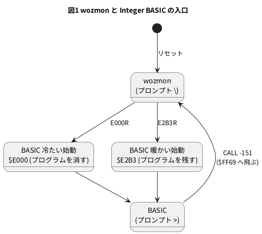

# 11-8 6502 で Integer BASIC を動かす

この題は実体配線図と Analog Discovery 3 の図を付けない。ブラウザと PC の中で動く題で、組む物が無いから。

> [!NOTE]
> この題の数は、soft-fpga の 04-6502 を PC にビルドし、自分で合否を言う試験台 (`sim/08-integer-basic-tb.cpp`) で取った。
> ブラウザ版 ([04-6502](https://tommie-jp.github.io/soft-fpga/04-6502/)) での打ち込みは確かめていない。

11-7 の wozmon から `E000R` と打つと、$E000 に置いた **Integer BASIC** が動き出し、プロンプト `>` を出す。
Steve Wozniak が 1976 年に Apple-1 のために書いた 4 KB の BASIC で、名前のとおり**整数 (16 ビット) しか扱わない**。
この題では、

1. BASIC を起こして `PRINT 2+3` を打ち、`5` が出るまでに 6502 が何クロック回るかを数える
2. 整数だけの計算と、Apple-1 の BASIC に特有の決まり (END が要る、NEW が無い) を確かめる
3. 打ち込んだ行がメモリにどう入るか (トークン) を、wozmon に戻ってメモリを見て読む
4. `FOR` を 1000 回まわす時間を数え、実物の 1.023 MHz と 11-12 の FPGA の 27 MHz での時間を出す

の 4 つをする。RTL・ハーネス・ビルドの仕方は 11-7 と同じ。

## BASIC と wozmon の行き来




- `CALL -151` は、16 ビットの番地 $FF69 を符号付きの整数で書いた物 (65 536 − 151 = 65 385 = $FF69)。wozmon の中の、1 行を読み直す所へ飛ぶ
- BASIC から wozmon に戻ってメモリを見たあと、`E2B3R` で戻ればプログラムは残っている。`E000R` だと消える
- 入口の番地は soft-fpga の `doAppleI-basic.sh` の使い方と `docs/04-6502/51-integer-BASIC-文法リファレンス.md` から。$E2B3 は下の試験台で確かめた

## 試験台 — BASIC に打ち込んで答えを確かめる

11-7 と同じく、soft-fpga の `harness.cpp` をそのまま使い、`main` だけを書く。
`line()` は 1 行を打ち、エコーが済んでから CR を送り、次の `>` が出るまで回す。CR から `>` までのクロック数も返す。

```cpp
// 11-8 の試験台。soft-fpga の examples/04-6502/cxx/harness.cpp をそのまま使い、
// Woz Monitor から E000R で Integer BASIC を起こして、次を自分で確かめる。
//   1. '>' のプロンプトが出る
//   2. PRINT 2+3 で 5 が出る (CR から何クロックか)
//   3. 整数だけの計算 (7/2・-7/2・32767+1)
//   4. END の無いプログラムは END ERR で止まる。消すのは NEW でなく SCR
//   5. プログラムがメモリにどう入るか (トークンの並び)
//   6. FOR を 1000 回まわす時間 (クロック数)
// 終わりに PASS か FAIL: n を出す。
#include <cstdint>
#include <cstdio>
#include <string>

extern "C" {
void     sim_init();
void     step();
void     send_key(uint8_t ch);
int      get_display_char();
uint32_t get_cycles();
uint32_t* get_ring_ptr();
uint32_t  get_head();
int       get_ring_size();
}

static int         errors = 0;
static std::string screen;

static void check(bool ok, const char* what) {
    printf("%s %s\n", ok ? "ok" : "NG", what);
    if (!ok) ++errors;
}

static void run(long n) {
    for (long i = 0; i < n; ++i) {
        step();
        for (int ch; (ch = get_display_char()) >= 0;)
            if (ch != 0x7F) screen += (char)ch;
    }
}

// want が (今から後に) 出るまで回し、出たときのクロック数を返す。出なければ -1
static long run_until(const std::string& want, long limit) {
    const size_t from = screen.size();
    for (long i = 0; i < limit; ++i) {
        run(1);
        if (screen.find(want, from) != std::string::npos) return (long)get_cycles();
    }
    return -1;
}

// 1 行打ち込み、CR を送ってから次のプロンプト '>' が出るまで回す。
// 出た字 (打ち込んだ字のエコーを除く) を返し、CR から '>' までのクロック数を *cycles に入れる
static std::string line(const std::string& s, long* cycles = nullptr, const char* prompt = "\n>") {
    for (char c : s) send_key((uint8_t)c);
    run_until(s, 4000000);                 // エコーが済むまで
    screen.clear();
    send_key('\r');
    const long cr_at = (long)get_cycles();
    const long end_at = run_until(prompt, 40000000);
    if (cycles) *cycles = end_at < 0 ? -1 : end_at - cr_at;
    return screen;
}

int main() {
    sim_init();
    check(run_until("\\\n", 100000) > 0, "wozmon prompt '\\'");

    // 1. E000R で BASIC へ
    check(line("E000R") == "\n\nE000: 4C\n>", "E000R starts Integer BASIC and prints '>'");

    // 2. PRINT 2+3
    long c = 0;
    const std::string r = line("PRINT 2+3", &c);
    printf("PRINT 2+3 -> \"%s\" (%ld clocks from CR to '>')\n", r.c_str(), c);
    check(r == "\n5\n\n>", "PRINT 2+3 prints 5");
    screen.clear();
    send_key('P'); send_key('R'); send_key('I'); send_key('N'); send_key('T');
    send_key(' '); send_key('2'); send_key('+'); send_key('3');
    run_until("2+3", 4000000);
    send_key('\r');
    const long cr_at = (long)get_cycles();
    const long five_at = run_until("5", 4000000);
    printf("PRINT 2+3: CR -> '5' %ld clocks\n", five_at - cr_at);

    // '5' ($B5) を書いたクロックの前後をリングバッファから出す。BASIC は $D012 でなく $D0F2 に書く
    run(400000);
    screen.clear();
    for (char ch : std::string("PRINT 2+3\r")) send_key((uint8_t)ch);
    const uint32_t* ring = get_ring_ptr();
    const uint32_t  mask = (uint32_t)get_ring_size() - 1;
    auto sample = [&](int k) { return ring[((get_head() - k) & mask) * 2]; };  // k = 1 が直近
    std::string trace;
    for (long i = 0; i < 4000000 && trace.empty(); ++i) {
        run(1);
        const uint32_t w = sample(1);
        if (((w >> 24) & 1) && (w & 0xFFFF) == 0xD0F2 && ((w >> 16) & 0xFF) == 0xB5) {
            run(2);
            char b[32];
            for (int k = 16; k >= 1; --k) {
                const uint32_t x = sample(k);
                snprintf(b, sizeof b, "%04X/%02X%s%s ", x & 0xFFFF, (x >> 16) & 0xFF,
                         ((x >> 24) & 1) ? "W" : "", ((x >> 25) & 1) ? "*" : "");
                trace += b;
            }
        }
    }
    run(400000);
    printf("around '5': %s\n", trace.c_str());
    check(trace == "E3D4/E6* 0024/24 0024/01 0024/02W E3D5/02 E3D6/2C* E3D7/F2 D0F2/D0 "
                   "E3D8/00 E3D9/30* E3DA/FB E3DB/8D* E3DC/F2 D0F2/B5W E3DD/00 E3DE/60* ",
          "'5' is written to $D0F2 after INC $24 and BIT $D0F2");

    // 3. 整数だけ
    check(line("PRINT 7/2") == "\n3\n\n>", "PRINT 7/2 prints 3 (integer division)");
    check(line("PRINT -7/2") == "\n-3\n\n>", "PRINT -7/2 prints -3 (truncates toward 0)");
    check(line("PRINT 32767+1") == "\n*** >32767 ERR\n>", "PRINT 32767+1 is an error (16-bit signed)");

    // 4. END の無いプログラム
    line("10 FOR I=1 TO 5");
    line("20 PRINT I*I;\" \";");
    line("30 NEXT I");
    line("40 PRINT");
    const std::string run1 = line("RUN");
    printf("RUN -> \"%s\"\n", run1.c_str());
    check(run1 == "\n1 4 9 16 25 \n*** END ERR\n>", "a program without END stops with END ERR");
    line("50 END");
    check(line("RUN") == "\n1 4 9 16 25 \n\n>", "with 50 END it ends normally");

    // 5. トークンの並び: SCR で消して 2 行だけにし、モニタへ戻ってメモリを見る。
    //    Apple-I の BASIC に NEW は無い (消すのは SCR)
    check(line("NEW") == "\n*** SYNTAX ERR\n>", "NEW is not a command (SYNTAX ERR)");
    line("SCR");
    line("10 PRINT 2+3");
    line("20 END");
    line("CALL -151", nullptr, "\\\n");    // モニタへ ('\' が出る)
    screen.clear();
    for (char ch : std::string("4C.4D\r")) send_key((uint8_t)ch);
    run(400000);
    printf("HIMEM: %s", screen.c_str());
    check(screen.find("004C: 00 10") != std::string::npos, "HIMEM ($4C,$4D) = $1000");
    screen.clear();
    for (char ch : std::string("CA.CB\r")) send_key((uint8_t)ch);
    run(400000);
    printf("PP: %s", screen.c_str());
    check(screen.find("00CA: EF 0F") != std::string::npos, "program pointer ($CA,$CB) = $0FEF");
    screen.clear();
    for (char ch : std::string("0FEF.0FFF\r")) send_key((uint8_t)ch);
    run(400000);
    printf("program bytes: %s", screen.c_str());
    check(screen.find("0FEF: 0C\n0FF0: 0A 00 62 B2 02 00 12 B3\n0FF8: 03 00 01 05 14 00 51 01") !=
              std::string::npos,
          "10 PRINT 2+3 / 20 END is stored as 17 bytes of tokens");

    // 6. 暖かい再始動 (E2B3) ならプログラムが残る
    check(line("E2B3R") == "\n\nE2B3: 20\n>", "E2B3R returns to BASIC");
    check(line("LIST") == "\n   10 PRINT 2+3\n   20 END \n\n>", "LIST shows the same program");

    // 7. FOR を 1000 回
    line("SCR");
    line("10 FOR I=1 TO 1000");
    line("20 NEXT I");
    line("30 END");
    long loop = 0;
    line("RUN", &loop);
    line("10 FOR I=1 TO 2000");
    long loop2 = 0;
    line("RUN", &loop2);
    printf("RUN FOR 1..1000: %ld clocks, FOR 1..2000: %ld clocks, per pass %.1f clocks\n", loop, loop2,
           (loop2 - loop) / 1000.0);
    check(loop > 0 && loop2 > loop, "the loop runs and returns to '>'");

    if (errors == 0) printf("PASS\n");
    else             printf("FAIL: %d\n", errors);
    return errors == 0 ? 0 : 1;
}
```

ビルドは 11-7 の `07-wozmon-tb.cpp` を `08-integer-basic-tb.cpp` に替えるだけ。

```bash
SRC=examples/04-6502
verilator --cc --exe --build -j 8 --top-module apple1_top --prefix Vapple1_top \
  -Wno-CASEX -Wno-CASEINCOMPLETE -Wno-WIDTHEXPAND -Wno-WIDTHTRUNC -Wno-CASEOVERLAP \
  $SRC/verilog/apple1_top.v $SRC/verilog/hoglet/cpu_65c02.v $SRC/verilog/hoglet/ALU.v \
  $SRC/cxx/harness.cpp 08-integer-basic-tb.cpp -o tb08
./obj_dir/tb08
```

```text
ok wozmon prompt '\'
ok E000R starts Integer BASIC and prints '>'
PRINT 2+3 -> "
5

>" (17356 clocks from CR to '>')
ok PRINT 2+3 prints 5
PRINT 2+3: CR -> '5' 17145 clocks
around '5': E3D4/E6* 0024/24 0024/01 0024/02W E3D5/02 E3D6/2C* E3D7/F2 D0F2/D0 E3D8/00 E3D9/30* E3DA/FB E3DB/8D* E3DC/F2 D0F2/B5W E3DD/00 E3DE/60*
ok '5' is written to $D0F2 after INC $24 and BIT $D0F2
ok PRINT 7/2 prints 3 (integer division)
ok PRINT -7/2 prints -3 (truncates toward 0)
ok PRINT 32767+1 is an error (16-bit signed)
RUN -> "
1 4 9 16 25
*** END ERR
>"
ok a program without END stops with END ERR
ok with 50 END it ends normally
ok NEW is not a command (SYNTAX ERR)
HIMEM: 4C.4D

004C: 00 10
ok HIMEM ($4C,$4D) = $1000
PP: CA.CB

00CA: EF 0F
ok program pointer ($CA,$CB) = $0FEF
program bytes: 0FEF.0FFF

0FEF: 0C
0FF0: 0A 00 62 B2 02 00 12 B3
0FF8: 03 00 01 05 14 00 51 01
ok 10 PRINT 2+3 / 20 END is stored as 17 bytes of tokens
ok E2B3R returns to BASIC
ok LIST shows the same program
RUN FOR 1..1000: 1270488 clocks, FOR 1..2000: 2530488 clocks, per pass 1260.0 clocks
ok the loop runs and returns to '>'
PASS
```

(行の終わりの空白は省いた。`1 4 9 16 25` と `around '5':` の行の終わりには空白が 1 つある)

## 打ってみて分かること

| 打った物 | 出た物 | 分かること |
| --- | --- | --- |
| `PRINT 2+3` | `5` | 即座に計算して出す (行番号の無い行は、その場で実行する) |
| `PRINT 7/2` | `3` | 割り算は整数。小数は捨てる |
| `PRINT -7/2` | `-3` | 負の数も 0 の側へ切り捨てる (−3.5 → −3) |
| `PRINT 32767+1` | `*** >32767 ERR` | 数は 16 ビットの符号付き (−32 767〜32 767)。あふれると誤りで止まる |
| `END` の無いプログラムを `RUN` | 結果の後に `*** END ERR` | **Apple-1 の BASIC はプログラムの終わりに `END` が要る**。最後の行から先へ落ちると誤りになる |
| `NEW` | `*** SYNTAX ERR` | プログラムを消す命令は `NEW` でなく `SCR` (scratch) |

後の Apple II の Integer BASIC や、多くの BASIC とは、`END` と `SCR` の 2 つが違う。

## 行はトークンになってメモリに入る

`10 PRINT 2+3` と `20 END` の 2 行を打ってから `CALL -151` で wozmon に戻り、メモリを見た。

- $4C・$4D に **HIMEM** (プログラムを置ける上限の次の番地) = $1000。Apple-1 の RAM 4 KB の上端
- $CA・$CB に **プログラムの先頭** = $0FEF。**プログラムは HIMEM から下へ向かって積む**
- $0FEF〜$0FFF の 17 バイトが 2 行ぶん

| 番地 | バイト | 意味 |
| --- | --- | --- |
| $0FEF | 0C | 行の長さ 12 バイト (この 1 バイトを含む) |
| $0FF0 | 0A 00 | 行番号 10 (下位バイトが先) |
| $0FF2 | 62 | `PRINT` (数を出す PRINT) |
| $0FF3 | B2 02 00 | 数 2。頭の B2 は数字 `2` の ASCII に $80 を足した印で、続く 2 バイトが値 $0002 |
| $0FF6 | 12 | `+` |
| $0FF7 | B3 03 00 | 数 3 |
| $0FFA | 01 | 行の終わり |
| $0FFB | 05 | 行の長さ 5 |
| $0FFC | 14 00 | 行番号 20 |
| $0FFE | 51 | `END` |
| $0FFF | 01 | 行の終わり |

- 命令の名前は 1 バイトの**トークン**に置き換えて入れる。`PRINT` の 5 字が 1 バイトになる。打った字のまま入れるより小さく、実行のたびに字を読み直さずに済む
- 数は打った時点で 2 進の 16 ビットに直して入れる。`RUN` のたびに 10 進を読み直さない
- `LIST` は逆に、トークンを名前に戻して出す。打った空白は残らない (`LIST` は行番号を右にそろえ、命令の間の空白を BASIC が決めた形で出す)
- 表のトークンの値 (62・12・51 など) は、このメモリを見て分かった値。手元の試験台で、ほかに `100 A=12345` が `09 64 00 C1 71 B1 39 30 01` になるのも見た
  (変数 `A` は ASCII に $80 を足した C1、代入の `=` は 71、12 345 = $3039)

## Logic に見えるはずの画面 — `5` を出す 16 クロック

`PRINT 2+3` の答え `5` を画面に出すところを、11-7 と同じ形で描く。1 クロックを 1 ms と置いた仮の目盛。アドレスは下位 8 ビットで、`PIA` のレーンは上位が $D0 のクロック (ほかは $E3 か $00)。

```logic
# ロジックアナライザの画面 (tommie-fence の logic フェンス)
title: 図2 BASIC は桁の数を 1 つ進めてから、$D0F2 を読んで空きを確かめ、$B5 を書く
device: generic
window: 16ms
signals:
  CLK: dio0 clock 1kHz
  SYNC: dio1 edges 0s=1 1ms=0 5ms=1 6ms=0 9ms=1 10ms=0 11ms=1 12ms=0 15ms=1
  WE: dio2 edges 0s=0 3ms=1 4ms=0 13ms=1 14ms=0
  PIA: dio3 edges 0s=0 7ms=1 8ms=0 13ms=1 14ms=0
  A: dio4..dio11 counter on CLK rising sequence 0xD4 0x24 0x24 0x24 0xD5 0xD6 0xD7 0xF2 0xD8 0xD9 0xDA 0xDB 0xDC 0xF2 0xDD 0xDE
  D: dio12..dio19 counter on CLK rising sequence 0xE6 0x24 0x01 0x02 0x02 0x2C 0xF2 0xD0 0x00 0x30 0xFB 0x8D 0xF2 0xB5 0x00 0x60
buses:
  addr: A7..A0 hex
  data: D7..D0 hex
cursors: [3.5ms, 13.5ms]
trigger: WE rising at 13ms
```


| 時刻 (ms) | addr | data | 何をしているか |
| --- | --- | --- | --- |
| 0〜4 | $E3D4・$0024 × 3・$E3D5 | E6 → 24 → 01 → **02** (X1、書く) | `INC $24` (5 クロック)。$24 は今の行の何桁目かを数える所。01 を読んで 02 を書く |
| 5〜8 | $E3D6・$E3D7・$D0F2・$E3D8 | 2C → F2 → D0 → 00 | `BIT $D0F2`。DSP を読み、ビット 7 = 0 (空き) |
| 9〜10 | $E3D9・$E3DA | 30 → FB | `BMI` が飛ばない |
| 11〜14 | $E3DB・$E3DC・**$D0F2**・$E3DD | 8D → F2 → **B5** (X2、書く) | `STA $D0F2`。`5` ($35 + $80 = $B5) を書く |
| 15 | $E3DE | 60 | `RTS` |

- **BASIC は DSP を $D012 でなく $D0F2 に書く**。Apple-1 の PIA は番地の A4 だけで選ばれていて ($D010〜$D0FF のうち A4 = 1 の番地はどれも同じ 4 つ)、$D0F2 も DSP になる。
  `harness.cpp` も `(addr & 0xFF10) == 0xD010` で PIA を選ぶ。11-12 で FPGA に載せるとき、$D012 だけを DSP にすると BASIC の字が出ない
- 字を出す形 (BIT → BMI → STA) は wozmon の ECHO (11-7 の図 2) と同じ

## 見るべき値

soft-fpga の f89a885 の `examples/04-6502` (RTL は 03951de) を Verilator 5.042 で PC にビルドして試験台を回した (2026-10-15)。

| 見る所 | 値 | 種類 |
| --- | --- | --- |
| `E000R` の後 | `E000: 4C` (その番地の中身) と `>` | 動かして確かめた |
| `PRINT 2+3` の CR から `5` を書くまで | 17 145 クロック | 動かして確かめた |
| `PRINT 2+3` の CR から次の `>` まで | 17 356 クロック | 動かして確かめた |
| 同じ時間を実物の 1.023 MHz で | 16.8 ms (`5` まで) | 計算値 |
| `FOR I=1 TO 1000 : NEXT I` の 1 回 | 1 260 クロック | 動かして確かめた (1000 回と 2000 回の差 ÷ 1000) |
| 同じ 1000 回 (`RUN` の CR から `>` まで) | 1 270 488 クロック | 動かして確かめた |
| 1000 回を 1.023 MHz で | 1.24 s | 計算値 |
| 1000 回を 27 MHz (11-12 の FPGA) で | 47.1 ms | 計算値 |
| HIMEM・プログラムの先頭 | $1000・$0FEF (2 行のとき) | 動かして確かめた |

- 1 回 1 260 クロックの中身は、`NEXT` の行を読む・`I` を探す・16 ビットの足し算・`TO` の値と比べる・`FOR` の行へ戻る。インタプリタは行を毎回読み直すので、機械語で書けば 10 クロックほどのループに 100 倍以上かかる (機械語の 10 クロックは見積り)
- 1000 回と 2000 回の差がちょうど 1 260 000 クロックだったので、1 回の時間は回数によらず一定。`I` が 1 桁から 4 桁に増えても変わらない (数は 2 進で持っているため)

## シミュレーションでの確かめ (対象外を含む)

soft-fpga の f89a885 の `examples/04-6502` に、サブモジュール `verilog/hoglet` (03951de) を取り、Verilator 5.042 で
本文の C++ (`sim/08-integer-basic-tb.cpp`) をハーネスとビルドして走らせた。結果は `PASS` (16 項目すべて ok、0.7 秒)。

| 項目 | 本文の数字 | 実行結果 | 判定 |
| --- | --- | --- | --- |
| `E000R` で `>` | `E000: 4C` と `>` | 同じ | 合った |
| `PRINT 2+3` | `5`、`5` まで 17 145 クロック、`>` まで 17 356 | 同じ | 合った |
| 整数だけの計算 | 3・−3・`*** >32767 ERR` | 同じ | 合った |
| END と SCR | `*** END ERR`、`NEW` は `*** SYNTAX ERR` | 同じ | 合った |
| トークン | $0FEF〜$0FFF の 17 バイト | 同じ | 合った |
| `E2B3R` で戻って `LIST` | 2 行が残る | 同じ | 合った |
| 図 2 の 16 クロック | A・D の並び、WE は 3 ms と 13 ms | 試験台の `around '5'` と同じ | 合った |
| `FOR` の 1 回 | 1 260 クロック | (2 530 488 − 1 270 488) ÷ 1000 = 1 260.0 | 合った |
| 1.023 MHz・27 MHz での時間 | 16.8 ms、1.24 s、47.1 ms | 17 145 ÷ 1.023 MHz = 16.76 ms、1 270 488 ÷ 1.023 MHz = 1.242 s、÷ 27 MHz = 47.06 ms | 合った (計算) |
| `100 A=12345` のトークン | `09 64 00 C1 71 B1 39 30 01` | 試験台を作る前の手元の打ち込みで見た (試験台には入れていない) | 合った (手で) |
| ブラウザでの打ち込み | 11-7 と同じ手順 | ブラウザが要る | 対象外 |

## 出典

- 自作。例とハーネスは [tommie-jp/soft-fpga](https://github.com/tommie-jp/soft-fpga) の `examples/04-6502` (MIT)。RTL の出所と条件は 11-7
- Integer BASIC (Apple-1 BASIC): Steve Wozniak 作 (1976)。Apple-1 にはカセットテープで配られ、$E000 に読み込んで使った。
  明示された使用許諾は見つけられなかった。この題では ROM のバイト列を写さず、soft-fpga の `harness.cpp` に入っている像
  (コメントによれば whscullin の apple1js の `js/roms/basic.ts` から) を動かして、画面とメモリに出た値だけを載せた
- 入口の番地 ($E000・$E2B3・`CALL -151`)・`SCR`・`END` の決まり: soft-fpga の `doAppleI-basic.sh` と `docs/04-6502/51-integer-BASIC-文法リファレンス.md`。どれも試験台で確かめた
- PIA の番地の選び方 (A4): soft-fpga の `examples/04-6502/cxx/harness.cpp` の `is_pia()` のコメント
