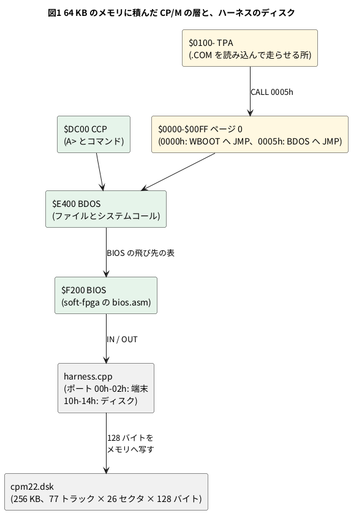

# 11-9 8080 で CP/M 2.2 を動かす

この題は実体配線図と Analog Discovery 3 の図を付けない。ブラウザと PC の中で動く題で、組む物が無いから。

> [!NOTE]
> この題の数は、soft-fpga の 06-8080 を PC にビルドし、自分で合否を言う試験台 (`sim/09-cpm22-tb.cpp`) で取った。
> ブラウザ版 ([06-8080](https://tommie-jp.github.io/soft-fpga/06-8080/)) では確かめていない。

4-12 では、CP/M が端末に 1 字を出すとき、8080 の `OUT` 命令がバスにどう出るかを見た。
この題では OS の全体を見る。**CP/M 2.2** は 1970 年代の 8080 と Z80 の機械で広く使われた OS で、次の 3 つの層でできている。

- **CCP** (Console Command Processor): `A>` を出してコマンドを読む。`DIR` `ERA` `SAVE` などはこの中にある
- **BDOS** (Basic Disk Operating System): ファイルの開け閉め・読み書き・1 字の入出力を、番号の付いた機能 (システムコール) として出す。プログラムは `CALL 0005h` で呼ぶ
- **BIOS** (Basic I/O System): 機械ごとに書き替える層。1 字の入出力と、ディスクの「トラック・セクタを決めて 128 バイトを読む」だけをする

CCP と BDOS はどの機械でも同じバイト列で、BIOS だけを書けば新しい機械で CP/M が動く。soft-fpga はこの BIOS を自分で書き (`sw/cpm/bios/bios.asm`)、I/O のポートをハーネスにつないでいる。

この題では、

1. CP/M を起こして `A>` が出るまでの T ステートとディスクの読みを数える
2. `DIR` が、どのトラック・セクタを、どの順で読むかを取る
3. 1 セクタを読むときの BIOS の I/O の並びを図にする
4. メモリに置いた 23 バイトの機械語を `SAVE` でファイルにし、名前で走らせる (自分の .COM を作る)

をする。

## メモリと層




- CCP と BDOS は合わせて 5 632 バイト ($DC00〜$F1FF)。起動のとき、ハーネスがファイル `rom/cpm22.bin` から RAM に置く (実物の機械ではディスクの先頭の 2 トラックから読む)
- BIOS は 762 バイト。$F200 から 3 バイトずつ 17 個の飛び先 (BOOT・WBOOT・CONST・CONIN・CONOUT・…・READ・WRITE・…・SECTRAN) が並ぶ (4-12)
- ディスクの像は 8 インチの片面単密度 (IBM 3740) と同じ並び。1 セクタ 128 バイト、1 トラック 26 セクタ、77 トラック

ディスクを読む BIOS の 5 つの入口は、どれもポートに 1 バイト出すだけ。

| BIOS の入口 | すること | ポート |
| --- | --- | --- |
| SETTRK | トラックを決める | `OUT 11h` |
| SETSEC | セクタを決める (0 から数える物理セクタ) | `OUT 12h` |
| SETDMA | 読んだ 128 バイトを置く番地 (DMA アドレス) を決める | `OUT 13h` (下位)、`OUT 14h` (上位) |
| READ | 読む。結果 (0 = 正常) を A に返す | `OUT 10h` に 0、続けて `IN 10h` |
| WRITE | 書く | `OUT 10h` に 1、続けて `IN 10h` |

ハーネスは `OUT 10h` を受けた瞬間に、ディスクの像の 128 バイトを DMA アドレスへ写す (`harness.cpp` の `handle_io()`)。
実物のフロッピーなら、ここでディスクが回ってくるのを待つ。

## 試験台 — CP/M を起こして DIR と SAVE を打つ

soft-fpga の `examples/06-8080/cxx/harness.cpp` をそのまま使い、`main` だけを書く (4-12 と同じ組み方)。
`step()` 1 回が soft-fpga の `clk` の 1 周期で、**1 T ステートは `step()` 2 回** (4-12)。
リングバッファの Word0 で `io_req` を見て、ポート 10h〜14h の IN と OUT を全部書き留める。

```cpp
// 11-9 の試験台。soft-fpga の examples/06-8080/cxx/harness.cpp をそのまま使い、
// 8080 の RTL (vm80a) で CP/M 2.2 を起こして、次を自分で確かめる。
//   1. 名乗りと A> のプロンプトが出る (何 T ステートか)
//   2. DIR で一覧が出る。その間にディスクのセクタを何回読むか
//   3. TPA ($0100) に置いた機械語を SAVE で .COM にし、名前で走らせる
// 使い方: tb09 <soft-fpga の examples/06-8080> <bios.bin>
// 終わりに PASS か FAIL: n を出す。
#include <cstdint>
#include <cstdio>
#include <string>
#include <vector>

extern "C" {
int       sim_init(const char* bios, const char* cpm, const char* dsk);
void      step();
void      send_key(uint8_t ch);
int       get_display_char();
uint32_t* get_ring_ptr();
uint32_t  get_head();
int       get_ring_words();
void      sim_poke(uint16_t addr, uint8_t val);
int       sim_get_disk_track();
int       sim_get_disk_sector();
uint16_t  sim_get_disk_dma();
}

static int         errors = 0;
static std::string screen;
static long        steps = 0;          // step() の数。1 T ステート = step() 2 回
static long        disk_reads = 0;     // OUT 10h に 0 (READ) を出した数
static long        disk_writes = 0;    // OUT 10h に 1 (WRITE) を出した数
static long        conout = 0;         // OUT 01h (CONOUT) の数
static std::vector<std::string> read_log;  // 読んだセクタ (トラック/セクタ→DMA)
struct IoEvent {
    long    step;
    bool    out;
    uint8_t port, data;
};
static std::vector<IoEvent> io_log;        // ディスクのポート (10h〜14h) の IN・OUT

static void check(bool ok, const char* what) {
    printf("%s %s\n", ok ? "ok" : "NG", what);
    if (!ok) ++errors;
}

static void run1() {
    step();
    ++steps;
    for (int ch; (ch = get_display_char()) >= 0;) screen += (char)ch;
    // Word0: [7:0] = io_addr、[23:16] = io_dout、[24] = io_req、[25] = io_wr (harness.cpp の冒頭の表)
    const uint32_t w0 = get_ring_ptr()[((get_head() - 1) & (4096 - 1)) * get_ring_words()];
    if ((w0 >> 24) & 1) {                    // io_req: IN か OUT
        const bool    out = (w0 >> 25) & 1;
        const uint8_t port = w0 & 0xFF;
        const uint8_t data = out ? (w0 >> 16) & 0xFF   // OUT は io_dout
                                 : (get_ring_ptr()[((get_head() - 1) & (4096 - 1)) * get_ring_words() + 1] >> 16) & 0xFF;  // IN は Word1 の io_din
        if (port >= 0x10 && port <= 0x14) io_log.push_back({steps, out, port, data});
    }
    if (((w0 >> 24) & 3) == 3) {
        const uint8_t port = w0 & 0xFF, data = (w0 >> 16) & 0xFF;
        if (port == 0x10 && data == 0) {
            ++disk_reads;
            char b[32];
            snprintf(b, sizeof b, "%d/%d->%04X", sim_get_disk_track(), sim_get_disk_sector(), sim_get_disk_dma());
            read_log.push_back(b);
        }
        if (port == 0x10 && data == 1) ++disk_writes;
        if (port == 0x01) ++conout;
    }
}

// want が今から後に出るまで回す。出たら true
static bool run_until(const std::string& want, long limit) {
    const size_t from = screen.size();
    for (long i = 0; i < limit; ++i) {
        run1();
        if (screen.find(want, from) != std::string::npos) return true;
    }
    return false;
}

// コマンドを 1 行打ち、次の "A>" が出るまで回す。出た字と、CR からの T ステートと読んだセクタ数を返す
struct Result {
    std::string text;
    long        t_states, reads, writes, chars;
};
static Result command(const std::string& s) {
    for (char c : s) send_key((uint8_t)c);
    run_until(s, 20000000);              // エコーが済むまで
    screen.clear();
    const long s0 = steps, r0 = disk_reads, w0 = disk_writes, c0 = conout;
    send_key('\r');
    run_until("A>", 200000000);
    return {screen, (steps - s0) / 2, disk_reads - r0, disk_writes - w0, conout - c0};
}

int main(int argc, char** argv) {
    if (argc < 3) {
        fprintf(stderr, "usage: tb09 <soft-fpga/examples/06-8080> <bios.bin>\n");
        return 2;
    }
    const std::string dir = argv[1];
    if (sim_init(argv[2], (dir + "/rom/cpm22.bin").c_str(), (dir + "/sw/cpm/disks/cpm22.dsk").c_str()))
        return 2;

    // 1. 名乗りと A>
    const bool booted = run_until("A>", 20000000);
    printf("--- boot ---\n%s\n------------\n", screen.c_str());
    printf("A> after %ld steps (%ld T states), %ld sector reads\n", steps, steps / 2, disk_reads);
    check(booted && screen.find("64K CP/M VERS 2.2") != std::string::npos, "CP/M 2.2 signs on and prints A>");

    // 2. DIR
    read_log.clear();
    io_log.clear();
    const Result d = command("DIR");
    printf("--- DIR ---\n%s\n-----------\n", d.text.c_str());
    printf("DIR: %ld T states, %ld sector reads, %ld writes, %ld chars out\n", d.t_states, d.reads, d.writes,
           d.chars);
    check(d.text.find("A: ") != std::string::npos, "DIR lists files (lines start with \"A: \")");
    check(d.reads > 0 && d.writes == 0, "DIR only reads the disk");
    printf("DIR reads (track/sector->DMA):");
    for (const std::string& r : read_log) printf(" %s", r.c_str());
    printf("\n");
    check(read_log.size() >= 2 && read_log[0] == "2/0->F377" && read_log[1] == "2/6->F377",
          "the directory is on track 2, sectors 0, 6, ... (skew 6) into DIR_BUF F377");

    // 2 つ目のセクタを読むときの I/O の並び: OUT 11h (トラック) から IN 10h (結果) まで
    std::string seq;
    int nread = 0;
    long t0 = -1;
    for (const IoEvent& e : io_log) {
        if (e.out && e.port == 0x11) { t0 = e.step; seq.clear(); }
        if (t0 < 0) continue;
        char b[40];
        snprintf(b, sizeof b, "%sT+%ld %s %02X=%02X", seq.empty() ? "" : ", ", (e.step - t0) / 2,
                 e.out ? "OUT" : "IN", e.port, e.data);
        seq += b;
        if (!e.out && e.port == 0x10 && ++nread == 2) break;
    }
    printf("2nd sector read: %s\n", seq.c_str());
    check(seq == "T+0 OUT 11=02, T+299 OUT 12=06, T+420 OUT 13=77, T+448 OUT 14=F3, T+519 OUT 10=00, T+528 IN 10=00",
          "one sector read is OUT 11h, 12h, 13h, 14h, 10h then IN 10h");

    // 3. 自分の .COM を作る。BDOS の 9 番 (文字列を $ まで出す) を呼んで戻るだけの 23 バイト
    //    0100: LXI D,0109h / MVI C,9 / CALL 0005h / RET / "HELLO, CP/M" CR LF '$'
    const uint8_t prog[] = {0x11, 0x09, 0x01, 0x0E, 0x09, 0xCD, 0x05, 0x00, 0xC9,
                            'H',  'E',  'L',  'L',  'O',  ',',  ' ',  'C',  'P',  '/', 'M', 0x0D, 0x0A, '$'};
    for (unsigned i = 0; i < sizeof prog; ++i) sim_poke((uint16_t)(0x0100 + i), prog[i]);
    const Result s = command("SAVE 1 HELLO.COM");
    printf("SAVE: %ld T states, %ld reads, %ld writes\n", s.t_states, s.reads, s.writes);
    check(s.writes > 0, "SAVE 1 HELLO.COM writes sectors");

    const Result h = command("HELLO");
    printf("--- HELLO ---\n%s\n-------------\n", h.text.c_str());
    printf("HELLO: %ld T states, %ld sector reads, %ld chars out\n", h.t_states, h.reads, h.chars);
    check(h.text.find("HELLO, CP/M\r\n") != std::string::npos, "HELLO.COM runs and prints HELLO, CP/M");

    const Result d2 = command("DIR HELLO.COM");
    check(d2.text.find("HELLO    COM") != std::string::npos, "DIR HELLO.COM finds the new file");

    if (errors == 0) printf("PASS\n");
    else             printf("FAIL: %d\n", errors);
    return errors == 0 ? 0 : 1;
}
```

- 作る .COM は BDOS の 9 番 (`$` までの文字列を出す) を呼んで戻るだけ。.COM は $0100 に読み込まれて $0100 から走り、`RET` で CCP に戻る
- `sim_poke()` は試験台からメモリに書く口。CP/M の `SAVE 1 HELLO.COM` は、**TPA の先頭 ($0100) から 1 ページ (256 バイト) をそのままファイルにする** CCP のコマンドなので、置いた 23 バイトがファイルになる
- 書き込みはハーネスのメモリの中のディスクの像にだけ入る。試験台はディスクの像をファイルに書き戻さないので、`cpm22.dsk` は変わらない

## 手順

### ブラウザで見る

1. [06-8080](https://tommie-jp.github.io/soft-fpga/06-8080/) を開く。名乗りと `A>` が出るまで待つ
2. 端末をクリックして `DIR` と打ち、Enter。ファイルの一覧が 4 つずつ並ぶ
3. 4-12 の Trigger を、種類 **On I/O**、`addr/port` に `10` で掛けてから `DIR` を打つと、セクタを読む `OUT 10h` で止まる

### PC で回す

soft-fpga を取ってきて (0-2)、RTL のサブモジュールを入れ、CCP+BDOS の像を作る (4-12 と同じ)。
BIOS は soft-fpga の `make -C examples/06-8080/sw/cpm` で作る (PC 用の名乗りで z80asm がアセンブルする)。

```bash
git submodule update --init examples/06-8080/verilog/vm80a
scripts/setup-cpm22.sh                # rom/cpm22.bin を z80pack から作る (MD5 を確かめる)
make -C examples/06-8080/sw/cpm       # sw/cpm/bios/bios.bin
SRC=examples/06-8080
verilator --cc --exe --build -j 8 --top-module cpm_top --prefix Vcpm_top \
  -Wno-WIDTHEXPAND -Wno-WIDTHTRUNC -Wno-UNOPTFLAT \
  $SRC/verilog/cpm_top.v $SRC/verilog/vm80a/org/rtl/vm80a.v \
  $SRC/cxx/harness.cpp 09-cpm22-tb.cpp -o tb09
./obj_dir/tb09 $SRC $SRC/sw/cpm/bios/bios.bin
```

```text
--- boot ---
64K CP/M VERS 2.2 for vm80a soft-FPGA Linux
BIOS (C) 2026 tommie.jp

A>
------------
A> after 626521 steps (313260 T states), 16 sector reads
ok CP/M 2.2 signs on and prints A>
--- DIR ---

A: MOVCPM   COM : SYSGEN   COM : CPM62    SYS : 8080EX1  COM
A: MAC      COM : TEST     COM : DUMMY    COM : 8080PRE  COM
A: DUMP     COM : STAT     COM : CLS      COM : XSUB     COM
A: PIP      COM : SUBMIT   COM : DDT      COM : ASM      COM
A: ED       COM : LOAD     COM : MBASIC   COM : MEMMAP   COM
A: R        COM : COPY     COM : SDIR     COM : HAMURABI BAS
A: SURVEY   COM : BLACKJCK BAS : CHECKERS BAS : MICRO80  COM
A: FORMAT   COM : AWARI    BAS : WM       HLP : XDIR     COM
A: WM       COM : KSCOPE   COM : VIEW     COM : BYE      COM
A: W        COM
A>
-----------
DIR: 993609 T states, 12 sector reads, 0 writes, 580 chars out
ok DIR lists files (lines start with "A: ")
ok DIR only reads the disk
DIR reads (track/sector->DMA): 2/0->F377 2/6->F377 2/12->F377 2/18->F377 2/24->F377 2/4->F377 2/10->F377 2/16->F377 2/22->F377 2/2->F377 2/8->F377 2/14->F377
ok the directory is on track 2, sectors 0, 6, ... (skew 6) into DIR_BUF F377
2nd sector read: T+0 OUT 11=02, T+299 OUT 12=06, T+420 OUT 13=77, T+448 OUT 14=F3, T+519 OUT 10=00, T+528 IN 10=00
ok one sector read is OUT 11h, 12h, 13h, 14h, 10h then IN 10h
SAVE: 208667 T states, 18 reads, 4 writes
ok SAVE 1 HELLO.COM writes sectors
--- HELLO ---

HELLO, CP/M

A>
-------------
HELLO: 62545 T states, 5 sector reads, 20 chars out
ok HELLO.COM runs and prints HELLO, CP/M
ok DIR HELLO.COM finds the new file
PASS
```

- ディスクの中身は soft-fpga の `sw/cpm/disks/cpm22.dsk` (リポジトリに入っている版)。CP/M に付いてくる道具 (PIP・ED・ASM・DDT・STAT など) と、試すために足したプログラムが入っている
- 名乗りの 2 行目までが BIOS の BOOT の出力。`A>` からが CCP

## 読めること

### 起動

`A>` まで 313 260 T ステート (626 521 `step()`)。その間にセクタを 16 回読んだ。
CP/M 2.2 は、ドライブを使い始めるとき (ログイン) にディレクトリを全部読んで、使っているブロックの表 (割り当てベクタ) を作る。
このディスクのディレクトリは 64 項目 × 32 バイト = 2 KB = 16 セクタなので、16 回はその分 (計算と合う)。

4-12 では起動から最初の `A` を出す `OUT` まで 624 941 `step()` だった。この題は `A>` の 2 字が画面に揃ったところまで数えているので、少し多い。

### DIR は何を読むか

`DIR` の間に読んだのは 12 セクタで、全部トラック 2 (先頭の 2 トラックはシステム用に取ってある)、DMA アドレスはどれも $F377 (BIOS の中の 128 バイトの DIR_BUF)。
セクタは **0, 6, 12, 18, 24, 4, 10, …** と 6 つ飛びに読んだ。

- CP/M は論理セクタ 1, 2, 3 … を、BIOS の SECTRAN に渡して物理セクタに直す。IBM 3740 の決まりの**飛び (スキュー) 6** の表 (`bios.asm` の XLT テーブル) で、論理 0 → 物理 0、論理 1 → 物理 6、論理 2 → 物理 12 …
- 飛ばすのは、実物のフロッピーで 1 セクタを読んで処理する間にディスクが回ってしまうため。次の論理セクタを 6 つ先に置けば、待たずに読める。ハーネスはすぐ読めるので、この並びは歴史の名残
- 起動では 16 セクタ読んだのに、`DIR` では 12 セクタで止まった。BDOS はディレクトリで使った一番後ろの項目を覚えていて、その先は探さない (12 セクタ = 48 項目に、このディスクの 37 ファイルが入る)

### 1 セクタを読む I/O の並び

試験台の `2nd sector read` の行を表にし、最後の 2 つ (READ の `OUT 10h` と `IN 10h`) を図にする。図は 1 T ステートを 1 µs (マイクロ秒) と置いた仮の目盛 (8080 を 2 MHz で回すと 1 T は 0.5 µs)。
6 回の I/O を 1 枚に入れると、半 T の `IO_REQ` が細すぎて読めないため。

```logic
# ロジックアナライザの画面 (tommie-fence の logic フェンス)
title: 図2 READ の 2 つの I/O — OUT 10h で読ませ、9 T 後の IN 10h で結果を受け取る
device: generic
window: 20us
start: 514us
signals:
  IO_REQ: dio0 edges 0s=0 448us=1 448.5us=0 519us=1 519.5us=0 528us=1 528.5us=0
  IO_WR: dio1 edges 0s=0 448us=1 448.5us=0 519us=1 519.5us=0
  P: dio2..dio9 counter on IO_REQ rising sequence 0x14 0x10 0x10
  D: dio10..dio17 counter on IO_REQ rising sequence 0xF3 0x00 0x00
buses:
  port: P7..P0 hex
  data: D7..D0 hex
cursors: [519.25us, 528.25us]
trigger: IO_REQ rising at 519us
```


| T | 命令 | port | data | 意味 |
| --- | --- | --- | --- | --- |
| 0 | `OUT 11h` (SETTRK) | 11 | 02 | トラック 2 |
| 299 | `OUT 12h` (SETSEC) | 12 | 06 | 物理セクタ 6 (論理 1 を SECTRAN で直した値) |
| 420 | `OUT 13h` (SETDMA) | 13 | 77 | DMA の下位 |
| 448 | `OUT 14h` (SETDMA) | 14 | F3 | DMA の上位 ($F377) |
| 519 (X1) | `OUT 10h` (READ) | 10 | 00 | 読め。ハーネスがここで 128 バイトを写す |
| 528 (X2) | `IN 10h` (READ) | 10 | 00 | 結果 0 = 正常 |

- `IO_WR` は 1 が OUT、0 が IN。`IO_REQ` は `cpm_top.v` が作る半 T の合図で、実物の 8080 のピンには無い (4-12)
- X1 と X2 の間 9 T は、`OUT 10h` の残りと `IN 10h` の最初の 2 つのマシンサイクル。`IN` も `OUT` と同じ 10 T で、最後のマシンサイクルで I/O を読む
- トラックを決めてからセクタを決めるまでの 299 T は BDOS の計算 (どのブロックの何番目のセクタか、SECTRAN の呼び出し)。1 セクタを読む手続きは合わせて約 530 T

### 自分の .COM

`SAVE 1 HELLO.COM` で 4 セクタ書き、`HELLO` で走らせると `HELLO, CP/M` が出て `A>` に戻った。

- 書いた 4 セクタは、ファイルの中身 2 セクタ (256 バイト = 128 バイト × 2) と、ディレクトリの書き直しと読める (どのセクタがどれかは確かめていない)
- `HELLO` と打つと、CCP は `HELLO.COM` を探して $0100 に読み込み、`CALL 0100h` する。プログラムは `CALL 0005h` で BDOS の 9 番を呼び、`RET` で CCP に戻る。
  この 62 545 T のうち、`HELLO, CP/M` と改行の 13 字を出す BDOS の 9 番は一部で、多くはファイルを探して読み込む時間
- 20 字は、プログラムの 13 字と、前後の改行・`A>`

## 見るべき値

soft-fpga の f89a885 の `examples/06-8080` (RTL はサブモジュール `verilog/vm80a` の ad04fd7) を Verilator 5.042 で PC にビルドし、
BIOS (`bios.bin`、762 バイト) と CCP+BDOS (`cpm22.bin`、MD5 `62239bb0…`、4-12 と同じ) で試験台を回した (2026-10-15)。

| 見る所 | 値 | 種類 |
| --- | --- | --- |
| 起動から `A>` まで | 313 260 T (626 521 `step()`) | 動かして確かめた |
| 起動のときに読むセクタ | 16 (ディレクトリ全部) | 動かして確かめた |
| `DIR` の長さ | 993 609 T、出した字 580、読んだセクタ 12、書いたセクタ 0 | 動かして確かめた |
| ディレクトリの場所と並び | トラック 2、セクタ 0, 6, 12, 18, 24, 4, … (飛び 6)、DMA $F377 | 動かして確かめた |
| 1 セクタを読む I/O | `OUT 11h` から `IN 10h` まで 528 T、6 回の I/O | 動かして確かめた |
| `SAVE 1 HELLO.COM` | 208 667 T、読み 18、書き 4 | 動かして確かめた |
| `HELLO` | 62 545 T、読み 5、`HELLO, CP/M` が出る | 動かして確かめた |
| 2 MHz の 8080 での時間 | 起動 0.157 s、`DIR` 0.497 s、`HELLO` 31.3 ms | 計算値 |

- `DIR` の 993 609 T のほとんどは字を出す時間と見られる。580 字を BDOS の 2 番 (1 字を出す) で出すと、1 字あたり平均 1 700 T ほど (993 609 ÷ 580、計算値。BDOS の中の時間を分けて測ってはいない)
- 実物の機械では、ディスクの回転を待つ時間が足される。ハーネスはディスクを待たないので、ここで数えた T は CPU の分だけ

## シミュレーションでの確かめ (対象外を含む)

soft-fpga の f89a885 の `examples/06-8080` にサブモジュール `verilog/vm80a` (ad04fd7) を取り、BIOS を z80asm で PC 用にアセンブルし
(`make` と同じ手順。できた `bios.bin` は手元の soft-fpga の物と MD5 が一致)、CCP+BDOS は `scripts/setup-cpm22.sh` が作る `cpm22.bin` を使った。
本文の C++ (`sim/09-cpm22-tb.cpp`) をハーネスとビルドして走らせ、`PASS` (8 項目すべて ok、0.9 秒)。

| 項目 | 本文の数字 | 実行結果 | 判定 |
| --- | --- | --- | --- |
| 名乗りと `A>` | 313 260 T、16 セクタ | 同じ | 合った |
| `DIR` の一覧 | 37 ファイル、「A:」で始まる行 | 同じ | 合った |
| `DIR` は読むだけ | 読み 12、書き 0 | 同じ | 合った |
| ディレクトリの並び | トラック 2、0, 6, 12, … → $F377 | 12 回とも同じ並び | 合った |
| 表の 6 回の I/O と図 2 | T+0・299・420・448・519・528 | 同じ | 合った |
| `SAVE` と `HELLO` | 書き 4、`HELLO, CP/M` | 同じ | 合った |
| `DIR HELLO.COM` | 新しいファイルが見える | 同じ | 合った |
| 2 MHz での時間 | 0.157 s・0.497 s・31.3 ms | 313 260 × 0.5 µs = 0.157 s、993 609 × 0.5 µs = 0.497 s、62 545 × 0.5 µs = 31.3 ms | 合った (計算) |
| 16 セクタ = ディレクトリ 64 項目 | 計算 | 64 × 32 ÷ 128 = 16 | 合った (計算) |
| ブラウザでの `DIR` と Trigger | 手順のとおり | ブラウザが要る | 対象外 |

## 出典

- 自作。例・ハーネス・BIOS は [tommie-jp/soft-fpga](https://github.com/tommie-jp/soft-fpga) の `examples/06-8080` (MIT)。BIOS は `sw/cpm/bios/bios.asm`
- 8080 の RTL: サブモジュール `verilog/vm80a` = [1801BM1/vm80a](https://github.com/1801BM1/vm80a)。
  ソ連の 8080A の互換チップ 580ВМ80А のダイの写真から起こした Verilog。ファイルの頭と `license.md` の条件は CC BY 3.0 (© 2014-2018 1801BM1)
  (soft-fpga の `examples/06-8080/README.md` は MIT と書いているが、vm80a の側の表示は CC BY 3.0)
- CP/M 2.2: Digital Research (Gary Kildall) の OS。使用許諾は The Unofficial CP/M Web Site の
  [License Agreement](http://www.cpm.z80.de/license.html) にある。2001-10-19 に Lineo の Bryan Sparks が「The Unofficial CP/M Web Site の一部として」使用・配布・改変を認め、
  2022-07-07 に DRDOS, Inc. の社長として同じ人が、その限定を外して「CP/M とその派生物」の使用・配布・改変を認め直した (同じページの 2022-07-09 の追記)。
  それより前の Caldera の許諾は、同じページで「もう有効でない」とされている
- CCP+BDOS の像: [udo-munk/z80pack](https://github.com/udo-munk/z80pack) (MIT) の `cpmsim/srccpm2/cpm.bin` を、soft-fpga の `scripts/setup-cpm22.sh` が $E400 用から $DC00 用に組み直した物。この題には写さない
- CP/M の BIOS の入口と BDOS の機能番号: Digital Research の CP/M 2.2 Alteration Guide と CP/M 2.2 Interface Guide (1979)。ディスクの形 (IBM 3740、スキュー 6): soft-fpga の `sw/cpm/README.md` と `bios.asm`
