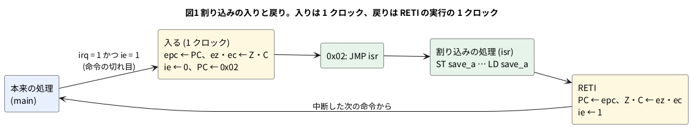

# 11-10 割り込み

この題は PC の Verilator (と iverilog) だけで動かす。組まない題なので、実体配線図と Analog Discovery 3 は入れない。
オシロの代わりに、シミュレーションの波形をロジックアナライザの画面の形に描く。

CPU が外の出来事 (タイマが時間を告げた、ボタンが押された、UART に字が届いた) に気づく方法は 2 つある。
1 つは、プログラムが何度も見に行く方法 (ポーリング)。もう 1 つは、外から CPU に「今やっている事を中断して、こちらを先に」と
知らせる方法で、これを**割り込み**と言う。割り込みなら、出来事が無い間、CPU は本来の計算を続けられる。

この題では、11-11 の 8 ビット CPU `cpu8` に割り込みを足す (足した物を `cpu8i` と呼ぶ)。命令セットとメモリの形は 11-11 と同じで、
先に 11-11 を読んでおくと分かりやすい。割り込みに要る仕組みは 3 つである。

- **ベクタ**: 割り込みが来たら飛ぶ番地。`cpu8i` では 0x02 番地に決める。そこに割り込みの処理への `JMP` を置く
- **戻り番地の退避**: 中断した所へ戻るため、次に実行するはずだった番地 (PC) を `epc` にしまう。フラグ (Z・C) も `ez` `ec` にしまう
- **割り込み許可**: 割り込みを受けてよいかの印 `ie`。受けたら下ろし (処理の途中でまた割り込まれないように)、`RETI` で戻るときに上げる

## 決めたこと

| 項目 | 決めたこと | 理由 |
| --- | --- | --- |
| 割り込みの線 | `irq` (1 の間、要求が続く)。受け付けたクロックに `iack` を 1 クロック出す | 外の回路は `iack` を見て要求を下ろす |
| 受け付ける時 | 命令の切れ目 (`S_FETCH` の前) か、`HLT` で止まっている間 | 命令の途中で中断すると、取り出した命令と引数の始末が要る |
| 入る手順 | 1 クロックで、`epc ← PC`、`ez ← Z`、`ec ← C`、`ie ← 0`、`PC ← 0x02` | 取り出しの 2 クロックを待たずに飛べる |
| 新しい命令 | `EI` (0x20、許可) `DI` (0x21、禁止) `RETI` (0x22、戻る) | `RETI` は `PC ← epc`、`Z ← ez`、`C ← ec`、`ie ← 1` |
| A の退避 | しない (処理の頭で `ST`、終わりで `LD` する) | 退避するのはフラグと番地だけ。A まで退避すると、レジスタが 8 ビット増える |
| 許可の遅れ | `EI` と `RETI` の次の 1 命令が終わるまで受け付けない | 下の「許可の遅れが要った」 |
| リセットの後 | `ie = 0` (禁止) | プログラムが準備を終えてから `EI` で許可する |
| `HLT` | 許可されていれば、割り込みで起きる。`RETI` で `HLT` の次から続く | 割り込みを待つ間、何もしないで止まれる |

`epc` には「次に実行する命令の番地」が入る。命令の切れ目で受け付けるので、中断した命令は終わっていて、やり直しは要らない。

## ブロック図




## Verilog

`cpu8i.v` は、11-11 の `cpu8.v` に割り込みの部分を足した物である。足した行は、
ポートの `irq` `iack` `ie_out`、レジスタの `ie` `epc` `ez` `ec` `hold`、`take_irq` とその受け付けの枝、`EI` `DI` `RETI` の実行。
ほかは `cpu8.v` と同じである。

`cpu8i.v`:

```verilog
// cpu8i.v  cpu8 (11-11) に割り込みを足した物 (11-10)
// 足したもの: 割り込みの入力 irq と受け付けの合図 iack、割り込み許可 ie、戻り番地 epc とフラグの退避、
// 命令 EI (許可)・DI (禁止)・RETI (戻る)。ベクタは 0x02 番地。HLT は割り込みで起きる
module cpu8i (
    input  wire       clk,
    input  wire       rst,        // 同期リセット (1 で PC = 0)
    output reg  [7:0] addr,
    input  wire [7:0] rdata,
    output wire [7:0] wdata,
    output wire       we,
    input  wire [7:0] in_port,
    output reg  [7:0] out_port,
    output reg        out_stb,    // OUT を実行したクロックだけ 1
    output wire       halted,
    output wire [7:0] pc_out,
    output wire [1:0] state_out,
    input  wire       irq,        // 割り込みの要求 (1 の間、要求が続く)
    output reg        iack,       // 割り込みを受け付けたクロックだけ 1
    output wire       ie_out
);
    localparam [1:0] S_FETCH = 2'd0, S_ARG = 2'd1, S_EXEC = 2'd2, S_HALT = 2'd3;
    localparam [7:0] NOP  = 8'h00, LDI  = 8'h01, LD   = 8'h02, ST   = 8'h03,
                     ADD  = 8'h04, SUB  = 8'h05, ADDI = 8'h06, SUBI = 8'h07,
                     AND_ = 8'h08, OR_  = 8'h09, XOR_ = 8'h0A, SHL  = 8'h0B,
                     SHR  = 8'h0C, JMP  = 8'h10, JZ   = 8'h11, JNZ  = 8'h12,
                     JC   = 8'h13, JNC  = 8'h14, IN   = 8'h18, OUT  = 8'h19,
                     HLT  = 8'h1F, EI   = 8'h20, DI   = 8'h21, RETI = 8'h22;
    localparam [7:0] VECTOR = 8'h02;               // 割り込みで飛ぶ番地

    reg [7:0] pc, ir, arg, acc;
    reg       z, c;
    reg [1:0] state;
    reg       ie;                                  // 割り込み許可
    reg [7:0] epc;                                 // 戻り番地
    reg       ez, ec;                              // 退避したフラグ
    reg       hold;                                // EI・RETI の次の 1 命令は受け付けない
    assign halted    = (state == S_HALT);
    assign ie_out    = ie;
    // 受け付けるのは、命令の切れ目 (取り出しの前) か HLT で止まっている間だけ。
    // EI と RETI の次の 1 命令が終わるまでは待つ (RETI の直後にまた入ると、元の処理が 1 命令も進まない)
    wire take_irq = irq && ie && !hold && (state == S_FETCH || state == S_HALT);
    assign pc_out    = pc;
    assign state_out = state;

    // 番地: 取り出しの間は PC、実行の間は引数 (LD・ST・ADD などのメモリの番地)
    always @* addr = (state == S_EXEC) ? arg : pc;
    assign wdata = acc;
    assign we    = (state == S_EXEC) && (ir == ST);

    // 演算: 実行の 1 クロックで、新しい A と桁上げを決める。足し算器は 1 つを足し算と引き算で使い回す
    wire       use_imm = (ir == LDI) || (ir == ADDI) || (ir == SUBI);
    wire       is_sub  = (ir == SUB) || (ir == SUBI);
    wire [7:0] b       = use_imm ? arg : rdata;    // 引数そのものか、メモリの値
    // 引き算は A + (~b) + 1。桁上げは「借りが無い」(A >= b) で 1 になる
    wire [8:0] sum     = {1'b0, acc} + {1'b0, is_sub ? ~b : b} + {8'd0, is_sub};
    reg  [8:0] r;                               // {桁上げ, 結果}
    reg        wr_acc, wr_c;
    always @* begin
        r = {c, acc}; wr_acc = 1'b0; wr_c = 1'b0;
        case (ir)
            LDI, LD:              begin r = {c, b};   wr_acc = 1'b1; end
            ADD, ADDI, SUB, SUBI: begin r = sum;      wr_acc = 1'b1; wr_c = 1'b1; end
            AND_: begin r = {c, acc & b};               wr_acc = 1'b1; end
            OR_:  begin r = {c, acc | b};               wr_acc = 1'b1; end
            XOR_: begin r = {c, acc ^ b};               wr_acc = 1'b1; end
            SHL:  begin r = {acc[7], acc[6:0], 1'b0};   wr_acc = 1'b1; wr_c = 1'b1; end
            SHR:  begin r = {acc[0], 1'b0, acc[7:1]};   wr_acc = 1'b1; wr_c = 1'b1; end
            IN:   begin r = {c, in_port};               wr_acc = 1'b1; end
            default: ;
        endcase
    end

    reg take;                                   // 飛ぶか
    always @* begin
        case (ir)
            JMP:     take = 1'b1;
            JZ:      take = z;
            JNZ:     take = ~z;
            JC:      take = c;
            JNC:     take = ~c;
            default: take = 1'b0;
        endcase
    end

    always @(posedge clk) begin
        out_stb <= 1'b0;
        iack    <= 1'b0;
        if (rst) begin
            pc <= 8'd0; ir <= NOP; arg <= 8'd0; acc <= 8'd0;
            z <= 1'b0; c <= 1'b0; out_port <= 8'd0; state <= S_FETCH;
            ie <= 1'b0; epc <= 8'd0; ez <= 1'b0; ec <= 1'b0; hold <= 1'b0;
        end else if (take_irq) begin
            // 割り込みに入る (1 クロック): 戻り番地とフラグを退避し、許可を落とし、ベクタへ
            epc   <= pc;
            ez    <= z;
            ec    <= c;
            ie    <= 1'b0;
            pc    <= VECTOR;
            iack  <= 1'b1;
            state <= S_FETCH;
        end else begin
            case (state)
                S_FETCH: begin ir  <= rdata; pc <= pc + 8'd1; state <= S_ARG;  end
                S_ARG:   begin arg <= rdata; pc <= pc + 8'd1; state <= S_EXEC; end
                S_EXEC: begin
                    state <= (ir == HLT) ? S_HALT : S_FETCH;
                    hold  <= (ir == EI) || (ir == RETI);   // ほかの命令を 1 つ終えたら下ろす
                    if (wr_acc) begin
                        acc <= r[7:0];
                        z   <= (r[7:0] == 8'd0);    // A に書く命令はゼロフラグも書く
                    end
                    if (wr_c) c <= r[8];
                    if (take) pc <= arg;
                    if (ir == OUT) begin out_port <= acc; out_stb <= 1'b1; end
                    if (ir == EI) ie <= 1'b1;
                    if (ir == DI) ie <= 1'b0;
                    if (ir == RETI) begin             // 戻る: 番地とフラグを戻し、許可を上げる
                        pc <= epc;
                        z  <= ez;
                        c  <= ec;
                        ie <= 1'b1;
                    end
                end
                default: ;                           // S_HALT: 割り込み (許可されていれば) かリセットまで止まる
            endcase
        end
    end
endmodule
```

`cpu8i_sys.v` (メモリをつないだ物。11-11 の `cpu8_sys.v` に `irq` `iack` `ie_out` を通しただけ):

```verilog
// cpu8i_sys.v  cpu8i に 256 語のメモリをつないだ物 (11-10)。中身は $readmemh で読む (+rom=<名前> で替えられる)
module cpu8i_sys #(parameter ROMFILE = "10-main.hex") (
    input  wire       clk,
    input  wire       rst,
    input  wire [7:0] in_port,
    output wire [7:0] out_port,
    output wire       out_stb,
    output wire       halted,
    output wire [7:0] pc_out,
    output wire [1:0] state_out,
    input  wire       irq,
    output wire       iack,
    output wire       ie_out
);
    reg  [7:0] mem [0:255];
    wire [7:0] addr, wdata;
    wire       we;
    reg  [8*256-1:0] fname;
    initial begin
        if ($value$plusargs("rom=%s", fname)) $readmemh(fname, mem);
        else                                  $readmemh(ROMFILE, mem);
    end
    always @(posedge clk) if (we) mem[addr] <= wdata;
    cpu8i cpu (.clk(clk), .rst(rst), .addr(addr), .rdata(mem[addr]), .wdata(wdata), .we(we),
              .in_port(in_port), .out_port(out_port), .out_stb(out_stb), .halted(halted),
              .pc_out(pc_out), .state_out(state_out),
              .irq(irq), .iack(iack), .ie_out(ie_out));
endmodule
```

- 受け付けの枝 (`else if (take_irq)`) は、状態の `case` より前に置いた。受け付けたクロックは、取り出しをしない
- `hold` は `EI` と `RETI` の実行で 1 になり、次の命令の実行で 0 に戻る。`take_irq` は `hold` が 1 の間は 0 になる

## プログラム

`main.s` は、割り込みを受けながら 1〜10 の和を 3 回求めて OUT に出す。割り込みのたびに `ticks` を 1 増やす。
アセンブラは 11-6 の `asm.py --isa cpu8i`。

```text
; main.s  割り込みを受けながら 1+2+…+10 を 3 回求めて OUT に出す (11-10)
;         割り込みのたびに ticks を 1 増やす。A は割り込みの処理で退避し、フラグは CPU が退避する
        JMP  main       ; 00: リセットで来る
        JMP  isr        ; 02: 割り込みで来る (ベクタ)
main:   LDI  0
        ST   ticks
        LDI  3
        ST   rep
        EI              ; ここから割り込みを受ける
again:  LDI  0
        ST   sum
        LDI  10
        ST   n
loop:   LD   sum
        ADD  n
        ST   sum        ; sum ← sum + n
        LD   n
        SUBI 1
        ST   n          ; n ← n - 1。ゼロフラグが立てば終わり
        JNZ  loop
        LD   sum
        OUT             ; 55
        LD   rep
        SUBI 1
        ST   rep
        JNZ  again
        DI
        HLT

isr:    ST   save_a     ; A を退避
        LD   ticks
        ADDI 1
        ST   ticks      ; ticks ← ticks + 1
        LD   save_a     ; A を戻す (ゼロフラグは変わるが、RETI が元に戻す)
        RETI

        .org 0xF0
sum:    .db  0
n:      .db  0
rep:    .db  0
ticks:  .db  0
save_a: .db  0
```

- 0x00 にリセットで来る `JMP main`、0x02 に割り込みで来る `JMP isr` を置く。どちらも 2 語の命令なので、ベクタは 2 語おき
- 割り込みの処理は、A を `save_a` にしまってから使い、終わりで戻す。`LD save_a` はゼロフラグを書き換えるが、`RETI` が `ez` から戻すので、
  `main` の `SUBI 1` → `ST n` → `JNZ loop` の Z は崩れない

`nosave.s` は、`main.s` から A の退避と戻し (`ST save_a` と `LD save_a`) を抜いた物である。

```text
; nosave.s  main.s から A の退避と戻しを抜いた物 (11-10)。割り込みが来ると和が狂う
        JMP  main       ; 00: リセットで来る
        JMP  isr        ; 02: 割り込みで来る (ベクタ)
main:   LDI  0
        ST   ticks
        LDI  3
        ST   rep
        EI              ; ここから割り込みを受ける
again:  LDI  0
        ST   sum
        LDI  10
        ST   n
loop:   LD   sum
        ADD  n
        ST   sum        ; sum ← sum + n
        LD   n
        SUBI 1
        ST   n          ; n ← n - 1。ゼロフラグが立てば終わり
        JNZ  loop
        LD   sum
        OUT             ; 55
        LD   rep
        SUBI 1
        ST   rep
        JNZ  again
        DI
        HLT

isr:    LD   ticks      ; A を退避しないで使う
        ADDI 1
        ST   ticks      ; ticks ← ticks + 1
        RETI

        .org 0xF0
sum:    .db  0
n:      .db  0
rep:    .db  0
ticks:  .db  0
save_a: .db  0
```

`wait.s` は、`HLT` で割り込みを待ち、起こされるたびに `ticks` を OUT に出す。

```text
; wait.s  HLT で割り込みを待ち、起こされるたびに数を OUT に出す (11-10)
        JMP  main
        JMP  isr        ; 02: ベクタ
main:   LDI  0
        ST   ticks
        EI
idle:   HLT             ; 割り込みが来るまで止まる。RETI で次の命令から続く
        LD   ticks
        OUT
        JMP  idle

isr:    ST   save_a
        LD   ticks
        ADDI 1
        ST   ticks
        LD   save_a
        RETI

        .org 0xF0
ticks:  .db  0
save_a: .db  0
```

## テストベンチ

試験台には、決まった周期で `irq` を上げるタイマを置く。`iack` が来たら `irq` を下げる。
要求が残っているうちに次の時刻が来たら、その要求は落ちる (落とした数を数える)。

```verilog
// tb_cpu8i.v  cpu8i (割り込み付き) の試験台 (11-10)。アセンブラ (11-6) の .hex を +rom= で読ませる
//   +test=main    周期 7〜60 クロックのタイマ割り込みで main.s を回す。OUT が 3 回とも 55、
//                 ticks が受け付けた数と同じ、クロック数が「割り込み無し + 22 × 受け付けた数」 (入る 1 + JMP isr 3 + 処理 18)
//   +test=nosave  同じ周期で nosave.s を回し、和が狂う周期の数を数える (1 つ以上あるはず)
//   +test=wait    周期 50 で wait.s を回し、OUT が 1 2 3 4 5 と出る
//   +test=masked  irq を 1 のままにして 11-11 のプログラムを回す (EI が無いので受け付けない)
//                 +want=<OUT の値> で最後の OUT を確かめる
//   +vcd          main の周期 40 の回の波形を cpu8i.vcd に残す
`timescale 1us/1ns
module tb_cpu8i;
    reg        clk = 0;
    reg        rst = 1;
    reg  [7:0] in_port = 8'h5A;
    reg        irq = 0;
    wire [7:0] out_port, pc;
    wire       out_stb, halted, iack, ie;
    wire [1:0] state;
    cpu8i_sys #(.ROMFILE("none.hex")) dut (.clk(clk), .rst(rst), .in_port(in_port),
        .out_port(out_port), .out_stb(out_stb), .halted(halted), .pc_out(pc), .state_out(state),
        .irq(irq), .iack(iack), .ie_out(ie));

    always #5 clk = ~clk;

    // タイマ: period クロックごとに要求を出し、受け付けられたら (iack) 下げる。period = 0 で止める
    // 要求が残っているうちに次の時刻が来たら、その分は落ちる (lost に数える)
    integer period = 0, tcount = 0, nack = 0, nlost = 0, lat = 0;
    integer lat_min = 999, lat_max = 0;
    reg     lat_on = 0;                         // 1 の間だけ、要求から受け付けまでのクロック数を集める
    reg     hold_irq = 0;                       // 1 なら irq を 1 のままにする (masked)
    always @(posedge clk) begin
        if (rst) begin
            irq <= hold_irq; tcount <= 0; nack <= 0; nlost <= 0; lat <= 0;
        end else begin
            if (iack) begin
                nack <= nack + 1;
                // lat は要求の立ち上がりから数えた立ち上がりの数。受け付けまでのクロック数は lat - 1
                if (lat_on && lat - 1 < lat_min) lat_min = lat - 1;
                if (lat_on && lat - 1 > lat_max) lat_max = lat - 1;
            end
            if (hold_irq) irq <= 1'b1;
            else if (iack) irq <= 1'b0;
            if (!hold_irq && period != 0 && tcount == period - 1) begin
                if (irq && !iack) nlost <= nlost + 1;
                else begin irq <= 1'b1; lat <= 1; end
            end else if (irq && !iack) lat <= lat + 1;
            tcount <= (period != 0 && tcount == period - 1) ? 0 : tcount + 1;
        end
    end

    reg  [7:0] outs [0:31];
    integer    nout, clocks, ng, i, p, base, bad_periods, limit;
    integer    want_out;
    reg  [8*8-1:0] test;
    always @(posedge clk) if (out_stb && nout < 32) begin outs[nout] = out_port; nout = nout + 1; end

    task load;      // プログラムを読み直す (前の回が書いたデータを消す)
        reg [8*256-1:0] fname;
        begin
            if ($value$plusargs("rom=%s", fname)) $readmemh(fname, dut.mem);
        end
    endtask

    // HLT で止まるか、max_clocks か、OUT が stop_after_outs 回出るまで走らせる (wait は HLT で止めない)
    task run(input integer max_clocks, input integer stop_after_outs);
        begin
            load;
            nout = 0;
            rst = 1;
            @(posedge clk); #1;
            rst = 0;
            clocks = 0;
            while ((!halted || test == "wait") && clocks < max_clocks && nout < stop_after_outs) begin
                @(posedge clk); #1; clocks = clocks + 1;
            end
        end
    endtask

    initial begin
        ng = 0;
        if (!$value$plusargs("test=%s", test)) test = "main";
        if (!$value$plusargs("want=%d", want_out)) want_out = -1;
        #2;
        if (test == "main") begin
            period = 0;
            run(100000, 99);
            base = clocks;
            $display("main: 割り込み無しで OUT %0d 回、HLT まで %0d クロック", nout, base);
            if (nout != 3) ng = ng + 1;
            if ($test$plusargs("vcd")) begin $dumpfile("cpu8i.vcd"); $dumpvars(0, tb_cpu8i); end
            for (p = 60; p >= 7; p = p - 1) begin
                period = p;
                lat_on = (p >= 30);                 // 処理 (22 クロック) が重ならない周期だけで測る
                if (p != 40) $dumpoff; else $dumpon;
                run(100000, 99);
                if (nout != 3 || outs[0] != 55 || outs[1] != 55 || outs[2] != 55) ng = ng + 1;
                if (dut.mem[8'hF3] != nack[7:0]) ng = ng + 1;
                if (clocks != base + 22 * nack) ng = ng + 1;
                if (nack == 0) ng = ng + 1;
                if (p == 60 || p == 40 || p == 19 || p == 7)
                    $display("  周期 %0d: OUT %0d %0d %0d、受け付け %0d 回、落とした要求 %0d、ticks %0d、%0d クロック (= %0d + 22 x %0d)",
                             p, outs[0], outs[1], outs[2], nack, nlost, dut.mem[8'hF3], clocks, base, nack);
            end
            $dumpoff;
            $display("main: 周期 7〜60 の 54 通りで、合わなかった項目 %0d", ng);
            $display("main: 周期 30〜60 で、irq が上がってから iack が上がるまで %0d〜%0d クロック", lat_min, lat_max);
        end else if (test == "nosave") begin
            bad_periods = 0;
            for (p = 60; p >= 7; p = p - 1) begin
                period = p;
                run(100000, 99);
                if (nout != 3 || outs[0] != 55 || outs[1] != 55 || outs[2] != 55)
                    bad_periods = bad_periods + 1;
            end
            $display("nosave: 周期 7〜60 の 54 通りのうち、和が狂ったのは %0d 通り", bad_periods);
            if (bad_periods == 0) ng = ng + 1;
        end else if (test == "wait") begin
            period = 50;
            run(100000, 5);
            $write("wait: OUT の並び");
            for (i = 0; i < nout; i = i + 1) $write(" %0d", outs[i]);
            $display(" (%0d 回、%0d クロック)", nout, clocks);
            for (i = 0; i < 5; i = i + 1) if (outs[i] != i + 1) ng = ng + 1;
            if (nout != 5) ng = ng + 1;
        end else if (test == "masked") begin
            hold_irq = 1;
            run(100000, 99);
            $display("masked: irq = 1 のまま、受け付け %0d 回、最後の OUT = %0d、HLT まで %0d クロック",
                     nack, out_port, clocks);
            if (nack != 0 || !halted) ng = ng + 1;
            if (want_out >= 0 && out_port != want_out[7:0]) ng = ng + 1;
        end else begin
            $display("知らない +test です");
            ng = ng + 1;
        end
        if (ng == 0) $display("PASS");
        else         $display("FAIL: %0d 件", ng);
        $finish;
    end
endmodule
```

`main` の試験は、まず割り込み無しで走らせてクロック数 (744) を測り、次に周期を 60 から 7 まで 1 ずつ変えて走らせる。
各周期で次の 4 つを確かめる。

1. OUT が 3 回とも 55 (割り込みが和を崩していない)
2. メモリの `ticks` が、試験台の数えた `iack` の数と同じ (割り込みを 1 つも取りこぼさずに処理した)
3. クロック数が「割り込み無しの 744 + 22 × 受け付けた数」(1 回の割り込みの時間がいつも同じ)
4. 1 回以上受け付けた

22 クロックの内訳は、入る 1、ベクタの `JMP isr` が 3、処理の 6 命令が 18 である。

## 動かす

```bash
cd 06-fpga/11-cpu/sim
sh 10-cpu8i-run.sh
```

`10-cpu8i-run.sh` は lint、アセンブル、Verilator と iverilog での試験 6 通り、yosys での合成を回す。
本文の `cpu8i.v` `cpu8i_sys.v` `tb_cpu8i.v` と 3 本の `.s` は、sim の置き場では `10-` を頭に付けた名前で置いた。
lint は `cpu8i` も `cpu8i_sys` も警告 0 件で通った (Verilator 5.042、`-Wall`、名前の都合で `-Wno-DECLFILENAME`)。

```text
main: 割り込み無しで OUT 3 回、HLT まで 744 クロック
  周期 60: OUT 55 55 55、受け付け 18 回、落とした要求 0、ticks 18、1140 クロック (= 744 + 22 x 18)
  周期 40: OUT 55 55 55、受け付け 39 回、落とした要求 0、ticks 39、1602 クロック (= 744 + 22 x 39)
  周期 19: OUT 55 55 55、受け付け 240 回、落とした要求 76、ticks 240、6024 クロック (= 744 + 22 x 240)
  周期 7: OUT 55 55 55、受け付け 240 回、落とした要求 619、ticks 240、6024 クロック (= 744 + 22 x 240)
main: 周期 7〜60 の 54 通りで、合わなかった項目 0
main: 周期 30〜60 で、irq が上がってから iack が上がるまで 1〜3 クロック
PASS
nosave: 周期 7〜60 の 54 通りのうち、和が狂ったのは 54 通り
PASS
wait: OUT の並び 1 2 3 4 5 (5 回、279 クロック)
PASS
masked: irq = 1 のまま、受け付け 0 回、最後の OUT = 55、HLT まで 261 クロック
PASS
masked: irq = 1 のまま、受け付け 0 回、最後の OUT = 143、HLT まで 156 クロック
PASS
masked: irq = 1 のまま、受け付け 0 回、最後の OUT = 233、HLT まで 357 クロック
PASS
```

Verilator と iverilog で同じ出力になった。

- **A を退避しないと、54 通りすべてで和が狂った。** 割り込みの処理が A を `ticks` の値で上書きし、`main` はその A で計算を続けるため
- 周期が 22 クロックより短いと、処理が終わる前に次の要求が来る。周期 19 と 7 では、受け付けた数は 240 回で同じになり、
  残りは落ちた。どちらも、`main` の命令 (248 個) をほぼ 1 つ実行するごとに割り込みが入った形である (下の「許可の遅れが要った」)
- `masked` は、11-11 の `sum.s` `mul.s` `fib.s` を `cpu8i` で走らせた物。`EI` が無いので、`irq` が 1 のままでも受け付けず、
  答えもクロック数も 11-11 と同じだった。割り込みを足しても、元のプログラムの速さは変わらない

## 許可の遅れが要った

最初に書いた `cpu8i` には `hold` が無く、`RETI` の直後の取り出しの前でも受け付けた。
すると周期が 22 クロックより短いとき、`RETI` で戻った直後にまた割り込みに入り、`main` が 1 命令も進まなくなった
(周期 19 と 7 では、10 万クロック走らせても `HLT` に着かなかった)。

`EI` と `RETI` の次の 1 命令が終わるまで受け付けない形にすると、割り込みがどれだけ混んでも、戻るたびに `main` が 1 命令は進む。
周期 19 と 7 でも 6024 クロックで終わり、和は 55 になった。多くの 8 ビットの CPU (8080・Z80 の `EI` など) も、
許可した直後の 1 命令の間は割り込みを受け付けない。

## シミュレーションの波形

周期 40 で `main.s` を走らせたときの 2 回目の割り込みを描いた。`+vcd` を付けて走らせ、VCD を読んでロジックアナライザの画面と同じ形にした
(シミュレーションの値)。PC の 7 ビット目と A の 7〜6 ビット目はいつも 0 なので出していない。クロックの 10 µs (マイクロ秒) は試験台で決めた値。

```logic
# ロジックアナライザの画面 (tommie-fence の logic フェンス)
title: 図2 受け付けから 22 クロックで 0x1A に戻る。A は 0x22 のまま
device: generic
time: 30us/div
signals:
  CLK: edges 0s=1 5us=0 10us=1 15us=0 20us=1 25us=0 30us=1 35us=0 40us=1 45us=0 50us=1 55us=0 60us=1 65us=0 70us=1 75us=0 80us=1 85us=0 90us=1 95us=0 100us=1 105us=0 110us=1 115us=0 120us=1 125us=0 130us=1 135us=0 140us=1 145us=0 150us=1 155us=0 160us=1 165us=0 170us=1 175us=0 180us=1 185us=0 190us=1 195us=0 200us=1 205us=0 210us=1 215us=0 220us=1 225us=0 230us=1 235us=0 240us=1 245us=0 250us=1 255us=0 260us=1 265us=0 270us=1 275us=0 280us=1 285us=0 290us=1 295us=0 300us=1
  IRQ: edges 0s=0 10us=1 40us=0
  IACK: edges 0s=0 30us=1 40us=0
  IE: edges 0s=1 30us=0 240us=1
  S1: edges 0s=0 10us=1 20us=0 50us=1 60us=0 80us=1 90us=0 110us=1 120us=0 140us=1 150us=0 170us=1 180us=0 200us=1 210us=0 230us=1 240us=0 260us=1 270us=0 290us=1 300us=0
  S0: edges 0s=1 10us=0 40us=1 50us=0 70us=1 80us=0 100us=1 110us=0 130us=1 140us=0 160us=1 170us=0 190us=1 200us=0 220us=1 230us=0 250us=1 260us=0 280us=1 290us=0
  PC6: edges 0s=0 230us=1 240us=0
  PC5: edges 0s=0 60us=1 230us=0
  PC4: edges 0s=1 30us=0 60us=1 230us=0 240us=1
  PC3: edges 0s=1 30us=0 110us=1 230us=0 240us=1
  PC2: edges 0s=0 50us=1 110us=0 170us=1 230us=0 260us=1
  PC1: edges 0s=0 10us=1 50us=0 80us=1 110us=0 140us=1 170us=0 200us=1 230us=0 240us=1 260us=0 290us=1
  PC0: edges 0s=1 10us=0 40us=1 50us=0 70us=1 80us=0 100us=1 110us=0 130us=1 140us=0 160us=1 170us=0 190us=1 200us=0 220us=1 230us=0 250us=1 260us=0 280us=1 290us=0
  A5: edges 0s=0 20us=1 120us=0 210us=1 300us=0
  A4: edges 0s=1 20us=0
  A3: edges 0s=1 20us=0
  A2: edges 0s=0 300us=1
  A1: edges 0s=1 120us=0 150us=1
  A0: edges 0s=1 20us=0 120us=1 150us=0 300us=1
buses:
  STATE: S1 S0 dec
  PC: PC6..PC0 hex
  A: A5..A0 hex
cursors: [25us, 245us]
```


## 見るべき値 (シミュレーションを実行して得た値)

| 時刻 | 起きたこと | PC (後) | A | IE |
| --- | --- | --- | --- | --- |
| 10 µs | タイマが `irq` を上げる。CPU は `ADD n` の実行に入る | 0x1A | 0x1B | 1 |
| 20 µs | `ADD n` が終わる (A = 0x22 = 34) | 0x1A | 0x22 | 1 |
| 30 µs | 命令の切れ目で受け付ける。`iack` = 1、`epc` = 0x1A | **0x02** | 0x22 | 0 |
| 40〜60 µs | ベクタの `JMP isr` | **0x34** | 0x22 | 0 |
| 60〜90 µs | `ST save_a` | 0x36 | 0x22 | 0 |
| 90〜180 µs | `LD ticks` `ADDI 1` `ST ticks` (ticks 1 → 2) | 0x3C | 0x01 → 0x02 | 0 |
| 180〜210 µs | `LD save_a` | 0x3E | **0x22** | 0 |
| 210〜240 µs | `RETI` (取り出しで PC は 0x40 まで進み、実行で 0x1A に戻る) | **0x1A** | 0x22 | 1 |
| 240 µs から | `main` の `ST sum` から続ける | 0x1C … | 0x22 | 1 |

- 図2のカーソル X1 = 25 µs (受け付ける前、PC = 0x1A) と X2 = 245 µs (戻った後、PC = 0x1A) の ΔX は 220 µs = 22 クロック。
  試験台の「744 + 22 × 受け付けた数」と同じ
- `irq` は 40 µs に下がる。試験台のタイマが `iack` を見て下ろした
- A は処理の中で 1 と 2 になるが、戻る前に 0x22 (34) に戻る。`main` から見ると、A は割り込みの前後で変わらない
- 周期 30〜60 で測ると、`irq` が上がってから `iack` が上がるまで 1〜3 クロックだった。いま実行している命令が終わるのを待つ時間で、
  1 命令が 3 クロックなので、長くて 3 クロックになる

## FPGA に載せるとき

`cpu8` と `cpu8i` (どちらもメモリを除く) を、Yosys 0.70+16 の `synth_gowin` で合成して比べた。

| 回路 | LUT | MUX2 | ALU | DFF |
| --- | --- | --- | --- | --- |
| `cpu8` (11-11) | 149 | 49 | 17 | 45 |
| `cpu8i` | 288 | 164 | 17 | 58 |

- DFF は 13 個増えた (`epc` 8、`ie` `ez` `ec` `hold` `iack` が 1 ずつ)
- LUT と MUX2 は 2 倍ほどになった。PC に入る値が 4 通り (PC + 1・飛ぶ先・`epc`・ベクタ) に増え、フラグにも `ez` `ec` から戻す道ができたため
- 足し算器 (ALU 17) は変わらない

## シミュレーションでの確かめ

Python 3.12・Verilator 5.042・iverilog 12・Yosys 0.70+16 で `sim/10-cpu8i-run.sh` を走らせた。
置き場は `sim/10-cpu8i.v` `sim/10-cpu8i-sys.v` `sim/10-cpu8i-tb.v` と `sim/10-main.s` `sim/10-nosave.s` `sim/10-wait.s`
(アセンブラは `sim/06-asm.py`、`masked` で走らせるのは `sim/11-sum.s` `sim/11-mul.s` `sim/11-fib.s`)。

| 項目 | 本文の数字 | 実行結果 | 判定 |
| --- | --- | --- | --- |
| lint (`cpu8i`・`cpu8i_sys`、`-Wall`) | 警告 0 件 | 0 件 | 合った |
| `main`、周期 7〜60 の 54 通り | OUT 55 × 3、ticks = 受け付け、744 + 22 × 受け付け | 合わなかった項目 0 (Verilator・iverilog) | 合った |
| 受け付けまで (周期 30〜60) | 1〜3 クロック | 1〜3 クロック | 合った |
| `nosave` | 和が狂う周期がある | 54 通りすべて | 合った |
| `wait` | OUT が 1 2 3 4 5 | 同じ (279 クロック) | 合った |
| `masked` (11-11 の 3 本) | 受け付け 0、OUT 55・143・233、261・156・357 クロック | 同じ | 合った |
| 図2の波形 | 上の表の時刻と値、ΔX = 22 クロック | 同じ | 合った |
| 合成 `cpu8i` (Yosys 0.70+16) | LUT 288、MUX2 164、ALU 17、DFF 58 | LUT1 115 + LUT2 25 + LUT3 74 + LUT4 74、MUX2_LUT5 100 + LUT6 42 + LUT7 17 + LUT8 5、ALU 17、DFFR 2 + DFFRE 56 | 合った |
| `hold` が無いとき | 周期 19・7 で `main` が終わらない | (最初の版で見た。最初の版は置き場に残していない) | 補足 |

配置配線と実機での確かめはしていない (SIM の題)。

## 出典

自作。命令の切れ目で受け付け、戻り番地を退避してベクタへ飛び、専用の命令で戻る形は、多くの CPU に共通の割り込みの作り方である。
`EI` の次の 1 命令の間は受け付けない決め方は、Z80 の `EI` の働き (Zilog の Z80 CPU User Manual) にならった。
