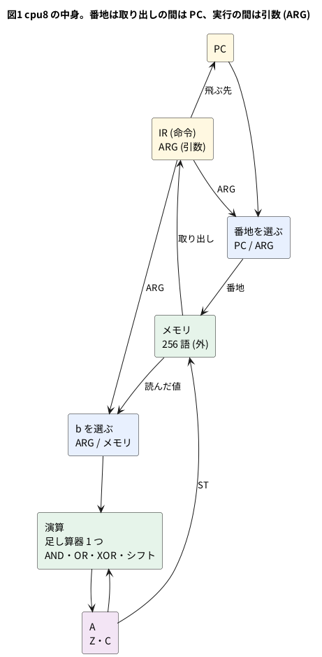

# 11-11 自分の 8 ビット CPU を設計する

この題は PC の Verilator (と iverilog) だけで動かす。組まない題なので、実体配線図と Analog Discovery 3 は入れない。
オシロの代わりに、シミュレーションの波形をロジックアナライザの画面の形に描く。

TD4 (5-8・11-5) は 4 ビットで、ROM は 16 語、データを置くメモリが無い。1 から 10 までの和 (55) も 4 ビットには入らない。
この題では、**命令セットを決めるところから** 8 ビットの CPU を 1 つ設計する。名前は `cpu8` とする。
プログラムは 11-6 のアセンブラ (`asm.py --isa cpu8`) で書き、1〜n の和・掛け算・フィボナッチ数を走らせて確かめる。

## 決めたこと

| 項目 | 決めたこと | 理由 |
| --- | --- | --- |
| データの幅 | 8 ビット | 0〜255 を扱う。1〜22 の和 (253) まで入る |
| 番地の幅 | 8 ビット、メモリ 256 語 | PC も番地も 8 ビットにそろう |
| メモリ | 命令とデータを同じメモリに置く | アセンブラの `.org` と `.db` でデータを置ける。読み書きの口は 1 つ |
| レジスタ | アキュムレータ A が 1 つ | 演算は「A と、メモリか即値」。命令の形が 1 つで済む |
| フラグ | Z (ゼロ) と C (桁上げ) | 分かれる命令を 4 つ (`JZ` `JNZ` `JC` `JNC`) 作れる |
| 命令の形 | 2 語 (命令 1 語 + 引数 1 語)。引数の無い命令も 2 語 | 取り出しの手順が 1 通りになる。そのぶんメモリを使う |
| 1 命令の時間 | 3 クロック (命令を取る・引数を取る・実行) | メモリの口が 1 つなので、1 クロックに 1 語しか読めない |
| リセット | 同期 (`rst` が 1 の立ち上がりで PC = 0) | 10-4 などの題と同じ |
| 入出力 | 8 ビットの IN と OUT。OUT を実行したクロックに `out_stb` が 1 | 試験台が OUT の並びを数えられる |

TD4 との違いで大きいのは、**フラグを書く命令を決めた**ことである。TD4 は毎命令でフラグを書き直すので、`JNC` は足し算のすぐ後に置く。
`cpu8` では、A に書く命令が Z を書き、足し算・引き算・シフトが C を書く。`ST` `OUT` `JMP` などはフラグを変えない。
そのため `ST` を挟んでも、前の計算の Z と C で分かれられる (下の `sum.s` の `SUBI 1` → `ST n` → `JNZ` はこれを使う)。

## 命令セット

| 番号 | 命令 | 働き | Z | C |
| --- | --- | --- | --- | --- |
| 00 | NOP | 何もしない | — | — |
| 01 | LDI n | A ← n | 書く | — |
| 02 | LD a | A ← M[a] | 書く | — |
| 03 | ST a | M[a] ← A | — | — |
| 04 | ADD a | A ← A + M[a] | 書く | 桁上げ |
| 05 | SUB a | A ← A − M[a] | 書く | 借りが無い (A ≥ M[a]) で 1 |
| 06 | ADDI n | A ← A + n | 書く | 桁上げ |
| 07 | SUBI n | A ← A − n | 書く | 借りが無いで 1 |
| 08 | AND a | A ← A & M[a] | 書く | — |
| 09 | OR a | A ← A \| M[a] | 書く | — |
| 0A | XOR a | A ← A ^ M[a] | 書く | — |
| 0B | SHL | A ← A × 2 (左へ 1 ビット) | 書く | 出たビット |
| 0C | SHR | A ← A ÷ 2 (右へ 1 ビット) | 書く | 出たビット |
| 10 | JMP a | PC ← a | — | — |
| 11 | JZ a | Z が 1 なら PC ← a | — | — |
| 12 | JNZ a | Z が 0 なら PC ← a | — | — |
| 13 | JC a | C が 1 なら PC ← a | — | — |
| 14 | JNC a | C が 0 なら PC ← a | — | — |
| 18 | IN | A ← IN | 書く | — |
| 19 | OUT | OUT ← A | — | — |
| 1F | HLT | 止まる (リセットまで) | — | — |

`M[a]` は a 番地のメモリ、`n` は即値。番号の無い命令は NOP と同じに動く。
番号は種類ごとに 16 進の上の桁をそろえた (`0x0?` が演算、`0x1?` がジャンプと入出力)。11-10 で割り込みの命令を 0x20〜0x22 に足す。

## ブロック図




足し算器は 1 つだけ置き、`ADD` `ADDI` `SUB` `SUBI` で使い回す。引き算は「b を反転して 1 を足す」(11-5 と同じ)。
`LDI` `ADDI` `SUBI` は b に引数そのものを、ほかはメモリの値を選ぶ。

## 状態

| 状態 | 番地 | このクロックの終わりにすること |
| --- | --- | --- |
| `S_FETCH` (0) | PC | IR ← メモリ、PC ← PC + 1 |
| `S_ARG` (1) | PC | ARG ← メモリ、PC ← PC + 1 |
| `S_EXEC` (2) | ARG | 命令を実行 (A・フラグ・メモリ・PC・OUT を書く)。HLT なら `S_HALT`、ほかは `S_FETCH` |
| `S_HALT` (3) | PC | 何もしない (リセットまで) |

実行の間は番地に ARG を出すので、`LD` `ADD` などはそのクロックのうちにメモリの値を読める (読みは同じクロックで返る形のメモリ)。
`ST` はそのクロックの終わりに書く。

## Verilog

`cpu8.v` が CPU、`cpu8_sys.v` がメモリをつないだ物である。メモリを外に出したので、合成で CPU だけの大きさを数えられる。

`cpu8.v`:

```verilog
// cpu8.v  8 ビットのアキュムレータ型 CPU (11-11)
// 命令は 2 語 (命令 1 語 + 引数 1 語)。取り出し 2 クロック + 実行 1 クロックの 3 クロックで 1 命令
// メモリは外に置く (番地 addr、読む値 rdata、書く値 wdata、書く合図 we)。読みは同じクロックで返る形
module cpu8 (
    input  wire       clk,
    input  wire       rst,        // 同期リセット (1 で PC = 0)
    output reg  [7:0] addr,
    input  wire [7:0] rdata,
    output wire [7:0] wdata,
    output wire       we,
    input  wire [7:0] in_port,
    output reg  [7:0] out_port,
    output reg        out_stb,    // OUT を実行したクロックだけ 1
    output wire       halted,
    output wire [7:0] pc_out,
    output wire [1:0] state_out
);
    localparam [1:0] S_FETCH = 2'd0, S_ARG = 2'd1, S_EXEC = 2'd2, S_HALT = 2'd3;
    localparam [7:0] NOP  = 8'h00, LDI  = 8'h01, LD   = 8'h02, ST   = 8'h03,
                     ADD  = 8'h04, SUB  = 8'h05, ADDI = 8'h06, SUBI = 8'h07,
                     AND_ = 8'h08, OR_  = 8'h09, XOR_ = 8'h0A, SHL  = 8'h0B,
                     SHR  = 8'h0C, JMP  = 8'h10, JZ   = 8'h11, JNZ  = 8'h12,
                     JC   = 8'h13, JNC  = 8'h14, IN   = 8'h18, OUT  = 8'h19,
                     HLT  = 8'h1F;

    reg [7:0] pc, ir, arg, acc;
    reg       z, c;
    reg [1:0] state;
    assign halted    = (state == S_HALT);
    assign pc_out    = pc;
    assign state_out = state;

    // 番地: 取り出しの間は PC、実行の間は引数 (LD・ST・ADD などのメモリの番地)
    always @* addr = (state == S_EXEC) ? arg : pc;
    assign wdata = acc;
    assign we    = (state == S_EXEC) && (ir == ST);

    // 演算: 実行の 1 クロックで、新しい A と桁上げを決める。足し算器は 1 つを足し算と引き算で使い回す
    wire       use_imm = (ir == LDI) || (ir == ADDI) || (ir == SUBI);
    wire       is_sub  = (ir == SUB) || (ir == SUBI);
    wire [7:0] b       = use_imm ? arg : rdata;    // 引数そのものか、メモリの値
    // 引き算は A + (~b) + 1。桁上げは「借りが無い」(A >= b) で 1 になる
    wire [8:0] sum     = {1'b0, acc} + {1'b0, is_sub ? ~b : b} + {8'd0, is_sub};
    reg  [8:0] r;                               // {桁上げ, 結果}
    reg        wr_acc, wr_c;
    always @* begin
        r = {c, acc}; wr_acc = 1'b0; wr_c = 1'b0;
        case (ir)
            LDI, LD:              begin r = {c, b};   wr_acc = 1'b1; end
            ADD, ADDI, SUB, SUBI: begin r = sum;      wr_acc = 1'b1; wr_c = 1'b1; end
            AND_: begin r = {c, acc & b};               wr_acc = 1'b1; end
            OR_:  begin r = {c, acc | b};               wr_acc = 1'b1; end
            XOR_: begin r = {c, acc ^ b};               wr_acc = 1'b1; end
            SHL:  begin r = {acc[7], acc[6:0], 1'b0};   wr_acc = 1'b1; wr_c = 1'b1; end
            SHR:  begin r = {acc[0], 1'b0, acc[7:1]};   wr_acc = 1'b1; wr_c = 1'b1; end
            IN:   begin r = {c, in_port};               wr_acc = 1'b1; end
            default: ;
        endcase
    end

    reg take;                                   // 飛ぶか
    always @* begin
        case (ir)
            JMP:     take = 1'b1;
            JZ:      take = z;
            JNZ:     take = ~z;
            JC:      take = c;
            JNC:     take = ~c;
            default: take = 1'b0;
        endcase
    end

    always @(posedge clk) begin
        out_stb <= 1'b0;
        if (rst) begin
            pc <= 8'd0; ir <= NOP; arg <= 8'd0; acc <= 8'd0;
            z <= 1'b0; c <= 1'b0; out_port <= 8'd0; state <= S_FETCH;
        end else begin
            case (state)
                S_FETCH: begin ir  <= rdata; pc <= pc + 8'd1; state <= S_ARG;  end
                S_ARG:   begin arg <= rdata; pc <= pc + 8'd1; state <= S_EXEC; end
                S_EXEC: begin
                    state <= (ir == HLT) ? S_HALT : S_FETCH;
                    if (wr_acc) begin
                        acc <= r[7:0];
                        z   <= (r[7:0] == 8'd0);    // A に書く命令はゼロフラグも書く
                    end
                    if (wr_c) c <= r[8];
                    if (take) pc <= arg;
                    if (ir == OUT) begin out_port <= acc; out_stb <= 1'b1; end
                end
                default: ;                           // S_HALT: リセットまで止まる
            endcase
        end
    end
endmodule
```

`cpu8_sys.v`:

```verilog
// cpu8_sys.v  cpu8 に 256 語のメモリをつないだ物 (11-11)。中身は $readmemh で読む (+rom=<名前> で替えられる)
module cpu8_sys #(parameter ROMFILE = "11-sum.hex") (
    input  wire       clk,
    input  wire       rst,
    input  wire [7:0] in_port,
    output wire [7:0] out_port,
    output wire       out_stb,
    output wire       halted,
    output wire [7:0] pc_out,
    output wire [1:0] state_out
);
    reg  [7:0] mem [0:255];
    wire [7:0] addr, wdata;
    wire       we;
    reg  [8*256-1:0] fname;
    initial begin
        if ($value$plusargs("rom=%s", fname)) $readmemh(fname, mem);
        else                                  $readmemh(ROMFILE, mem);
    end
    always @(posedge clk) if (we) mem[addr] <= wdata;
    cpu8 cpu (.clk(clk), .rst(rst), .addr(addr), .rdata(mem[addr]), .wdata(wdata), .we(we),
              .in_port(in_port), .out_port(out_port), .out_stb(out_stb), .halted(halted),
              .pc_out(pc_out), .state_out(state_out));
endmodule
```

- `addr` は `always @*` で選ぶ。取り出しと実行で番地を切り替えるのが、メモリの口が 1 つの CPU の要である
- フラグの規則は `wr_acc` (A に書くので Z も書く) と `wr_c` (C を書く) の 2 本で表した。命令ごとの表を `case` 1 つに収めた
- `rst` は同期なので、`always @(posedge clk)` の中で見る

## プログラム

4 本とも 11-6 の `asm.py --isa cpu8` でアセンブルする。データは 0xF0 番地から置いた。

1〜n の和 (`sum.s`)。n は 0xF1 番地で、既定は 10。

```text
; sum.s  1 + 2 + … + n を求めて OUT に出す (11-11)。n は 0xF1 番地 (既定 10 → 55)
start:  LDI  0
        ST   sum
loop:   LD   n          ; LD はゼロフラグを書く
        JZ   done       ; n が 0 なら終わり
        ADD  sum
        ST   sum        ; sum ← sum + n
        LD   n
        SUBI 1
        ST   n          ; n ← n - 1
        JMP  loop
done:   LD   sum
        OUT
        HLT

        .org 0xF0
sum:    .db  0
n:      .db  10
```

掛け算 (`mul.s`)。b を右へずらして出た桁が 1 なら p に a を足し、a を左へずらす (10-4 のシフトと加算を、命令で書いた物)。

```text
; mul.s  a × b をシフトと足し算で求めて OUT に出す (11-11)。a は 0xF0、b は 0xF1 番地 (既定 13 × 11 → 143)
;        b を右へずらして出た桁が 1 なら p に a を足し、a を左へずらす。b が 0 になったら終わり
start:  LDI  0
        ST   p
loop:   LD   b
        JZ   done
        SHR             ; 出た桁は桁上げに入る
        ST   b
        JNC  skip
        LD   p
        ADD  a
        ST   p          ; p ← p + a
skip:   LD   a
        SHL
        ST   a          ; a ← a × 2
        JMP  loop
done:   LD   p
        OUT
        HLT

        .org 0xF0
a:      .db  13
b:      .db  11
p:      .db  0
```

フィボナッチ数 (`fib.s`)。足して桁上げが出たら (255 を超えたら) 止まる。

```text
; fib.s  フィボナッチ数を 8 ビットに収まる間 OUT に出す (11-11)。1 1 2 3 5 … 233
start:  LDI  1
        ST   x
        ST   y
        OUT             ; 1
loop:   LD   y
        OUT
        ADD  x          ; A ← x + y
        JC   done       ; 255 を超えたら終わり
        ST   t
        LD   y
        ST   x          ; x ← y
        LD   t
        ST   y          ; y ← x + y
        JMP  loop
done:   HLT

        .org 0xF0
x:      .db  0
y:      .db  0
t:      .db  0
```

命令を 1 つずつ試す (`ops.s`)。IN に 0x5A を入れて走らせ、OUT の並びとフラグを確かめる。

```text
; ops.s  命令を 1 つずつ試し、結果を OUT に出す (11-11)。IN には 0x5A を入れておく
;        OUT の並びは 5A 0A FA 05 00 FE FF 42。フラグが違えば EE を出して止まる
        IN
        OUT             ; 5A
        AND  m0f
        OUT             ; 0A
        OR   mf0
        OUT             ; FA
        XOR  mff
        OUT             ; 05
        LDI  0x80
        SHL             ; 00、桁上げ 1、ゼロ 1
        JNC  bad
        JNZ  bad
        OUT             ; 00
        LDI  3
        SUBI 5          ; FE、借りが有るので桁上げ 0
        JC   bad
        OUT             ; FE
        SUBI 0xFE       ; 00、借りが無いので桁上げ 1、ゼロ 1
        JNC  bad
        JNZ  bad
        LDI  1
        SHR             ; 00、桁上げ 1
        JNC  bad
        ADDI 0xFF       ; FF、桁上げ 0
        JC   bad
        NOP
        OUT             ; FF
        LDI  0x42
        OUT             ; 42
        HLT
bad:    LDI  0xEE
        OUT
        HLT
m0f:    .db  0x0F
mf0:    .db  0xF0
mff:    .db  0xFF
```

`mul.s` を `--list` で見ると、2 語の命令が並ぶ。

```text
00  01 00  start:  LDI  0
02  03 F2          ST   p
04  02 F1  loop:   LD   b
06  11 1C          JZ   done
08  0C 00          SHR
0A  03 F1          ST   b
0C  14 14          JNC  skip
0E  02 F2          LD   p
10  04 F0          ADD  a
12  03 F2          ST   p
14  02 F0  skip:   LD   a
16  0B 00          SHL
18  03 F0          ST   a
1A  10 04          JMP  loop
1C  02 F2  done:   LD   p
1E  19 00          OUT
20  1F 00          HLT
F0  0D     a:      .db  13
F1  0B     b:      .db  11
F2  00     p:      .db  0
```

## テストベンチ

```verilog
// tb_cpu8.v  cpu8 の試験台 (11-11)。アセンブラ (11-6) で作った .hex を +rom= で読ませる
//   +test=sum  n = 0〜22 で 1+…+n          (0xF1 番地に n を置く)
//   +test=mul  a × b < 256 の全部の組       (0xF0 に a、0xF1 に b を置く)
//   +test=fib  OUT の並びが 1 1 2 3 5 … 233
//   +test=ops  OUT の並びが 5A 0A FA 05 00 FE FF 42 (IN = 0x5A)
//   +vcd       最初の 1 回 (sum なら n = 10、mul なら 13 × 11) の波形を cpu8.vcd に残す
`timescale 1us/1ns
module tb_cpu8;
    reg        clk = 0;
    reg        rst = 1;
    reg  [7:0] in_port = 8'h00;
    wire [7:0] out_port, pc;
    wire       out_stb, halted;
    wire [1:0] state;
    cpu8_sys #(.ROMFILE("none.hex")) dut (.clk(clk), .rst(rst), .in_port(in_port),
        .out_port(out_port), .out_stb(out_stb), .halted(halted), .pc_out(pc), .state_out(state));

    always #5 clk = ~clk;

    reg  [8*8-1:0] test;
    reg  [7:0]     outs [0:31];
    integer        nout, clocks, ng, i, a, b, n, pairs;
    reg  [7:0]     want [0:15];

    always @(posedge clk) if (out_stb && nout < 32) begin outs[nout] = out_port; nout = nout + 1; end

    // リセットして、止まる (HLT) まで走らせる。clocks に取り出しから止まるまでのクロック数
    task run;
        begin
            nout = 0;
            rst = 1;
            @(posedge clk); #1;
            rst = 0;
            clocks = 0;
            while (!halted && clocks < 100000) begin @(posedge clk); #1; clocks = clocks + 1; end
        end
    endtask

    initial begin
        ng = 0;
        if (!$value$plusargs("test=%s", test)) test = "sum";
        #2;
        if ($test$plusargs("vcd")) begin
            $dumpfile("cpu8.vcd");
            $dumpvars(0, tb_cpu8);
        end

        if (test == "sum") begin
            run;                                        // 置いたままの n = 10
            $dumpoff;
            $display("sum: n = 10 で OUT = %0d、HLT まで %0d クロック", out_port, clocks);
            if (out_port != 8'd55) ng = ng + 1;
            for (n = 0; n <= 22; n = n + 1) begin
                dut.mem[8'hF0] = 8'd0;
                dut.mem[8'hF1] = n[7:0];
                run;
                if (nout != 1 || outs[0] != (n * (n + 1) / 2)) begin
                    $display("  n = %0d: OUT = %0d (期待 %0d)", n, outs[0], n * (n + 1) / 2);
                    ng = ng + 1;
                end
            end
            $display("sum: n = 0〜22 の 23 通りで、違ったのは %0d 通り", ng);
        end else if (test == "mul") begin
            run;                                        // 置いたままの 13 × 11
            $dumpoff;
            $display("mul: 13 x 11 で OUT = %0d、HLT まで %0d クロック", out_port, clocks);
            if (out_port != 8'd143) ng = ng + 1;
            pairs = 0;
            for (a = 0; a < 256; a = a + 1)
                for (b = 0; b < 256; b = b + 1)
                    if (a * b < 256) begin
                        dut.mem[8'hF0] = a[7:0];
                        dut.mem[8'hF1] = b[7:0];
                        dut.mem[8'hF2] = 8'd0;
                        run;
                        pairs = pairs + 1;
                        if (nout != 1 || outs[0] != a * b) ng = ng + 1;
                    end
            $display("mul: a x b < 256 の %0d 組で、違ったのは %0d 組", pairs, ng);
        end else if (test == "fib") begin
            run;
            $dumpoff;
            want[0] = 1;  want[1] = 1;  want[2] = 2;   want[3] = 3;   want[4] = 5;
            want[5] = 8;  want[6] = 13; want[7] = 21;  want[8] = 34;  want[9] = 55;
            want[10] = 89; want[11] = 144; want[12] = 233;
            if (nout != 13) ng = ng + 1;
            for (i = 0; i < 13; i = i + 1) if (outs[i] != want[i]) ng = ng + 1;
            $write("fib: OUT の並び");
            for (i = 0; i < nout; i = i + 1) $write(" %0d", outs[i]);
            $display(" (%0d 個)、HLT まで %0d クロック", nout, clocks);
        end else if (test == "ops") begin
            in_port = 8'h5A;
            run;
            $dumpoff;
            want[0] = 8'h5A; want[1] = 8'h0A; want[2] = 8'hFA; want[3] = 8'h05;
            want[4] = 8'h00; want[5] = 8'hFE; want[6] = 8'hFF; want[7] = 8'h42;
            if (nout != 8) ng = ng + 1;
            for (i = 0; i < 8; i = i + 1) if (outs[i] != want[i]) ng = ng + 1;
            $write("ops: OUT の並び");
            for (i = 0; i < nout; i = i + 1) $write(" %h", outs[i]);
            $display(" (%0d 個)", nout);
        end else begin
            $display("知らない +test です");
            ng = ng + 1;
        end
        if (ng == 0) $display("PASS");
        else         $display("FAIL: %0d 件", ng);
        $finish;
    end
endmodule
```

- `sum` と `mul` は、データの番地 (0xF0〜0xF2) に試験台から値を書き込み、リセットして走らせ直す。プログラムの部分は書き換わらないので読み直さない
- `mul` は a × b が 255 以下の組を全部 (1968 組) 試す。8 ビットの CPU で 8 ビットに収まる掛け算は、これで全部である
- クロック数は、リセットを解いてから `halted` が 1 になるまで。1 命令 3 クロックなので、3 × 実行した命令の数になる

## 動かす

```bash
cd 06-fpga/11-cpu/sim
sh 11-cpu8-run.sh
```

`11-cpu8-run.sh` は lint、4 本のアセンブル、Verilator と iverilog での試験、yosys での合成を回す。
本文の `cpu8.v` `cpu8_sys.v` `tb_cpu8.v` と 4 本の `.s` は、sim の置き場では `11-` を頭に付けた名前で置いた。
lint は `cpu8` も `cpu8_sys` も警告 0 件で通った (Verilator 5.042、`-Wall`、名前の都合で `-Wno-DECLFILENAME`)。

```text
sum: n = 10 で OUT = 55、HLT まで 261 クロック
sum: n = 0〜22 の 23 通りで、違ったのは 0 通り
PASS
mul: 13 x 11 で OUT = 143、HLT まで 156 クロック
mul: a x b < 256 の 1968 組で、違ったのは 0 組
PASS
fib: OUT の並び 1 1 2 3 5 8 13 21 34 55 89 144 233 (13 個)、HLT まで 357 クロック
PASS
ops: OUT の並び 5a 0a fa 05 00 fe ff 42 (8 個)
PASS
```

Verilator と iverilog で同じ出力になった。

## シミュレーションの波形

`sum.s` (n = 10) の終わりの 200 µs (マイクロ秒) を描いた。`JMP loop` → `LD n` (n = 0) → `JZ done` → `LD sum` → `OUT` → `HLT` の 6 命令である。
`+vcd` を付けて走らせ、VCD を読んでロジックアナライザの画面と同じ形に描いた (シミュレーションの値)。
上の桁がいつも 0 の所 (PC と IR の 7〜5、A の 7〜6) は出していない。クロックの 10 µs は試験台で決めた値。

```logic
# ロジックアナライザの画面 (tommie-fence の logic フェンス)
title: 図2 JZ で done へ飛び、55 を OUT に出して HLT で止まる
device: generic
time: 20us/div
signals:
  CLK: edges 0s=1 5us=0 10us=1 15us=0 20us=1 25us=0 30us=1 35us=0 40us=1 45us=0 50us=1 55us=0 60us=1 65us=0 70us=1 75us=0 80us=1 85us=0 90us=1 95us=0 100us=1 105us=0 110us=1 115us=0 120us=1 125us=0 130us=1 135us=0 140us=1 145us=0 150us=1 155us=0 160us=1 165us=0 170us=1 175us=0 180us=1 185us=0 190us=1 195us=0
  S1: edges 0s=1 10us=0 30us=1 40us=0 60us=1 70us=0 90us=1 100us=0 120us=1 130us=0 150us=1 160us=0 180us=1
  S0: edges 0s=0 20us=1 30us=0 50us=1 60us=0 80us=1 90us=0 110us=1 120us=0 140us=1 150us=0 170us=1 180us=0 190us=1
  PC4: edges 0s=1 40us=0 100us=1
  PC3: edges 0s=0 90us=1 100us=0 150us=1
  PC2: edges 0s=0 30us=1 90us=0 100us=1 150us=0
  PC1: edges 0s=1 30us=0 60us=1 90us=0 120us=1 150us=0 180us=1
  PC0: edges 0s=0 20us=1 30us=0 50us=1 60us=0 80us=1 90us=0 110us=1 120us=0 140us=1 150us=0 170us=1 180us=0
  IR4: edges 0s=0 20us=1 50us=0 80us=1 110us=0 140us=1
  IR3: edges 0s=0 140us=1
  IR2: edges 0s=0 170us=1
  IR1: edges 0s=1 20us=0 50us=1 80us=0 110us=1 140us=0 170us=1
  IR0: edges 0s=1 20us=0 80us=1 110us=0 140us=1
  A5: edges 0s=0 130us=1
  A4: edges 0s=0 130us=1
  A3: low
  A2: edges 0s=0 130us=1
  A1: edges 0s=0 130us=1
  A0: edges 0s=0 130us=1
  Z: edges 0s=1 130us=0
  STB: edges 0s=0 160us=1 170us=0
  HALT: edges 0s=0 190us=1
buses:
  STATE: S1 S0 dec
  PC: PC4..PC0 hex
  IR: IR4..IR0 hex
  A: A5..A0 hex
cursors: [105us, 165us]
```


## 見るべき値 (シミュレーションを実行して得た値)

| 時刻 | 起きたこと | PC (後) | IR | A |
| --- | --- | --- | --- | --- |
| 10 µs | `ST n` の実行が終わる (n = 0) | 0x12 | 0x03 | 0x00 |
| 20・30・40 µs | `JMP loop` を取り出して (2 クロック) 実行 (1 クロック) | 0x13・0x14・**0x04** | 0x10 | 0x00 |
| 50〜70 µs | `LD n`。A = 0 なので Z = 1 のまま | 0x06 | 0x02 | 0x00 |
| 80〜100 µs | `JZ done` が飛ぶ | **0x14** | 0x11 | 0x00 |
| 110〜130 µs | `LD sum`。A = 0x37 (55)、Z = 0 | 0x16 | 0x02 | 0x37 |
| 140〜160 µs | `OUT`。160 µs から 1 クロックだけ STB = 1 | 0x18 | 0x19 | 0x37 |
| 170〜190 µs | `HLT`。190 µs から HALT = 1 | 0x1A | 0x1F | 0x37 |

- 図2のカーソル X1 = 105 µs は `JZ` が飛んだ直後で PC = 0x14。X2 = 165 µs は STB = 1、A = 0x37 (55)。ΔX = 60 µs = 6 クロック = 2 命令
- 状態は 0 → 1 → 2 を繰り返し、PC は取り出しの 2 クロックで 1 ずつ進む。実行のクロックでジャンプなら PC が飛ぶ
- 1〜10 の和は 87 命令 = 261 クロック。13 × 11 は 52 命令 = 156 クロック、フィボナッチは 119 命令 = 357 クロック

## FPGA に載せるとき

`cpu8` (メモリを除く) を yosys の `synth_gowin` で合成した。

```bash
yosys -p "read_verilog cpu8.v; synth_gowin -top cpu8; stat"
```

| 回路 | Yosys 0.70+16 (OSS CAD Suite) | yosys 0.33 (`/usr/bin/yosys`) |
| --- | --- | --- |
| `cpu8` | LUT 149、MUX2 49、ALU 17、DFF 45 | LUT 304、MUX2 197、ALU 17、DFF 45 |

- DFF の 45 個は、PC・IR・ARG・A・OUT の 8 × 5 と、Z・C・`out_stb`・状態 2 ビット
- ALU の 17 個は、足し算器 (9) と PC + 1 (8)。最初に書いた版は `ADD` `ADDI` `SUB` `SUBI` に別々の `+` を書いていて、
  Yosys 0.70+16 で ALU 44・LUT 559・MUX2 393 になった。b を選んでから 1 つの足し算器に入れる今の形にして、LUT は 4 分の 1 ほどになった
  (最初の版は置き場に残していない)。**Verilog の `+` は 1 つ書けば足し算器 1 つになる**ので、使い回すかは書き方で決まる
- メモリ (256 語) は数に入れていない。同じクロックで読める形なので、FPGA では LUT の RAM かフリップフロップになる。
  Tang Nano 9K のブロック RAM (BSRAM) は読みがクロックに同期するので、使うなら読みを待つ状態を 1 つ足す (この題ではしていない)

## シミュレーションでの確かめ

Python 3.12・Verilator 5.042・iverilog 12・yosys 0.33・Yosys 0.70+16 で `sim/11-cpu8-run.sh` を走らせた。
置き場は `sim/11-cpu8.v` `sim/11-cpu8-sys.v` `sim/11-cpu8-tb.v` と `sim/11-sum.s` `sim/11-mul.s` `sim/11-fib.s` `sim/11-ops.s`
(アセンブラは `sim/06-asm.py`)。

| 項目 | 本文の数字 | 実行結果 | 判定 |
| --- | --- | --- | --- |
| lint (`cpu8`・`cpu8_sys`、`-Wall`) | 警告 0 件 | 0 件 | 合った |
| 1〜10 の和 | 55、261 クロック | 同じ (Verilator・iverilog) | 合った |
| 1〜n の和 (n = 0〜22) | 23 通りとも n(n+1)/2 | 違ったのは 0 通り | 合った |
| 13 × 11 | 143、156 クロック | 同じ | 合った |
| a × b < 256 の全部 | 1968 組とも合う | 違ったのは 0 組 | 合った |
| フィボナッチ | 1 1 2 3 5 8 13 21 34 55 89 144 233、357 クロック | 同じ | 合った |
| 命令の試し | 5A 0A FA 05 00 FE FF 42 | 同じ (EE は出ない) | 合った |
| 図2の波形 | 上の表の時刻と値 | 同じ | 合った |
| 合成 `cpu8` (Yosys 0.70+16) | LUT 149、MUX2 49、ALU 17、DFF 45 | LUT1 35 + LUT2 20 + LUT3 35 + LUT4 59、MUX2_LUT5 35 + LUT6 9 + LUT7 4 + LUT8 1、ALU 17、DFFR 1 + DFFRE 44 | 合った |
| 合成 `cpu8` (yosys 0.33) | LUT 304、MUX2 197 | LUT1 167 + LUT2 17 + LUT3 11 + LUT4 109、MUX2 118 + 49 + 21 + 9 | 合った |

配置配線と実機での確かめはしていない (SIM の題)。

## 出典

自作。アキュムレータ 1 つに、メモリか即値を相手にする命令を並べる形は、小さな CPU の定番の作り方である。
引き算の桁上げを「借りが無い」で 1 にする決め方は、11-5 と同じ。

参考: [Accumulator (computing) (Wikipedia)](https://en.wikipedia.org/wiki/Accumulator_(computing))、[中央処理装置 (Wikipedia)](https://ja.wikipedia.org/wiki/中央処理装置)
