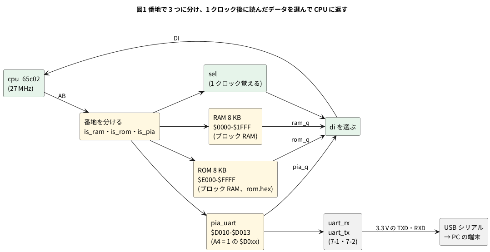

# 11-12 6502 を実物の FPGA に載せる

> [!WARNING]
> **この題は実機で組んでいない。** Verilog は Verilator の lint を通し、27 MHz・115 200 bps のまま UART のピンの上で wozmon と
> Integer BASIC と話す試験台を回して、自分で合否を言う試験を通した。yosys の `synth_gowin` で Tang Nano 9K の FPGA (GW1NR-9) 向けに合成し、
> nextpnr で配置配線して最高周波数を見積もり、`gowin_pack` でビットストリームを作るところまで確かめた。
> 書き込み・USB シリアルでの対話・AD3 での測定はしていない。「見るべき値」はシミュレーションの値と計算値で、測った値ではない。

11-7 と 11-8 では、soft-fpga の中で 6502 の RTL を動かし、wozmon と Integer BASIC と話した。
そこでは CPU の外側 (メモリ・キーボード・画面) を C++ のハーネスが真似ていた。
この題では外側も Verilog で書き、**CPU・RAM・ROM・キーボードと画面の代わりの UART を、まとめて 1 つの FPGA に入れる**。
PC の端末から USB シリアルでつなぐと、Tang Nano 9K が Apple-1 になって `\` を返す。

使う部品の題は次のとおり。

| 部品 | 題 | この題での役 |
| --- | --- | --- |
| 6502 の RTL と、同期メモリが前提なこと | 4-11 | CPU。番地を出した次のクロックにデータが要る |
| wozmon とメモリの並び | 11-7 | ROM の $FF00。PIA の 4 つの番地 |
| Integer BASIC と、PIA の番地の選び方 (A4) | 11-8 | ROM の $E000。$D0F2 にも字を書く |
| UART の送信・受信 | 7-1・7-2 | キーボードと画面の代わり |
| ブロック RAM | 10-13 | RAM と ROM を FPGA の中のメモリに置く |
| ボタンを 2 段で受ける | 9-2 | リセットのボタン |

## 決めたこと

| 項目 | 決め | 理由 |
| --- | --- | --- |
| CPU のクロック | ボードの 27 MHz をそのまま使う。実物の Apple-1 (1.023 MHz) の 26.4 倍 | 配置配線の見積りで最高 33.1〜42.8 MHz。27 MHz で間に合う。PLL も分周も要らない |
| RAM | $0000〜$1FFF の 8 KB (ブロック RAM 4 つ) | Integer BASIC の HIMEM は $1000 (4 KB)。倍あれば `HIMEM` を上げて試せる。`RAM_AW` を 15 にすると 32 KB (ブロック RAM 16 個) |
| ROM | $E000〜$FFFF の 8 KB (ブロック RAM 4 つ)。$E000 に BASIC、$FF00 に wozmon | 2 つを 1 つの ROM にまとめ、番地の下 13 ビットで引く |
| キーボードと画面 | PIA の 4 つの番地を真似る小さい回路 (`pia_uart`) で UART につなぐ | wozmon と BASIC を 1 バイトも書き替えずに動かせる |
| UART | 115 200 bps、8N1。受けた小文字は大文字にし、BS と DEL は Apple-1 の消す字 `_` にする | PC の端末の既定の速さ。Apple-1 のキーボードは大文字だけ |
| 画面の待ち | DSP のビット 7 を、UART が送っている間 1 にする | wozmon と BASIC は書く前にこのビットを見て待つ (11-7 の図 2)。送り切れない字を捨てずに済む |
| 改行 | CR ($8D) を書かれたら、CR の後に LF を足して送る | Apple-1 は CR だけで改行する。PC の端末は LF も要る |
| つなぐ所 | USB シリアル変換 (信号が 3.3 V の物) をブレッドボードで IO27・IO28 へ | 線が見えるので AD3 で同じ線を読める |
| 電源 | USB-C から Tang Nano 9K へ。USB シリアルは PC の USB から。2 つの GND をブレッドボードでつなぐ | ブレッドボードに電源は配らない |

FPGA のピンは 3.3 V (0-3)。この題で使うピンは全部 3.3 V の列で、1.8 V の `IO79`〜`IO86` は使わない。
**USB シリアル変換は、信号が 3.3 V の物を使う**。5 V の信号の物を IO28 につなぐと FPGA が壊れる。電圧を切り替えるジャンパの付いた物は 3.3 V にする。

## ブロック図




- 6502 のコアは、番地を出した**次のクロック**にデータを受け取る (4-11)。FPGA のブロック RAM も、番地を入れた次のクロックにデータを出す。そのまま 2 つをつなげばよい
- どのメモリを読んだかは 1 クロック遅れて分かればよい。`sel` に覚えて、次のクロックにそのメモリの出力を選ぶ
- PIA の代わりの回路も同じ形 (次のクロックに読む値を出す) にそろえた

## 回路図

```circuit
# 回路図 (tommie-fence の circuit フェンス)
title: 図2 IO27・IO28 を USB シリアルへ、UART の 2 本と IO25・IO26 の合図を AD3 へ
parts:
  U1: tang-nano-9k 5,6
  KBD: port 3.5,4.25
  DSP: port 3.5,4.5
  TXD: port 3.5,4.75
  RXD: port 3.5,5
  G0: ground 7,9.3
  M1:
    type: device
    at: 11,3
    label: USB UART
    pins: [RXD, TXD, GND]
  TXD: port 9.5,2.75
  RXD: port 9.5,3
  G1: ground 9.5,3.8
  AD:
    type: device
    at: 11,5.5
    label: AD3
    pins: [DIO0, DIO1, DIO2, DIO3, GND]
  TXD: port 9.5,5
  RXD: port 9.5,5.25
  KBD: port 9.5,5.5
  DSP: port 9.5,5.75
  G2: ground 9.5,6.6
wires:
  - U1.IO25 -- 3.5,4.25
  - U1.IO26 -- 3.5,4.5
  - U1.IO27 -- 3.5,4.75
  - U1.IO28 -- 3.5,5
  - U1.GND -- 7,8.75 -- 7,9.3
  - M1.RXD |- 9.5,2.75
  - M1.TXD |- 9.5,3
  - M1.GND |- 9.5,3.25 -- 9.5,3.8
  - AD.DIO0 |- 9.5,5
  - AD.DIO1 |- 9.5,5.25
  - AD.DIO2 |- 9.5,5.5
  - AD.DIO3 |- 9.5,5.75
  - AD.GND |- 9.5,6 -- 9.5,6.6
```


- 線で結ぶ代わりに、**同じ名前の端子どうしがつながっている** (12-4 と同じ描き方)。`TXD` は FPGA が送る線 (`uart_tx`) で、USB シリアルの RXD に入る。`RXD` はその逆
- U1 のピンの名前は Sipeed のピン配置図の FPGA のピン番号に `IO` を付けたもの。制約ファイル (`apple1.cst`) の番号と同じ
- AD3 は DIO0 で `TXD`、DIO1 で `RXD`、DIO2 で `KBD` (CPU が KBD を読んだ合図)、DIO3 で `DSP` (CPU が DSP に書いた合図) を読む
- 図に無いピン: 27 MHz のクロック (52 番) とリセットのボタン S1 (4 番) はボードの上で FPGA につながっている
- M1 は USB シリアル変換 (信号が 3.3 V の物)。VCC (5 V か 3.3 V の出力) はどこにもつながない。GND だけを共通にする

## 部品表

| 部品 | 値・型番 | 数 | 役 |
| --- | --- | --- | --- |
| U1 | Sipeed Tang Nano 9K (GW1NR-9) | 1 | FPGA ボード。USB-C から給電 |
| M1 | USB シリアル変換 (信号が 3.3 V の物。FT232R・FT234X・CH340 などのモジュール) | 1 | PC の端末と UART でつなぐ |
| — | ブレッドボード (full、63 列) | 1 | |
| — | ジャンパ線 | 約 10 本 | |
| AD | Analog Discovery 3 | 1 | Logic で TXD・RXD と 2 つの合図を読む |

電源は教科書の既定の 5 V ではなく **3.3 V** (FPGA のピン)。FPGA のピンに 5 V を入れると壊れるため (0-3)。
抵抗やコンデンサは使わない。UART の 2 本は 3.3 V どうしなので、そのままつなぐ。

USB シリアルをつながずに、Tang Nano 9K に載っている USB の変換 (BL702) を使うこともできる。
Sipeed の例 (TangNano-9K-example の `uart/src/top.cst`) では FPGA の 17 番ピンが `uart_tx`、18 番ピンが `uart_rx` で、USB-C の 1 本で書き込みと端末の両方ができる。
このピンはヘッダに出ていないので AD3 では読めない。この題では線を見るためにブレッドボードに出した。

## 実体配線図

```bread
# ブレッドボードの実体配線図 (tommie-fence の bread フェンス)
title: 図3 TXD・RXD は空いた列へ延ばし、上から USB シリアル、下から AD3 を挿す
board: full
parts:
  U1: tang-nano-9k @ b1
  AD:
    type: device
    at: bottom
    label: AD3 Logic
    pins: [DIO2, DIO3, DIO0, DIO1, GND]
  M1:
    type: device
    at: top
    label: USB-UART (3.3 V)
    pins: [GND, TXD, RXD]
wires:
  - a23 -- -t23 black
  - -t63 -- -b63 black
  - AD.DIO2 -- j5 purple
  - AD.DIO3 -- j6 purple
  - j7 -- j33 orange
  - j8 -- j30 blue
  - AD.DIO0 -- i33 green
  - AD.DIO1 -- i30 green
  - M1.TXD -- f30 blue
  - M1.RXD -- f33 orange
  - AD.GND -- -b40 black
  - M1.GND -- -t28 black
notes:
  - text: 給電は Tang Nano 9K の USB-C (5 V)。電源レールは GND (−) だけ使う
```


- Tang Nano 9K は溝をまたいで b 行と i 行に挿す (`@ b1`、12-4 と同じ)。1〜24 番が下の列 (i 行)、25〜48 番が上の列 (b 行)。基板の外側の 1 穴 (a 行・j 行) から線を取る
- 7 番ピン (IO27、TXD) と 8 番ピン (IO28、RXD) の列は外側に 1 穴しか空いていない。そこから空いた列へ 1 本ずつ延ばす。TXD は 33 列、RXD は 30 列で、TXD の線が RXD の線を外から包む (2 本が交わらない)
- 延ばした列の下半分 (f〜j 行) に、USB シリアルは上から f 行へ、AD3 は下から i 行へ挿す。USB シリアルを基板の上に置いたので、その線は Tang Nano 9K の右の空いた所を通り、ほかの線と交わらない
- 5 番ピン (IO25、KBD) と 6 番ピン (IO26、DSP) は AD3 だけがつながるので、j 行に直に挿す
- 交わるのは 1 か所だけ (AD3 の DIO1 の緑が、TXD の橙の延長をまたぐ)。AD3 は TXD と RXD の両方を読むので、包んだ線の内側の RXD へ届くには、どこかで TXD の線をまたぐ
- GND は 26 番ピン (23 列の a 行) から上のレールへ。上と下のレールを右端 (63 列) でつなぐ。USB シリアルの GND は上のレール、AD3 の GND は下のレールに挿す
- 線の色: 黒は GND だけ。橙は TXD、青は RXD、緑と紫は AD3。赤は使わない (+ の電源が無い)
- 流れる電流は信号のごく小さなものだけ。速い信号は 115 200 bps の UART (1 ビット 8.68 µs) と 1 µs の合図で、ブレッドボードの範囲 (3 MHz 以下) に収まる

## Verilog

モジュールは 6 つ。`uart_tx` と `uart_rx` は 7-1・7-2 の物をそのまま使う (置き場は `sim/12-apple1-fpga-uart-tx.v`・`sim/12-apple1-fpga-uart-rx.v`)。
`cpu_65c02` と、その中の `ALU` は soft-fpga のサブモジュール `examples/04-6502/verilog/hoglet` の `cpu_65c02.v` と `ALU.v` (11-7)。

### pia_uart.v — PIA の 4 つの番地を UART に

```verilog
// Apple-I の PIA (6820) のうち、Woz Monitor と Integer BASIC が使う 4 つの番地だけを真似て、
// キーボードと画面を UART に置き換える。番地を出した次のクロックに rdata が出る (ブロック RAM と同じ)
//   rs = 0  KBD    読むと {1, 字}。読んだら「字がある」を 0 に戻す
//   rs = 1  KBDCR  ビット 7 = 字がある
//   rs = 2  DSP    書くと最上位ビットが 1 の字だけ送る。読むとビット 7 = 送っている最中
//   rs = 3  DSPCR  読むと 0。書いても何もしない
module pia_uart #(
    parameter CLK_HZ = 27_000_000,
    parameter BAUD   = 115_200
) (
    input            clk,
    input            rst,
    input            cs,          // この 4 つの番地のどれかを出している
    input      [1:0] rs,          // 番地の下 2 ビット
    input            we,
    input      [7:0] wdata,
    output reg [7:0] rdata,
    input            rxd,
    output           txd,
    output           kbd_stb,     // CPU が KBD を読んだクロックだけ 1
    output           dsp_stb      // CPU が DSP に字を書いたクロックだけ 1
);
    // ---- キーボード: UART で受けた字を 1 字だけ持つ ----
    wire [7:0] rx_data;
    wire       rx_valid;
    /* verilator lint_off PINCONNECTEMPTY */     // frame_err と sample は使わない
    uart_rx #(.CLK_HZ(CLK_HZ), .BAUD(BAUD)) u_rx (
        .clk(clk), .rst(rst), .rxd(rxd), .data(rx_data), .valid(rx_valid), .frame_err(), .sample());
    /* verilator lint_on PINCONNECTEMPTY */

    // Apple-I のキーボードは大文字だけ。BS と DEL は Apple-I の消す字 '_' にする
    function [6:0] to_apple1(input [7:0] c);
        if (c >= "a" && c <= "z")      to_apple1 = c[6:0] - 7'h20;
        else if (c == 8'h08 || c == 8'h7F) to_apple1 = 7'h5F;
        else                           to_apple1 = c[6:0];
    endfunction

    reg [6:0] kbd_char;
    reg       kbd_full;
    wire      kbd_read = cs && !we && (rs == 2'd0);

    always @(posedge clk)
        if (rst) begin
            kbd_char <= 7'h00;
            kbd_full <= 1'b0;
        end else if (rx_valid && rx_data != 8'h0A) begin   // LF は捨てる (Enter は CR で来る)
            kbd_char <= to_apple1(rx_data);
            kbd_full <= 1'b1;
        end else if (kbd_read)
            kbd_full <= 1'b0;

    // ---- 画面: 書かれた字を UART で送る。CR の後に LF を足す ----
    reg  [7:0] tx_data;
    reg        tx_req;      // 送りたい字がある
    reg        lf_pend;     // CR を送ったら LF も送る
    wire       tx_busy;
    wire       tx_start = tx_req && !tx_busy;
    wire       dsp_write = cs && we && (rs == 2'd2) && wdata[7];   // 最上位ビットが 0 の書き込みは設定とみなす
    wire       dsp_busy = tx_req || tx_busy || lf_pend;

    uart_tx #(.CLK_HZ(CLK_HZ), .BAUD(BAUD)) u_tx (
        .clk(clk), .rst(rst), .data(tx_data), .start(tx_start), .txd(txd), .busy(tx_busy));

    always @(posedge clk)
        if (rst) begin
            tx_data <= 8'h00;
            tx_req  <= 1'b0;
            lf_pend <= 1'b0;
        end else if (dsp_write && !dsp_busy) begin
            tx_data <= {1'b0, wdata[6:0]};
            tx_req  <= 1'b1;
            lf_pend <= (wdata[6:0] == 7'h0D);
        end else if (tx_start)
            tx_req <= 1'b0;
        else if (lf_pend && !tx_req && !tx_busy) begin
            tx_data <= 8'h0A;
            tx_req  <= 1'b1;
            lf_pend <= 1'b0;
        end

    // ---- 読む値 (次のクロックに出す) ----
    always @(posedge clk)
        case (rs)
            2'd0:    rdata <= {1'b1, kbd_char};
            2'd1:    rdata <= {kbd_full, 7'h00};
            2'd2:    rdata <= {dsp_busy, 7'h00};
            default: rdata <= 8'h00;
        endcase

    assign kbd_stb = kbd_read;
    assign dsp_stb = dsp_write;
endmodule
```

- KBD を読むと「字がある」を 0 に戻す。実物の PIA と同じく、wozmon はまず KBDCR のビット 7 を見て、1 なら KBD を読む (11-7 の図 3)
- RESET は DSP に $7F を書く (11-7)。最上位ビットが 0 の書き込みは字として送らない
- `dsp_busy` は、字を受けてから LF を送り終えるまで 1。この間に書かれた字は来ない (CPU が待つ) ので、取りこぼしを考えなくてよい

### apple1_fpga.v — CPU とメモリ

```verilog
// Apple-I を FPGA の中に組む: 65C02 のコア + RAM + ROM + PIA の代わりの UART。
// メモリは番地を出した次のクロックにデータが出る形 (ブロック RAM)。コアがその形を前提にしている
//   $0000-$1FFF  RAM 8 KB (RAM_AW = 13)
//   $D010-$D013  PIA (A4 = 1 の $D0xx はどれも同じ 4 つ。BASIC は $D0F2 に書く)
//   $E000-$FFFF  ROM 8 KB ($E000 Integer BASIC、$FF00 Woz Monitor)
module apple1_fpga #(
    parameter CLK_HZ  = 27_000_000,
    parameter BAUD    = 115_200,
    parameter RAM_AW  = 13,
    parameter ROM_HEX = "rom.hex"
) (
    input  clk,
    input  rst,
    input  rxd,
    output txd,
    output kbd_stb,
    output dsp_stb,
    output sync        // opcode が CPU に届いたクロックで 1 (試験で命令を数える)
);
    wire [15:0] ab;
    wire [7:0]  dout;
    wire        we;
    reg  [7:0]  di;

    /* verilator lint_off PINCONNECTEMPTY */     // 観測用の出力 (o_a など) は使わない
    cpu_65c02 u_cpu (
        .clk(clk), .reset(rst), .AB(ab), .DI(di), .DO(dout), .WE(we),
        .IRQ(1'b0), .NMI(1'b0), .RDY(1'b1), .SYNC(sync),
        .o_a(), .o_x(), .o_y(), .o_sp(), .o_pc(), .o_p(), .o_state());
    /* verilator lint_on PINCONNECTEMPTY */

    // ---- 番地を分ける ----
    wire is_ram = (ab[15:RAM_AW] == {(16 - RAM_AW){1'b0}});
    wire is_pia = ((ab & 16'hFF10) == 16'hD010);
    wire is_rom = (ab[15:13] == 3'b111);

    // ---- RAM: 書くのは WE のクロック、読みは次のクロックに出る ----
    reg [7:0] ram [0:(1 << RAM_AW) - 1];
    reg [7:0] ram_q;
    always @(posedge clk) begin
        if (we && is_ram) ram[ab[RAM_AW-1:0]] <= dout;
        ram_q <= ram[ab[RAM_AW-1:0]];
    end

    // ---- ROM: 中身は合成のときに ROM_HEX から入れる ----
    reg [7:0] rom [0:8191];
    reg [7:0] rom_q;
    initial $readmemh(ROM_HEX, rom);
    always @(posedge clk) rom_q <= rom[ab[12:0]];

    // ---- PIA の代わり ----
    wire [7:0] pia_q;
    pia_uart #(.CLK_HZ(CLK_HZ), .BAUD(BAUD)) u_pia (
        .clk(clk), .rst(rst), .cs(is_pia), .rs(ab[1:0]), .we(we), .wdata(dout), .rdata(pia_q),
        .rxd(rxd), .txd(txd), .kbd_stb(kbd_stb), .dsp_stb(dsp_stb));

    // ---- どこを読んだかを 1 クロック覚えて、次のクロックにそのデータを選ぶ ----
    localparam [1:0] SEL_NONE = 2'd0, SEL_RAM = 2'd1, SEL_ROM = 2'd2, SEL_PIA = 2'd3;
    reg [1:0] sel;
    always @(posedge clk)
        sel <= is_ram ? SEL_RAM : is_rom ? SEL_ROM : is_pia ? SEL_PIA : SEL_NONE;

    always @(*)
        case (sel)
            SEL_RAM: di = ram_q;
            SEL_ROM: di = rom_q;
            SEL_PIA: di = pia_q;
            default: di = 8'hFF;      // 何も無い番地
        endcase
endmodule
```

- RAM は書きと読みを同じ `always` に置く形。yosys はこの形をブロック RAM (Gowin の `SP`) に割り当てる
- ROM は `initial $readmemh` で中身を入れる。合成のときに `rom.hex` を読み、ビットストリームにブロック RAM の初期値として入る
- 何も無い番地 ($2000〜$CFFF など) を読むと $FF

### top.v — Tang Nano 9K に載せる最上位

```verilog
// Tang Nano 9K に載せる最上位。27 MHz でそのまま 65C02 を回す。
// リセットは電源を入れた直後の 15 クロックと、ボードの S1 (押すと 0) を押している間
module top (
    input  clk,          // 52 番ピン。ボードの 27 MHz
    input  rst_n,        // 4 番ピン。ボードの S1
    input  uart_rx,      // USB シリアルの TXD から
    output uart_tx,      // USB シリアルの RXD へ
    output dbg_kbd,      // KBD を読んだら 1 µs だけ 1 (AD3 で見る)
    output dbg_dsp       // DSP に書いたら 1 µs だけ 1
);
    reg [3:0] por;
    initial por = 4'd0;
    always @(posedge clk)
        if (por != 4'hf) por <= por + 4'd1;

    reg [1:0] rst_sync;                    // ボタンは 2 段で受ける (9-2)
    reg       rst;                         // リセットもフリップフロップから出す (下の「合成」)
    initial rst = 1'b1;
    always @(posedge clk) begin
        rst_sync <= {rst_sync[0], rst_n};
        rst      <= (por != 4'hf) || !rst_sync[1];
    end

    wire kbd_stb, dsp_stb;
    /* verilator lint_off PINCONNECTEMPTY */
    apple1_fpga #(.ROM_HEX("rom.hex")) u (
        .clk(clk), .rst(rst), .rxd(uart_rx), .txd(uart_tx),
        .kbd_stb(kbd_stb), .dsp_stb(dsp_stb), .sync());
    /* verilator lint_on PINCONNECTEMPTY */

    // 1 クロック (37 ns) の合図は AD3 で取りこぼすので、27 クロック (1 µs) に延ばす
    reg [4:0] kbd_cnt, dsp_cnt;
    always @(posedge clk) begin
        kbd_cnt <= kbd_stb ? 5'd27 : (kbd_cnt != 5'd0) ? kbd_cnt - 5'd1 : 5'd0;
        dsp_cnt <= dsp_stb ? 5'd27 : (dsp_cnt != 5'd0) ? dsp_cnt - 5'd1 : 5'd0;
    end
    assign dbg_kbd = (kbd_cnt != 5'd0);
    assign dbg_dsp = (dsp_cnt != 5'd0);
endmodule
```

- リセットを組み合わせ回路のまま出すと、`por` からコアの中の多くのフリップフロップまでの道が一番遅い道になり、最高周波数が 30.0 MHz しか出なかった
  (配置配線の見積り、`--seed` 指定なし)。フリップフロップから出すと 35.0 MHz になった (同じ条件)
- コアの状態機械は reset を非同期で受ける (`always @(posedge clk or posedge reset)`)。フリップフロップから出しておけば、リセットを離すのはクロックにそろう

### ピンの割り当て (`apple1.cst`)

```text
IO_LOC "clk" 52;
IO_PORT "clk" IO_TYPE=LVCMOS33 PULL_MODE=UP;
IO_LOC "rst_n" 4;
IO_PORT "rst_n" PULL_MODE=UP;
IO_LOC "uart_tx" 27;
IO_PORT "uart_tx" IO_TYPE=LVCMOS33 DRIVE=8;
IO_LOC "uart_rx" 28;
IO_PORT "uart_rx" IO_TYPE=LVCMOS33 PULL_MODE=UP;
IO_LOC "dbg_kbd" 25;
IO_PORT "dbg_kbd" IO_TYPE=LVCMOS33 DRIVE=8;
IO_LOC "dbg_dsp" 26;
IO_PORT "dbg_dsp" IO_TYPE=LVCMOS33 DRIVE=8;
```

- 52 番ピンはボードの 27 MHz、4 番はボードの押しボタン S1 (押すと 0)。12-4 と同じ番号
- `uart_rx` は FPGA の中でプルアップする。USB シリアルを外しても 1 (アイドル) のまま

### ROM の中身を作る (`rom.hex`)

ROM のバイト列はこのリポジトリに置かない。soft-fpga の `examples/04-6502/cxx/harness.cpp` に C の配列 (`WOZMON[256]`・`BASIC[4096]`) として入っているので、そこから読み出して `$readmemh` の形にする。

```python
"""11-12: FPGA のブロック RAM に置く ROM の中身 ($E000-$FFFF の 8 KB) を $readmemh の形で書く。

ROM の中身 (Woz Monitor と Integer BASIC) はこのリポジトリに置かない。
soft-fpga の examples/04-6502/cxx/harness.cpp に C の配列 (WOZMON[256]・BASIC[4096]) として
入っているので、そこから読み出す。

    python3 -I 12-apple1-fpga-rom.py <soft-fpga>/examples/04-6502/cxx/harness.cpp rom.hex

並び: $E000-$EFFF = BASIC、$F000-$FEFF = $FF (何も無い)、$FF00-$FFFF = Woz Monitor。
1 行 1 バイト、8192 行。
"""

import re
import sys

ROM_BASE = 0xE000
ROM_SIZE = 0x2000


def c_array(source: str, name: str, size: int) -> bytes:
    """`static const uint8_t NAME[size] = { ... };` の中の 16 進を読む"""
    m = re.search(r"\b" + name + r"\[" + str(size) + r"\]\s*=\s*\{(.*?)\};", source, re.S)
    if m is None:
        raise SystemExit(f"{name}[{size}] が見つからない")
    body = re.sub(r"//[^\n]*", "", m.group(1))
    data = bytes(int(x, 16) for x in re.findall(r"0x([0-9A-Fa-f]{2})", body))
    if len(data) != size:
        raise SystemExit(f"{name} は {size} バイトのはずが {len(data)} バイト")
    return data


def main() -> None:
    if len(sys.argv) != 3:
        raise SystemExit("usage: 12-apple1-fpga-rom.py <harness.cpp> <out.hex>")
    with open(sys.argv[1], encoding="utf-8") as f:
        src = f.read()
    basic = c_array(src, "BASIC", 4096)
    wozmon = c_array(src, "WOZMON", 256)

    rom = bytearray([0xFF] * ROM_SIZE)
    rom[0xE000 - ROM_BASE:0xE000 - ROM_BASE + len(basic)] = basic
    rom[0xFF00 - ROM_BASE:0xFF00 - ROM_BASE + len(wozmon)] = wozmon
    reset = rom[0xFFFC - ROM_BASE] | rom[0xFFFD - ROM_BASE] << 8
    with open(sys.argv[2], "w", encoding="ascii") as f:
        f.writelines(f"{b:02X}\n" for b in rom)
    print(f"wrote {len(rom)} bytes, reset vector = ${reset:04X}")


if __name__ == "__main__":
    main()
```

```bash
python3 -I 12-apple1-fpga-rom.py <soft-fpga>/examples/04-6502/cxx/harness.cpp rom.hex
```

```text
wrote 8192 bytes, reset vector = $FF00
```

リセットのベクタ ($FFFC・$FFFD) は wozmon の中にあり、$FF00 を指す。CPU はリセットを離すと $FF00 から走り出す。

## 動かす

### UART のピンで話す試験

`apple1_fpga` を最上位にし、27 MHz・115 200 bps のまま回す。C++ の側で PC の UART (送り手と受け手) を真似て、`rxd` と `txd` のピンを 1 ビットずつ動かす・読む。

```cpp
// 11-12 の試験台。apple1_fpga (65C02 + RAM + ROM + UART) を 27 MHz・115 200 bps のまま回し、
// PC の側の UART (送り・受け) をこの C++ で真似て、ピンの上の 1 ビットずつで話す。
//   1. リセットすると '\' と CR LF が届く
//   2. 小文字で打っても大文字になってエコーが返る。打ち込んだプログラムが HELLO を出す
//   3. E000R で Integer BASIC。PRINT 2+3 で 5
//   4. FOR を 1000 回まわす時間 (クロック数)
//   5. 1 字を送り終えてから、エコーの 1 字が始まるまでのクロック数
// 終わりに PASS か FAIL: n を出す。
#include <cstdint>
#include <cstdio>
#include <string>

#include "Vapple1_fpga.h"
#include "verilated.h"

static const double CLK_HZ = 27e6;
static const double BAUD = 115200.0;
static const double BIT = CLK_HZ / BAUD;  // 1 ビット = 234.375 クロック

static Vapple1_fpga* dut;
static uint64_t      cycle = 0;
static int           errors = 0;
static std::string   screen;        // FPGA から届いた字
static long          kbd_reads = 0, dsp_writes = 0, instructions = 0;
static uint64_t      kbd_at = 0, dsp_at = 0;   // 最後に KBD を読んだ・DSP に書いたクロック

// ---- PC の側の受け手: txd を見て字にする ----
static int      rx_state = 0;       // 0 = 待つ、1 = 受けている
static double   rx_next = 0;        // 次に読む時刻 (クロック)
static int      rx_bit = 0;
static uint8_t  rx_byte = 0;
static uint64_t rx_start_at = 0;    // 最後の字のスタートビットが始まったクロック

static void pc_receive() {
    const int line = dut->txd;
    if (rx_state == 0) {
        if (line == 0) {            // スタートビットの始まり
            rx_state = 1;
            rx_start_at = cycle;
            rx_next = cycle + BIT * 1.5;   // bit0 の真ん中
            rx_bit = 0;
            rx_byte = 0;
        }
    } else if (cycle >= (uint64_t)rx_next) {
        if (rx_bit < 8) {
            rx_byte |= (uint8_t)(line << rx_bit);
            ++rx_bit;
            rx_next += BIT;
        } else {                    // ストップビット
            if (line != 1) printf("framing error at cycle %llu\n", (unsigned long long)cycle);
            screen += (char)rx_byte;
            rx_state = 0;
        }
    }
}

// ---- PC の側の送り手: 字の列を rxd に 1 ビットずつ出す ----
static std::string tx_queue;
static double      tx_t0 = -1;      // 今送っている字のスタートビットの時刻
static uint64_t    tx_start_at = 0; // 最後の字のスタートビットが始まったクロック
static uint64_t    tx_end_at = 0;   // 最後の字のストップビットが終わったクロック

static void pc_send() {
    if (tx_t0 < 0) {
        if (tx_queue.empty()) { dut->rxd = 1; return; }
        tx_t0 = (double)cycle;
        tx_start_at = cycle;
    }
    const int k = (int)((cycle - tx_t0) / BIT);   // 何ビット目か (0 = スタート、9 = ストップ)
    const uint8_t c = (uint8_t)tx_queue[0];
    if (k == 0)      dut->rxd = 0;
    else if (k <= 8) dut->rxd = (c >> (k - 1)) & 1;
    else if (k == 9) dut->rxd = 1;
    else {                                         // 1 字送り終えた
        tx_queue.erase(0, 1);
        tx_end_at = cycle;
        tx_t0 = -1;
        dut->rxd = 1;
    }
}

static void tick() {
    pc_send();
    dut->clk = 0;
    dut->eval();
    dut->clk = 1;
    dut->eval();
    ++cycle;
    if (dut->kbd_stb) { ++kbd_reads; kbd_at = cycle; }
    if (dut->dsp_stb) { ++dsp_writes; dsp_at = cycle; }
    if (dut->sync) ++instructions;
    pc_receive();
}

static void check(bool ok, const char* what) {
    printf("%s %s\n", ok ? "ok" : "NG", what);
    if (!ok) ++errors;
}

// want が今から後に届くまで回す。届いたクロックを返す (届かなければ 0)
static uint64_t run_until(const std::string& want, uint64_t limit) {
    const size_t from = screen.size();
    for (uint64_t i = 0; i < limit; ++i) {
        tick();
        if (screen.find(want, from) != std::string::npos) return cycle;
    }
    return 0;
}

// 1 行を送り、エコーが済むまで待ってから CR を送り、prompt が届くまで回す。届いた字を返す
static std::string line(const std::string& s, const std::string& prompt, uint64_t* clocks = nullptr) {
    tx_queue += s;
    while (!tx_queue.empty()) tick();
    for (int i = 0; i < 20000; ++i) tick();       // 最後のエコーが届くまで
    screen.clear();
    tx_queue += '\r';
    while (!tx_queue.empty()) tick();
    const uint64_t cr_end = tx_end_at;
    const uint64_t got = run_until(prompt, 200000000);
    if (clocks) *clocks = got ? got - cr_end : 0;
    return screen;
}

int main(int argc, char** argv) {
    Verilated::commandArgs(argc, argv);
    dut = new Vapple1_fpga;
    dut->rxd = 1;
    dut->rst = 1;
    for (int i = 0; i < 16; ++i) tick();
    dut->rst = 0;

    // 1. リセット直後
    const uint64_t prompt_at = run_until("\\\r\n", 1000000);
    printf("prompt at clock %llu (%.1f us)\n", (unsigned long long)prompt_at, prompt_at / 27.0);
    check(prompt_at > 0 && screen == "\\\r\n", "reset prints '\\' CR LF on the UART");

    // 5. エコーの遅れ: 'a' を 1 字送り、そのスタートビットから、返る 'A' のスタートビットまで
    screen.clear();
    tx_queue += "a";
    run_until("A", 100000);
    const uint64_t lag = rx_start_at - tx_start_at;
    printf("echo: 'a' start bit at %llu, 'A' start bit at %llu (+%llu clocks = %.2f us = %.2f bits)\n",
           (unsigned long long)tx_start_at, (unsigned long long)rx_start_at, (unsigned long long)lag,
           lag / 27.0, lag / BIT);
    printf("echo: KBD read at +%llu clocks, DSP write at +%llu clocks (from the start bit of 'a')\n",
           (unsigned long long)(kbd_at - tx_start_at), (unsigned long long)(dsp_at - tx_start_at));
    check(screen == "A", "lower-case 'a' comes back as 'A'");
    tx_queue += "\x1b";                           // ESC で行を捨てる
    run_until("\\\r\n", 1000000);

    // 2. 11-7 と同じプログラム (小文字で打つ)
    line("0300: a2 00 bd 10 03 f0 06 20 ef ff e8 d0 f5 4c 00 ff", "0300: 00\r\n");
    line("0310: c8 c5 cc cc cf 8d 00", "0310: 00\r\n");
    const std::string r = line("0300R", "\\\r\n");
    printf("--- 0300R ---\n%s-------------\n", r.c_str());
    check(r == "\r\n\r\n0300: A2HELLO\r\n\\\r\n", "0300R prints HELLO");

    // 3. Integer BASIC
    check(line("E000R", ">") == "\r\n\r\nE000: 4C\r\n>", "E000R prints '>'");
    uint64_t c = 0;
    const std::string p = line("print 2+3", ">", &c);
    printf("PRINT 2+3 -> %zu chars, %llu clocks from CR to '>'\n", p.size(), (unsigned long long)c);
    check(p == "\r\n5\r\n\r\n>", "PRINT 2+3 prints 5");

    // 4. FOR を 1000 回
    line("10 FOR I=1 TO 1000", ">");
    line("20 NEXT I", ">");
    line("30 END", ">");
    uint64_t loop = 0;
    const long i0 = instructions;
    const std::string run = line("RUN", ">", &loop);
    printf("RUN (FOR 1..1000): %llu clocks = %.2f ms at 27 MHz, %ld instructions\n",
           (unsigned long long)loop, loop / 27e3, instructions - i0);
    check(run == "\r\n\r\n>", "the loop ends and returns to '>'");
    line("10 FOR I=1 TO 2000", ">");
    uint64_t loop2 = 0;
    line("RUN", ">", &loop2);
    printf("RUN (FOR 1..2000): %llu clocks, per pass %.1f clocks\n", (unsigned long long)loop2,
           (double)(loop2 - loop) / 1000.0);
    // 測り始め (CR のストップビットの終わり) と UART の受けの刻みの位相で、1 ビット (234 クロック) ほど揺れる
    const long d = (long)(loop2 - loop) - 1260000;
    check(d > -300 && d < 300, "one pass of FOR/NEXT is 1260 clocks (the same as 11-8)");

    printf("KBD reads %ld, DSP writes %ld, total %llu clocks\n", kbd_reads, dsp_writes,
           (unsigned long long)cycle);
    if (errors == 0) printf("PASS\n");
    else             printf("FAIL: %d\n", errors);
    dut->final();
    delete dut;
    return errors == 0 ? 0 : 1;
}
```

```bash
H=<soft-fpga>/examples/04-6502/verilog/hoglet
verilator --lint-only -Wall lint.vlt --top-module top \
  top.v apple1_fpga.v pia_uart.v uart_tx.v uart_rx.v $H/cpu_65c02.v $H/ALU.v
verilator --cc --exe --build -j 8 -O3 -Wno-fatal -Wno-lint -Wno-style lint.vlt \
  --top-module apple1_fpga -GROM_HEX='"rom.hex"' \
  apple1_fpga.v pia_uart.v uart_tx.v uart_rx.v $H/cpu_65c02.v $H/ALU.v apple1_fpga_tb.cpp -o tb
./obj_dir/tb
```

`lint.vlt` は、借りたコアの警告を lint で見ないための設定 (置き場は `sim/12-apple1-fpga.vlt`)。自分で書いた 4 つのモジュールは `-Wall` で警告 0 件。

```text
`verilator_config
// 借りた 65C02 のコアの警告は見ない (自分の書いた所だけ -Wall で見る)
lint_off -file "*hoglet/*"
// コアは reset を 1 か所だけ非同期 (always @(posedge clk or posedge reset)) で使う。その知らせ
lint_off -rule SYNCASYNCNET
```

```text
prompt at clock 6988 (258.8 us)
ok reset prints '\' CR LF on the UART
echo: 'a' start bit at 6988, 'A' start bit at 9302 (+2314 clocks = 85.70 us = 9.87 bits)
echo: KBD read at +2291 clocks, DSP write at +2312 clocks (from the start bit of 'a')
ok lower-case 'a' comes back as 'A'
--- 0300R ---


0300: A2HELLO
\
-------------
ok 0300R prints HELLO
ok E000R prints '>'
PRINT 2+3 -> 8 chars, 31017 clocks from CR to '>'
ok PRINT 2+3 prints 5
RUN (FOR 1..1000): 1277284 clocks = 47.31 ms at 27 MHz, 385879 instructions
ok the loop ends and returns to '>'
RUN (FOR 1..2000): 2537270 clocks, per pass 1260.0 clocks
ok one pass of FOR/NEXT is 1260 clocks (the same as 11-8)
KBD reads 168, DSP writes 232, total 4683802 clocks
PASS
```

試験は全部 ok で `PASS` (468 万クロック、手元の PC で 0.2 秒ほど)。

- **wozmon と BASIC は 1 バイトも書き替えずに動いた**。11-7 と同じプログラムが `HELLO` を出し、`E000R` で `>`、小文字の `print 2+3` で `5` が出た
- `FOR` の 1 回は 1 260 クロックで、11-8 の soft-fpga と同じ。CPU の RTL が同じなので、クロック数も同じになる。27 MHz では 46.7 µs (計算値)
- `PRINT 2+3` の CR から `>` までは 31 017 クロック。11-8 の 17 356 クロックより 13 661 クロック長い。画面に出す 8 字を UART で送る間、CPU が DSP のビット 7 を見て待つため (1 字 10 ビット = 2 340 クロック)
- 1 字のエコーは、`a` のスタートビットから `A` のスタートビットまで 85.70 µs。そのうち 9.5 ビット (82.5 µs) は、`uart_rx` がストップビットの真ん中を読むまでの時間。
  そこから CPU が KBD を読み (84.85 µs)、ECHO で DSP に書き (85.63 µs)、2 クロック後に `A` を送り始める

### 合成と配置配線

```bash
yosys -p "read_verilog top.v apple1_fpga.v pia_uart.v uart_tx.v uart_rx.v cpu_65c02.v ALU.v; \
  rename ALU alu6502; chtype -map ALU alu6502 cpu_65c02; \
  synth_gowin -top top -json apple1.json; stat"
nextpnr-himbaechel --json apple1.json --write apple1_pnr.json --device GW1NR-LV9QN88PC6/I5 \
  --vopt family=GW1N-9C --vopt cst=apple1.cst --freq 27
gowin_pack -d GW1N-9C -o apple1.fs apple1_pnr.json
```

- **コアの `ALU` というモジュール名は、Gowin の基本セル `ALU` (桁上げの回路) と同じ名前**。そのまま `synth_gowin` に渡すと「`ALU` の定義が 2 つある」と止まる。
  読み込んだ後に `rename` でコアの側の名前を替え、`chtype` で `cpu_65c02` の中の呼び出しも替えてから合成する
- `rom.hex` は yosys を走らせる所に置く (`top.v` が `ROM_HEX("rom.hex")` で読む)

OSS CAD Suite の Yosys 0.70+16 と nextpnr-himbaechel 0.11.1-63 で数えた。

| 種類 | 数 | GW1NR-9 の中の割合 |
| --- | --- | --- |
| LUT (nextpnr の LUT4) | 1 443 | 8 640 の 17 % |
| フリップフロップ (DFF) | 219 | 6 480 の 3 % |
| 桁上げの回路 (ALU) | 120 | 1 % |
| ブロック RAM (BSRAM) | 8 (RAM 4・ROM 4) | 26 の 31 % |
| 分散 RAM (RAM16SDP4) | 2 (コアの A・X・Y・S) | 1 % 未満 |
| 入出力 (IOB) | 6 | 2 % |

| `--seed` | 最高周波数 (配置配線の後) | 27 MHz で |
| --- | --- | --- |
| 指定なし | 35.02 MHz | PASS |
| 1 | 33.07 MHz | PASS |
| 2 | 42.81 MHz | PASS |
| 3 | 35.92 MHz | PASS |

- 一番遅い道は、リセットのフリップフロップからコアの中の加算器を通って `ADD` のレジスタまで (`--seed` 指定なしで 28.56 ns、うち配線 12.67 ns)
- 最高周波数は配置の乱数 (`--seed`) で 33〜43 MHz とばらつく。一番悪い回でも 27 MHz に 2 割の余裕がある。8 KB の RAM を 32 KB (`RAM_AW` = 15) にすると、ブロック RAM は 20 個、最高周波数は 32.74 MHz (`--seed` 指定なしの 1 回) になった
- 6502 のコアだけで LUT の大半を使う。それでも GW1NR-9 の 2 割に満たないので、横にほかの回路 (7 セグ・VGA など) を足す余地がある

書き込むには `openFPGALoader -b tangnano9k apple1.fs` (8-4)。この題では `.fs` ができるところまでを確かめた。書き込みは未実行。

## 端末でつなぐ

1. Tang Nano 9K に `apple1.fs` を書き込む
2. PC で USB シリアルのポートを開く。115 200 bps、8 ビット、パリティなし、ストップ 1、フロー制御なし
   (Linux なら `picocom -b 115200 /dev/ttyUSB0`、Windows なら Tera Term)
3. S1 を押して離す。端末に `\` が出て改行する
4. 11-7 と同じく `0300: A2 00 BD 10 03 F0 06 20 EF FF E8 D0 F5 4C 00 FF` … と打つ。小文字で打ってもよい
5. `E000R` で BASIC。`PRINT 2+3` で `5`

端末の Enter が CR を送る設定にする (多くの端末の既定)。LF は捨てるので、CR LF を送る設定でも動く。

## 計器の設定

| 計器 | 設定 |
| --- | --- |
| Logic | DIO0 を `TXD`、DIO1 を `RXD`、DIO2 を `KBD`、DIO3 を `DSP` につなぐ。DIO は 3.3 V。GND を共通にする (0-4) |
| 読み下し | DIO0 と DIO1 に UART (115 200 bps、8N1) |
| 時間軸 | 20 µs/div (10 目盛で 200 µs。1 字の 86.8 µs が 2 つ入る)。標本化 10 MS/s (1 µs の合図に 10 標本) |
| トリガ | DIO1 の立ち下がり (PC から来る字のスタートビット)。トリガの前を 10 µs 見せる |

端末で `a` を 1 字打つと、トリガが掛かる。

## Logic に見えるはずの画面

```logic
# ロジックアナライザの画面 (tommie-fence の logic フェンス)
title: 図4 a を受けてから A を送り始めるまで 85.7 µs
device: ad3
time: 20us/div
start: -10us
sample: 10MHz
signals:
  TXD: dio0 pattern 10100000101 bit 8.667us from 77.03us
  RXD: dio1 pattern 10100001101 bit 8.681us from -8.681us
decode:
  PC: uart RXD baud 115200 8N1 ascii
  FPGA: uart TXD baud 115385 8N1 ascii
cursors: [0us, 85.7us]
trigger: RXD falling at 0s
```


| 時刻 (µs) | 何が起きるか |
| --- | --- |
| 0 (X1) | PC が `a` ($61) のスタートビットを送り始める |
| 82.5 | `uart_rx` がストップビットの真ん中を読み、字を `kbd_char` に入れる (KBDCR のビット 7 が 1) |
| 84.85 | wozmon が KBD を読む (`KBD` の合図)。次の 7 クロックの待ちの周で、KBDCR が 1 になったのを見つけた |
| 85.63 | ECHO が DSP に $C1 (`A`) を書く (`DSP` の合図) |
| 85.70 (X2) | `uart_tx` が `A` ($41) のスタートビットを送り始める |

同じ所を 80〜90 µs だけ広げて見る (時間軸 1 µs/div)。

```logic
# ロジックアナライザの画面 (tommie-fence の logic フェンス)
title: 図5 受け終えてから送り始めるまでの 3.2 µs。KBD を読み、21 クロック後に DSP に書く
device: ad3
time: 1us/div
start: 80us
sample: 100MHz
signals:
  TXD: dio0 pattern 10100000101 bit 8.667us from 77.03us
  RXD: dio1 pattern 10100001101 bit 8.681us from -8.681us
  KBD: dio2 pulse 84.85us 1us
  DSP: dio3 pulse 85.63us 1us
cursors: [82.5us, 85.7us]
trigger: KBD rising at 84.85us
```


- X1 (82.5 µs) はストップビットの真ん中。`uart_rx` がここで字を受け取る (2 段の同期の 2 クロックを含めると 82.6 µs ごろ)
- X2 (85.7 µs) で TXD が下がる。ΔX = 3.2 µs = 約 86 クロックが、字を受けてから返し始めるまでの FPGA の中の時間
- KBD の合図から DSP の合図までの 0.78 µs (21 クロック) が、wozmon が字を確かめて ECHO を呼ぶまで

- ΔX = 85.7 µs は、ほぼ 1 字ぶん (10 ビット = 86.8 µs) の遅れ。エコーが 1 字遅れで流れてくる
- FPGA の送る速さは、27 MHz を 234 で割った 115 385 bps (+0.16 %)。受ける側の `uart_rx` は 16 倍の刻みを 27 MHz ÷ 15 で作るので、112 500 bps (−2.3 %) を前提に読む。ずれは 1 字の終わりのストップビットで 0.23 ビットで、真ん中を読む余裕 (0.5 ビット) の内側 (7-6)
- `KBD` と `DSP` の合図は、FPGA の中では 1 クロック (37 ns) の幅。AD3 で読めるように `top.v` で 1 µs に延ばした。20 µs/div では細すぎるので、図 4 には描かず、図 5 で広げて見る

## 見るべき値

シミュレーションの値と計算値。実機では測っていない。

| 項目 | 値 | どこで得たか |
| --- | --- | --- |
| リセットから `\` CR LF が届くまで | 6 988 クロック = 258.8 µs | UART の試験 |
| 1 字のエコー (スタートビットからスタートビット) | 2 314 クロック = 85.70 µs | UART の試験・図 4 の ΔX |
| `a` を受けてから CPU が KBD を読むまで | 84.85 − 82.5 = 約 2.4 µs | UART の試験 (82.5 µs は 9.5 ビットの計算値) |
| `FOR` の 1 回 | 1 260 クロック = 46.7 µs | UART の試験 (11-8 と同じ) |
| `FOR` 1000 回の `RUN` (CR から `>` まで) | 1 277 284 クロック = 47.3 ms | UART の試験 |
| 同じ 1000 回を実物の Apple-1 (1.023 MHz) で | 1.24 s | 11-8 |
| 最高周波数 (配置配線の見積り) | 33.1〜42.8 MHz | nextpnr (4 回) |
| LUT・FF・ブロック RAM | 1 443・219・8 | nextpnr |
| 送る速さの誤差 | +0.16 % (115 385 bps) | 27 MHz ÷ 234 |
| 受ける速さの誤差 | −2.3 % (112 500 bps) | 27 MHz ÷ 15 ÷ 16 |

## シミュレーションでの確かめ (対象外を含む)

Verilator 5.042、Yosys 0.33 と 0.70+16、nextpnr-himbaechel 0.11.1-63 で、本文のファイルを走らせた。
置き場は `sim/12-apple1-fpga.v` (`apple1_fpga.v`)・`sim/12-apple1-fpga-pia.v` (`pia_uart.v`)・`sim/12-apple1-fpga-top.v` (`top.v`)・
`sim/12-apple1-fpga-uart-tx.v`・`sim/12-apple1-fpga-uart-rx.v` (7-1・7-2 の写し)・`sim/12-apple1-fpga.cst` (`apple1.cst`)・
`sim/12-apple1-fpga.vlt` (`lint.vlt`)・`sim/12-apple1-fpga-rom.py`・`sim/12-apple1-fpga-tb.cpp`。
コアは soft-fpga の f89a885 のサブモジュール `verilog/hoglet` (03951de) の `cpu_65c02.v` と `ALU.v`。

| 項目 | 本文の数字 | 実行結果 | 判定 |
| --- | --- | --- | --- |
| lint (`-Wall`、`top` を最上位、コアの警告は `lint.vlt` で外す) | 警告 0 件 | 0 件 (ファイル名をモジュール名にして回した) | 合った |
| `rom.hex` | 8192 バイト、ベクタ $FF00 | 同じ。BASIC と wozmon の部分の MD5 は soft-fpga の `rom/basic.bin`・`rom/wozmon.bin` と一致 | 合った |
| UART の試験 (`tb`) | 7 項目 ok、PASS | 同じ (0.16 秒) | 合った |
| リセットから `\`・エコーの遅れ | 6 988 クロック、2 314 クロック (KBD +2 291、DSP +2 312) | 同じ | 合った |
| `FOR` の 1 回 | 1 260 クロック | (2 537 270 − 1 277 284) ÷ 1000 = 1 259.99 | 合った (測り始めの位相で ±1 ビットの揺れ) |
| 合成 (Yosys 0.70+16) | (表のとおり) | LUT1 259・LUT2 204・LUT3 372・LUT4 472、MUX2_LUT5〜8 370・146・64・28、ALU 90、FF 207、SP 8、RAM16SDP4 2 (nextpnr は FF を 219、ALU を 120 と数える) | 補足 |
| 合成 (Yosys 0.33) | (本文に無い) | LUT 1 514 (605 + 232 + 230 + 447)、FF 207、ALU 90、SP 8、RAM16SDP4 2 | 補足 (版でブロック RAM の割り当ては同じ) |
| 配置配線 (`--freq 27`) | 33.1〜42.8 MHz、LUT4 1 443、DFF 219、ALU 120、BSRAM 8、IOB 6 | 35.02・33.07・42.81・35.92 MHz、すべて PASS | 合った |
| リセットを組み合わせ回路のまま出したとき | 30.0 MHz | 30.02 MHz (`--seed` 指定なし) | 合った |
| 32 KB の RAM | BSRAM 20、32.74 MHz | 同じ | 合った |
| `gowin_pack` | `.fs` ができる | できた (書き込みは未実行) | 合った |
| 送る・受ける速さの誤差 | +0.16 %、−2.3 % | 27e6 ÷ 234 = 115 385、27e6 ÷ 240 = 112 500 | 合った (計算) |
| 図 4 | 試験の時刻 (0・84.85・85.63・85.70 µs) をそのまま置いた | 同じ | 合った |

確かめていない数: 実機への書き込み・USB シリアルでの対話・図 4 の AD3 での測定・FPGA の中の実際の遅れ。

## 出典

- 自作。6502 の RTL の出所と条件は 11-7 (hoglet67/verilog-6502 の `cpu_65c02.v`、Arlet Ottens・David Banks・Ed Spittles。著作権表示を残せば商用でも使ってよい)。
  コアが同期メモリを前提にすること、Spartan-6 で 80 MHz で動いた例は hoglet67/verilog-6502 の README
- Woz Monitor と Integer BASIC の出所と扱いは 11-7・11-8。この題では ROM のバイト列を写さず、soft-fpga の `examples/04-6502/cxx/harness.cpp` から読み出す
- Tang Nano 9K のクロック (52 番)・ボタン (4 番)・載っている USB の変換の UART (17 番・18 番): Sipeed の [TangNano-9K-example](https://github.com/sipeed/TangNano-9K-example) の `led/src/9K_LED_project.cst` と `uart/src/top.cst`
- GW1NR-9 の LUT・フリップフロップ・ブロック RAM の数: nextpnr-himbaechel の `Device utilisation` と Sipeed の [Tang Nano 9K のページ](https://wiki.sipeed.com/hardware/en/tang/Tang-Nano-9K/Nano-9K.html)
