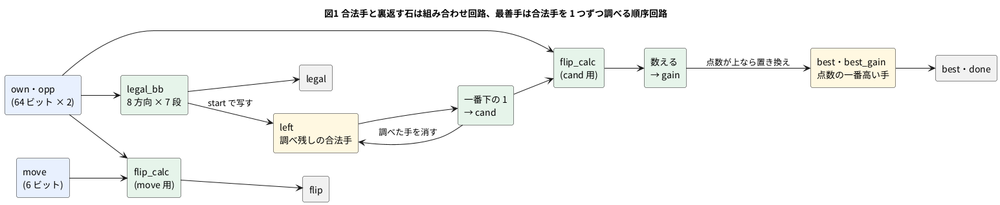

# 12-1 リバーシのアクセラレータ — 合法手と裏返しを回路で

> [!WARNING]
> **この題は PC のシミュレーションだけで確かめた。** Verilog は Verilator の lint を通し、
> 乱数で打った 1000 局 (62 364 局面) の合法手・裏返す石・選んだ手を、素朴な参照実装と突き合わせた。
> 合成の数は yosys の `synth_gowin` の見積りで、実物の FPGA には載せていない。

リバーシ (オセロと同じ遊び) を打つプログラムが一番多く繰り返すのは、**どこに打てるか (合法手)** と、
**打ったらどの石が裏返るか** を調べる計算である。素直に書くと、64 マスのそれぞれから 8 方向を 1 マスずつ辿る。
CPU では 1 局面に数千回の比較と分かれ道になる。

この題では、この 2 つの計算を **1 クロックの組み合わせ回路** にする。盤を 64 ビットの数 2 つ (自分の石と相手の石) で持ち、
「盤の石を全部まとめて 1 マスずらす」を 6 回重ねると、8 方向の答えが同時に出る。
さらに、合法手を 1 クロックに 1 つずつ調べて**最善手を選ぶ順序回路**を足す。
CPU に「計算だけ」を任されて速く返す回路を、**アクセラレータ** と呼ぶ。

この回路は 12-2 で Pico 2 の Soft-FPGA に載せ、UART で PC と対戦する。
組まない題なので、実体配線図と Analog Discovery 3 は入れない (SIM の題)。

## 決めたこと

| 項目 | 決め | 理由 |
| --- | --- | --- |
| 盤の持ち方 | 64 ビットの `own` (打つ側の石) と `opp` (相手の石)。番号は 行 × 8 + 列 (a1 = 0、h1 = 7、a8 = 56、h8 = 63) | 10-14 のビットボード。リバーシ UART プロトコルの盤の並び (a1, b1, … h1, a2, …) と同じ順なので、12-2 で並べ替えが要らない |
| 合法手 `legal` | 組み合わせ回路。8 方向 × 7 段のずらしと AND・OR | 1 クロックで出る。CPU の 1 命令ぶんの時間で 64 マスの答えが揃う |
| 裏返す石 `flip` | 組み合わせ回路。打つマス `move` の 1 ビットから 8 方向を辿る | 合法手と同じ形の回路で書ける |
| 最善手 | 順序回路。合法手を番号の小さい順に 1 クロックに 1 つ調べ、点数の一番高い手を残す | 64 マスを同時に調べる回路は `flip_calc` が 64 個要る。1 つを使い回して時間で払う (10-4 の掛け算と同じ引き換え) |
| 点数 | 角 (a1・h1・a8・h8) なら 32 を足し、そのほかは裏返る数 | 強くはないが、決まりが短く、試験で同じ答えを C で出せる |
| 同じ点数のとき | 番号の小さい手 (先に調べた手) | 結果が 1 つに決まる。参照実装と 1 ビットも違わない答えにできる |

点数の決め方は、強い打ち方を目指したものではない。この題で見たいのは、**決まった計算を回路にすると何クロックで終わるか**である。

## 盤を 64 ビットで持つ

```text
  a b c d e f g h        番号 (行 × 8 + 列)
1 . . . . . . . .         0  1  2  3  4  5  6  7
2 . . . . . . . .         8  9 10 11 12 13 14 15
3 . . . * . . . .        16 17 18 19 20 21 22 23
4 . . * O X . . .        24 25 26 27 28 29 30 31
5 . . . X O * . .        32 33 34 35 36 37 38 39
6 . . . . * . . .        40 41 42 43 44 45 46 47
7 . . . . . . . .        48 49 50 51 52 53 54 55
8 . . . . . . . .        56 57 58 59 60 61 62 63
```

始めの局面。X が黒 (先手)、O が白、`*` が黒の合法手 (d3 = 19、c4 = 26、f5 = 37、e6 = 44)。
黒の石は e4 (28) と d5 (35) なので、`own = (1 << 28) | (1 << 35)` = `0x0000_0008_1000_0000`。

盤の石を全部まとめて 1 マスずらすのは、64 ビットのシフト 1 つで済む。

| 向き | ずらし方 | 消す列 | 理由 |
| --- | --- | --- | --- |
| 東 (列 +1) | `<< 1` | a 列 | h 列の石が次の行の a 列へ回り込むので消す |
| 西 (列 −1) | `>> 1` | h 列 | a 列の石が前の行の h 列へ回り込む |
| 南 (行 +1) | `<< 8` | なし | 上下にはみ出した石は、64 ビットの外へ落ちる |
| 北 (行 −1) | `>> 8` | なし | 同上 |
| 南東・南西・北東・北西 | `<< 9` `<< 7` `>> 7` `>> 9` | 東向きは a 列、西向きは h 列 | 横の向きの回り込みを消す |

消すのは AND 1 つ (`NOT_A = 0xFEFE…FE`、`NOT_H = 0x7F7F…7F`)。シフトは配線をずらすだけで、FPGA の中では部品を使わない。

## ブロック図




- 緑の箱が組み合わせ回路、黄の箱がレジスタ。`legal` と `flip` はクロックを待たずに出る
- `start` を 1 にしたクロックで、`legal` を `left` に写す。以後 1 クロックごとに、`left` の一番下の 1 (番号の一番小さい合法手) を `cand` として調べ、`left` から消す
- `left` が空になった次のクロックで `done` を 1 にする。**合法手が n 個なら、start の次の立ち上がりから n + 1 クロックで done**

## Verilog

モジュールは 3 つ。1 ファイル 1 モジュールにした。

### legal_bb.v — 合法手

```verilog
// 合法手の地図を 1 クロックの組み合わせ回路で出す。
// 盤は 64 ビット。番号 = 行 * 8 + 列 (a1 が 0、h1 が 7、a8 が 56、h8 が 63)
module legal_bb (
    input      [63:0] own,      // 打つ側の石
    input      [63:0] opp,      // 相手の石
    output reg [63:0] legal     // 打てるマスが 1
);
    localparam [63:0] NOT_A = 64'hFEFE_FEFE_FEFE_FEFE;   // a 列 (左端) を消す
    localparam [63:0] NOT_H = 64'h7F7F_7F7F_7F7F_7F7F;   // h 列 (右端) を消す

    // 盤の全部の石を、方向 d へ 1 マス進める。端からはみ出した石は消す
    function [63:0] step(input [63:0] x, input [2:0] d);
        case (d)
            3'd0:    step = (x << 1) & NOT_A;   // 東 (列 +1)
            3'd1:    step = (x >> 1) & NOT_H;   // 西 (列 -1)
            3'd2:    step =  x << 8;            // 南 (行 +1)
            3'd3:    step =  x >> 8;            // 北 (行 -1)
            3'd4:    step = (x << 9) & NOT_A;   // 南東
            3'd5:    step = (x << 7) & NOT_H;   // 南西
            3'd6:    step = (x >> 7) & NOT_A;   // 北東
            default: step = (x >> 9) & NOT_H;   // 北西
        endcase
    endfunction

    wire [63:0] empty = ~(own | opp);

    integer d, k;
    reg [63:0] run;     // 自分の石から d の向きに続く相手の石

    always @(*) begin
        legal = 64'd0;
        for (d = 0; d < 8; d = d + 1) begin
            run = step(own, d[2:0]) & opp;                  // 隣が相手の石
            for (k = 0; k < 5; k = k + 1)
                run = run | (step(run, d[2:0]) & opp);      // 相手の石を辿る (6 個まで)
            legal = legal | (step(run, d[2:0]) & empty);    // その先が空きなら打てる
        end
    end
endmodule
```

- `run` は「自分の石から、ある向きに途切れずに続く相手の石」。1 段目で自分の石の隣にある相手の石を取り、あとの 5 段で 1 マスずつ延ばす。
  盤は 8 マスなので、挟める相手の石は 1 列に 6 個まで。6 段で足りる
- 最後に `run` をもう 1 マスずらして、そこが空きなら打てる。8 方向の答えを OR で集める
- `for` は回路を繰り返し並べる書き方で、実行の順ではない (1-5)。合成すると 8 × 7 段のシフトと AND・OR が並ぶ

### flip_calc.v — 裏返す石

```verilog
// move に打ったとき裏返る相手の石を、1 クロックの組み合わせ回路で出す。
// 打てない手 (埋まっているマス・1 つも挟めない) では 0
module flip_calc (
    input      [63:0] own,
    input      [63:0] opp,
    input      [5:0]  move,
    output reg [63:0] flip
);
    localparam [63:0] NOT_A = 64'hFEFE_FEFE_FEFE_FEFE;
    localparam [63:0] NOT_H = 64'h7F7F_7F7F_7F7F_7F7F;

    function [63:0] step(input [63:0] x, input [2:0] d);   // legal_bb と同じ
        case (d)
            3'd0:    step = (x << 1) & NOT_A;
            3'd1:    step = (x >> 1) & NOT_H;
            3'd2:    step =  x << 8;
            3'd3:    step =  x >> 8;
            3'd4:    step = (x << 9) & NOT_A;
            3'd5:    step = (x << 7) & NOT_H;
            3'd6:    step = (x >> 7) & NOT_A;
            default: step = (x >> 9) & NOT_H;
        endcase
    endfunction

    wire [63:0] m = 64'd1 << move;     // 打つマスだけが 1

    integer d, k;
    reg [63:0] run;

    always @(*) begin
        flip = 64'd0;
        for (d = 0; d < 8; d = d + 1) begin
            run = step(m, d[2:0]) & opp;                    // 打つマスの隣の相手の石
            for (k = 0; k < 5; k = k + 1)
                run = run | (step(run, d[2:0]) & opp);
            if ((step(run, d[2:0]) & own) != 64'd0)         // その先に自分の石があれば挟める
                flip = flip | run;
        end
        if (((own | opp) & m) != 64'd0)                     // 埋まっているマスには打てない
            flip = 64'd0;
    end
endmodule
```

- 辿り始めが、自分の石全部 (`own`) から、打つマス 1 つ (`m`) に替わっただけで、`legal_bb` と同じ形
- 辿った相手の石の先に**自分の石**があれば、その向きの `run` が全部裏返る
- `step` の関数は 2 つのファイルに同じ物を置いた。Verilog-2001 では関数をモジュールの外に置けない (`` `include `` で 1 つのファイルにまとめる手もある)

### reversi_accel.v — 最善手を選ぶ

```verilog
// リバーシのアクセラレータ。合法手と裏返す石は組み合わせ回路で、
// 最善手は合法手を 1 クロックに 1 つずつ調べて選ぶ (調べる回路は flip_calc 1 つ)
module reversi_accel (
    input             clk,
    input             rst,
    input      [63:0] own,         // 打つ側の石 (探している間は変えない)
    input      [63:0] opp,         // 相手の石
    input      [5:0]  move,        // flip を知りたい手
    input             start,       // 1 にした次のクロックから最善手を探す
    output     [63:0] legal,       // 合法手 (すぐ出る)
    output     [63:0] flip,        // move に打ったとき裏返る石 (すぐ出る)
    output reg        busy,        // 探している間 1
    output reg        done,        // 探し終えたクロックだけ 1
    output reg        found,       // 合法手が 1 つ以上あった
    output reg [5:0]  best,        // 選んだ手
    output reg [4:0]  best_gain    // 選んだ手で裏返る数
);
    localparam [63:0] CORNER = 64'h8100_0000_0000_0081;   // a1 h1 a8 h8

    legal_bb  u_legal (.own(own), .opp(opp), .legal(legal));
    flip_calc u_flip  (.own(own), .opp(opp), .move(move), .flip(flip));

    // 調べ残しの合法手。一番小さい番号から 1 つずつ調べて消す
    reg  [63:0] left;
    wire [63:0] low = left & (~left + 64'd1);   // 一番下の 1 だけ残す

    reg [5:0] cand;             // low の番号 (1 が立つ位置)
    integer i;
    always @(*) begin
        cand = 6'd0;
        for (i = 0; i < 64; i = i + 1)
            if (low[i]) cand = i[5:0];
    end

    wire [63:0] cflip;
    flip_calc u_scan (.own(own), .opp(opp), .move(cand), .flip(cflip));

    reg [4:0] gain;             // 裏返る数 (1 手で多くても 19 個)
    always @(*) begin
        gain = 5'd0;
        for (i = 0; i < 64; i = i + 1)
            gain = gain + {4'd0, cflip[i]};
    end

    // 点数 = 角なら 32 + 裏返る数。同じ点数なら先に調べた (番号の小さい) 手を残す
    wire [5:0] score = {(low & CORNER) != 64'd0, gain};
    reg  [5:0] best_score;

    always @(posedge clk) begin
        done <= 1'b0;
        if (rst) begin
            busy <= 1'b0; found <= 1'b0; best <= 6'd0; best_gain <= 5'd0;
            best_score <= 6'd0; left <= 64'd0;
        end else if (start) begin
            busy <= 1'b1; found <= (legal != 64'd0); best <= 6'd0; best_gain <= 5'd0;
            best_score <= 6'd0; left <= legal;
        end else if (busy) begin
            if (left == 64'd0) begin
                busy <= 1'b0;
                done <= 1'b1;
            end else begin
                if (score > best_score) begin
                    best_score <= score;
                    best       <= cand;
                    best_gain  <= gain;
                end
                left <= left & ~low;
            end
        end
    end
endmodule
```

- `left & (~left + 1)` は、**一番下の 1 だけを残す**決まった手 (2 の補数の性質。`~left + 1` は `-left`)。`left & ~low` でその 1 を消す
- `cand` は `low` の 1 の位置を 6 ビットの番号に直す。`low` は 1 ビットしか立たないので、どの順に調べても同じ答え
- 裏返る数 `gain` は、`cflip` の 1 を数える (ビットの数を数える回路。足し算の木になる)。1 手で裏返る数は、8 方向それぞれの「端までのマス − 1」を足しても 19 個が上限 (どのマスでも。計算で確かめた) なので、5 ビット (31 まで) で足りる
- 点数の 6 ビット目が「角かどうか」。角の手は、裏返る数がいくつでも角でない手より上になる
- `own` と `opp` は、探している間 (`busy` の間) 変えない。変えると、`left` を写した後の局面とずれる

lint は 3 つとも警告 0 件 (Verilator 5.042、`-Wall`)。

## 試験台

参照実装は、盤を 8 × 8 のマスとして**1 マスずつ辿る素朴な C++** にした。回路とは書き方が全く違うので、同じ答えが出れば両方が正しいと言える。
試験台は Verilator の `--cc --exe` で回路といっしょにビルドする C++ で、自分で合否を言う。

| 確かめること | やり方 |
| --- | --- |
| 合法手 | 乱数で 1000 局を最後まで打ち、途中の全部の局面で `legal` を参照実装と比べる |
| 裏返す石 | 同じ局面の全 64 マスで `flip` を比べる (打てない手は 0 になるか、も含む) |
| 最善手とクロック数 | `start` を入れて `done` まで回し、`best`・`best_gain`・`found` と、かかったクロック数 (合法手の数 + 1) を比べる |
| 局面の数 (perft) | 始めの局面から深さ 1〜8 の、打ち方の数を数える。回路と参照実装で同じか、公表された数と同じか |

`01-reversi-accel-tb.cpp` (要所だけ載せる。全部は `sim/` にある):

```cpp
// ---- 参照実装: 盤を 8×8 の配列にして、8 方向を 1 マスずつ辿る ----
static const int DR[8] = {-1, -1, -1, 0, 0, 1, 1, 1};
static const int DC[8] = {-1, 0, 1, -1, 1, -1, 0, 1};

static int at(u64 b, int r, int c) { return (int)((b >> (r * 8 + c)) & 1u); }

static u64 ref_flip(u64 own, u64 opp, int idx) {
    int r0 = idx / 8, c0 = idx % 8;
    if (at(own | opp, r0, c0)) return 0;
    u64 all = 0;
    for (int d = 0; d < 8; d++) {
        u64 line = 0;
        int r = r0 + DR[d], c = c0 + DC[d];
        while (r >= 0 && r < 8 && c >= 0 && c < 8 && at(opp, r, c)) {
            line |= 1ull << (r * 8 + c);
            r += DR[d]; c += DC[d];
        }
        if (line && r >= 0 && r < 8 && c >= 0 && c < 8 && at(own, r, c)) all |= line;
    }
    return all;
}

// start を 1 クロック入れ、done まで待つ。clocks は start の次の立ち上がりから done が 1 になるまでの数
static int hw_pick(u64 own, u64 opp, int* gain, int* clocks, int* found) {
    top->own = own; top->opp = opp;
    top->start = 1; tick(); top->start = 0;
    int n = 0;
    do { tick(); n++; } while (!top->done && n < 200);
    *clocks = n; *gain = top->best_gain; *found = top->found;
    return top->best;
}
```

- 乱数の打ち手は、毎回、参照実装の合法手から 1 つを選ぶ。打てなければパスし、両方が続けてパスしたら終局 (リバーシの決まり)
- perft (パーフト) は、ゲームの手を作る部分の検査によく使う数。決まった深さまで全部の打ち方を辿り、葉の数を数える。
  リバーシの深さ 1〜8 の数は OEIS の A124004 に載っている (4、12、56、244、1 396、8 200、55 092、390 216)

## 動かす

```bash
verilator --lint-only -Wall legal_bb.v
verilator --lint-only -Wall flip_calc.v
verilator --lint-only -Wall reversi_accel.v legal_bb.v flip_calc.v
verilator --cc --exe --build -O3 reversi_accel.v legal_bb.v flip_calc.v tb_accel.cpp -o tb_accel
./obj_dir/tb_accel
```

```text
start position: legal=0000102004080000 best=19 gain=1 clocks=5
random games: 1000, positions: 62364, flip checks: 3991296, pick checks: 62364, max clocks: 24
perft 1: accel 4, ref 4
perft 2: accel 12, ref 12
perft 3: accel 56, ref 56
perft 4: accel 244, ref 244
perft 5: accel 1396, ref 1396
perft 6: accel 8200, ref 8200
perft 7: accel 55092, ref 55092
perft 8: accel 390216, ref 390216
PASS
```

- 1 行目は始めの局面。`legal = 0x0000102004080000` は 19・26・37・44 番の 4 ビット (d3・c4・f5・e6)。
  どれも 1 個しか裏返らず角も無いので、番号の一番小さい d3 (19) を選んだ。合法手 4 個で 5 クロック
- 1000 局で 62 364 局面、裏返す石は 3 991 296 回 (局面 × 64 マス) 比べて、1 つも違わなかった
- 一番多くかかったのは 24 クロック (合法手 23 個の局面)
- perft の深さ 8 まで、回路・参照実装・OEIS の 3 つが同じ数になった。深さ 8 の 390 216 局面は、`legal` と `flip` を 50 万回ほど引いて数えた

## シミュレーションの波形

終盤の 1 局面で、最善手を探すところを波形にした。黒の番で、合法手は b6・c6・d8・f8・h8 の 5 つ。

```text
  a b c d e f g h
1 O . X O O O O O
2 X X X O X O O O
3 X X X X X O O O
4 X X X O X X X O
5 X X O X X X X O
6 X * * X X O O O
7 . X O O O O O O
8 . X X * X * O *
```

| 手 | 番号 | 裏返る数 | 角 | 点数 |
| --- | --- | --- | --- | --- |
| b6 | 41 | 2 | | 2 |
| c6 | 42 | 3 | | 3 |
| d8 | 59 | 3 | | 3 |
| f8 | 61 | 3 | | 3 |
| h8 | 63 | 2 | 角 | 34 |

`own = 0x1602_197B_771F_1704`、`opp = 0x40FC_E084_88E0_E8F9`。1 クロックを 10 µs (マイクロ秒) と置いた仮の目盛で、
`01-reversi-accel-wave-tb.v` を iverilog 12 と Verilator で回した値から描いた。実機で測った波形ではない。

```logic
# ロジックアナライザの画面 (tommie-fence の logic フェンス)
title: 図2 合法手 5 つを 1 クロックずつ調べ、6 クロックめに done。角の h8 (63) が残る
device: generic
time: 11us/div
signals:
  CLK: edges 0s=0 5us=1 10us=0 15us=1 20us=0 25us=1 30us=0 35us=1 40us=0 45us=1 50us=0 55us=1 60us=0 65us=1 70us=0 75us=1 80us=0 85us=1 90us=0 95us=1 100us=0 105us=1
  START: edges 0s=0 16us=1 26us=0
  BUSY: edges 0s=0 25us=1 85us=0
  DONE: edges 0s=0 85us=1 95us=0
  C5: edges 0s=0 25us=1 75us=0
  C4: edges 0s=0 45us=1 75us=0
  C3: edges 0s=0 25us=1 75us=0
  C2: edges 0s=0 55us=1 75us=0
  C1: edges 0s=0 35us=1 55us=0 65us=1 75us=0
  C0: edges 0s=0 25us=1 35us=0 45us=1 75us=0
  B5: edges 0s=0 35us=1
  B4: edges 0s=0 75us=1
  B3: edges 0s=0 35us=1
  B2: edges 0s=0 75us=1
  B1: edges 0s=0 45us=1
  B0: edges 0s=0 35us=1 45us=0 75us=1
buses:
  cand: C5..C0 dec
  best: B5..B0 dec
cursors: [30us, 90us]
```


| 立ち上がり | 起きたこと | `cand` (調べる手) | `best` (その時点の最善) |
| --- | --- | --- | --- |
| 25 µs | `start` を見て、合法手を `left` に写す。`busy` = 1 | 41 (b6) | 0 |
| 35 µs | b6 (点数 2) を調べた。今までの最善 (0) より上 | 42 (c6) | 41 |
| 45 µs | c6 (点数 3) が上 | 59 (d8) | 42 |
| 55 µs | d8 (点数 3) は同じ点数なので置き換えない | 61 (f8) | 42 |
| 65 µs | f8 (点数 3) も同じ | 63 (h8) | 42 |
| 75 µs | h8 (点数 34、角) が上。`left` が空になる | 0 | 63 |
| 85 µs | `left` が空なので `done` = 1、`busy` = 0 | 0 | 63 |

- 図2のカーソル X1 = 30 µs は、調べ始めたところ (`cand` = 41、`best` = 0)。X2 = 90 µs は `done` = 1 で `best` = 63 (h8)
- `start` を見た立ち上がり (25 µs) から `done` の立ち上がり (85 µs) まで 6 クロック。合法手 5 個 + 1 で、試験台の数え方と同じ
- `cand` は組み合わせ回路なので、`left` が替わった立ち上がりの直後に次の手を指す。`best` はその手を調べた次の立ち上がりで替わる
- 裏返る数だけなら c6・d8・f8 の 3 個が最多だが、角の h8 が残った。同じ点数の d8・f8 は、先に調べた c6 に負ける

## 見るべき値 (シミュレーションを実行して得た値)

| 項目 | 値 | どこで得たか |
| --- | --- | --- |
| `legal` と `flip` が出るまで | 0 クロック (組み合わせ回路。入力が替われば同じクロックの中で出る) | 回路の作り |
| 最善手が出るまで | 合法手の数 + 1 クロック。始めの局面は 5、図2の局面は 6、1000 局で一番多いのは 24 | 試験台・図2 |
| 1000 局 62 364 局面の突き合わせ | 合法手・裏返す石 (3 991 296 回)・最善手が全部同じ | 試験台 |
| perft の深さ 8 | 390 216 (回路・参照実装・OEIS A124004 で同じ) | 試験台 |
| 図2の局面の最善手 | h8 (63)、裏返る数 2 | 図2 |

- 合法手が出るまで 0 クロック、とは「次の立ち上がりで使ってよい」の意味。実物の FPGA では、組み合わせ回路の遅れが 1 クロックの周期に収まるかを確かめる (9-3)
- 参照実装は 1 局面の合法手を出すのに、64 マス × 8 方向を辿る。回路は同じ答えを 1 クロックで出す。この差が、12-2 で Pico 2 から回路を呼ぶ理由になる

## FPGA に載せるとき

3 つの回路を、合成の道具 (yosys) の `synth_gowin` に通した。

```bash
yosys -p "read_verilog reversi_accel.v legal_bb.v flip_calc.v; synth_gowin -top legal_bb; stat"
yosys -p "read_verilog reversi_accel.v legal_bb.v flip_calc.v; synth_gowin -top reversi_accel; stat"
```

| 回路 | LUT (LUT1〜LUT4) yosys 0.33 | LUT yosys 0.70+16 | フリップフロップ | ALU |
| --- | --- | --- | --- | --- |
| `legal_bb` | 867 | 1 246 | 0 | 0 |
| `flip_calc` | 5 691 | 5 568 | 0 | 0 |
| `reversi_accel` (全部) | 8 887 | 5 686 | 79 | 75 |

- LUT の数は、LUT1〜LUT4 を足した数 (MUX2_LUT5〜8 は含めない)。Tang Nano 9K の FPGA (GW1NR-9) は LUT が 8 640 個 (12-4)
- **合法手と裏返しを回路にすると大きい。** `reversi_accel` は yosys 0.70+16 で LUT の 3 分の 2 ほど、0.33 では LUT を使い切る数が出た。
  同じ回路が道具の版で 1.5 倍違うのは、10-4 の `*` と同じ (道具の最適化の差)
- 大きいのは `flip_calc` で、`legal_bb` の 4 倍以上ある。打つマス `move` を 64 本の線に直す (`1 << move`) 所と、8 方向の答えを選ぶ所が、64 ビットぶん並ぶためと見ている (内訳は追っていない)。
  `flip_calc` だけを合成すると、0.70+16 では 2 つを含む `reversi_accel` より LUT が多く出た。道具が回路の境目をまたいで最適化するかどうかで変わる
- 最善手を 64 マス同時に調べる回路 (`flip_calc` を 64 個並べる) は、この数から見て GW1NR-9 に入らない。1 つを使い回して n + 1 クロックかける作りにしたのはこのため
- フリップフロップ 79 個は `left` 64、`best` 6、`best_gain` 5、`busy`・`done`・`found` の 3 と、`best_score` の一部 (残りは道具が削った)
- 数は合成の見積りで、配置配線と実物の FPGA では確かめていない

## シミュレーションでの確かめ

Verilator 5.042・iverilog 12・Yosys 0.33 と 0.70+16 で、本文の Verilog と試験台を取り出して走らせ直した。
置き場は `sim/01-reversi-accel-legal.v` (`legal_bb`)・`sim/01-reversi-accel-flip.v` (`flip_calc`)・`sim/01-reversi-accel.v` (`reversi_accel`)・
`sim/01-reversi-accel-tb.cpp` (試験台)・`sim/01-reversi-accel-wave-tb.v` (図2の波形)。lint は、ファイルをモジュールの名前に写してから打つ
(ファイル名とモジュール名が違うと Verilator が言うため)。

| 項目 | 本文の数字 | 実行結果 | 判定 |
| --- | --- | --- | --- |
| lint (`-Wall`、3 つの回路) | 警告 0 件 | 0 件 | 合った |
| 始めの局面 | `legal` = `0x0000102004080000`、d3 (19)、裏返る数 1、5 クロック | 同じ | 合った |
| 乱数の 1000 局 | 62 364 局面、flip 3 991 296 回、違い 0、最長 24 クロック | 同じ、PASS | 合った |
| perft 1〜8 | 4、12、56、244、1 396、8 200、55 092、390 216 | 回路と参照実装で同じ。OEIS A124004 の数とも同じ | 合った |
| 図2の波形 | `cand` 41・42・59・61・63、`best` 41→42→63、85 µs で `done` | iverilog と Verilator (`--binary --timing`) で同じ表、PASS: best=h8 gain=2 | 合った |
| 合成 `legal_bb` (0.33 / 0.70+16) | LUT 867 / 1 246 | LUT1 437 + LUT2 55 + LUT3 40 + LUT4 335 / 492 + 223 + 208 + 323 | 合った |
| 合成 `flip_calc` | LUT 5 691 / 5 568 | 4 111 + 206 + 318 + 1 056 / 3 183 + 536 + 555 + 1 294 | 合った |
| 合成 `reversi_accel` | LUT 8 887 / 5 686、FF 79、ALU 75 | 4 960 + 526 + 1 015 + 2 386 / 1 443 + 747 + 1 390 + 2 106、DFFR 2 + DFFRE 77、ALU 75 (どちらの版も) | 合った |

確かめていないもの: 配置配線と最高の周波数、実物の FPGA での動き。12-2 では、この回路を Pico 2 の Soft-FPGA で動かす。

## 出典

自作。盤を 64 ビットで持ち、8 方向へずらして合法手と裏返す石を出す書き方 (a 列・h 列を消すマスク、6 段の辿り) は、
[tommie-jp/Soft-FPGA-Reversi](https://github.com/tommie-jp/Soft-FPGA-Reversi) (MIT ライセンス) の `rtl/legal_bb.v`・`rtl/flip_calc.v` を読み、
`for` と関数を使う形に書き直した。最善手を 1 つずつ調べる順序回路と点数の決めは、この題で足した。

- 盤の番号の並び (a1 = 0、行優先): [tommie-jp/reversi-uart-protocol](https://github.com/tommie-jp/reversi-uart-protocol) (CC BY 4.0) の §8
- perft の数: [OEIS A124004](https://oeis.org/A124004) (リバーシの n 手目までの打ち方の数)
