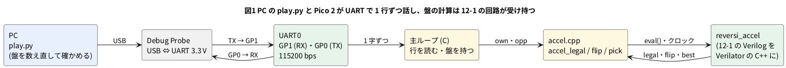

# 12-2 リバーシを UART で PC と対戦させる

> [!WARNING]
> **この題は実機で組んでいない。** Pico 2 のプログラムは `.uf2` までビルドし、RP2350 のエミュレータ (picoemu) に載せて
> UART 越しに 200 局を打たせた。PC では同じプログラムを替え玉の UART で動かし、PC の側のプログラムと 200 局を打たせた。
> 実物の Pico 2 への書き込み、Debug Probe と PC の端末での対局、AD3 での測定はしていない。
> 「見るべき値」の時間の欄は、測って書く。

12-1 で作ったリバーシのアクセラレータを Pico 2 の Soft-FPGA に載せ、**PC と UART で対戦させる**。
PC からは「黒で始めて」「相手は d3 に打った」と 1 行ずつ送り、Pico 2 は自分の手を 1 行で返す。
行の決まりは、自作の CPU を PC と対戦させるために決められた [リバーシ UART プロトコル](https://github.com/tommie-jp/reversi-uart-protocol) (v0.2) に従う。
同じ決まりを話す物どうしなら、相手が PC のソフトでも、別の人が FPGA で作った CPU でも対戦できる。

仕事は 3 つに分けた。

| 仕事 | 誰がするか | 理由 |
| --- | --- | --- |
| UART のビットを字にする | Pico 2 の UART の部品 (ハードウェア) | 7-1・7-2 では Verilog で書いた。この題では盤の計算に絞るため、Pico 2 に元からある部品に任せる |
| 行を読み、決まりどおりに答える | C の主ループ | 字の並びを比べて分かれる仕事。分かれ道の多い仕事は CPU が得意 |
| 合法手・裏返す石・最善手 | 12-1 の回路 (Verilator の C++) | 64 マスを同時に調べる仕事。回路が得意 |

Soft-FPGA-Reversi では、行を読む所まで Verilog で書いている (`rtl/proto.v`)。この題は、回路の仕事を盤の計算に絞った形にした。
UART を 115200 bps のビットのまま Verilog で読まないのは、Soft-FPGA の 1 クロックが 1 bit の 8.7 µs より遅くなりうるため (5-6)。

## 決めたこと

| 項目 | 決め | 理由 |
| --- | --- | --- |
| UART | Pico 2 の UART0。GP0 が TX (送る)、GP1 が RX (受ける)。115200 bps、8N1、流れの制御なし | プロトコルの §4 の例の速さ。GP0・GP1 は UART0 の既定のピン (7-3 と同じ) |
| PC とのつなぎ | Raspberry Pi Debug Probe の UART の端子 (3.3 V) | Pico 2 のピンは 3.3 V (0-3)。Debug Probe は Pico 2 への書き込みにも使える (0-9) |
| 話す行 | 必須の `SB` `SW` `MO` `PA` `EB` `EW` `ED` `VE` `PI` と、`CA` `XB`。`BO` (盤を丸ごと送る) は受けない | プロトコルで任意とされた行を減らし、主ループを短くした |
| 打つ手 | 12-1 の `reversi_accel` の最善手 (角を先に、次に裏返る数の多い手) | 12-1 で C の参照実装と突き合わせ済み |
| 回路を使わないビルド | `SOFT_FPGA` を定義しないと、同じ答えを C の関数で出す | 回路の版と C の版で同じ棋譜になることを確かめる。速さを比べる |
| 起きたとき | `RE` を 1 行送る | プロトコルの §11。PC は `RE` を見たら直前の指示を送り直せる |
| 誤った行 | `-01`〜`-06` で答える | プロトコルの §7.3。FPGA の最小の作りなら `-00` だけでもよい、とされている |

この題で使わない決め: 字と字の間が 100 ms 空いたら行を捨てる決め (プロトコルの §6) は入れていない。人が端末で打つと 100 ms は空くので、手で試すときに困るからである。

## 話す行

PC → Pico 2 (左) と Pico 2 → PC (右)。行の終わりはどれも CR LF (`\r\n`)。

| PC が送る | 意味 | Pico 2 が返す |
| --- | --- | --- |
| `PI` | 生きているか | `+PI` |
| `VE` | 版 | `+VE02wb-reversi-12-2` (`02` がプロトコルの版) |
| `CA` | 話せる行の一覧 | `+CA PI VE CA SB SW MO PA EB EW ED XB` |
| `SB` | あなたは黒 (先手) | 自分の手 `MOd3` など |
| `SW` | あなたは白 (後手) | 返さない (相手の手を待つ) |
| `MOe3` | 相手は e3 に打った | 自分の手 `MOf3` など。打てなければ `PA` |
| `PA` | 相手はパス | 自分の手か `PA` |
| `EB` `EW` `ED` | 終わり (黒の勝ち・白の勝ち・引き分け) | 返さない |
| `XB` | 拡張: 考えた量 | `+XB moves=手の数 clocks=回路のクロックの合計 us=考えた時間の合計` |

誤った行への答え: 小文字のコマンド `-02`、CR の無い行 `-03`、座標の書き違い `-04`、打てない手 `-05`、対局していないのに `MO`・`PA` `-06`、知らないコマンド `-01`、80 字を超える行 `-00`。
空の行 (CR LF だけ) は黙って捨てる。`X` で始まる知らない行 (ほかの人の拡張) も黙って捨てる。

始めの数行のやり取り (左の `>` が PC から、`<` が Pico 2 から):

```text
< RE              Pico 2 が起きた
> PI
< +PI
> SB              あなたは黒
< MOd3            始めの局面の合法手 d3・c4・f5・e6 は同じ点数。番号の小さい d3
> MOe3            PC (白) は e3
< MOf3            Pico 2 は f3
```

盤の座標は a1 が左上、行は上から 1〜8 (プロトコルの §8)。12-1 の番号 (行 × 8 + 列) と同じ並びで、`d3` は 2 × 8 + 3 = 19 番になる。

## ブロック図




- 主ループは字を 1 つずつ受け、LF が来たら 1 行として調べる。盤 (`black` と `white` の 64 ビット 2 つ) は主ループが持つ
- 盤の計算は `accel_legal` `accel_flip` `accel_pick` の 3 つの関数だけを呼ぶ。中身が回路か C かを、主ループは知らない
- 最善手を探す `accel_pick` だけクロックを回す (合法手の数 + 1 クロック、12-1)。`accel_legal` と `accel_flip` は組み合わせ回路なので `eval()` 1 回で答えが出る

## 回路図

```circuit
# 回路図 (tommie-fence の circuit フェンス)
title: 図2 Debug Probe と AD3 を GP0・GP1 につなぐ
parts:
  MCU: pico2 3,6 mirror
  DP:
    type: device
    at: 13,2.8
    label: Debug Probe (UART)
    pins: [RX, TX, GND]
  AD:
    type: device
    at: 13,6
    label: AD3
    pins: [DIO1, DIO0, GND]
  G1: ground 7.4,4
  G2: ground 11,4
  G3: ground 11,7
wires:
  - MCU.GP0 -- 9.4,2.4 -- DP.RX
  - MCU.GP1 -- 8.6,2.8 -- DP.TX
  - MCU.GND3 -| 7.4,4
  - DP.GND -| 11,4
  - 9.4,2.4 |- AD.DIO1
  - 8.6,2.8 |- AD.DIO0
  - AD.GND -| 11,7
style:
  pitch: 1.2
```


- Debug Probe の TX (Probe が送る) を Pico 2 の GP1 (受ける) へ、Pico 2 の GP0 (送る) を Probe の RX へ。**送ると受けるを交差させる**
- AD3 は同じ 2 本を読むだけ。DIO0 が PC → Pico 2 (GP1)、DIO1 が Pico 2 → PC (GP0)
- 3 つの GND を共通にする。どれも 3.3 V の信号で、レベル変換は要らない
- Pico 2 の電源は USB (PC と別のポートでよい)。Debug Probe も PC の USB につなぐ

## 部品表

| 部品 | 値・型番 | 数 | 役 |
| --- | --- | --- | --- |
| MCU | Raspberry Pi Pico 2 | 1 | Soft-FPGA (12-1 の回路) と主ループ |
| DP | Raspberry Pi Debug Probe | 1 | PC の USB と Pico 2 の UART (3.3 V) をつなぐ。書き込みにも使える |
| — | ブレッドボード (half) | 1 | |
| — | ジャンパ線 | 6 本 | Debug Probe の UART の端子から 3 本 (端子の線の先をブレッドボードに挿す)、AD3 から 3 本 |
| AD | Analog Discovery 3 | 1 | Logic で TX と RX の字を読む |
| — | USB ケーブル | 2 本 | Pico 2 の給電と書き込み、Debug Probe と PC |

電源は教科書の既定の 5 V ではなく **3.3 V** (Pico 2 のピン)。Pico 2 のピンに 5 V を入れると壊れるため (0-3)。
3.3 V でない USB-UART の変換器 (5 V のもの) をつながない。

## 実体配線図

```bread
# ブレッドボードの実体配線図 (tommie-fence の bread フェンス)
title: 図3 GP0 (TX)・GP1 (RX)・GND の 3 列に Debug Probe と AD3 をつなぐ
board: half
parts:
  MCU: pico2 @ h5
  DP:
    type: device
    at: bottom
    label: Debug Probe (UART)
    pins: [RX, TX, GND]
  AD:
    type: device
    at: bottom
    label: AD3 Logic
    pins: [DIO1, DIO0, GND]
wires:
  - DP.RX -- j5 green
  - DP.TX -- j6 yellow
  - DP.GND -- j7 black
  - AD.DIO1 -- i5 white
  - AD.DIO0 -- i6 orange
  - AD.GND -- i7 black
```


- `pico2 @ h5` は 7-3 と同じ向き。GP0 (1 番) が 5 列、GP1 (2 番) が 6 列、GND (3 番) が 7 列
- Pico 2 のピンは h 行に挿さり、同じ列の i・j 行の穴とつながる (f〜j 行は 1 つの列でつながっている)。Debug Probe は j 行、AD3 は i 行から取る
- 線の色: 黄が PC → Pico 2 (RX)、緑が Pico 2 → PC (TX)、黒が GND。AD3 の線は橙 (DIO0) と白 (DIO1)。赤は使わない (電源を配らない)
- 流れる電流は UART のピンのごく小さな電流。信号は 115200 bps (1 bit 8.7 µs) で、ブレッドボードの範囲 (3 MHz 以下) に収まる

## Pico 2 のプログラム

作業用のフォルダは 5-1 と同じに作る (`stub_mutex.h` `cxx_minimal.cpp` `verilated.cpp` `pico_tls.cpp` と `add_soft_fpga` の `CMakeLists.txt`)。
12-1 の `reversi_accel.v` `legal_bb.v` `flip_calc.v` を写し、下の 2 つのファイルを足す。

C/C++ を第 1、MicroPython を第 2 にする決まりがあるが、この題は C と C++ だけで書く。MicroPython からは Verilator の C++ を呼べない (5-1)。

### reversi.c — 主ループ

```c
// 12-2 リバーシを UART で PC と対戦させる — Pico 2 の主ループ
// UART0 (GP0 が TX、GP1 が RX) を 115200 bps 8N1 で使い、リバーシ UART プロトコル v0.2 の一部を話す。
// 盤面の計算 (合法手・裏返す石・最善手) は accel_* の 3 つの関数に任せる。
// SOFT_FPGA を定義したビルドでは accel.cpp が 12-1 の回路 (Verilator の C++) で答え、
// 定義しないビルドでは下の C の関数が同じ答えを出す (比べるためと、PC の試験のため)。
#include <stdint.h>
#include <stdio.h>
#include <string.h>
#include "pico/stdlib.h"
#include "hardware/uart.h"

#define UART_ID  uart0
#define BAUD     115200
#define PIN_TX   0
#define PIN_RX   1
#define LINE_MAX 80                    // 受ける 1 行の最大 (CR LF を除く)

uint64_t accel_legal(uint64_t own, uint64_t opp);
uint64_t accel_flip(uint64_t own, uint64_t opp, unsigned move);
int      accel_pick(uint64_t own, uint64_t opp, unsigned *clocks);

#ifndef SOFT_FPGA
// ---- 回路を使わないビルドの代わり: 12-1 と同じ答えを C で出す ----
static const int DR[8] = {-1, -1, -1, 0, 0, 1, 1, 1};
static const int DC[8] = {-1, 0, 1, -1, 1, -1, 0, 1};

uint64_t accel_flip(uint64_t own, uint64_t opp, unsigned move) {
    if (((own | opp) >> move) & 1u) return 0;
    uint64_t all = 0;
    for (int d = 0; d < 8; d++) {
        uint64_t line = 0;
        int r = (int)move / 8 + DR[d], c = (int)move % 8 + DC[d];
        while (r >= 0 && r < 8 && c >= 0 && c < 8 && ((opp >> (r * 8 + c)) & 1u)) {
            line |= 1ull << (r * 8 + c);
            r += DR[d]; c += DC[d];
        }
        if (line && r >= 0 && r < 8 && c >= 0 && c < 8 && ((own >> (r * 8 + c)) & 1u)) all |= line;
    }
    return all;
}

uint64_t accel_legal(uint64_t own, uint64_t opp) {
    uint64_t l = 0;
    for (unsigned i = 0; i < 64; i++)
        if (accel_flip(own, opp, i)) l |= 1ull << i;
    return l;
}

int accel_pick(uint64_t own, uint64_t opp, unsigned *clocks) {   // 角を先に、次に裏返る数の多い手
    int best = -1, best_score = -1;
    unsigned n = 0;
    for (unsigned i = 0; i < 64; i++) {
        uint64_t f = accel_flip(own, opp, i);
        if (!f) continue;
        n++;
        int score = __builtin_popcountll(f) + ((i == 0 || i == 7 || i == 56 || i == 63) ? 32 : 0);
        if (score > best_score) { best_score = score; best = (int)i; }
    }
    *clocks = n + 1;                    // 回路なら合法手の数 + 1 クロック (12-1)
    return best;
}
#endif

// ---- 対局の状態 ----
enum { IDLE, WAIT_OPP };
static int      state = IDLE;
static uint64_t black, white;
static int      me;                     // 0 = 黒、1 = 白
static unsigned moves;                  // 自分が考えた回数
static unsigned long total_clocks;      // 回路が探すのに使ったクロックの合計
static uint64_t total_us;               // 考えるのに使った時間の合計

static void send(const char *s) {       // 1 行送る。行の終わりは CR LF
    uart_puts(UART_ID, s);
    uart_puts(UART_ID, "\r\n");
}

static void new_game(int side) {
    black = (1ull << 28) | (1ull << 35);    // e4 d5
    white = (1ull << 27) | (1ull << 36);    // d4 e5
    me = side;
}

static void put_stone(uint64_t *own, uint64_t *opp, unsigned m, uint64_t f) {
    *own |= f | (1ull << m);
    *opp &= ~f;
}

static void think_and_move(void) {
    uint64_t *mine = me ? &white : &black, *theirs = me ? &black : &white;
    unsigned clocks = 0;
    uint64_t t0 = time_us_64();
    int m = accel_pick(*mine, *theirs, &clocks);
    if (m >= 0) put_stone(mine, theirs, (unsigned)m, accel_flip(*mine, *theirs, (unsigned)m));
    total_us += time_us_64() - t0;
    total_clocks += clocks;
    moves++;
    if (m < 0) {
        send("PA");                     // 打てる所が無い
    } else {
        char s[5] = {'M', 'O', (char)('a' + m % 8), (char)('1' + m / 8), 0};
        send(s);
    }
    state = WAIT_OPP;
}

static void opponent_move(const char *line, unsigned len) {
    if (len != 4 || line[2] < 'a' || line[2] > 'h' || line[3] < '1' || line[3] > '8') { send("-04 bad coord"); return; }
    unsigned m = (unsigned)(line[3] - '1') * 8u + (unsigned)(line[2] - 'a');
    uint64_t *mine = me ? &white : &black, *theirs = me ? &black : &white;
    uint64_t f = accel_flip(*theirs, *mine, m);
    if (!f) { send("-05 illegal move"); return; }
    put_stone(theirs, mine, m, f);
    think_and_move();
}

static void handle_line(const char *line, unsigned len, bool had_cr) {
    if (!had_cr) { send("-03 need CR LF"); return; }
    if (len == 0) return;                                   // 空行は黙って捨てる
    if (len < 2) { send("-01 unknown"); return; }
    if (line[0] >= 'a' && line[0] <= 'z') { send("-02 lowercase"); return; }
    char c0 = line[0], c1 = line[1];
    if      (c0 == 'P' && c1 == 'I') send("+PI");
    else if (c0 == 'V' && c1 == 'E') send("+VE02wb-reversi-12-2");
    else if (c0 == 'C' && c1 == 'A') send("+CA PI VE CA SB SW MO PA EB EW ED XB");
    else if (c0 == 'X' && c1 == 'B') {
        char s[64];
        snprintf(s, sizeof s, "+XB moves=%u clocks=%lu us=%lu", moves, total_clocks, (unsigned long)total_us);
        send(s);
    }
    else if (c0 == 'S' && (c1 == 'B' || c1 == 'W')) {
        new_game(c1 == 'W');
        if (c1 == 'B') think_and_move();                     // 黒が先に打つ
        else           state = WAIT_OPP;
    }
    else if (c0 == 'M' && c1 == 'O') { if (state == WAIT_OPP) opponent_move(line, len); else send("-06 not my game"); }
    else if (c0 == 'P' && c1 == 'A') { if (state == WAIT_OPP) think_and_move();         else send("-06 not my game"); }
    else if (c0 == 'E' && (c1 == 'B' || c1 == 'W' || c1 == 'D')) state = IDLE;
    else if (c0 == 'X') { }                                   // ほかの拡張は黙って捨てる
    else send("-01 unknown");
}

int main(void) {
    uart_init(UART_ID, BAUD);
    uart_set_format(UART_ID, 8, 1, UART_PARITY_NONE);
    gpio_set_function(PIN_TX, GPIO_FUNC_UART);
    gpio_set_function(PIN_RX, GPIO_FUNC_UART);
    send("RE");                                               // 起きたことを知らせる

    char line[LINE_MAX];
    unsigned len = 0;
    bool cr = false, too_long = false;
    while (true) {
        char c = uart_getc(UART_ID);
        if (c == '\n') {                                      // 行の終わり
            if (too_long) send("-00 too long");
            else          handle_line(line, len, cr);
            len = 0; cr = false; too_long = false;
        } else if (c == '\r') {
            cr = true;
        } else {
            if (len < LINE_MAX) line[len++] = c;
            else                too_long = true;
            cr = false;
        }
    }
}
```

- 盤は主ループの `black` と `white` が持つ。`accel_*` には「打つ側」と「相手」の順に渡す。相手の手を確かめるときは、相手の石を `own` にして渡す (`opponent_move`)
- `uart_getc` は字が来るまで待つ。主ループは字を 1 つずつ見て、CR を覚え、LF で 1 行を調べる。LF の前に CR が無ければ `-03`
- 自分の手の座標は、番号 `m` の `m % 8` が列 (`a`〜`h`)、`m / 8` が行 (`1`〜`8`)
- `XB` の `us` は、`accel_pick` と `accel_flip` を呼んでいた時間の合計 (`time_us_64` の µs)。行を送る時間は含まない
- `#ifndef SOFT_FPGA` の中は 12-1 の参照実装と同じ考え方 (8 方向を 1 マスずつ辿る)。`clocks` は、回路なら何クロックかかったかを同じ数え方で出す

### accel.cpp — 12-1 の回路を呼ぶ

```cpp
// accel.cpp — 12-1 の reversi_accel (Verilator で C++ にした物) を、C の主ループから呼ぶ
#include <stdint.h>
#include "Vreversi_accel.h"

static VerilatedContext ctx;
static Vreversi_accel   top{&ctx};
static bool             ready = false;

static void tick() {
    top.clk = 0; top.eval();
    top.clk = 1; top.eval();
}

static void set_board(uint64_t own, uint64_t opp) {
    if (!ready) {                       // 初めて呼ばれたときにリセットを 1 クロック掛ける
        top.start = 0; top.rst = 1; tick(); top.rst = 0;
        ready = true;
    }
    top.own = own;
    top.opp = opp;
}

extern "C" uint64_t accel_legal(uint64_t own, uint64_t opp) {
    set_board(own, opp);
    top.eval();                         // 組み合わせ回路: クロックを待たない
    return top.legal;
}

extern "C" uint64_t accel_flip(uint64_t own, uint64_t opp, unsigned move) {
    set_board(own, opp);
    top.move = move;
    top.eval();
    return top.flip;
}

extern "C" int accel_pick(uint64_t own, uint64_t opp, unsigned *clocks) {
    set_board(own, opp);
    top.start = 1; tick(); top.start = 0;
    unsigned n = 0;
    do { tick(); n++; } while (!top.done);     // 合法手の数 + 1 クロックで done
    *clocks = n;
    return top.found ? (int)top.best : -1;
}
```

- `extern "C"` で、C の主ループから呼べる名前にする (C++ は関数の名前に引数の型を混ぜるので、そのままでは C から見えない)
- `accel_legal` と `accel_flip` は、入力を置いて `eval()` を 1 回するだけ。組み合わせ回路なので、クロックを回さなくても答えが出る
- `accel_pick` は 12-1 の試験台の `hw_pick` と同じ回し方。`start` を 1 クロック入れ、`done` が 1 になるまでクロックを回す

### verilate.sh と CMakeLists.txt

`verilate.sh` (`sfa-dev:local` の中で打つ):

```bash
#!/bin/sh
set -e
rm -rf vlinc && cp -r /usr/local/share/verilator/include vlinc
verilator --cc --no-timing --no-trace -Wall --prefix Vreversi_accel --Mdir v_reversi_accel reversi_accel.v legal_bb.v flip_calc.v
```

`CMakeLists.txt` の「ここから下が題ごとに替わる」の下 (5-1):

```cmake
add_soft_fpga(reversi122 reversi.c reversi_accel)
target_sources(reversi122 PRIVATE accel.cpp)
target_compile_definitions(reversi122 PRIVATE SOFT_FPGA)
target_link_libraries(reversi122 hardware_uart)

# 比べるための C だけの版
add_executable(reversi122_c reversi.c)
target_link_libraries(reversi122_c pico_stdlib hardware_uart)
pico_add_extra_outputs(reversi122_c)
```

- `add_soft_fpga` の主ループは `.c` でもよい。`stub_mutex.h` を先に読ませる指定は C++ のファイルにだけ掛かる (5-1 の `$<COMPILE_LANGUAGE:CXX>`)
- `target_compile_definitions` で `SOFT_FPGA` を定義すると、`reversi.c` の C の関数が消え、`accel.cpp` の関数がつながる

ビルドの打ち方は [5-1 の「ビルドする」](../05-soft-fpga-pico/01-verilator-on-pico.md#ビルドする) と同じ 2 行。

| できた物 | 大きさ | text | bss |
| --- | --- | --- | --- |
| `build/reversi122.uf2` (回路の版) | 126 976 バイト | 67 272 バイト | 2 944 バイト |
| `build/reversi122_c.uf2` (C だけの版) | 36 352 バイト | 21 888 バイト | 1 256 バイト |

回路の版は、5-1 の `blink` (`.uf2` 92 160 バイト) より 35 KB ほど大きい。Verilator のランタイムに、回路の C++ と UART の部品が足された分である。
`arm-none-eabi-readelf -S` で `.tdata` が 0 バイト、`.tbss` が 0x44 バイトなので、5-1 の `pico_tls.cpp` の配列のままでよい。**実機では動かしていない。**

## PC の側 — play.py

PC の側は Python で書いた。人が打つ (既定) か、乱数で打つ相手を何局も回す。**Pico 2 の手を毎回自分でルールに当てて確かめ**、合法でなければ止まる。
シリアルポートを開くのに pyserial (`pip install pyserial`) を使う。

```python
#!/usr/bin/env python3
"""12-2 PC の側: Pico 2 とリバーシ UART プロトコルで対戦する。

    python3 play.py /dev/ttyACM0            # 人が打つ (PC は白、Pico 2 は黒)
    python3 play.py /dev/ttyACM0 --cpu white --random 5   # 乱数で打つ相手を 5 局

盤のルールはこのファイルの中で数え直し、Pico 2 の手が合法かを毎回確かめる。
"""
import argparse
import random
import sys

DIRS = [(-1, -1), (-1, 0), (-1, 1), (0, -1), (0, 1), (1, -1), (1, 0), (1, 1)]
EMPTY, BLACK, WHITE = 0, 1, 2


def new_board():
    b = [[EMPTY] * 8 for _ in range(8)]
    b[3][3], b[3][4], b[4][3], b[4][4] = WHITE, BLACK, BLACK, WHITE   # d4 e4 d5 e5
    return b


def flips(b, r0, c0, me):
    """(r0, c0) に me を置いたとき裏返る石の (行, 列) の並び。打てなければ空"""
    if b[r0][c0] != EMPTY:
        return []
    you = BLACK + WHITE - me
    out = []
    for dr, dc in DIRS:
        r, c, line = r0 + dr, c0 + dc, []
        while 0 <= r < 8 and 0 <= c < 8 and b[r][c] == you:
            line.append((r, c))
            r, c = r + dr, c + dc
        if line and 0 <= r < 8 and 0 <= c < 8 and b[r][c] == me:
            out += line
    return out


def moves(b, me):
    return [(r, c) for r in range(8) for c in range(8) if flips(b, r, c, me)]


def play(b, r, c, me):
    for fr, fc in flips(b, r, c, me):
        b[fr][fc] = me
    b[r][c] = me


def coord(r, c):
    return "abcdefgh"[c] + str(r + 1)


def show(b):
    mark = {EMPTY: ".", BLACK: "X", WHITE: "O"}
    lines = ["  a b c d e f g h"]
    for r in range(8):
        lines.append(f"{r + 1} " + " ".join(mark[b[r][c]] for c in range(8)))
    return "\n".join(lines)


class Link:
    """1 行ずつ送り、1 行ずつ受ける。行の終わりは CR LF"""

    def __init__(self, write, readline):
        self._write, self._readline = write, readline

    def send(self, s):
        self._write((s + "\r\n").encode("ascii"))

    def recv(self):
        raw = self._readline()
        if not raw:
            raise EOFError("相手が黙った")
        return raw.decode("ascii").rstrip("\r\n")


def wait_move(link, log):
    """Pico 2 の MO か PA を待つ。ほかの行 (RE・+ で始まる応答) は記録して読み飛ばす"""
    while True:
        line = link.recv()
        log.append("< " + line)
        if line.startswith("MO") or line == "PA":
            return line
        if line.startswith("-"):
            raise RuntimeError(f"Pico 2 がエラーを返した: {line}")


def game(link, cpu, choose, log):
    """1 局打つ。cpu は Pico 2 の色 (BLACK か WHITE)。choose(b, legal) が PC の手を選ぶ。
    戻り値は (黒の石の数, 白の石の数)"""
    b = new_board()
    pc = BLACK + WHITE - cpu
    link.send("SB" if cpu == BLACK else "SW")
    log.append("> " + ("SB" if cpu == BLACK else "SW"))
    turn = BLACK
    while True:
        if turn == cpu:
            line = wait_move(link, log)
            legal = moves(b, cpu)
            if line == "PA":
                if legal:
                    raise RuntimeError(f"Pico 2 が打てるのにパスした: {[coord(*m) for m in legal]}")
            else:
                r, c = int(line[3]) - 1, "abcdefgh".index(line[2])
                if (r, c) not in legal:
                    raise RuntimeError(f"Pico 2 の手 {line} は合法でない")
                play(b, r, c, cpu)
        else:
            if not moves(b, BLACK) and not moves(b, WHITE):
                nb = sum(row.count(BLACK) for row in b)
                nw = sum(row.count(WHITE) for row in b)
                end = "EB" if nb > nw else "EW" if nw > nb else "ED"
                link.send(end)
                log.append("> " + end)
                return nb, nw
            legal = moves(b, pc)
            if legal:
                r, c = choose(b, legal)
                play(b, r, c, pc)
                msg = "MO" + coord(r, c)
            else:
                msg = "PA"
            link.send(msg)
            log.append("> " + msg)
        turn = BLACK + WHITE - turn


def human(b, legal):
    print(show(b))
    while True:
        s = input(f"あなたの手 ({' '.join(coord(*m) for m in legal)}): ").strip().lower()
        if len(s) == 2 and s[0] in "abcdefgh" and s[1] in "12345678":
            m = (int(s[1]) - 1, "abcdefgh".index(s[0]))
            if m in legal:
                return m
        print("その手は打てない")


def main():
    ap = argparse.ArgumentParser()
    ap.add_argument("port")
    ap.add_argument("--cpu", choices=["black", "white"], default="black")
    ap.add_argument("--random", type=int, metavar="N", help="乱数で打つ相手と N 局")
    ap.add_argument("--baud", type=int, default=115200)
    a = ap.parse_args()
    import serial                       # pyserial
    ser = serial.Serial(a.port, a.baud, timeout=5)
    link = Link(ser.write, ser.readline)
    link.send("PI")
    print("<", link.recv())             # RE が先に来ることもある
    cpu = BLACK if a.cpu == "black" else WHITE
    rng = random.Random(1)
    games = a.random or 1
    for _ in range(games):
        log = []
        choose = (lambda b, legal: rng.choice(legal)) if a.random else human
        nb, nw = game(link, cpu, choose, log)
        print(f"黒 {nb} 白 {nw}")
    link.send("XB")
    print("<", link.recv())


if __name__ == "__main__":
    sys.exit(main())
```

- 盤のルールは 12-1 の参照実装と同じ考え方 (8 方向を 1 マスずつ辿る) を Python で書き直した。Pico 2 の答えを、別の言語の別の書き方で確かめる
- 終局の判断は PC がする。両方とも打てなくなったら、石の数で `EB` `EW` `ED` を送る。Pico 2 は終局を判断しない (プロトコルの §11)
- PC が打った後は、Pico 2 が必ず `MO` か `PA` を返す。両方打てない局面でも、Pico 2 の `PA` を受けてから `EB` などを送る
- `game()` は送り先と受け先を `Link` で受け取るので、シリアルポートの代わりに PC のプロセスや TCP をつないで試験できる (下の「プログラムでの確かめ」)

## 動かす

1. Pico 2 の BOOTSEL を押しながら USB をつなぎ、出たドライブに `reversi122.uf2` を写す (0-2)
2. Debug Probe を PC につなぐ。Linux なら `/dev/ttyACM0` などの名前で見える (Debug Probe は書き込みの口と UART の口の 2 つを出す。UART の方を選ぶ)
3. 端末ソフト (115200 bps、改行を CR LF で送る設定) で `PI` を打ち、`+PI` が返るのを見る
4. `python3 play.py /dev/ttyACM0` で対局する。乱数の相手と 5 局なら `python3 play.py /dev/ttyACM0 --random 5`

Pico 2 を先に起こすと、`RE` の行は PC が開く前に出て捨てられる。play.py は `RE` を読み飛ばすので、どちらの順でもよい。

## 計器の設定

| 計器 | 設定 |
| --- | --- |
| Logic | DIO0 (GP1、PC → Pico 2)・DIO1 (GP0、Pico 2 → PC) を Enable。DIO は 3.3 V。GND を共通にする (0-4) |
| 標本化 | 1 MHz (1 bit 8.68 µs に 8 標本ほど)、窓 1 ms (100 µs/div) |
| トリガ | DIO0 の立ち下がり (PC が送る行の始まりのスタートビット) |
| 読み下し | Logic に UART を 2 つ足す。DIO0 と DIO1、115200 bps、8N1 |
| 測る値 | DIO0 の LF の終わりから、DIO1 の `M` のスタートビットまでの時間 (Pico 2 が考えた時間 + 行を送り始めるまで) |

標本化は、読み取る一番短い変化 (1 bit) の 4 倍より速くした (instrument-screen の流儀)。

## Logic に見えるはずの画面

PC が `SB` を送り、Pico 2 が `MOd3` を返すところ。**返し始めるまでの間 (図では 35 µs) は仮の値**で、測って書き直す。
字の並びとビットの長さ (8.68 µs) は決まりから決まる。

```logic
# ロジックアナライザの画面 (tommie-fence の logic フェンス)
title: 図4 PC の SB に、Pico 2 が MOd3 を返す (返し始めまでの間は仮)
device: ad3
time: 100us/div
start: 0s
sample: 1MHz
signals:
  RX: dio0 pattern 110110010101001000010101011000010010100001 bit 8.681us from 0s
  TX: dio1 pattern 1010110010101111001010001001101011001100101011000010010100001 bit 8.681us from 391.319us
decode:
  PC: uart RX baud 115200 8N1 ascii
  PICO: uart TX baud 115200 8N1 ascii
cursors: [364.6us, 400us]
trigger: RX falling at 17.362us
```


- 1 字は 10 bit (スタート 1・データ 8・ストップ 1) で 86.8 µs。`SB\r\n` の 4 字は 347 µs、`MOd3\r\n` の 6 字は 521 µs で送り終わる
- X1 (364.6 µs) は `SB\r\n` の LF のストップビットの終わり、X2 (400 µs) は `MOd3` の `M` のスタートビットの始まり (仮の位置)。**ΔX が Pico 2 の考える時間**を含む
- 読み下しの行に、上の「話す行」の表の字が出れば、プロトコルの行の形は合っている

## 見るべき値

| 項目 | 値 | どこで得たか |
| --- | --- | --- |
| `PI` への答え | `+PI` | PC の試験・picoemu |
| `SB` への答え | `MOd3` | PC の試験・picoemu・層 A |
| `SB` → `MOe3` の後の答え | `MOf3` | 同上 |
| 乱数の相手と 200 局 (Pico 2 が黒 100・白 100) | 最後まで打ち切り、Pico 2 の 5 582 手がすべて合法。Pico 2 の勝ち 165・引き分け 2・負け 33 | PC の試験 (回路の版と C の版で同じ) と picoemu |
| 200 局で回路が探すのに使ったクロック | 41 387 (考えた回数 5 774、1 回あたり平均 7.2) | `XB` の `clocks` |
| 1 字の時間 | 86.8 µs (115200 bps、10 bit) | 計算値 |
| `SB` を送り終えてから `MOd3` が出始めるまで | (測って書く) µs | 図4の ΔX |
| 1 回考える時間 (回路の版) | (測って書く) µs | `XB` の `us` ÷ `moves` |
| 1 回考える時間 (C の版) | (測って書く) µs | 同上 |

- 「考えた回数」5 774 には、Pico 2 が打った 5 582 手と、打てる所が無くて `PA` を返した 192 回が入る
- 乱数の相手に 8 割ほど勝つのは、角を取り、多く裏返す手を選ぶからである。強い相手には勝てない (先を読まない)
- PC で回したときの 1 回考える時間は、回路の版 (Verilator の C++) が約 2.3〜2.4 µs、C の版が約 0.7〜0.85 µs だった (手元の PC。参考の値)。
  **PC の上では、回路を Verilator で真似るほうが C より遅い。** 回路は 64 マスを同時に計算するが、Verilator はその全部を順に計算するからである。
  実物の FPGA なら `legal` は 1 クロック (27 MHz なら 37 ns) で出る。Pico 2 の上で何倍になるかを、`XB` で測って書く

## プログラムでの確かめ

3 つの所で、本文のプログラムを動かした。

### 層 A — SDK のモック

`npm run pico:test` の層 A (`tests/pico/host/cases/12-02-reversi-uart.c`)。本文の `reversi.c` を SDK のモックにつなぎ、
`SOFT_FPGA` なし (C の計算) で動かす。UART に決まった行を流し、返した字を 1 字ずつ比べた。

| 確かめること | 期待値 | 結果 |
| --- | --- | --- |
| UART の設定 | 115200 bps、8N1、GP0・GP1 を UART に | 合った |
| `PI` `VE` `SB` `MOe3` `XB` への答え | `RE` `+PI` `+VE02wb-reversi-12-2` `MOd3` `MOf3` `+XB moves=2 clocks=11 us=0` | 合った (モックの時刻は進まないので `us=0`) |
| 誤った行 (`pi`、CR の無い `PI`、`MOz9`、`MOa1`、終局後の `PA`、`ZZ`) | `-02` `-03` `-04` `-05` `-06` `-01`。空の行には答えない | 合った |

### PC で 200 局 — 回路の版と C の版

`sim/02-reversi-uart-run.sh` が、本文の `reversi.c` を PC 用の替え玉 (`sim/02-reversi-uart-pcstub/`。`uart_getc` を標準入力、`uart_puts` を標準出力にする) で 2 通りにビルドし、
`sim/02-reversi-uart-test.py` で play.py と対局させる。回路の版は、12-1 の Verilog を Verilator 5.042 で C++ にして `accel.cpp` とつないだ。

```text
ok  ./reversi_fpga: 決まった応答 ['RE', '+PI', '+VE02wb-reversi-12-2', 'MOd3', 'MOf3', '-02 lowercase', '-03 need CR LF', '-04 bad coord', '-05 illegal move', '-06 not my game', '-01 unknown']
ok  ./reversi_c: 決まった応答 (同じ 11 行)
ok  ./reversi_fpga: 200 局を最後まで打った。Pico 2 の手 5582、パス 192、すべて合法
    Pico 2 の勝ち 165、引き分け 2、負け 33  +XB moves=5774 clocks=41387 us=13438
ok  ./reversi_c: 200 局を最後まで打った。Pico 2 の手 5582、パス 192、すべて合法
    Pico 2 の勝ち 165、引き分け 2、負け 33  +XB moves=5774 clocks=41387 us=4886
ok  2 つのビルドの記録が同じ (11848 行)
PASS
```

`us=` は PC の時間で、走らせるたびに少し変わる (2 回で回路の版 13 438・13 629、C の版 4 066・4 886)。
2 つのビルドの記録 (PC と Pico 2 が送った全部の行) が 1 字も違わないので、回路の版と C の版は 200 局の全部の局面で同じ手を選んだ。

### picoemu — `.uf2` を丸ごと動かす

`.uf2` を RP2350 のエミュレータ picoemu (`wb-picoemu` のイメージ。5-2 と同じ版) に Cortex-M33 として載せ、`-net-uart0` で UART0 を TCP につないだ。
`sim/02-reversi-uart-emu.py` が play.py の `game()` を TCP で回し、同じ乱数の相手と PC の版 (`reversi_c`) とも打って、記録を比べる。

```bash
docker run --rm -v "$PWD":/w -w /w wb-picoemu python3 -I 02-reversi-uart-emu.py build/reversi122.uf2 ./reversi_c 200
```

| `.uf2` | 結果 |
| --- | --- |
| `reversi122.uf2` (回路の版) | 200 局、Pico 2 の手 5 582 がすべて合法。PC の記録と同じ。`+XB moves=5774 clocks=41387 us=351357889` |
| `reversi122_c.uf2` (C の版) | 200 局、同じく PC の記録と同じ。`+XB moves=5774 clocks=41387 us=91437902` |

picoemu の `us` は、picoemu が命令を数えて進める時刻で、実機の時間ではない (5-2)。picoemu の中では回路の版が C の版の約 3.8 倍の時間を数えた。
PC の比 (約 2.8〜3.4 倍) に近いが、実機の比は測って確かめる。

確かめていないもの: 実物の Pico 2 での動き、Debug Probe と PC の端末で読めること、`XB` の実機の時間、図4の返し始めまでの間、AD3 での読み下し。

## 出典

自作。

- 行の決まり: [tommie-jp/reversi-uart-protocol](https://github.com/tommie-jp/reversi-uart-protocol) の README (ドラフト v0.2、CC BY 4.0)。§4 リンク層、§5 文字と改行、§7 行の書式と答えのコード、§8 座標、§11 CPU の状態、§12 状態遷移表
- Pico SDK で Verilator の C++ をビルドする手 (`stub_mutex.h`・`cxx_minimal.cpp`・`verilated.cpp`): [tommie-jp/Soft-FPGA-Reversi](https://github.com/tommie-jp/Soft-FPGA-Reversi) (MIT、コミット `5be3b16`)。5-1 と同じ
- 行を読む所まで Verilog で書いた例: 同じリポジトリの `rtl/proto.v` (この題では C に置いた)
- UART の部品の使い方 (`uart_init` `uart_getc` `uart_puts` `gpio_set_function`): Raspberry Pi の Pico SDK 2.2.0 の `hardware_uart`
