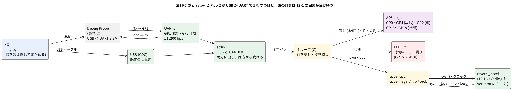

# 12-2 リバーシを UART で PC と対戦させる

> [!WARNING]
> **この題は実機で組んでいない。** Pico 2 のプログラムは `.uf2` までビルドし、RP2350 のエミュレータ (picoemu) に載せて
> UART0 越しに 200 局を打たせた。PC では同じプログラムを替え玉の stdio で動かし、PC の側のプログラムと 200 局を打たせた。
> 実物の Pico 2 への書き込み、USB と Debug Probe での PC との対局、AD3 での測定はしていない。
> picoemu は USB を外に出さないので、USB の道は picoemu でも確かめていない。
> 「見るべき値」の時間の欄は、測って書く。

12-1 で作ったリバーシのアクセラレータを Pico 2 の Soft-FPGA に載せ、**PC と対戦させる**。
PC とは Pico 2 の **USB** (仮想のシリアルポート) でつなぐ。USB ケーブル 1 本で給電と書き込みと対局ができ、ほかの機器は要らない。
Raspberry Pi Debug Probe を持っていれば、Pico 2 の UART0 (GP0・GP1) にもつなげる。同じ `.uf2` のまま、どちらからでも同じに話せる。
PC からは「黒で始めて」「相手は d3 に打った」と 1 行ずつ送り、Pico 2 は自分の手を 1 行で返す。
行の決まりは、自作の CPU を PC と対戦させるために決められた [リバーシ UART プロトコル](https://github.com/tommie-jp/reversi-uart-protocol) (v0.2) に従う。
同じ決まりを話す物どうしなら、相手が PC のソフトでも、別の人が FPGA で作った CPU でも対戦できる。

仕事は 3 つに分けた。

| 仕事 | 誰がするか | 理由 |
| --- | --- | --- |
| USB・UART のビットを字にする | Pico 2 の USB と UART の部品 (ハードウェア) と、SDK の stdio | 7-1・7-2 では UART を Verilog で書いた。この題では盤の計算に絞るため、Pico 2 に元からある部品に任せる |
| 行を読み、決まりどおりに答える | C の主ループ | 字の並びを比べて分かれる仕事。分かれ道の多い仕事は CPU が得意 |
| 合法手・裏返す石・最善手 | 12-1 の回路 (Verilator の C++) | 64 マスを同時に調べる仕事。回路が得意 |

Soft-FPGA-Reversi では、行を読む所まで Verilog で書いている (`rtl/proto.v`)。この題は、回路の仕事を盤の計算に絞った形にした。
UART を 115200 bps のビットのまま Verilog で読まないのは、Soft-FPGA の 1 クロックが 1 bit の 8.7 µs より遅くなりうるため (5-6)。

## 決めたこと

| 項目 | 決め | 理由 |
| --- | --- | --- |
| PC とのつなぎ | 既定は Pico 2 の USB (CDC。PC からはシリアルポートに見える)。Debug Probe があれば、その UART の端子 (3.3 V) を GP0・GP1 につないでもよい | Debug Probe を持っていない人でも組めるようにする。Probe は持っていれば便利 (書き込み・PC が送った線そのものを AD3 で読める) なので、外さずに残す |
| stdio | `pico_enable_stdio_usb` と `pico_enable_stdio_uart` を両方有効にする。出す字は USB と UART0 の両方に出て、受ける字はどちらからでも受ける | 1 つの `.uf2` で 2 つのつなぎ方に応じる。UART0 は GP0 が TX、GP1 が RX、115200 bps、8N1 (プロトコルの §4 の例の速さ。SDK の既定) |
| 改行 | `stdio_put_string(…, false, false)` で送り、stdio の改行の変換 (LF を CR LF にする) を通さない | プロトコルは CR LF だけを許す (§5)。`printf("…\r\n")` だと変換で `\r\r\n` になる |
| 受けた行の写し | 受けた行を、そのまま UART1 の TX (GP4、115200 bps 8N1) に出す | **AD3 では USB の中身を読みにくい** (USB は D+・D− の差動 12 Mbps で、線を取り出すにはケーブルを割くか変換の基板が要る。WaveForms の Logic の読み下しの一覧 (UART・SPI・I2C・CAN・I2S など) にも USB は見当たらない)。PC → Pico 2 の行を AD3 で読むために、Pico 2 が受けた字を UART で出し直す |
| 時間の印 | 行の LF を受けてから答えを送り始めるまで GP2 を H にする | USB には 1 ms ごとの区切りがあり、PC での受け取りの時刻が揺れる。Pico 2 が考えた時間は、この印の幅で測る |
| GP1 | プルアップする | Debug Probe をつながないと GP1 (UART0 の RX) が浮き、雑音を字として読むおそれがある |
| 状態の LED | GP16 = 対局中 (緑)、GP17 = 対局中で自分が白 (黄)、GP18 = 直前の行に誤り (`-0x`) を返した (赤)。どれも 330 Ω を通して LED を光らせ、AD3 でも読む | 主ループの中の状態 (対局しているか・どちらの色か・行を正しく受けたか) を、PC の画面を見なくても分かるようにする。Pico 2 の上の列のピンを使うと、AD3 の線と交わらずに右の空いた所へ LED を置ける |
| 状態を出す時 | 行を 1 つ調べ終えるたびに 3 本を書き直す | 状態が変わるのは行を受けた時だけ。誤りの LED は、次に誤りでない行 (答えない行も含む) を受けると消える |
| 話す行 | 必須の `SB` `SW` `MO` `PA` `EB` `EW` `ED` `VE` `PI` と、`CA` `XB`。`BO` (盤を丸ごと送る) は受けない | プロトコルで任意とされた行を減らし、主ループを短くした |
| 打つ手 | 12-1 の `reversi_accel` の最善手 (角を先に、次に裏返る数の多い手) | 12-1 で C の参照実装と突き合わせ済み |
| 回路を使わないビルド | `SOFT_FPGA` を定義しないと、同じ答えを C の関数で出す | 回路の版と C の版で同じ棋譜になることを確かめる。速さを比べる |
| 起きたとき | `RE` を 1 行送る | プロトコルの §11。PC は `RE` を見たら直前の指示を送り直せる |
| 誤った行 | `-01`〜`-06` で答える | プロトコルの §7.3。FPGA の最小の作りなら `-00` だけでもよい、とされている |

この題で使わない決め: 字と字の間が 100 ms 空いたら行を捨てる決め (プロトコルの §6) は入れていない。人が端末で打つと 100 ms は空くので、手で試すときに困るからである。

## 話す行

PC → Pico 2 (左) と Pico 2 → PC (右)。行の終わりはどれも CR LF (`\r\n`)。

| PC が送る | 意味 | Pico 2 が返す |
| --- | --- | --- |
| `PI` | 生きているか | `+PI` |
| `VE` | 版 | `+VE02wb-reversi-12-2` (`02` がプロトコルの版) |
| `CA` | 話せる行の一覧 | `+CA PI VE CA SB SW MO PA EB EW ED XB` |
| `SB` | あなたは黒 (先手) | 自分の手 `MOd3` など |
| `SW` | あなたは白 (後手) | 返さない (相手の手を待つ) |
| `MOe3` | 相手は e3 に打った | 自分の手 `MOf3` など。打てなければ `PA` |
| `PA` | 相手はパス | 自分の手か `PA` |
| `EB` `EW` `ED` | 終わり (黒の勝ち・白の勝ち・引き分け) | 返さない |
| `XB` | 拡張: 考えた量 | `+XB moves=手の数 clocks=回路のクロックの合計 us=考えた時間の合計` |

誤った行への答え: 小文字のコマンド `-02`、CR の無い行 `-03`、座標の書き違い `-04`、打てない手 `-05`、対局していないのに `MO`・`PA` `-06`、知らないコマンド `-01`、80 字を超える行 `-00`。
空の行 (CR LF だけ) は黙って捨てる。`X` で始まる知らない行 (ほかの人の拡張) も黙って捨てる。

始めの数行のやり取り (左の `>` が PC から、`<` が Pico 2 から):

```text
< RE              Pico 2 が起きた
> PI
< +PI
> SB              あなたは黒
< MOd3            始めの局面の合法手 d3・c4・f5・e6 は同じ点数。番号の小さい d3
> MOe3            PC (白) は e3
< MOf3            Pico 2 は f3
```

盤の座標は a1 が左上、行は上から 1〜8 (プロトコルの §8)。12-1 の番号 (行 × 8 + 列) と同じ並びで、`d3` は 2 × 8 + 3 = 19 番になる。

## ブロック図




- 主ループは stdio から字を 1 つずつ受け、LF が来たら 1 行として調べる。字が USB から来たか UART0 から来たかは区別しない。盤 (`black` と `white` の 64 ビット 2 つ) は主ループが持つ
- 盤の計算は `accel_legal` `accel_flip` `accel_pick` の 3 つの関数だけを呼ぶ。中身が回路か C かを、主ループは知らない
- 最善手を探す `accel_pick` だけクロックを回す (合法手の数 + 1 クロック、12-1)。`accel_legal` と `accel_flip` は組み合わせ回路なので `eval()` 1 回で答えが出る

## 回路図

```circuit
# 回路図 (tommie-fence の circuit フェンス)
title: 図2 AD3 は 6 本を読む。状態は LED 3 つ。Debug Probe はあれば
parts:
  MCU: pico2 4,6 mirror
  TX0: port 6.4,2.4
  RX0: port 6.4,2.8
  G1: ground 6.4,3.2 r270
  BUSY: port 6.4,3.6
  COPY: port 6.4,4.4
  GAME: port 6.4,10.8
  WHITE: port 6.4,11.2
  ERR: port 6.4,11.6
  DP:
    type: device
    at: 14,2.8
    label: Debug Probe
    pins: [RX, TX, GND]
  TX0: port 11.6,2.4
  RX0: port 11.6,2.8
  G2: ground 11.6,3.2 r90
  AD:
    type: device
    at: 14,6
    label: AD3
    pins: [DIO1, DIO0, DIO2, DIO3, DIO4, DIO5, GND]
  TX0: port 11.6,4.8
  COPY: port 11.6,5.2
  BUSY: port 11.6,5.6
  GAME: port 11.6,6
  WHITE: port 11.6,6.4
  ERR: port 11.6,6.8
  G3: ground 11.6,7.2 r90
  GAME: port 9.6,8.4
  D1: led 9.6,8.4 11.1,8.4
  R1: resistor 11.1,8.4 12.6,8.4 330
  G4: ground 13.2,8.4 r270
  WHITE: port 9.6,9.8
  D2: led 9.6,9.8 11.1,9.8
  R2: resistor 11.1,9.8 12.6,9.8 330
  G5: ground 13.2,9.8 r270
  ERR: port 9.6,11.2
  D3: led 9.6,11.2 11.1,11.2
  R3: resistor 11.1,11.2 12.6,11.2 330
  G6: ground 13.2,11.2 r270
wires:
  - MCU.GP0 -- 6.4,2.4
  - MCU.GP1 -- 6.4,2.8
  - MCU.GND3 -- 6.4,3.2
  - MCU.GP2 -- 6.4,3.6
  - MCU.GP4 -- 6.4,4.4
  - MCU.GP16 -- 2.3,10 -- 2.3,10.8 -- 6.4,10.8
  - MCU.GP17 -- 2,9.6 -- 2,11.2 -- 6.4,11.2
  - MCU.GP18 -- 1.6,8.8 -- 1.6,11.6 -- 6.4,11.6
  - 11.6,2.4 -- DP.RX
  - 11.6,2.8 -- DP.TX
  - 11.6,3.2 -- DP.GND
  - 11.6,4.8 -- AD.DIO1
  - 11.6,5.2 -- AD.DIO0
  - 11.6,5.6 -- AD.DIO2
  - 11.6,6 -- AD.DIO3
  - 11.6,6.4 -- AD.DIO4
  - 11.6,6.8 -- AD.DIO5
  - 11.6,7.2 -- AD.GND
  - 12.6,8.4 -- 13.2,8.4
  - 12.6,9.8 -- 13.2,9.8
  - 12.6,11.2 -- 13.2,11.2
style:
  pitch: 1.2
```


- 線で結ぶ代わりに、**同じ名前の端子 (白丸と名前) どうしがつながっている** (12-4 と同じ書き方)。`TX0` は GP0、`RX0` は GP1、`BUSY` は GP2、`COPY` は GP4
- PC とは Pico 2 の USB でつなぐので、回路図に PC は出てこない。Pico 2 の電源も同じ USB から取る
- AD3 は 6 本を読むだけ。DIO1 が Pico 2 → PC (GP0)、DIO0 が PC → Pico 2 の行の写し (GP4)、DIO2 が時間の印 (GP2)、DIO3〜DIO5 が状態 (GP16〜GP18)
- 状態の 3 本は、それぞれ LED と 330 Ω を通して GND へ。赤・黄・緑の LED の V<sub>F</sub> (順方向電圧) を 2.0 V ほどとすると、(3.3 V − 2.0 V) ÷ 330 Ω ≈ 3.9 mA (見積り)。Pico 2 のピンの既定の駆動 (4 mA) の内に収まる
- Debug Probe は**あれば**つなぐ。Probe の TX (Probe が送る) を Pico 2 の GP1 (受ける) へ、Pico 2 の GP0 (送る) を Probe の RX へ。**送ると受けるを交差させる**
- GND はどれも共通にする。どれも 3.3 V の信号で、レベル変換は要らない

## 部品表

| 部品 | 値・型番 | 数 | 役 |
| --- | --- | --- | --- |
| MCU | Raspberry Pi Pico 2 | 1 | Soft-FPGA (12-1 の回路) と主ループ |
| DP | Raspberry Pi Debug Probe (**あれば**。無くても組める) | 1 | PC の USB と Pico 2 の UART (3.3 V) をつなぐ。書き込みにも使える |
| — | ブレッドボード (full、63 列) | 1 | LED を Pico 2 の右に 4 列おきに置くため、half (30 列) から替えた |
| — | ジャンパ線 | 4 本 + 機器の線 | Pico 2 の GND (3 番) から − のレールへ 1 本、GP16〜GP18 から LED へ 3 本。AD3 の線 7 本と、Probe の UART の端子の線 3 本 (あれば) は、先をブレッドボードに挿す |
| D1・D2・D3 | LED 5 mm (緑・黄・赤) | 3 | 状態を見せる。D1 が対局中、D2 が自分が白、D3 が誤り |
| R1・R2・R3 | 330 Ω (E24)、1/4 W | 3 | LED の電流を決める (約 3.9 mA、見積り) |
| AD | Analog Discovery 3 | 1 | Logic で Pico 2 が送った字・受けた字の写し・時間の印・状態の 3 本を読む |
| — | USB ケーブル | 1 本 (Probe があれば 2 本) | Pico 2 と PC (給電・書き込み・対局)。Debug Probe と PC |

電源は教科書の既定の 5 V ではなく **3.3 V** (Pico 2 のピン)。Pico 2 のピンに 5 V を入れると壊れるため (0-3)。
3.3 V でない USB-UART の変換器 (5 V のもの) をつながない。

## 実体配線図

```bread
# ブレッドボードの実体配線図 (tommie-fence の bread フェンス)
title: 図3 GND は − のレールに。状態の LED は右の 27〜36 列。Probe はあれば i5・j6
board: full
parts:
  MCU: pico2 @ h5
  D1: led g27(A) g28(K) green
  R1: resistor j28 -b28 330
  D2: led g31(A) g32(K) yellow
  R2: resistor j32 -b32 330
  D3: led g35(A) g36(K) red
  R3: resistor j36 -b36 330
  DP:
    type: device
    at: bottom
    label: Debug Probe (あれば)
    pins: [RX, GND, TX]
  AD:
    type: device
    at: bottom
    label: AD3 Logic
    pins: [DIO2, DIO0, DIO1, GND, DIO3, DIO4, DIO5]
wires:
  - j7 -- -b7 black
  - DP.RX -- i5 green [h0]
  - DP.GND -- -b3 black
  - DP.TX -- j6 yellow
  - AD.DIO1 -- j5 white [h10, v-130, h-240]
  - AD.DIO2 -- j8 purple
  - AD.DIO0 -- j10 orange
  - AD.GND -- -b19 black
  - b24 -- f27 pink [h50]
  - a23 -- f31 gray [v-10, h150]
  - a21 -- f35 brown [v-20, h270]
  - AD.DIO3 -- j27 blue
  - AD.DIO4 -- j31 blue
  - AD.DIO5 -- j35 blue
```


- `pico2 @ h5` は 7-3 と同じ向き。下の列は GP0 (1 番) が 5 列、GP1 (2 番) が 6 列、GND (3 番) が 7 列、GP2 (4 番) が 8 列、GP4 (6 番) が 10 列。上の列は GP16 (21 番) が 24 列、GP17 (22 番) が 23 列、GP18 (24 番) が 21 列
- 状態の 3 本は、上の列のピンの a・b 行から、基板の上の縁を通して右の 27・31・35 列へ渡し、溝を越えて f 行に挿す。遠くへ行く線ほど外を回したので、3 本は交わらない
- LED は g 行に横に挿す (左がアノード)。カソードの列の j 行から 330 Ω で − のレールへ落とす。AD3 の DIO3〜DIO5 は、LED のアノードの列 (27・31・35 列) の j 行に下から挿す
- Pico 2 のピンは h 行に挿さり、同じ列の i・j 行の穴とつながる (f〜j 行は 1 つの列でつながっている)
- **GND は − のレール (下) にまとめる。** Pico 2 の GND (j7) から − のレールへ 1 本渡し、AD3 と Debug Probe の GND はレールに挿す
- AD3 の DIO1 (白) は、i 行と j 行の間を通して j5 へ入れる。ほかの線の端 (j 行) より上を通るので、線どうしが交差しない
- Debug Probe が無ければ、緑・黄と Probe の黒の 3 本を挿さないだけでよい。ほかの線は変わらない
- 線の色: 緑が Pico 2 → Probe (GP0)、黄が Probe → Pico 2 (GP1)、黒が GND。AD3 の線は白 (DIO1、GP0)、橙 (DIO0、写し)、紫 (DIO2、印)、青 (DIO3〜DIO5、状態)。LED への線は桃 (GP16)・灰 (GP17)・茶 (GP18)。赤は使わない (電源を配らない)
- 流れる電流は LED の 1 本あたり約 3.9 mA (見積り)、3 つで 12 mA ほど。ほかは信号のごく小さな電流。信号は 115200 bps (1 bit 8.7 µs) で、ブレッドボードの範囲 (3 MHz 以下) に収まる

## Pico 2 のプログラム

作業用のフォルダは 5-1 と同じに作る (`stub_mutex.h` `cxx_minimal.cpp` `verilated.cpp` `pico_tls.cpp` と `add_soft_fpga` の `CMakeLists.txt`)。
12-1 の `reversi_accel.v` `legal_bb.v` `flip_calc.v` を写し、下の 2 つのファイルを足す。

C/C++ を第 1、MicroPython を第 2 にする決まりがあるが、この題は C と C++ だけで書く。MicroPython からは Verilator の C++ を呼べない (5-1)。

### reversi.c — 主ループ

```c
// 12-2 リバーシを UART で PC と対戦させる — Pico 2 の主ループ
// PC とは stdio で話す。stdio は USB (CDC) と UART0 (GP0 が TX、GP1 が RX、115200 bps 8N1) の両方に出し、両方から受ける。
// Debug Probe が無ければ USB だけ、あれば Probe の UART でも同じに話せる。リバーシ UART プロトコル v0.2 の一部を話す。
// AD3 で見るために、受けた行の写しを UART1 (GP4) に出し、行を受け終えてから答えを送り始めるまで GP2 を H にする。
// 内部の状態を GP16〜GP18 に出し、LED で見せる (対局中・自分が白・直前の行に誤りを返した)。AD3 でも読む。
// 盤面の計算 (合法手・裏返す石・最善手) は accel_* の 3 つの関数に任せる。
// SOFT_FPGA を定義したビルドでは accel.cpp が 12-1 の回路 (Verilator の C++) で答え、
// 定義しないビルドでは下の C の関数が同じ答えを出す (比べるためと、PC の試験のため)。
#include <stdint.h>
#include <stdio.h>
#include <string.h>
#include "pico/stdlib.h"
#include "hardware/uart.h"

#define BAUD      115200
#define PIN_RX0   1                     // UART0 の RX (stdio が使う)。Probe をつながないときに浮かせない
#define COPY_UART uart1
#define PIN_COPY  4                     // UART1 の TX: 受けた行の写し (AD3 用)
#define PIN_BUSY  2                     // 行を受け終えてから答えを送り始めるまで H (AD3 用)
#define PIN_GAME  16                    // 対局中 (緑の LED)
#define PIN_WHITE 17                    // 対局中で、自分が白 (黄の LED)
#define PIN_ERR   18                    // 直前の行に誤り (-0x) を返した (赤の LED)
#define LINE_MAX  80                    // 受ける 1 行の最大 (CR LF を除く)

uint64_t accel_legal(uint64_t own, uint64_t opp);
uint64_t accel_flip(uint64_t own, uint64_t opp, unsigned move);
int      accel_pick(uint64_t own, uint64_t opp, unsigned *clocks);

#ifndef SOFT_FPGA
// ---- 回路を使わないビルドの代わり: 12-1 と同じ答えを C で出す ----
static const int DR[8] = {-1, -1, -1, 0, 0, 1, 1, 1};
static const int DC[8] = {-1, 0, 1, -1, 1, -1, 0, 1};

uint64_t accel_flip(uint64_t own, uint64_t opp, unsigned move) {
    if (((own | opp) >> move) & 1u) return 0;
    uint64_t all = 0;
    for (int d = 0; d < 8; d++) {
        uint64_t line = 0;
        int r = (int)move / 8 + DR[d], c = (int)move % 8 + DC[d];
        while (r >= 0 && r < 8 && c >= 0 && c < 8 && ((opp >> (r * 8 + c)) & 1u)) {
            line |= 1ull << (r * 8 + c);
            r += DR[d]; c += DC[d];
        }
        if (line && r >= 0 && r < 8 && c >= 0 && c < 8 && ((own >> (r * 8 + c)) & 1u)) all |= line;
    }
    return all;
}

uint64_t accel_legal(uint64_t own, uint64_t opp) {
    uint64_t l = 0;
    for (unsigned i = 0; i < 64; i++)
        if (accel_flip(own, opp, i)) l |= 1ull << i;
    return l;
}

int accel_pick(uint64_t own, uint64_t opp, unsigned *clocks) {   // 角を先に、次に裏返る数の多い手
    int best = -1, best_score = -1;
    unsigned n = 0;
    for (unsigned i = 0; i < 64; i++) {
        uint64_t f = accel_flip(own, opp, i);
        if (!f) continue;
        n++;
        int score = __builtin_popcountll(f) + ((i == 0 || i == 7 || i == 56 || i == 63) ? 32 : 0);
        if (score > best_score) { best_score = score; best = (int)i; }
    }
    *clocks = n + 1;                    // 回路なら合法手の数 + 1 クロック (12-1)
    return best;
}
#endif

// ---- 対局の状態 ----
enum { IDLE, WAIT_OPP };
static int      state = IDLE;
static uint64_t black, white;
static int      me;                     // 0 = 黒、1 = 白
static unsigned moves;                  // 自分が考えた回数
static unsigned long total_clocks;      // 回路が探すのに使ったクロックの合計
static uint64_t total_us;               // 考えるのに使った時間の合計
static bool     last_err;               // この行に誤りを返したか

static void send(const char *s) {       // 1 行送る。行の終わりは CR LF
    char buf[LINE_MAX + 3];
    int n = snprintf(buf, sizeof buf, "%s\r\n", s);
    gpio_put(PIN_BUSY, 0);              // 答えを送り始める
    last_err = (s[0] == '-');
    stdio_put_string(buf, n, false, false);  // 改行の変換をしない (CR LF をそのまま送る)
}

static void show_state(void) {          // 状態を LED に出す
    gpio_put(PIN_GAME, state == WAIT_OPP);
    gpio_put(PIN_WHITE, state == WAIT_OPP && me == 1);
    gpio_put(PIN_ERR, last_err);
}

static void copy_line(const char *line, unsigned len, bool had_cr) {  // 受けた行を UART1 に写す
    for (unsigned i = 0; i < len; i++) uart_putc_raw(COPY_UART, line[i]);
    if (had_cr) uart_putc_raw(COPY_UART, '\r');
    uart_putc_raw(COPY_UART, '\n');
}

static void new_game(int side) {
    black = (1ull << 28) | (1ull << 35);    // e4 d5
    white = (1ull << 27) | (1ull << 36);    // d4 e5
    me = side;
}

static void put_stone(uint64_t *own, uint64_t *opp, unsigned m, uint64_t f) {
    *own |= f | (1ull << m);
    *opp &= ~f;
}

static void think_and_move(void) {
    uint64_t *mine = me ? &white : &black, *theirs = me ? &black : &white;
    unsigned clocks = 0;
    uint64_t t0 = time_us_64();
    int m = accel_pick(*mine, *theirs, &clocks);
    if (m >= 0) put_stone(mine, theirs, (unsigned)m, accel_flip(*mine, *theirs, (unsigned)m));
    total_us += time_us_64() - t0;
    total_clocks += clocks;
    moves++;
    if (m < 0) {
        send("PA");                     // 打てる所が無い
    } else {
        char s[5] = {'M', 'O', (char)('a' + m % 8), (char)('1' + m / 8), 0};
        send(s);
    }
    state = WAIT_OPP;
}

static void opponent_move(const char *line, unsigned len) {
    if (len != 4 || line[2] < 'a' || line[2] > 'h' || line[3] < '1' || line[3] > '8') { send("-04 bad coord"); return; }
    unsigned m = (unsigned)(line[3] - '1') * 8u + (unsigned)(line[2] - 'a');
    uint64_t *mine = me ? &white : &black, *theirs = me ? &black : &white;
    uint64_t f = accel_flip(*theirs, *mine, m);
    if (!f) { send("-05 illegal move"); return; }
    put_stone(theirs, mine, m, f);
    think_and_move();
}

static void handle_line(const char *line, unsigned len, bool had_cr) {
    if (!had_cr) { send("-03 need CR LF"); return; }
    if (len == 0) return;                                   // 空行は黙って捨てる
    if (len < 2) { send("-01 unknown"); return; }
    if (line[0] >= 'a' && line[0] <= 'z') { send("-02 lowercase"); return; }
    char c0 = line[0], c1 = line[1];
    if      (c0 == 'P' && c1 == 'I') send("+PI");
    else if (c0 == 'V' && c1 == 'E') send("+VE02wb-reversi-12-2");
    else if (c0 == 'C' && c1 == 'A') send("+CA PI VE CA SB SW MO PA EB EW ED XB");
    else if (c0 == 'X' && c1 == 'B') {
        char s[64];
        snprintf(s, sizeof s, "+XB moves=%u clocks=%lu us=%lu", moves, total_clocks, (unsigned long)total_us);
        send(s);
    }
    else if (c0 == 'S' && (c1 == 'B' || c1 == 'W')) {
        new_game(c1 == 'W');
        if (c1 == 'B') think_and_move();                     // 黒が先に打つ
        else           state = WAIT_OPP;
    }
    else if (c0 == 'M' && c1 == 'O') { if (state == WAIT_OPP) opponent_move(line, len); else send("-06 not my game"); }
    else if (c0 == 'P' && c1 == 'A') { if (state == WAIT_OPP) think_and_move();         else send("-06 not my game"); }
    else if (c0 == 'E' && (c1 == 'B' || c1 == 'W' || c1 == 'D')) state = IDLE;
    else if (c0 == 'X') { }                                   // ほかの拡張は黙って捨てる
    else send("-01 unknown");
}

int main(void) {
    stdio_init_all();                                         // USB と UART0 (GP0・GP1、115200 8N1)
    gpio_pull_up(PIN_RX0);
    uart_init(COPY_UART, BAUD);
    uart_set_format(COPY_UART, 8, 1, UART_PARITY_NONE);
    gpio_set_function(PIN_COPY, GPIO_FUNC_UART);
    static const uint OUT_PINS[] = {PIN_BUSY, PIN_GAME, PIN_WHITE, PIN_ERR};
    for (unsigned i = 0; i < sizeof OUT_PINS / sizeof OUT_PINS[0]; i++) {
        gpio_init(OUT_PINS[i]);
        gpio_set_dir(OUT_PINS[i], GPIO_OUT);
    }
    send("RE");                                               // 起きたことを知らせる

    char line[LINE_MAX];
    unsigned len = 0;
    bool cr = false, too_long = false;
    while (true) {
        int c = getchar_timeout_us(1000000);                  // USB か UART0 から 1 字
        if (c == PICO_ERROR_TIMEOUT) continue;
        if (c == '\n') {                                     // 行の終わり
            gpio_put(PIN_BUSY, 1);
            last_err = false;
            copy_line(line, len, cr);
            if (too_long) send("-00 too long");
            else          handle_line(line, len, cr);
            gpio_put(PIN_BUSY, 0);                            // 答えない行 (SW・EB など) もここで L
            show_state();
            len = 0; cr = false; too_long = false;
        } else if (c == '\r') {
            cr = true;
        } else {
            if (len < LINE_MAX) line[len++] = (char)c;
            else                too_long = true;
            cr = false;
        }
    }
}
```

- 盤は主ループの `black` と `white` が持つ。`accel_*` には「打つ側」と「相手」の順に渡す。相手の手を確かめるときは、相手の石を `own` にして渡す (`opponent_move`)
- `stdio_init_all` が USB と UART0 の両方を用意する (どちらを使うかは CMake の `pico_enable_stdio_*` で決まる)。`getchar_timeout_us` は USB と UART0 のどちらに来た字も返す
- 主ループは字を 1 つずつ見て、CR を覚え、LF で 1 行を調べる。LF の前に CR が無ければ `-03`
- 送るのは `send` だけ。`stdio_put_string` の 4 つめの引数 `false` が改行の変換を止める。止めないと CR LF の CR がもう 1 つ増える
- LF を受けたら GP2 を H にし、受けた行を UART1 に写す (`copy_line`)。`send` が送り始める前に GP2 を L にする。答えない行 (`SW` `EB` など) は、行を調べ終えた所で L にする
- `send` は送る行が `-` で始まれば `last_err` を立てる。行を調べ終えたら `show_state` が GP16〜GP18 を書き直す。対局中は `state == WAIT_OPP` (Pico 2 は考えるのも答えるのも行を受けた中で済ませるので、対局の間はいつも相手を待っている)
- PC がポートを開くまで、USB への出力は捨てられる (SDK の stdio_usb は、PC が DTR を立てたのを見て送り始める)。起きたときの `RE` は、PC が後から開くと届かない。play.py は `PI` から始めるので困らない
- 自分の手の座標は、番号 `m` の `m % 8` が列 (`a`〜`h`)、`m / 8` が行 (`1`〜`8`)
- `XB` の `us` は、`accel_pick` と `accel_flip` を呼んでいた時間の合計 (`time_us_64` の µs)。行を送る時間は含まない
- `#ifndef SOFT_FPGA` の中は 12-1 の参照実装と同じ考え方 (8 方向を 1 マスずつ辿る)。`clocks` は、回路なら何クロックかかったかを同じ数え方で出す

### accel.cpp — 12-1 の回路を呼ぶ

```cpp
// accel.cpp — 12-1 の reversi_accel (Verilator で C++ にした物) を、C の主ループから呼ぶ
#include <stdint.h>
#include "Vreversi_accel.h"

static VerilatedContext ctx;
static Vreversi_accel   top{&ctx};
static bool             ready = false;

static void tick() {
    top.clk = 0; top.eval();
    top.clk = 1; top.eval();
}

static void set_board(uint64_t own, uint64_t opp) {
    if (!ready) {                       // 初めて呼ばれたときにリセットを 1 クロック掛ける
        top.start = 0; top.rst = 1; tick(); top.rst = 0;
        ready = true;
    }
    top.own = own;
    top.opp = opp;
}

extern "C" uint64_t accel_legal(uint64_t own, uint64_t opp) {
    set_board(own, opp);
    top.eval();                         // 組み合わせ回路: クロックを待たない
    return top.legal;
}

extern "C" uint64_t accel_flip(uint64_t own, uint64_t opp, unsigned move) {
    set_board(own, opp);
    top.move = move;
    top.eval();
    return top.flip;
}

extern "C" int accel_pick(uint64_t own, uint64_t opp, unsigned *clocks) {
    set_board(own, opp);
    top.start = 1; tick(); top.start = 0;
    unsigned n = 0;
    do { tick(); n++; } while (!top.done);     // 合法手の数 + 1 クロックで done
    *clocks = n;
    return top.found ? (int)top.best : -1;
}
```

- `extern "C"` で、C の主ループから呼べる名前にする (C++ は関数の名前に引数の型を混ぜるので、そのままでは C から見えない)
- `accel_legal` と `accel_flip` は、入力を置いて `eval()` を 1 回するだけ。組み合わせ回路なので、クロックを回さなくても答えが出る
- `accel_pick` は 12-1 の試験台の `hw_pick` と同じ回し方。`start` を 1 クロック入れ、`done` が 1 になるまでクロックを回す

### verilate.sh と CMakeLists.txt

`verilate.sh` (`sfa-dev:local` の中で打つ):

```bash
#!/bin/sh
set -e
rm -rf vlinc && cp -r /usr/local/share/verilator/include vlinc
verilator --cc --no-timing --no-trace -Wall --prefix Vreversi_accel --Mdir v_reversi_accel reversi_accel.v legal_bb.v flip_calc.v
```

`CMakeLists.txt` の「ここから下が題ごとに替わる」の下 (5-1):

```cmake
add_soft_fpga(reversi122 reversi.c reversi_accel)
target_sources(reversi122 PRIVATE accel.cpp)
target_compile_definitions(reversi122 PRIVATE SOFT_FPGA)
target_link_libraries(reversi122 hardware_uart)
pico_enable_stdio_usb(reversi122 1)          # stdio を USB (CDC) にも出す
pico_enable_stdio_uart(reversi122 1)         # stdio を UART0 (GP0・GP1) にも出す (Debug Probe・AD3 用)

# 比べるための C だけの版
add_executable(reversi122_c reversi.c)
target_link_libraries(reversi122_c pico_stdlib hardware_uart)
pico_enable_stdio_usb(reversi122_c 1)
pico_enable_stdio_uart(reversi122_c 1)
pico_add_extra_outputs(reversi122_c)
```

- `add_soft_fpga` の主ループは `.c` でもよい。`stub_mutex.h` を先に読ませる指定は C++ のファイルにだけ掛かる (5-1 の `$<COMPILE_LANGUAGE:CXX>`)
- `target_compile_definitions` で `SOFT_FPGA` を定義すると、`reversi.c` の C の関数が消え、`accel.cpp` の関数がつながる
- `pico_enable_stdio_usb` と `pico_enable_stdio_uart` を両方 1 にする。片方だけにすると、もう片方のつなぎ方では話せない

ビルドの打ち方は [5-1 の「ビルドする」](../05-soft-fpga-pico/01-verilator-on-pico.md#ビルドする) と同じ 2 行。
ただし **USB を使うので、TinyUSB 入りの Pico SDK でビルドする** (5-14)。5-1 の `wb-pico-sdk` の Pico SDK には TinyUSB が入っておらず、
CMake が「TinyUSB submodule has not been initialized」と警告して、黙って USB の無い `.uf2` ができる。
手元の Pico SDK 2.2.0 (`git clone --recurse-submodules`) を `-v "$HOME/pico-sdk":/psdk:ro -e PICO_SDK_PATH=/psdk` で差し込む打ち方は 5-14 と同じ。

| できた物 | 大きさ | text | bss |
| --- | --- | --- | --- |
| `build/reversi122.uf2` (回路の版) | 158 720 バイト | 83 032 バイト | 5 532 バイト |
| `build/reversi122_c.uf2` (C だけの版) | 67 072 バイト | 37 312 バイト | 3 848 バイト |

回路の版は、5-1 の `blink` (`.uf2` 92 160 バイト) より 65 KB ほど大きい。Verilator のランタイムに、回路の C++ と USB (TinyUSB)・UART の部品が足された分である。
USB を入れる前 (UART0 だけ) は回路の版が 126 976 バイト、C の版が 36 352 バイトだったので、USB の部品で約 30 KB 増えた。
`arm-none-eabi-readelf -S` で `.tdata` が 0 バイト、`.tbss` が 0x44 バイトなので、5-1 の `pico_tls.cpp` の配列のままでよい。**実機では動かしていない。**

## PC の側 — play.py

PC の側は Python で書いた。人が打つ (既定) か、乱数で打つ相手を何局も回す。**Pico 2 の手を毎回自分でルールに当てて確かめ**、合法でなければ止まる。
シリアルポートを開くのに pyserial (`pip install pyserial`) を使う。

```python
#!/usr/bin/env python3
"""12-2 PC の側: Pico 2 とリバーシ UART プロトコルで対戦する。

    python3 play.py /dev/ttyACM0            # 人が打つ (PC は白、Pico 2 は黒)
    python3 play.py /dev/ttyACM0 --cpu white --random 5   # 乱数で打つ相手を 5 局

盤のルールはこのファイルの中で数え直し、Pico 2 の手が合法かを毎回確かめる。
"""
import argparse
import random
import sys

DIRS = [(-1, -1), (-1, 0), (-1, 1), (0, -1), (0, 1), (1, -1), (1, 0), (1, 1)]
EMPTY, BLACK, WHITE = 0, 1, 2


def new_board():
    b = [[EMPTY] * 8 for _ in range(8)]
    b[3][3], b[3][4], b[4][3], b[4][4] = WHITE, BLACK, BLACK, WHITE   # d4 e4 d5 e5
    return b


def flips(b, r0, c0, me):
    """(r0, c0) に me を置いたとき裏返る石の (行, 列) の並び。打てなければ空"""
    if b[r0][c0] != EMPTY:
        return []
    you = BLACK + WHITE - me
    out = []
    for dr, dc in DIRS:
        r, c, line = r0 + dr, c0 + dc, []
        while 0 <= r < 8 and 0 <= c < 8 and b[r][c] == you:
            line.append((r, c))
            r, c = r + dr, c + dc
        if line and 0 <= r < 8 and 0 <= c < 8 and b[r][c] == me:
            out += line
    return out


def moves(b, me):
    return [(r, c) for r in range(8) for c in range(8) if flips(b, r, c, me)]


def play(b, r, c, me):
    for fr, fc in flips(b, r, c, me):
        b[fr][fc] = me
    b[r][c] = me


def coord(r, c):
    return "abcdefgh"[c] + str(r + 1)


def show(b):
    mark = {EMPTY: ".", BLACK: "X", WHITE: "O"}
    lines = ["  a b c d e f g h"]
    for r in range(8):
        lines.append(f"{r + 1} " + " ".join(mark[b[r][c]] for c in range(8)))
    return "\n".join(lines)


class Link:
    """1 行ずつ送り、1 行ずつ受ける。行の終わりは CR LF"""

    def __init__(self, write, readline):
        self._write, self._readline = write, readline

    def send(self, s):
        self._write((s + "\r\n").encode("ascii"))

    def recv(self):
        raw = self._readline()
        if not raw:
            raise EOFError("相手が黙った")
        return raw.decode("ascii").rstrip("\r\n")


def wait_move(link, log):
    """Pico 2 の MO か PA を待つ。ほかの行 (RE・+ で始まる応答) は記録して読み飛ばす"""
    while True:
        line = link.recv()
        log.append("< " + line)
        if line.startswith("MO") or line == "PA":
            return line
        if line.startswith("-"):
            raise RuntimeError(f"Pico 2 がエラーを返した: {line}")


def game(link, cpu, choose, log):
    """1 局打つ。cpu は Pico 2 の色 (BLACK か WHITE)。choose(b, legal) が PC の手を選ぶ。
    戻り値は (黒の石の数, 白の石の数)"""
    b = new_board()
    pc = BLACK + WHITE - cpu
    link.send("SB" if cpu == BLACK else "SW")
    log.append("> " + ("SB" if cpu == BLACK else "SW"))
    turn = BLACK
    while True:
        if turn == cpu:
            line = wait_move(link, log)
            legal = moves(b, cpu)
            if line == "PA":
                if legal:
                    raise RuntimeError(f"Pico 2 が打てるのにパスした: {[coord(*m) for m in legal]}")
            else:
                r, c = int(line[3]) - 1, "abcdefgh".index(line[2])
                if (r, c) not in legal:
                    raise RuntimeError(f"Pico 2 の手 {line} は合法でない")
                play(b, r, c, cpu)
        else:
            if not moves(b, BLACK) and not moves(b, WHITE):
                nb = sum(row.count(BLACK) for row in b)
                nw = sum(row.count(WHITE) for row in b)
                end = "EB" if nb > nw else "EW" if nw > nb else "ED"
                link.send(end)
                log.append("> " + end)
                return nb, nw
            legal = moves(b, pc)
            if legal:
                r, c = choose(b, legal)
                play(b, r, c, pc)
                msg = "MO" + coord(r, c)
            else:
                msg = "PA"
            link.send(msg)
            log.append("> " + msg)
        turn = BLACK + WHITE - turn


def human(b, legal):
    print(show(b))
    while True:
        s = input(f"あなたの手 ({' '.join(coord(*m) for m in legal)}): ").strip().lower()
        if len(s) == 2 and s[0] in "abcdefgh" and s[1] in "12345678":
            m = (int(s[1]) - 1, "abcdefgh".index(s[0]))
            if m in legal:
                return m
        print("その手は打てない")


def main():
    ap = argparse.ArgumentParser()
    ap.add_argument("port")
    ap.add_argument("--cpu", choices=["black", "white"], default="black")
    ap.add_argument("--random", type=int, metavar="N", help="乱数で打つ相手と N 局")
    ap.add_argument("--baud", type=int, default=115200)
    a = ap.parse_args()
    import serial                       # pyserial
    ser = serial.Serial(a.port, a.baud, timeout=5)
    link = Link(ser.write, ser.readline)
    link.send("PI")
    print("<", link.recv())             # RE が先に来ることもある
    cpu = BLACK if a.cpu == "black" else WHITE
    rng = random.Random(1)
    games = a.random or 1
    for _ in range(games):
        log = []
        choose = (lambda b, legal: rng.choice(legal)) if a.random else human
        nb, nw = game(link, cpu, choose, log)
        print(f"黒 {nb} 白 {nw}")
    link.send("XB")
    print("<", link.recv())


if __name__ == "__main__":
    sys.exit(main())
```

- 盤のルールは 12-1 の参照実装と同じ考え方 (8 方向を 1 マスずつ辿る) を Python で書き直した。Pico 2 の答えを、別の言語の別の書き方で確かめる
- 終局の判断は PC がする。両方とも打てなくなったら、石の数で `EB` `EW` `ED` を送る。Pico 2 は終局を判断しない (プロトコルの §11)
- PC が打った後は、Pico 2 が必ず `MO` か `PA` を返す。両方打てない局面でも、Pico 2 の `PA` を受けてから `EB` などを送る
- `game()` は送り先と受け先を `Link` で受け取るので、シリアルポートの代わりに PC のプロセスや TCP をつないで試験できる (下の「プログラムでの確かめ」)

## 動かす

### Debug Probe が無いとき (既定)

1. Pico 2 の BOOTSEL を押しながら USB をつなぎ、出たドライブに `reversi122.uf2` を写す (0-2)
2. 書き込むと Pico 2 が起き直し、USB のシリアルポートが出る。Linux なら `/dev/ttyACM0` など、Windows なら `COM3` など
3. 端末ソフト (改行を CR LF で送る設定) で `PI` を打ち、`+PI` が返るのを見る。USB なので速さ (bps) の設定は何でもよい
4. `python3 play.py /dev/ttyACM0` で対局する。乱数の相手と 5 局なら `python3 play.py /dev/ttyACM0 --random 5`

Pico 2 を書き直したり BOOTSEL で止めたりすると、USB のシリアルポートは一度消えて出直す。play.py を開いたままにしていたら、開き直す。

### Debug Probe があるとき

同じ `.uf2` のまま、図3 の緑・黄・黒の 3 本を挿して、Probe の UART の口を開く。

1. Debug Probe を PC につなぐ。Probe は書き込みの口と UART の口の 2 つを出す。Linux なら Pico 2 の USB と合わせて `/dev/ttyACM0` と `/dev/ttyACM1` が出る。番号はつなぐ順で変わるので、次の手順で名前から選ぶ
2. `ls /dev/serial/by-id/` で `Debug_Probe` を含む名前を探し、`python3 play.py /dev/serial/by-id/<その名前>` で対局する (115200 bps は play.py の既定)
3. Probe から書き込むなら BOOTSEL は要らない (0-9)

答えは USB と UART0 の両方に出る。Probe で対局している間に Pico 2 の USB のポートを別の端末で開いても、同じ答えが見える。
Pico 2 を先に起こすと、`RE` の行は PC が開く前に出て捨てられる。play.py は `RE` を読み飛ばすので、どちらの順でもよい。

## 計器の設定

| 計器 | 設定 |
| --- | --- |
| Logic | DIO0 (GP4、PC → Pico 2 の行の写し)・DIO1 (GP0、Pico 2 → PC)・DIO2 (GP2、時間の印)・DIO3〜DIO5 (GP16〜GP18、状態) を Enable。DIO は 3.3 V。GND を共通にする (0-4) |
| 標本化 | 1 MHz (1 bit 8.68 µs に 8 標本ほど)、窓 1 ms (100 µs/div) |
| トリガ | DIO2 の立ち上がり (Pico 2 が行の LF を受けた所) |
| 読み下し | Logic に UART を 2 つ足す。DIO0 と DIO1、115200 bps、8N1 |
| 測る値 | DIO2 の H の幅 (行を受けてから答えを送り始めるまで = Pico 2 が考えた時間 + 行を調べる時間)。状態の 3 本は窓を 20 ms (2 ms/div) に広げ、どの行で変わったかを見る (図5) |

標本化は、読み取る一番短い変化 (1 bit) の 4 倍より速くした (instrument-screen の流儀)。

図4・図5 のレーンの名前は「信号の名前-Pico 2 のピン」(logic フェンスの名前に括弧は使えないので `-` でつなぐ)。AD3 の DIO との対応は次のとおり。

| レーン | AD3 | Pico 2 のピン | 中身 | 図 |
| --- | --- | --- | --- | --- |
| COPY-GP4 | DIO0 | GP4 (UART1 の TX) | PC から受けた行の写し | 図4 |
| TX-GP0 | DIO1 | GP0 (UART0 の TX) | Pico 2 の答え | 図4 |
| BUSY-GP2 | DIO2 | GP2 | 行を受けてから答えを送り始めるまで H (時間の印) | 図4 |
| D1-GP16 | DIO3 | GP16 | 対局中 (LED の D1、緑) | 図4・図5 |
| D2-GP17 | DIO4 | GP17 | 対局中で自分が白 (LED の D2、黄) | 図4・図5 |
| D3-GP18 | DIO5 | GP18 | 直前の行に誤りを返した (LED の D3、赤) | 図4・図5 |
| (図に無い) | DIO6 (足すとき) | GP1 (UART0 の RX) | Debug Probe から届いた字そのもの (Probe でつないだときだけ) | — |

Debug Probe でつないでいるときは、DIO6 を GP1 (Probe → Pico 2 の線そのもの) に足すと、PC が送った字が届いた時刻も読める。
写し (DIO0) は Pico 2 が受け終えてから出すので、届いた時刻は読めない。USB でつないでいるときは、届いた時刻は Logic では測れない。

## Logic に見えるはずの画面

PC が `SB` を送り、Pico 2 が `MOd3` を返すところ。**考える時間 (図では BUSY-GP2 の H の 35 µs) は仮の値**で、測って書き直す。
字の並びとビットの長さ (8.68 µs) は決まりから決まる。USB でつないでも Debug Probe でつないでも、この 3 本は同じに見える。

```logic
# ロジックアナライザの画面 (tommie-fence の logic フェンス)
title: 図4 SB を受けて MOd3 を返す。BUSY-GP2 の H の幅が考える時間 (仮)
device: ad3
time: 100us/div
start: 0s
sample: 1MHz
signals:
  COPY-GP4: dio0 pattern 110110010101001000010101011000010010100001 bit 8.681us from 0s
  TX-GP0: dio1 pattern 1010110010101111001010001001101011001100101011000010010100001 bit 8.681us from 36.319us
  BUSY-GP2: dio2 edges 0s=0 10us=1 45us=0
  D1-GP16: dio3 edges 0s=0 47us=1
  D2-GP17: dio4 low
  D3-GP18: dio5 low
decode:
  PC: uart COPY-GP4 baud 115200 8N1 ascii
  PICO: uart TX-GP0 baud 115200 8N1 ascii
cursors: [10us, 45us]
trigger: BUSY-GP2 rising at 10us
```


- 1 字は 10 bit (スタート 1・データ 8・ストップ 1) で 86.8 µs。`SB\r\n` の 4 字は 347 µs、`MOd3\r\n` の 6 字は 521 µs で送り終わる
- レーンの名前とピンの対応は、上の「計器の設定」の表のとおり
- X1 (10 µs) は BUSY-GP2 が H になった所 (LF を受けた所)、X2 (45 µs) は L に戻って `MOd3` の `M` のスタートビットが始まる所 (仮の位置)。**ΔX が Pico 2 の考える時間**を含む
- D1 (対局中) は、`SB` で対局が始まるので点く。点くのは答えを送り始めた後 (図では 47 µs、仮の位置)。主ループは行を調べ終えてから LED を書き直すため。`SB` は黒番なので D2 (白) は消えたまま、誤りでもないので D3 も消えたまま
- 写し (`COPY-GP4`) と答え (`TX-GP0`) は別の UART なので、写しを送っている間に答えが出始めてよい。写しの字の並びが PC の送った行と同じなら、Pico 2 は行を正しく受けている
- 読み下しの行に、上の「話す行」の表の字が出れば、プロトコルの行の形は合っている

### 状態の 3 本

PC から 4 ms おきに `SW` `MOd3` `MOz9` `PI` `EW` の 5 行を送ったところ (送る間隔は例として決めた。play.py は答えを待ってすぐ送るので、もっと詰まる)。
変わり目の時刻は、各行の LF を受けた所 (行の最後の字のストップビットの終わり) に置いた。行を調べる時間 (数十 µs、見積り) はこの尺度では見えない。

```logic
# ロジックアナライザの画面 (tommie-fence の logic フェンス)
title: 図5 SW で対局が始まり、MOz9 で誤り、PI で消え、EW で終わる
device: ad3
time: 2ms/div
start: 0s
sample: 100kHz
signals:
  D1-GP16: dio3 edges 0s=0 1ms=1 17ms=0
  D2-GP17: dio4 edges 0s=0 1ms=1 17ms=0
  D3-GP18: dio5 edges 0s=0 9ms=1 13ms=0
cursors: [1ms, 17ms]
trigger: D1-GP16 rising at 1ms
```


- レーンの名前とピンの対応は、図4 と同じく「計器の設定」の表のとおり
- 1 ms の `SW` で D1 (緑) と D2 (黄) が点く。自分が白なので答えは返さない
- 5 ms の `MOd3` は合法な手なので、Pico 2 は自分の手を返し、状態は変わらない
- 9 ms の `MOz9` は座標の書き違いで `-04` を返し、D3 (赤) が点く。13 ms の `PI` は `+PI` を返すので D3 が消える
- 17 ms の `EW` で対局が終わり、D1 と D2 が消える。ΔX (16 ms) が、この例の対局の長さ
- GP2 (BUSY) はこの図に入れていない。山の幅は数十 µs (仮の値) で、2 ms/div では塗りつぶしになって読めない。幅は図4の尺度で測る

## 見るべき値

| 項目 | 値 | どこで得たか |
| --- | --- | --- |
| `PI` への答え | `+PI` | PC の試験・picoemu |
| `SB` への答え | `MOd3` | PC の試験・picoemu・層 A |
| `SB` → `MOe3` の後の答え | `MOf3` | 同上 |
| 乱数の相手と 200 局 (Pico 2 が黒 100・白 100) | 最後まで打ち切り、Pico 2 の 5 582 手がすべて合法。Pico 2 の勝ち 165・引き分け 2・負け 33 | PC の試験 (回路の版と C の版で同じ) と picoemu |
| 200 局で回路が探すのに使ったクロック | 41 387 (考えた回数 5 774、1 回あたり平均 7.2) | `XB` の `clocks` |
| 1 字の時間 | 86.8 µs (115200 bps、10 bit) | 計算値 |
| UART1 (GP4) の写し | 受けた字と 1 字も違わない (200 局で 35 602 字) | 層 A・picoemu |
| GP2 の印 | 行ごとに 1 回 H になり、答えを送り始める前に L に戻る | 層 A |
| 状態の 3 本 (GP16〜GP18、LED の D1〜D3) | `SB` で D1 が点き、`EB` で消える。`SW` では D2 も点く。誤りの答え (`-0x`) で D3 が点き、次の誤りでない行で消える。15 行で 12 回の変わり目が期待どおりの並び | 層 A |
| LED の電流 | 約 3.9 mA (1 本) | 計算 ((3.3 V − 2.0 V) ÷ 330 Ω、V<sub>F</sub> は見積り) |
| BUSY (GP2) の H の幅 (`SB` を受けてから `MOd3` を送り始めるまで) | (測って書く) µs | 図4の ΔX |
| 1 回考える時間 (回路の版) | (測って書く) µs | `XB` の `us` ÷ `moves` |
| 1 回考える時間 (C の版) | (測って書く) µs | 同上 |

- 「考えた回数」5 774 には、Pico 2 が打った 5 582 手と、打てる所が無くて `PA` を返した 192 回が入る
- 乱数の相手に 8 割ほど勝つのは、角を取り、多く裏返す手を選ぶからである。強い相手には勝てない (先を読まない)
- PC で回したときの 1 回考える時間は、回路の版 (Verilator の C++) が約 2.3〜2.4 µs、C の版が約 0.7〜0.85 µs だった (手元の PC。参考の値)。
  **PC の上では、回路を Verilator で真似るほうが C より遅い。** 回路は 64 マスを同時に計算するが、Verilator はその全部を順に計算するからである。
  実物の FPGA なら `legal` は 1 クロック (27 MHz なら 37 ns) で出る。Pico 2 の上で何倍になるかを、`XB` で測って書く

## プログラムでの確かめ

3 つの所で、本文のプログラムを動かした。

### 層 A — SDK のモック

`npm run pico:test` の層 A (`tests/pico/host/cases/12-02-reversi-uart.c`)。本文の `reversi.c` を SDK のモックにつなぎ、
`SOFT_FPGA` なし (C の計算) で動かす。stdio に決まった行を流し、返した字・UART1 の写し・GP2 と GP16〜GP18 の変化を比べた。
流す行は、黒番の局 (`SB`〜`EB`) と誤りの行のあとに、白番の局 (`SW` `EW`) を足した 15 行。
モックは USB と UART0 を分けない (どちらも stdio の 1 本の入口と出口)。

| 確かめること | 期待値 | 結果 |
| --- | --- | --- |
| `PI` `VE` `SB` `MOe3` `XB` への答え | `RE` `+PI` `+VE02wb-reversi-12-2` `MOd3` `MOf3` `+XB moves=2 clocks=11 us=0` | 合った (考える間はモックの時刻が進まないので `us=0`) |
| 誤った行 (`pi`、CR の無い `PI`、`MOz9`、`MOa1`、終局後の `PA`、`ZZ`) | `-02` `-03` `-04` `-05` `-06` `-01`。空の行には答えない | 合った |
| 改行 | 答えの行の終わりが CR LF のまま (CR が増えない) | 合った |
| UART1 | 115200 bps、8N1、GP4 を UART に。写しが受けた字 (15 行) と同じ。UART0 には直に書かない | 合った |
| GP1 | プルアップ | 合った |
| GP2 | 出力。15 行で 15 回 H になり、最後は L | 合った |
| GP16〜GP18 | 出力。変わり目が `SB` で D1↑、`pi` で D3↑、`EB` で D1↓・D3↓、`PA` で D3↑、空の行で D3↓、`ZZ` で D3↑、`SW` で D1↑・D2↑・D3↓、`EW` で D1↓・D2↓ の 12 回 | 合った |

### PC で 200 局 — 回路の版と C の版

`sim/02-reversi-uart-run.sh` が、本文の `reversi.c` を PC 用の替え玉 (`sim/02-reversi-uart-pcstub/`。`getchar_timeout_us` を標準入力、`stdio_put_string` を標準出力にし、UART1 と GPIO は何もしない) で 2 通りにビルドし、
`sim/02-reversi-uart-test.py` で play.py と対局させる。回路の版は、12-1 の Verilog を Verilator 5.042 で C++ にして `accel.cpp` とつないだ。

```text
ok  ./reversi_fpga: 決まった応答 ['RE', '+PI', '+VE02wb-reversi-12-2', 'MOd3', 'MOf3', '-02 lowercase', '-03 need CR LF', '-04 bad coord', '-05 illegal move', '-06 not my game', '-01 unknown']
ok  ./reversi_c: 決まった応答 (同じ 11 行)
ok  ./reversi_fpga: 200 局を最後まで打った。Pico 2 の手 5582、パス 192、すべて合法
    Pico 2 の勝ち 165、引き分け 2、負け 33  +XB moves=5774 clocks=41387 us=11087
ok  ./reversi_c: 200 局を最後まで打った。Pico 2 の手 5582、パス 192、すべて合法
    Pico 2 の勝ち 165、引き分け 2、負け 33  +XB moves=5774 clocks=41387 us=4490
ok  2 つのビルドの記録が同じ (11848 行)
PASS
```

`us=` は PC の時間で、走らせるたびに少し変わる (4 回で回路の版 13 438・13 629・11 599・11 087、C の版 4 066・4 886・4 189・4 490)。
2 つのビルドの記録 (PC と Pico 2 が送った全部の行) が 1 字も違わないので、回路の版と C の版は 200 局の全部の局面で同じ手を選んだ。

### picoemu — `.uf2` を丸ごと動かす

USB 付きでビルドした `.uf2` を RP2350 のエミュレータ picoemu (`wb-picoemu` のイメージ。5-2 と同じ版) に Cortex-M33 として載せ、
`-net-uart0` で UART0 を、`-net-uart1` で UART1 (写し) を TCP につないだ。
`sim/02-reversi-uart-emu.py` が play.py の `game()` を UART0 の TCP で回し、同じ乱数の相手と PC の版 (`reversi_c`) とも打って、記録を比べる。
UART1 に届いた写しが、UART0 に送った字と同じかも比べる。

**picoemu は USB の CDC を外に出さない** (USB の列挙を始めるところまでは動く)。なので PC とは UART0、つまり Debug Probe の道で話させた。
主ループは USB か UART0 かを区別しないので、UART0 で通れば行の扱いは同じ。USB の道そのもの (TinyUSB の動き・ポートを開く前の出力が捨てられること) は実機で確かめる。
GP2 の印と GP16〜GP18 の状態は picoemu では見ていない。picoemu は走り切って終わるときにしか `-gpio-trace` の VCD を閉じず、対局の途中で止めると書きかけで切れるため (層 A で見た)。

```bash
docker run --rm -v "$PWD":/w -w /w wb-picoemu python3 -I 02-reversi-uart-emu.py build/reversi122.uf2 ./reversi_c 200
```

| `.uf2` | 結果 |
| --- | --- |
| `reversi122.uf2` (回路の版) | 200 局、Pico 2 の手 5 582 がすべて合法。PC の記録と同じ。UART1 の写しが送った字 35 602 字と同じ。`+XB moves=5774 clocks=41387 us=351346938` |
| `reversi122_c.uf2` (C の版) | 200 局、同じく PC の記録と同じ。写しも同じ。`+XB moves=5774 clocks=41387 us=91437902` |

picoemu の `us` は、picoemu が命令を数えて進める時刻で、実機の時間ではない (5-2)。picoemu の中では回路の版が C の版の約 3.8 倍の時間を数えた。
PC の比 (約 2.8〜3.4 倍) に近いが、実機の比は測って確かめる。

確かめていないもの: 実物の Pico 2 での動き、USB と Debug Probe のそれぞれで PC の端末から読めること、`XB` の実機の時間、図4の GP2 の H の幅、AD3 での読み下し、LED の明るさと実際の電流。

## 出典

自作。

- 行の決まり: [tommie-jp/reversi-uart-protocol](https://github.com/tommie-jp/reversi-uart-protocol) の README (ドラフト v0.2、CC BY 4.0)。§4 リンク層、§5 文字と改行、§7 行の書式と答えのコード、§8 座標、§11 CPU の状態、§12 状態遷移表
- Pico SDK で Verilator の C++ をビルドする手 (`stub_mutex.h`・`cxx_minimal.cpp`・`verilated.cpp`): [tommie-jp/Soft-FPGA-Reversi](https://github.com/tommie-jp/Soft-FPGA-Reversi) (MIT、コミット `5be3b16`)。5-1 と同じ
- 行を読む所まで Verilog で書いた例: 同じリポジトリの `rtl/proto.v` (この題では C に置いた)
- UART の部品の使い方 (`uart_init` `uart_putc_raw` `gpio_set_function`): Raspberry Pi の Pico SDK 2.2.0 の `hardware_uart`
- stdio を USB と UART の両方に出す設定 (`pico_enable_stdio_usb` `pico_enable_stdio_uart`)、改行の変換 (`PICO_STDIO_DEFAULT_CRLF`)、`stdio_put_string`・`getchar_timeout_us`: Pico SDK 2.2.0 の `pico_stdio` と `pico_stdio_usb` (`stdio.h`・`stdio_usb.h`)
- AD3 の Logic の読み下しの種類 (Signal・Bus・SPI・I2C・UART・CAN・I2S・Custom): Digilent の [WaveForms Reference Manual](https://digilent.com/reference/software/waveforms/waveforms-3/reference-manual)。USB の読み下しは見つからなかった (版によって増えるので、手元の WaveForms で確かめる)
