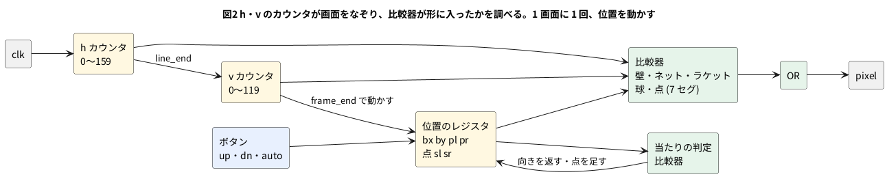

# 12-3 Pong — ゲートだけで動くゲーム

この題は実体配線図と Analog Discovery 3 の図を付けない。ブラウザの中で動く題で、組む物が無いから。

1972 年の業務用の Pong は、TTL の IC を並べたディジタル回路で作られた。CPU もプログラムも無い。
画面を左上から 1 画素ずつ描いていく**カウンタ**と、「いま描いている所は球の中か」を調べる**比較器**があれば、
球もラケットも点数も描ける。球を動かすのも、1 画面に 1 回、位置のレジスタに 1 か 2 を足すだけである。

この題では、同じ作りの Pong を Verilog で書き、ブラウザの soft-fpga (第 4 章) で遊ぶ。4-7 の画面のボタンでラケットを動かし、
回路が出す画素を JS が `<canvas>` に並べる。**命令を読む回路 (CPU) はどこにも無い。**

**動くページ: <https://tommie-jp.github.io/soft-fpga/91-pong/>** (自分でビルドしなくても、ブラウザで開けば遊べる。W・S が左、↑・↓ が右のラケット、AUTO は回路が打つ。下に Logic Analyzer が付いていて、球・ラケット・点の動きが波形で見える (「Logic Analyzer で見る」)。ソースは [soft-fpga の examples/91-pong](https://github.com/tommie-jp/soft-fpga/tree/main/examples/91-pong))

## 決めたこと

| 項目 | 決め | 理由 |
| --- | --- | --- |
| 画面 | 横 160 × 縦 120 画素、白と黒。1 クロックで 1 画素 | 小さくても Pong に見える。1 画面 = 19 200 クロック |
| 描き方 | 横のカウンタ `h` (0〜159) と縦のカウンタ `v` (0〜119) で、左上から右へ、行が終われば次の行へ | テレビの走査と同じ順。帰線の時間は省いた |
| 動かす時 | 画面の最後の画素 (`frame_end`) のクロックで、球とラケットを 1 回動かす | 描いている途中で位置が変わると、球が上下に割れて見える |
| 球 | 3 × 3 画素。横は 1 画面に 2 画素、縦は 1 か 2 画素 | 横に約 1.3 s で画面を渡る (60 画面/s のとき) |
| ラケット | 3 × 16 画素。ボタンを押している間 1 画面に 2 画素動く | 4-7 のボタンは「1 クロックの合図」だったが、ここでは「押している間ずっと 1」にする |
| 返し方 | ラケットの端の 4 画素で返すと縦に速く (2 画素) なる。上半分なら上へ、下半分なら下へ | 打ち方で球の角度を変えられる。元の Pong もラケットを区切って角度を変えていた |
| AUTO | スイッチを入れたラケットは、球の縦の真ん中を 1 画面に 1 画素ずつ追う | 1 人でも遊べる。比較器 1 つで「相手」が作れる |
| 点数 | 0〜9 (9 の次は 0)。7 セグの形で画面の上に描く | 1-8 の 7 セグのデコーダを、そのまま絵に使える |

## 画面のつくり


図1 画面は横 160 × 縦 120 画素。壁・ラケット・ネット・点・球を、比較器で 1 つずつ描く (公開ページのゲーム画面の部分に、形の名前と位置の数を重ねた)。

- 左上が (h, v) = (0, 0)、右下が (159, 119)。**h が横、v が縦**。画面は 1 画素を約 3.6 画素に拡大して写してあり、位置はこの縮尺で合っている
- 枠の色は種類を表す。青が壁、緑がラケット、黄が点、白がネット、橙が球
- 左右のラケットは `pl`・`pr`、球は `bx`・`by` が動く。壁・ネット・点の位置は動かない。球とラケットと点の位置は、撮った瞬間の値 (`bx` = 38、`by` = 38、点は 0 対 3)

画素を 1 つ描くたびに、回路は (`h`, `v`) が次のどれかに入っているかを比べ、どれかに入っていれば白にする。

| 形 | 白にする条件 | 比べる数 |
| --- | --- | --- |
| 壁 | `v < 2` か `v >= 118` | 2 |
| ネット | `h == 79` で `v` の 2 の位のビット (`v[2]`) が 1 | 1 (と配線 1 本) |
| ラケット | `6 <= h < 9` で `pl <= v < pl + 16` (右は `151 <= h < 154`、`pr`) | 4 × 2 |
| 球 | `bx <= h < bx + 3` で `by <= v < by + 3` | 4 |
| 点 | 7 セグの 7 本の棒の長方形のどれかに入り、その棒が点数で光る | 棒 1 本に 2〜4 |

どれも「大きいか・小さいか」の比較器と AND・OR だけで、記憶も命令も要らない。

## ブロック図




- 黄の箱がレジスタ (カウンタ)、緑の箱が組み合わせ回路。左のカウンタと右の比較器だけで画面が描ける
- 位置のレジスタは、`frame_end` のクロックでだけ書き換わる。ほかの 19 199 クロックは、描くために読まれるだけ

## Verilog

`examples/91-pong/verilog/pong.v`

```verilog
// Pong — CPU を使わず、カウンタと比較器だけで球とラケットを描く。
// 1 クロックで 1 画素。横 160 × 縦 120 画素を左上から順に出し、1 画面の終わりで球とラケットを 1 回動かす
module pong (
    input        clk,
    input        rst,
    input        up_l, dn_l,       // 左のラケット。押している間 1
    input        up_r, dn_r,       // 右のラケット
    input        auto_l, auto_r,   // 1 ならラケットが球を追う (相手がいなくても遊べる)
    output [7:0] hpos,             // いま出している画素の横 (0〜159)
    output [6:0] vpos,             // 縦 (0〜119)
    output       pixel,            // 1 なら白
    output       line_end,         // 行の最後の画素で 1
    output       frame_end,        // 画面の最後の画素で 1
    output [3:0] score_l,
    output [3:0] score_r
);
    localparam [7:0] W = 8'd160;
    localparam [6:0] H = 7'd120;
    localparam [6:0] TOP = 7'd2, BOTTOM = 7'd118;    // 上下の壁の内側
    localparam [6:0] PH = 7'd16;                      // ラケットの長さ
    localparam [7:0] LX = 8'd6, RX = 8'd151;          // ラケットの左端の横位置 (幅 3)
    localparam [7:0] BS = 8'd3;                       // 球の大きさ (3 × 3)

    // ---- 画素のカウンタ ----
    reg [7:0] h;
    reg [6:0] v;
    assign hpos      = h;
    assign vpos      = v;
    assign line_end  = (h == W - 8'd1);
    assign frame_end = line_end && (v == H - 7'd1);

    always @(posedge clk)
        if (rst)            begin h <= 8'd0; v <= 7'd0; end
        else if (frame_end) begin h <= 8'd0; v <= 7'd0; end
        else if (line_end)  begin h <= 8'd0; v <= v + 7'd1; end
        else                      h <= h + 8'd1;

    // ---- 球とラケットの位置 (左上の角) ----
    reg [7:0] bx;
    reg [6:0] by;
    reg       left, up, fast;          // 球の向き: 左へ・上へ・縦に 2 画素ずつ
    reg [6:0] pl, pr;                  // ラケットの上端
    reg [3:0] sl, sr;                  // 点 (0〜9)
    assign score_l = sl;
    assign score_r = sr;

    wire [6:0] dy = fast ? 7'd2 : 7'd1;
    wire [6:0] bc = by + 7'd1;         // 球の縦の真ん中

    // 球がラケットの縦の範囲に入っているか
    wire on_l = (by + 7'd3 > pl) && (by < pl + PH);
    wire on_r = (by + 7'd3 > pr) && (by < pr + PH);
    // 球がラケットの横の位置まで来たか (横に 2 画素ずつ進むので 2 画素の幅で見る)
    wire at_l = left  && (bx >= LX + 8'd1) && (bx <= LX + 8'd3);
    wire at_r = !left && (bx + BS >= RX)    && (bx + BS <= RX + 8'd2);
    wire hit_l = at_l && on_l;
    wire hit_r = at_r && on_r;
    wire out_l = left  && (bx < 8'd2);              // 左の端を越えた → 右の点
    wire out_r = !left && (bx + BS > W - 8'd2);     // 右の端を越えた → 左の点

    // ラケットの端の 4 画素に当たると縦に速くなり、上半分なら上へ、下半分なら下へ返す
    function [1:0] bounce(input [6:0] p);           // {fast, up}
        bounce = {(bc < p + 7'd4) || (bc >= p + PH - 7'd4), bc < p + 7'd8};
    endfunction

    // ラケットを 1 画面ぶん動かす。auto なら球の真ん中を 1 画素ずつ追い、手で動かすときは 2 画素ずつ
    function [6:0] paddle(input [6:0] p, input u, input d, input auto);
        reg [6:0] q;
        begin
            q = p;
            if (auto) begin
                if      (bc < p + 7'd8 && p > TOP)          q = p - 7'd1;
                else if (bc > p + 7'd8 && p < BOTTOM - PH)  q = p + 7'd1;
            end else begin
                if      (u && p >= TOP + 7'd2)              q = p - 7'd2;
                else if (d && p + 7'd2 <= BOTTOM - PH)      q = p + 7'd2;
            end
            paddle = q;
        end
    endfunction

    always @(posedge clk)
        if (rst) begin
            bx <= 8'd78; by <= 7'd58; left <= 1'b1; up <= 1'b0; fast <= 1'b0;
            pl <= 7'd52; pr <= 7'd52; sl <= 4'd0; sr <= 4'd0;
        end else if (frame_end) begin
            pl <= paddle(pl, up_l, dn_l, auto_l);
            pr <= paddle(pr, up_r, dn_r, auto_r);

            // 横: 当たれば向きを返す。外れたら点を足して真ん中から打ち直す (点を取られた側へ)
            if (out_l || out_r) begin
                if (out_l) sr <= (sr == 4'd9) ? 4'd0 : sr + 4'd1;
                else       sl <= (sl == 4'd9) ? 4'd0 : sl + 4'd1;
                bx <= 8'd78; by <= 7'd58; fast <= 1'b0; up <= !up;
            end else begin
                if (hit_l)      begin left <= 1'b0; {fast, up} <= bounce(pl); bx <= bx + 8'd2; end
                else if (hit_r) begin left <= 1'b1; {fast, up} <= bounce(pr); bx <= bx - 8'd2; end
                else            bx <= left ? bx - 8'd2 : bx + 8'd2;

                // 縦: 上下の壁で返す
                if (up) begin
                    if (by <= TOP + dy - 7'd1) begin up <= 1'b0; by <= TOP; end
                    else                         by <= by - dy;
                end else begin
                    if (by + 7'd3 + dy >= BOTTOM) begin up <= 1'b1; by <= BOTTOM - 7'd3; end
                    else                            by <= by + dy;
                end
            end
        end

    // ---- 絵: いまの (h, v) が何かの形の中にあるかを、比較器で調べる ----
    wire wall   = (v < TOP) || (v >= BOTTOM);
    wire net    = (h == 8'd79) && v[2];                                   // 4 画素おきの点線
    wire racket = ((h >= LX) && (h < LX + 8'd3) && (v >= pl) && (v < pl + PH))
               || ((h >= RX) && (h < RX + 8'd3) && (v >= pr) && (v < pr + PH));
    wire ball   = (h >= bx) && (h < bx + BS) && (v >= by) && (v < by + 7'd3);

    // 点は 7 セグの形 (横 8 × 縦 14 画素) で、左の点を x = 60、右の点を x = 92、y = 6 から描く
    function [6:0] seg7(input [3:0] n);                // {g, f, e, d, c, b, a} (1-8 と同じ)
        case (n)
            4'd0: seg7 = 7'b0111111;  4'd1: seg7 = 7'b0000110;
            4'd2: seg7 = 7'b1011011;  4'd3: seg7 = 7'b1001111;
            4'd4: seg7 = 7'b1100110;  4'd5: seg7 = 7'b1101101;
            4'd6: seg7 = 7'b1111101;  4'd7: seg7 = 7'b0000111;
            4'd8: seg7 = 7'b1111111;  4'd9: seg7 = 7'b1101111;
            default: seg7 = 7'b0000000;
        endcase
    endfunction

    function digit(input [3:0] n, input [7:0] x0, input [7:0] x, input [6:0] y);
        reg [6:0] s;
        reg [7:0] dx;
        reg [6:0] dy7;
        begin
            s = seg7(n);
            dx = x - x0;
            dy7 = y - 7'd6;
            if (x < x0 || x >= x0 + 8'd8 || y < 7'd6 || y >= 7'd20) digit = 1'b0;
            else digit = (s[0] && dy7 <= 7'd1)                                 // a
                      || (s[1] && dx >= 8'd6 && dy7 <= 7'd7)                   // b
                      || (s[2] && dx >= 8'd6 && dy7 >= 7'd6)                   // c
                      || (s[3] && dy7 >= 7'd12)                                // d
                      || (s[4] && dx <= 8'd1 && dy7 >= 7'd6)                   // e
                      || (s[5] && dx <= 8'd1 && dy7 <= 7'd7)                   // f
                      || (s[6] && dy7 >= 7'd6 && dy7 <= 7'd7);                 // g
        end
    endfunction

    wire score = digit(sl, 8'd60, h, v) || digit(sr, 8'd92, h, v);

    assign pixel = wall || net || racket || ball || score;
endmodule
```

- `h` と `v` は 2-8 の 2 段のカウンタ。`h` が 159 で `line_end`、そのとき `v` を 1 進める
- 当たりの判定 (`on_l` `at_l` `hit_l` …) は、**次に動かす前の位置**で比べる。横に 2 画素ずつ進むので、ラケットの位置を 2 画素の幅で見る (1 画素の幅だと、球がラケットを飛び越えることがある)
- `out_l` は、球が左に向かっていて、左の端から 2 画素より内に来たとき。右の点を 1 足し、球を真ん中に戻す。向きは変えないので、**点を取られた側へ打ち直す**
- `bounce` は「ラケットのどこに当たったか」を比べて、縦の速さと向きを決める。`paddle` はラケットの動き。AUTO なら球の真ん中 `bc` とラケットの真ん中 `p + 8` を比べ、1 画素ずつ近づける
- `function` の中の `if` も、合成すると比較器とセレクタになる (1-5)。実行の順ではない
- 点の 7 セグは、1-8 のデコーダ `seg7` の 7 ビットで、7 本の棒 (幅 2 画素の長方形) のどれを白にするかを決める

lint (`verilator --lint-only -Wall pong.v`) は警告 0 件で通る (Verilator 5.042)。

## C++ (ハーネス)

`examples/91-pong/cxx/harness.cpp`。4-7 の `harness.cpp` の形で、1 画面ぶんのクロックを回して画素を配列に書く。

```cpp
// examples/91-pong/cxx/harness.cpp — 1 画面ぶんクロックを回し、画素を 160 × 120 の配列に書く
#include "Vpong.h"
#include "verilated.h"
#ifdef __EMSCRIPTEN__
#include <emscripten.h>
#else
#define EMSCRIPTEN_KEEPALIVE
#endif
#include <stdint.h>

static Vpong*   top;
static uint8_t  fb[160 * 120];     // 1 画素 1 バイト (0 か 1)
static uint32_t keys   = 0;        // bit0 左上 bit1 左下 bit2 右上 bit3 右下 bit4 左 auto bit5 右 auto
static uint32_t frames = 0;

static void tick() {
    top->clk = 0; top->eval();
    top->clk = 1; top->eval();
}

extern "C" {

EMSCRIPTEN_KEEPALIVE void sim_init() {
    top = new Vpong();
    top->rst = 1; tick();
    top->rst = 0; top->clk = 0; top->eval();
    frames = 0;
}

EMSCRIPTEN_KEEPALIVE void set_keys(uint32_t k) { keys = k; }

// 1 画面 = 160 × 120 = 19 200 クロック。画素は立ち上がりの前の (hpos, vpos) の値
EMSCRIPTEN_KEEPALIVE void run_frame() {
    top->up_l = keys & 1;         top->dn_l = (keys >> 1) & 1;
    top->up_r = (keys >> 2) & 1;  top->dn_r = (keys >> 3) & 1;
    top->auto_l = (keys >> 4) & 1; top->auto_r = (keys >> 5) & 1;
    for (int i = 0; i < 160 * 120; i++) {
        top->clk = 0; top->eval();
        fb[top->vpos * 160 + top->hpos] = top->pixel;
        const bool last = top->frame_end;
        top->clk = 1; top->eval();
        if (last) break;
    }
    frames++;
}

EMSCRIPTEN_KEEPALIVE uint8_t* get_fb()      { return fb; }
EMSCRIPTEN_KEEPALIVE uint32_t get_score()   { return (uint32_t)top->score_l << 4 | top->score_r; }
EMSCRIPTEN_KEEPALIVE uint32_t get_frames()  { return frames; }

} // extern "C"
```

- `run_frame` は 19 200 回、`clk` を 0 → 1 にする。立ち上がりの前の `hpos` `vpos` の場所に `pixel` を書く。最後の画素 (`frame_end`) を書いたら抜ける
- ボタンとスイッチは `keys` の 6 ビットにまとめ、1 画面の初めに Verilog の入力へ入れる。位置が動くのは画面の最後のクロックだけなので、画面の途中で入力を替えても意味が無い
- `get_fb` は配列の番地を返す。JS は WebAssembly のメモリ (`HEAPU8`) を、その番地から 19 200 バイト読む

## JS (画面)

`examples/91-pong/web/index.html`

```html
<!doctype html>
<html lang="ja">
<head>
<meta charset="utf-8">
<title>91-pong</title>
<style>
  body { background: #222; color: #ddd; font-family: sans-serif; }
  canvas { image-rendering: pixelated; border: 1px solid #555; }
  button { min-width: 4em; margin: 2px; }
  button.on { background: #6c6; }
</style>
</head>
<body>
<canvas id="screen" width="160" height="120" style="width:480px;height:360px"></canvas>
<div>
  左 <button id="ul">上 (W)</button><button id="dl">下 (S)</button><button id="al">AUTO</button>
  右 <button id="ur">上 (↑)</button><button id="dr">下 (↓)</button><button id="ar">AUTO</button>
</div>
<div>点 <span id="score">0 - 0</span> / <span id="frames">0</span> 画面</div>
<script>
var Module = { onRuntimeInitialized: function () {
  Module._sim_init();
  const ctx = document.getElementById('screen').getContext('2d');
  const img = ctx.createImageData(160, 120);
  let held = 0, sw = 0;                       // held: 押している間のボタン (bit0〜3)、sw: AUTO のスイッチ (bit4・5)

  function hold(id, bit, key) {               // ボタン: 押している間だけ 1
    const el = document.getElementById(id);
    const on = () => { held |= bit; el.classList.add('on'); };
    const off = () => { held &= ~bit; el.classList.remove('on'); };
    el.addEventListener('pointerdown', on);
    el.addEventListener('pointerup', off);
    el.addEventListener('pointerleave', off);
    addEventListener('keydown', (e) => { if (e.key === key) on(); });
    addEventListener('keyup', (e) => { if (e.key === key) off(); });
  }
  hold('ul', 1, 'w'); hold('dl', 2, 's'); hold('ur', 4, 'ArrowUp'); hold('dr', 8, 'ArrowDown');

  function toggle(id, bit) {                  // スイッチ: 押すたびに入れ替わり、そのまま残る
    const el = document.getElementById(id);
    el.addEventListener('click', () => { sw ^= bit; el.classList.toggle('on', (sw & bit) !== 0); });
  }
  toggle('al', 16); toggle('ar', 32);

  function loop() {
    Module._set_keys(held | sw);
    Module._run_frame();                      // 1 画面 = 19 200 クロック
    const fb = new Uint8Array(Module.HEAPU8.buffer, Module._get_fb(), 160 * 120);
    for (let i = 0; i < fb.length; i++) {
      const c = fb[i] ? 255 : 0;
      img.data[i * 4] = img.data[i * 4 + 1] = img.data[i * 4 + 2] = c;
      img.data[i * 4 + 3] = 255;
    }
    ctx.putImageData(img, 0, 0);
    const s = Module._get_score();
    document.getElementById('score').textContent = (s >> 4) + ' - ' + (s & 15);
    document.getElementById('frames').textContent = Module._get_frames();
    requestAnimationFrame(loop);
  }
  requestAnimationFrame(loop);
} };
</script>
<script src="sim.js"></script>
</body>
</html>
```

- ラケットのボタンは**押している間だけ 1** (`pointerdown` で立て、`pointerup` と `pointerleave` で下ろす)。キーボードの W・S と ↑・↓ でも同じ
- AUTO は 4-7 のスイッチと同じで、押すたびに入れ替わる
- 描き替えのたびに `run_frame` を 1 回呼ぶ。ブラウザの描き替えは 1 秒に約 60 回なので、回路は 1 秒に 60 × 19 200 = 約 115 万クロック回る
- `<canvas>` は 160 × 120 のまま、CSS で 3 倍に広げる。`image-rendering: pixelated` で、画素がぼけずに四角く出る

## 手順

1. soft-fpga を写す (0-2)。上の 3 つのファイルを `examples/91-pong/` の下に置く
2. `scripts/build-wasm-02.sh` を写して `scripts/build-wasm-91.sh` を作る。替えるのは例の場所・`OBJ_DIR`・Verilog のファイル・出す関数の並び (4-7 と同じ考え)。
   この例は Logic Analyzer の関数を持たないので `${LA_EXPORTS}` を消し、JS が `HEAPU8` を読むので `EXPORTED_RUNTIME_METHODS` を `HEAPU8` にする

   ```bash
   verilator --cc "$EXAMPLE/verilog/pong.v" --Mdir "$OBJ_DIR"
   # … (wasm_compile_verilated_cpp まで 02 と同じ)
   em++ $COMMON_FLAGS "$OBJ_DIR"/V*.cpp "$OBJ_DIR/verilated.wasm.o" "$EXAMPLE/cxx/harness.cpp" \
       -s EXPORTED_FUNCTIONS="[\"_sim_init\",\"_set_keys\",\"_run_frame\",\"_get_fb\",\"_get_score\",\"_get_frames\"]" \
       -s EXPORTED_RUNTIME_METHODS='["HEAPU8"]' \
       -s ALLOW_MEMORY_GROWTH=1 -s EXIT_RUNTIME=0 -o "$EXAMPLE/web/sim.js"
   ```

3. 4-3 と同じく docker の `build-wasm` で回す

   ```bash
   docker compose -f docker/compose.yml run --rm build-wasm scripts/build-wasm-91.sh
   ```

4. `examples/` で Web サーバを立て (`python3 -m http.server 8081`)、`/91-pong/web/` を開く。同じ物が上の URL に公開してある
5. 左右の AUTO を入れると、回路どうしが打ち合う。AUTO を切り、W・S (左) と ↑・↓ (右) で打つ

## 画面に見えるはずのもの

開いた直後 (1 画面め) の 58〜61 行め。1 クロックを 1 µs と置いた仮の目盛で、`pixel` を Logic で見たように描いた。
リセットのあと、球は (78, 58)、ラケットはどちらも 52〜67 行にいる。

```logic
# ロジックアナライザの画面 (tommie-fence の logic フェンス)
title: 図3 1 行の中で、比較器が形に入った所だけ pixel が 1 になる (1 クロック = 1 µs と置いた)
device: generic
time: 40us/div
start: -20us
signals:
  V0: edges -20us=0 0s=1 160us=0 320us=1
  RACKET: edges -20us=0 6us=1 9us=0 151us=1 154us=0 166us=1 169us=0 311us=1 314us=0 326us=1 329us=0
  BALL: edges -20us=0 78us=1 81us=0 238us=1 241us=0
  PIXEL: edges -20us=0 6us=1 9us=0 78us=1 81us=0 151us=1 154us=0 166us=1 169us=0 238us=1 241us=0 311us=1 314us=0 326us=1 329us=0
cursors: [6us, 78us]
```


| 行 | `pixel` が 1 の `h` | 何か |
| --- | --- | --- |
| 59 (図の 0〜159 µs) | 6〜8、78〜80、151〜153 | 左のラケット・球・右のラケット |
| 60 (160〜319 µs) | 6〜8、78〜80、151〜153 | 同じ。60 は `v[2]` が 1 なのでネットの 79 も 1 だが、球と重なる |
| 61 (320 µs〜) | 6〜8、79、151〜153 | 球はもう無い (58〜60 行)。ネットの 79 だけ |

- `V0` は縦のカウンタ `v` の一番下のビット。行が替わるたびに反転するので、行の境目 (160 クロックごと) が見える。窓の左端の −20〜0 µs は 58 行めの終わり
- `RACKET` と `BALL` は、ラケットと球の比較器の出力 (`racket` と `ball`)。`PIXEL` はそれと壁・ネット・点の OR。60 行めのネット (239 µs) は球と重なるので、`PIXEL` は `BALL` と同じ形になる
- X1 (6 µs) は左のラケットの左端、X2 (78 µs) は球の左端。ΔX の 72 µs が 72 画素で、`bx` − 6 = 78 − 6 と同じ
- 1 画面は 19 200 µs (この目盛で)。ブラウザの描き替えに合わせて回すと、実際の時間はそれと関係なく 1 画面が約 16.7 ms になる

## Logic Analyzer で見る

公開ページの下には、soft-fpga の Logic Analyzer (第 4 章の 4-2 と同じ画面) が付いている。本文の `pong.v` は変えず、ハーネスが Verilator の `rootp` から内部のレジスタを読んで、
1 サンプル 3 word の ring buffer に記録している (この本文の `harness.cpp` は、記録を省いた最小の版)。

記録のしかたは、ページの「Logic Analyzer の記録」で 2 通りから選ぶ。

| 記録 | 1 サンプル | 見えるもの | 使いどころ |
| --- | --- | --- | --- |
| 1 画面ごと (既定) | 画面の最後の画素の次のクロック | `bx` `by` `left` (球)、`pl` `pr` (ラケット)、`sl` `sr` (点)、`hit_l` `hit_r` `out_l` `out_r` (出来事) | 球の動きと点が増える瞬間。4096 画面ぶん (約 68 秒) が残る |
| 1 クロックごと | 毎クロック | `h` `v` `pixel` `line_end` `frame_end` | 走査線。1 画面は 19 200 クロックで、リングは 4096 なので約 25 行ぶん |

見方の例:

- **球が左のラケットで返った瞬間**: 「1 画面ごと」で `hit_l` のパルスの次の画面で、`left` が 1 から 0 になり、`bx` が増え始める
- **点が入った瞬間**: `out_l` のパルスの次の画面で `sr` が 1 増え、`bx`・`by` が真ん中 (78・58) に戻る
- **縦に速くなる**: ラケットの端で返すと `fast` が 1 になり、`by` が 1 画面に 2 ずつ動く
- **形の縁**: 「1 クロックごと」で `pixel` の立ち上がりにトリガーすると、行の中で壁・ラケット・ネット・球に入った所が見える。`h` が 0〜159 を数える傾斜と、`line_end` で `v` が 1 増える段も見える

### トリガーで止め、再開する

1. **トリガーを決める**: 「⚙ Trigger ▾」を開き、左から順に選ぶ。信号 (例 `sr[7:4]`)、条件 (`==` で値、`↑ 立ち上がり`、`↓ 立ち下がり`)、`==` のときは value (16 進、例 `3`)、post (発火のあと何サンプル記録してから止めるか、例 `5`)。**Set** を押すと、その条件で待ち始める
2. **待つ**: ゲームは動き続け、条件が揃った瞬間に発火する。post ぶん記録したところで、LA が止まり (ツールバーの「❄ Freeze」が「▶ Thaw」に替わる)、ゲームも止まる (「Pause」が「Run」に替わる)。止まった画面の波形は、発火の前後が残り、赤い縦線が発火の位置
3. **波形を読む**: 止まっている間は、「«」「‹」「›」「»」や拡大の「−」「＋」、マーカー (A・B・C) で好きなだけ見られる。ゲームは進まない
4. **再開する**: **「Run」を押す**か、LA の **「▶ Thaw」を押す**。どちらも LA の凍結が解け (「▶ Thaw」が「❄ Freeze」に戻る)、再び武装して、ゲームが続く。同じトリガーの条件のまま次を待つ
5. **やめる**: 「Clear」を押すとトリガーの条件が消える。以後は止まらない

- 条件が `==` のとき、**一致し続けている間は再発火しない**。`sr == 3` で止めた後に再開しても、`sr` が 4 になり、また 3 に戻る (9 の次の 0 を経て 3 になる) までは止まらない
- トリガーで止まったときの「▶ Thaw」は、ゲームも続ける。**手で「Pause」したあと**に「❄ Freeze」と「▶ Thaw」を押しても、ゲームは勝手には進まない (「Run」を押す)
- 手動で止めたいときは、画面の「Pause」を押す。ゲームが止まるので、LA の記録も止まる (新しいサンプルは入らない)。「Run」で続きから動く
- 上の手順は、公開ページをブラウザで開き、`sr[7:4] == 3` の値トリガーで停止し、「Run」で再開して画面が進み続けることを確かめた (Playwright の Chromium)。
  「Run」を押すと凍結が解けて `frames` が増え続けること、「▶ Thaw」でも同じく続くこと (2026-10-15 の版から。それより前は凍結が解けるだけでゲームは止まっていた)、手で「Pause」したあとの Freeze → Thaw では進まないこと、「Clear」のあとは止まらないこと、「Pause」中は記録が増えないことも、同じ手で確かめた

この図は、ブラウザで開いて確かめた (Playwright の Chromium、1 画面ごとのモードで 3 秒に約 180 サンプル、1 クロックごとのモードで 1.5 秒に約 180 万サンプル)。
実機の波形ではなく、PC の Verilator の模型の波形である。

## 見るべき値

PC の Verilator 5.042 の試験台と、Verilator 5.048・Emscripten の docker でビルドしたブラウザ (Playwright の Chromium) で動かした。
soft-fpga は f89a885 の写しに 91-pong を足して確かめた。

| 見る所 | 値 | 種類 |
| --- | --- | --- |
| 1 画面めの白の画素の数 | 946 (壁 640、ネット 58、ラケット 96、球 8 (1 画素はネットと重なる)、点の 0 が 72 × 2) | PC で動かして確かめた。数え方は下 |
| 何も押さずに 300 画面 | 右の点が 7 (最初は 39 画面め)。左のラケットに 1 度も当たらない | PC で動かして確かめた |
| 左の上を押し続ける | 30 画面でラケットの上端が 2 (上の壁のすぐ下) で止まる | PC とブラウザ (W キーを 1 s) で確かめた |
| 左右とも AUTO で 3600 画面 (60 画面/s で 1 分) | ラケットに 51 回当たり、点は入らない | PC で動かして確かめた |
| ブラウザの描き替え | 5 s で約 300 画面 (約 60 画面/s、回路は約 115 万クロック/s) | ブラウザで確かめた |

- 946 の内訳: 壁は 160 × 2 行 × 2 = 640。ネットは `v[2]` が 1 の 60 行のうち、壁に重なる 118・119 行を除く 58。ラケットは 3 × 16 × 2 = 96。
  球は 9 画素のうち (79, 60) がネットと重なるので 8。点の「0」は 6 本の棒 × 16 画素 − 角の重なり 6 × 4 = 72
- AUTO どうしで点が入らないのは、AUTO のラケットが球の縦の動き (1 画面に 1〜2 画素) によく付いていけるからである。ラケットの端で返して縦に速くなった球は追い抜くことがあるが、1 分では起きなかった。
  ブラウザで、AUTO をラケットが端にいる所から入れたときは点が入った (追いつく前に球が来た)
- 何も押さないとき、球は左へ向かいながら 1 画素ずつ下がり、左のラケット (52〜67 行) の下を抜ける。点を取られた側 (左) へ打ち直すので、同じことを繰り返す

## FPGA に載せるとき

```bash
yosys -p "read_verilog pong.v; synth_gowin -top pong; stat"
```

| 部品 | yosys 0.33 | yosys 0.70+16 |
| --- | --- | --- |
| LUT (LUT1〜LUT4) | 536 | 310 |
| 桁上げの回路 (ALU) | 573 | 483 |
| フリップフロップ | 69 | 69 |

- フリップフロップ 69 個がゲームの記憶の全部 (カウンタ `h` `v`、位置 `bx` `by` `pl` `pr`、向き、点)。12-1 のアクセラレータ (79 個) より少ない
- ALU が多いのは、比較器 (`<` `>=`) を道具が引き算の桁上げの回路で作るため。比べる所が 40 ほどある
- Tang Nano 9K の FPGA (GW1NR-9) の LUT 8 640 個に対して 4〜6 %。実物の FPGA に載せるなら、`pixel` を VGA や HDMI の信号にする回路 (帰線と同期の信号) が別に要る。この題では作っていない

## シミュレーションでの確かめ (対象外を含む)

本文の `pong.v`・`harness.cpp` と、試験台 `sim/03-pong-tb.cpp` を Verilator 5.042 で組んで回した。置き場は `sim/03-pong.v`・`sim/03-pong-harness.cpp`・
`sim/03-pong-index.html`・`sim/03-pong-build-wasm.sh` (`scripts/build-wasm-91.sh`)。試験台は、同じ遊びを C++ で書き直した模型を持ち、
**画面ごとに 160 × 120 の全画素と点を回路と比べる** (球とラケットの位置は画素に出るので、位置も比べたことになる)。

```text
no input: 300 frames, lit pixels in frame 0 = 946, paddle hits 0, points 7 (first at frame 39), score 0-7
hold up (left): 30 frames, lit pixels in frame 0 = 946, paddle hits 0, points 0 (first at frame -1), score 0-0
  left paddle top after holding up: 2
both auto: 3600 frames, lit pixels in frame 0 = 946, paddle hits 51, points 0 (first at frame -1), score 0-0
random keys: 10000 frames, lit pixels in frame 0 = 946, paddle hits 59, points 146 (first at frame 179), score 7-9
PASS
```

`random keys` は、30 画面ごとに 6 つのボタンとスイッチを乱数で替えて 10 000 画面回した (点は 9 の次に 0 に戻るので、146 点入って 7 対 9)。
どの画面でも、回路と模型の画素が 1 つも違わず、球は上下の壁の内にいた。

ブラウザは、soft-fpga の f89a885 の写しに `examples/91-pong` と `scripts/build-wasm-91.sh` を置き、`sfa-dev-wasm` の docker (Verilator 5.048・Emscripten) でビルドした
(`sim.wasm` 149 589 バイト)。Playwright の Chromium で開き、スクリプトで次を確かめた。

| 項目 | 本文の数字 | 結果 | 判定 |
| --- | --- | --- | --- |
| lint (`-Wall`) | 警告 0 件 | 0 件 | 合った |
| 1 画面めの白の画素 | 946 | 946 (PC)。ブラウザは開いて 1.5 s 後の画面で 939 (点が 0 対 2 になり、「2」が「0」より 7 画素少ない) | 合った |
| 図3の 58〜61 行の `pixel` | 6〜8・78〜80・151〜153 (61 行は 79) | 同じ (`run_frame` の配列を読んだ) | 合った |
| W キーを 1 s 押す | ラケットの上端が 2 | `<canvas>` の 7 列めの白が 2〜17 行 | 合った |
| 左右の AUTO を入れて 5 s | 画面と点が進む | 156 → 456 画面、点 0-3 → 0-5、コンソールに誤り無し (favicon の 404 だけ) | 合った |
| 描き替えの速さ | 約 60 画面/s | 300 画面/5 s | 合った (ヘッドレスの Chromium の値) |
| 合成 (0.33 / 0.70+16) | LUT 536 / 310、ALU 573 / 483、FF 69 | LUT1 200 + LUT2 43 + LUT3 66 + LUT4 227 / 71 + 54 + 71 + 114、DFF 14 + DFFR 8 + DFFRE 32 + DFFSE 15 (どちらも) | 合った |
| 人の指で打ったときの遊びやすさ | — | 人が見て遊ぶこと | 対象外 |

ブラウザで AUTO のときに点が入ったのは、W キーで左のラケットを上の端に寄せた後に AUTO を入れたためで、PC の試験の `both auto` (リセットの直後から AUTO) とは始まりが違う。

## 出典

自作。画面のボタンと WebAssembly の関数の付け方は [tommie-jp/soft-fpga](https://github.com/tommie-jp/soft-fpga) (MIT) の
`examples/02-traffic-fsm` (`cxx/harness.cpp`、`web/index.html`、`scripts/build-wasm-02.sh`) と、それをまねた 4-7 の 90-switches に倣った。
91-pong はこの題のために書いた。soft-fpga のリポジトリの `examples/91-pong` に足し (`pong.v`・`cxx/harness.cpp`・`web/index.html`・`scripts/build-wasm-91.sh`)、GitHub Pages に公開した。公開ページには Logic Analyzer が付いていて (「Logic Analyzer で見る」)、本文の `harness.cpp` はその記録を省いた最小の版である。

図1 は、公開ページ (soft-fpga の 91-pong) のスクリーンショット (`sim/03-pong-screen-raw.png`) に、`sim/03-pong-screen-overlay.py` (Pillow) で形の名前と位置の数を重ね、ゲーム画面の部分だけを切り出した (ボタンの行は載せていない)。

- 1972 年の Pong が TTL の回路で設計されたこと、ラケットを 8 つに区切って返す角度を変えていたこと: Wikipedia の [Pong](https://en.wikipedia.org/wiki/Pong) の項 (Development and history)。この題のラケットは端の 4 画素とそのほかの 3 つに区切った
