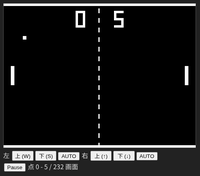
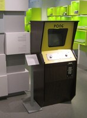
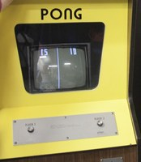
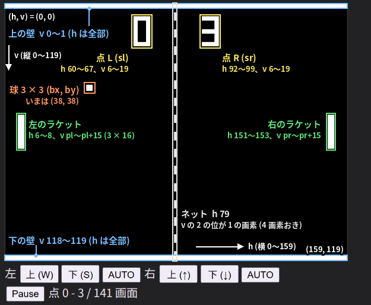
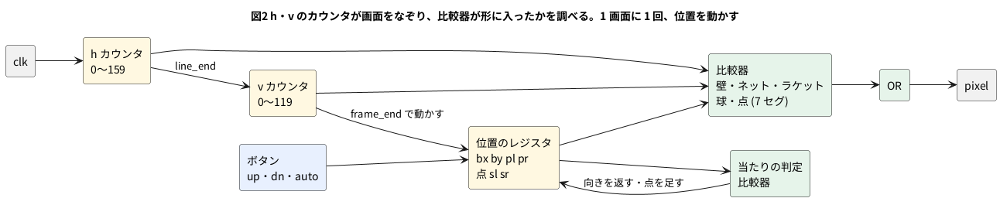
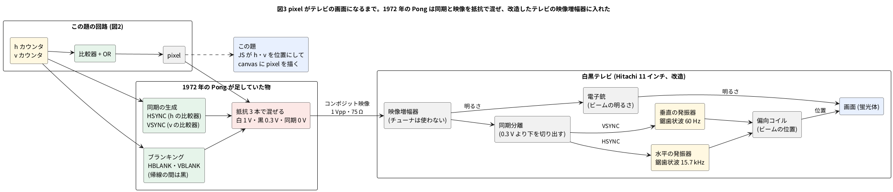

# 12-3 Pong — ゲートだけで動くゲーム

この題は実体配線図と Analog Discovery 3 の図を付けない。ブラウザの中で動く題で、組む物が無いから。

1972 年の業務用の Pong は、TTL の IC を並べたディジタル回路で作られた。CPU もプログラムも無い。
画面を左上から 1 画素ずつ描いていく**カウンタ**と、「いま描いている所は球の中か」を調べる**比較器**があれば、
球もラケットも点数も描ける。球を動かすのも、1 画面に 1 回、位置のレジスタに 1 か 2 を足すだけである。

この題では、同じ作りの Pong を Verilog で書き、ブラウザの soft-fpga (第 4 章) で遊ぶ。4-7 の画面のボタンでラケットを動かし、
回路が出す画素を JS が `<canvas>` に並べる。**命令を読む回路 (CPU) はどこにも無い。**

**動くページ: <https://tommie-jp.github.io/soft-fpga/91-pong/>** (自分でビルドしなくても、ブラウザで開けば遊べる。開いた直後は、左右とも AUTO (回路が打つ) で打ち合う。AUTO を切ると、W・S が左、↑・↓ が右のラケット。スマホでも開けて、画面の下の左右の端にある ▲・▼ のボタンで打つ。下に Logic Analyzer が付いていて、遊んでいる最中の球・ラケット・点の動きが、その場で波形で見える。シミュレーションを走らせ終えてから波形を開く、ふつうの RTL シミュレーションとはここが違う (「Logic Analyzer で見る」)。ソースは [soft-fpga の examples/91-pong](https://github.com/tommie-jp/soft-fpga/tree/main/examples/91-pong))

[](03-pong-page.png)

(公開ページのスクリーンショット。クリックすると、ページ全体 (ゲーム画面・説明欄・Logic Analyzer) が開く)

## Pong の歴史的な位置

Pong (1972) は、ビデオゲームが産業になる入口にあったゲームである。前と後を、年と数で短く並べる (出典は末尾)。

### Pong より前

| 年 | もの | 作り | 位置づけ |
| --- | --- | --- | --- |
| 1958 | Tennis for Two (W. Higinbotham、ブルックヘブン国立研究所) | アナログ計算機とオシロスコープ | 研究所の見学者向けの展示。特許も取らず、産業にはつながらなかった |
| 1962 | Spacewar! (MIT の学生、DEC PDP-1) | 計算機のプログラム | 大学や研究所の計算機でしか遊べない。多くの学生が見て、のちの作り手 (N. Bushnell) の源になった |
| 1971 | Computer Space (Bushnell・Dabney) | TTL の論理回路 (CPU なし) | 最初の業務用ビデオゲーム。商業的には振るわなかった (Wikipedia) |
| 1972 | Magnavox Odyssey (R. Baer の設計) | ダイオードとトランジスタの論理 (ディスクリート部品) | 最初の家庭用機。卓球のゲームを Bushnell が 5 月に遊び、Pong のもとになった |

### Pong (1972)

- Atari の Allan Alcorn が、Bushnell に与えられた練習課題として作った。**CPU もプログラムも無く、7400 系の TTL だけで組んだ** (Alcorn 本人の話)
- 酒場 (Andy Capp's Tavern) に置いた試作は、最初の 2 週間で、これを遊ぶために人が来るほどになった (同じく Alcorn)
- 1972 年 11 月 29 日に、北米で業務用が発売された (Wikipedia)

[](03-pong-photo-cabinet.jpg)
[](03-pong-photo-screen.jpg)

(写真をクリックすると、元の大きさで開く)

- 写真1 (左) Atari Pong の筐体 (コンピュータゲーム博物館、ベルリン)。木目の筐体の上に、黄色の前面と白黒テレビの画面、ラケットを動かす 2 つのつまみ、コイン投入口が付く
- 写真2 (右) Pong の画面と操作盤。白黒テレビに、左の点 (15)・ネットの点線・右の点 (10) が出ている。操作は PLAYER 1 と PLAYER 2 のつまみ 1 つずつだけで、回すとラケットが縦に動く

写真の出どころとライセンスは、末尾の出典にある。

**動画** (外部のサイトなので、リンクが切れることがある):

- [Atari Pong Video Arcade Game (1972) — Vimeo、93 秒](https://vimeo.com/427804665): 黄色の筐体で子どもたちが遊ぶ映像。投稿者の説明は 1972 年の Atari Pong。機体が当時の物か復元品かは、確かめていない
- [The Evolution of Video Games: Pong's 50-Year Legacy — YouTube (The Sydney Morning Herald と The Age、2022 年)](https://www.youtube.com/watch?v=763CFRuxovo): Pong の 50 年を扱った解説。業務用から家庭用への流れ
- [50 Years of Fun With Pong — Computer History Museum の記事](https://computerhistory.org/blog/50-years-of-fun-with-pong/): 試作機は同館が所蔵している (Alcorn の 2012 年のインタビュー [The Register](https://www.theregister.com/2012/03/05/pong_anniversary_al_alcorn/) による)

### Pong より後

| 年 | できごと | 意味 |
| --- | --- | --- |
| 1973〜74 | 1973 年までに 2 500 台の注文、1974 年末までに 8 000 台超 (Wikipedia) | 業務用のビデオゲームが商売になった。Ramtek・Nutting などの「Pong のそっくりさん」が数か月で出た |
| 1974〜76 | Magnavox が特許で Atari などを提訴。Atari は 1976 年に 150 万ドル (8 回の分割) のライセンスで和解 (Wikipedia) | ゲームの回路そのものに特許と権利金が付く時代になった |
| 1975 | 家庭用の Home Pong (Sears の Tele-Games、98.95 ドル)。その年の年末商戦で約 15 万台 (Wikipedia) | 回路を 1 個の LSI にまとめた (開発費は約 5 万ドル)。家庭にゲーム機が入った |
| 1975 | Gun Fight (Midway)。業務用で最初にマイクロプロセッサ (Intel 8080) を使ったゲーム | 論理回路を配線して作る時代から、**CPU とプログラム**で作る時代へ。以後、CPU とプログラムで作る業務用のゲームが増えた |
| 1976 | General Instrument の AY-3-8500 (ボールとパドルのゲーム 1 個入りの LSI)。Coleco Telstar など 200 種ほどの家庭機が使った | 「Pong の回路」が部品として買えるようになり、同じ遊びの家庭機があふれた |

この題の回路は、**1972 年のやり方** (カウンタと比較器だけ。CPU もプログラムも無い) を、FPGA の中の Verilog で作り直したものである。
つまり、Pong 以後に CPU へ移っていった流れの手前の、ゲートだけで遊びを作っていた時代の作り方を、そのまま追っている。

## 実際の Pong の回路の規模

| 項目 | 1972 年の Pong | この題の回路 |
| --- | --- | --- |
| 部品の数 | **7400 系の TTL の IC が 60 数個〜75 個ほど** (下の注) | yosys で LUT 342〜758 個 (道具の版による)、ALU 494〜578 個、フリップフロップ 75 個 (音を足す前は 310〜536、483〜573、69) |
| CPU・プログラム | 無い | 無い |
| 画面 | 白黒テレビ (家庭用の Hitachi、75 ドル) に、走査に同期した信号を出す | 160 × 120 画素、1 クロック 1 画素。VGA や HDMI の同期は含まない |
| ラケット | 高さ 16 走査線。当たった位置で球の縦の速さが変わる (そのために、高価な IC の 1 つの 4 ビット加算器を足した) | 高さ 16 画素。端の 4 画素で縦に速くなる |
| 点数 | 画面に 7 セグの形の数字で表示。Fairchild の点数用の MOS チップは 1 個 5 ドルで高すぎ、7 セグの各線を TTL で組んだ | 7 セグの形を比較器で描く (1-8 のデコーダと同じ) |
| 音 | 同期のカウンタの矩形波を、出来事の間だけ通す。ヒットは 491 Hz (16 ms)、壁で返したときと点は 246 Hz (壁は 16 ms、点は 555 のタイマーの長さ) | 同じ手。ヒット 450 Hz・壁と点 225 Hz (比は同じ 2 : 1)。ヒットと壁は 1 画面、点は 16 画面 (約 0.27 s) |
| 部品の原価 | 目標 15 ドル、実際は約 20 ドル | — |

- **IC の数は資料で違う**。Alcorn 本人は「出来上がったときには 75 個ほど」と話し、基板を数えた資料は「60 数個」「66 個」と書く。話した時期と数え方 (試作と量産、数える IC の範囲) の違いかもしれないが、確かめていない
- **1 個の IC の大きさは一定でない**。74 シリーズは、2 入力のゲーム 4 個入りから、4 ビットのカウンタ 1 個まで幅がある。LUT (4 入力の関数 1 個) と IC の数を、1 対 1 で比べることはできない。規模の感じをつかむ目安である
- 1972 年の Pong も、Alcorn の説明では、画面に描くものを「球」「ラケット」「点数の数字」「ネットなどの固定物」「音」に分け、それぞれを論理回路で作って足し合わせている。この題も同じ分け方で、画面のカウンタ (水平・垂直) → 形に入ったかの比較器 → OR → 画素、とした。球とラケットの位置は 1 画面に 1 回だけ更新する (テレビなら帰線の時間に当たる。1972 年の回路は、位置をレジスタに持たず、タイマーとカウンタの周期の差で動かしていた。「1 画面のタイミング」)

## 決めたこと

| 項目 | 決め | 理由 |
| --- | --- | --- |
| 画面 | 横 160 × 縦 120 画素、白と黒。1 クロックで 1 画素 | 小さくても Pong に見える。1 画面 = 19 200 クロック |
| 描き方 | 横のカウンタ `h` (0〜159) と縦のカウンタ `v` (0〜119) で、左上から右へ、行が終われば次の行へ | テレビの走査と同じ順。帰線の時間は省いた |
| 動かす時 | 画面の最後の画素 (`frame_end`) のクロックで、球とラケットを 1 回動かす | 描いている途中で位置が変わると、球が上下に割れて見える |
| 球 | 3 × 3 画素。横は 1 画面に 2 画素、縦は 1 か 2 画素 | 横に約 1.3 s で画面を渡る (60 画面/s のとき) |
| ラケット | 3 × 16 画素。ボタンを押している間 1 画面に 2 画素動く | 4-7 のボタンは「1 クロックの合図」だったが、ここでは「押している間ずっと 1」にする |
| 返し方 | ラケットの端の 4 画素で返すと縦に速く (2 画素) なる。上半分なら上へ、下半分なら下へ | 打ち方で球の角度を変えられる。元の Pong もラケットを区切って角度を変えていた |
| AUTO | スイッチを入れたラケットは、球の縦の真ん中を 1 画面に 1 画素ずつ追う | 1 人でも遊べる。比較器 1 つで「相手」が作れる |
| 点数 | 0〜9 (9 の次は 0)。7 セグの形で画面の上に描く | 1-8 の 7 セグのデコーダを、そのまま絵に使える |
| 音 | 出来事 (ヒット・壁・点) の間だけ、垂直カウンタの 1 ビットを `sound` へそのまま出す。ヒットは `v[3]` (450 Hz)・壁と点は `v[4]` (225 Hz)。ヒットと壁は 1 画面、点は 16 画面 | 1972 年の Pong と同じ手 (同期のカウンタの矩形波を、出来事の間だけ通す)。発振器を足さずに済む |

## 画面のつくり



図1 画面は横 160 × 縦 120 画素。壁・ラケット・ネット・点・球を、比較器で 1 つずつ描く (公開ページのゲーム画面の部分に、形の名前と位置の数を重ねた)。

- 左上が (h, v) = (0, 0)、右下が (159, 119)。**h が横、v が縦**。画面は 1 画素を約 3.6 画素に拡大して写してあり、位置はこの縮尺で合っている
- 枠の色は種類を表す。青が壁、緑がラケット、黄が点、白がネット、橙が球
- 左右のラケットは `pl`・`pr`、球は `bx`・`by` が動く。壁・ネット・点の位置は動かない。球とラケットと点の位置は、撮った瞬間の値 (`bx` = 38、`by` = 38、点は 0 対 3)

画素を 1 つ描くたびに、回路は (`h`, `v`) が次のどれかに入っているかを比べ、どれかに入っていれば白にする。

| 形 | 白にする条件 | 比べる数 |
| --- | --- | --- |
| 壁 | `v < 2` か `v >= 118` | 2 |
| ネット | `h == 79` で `v` の 2 の位のビット (`v[2]`) が 1 | 1 (と配線 1 本) |
| ラケット | `6 <= h < 9` で `pl <= v < pl + 16` (右は `151 <= h < 154`、`pr`) | 4 × 2 |
| 球 | `bx <= h < bx + 3` で `by <= v < by + 3` | 4 |
| 点 | 7 セグの 7 本の棒の長方形のどれかに入り、その棒が点数で光る | 棒 1 本に 2〜4 |

どれも「大きいか・小さいか」の比較器と AND・OR だけで、記憶も命令も要らない。

## ブロック図




- 黄の箱がレジスタ (カウンタ)、緑の箱が組み合わせ回路。左のカウンタと右の比較器だけで画面が描ける
- 位置のレジスタは、`frame_end` のクロックでだけ書き換わる。ほかの 19 199 クロックは、描くために読まれるだけ

## pixel がテレビの画面になるまで (NTSC)

図2 の `pixel` は、この題では JS が `<canvas>` に並べる。1972 年の Pong では、同じ信号をそのまま**白黒テレビ**に入れていた。
画面のメモリ (フレームバッファ) は、ゲームの側にもテレビの側にも無い。ブラウン管のテレビは、電子ビームで画面を左上から右へ、
1 行ずつ下へとなぞり (走査)、**そのときの映像の電圧の高さで、その点の明るさを決める**だけである。
だから「どこに描くか」は「いつ 1 を出すか」と同じことになり、ビームの位置を数えるカウンタ (`h` `v`) と比較器があれば絵が描ける。
この題の `h` `v` のカウンタは、1972 年には**テレビのビームの位置そのもの**だった。描き方が走査と同じ順なのは、この名残である。

### テレビの走査と同期

米国の白黒テレビ (NTSC) は、1 行 (走査線) を 63.5 µs (1 秒に 15 734 行)、1 画面を 1/60 s で描く。
放送は 525 行を 2 回に分けて (奇数行と偶数行を交互に、飛び越し走査)、1 回を 262.5 行にする。
Pong は 262 行で 1 画面にし、飛び越さない。毎回同じ行の上をなぞるので、行と行の間に隙間のある粗い画面になる (写真2 の画面はこれ)。

ビームを振るのは、テレビの中の 2 つの鋸歯状波の発振器 (水平 15.7 kHz・垂直 60 Hz) である。
これがゲームのカウンタと同じ歩調で回らないと、絵が横に流れ、縦に転がる。歩調を合わせるのが**同期パルス** (HSYNC・VSYNC) で、
映像の電圧の「黒より下」の段に埋め込んで同じ 1 本の線で送る。テレビは同期分離回路でそれを切り出し、発振器の位相を引き込む。
ビームが右端から左端へ、下から上へ戻る間 (帰線) は、映像を黒にして消す (ブランキング)。




- 黄がカウンタと発振器 (時間を作る物)、緑が比較器、赤が混ぜる所。1972 年の Pong は、この図の真ん中の列を 7400 系の TTL で作った
  (HSYNC・VSYNC・HBLANK・VBLANK は、`h` `v` のカウンタの出力をゲートで組んだ比較器。この題の壁やネットと同じ作り)
- テレビの中は、1 本の線で入った信号を**同期**と**明るさ**に分け、同期は 2 つの発振器 (位置) へ、明るさは電子銃へ送る。
  画面の点は、ビームがそこを通った瞬間の明るさで光る。次に通るのは 1/60 s 後で、それまで蛍光体の残光と目の残像で見えている
- Alcorn は、75 ドルの Hitachi のテレビのアンテナ端子の板を外し、映像と音を直接入れられるように改造した。
  チューナと中間周波の回路は使わず、ゲームの信号を映像増幅器へ入れる。家庭用の機械は、RF に変調してアンテナ端子に入れるのが普通だった

### コンポジット映像の電圧

1 本の線で送る映像信号 (コンポジット映像) は、75 Ω の負荷に 1 Vpp で、電圧の段で意味が決まる。

| 電圧 (目安) | 意味 | この題の信号 |
| --- | --- | --- |
| 0 V | 同期パルス (黒より下。テレビはここだけを切り出す) | HSYNC・VSYNC (無い) |
| 0.3 V | ブランキング = 黒 (ビームを消す) | `pixel` = 0 |
| 1.0 V | 白 | `pixel` = 1 |

Pong は、球・ラケット・ネットを OR した VIDEO と、点の映像、そして HSYNC と VSYNC を XOR した複合同期の 3 つを、
**抵抗 3 本で足し合わせて**この 3 段を作った (Holden)。TTL の H と L は 2 値なので、抵抗の比で 0 V・0.3 V・1 V に割り付ける。
D/A 変換器も発振器も無い。この題で `pixel` を 1 ビットにしてあるのは、この作りをそのまま写しているからである。

### 1 行のタイミング

図4 は、図9 (後の「画面に見えるはずのもの」) の 59 行めの `pixel` を、NTSC の 1 行に置き直したものである。
1 行 63.56 µs のうち映像に使えるのは 53.3 µs で、この題の 160 画素をそこに並べると 1 画素は 0.333 µs になる。
時刻は、HSYNC の立ち下がりを 0 とした。

```logic
# ロジックアナライザの画面 (tommie-fence の logic フェンス)
title: 図4 1 行 63.56 µs。HSYNC の後にビームが左から右へ走り、pixel が 1 の間だけ白く光る
device: generic
time: 10us/div
start: -10us
signals:
  HSYNC: edges -10us=1 0s=0 5.08us=1 63.56us=0 68.64us=1
  HBLANK: edges -10us=0 -1.27us=1 8.89us=0 62.29us=1 72.45us=0
  PIXEL: edges -10us=0 -4.4us=1 -3.4us=0 10.9us=1 11.9us=0 34.9us=1 35.9us=0 59.2us=1 60.2us=0 74.5us=1 75.5us=0
cursors: [0s, 5.08us, 8.89us, 63.56us]
```


図5 は、図4 の HSYNC のまわり (ブランキングの 10.2 µs) を 2 µs/div に広げたもの。フロントポーチ・同期・バックポーチの 3 つの間が見える。

```logic
# ロジックアナライザの画面 (tommie-fence の logic フェンス)
title: 図5 ブランキングの中。フロントポーチ 1.27 µs → HSYNC 5.08 µs → バックポーチ 3.81 µs
device: generic
time: 2us/div
start: -4us
signals:
  HSYNC: edges -4us=1 0s=0 5.08us=1
  HBLANK: edges -4us=0 -1.27us=1 8.89us=0
  PIXEL: edges -4us=1 -3.4us=0 10.9us=1 11.9us=0
cursors: [-1.27us, 0s, 5.08us, 8.89us]
```


| 図4 の印 | 図5 の印 | 時刻 (µs) | 何が起きるか | 米国の規格 (Holden が引く値) | 1972 年の Pong |
| --- | --- | --- | --- | --- | --- |
| — | X1〜X2 | −1.27〜0 | フロントポーチ (ブランキングが始まり、同期の前の間) | 1.27 µs | — (同期の位置が規格とずれていた。下の注) |
| X1〜X2 | X2〜X3 | 0〜5.08 | **HSYNC**。ビームが右端から左端へ戻る (水平の帰線) | 5.08 µs | 32H = 4.5 µs |
| X2〜X3 | X3〜X4 | 5.08〜8.89 | バックポーチ (帰線の揺れが収まるまで黒のまま) | 3.81 µs | — |
| X3〜X4 | — | 8.89〜62.29 | **映像**。ビームが左端から右端へ走り、`pixel` の 1 が白い点になる | 53.3 µs | 375H = 52.4 µs |
| (X4 の直前) | (X1〜X2 と同じ) | 62.29〜63.56 | フロントポーチ (次の行) | 1.27 µs | — |
| X4 | — | 63.56 | 次の HSYNC。1 行 = 63.56 µs = 1/15 734 Hz | 63.5 µs | 455H = 63.6 µs (15 731 Hz) |

- ビームの横の位置は、映像の始まり (8.89 µs) からの**経過時間に比例する**。左のラケット (`h` = 6〜8) は 10.9〜11.9 µs、
  球 (78〜80) は 34.9〜35.9 µs、右のラケット (151〜153) は 59.2〜60.2 µs に 1 µs ずつ白が出る
- 印は表の時刻に置いた。図4 の読み値の ΔX は X1 (HSYNC の始まり) からの差で、X2 までの 5.08 µs が同期の幅、X3 までの 8.89 µs が同期からブランキングの終わりまで、
  X4 までの 63.56 µs が 1 行。その 1/ΔX が水平同期の周波数 15.73 kHz。フロントポーチ (1.27 µs) は図4 では X4 の直前の 7.6 px に当たり、札が重なるので図5 に置いた
- HSYNC は**負論理** (ふだん 1、同期の間だけ 0)。t = 0 が立ち下がり、5.08 µs が立ち上がり。図6 の 0 V の段がこれで、Pong の信号名も (not)HSYNC
- 窓の左端 (−10 µs) に見える白は、前の行 (58 行め) の右のラケット。ブランキング (HBLANK) の間は `pixel` が 1 でも黒に落とす
- 1972 年の Pong は、ブランキングの幅 (80H = 11.2 µs) は規格 (10.2 µs) に近かったが、
  HSYNC をブランキングの中の右寄りに出していたため、絵が左に寄った。テレビの H. Hold のつまみで直して使い、
  4 人用の Pong Doubles で位置を直した (Holden)

映像の電圧そのものを、オシロで見た形にすると図6 になる。

```scope
# オシロスコープの画面 (tommie-fence の scope フェンス)
title: 図6 コンポジット映像の 1 行 (59 行め)。同期 0 V・黒 0.3 V・白 1 V の 3 段
time: 10us/div
# HSYNC は負論理。t = 0 で 0.3 V から 0 V へ落ちる (立ち下がり) のが同期の始まりで、トリガもこの立ち下がりに掛ける
trigger: ch1 falling 0.15V at -4div
ch1: {wave: "= 0.3V - 0.3V*(step(t)-step(t-5.08us)+step(t-63.56us)-step(t-68.64us)) + 0.7V*(step(t-10.9us)-step(t-11.9us)+step(t-34.9us)-step(t-35.9us)+step(t-59.2us)-step(t-60.2us))", range: 500mV/div, position: 0div}
cursors: [0, 63.56us]
measure: [vmax, vmin]
notes:
  - text 0 0.3V: 立ち下がり
  - band 0 5.08us
  - text 5.08us 0V: HSYNC 0 V (帯の 5.08 µs)
  - text 40us 0.3V: 黒 (ブランキング)
  - text 35.4us 1V: 白 (球)
```


- t = 0 で 0.3 V から 0 V へ落ちる**立ち下がり**が HSYNC の始まりで、0 V が 5.08 µs 続いて 0.3 V へ戻る (立ち上がり)。
  テレビの同期分離回路は、0.3 V より下だけを取り出して水平の発振器に渡す。図のトリガ (Trig CH1 ↓ 150 mV) も、この立ち下がりに掛けてある
- X1・X2 は 2 つの立ち下がり (0 と 63.56 µs) に置いた。ΔX の 63.56 µs が 1 行で、1/ΔX が 15.73 kHz。
  カーソルの電圧の読み (270 mV・210 mV) は、段の途中に当たった値で意味は無い (段の上は 0.3 V、下は 0 V)
- 白い点は 1 µs 幅 (3 画素) の 1 V のパルス。黒い所は 0.3 V のまま。Vmax 1 V・Vmin 0 V で 1 Vpp
- この波形はこの題の `pixel` (160 画素) を置いたもので、1972 年の Pong の 1 行 (375 クロックの映像) とは画素の刻みが違う。
  形の作り方は同じで、ラケットは 4H (0.56 µs) 幅、球は 4 走査線の高さ (Holden)

### 1 画面のタイミング

縦も同じ作りである。垂直の帰線の間に VSYNC を出し、その前後をブランキングにする。図7 は 1972 年の Pong の数 (Holden) で描いた。
ラケットと球の縦の窓 (Pong の信号の名で VPAD と VVID) は、`v` の比較器の出力そのもので、横の窓 (図4 の PIXEL) との AND が画面の形になる。

```logic
# ロジックアナライザの画面 (tommie-fence の logic フェンス)
title: 図7 1 画面 = 262 行 = 16.65 ms。VBLANK 16 行の中に VSYNC 4 行
device: generic
time: 2ms/div
start: -1ms
signals:
  VSYNC: edges -1ms=1 254us=0 508us=1 16.904ms=0 17.158ms=1
  VBLANK: edges -1ms=0 0s=1 1.016ms=0 16.65ms=1 17.666ms=0
  VPAD1: edges -1ms=0 7.627ms=1 8.644ms=0
  VVID: edges -1ms=0 6.356ms=1 6.61ms=0
cursors: [0s, 16.65ms]
```


| 時刻 (ms) | 何が起きるか | 1972 年の Pong |
| --- | --- | --- |
| 0〜1.016 | **VBLANK**。ビームが下端から上端へ戻る (垂直の帰線)。16 行ぶん | 16V = 1 016 µs (規格は約 833 µs) |
| 0.254〜0.508 | **VSYNC**。4 行ぶんの 1 つの箱形のパルス (規格の鋸歯状の切れ込みは無い) | 4V = 254 µs (規格は約 190 µs) |
| 1.016〜16.65 | 映像。246 行。行ごとに図4 が繰り返す | 262 − 16 行 |
| 16.65 | 次の VBLANK。1 画面 = 262 行 × 63.56 µs = 16.65 ms = 1/60.04 Hz | 262H = 60.04 Hz |

- VPAD1 (左のラケットの縦の窓) は 16 行 = 1.016 ms。ここでは 120 行めから置いた。VVID (球の縦の窓) は 4 行 = 254 µs。
  位置は例で、動く物は毎画面ずれる。この題では、ラケットは `pl <= v < pl + 16`、球は `by <= v < by + 3` の比較器に当たる
- 1972 年の Pong は、位置を「レジスタに足す」のではない。ラケットは、VBLANK の始まりで 555 のタイマーを起動し、つまみで決まる時間が過ぎてから 16 行を数える
  (つまみの抵抗がそのままラケットの高さになる)。球は、専用の位置カウンタが 1 画面を 262 ± 3 行、1 行を 455 ± 1 クロックで数え、
  同期のカウンタとの周期の差だけ毎画面ずれていく (Holden)。「どこに描くか」を時間の差で持つ作りで、この題の `frame_end` で足す作りとは違う
- 1972 年の Pong の音 (「音のつくり」) が垂直カウンタの 16V と 32V のビットなのは、この図の VBLANK の 16 行 (16V) と同じ信号を使っているからである

### 1972 年の Pong とこの題の数

| | 1972 年の Pong (Holden) | この題 |
| --- | --- | --- |
| クロック | 14.318 MHz の水晶を 2 で割った 7.159 MHz (1H = 0.14 µs) | 約 1.15 MHz (ブラウザの描き替えに合わせた値。「Logic Analyzer で見る」) |
| 1 行 | 455 クロック = 63.6 µs。映像 375、ブランキング 80 (HSYNC 32) | 160 クロック。全部が映像 |
| 1 画面 | 262 行 = 16.65 ms (60.04 Hz)。映像 246、ブランキング 16 (VSYNC 4) | 120 行 = 19 200 クロック。全部が映像 |
| 画素 | 横は 1 クロック (0.14 µs)、縦は 1 走査線 | 1 クロック = 1 画素 |
| ラケット | 横 4H × 縦 16 走査線 | 3 × 16 画素 |
| 球 | 縦 4 走査線 | 3 × 3 画素 |
| 同期 | 回路が作り、テレビの発振器が従う | 無い。JS が 1 画面ずつ `<canvas>` に並べる |
| 出力 | コンポジット映像 1 Vpp (抵抗 3 本)。テレビの映像増幅器へ | `pixel` の 1 ビット |

この題の回路を本物のテレビにつなぐなら、`h` を 160 で止めずに 455 まで数えさせ、160 から先をブランキングにし、その中の決めた所で HSYNC を 0 V に落とす。
`v` も 262 まで数え、120 から先の 16 行に VSYNC を入れる。`pixel`・HSYNC・VSYNC の 3 本を、抵抗で 0 V・0.3 V・1 V に割り付けて 75 Ω へ出せばよい。
足す物は比較器が数個と抵抗 3 本で、「FPGA に載せるとき」に書いた VGA や HDMI よりずっと少ない。1972 年の回路が TTL 60 数個で済んだのは、テレビがこの形の信号を受けてくれたからでもある。

## Verilog

`examples/91-pong/verilog/pong.v`

```verilog
// Pong — CPU を使わず、カウンタと比較器だけで球とラケットを描く。
// 1 クロックで 1 画素。横 160 × 縦 120 画素を左上から順に出し、1 画面の終わりで球とラケットを 1 回動かす。
// 音は、出来事 (ヒット・壁・点) のあいだだけ、画面のカウンタの 1 ビットをそのまま出す
module pong (
    input        clk,
    input        rst,
    input        up_l, dn_l,       // 左のラケット。押している間 1
    input        up_r, dn_r,       // 右のラケット
    input        auto_l, auto_r,   // 1 ならラケットが球を追う (相手がいなくても遊べる)
    output [7:0] hpos,             // いま出している画素の横 (0〜159)
    output [6:0] vpos,             // 縦 (0〜119)
    output       pixel,            // 1 なら白
    output       line_end,         // 行の最後の画素で 1
    output       frame_end,        // 画面の最後の画素で 1
    output [3:0] score_l,
    output [3:0] score_r,
    output       sound,            // スピーカーへ。矩形波 (鳴らす間だけ。下の「音」)
    output [1:0] snd_kind          // いま鳴らす音: 0 無音、1 ヒット (450 Hz)、2 壁・点 (225 Hz)。次の画面から鳴る
);
    localparam [7:0] W = 8'd160;
    localparam [6:0] H = 7'd120;
    localparam [6:0] TOP = 7'd2, BOTTOM = 7'd118;    // 上下の壁の内側
    localparam [6:0] PH = 7'd16;                      // ラケットの長さ
    localparam [7:0] LX = 8'd6, RX = 8'd151;          // ラケットの左端の横位置 (幅 3)
    localparam [7:0] BS = 8'd3;                       // 球の大きさ (3 × 3)

    // ---- 画素のカウンタ ----
    reg [7:0] h;
    reg [6:0] v;
    assign hpos      = h;
    assign vpos      = v;
    assign line_end  = (h == W - 8'd1);
    assign frame_end = line_end && (v == H - 7'd1);

    always @(posedge clk)
        if (rst)            begin h <= 8'd0; v <= 7'd0; end
        else if (frame_end) begin h <= 8'd0; v <= 7'd0; end
        else if (line_end)  begin h <= 8'd0; v <= v + 7'd1; end
        else                      h <= h + 8'd1;

    // ---- 球とラケットの位置 (左上の角) ----
    reg [7:0] bx;
    reg [6:0] by;
    reg       left, up, fast;          // 球の向き: 左へ・上へ・縦に 2 画素ずつ
    reg [6:0] pl, pr;                  // ラケットの上端
    reg [3:0] sl, sr;                  // 点 (0〜9)
    assign score_l = sl;
    assign score_r = sr;

    wire [6:0] dy = fast ? 7'd2 : 7'd1;
    wire [6:0] bc = by + 7'd1;         // 球の縦の真ん中

    // 球がラケットの縦の範囲に入っているか
    wire on_l = (by + 7'd3 > pl) && (by < pl + PH);
    wire on_r = (by + 7'd3 > pr) && (by < pr + PH);
    // 球がラケットの横の位置まで来たか (横に 2 画素ずつ進むので 2 画素の幅で見る)
    wire at_l = left  && (bx >= LX + 8'd1) && (bx <= LX + 8'd3);
    wire at_r = !left && (bx + BS >= RX)    && (bx + BS <= RX + 8'd2);
    wire hit_l = at_l && on_l;
    wire hit_r = at_r && on_r;
    wire out_l = left  && (bx < 8'd2);              // 左の端を越えた → 右の点
    wire out_r = !left && (bx + BS > W - 8'd2);     // 右の端を越えた → 左の点

    // ラケットの端の 4 画素に当たると縦に速くなり、上半分なら上へ、下半分なら下へ返す
    function [1:0] bounce(input [6:0] p);           // {fast, up}
        bounce = {(bc < p + 7'd4) || (bc >= p + PH - 7'd4), bc < p + 7'd8};
    endfunction

    // ラケットを 1 画面ぶん動かす。auto なら球の真ん中を 1 画素ずつ追い、手で動かすときは 2 画素ずつ
    function [6:0] paddle(input [6:0] p, input u, input d, input auto);
        reg [6:0] q;
        begin
            q = p;
            if (auto) begin
                if      (bc < p + 7'd8 && p > TOP)          q = p - 7'd1;
                else if (bc > p + 7'd8 && p < BOTTOM - PH)  q = p + 7'd1;
            end else begin
                if      (u && p >= TOP + 7'd2)              q = p - 7'd2;
                else if (d && p + 7'd2 <= BOTTOM - PH)      q = p + 7'd2;
            end
            paddle = q;
        end
    endfunction

    always @(posedge clk)
        if (rst) begin
            bx <= 8'd78; by <= 7'd58; left <= 1'b1; up <= 1'b0; fast <= 1'b0;
            pl <= 7'd52; pr <= 7'd52; sl <= 4'd0; sr <= 4'd0;
        end else if (frame_end) begin
            pl <= paddle(pl, up_l, dn_l, auto_l);
            pr <= paddle(pr, up_r, dn_r, auto_r);

            // 横: 当たれば向きを返す。外れたら点を足して真ん中から打ち直す (点を取られた側へ)
            if (out_l || out_r) begin
                if (out_l) sr <= (sr == 4'd9) ? 4'd0 : sr + 4'd1;
                else       sl <= (sl == 4'd9) ? 4'd0 : sl + 4'd1;
                bx <= 8'd78; by <= 7'd58; fast <= 1'b0; up <= !up;
            end else begin
                if (hit_l)      begin left <= 1'b0; {fast, up} <= bounce(pl); bx <= bx + 8'd2; end
                else if (hit_r) begin left <= 1'b1; {fast, up} <= bounce(pr); bx <= bx - 8'd2; end
                else            bx <= left ? bx - 8'd2 : bx + 8'd2;

                // 縦: 上下の壁で返す
                if (up) begin
                    if (by <= TOP + dy - 7'd1) begin up <= 1'b0; by <= TOP; end
                    else                         by <= by - dy;
                end else begin
                    if (by + 7'd3 + dy >= BOTTOM) begin up <= 1'b1; by <= BOTTOM - 7'd3; end
                    else                            by <= by + dy;
                end
            end
        end

    // ---- 音: 画面のカウンタの 1 ビットを、出来事の間だけスピーカーへ通す ----
    // 1972 年の Pong と同じ手。垂直カウンタの 1 ビットは、そのまま一定の周波数の矩形波になっている。
    // ヒットは v[3] (450 Hz)、壁で返したときと点が入ったときは v[4] (225 Hz)。比は 2 : 1 で元の Pong (491 Hz と 246 Hz) と同じ。
    // 周波数は 1 秒に 60 画面のとき (1 行 = 160 クロック = 1 / 7 200 s)。出来事は画面の最後に決まるので、鳴るのは次の画面から。
    wire wall_top = up  && (by <= TOP + dy - 7'd1);
    wire wall_bot = !up && (by + 7'd3 + dy >= BOTTOM);
    wire wall_hit = !(out_l || out_r) && (wall_top || wall_bot);

    localparam [4:0] SCORE_FRAMES = 5'd16;     // 点が入ったときの音の長さ (16 画面 = 約 0.27 s)
    reg [4:0] snd_n;                           // 鳴らす画面の残り (0 なら無音)
    reg       snd_hit;                         // 1: ヒットの音 (v[3])、0: 壁・点の音 (v[4])

    always @(posedge clk)
        if (rst) begin
            snd_n <= 5'd0; snd_hit <= 1'b0;
        end else if (frame_end) begin
            if      (out_l || out_r)  begin snd_n <= SCORE_FRAMES; snd_hit <= 1'b0; end
            else if (hit_l || hit_r)  begin snd_n <= 5'd1;         snd_hit <= 1'b1; end   // 1 画面 = 約 16 ms
            else if (wall_hit)        begin snd_n <= 5'd1;         snd_hit <= 1'b0; end
            else if (snd_n != 5'd0)   snd_n <= snd_n - 5'd1;
        end

    assign sound    = (snd_n != 5'd0) && (snd_hit ? v[3] : v[4]);
    assign snd_kind = (snd_n == 5'd0) ? 2'd0 : snd_hit ? 2'd1 : 2'd2;

    // ---- 絵: いまの (h, v) が何かの形の中にあるかを、比較器で調べる ----
    wire wall   = (v < TOP) || (v >= BOTTOM);
    wire net    = (h == 8'd79) && v[2];                                   // 4 画素おきの点線
    wire racket = ((h >= LX) && (h < LX + 8'd3) && (v >= pl) && (v < pl + PH))
               || ((h >= RX) && (h < RX + 8'd3) && (v >= pr) && (v < pr + PH));
    wire ball   = (h >= bx) && (h < bx + BS) && (v >= by) && (v < by + 7'd3);

    // 点は 7 セグの形 (横 8 × 縦 14 画素) で、左の点を x = 60、右の点を x = 92、y = 6 から描く
    function [6:0] seg7(input [3:0] n);                // {g, f, e, d, c, b, a} (1-8 と同じ)
        case (n)
            4'd0: seg7 = 7'b0111111;  4'd1: seg7 = 7'b0000110;
            4'd2: seg7 = 7'b1011011;  4'd3: seg7 = 7'b1001111;
            4'd4: seg7 = 7'b1100110;  4'd5: seg7 = 7'b1101101;
            4'd6: seg7 = 7'b1111101;  4'd7: seg7 = 7'b0000111;
            4'd8: seg7 = 7'b1111111;  4'd9: seg7 = 7'b1101111;
            default: seg7 = 7'b0000000;
        endcase
    endfunction

    function digit(input [3:0] n, input [7:0] x0, input [7:0] x, input [6:0] y);
        reg [6:0] s;
        reg [7:0] dx;
        reg [6:0] dy7;
        begin
            s = seg7(n);
            dx = x - x0;
            dy7 = y - 7'd6;
            if (x < x0 || x >= x0 + 8'd8 || y < 7'd6 || y >= 7'd20) digit = 1'b0;
            else digit = (s[0] && dy7 <= 7'd1)                                 // a
                      || (s[1] && dx >= 8'd6 && dy7 <= 7'd7)                   // b
                      || (s[2] && dx >= 8'd6 && dy7 >= 7'd6)                   // c
                      || (s[3] && dy7 >= 7'd12)                                // d
                      || (s[4] && dx <= 8'd1 && dy7 >= 7'd6)                   // e
                      || (s[5] && dx <= 8'd1 && dy7 <= 7'd7)                   // f
                      || (s[6] && dy7 >= 7'd6 && dy7 <= 7'd7);                 // g
        end
    endfunction

    wire score = digit(sl, 8'd60, h, v) || digit(sr, 8'd92, h, v);

    assign pixel = wall || net || racket || ball || score;
endmodule
```

- `h` と `v` は 2-8 の 2 段のカウンタ。`h` が 159 で `line_end`、そのとき `v` を 1 進める
- 当たりの判定 (`on_l` `at_l` `hit_l` …) は、**次に動かす前の位置**で比べる。横に 2 画素ずつ進むので、ラケットの位置を 2 画素の幅で見る (1 画素の幅だと、球がラケットを飛び越えることがある)
- `out_l` は、球が左に向かっていて、左の端から 2 画素より内に来たとき。右の点を 1 足し、球を真ん中に戻す。向きは変えないので、**点を取られた側へ打ち直す**
- `bounce` は「ラケットのどこに当たったか」を比べて、縦の速さと向きを決める。`paddle` はラケットの動き。AUTO なら球の真ん中 `bc` とラケットの真ん中 `p + 8` を比べ、1 画素ずつ近づける
- `function` の中の `if` も、合成すると比較器とセレクタになる (1-5)。実行の順ではない
- 点の 7 セグは、1-8 のデコーダ `seg7` の 7 ビットで、7 本の棒 (幅 2 画素の長方形) のどれを白にするかを決める

- 音は `snd_n` (鳴らす画面の残り、5 ビット) と `snd_hit` (ヒットの音か、1 ビット) の 6 ビットと、数個の比較だけ。`sound` は「残りがあるあいだ、選んだ `v` のビットを通す」だけの AND である

lint (`verilator --lint-only -Wall pong.v`) は警告 0 件で通る (Verilator 5.042)。

## 音のつくり

1972 年の Pong には、音を作る発振器が無い。**画面を数えるカウンタの 1 ビットは、そのまま一定の周波数の矩形波**なので、出来事の間だけそれを通せばよい。
Holden の回路解析では、ヒットは水平同期 15 731 Hz を 32 に割った 491.6 Hz (垂直カウンタの 16V のビット)、壁と点は 246 Hz (その半分) である。

この題の回路は、1 画面が 120 行・1 秒に 60 画面なので 1 行は 1/7 200 s。垂直カウンタ `v` のビット k は、周期が 2^(k+1) 行の矩形波になる。

| 音 | 使うビット | 周期 | 周波数 (1 秒に 60 画面) | 長さ | 元の Pong |
| --- | --- | --- | --- | --- | --- |
| ヒット | `v[3]` | 16 行 | 7 200 / 16 = **450 Hz** | 1 画面 (約 16.7 ms) | 491 Hz、16 ms |
| 壁で返した | `v[4]` | 32 行 | 7 200 / 32 = **225 Hz** | 1 画面 | 246 Hz、16 ms |
| 点が入った | `v[4]` | 32 行 | **225 Hz** | 16 画面 (約 0.27 s) | 246 Hz、555 のタイマーの長さ |

- 比が 2 : 1 なのは元の Pong と同じ。周波数は元より約 8 % 低い (行の数が違うため)
- 出来事は画面の最後 (`frame_end`) に決まるので、鳴るのは**次の 1 画面**から。元の Pong は、ヒットを垂直ブランクのあいだに検出して、次の 1 画面の間鳴らしていた
- 3 つが同時に起きたときは、点 > ヒット > 壁の順で選ぶ (`snd_hit` と `snd_n` を 1 組しか持たない)
- 点の音の長さ 16 画面は、この題で決めた値。元の 555 の時定数の数値は確かめられなかった (別の測定には 257 ms とするものがある)
- `v` は 119 の次に 0 へ戻る。16 行や 32 行の整数倍でないので、画面の境目で矩形波の位相が 1 回飛び、1 画面の山は 450 Hz のとき 7 個、225 Hz のとき 4 個になる。平均すると 420 Hz と 240 Hz で、60 Hz の「うなり」が乗る

```logic
# ロジックアナライザの画面 (tommie-fence の logic フェンス)
title: 図8 ヒットの音。次の 1 画面だけ v[3] が sound に出る
device: ad3
time: 4ms/div
start: 0s
signals:
  hit_l: dio0 edges 0s=1 16.6667ms=0
  snd_on: dio1 edges 0s=0 16.6667ms=1 33.3333ms=0
  v3: dio2 pattern 000000001111111100000000111111110000000011111111000000001111111100000000111111110000000011111111000000001111111100000000000000001111111100000000111111110000000011111111000000001111111100000000111111110000000011111111000000001111111100000000000000001111111100000000111111110000000011111111 bit 138.889us from 0s
  sound: dio3 pattern 000000000000000000000000000000000000000000000000000000000000000000000000000000000000000000000000000000000000000000000000000000001111111100000000111111110000000011111111000000001111111100000000111111110000000011111111000000001111111100000000000000000000000000000000000000000000000000000000 bit 138.889us from 0s
cursors: [16.6667ms, 33.3333ms]
```


- 左の 1 画面 (0〜16.7 ms) で、球がラケットに当たる (`hit_l`)。画面の最後 (X1) で `snd_n` に 1 が入り、次の 1 画面 (X1〜X2) だけ `snd_on` が 1 になる。X2 で残りが 0 に戻り、鳴り止む
- `v3` は `v[3]` の矩形波で、毎画面同じ形。`sound` は `snd_on` が 1 の画面だけ、それがそのまま出る (横軸は 1 秒に 60 画面と置いた、1 行 = 138.9 µs)
- 1 クロックごとの Logic Analyzer (下の「Logic Analyzer で見る」) では、`sound` の矩形波そのものが見える

## C++ (ハーネス)

`examples/91-pong/cxx/harness.cpp`。4-7 の `harness.cpp` の形で、1 画面ぶんのクロックを回して画素を配列に書く。

```cpp
// examples/91-pong/cxx/harness.cpp — 1 画面ぶんクロックを回し、画素を 160 × 120 の配列に書く
#include "Vpong.h"
#include "verilated.h"
#ifdef __EMSCRIPTEN__
#include <emscripten.h>
#else
#define EMSCRIPTEN_KEEPALIVE
#endif
#include <stdint.h>

static Vpong*   top;
static uint8_t  fb[160 * 120];     // 1 画素 1 バイト (0 か 1)
static uint32_t keys   = 0;        // bit0 左上 bit1 左下 bit2 右上 bit3 右下 bit4 左 auto bit5 右 auto
static uint32_t frames = 0;
static bool     snd_prev = false;   // 直前のクロックの sound (画面をまたいで覚える)
static uint32_t snd_edges  = 0;     // この画面で sound が 0 → 1 になった数
static uint32_t snd_clocks = 0;     // この画面で sound が 1 だったクロックの数

static void tick() {
    top->clk = 0; top->eval();
    top->clk = 1; top->eval();
}

extern "C" {

EMSCRIPTEN_KEEPALIVE void sim_init() {
    top = new Vpong();
    top->rst = 1; tick();
    top->rst = 0; top->clk = 0; top->eval();
    frames = 0; snd_prev = false;
}

EMSCRIPTEN_KEEPALIVE void set_keys(uint32_t k) { keys = k; }

// 1 画面 = 160 × 120 = 19 200 クロック。画素は立ち上がりの前の (hpos, vpos) の値
EMSCRIPTEN_KEEPALIVE void run_frame() {
    top->up_l = keys & 1;         top->dn_l = (keys >> 1) & 1;
    top->up_r = (keys >> 2) & 1;  top->dn_r = (keys >> 3) & 1;
    top->auto_l = (keys >> 4) & 1; top->auto_r = (keys >> 5) & 1;
    snd_edges = snd_clocks = 0;
    for (int i = 0; i < 160 * 120; i++) {
        top->clk = 0; top->eval();
        fb[top->vpos * 160 + top->hpos] = top->pixel;
        const bool s = top->sound;
        snd_clocks += s;
        if (s && !snd_prev) snd_edges++;
        snd_prev = s;
        const bool last = top->frame_end;
        top->clk = 1; top->eval();
        if (last) break;
    }
    frames++;
}

EMSCRIPTEN_KEEPALIVE uint8_t* get_fb()      { return fb; }
EMSCRIPTEN_KEEPALIVE uint32_t get_score()   { return (uint32_t)top->score_l << 4 | top->score_r; }
EMSCRIPTEN_KEEPALIVE uint32_t get_frames()  { return frames; }
// 音。JS は画面ごとに get_snd_kind() を読み、次の 1 画面ぶんの音を鳴らす (0 無音・1 ヒット 450 Hz・2 壁と点 225 Hz)
EMSCRIPTEN_KEEPALIVE uint32_t get_snd_kind()   { return top->snd_kind; }
EMSCRIPTEN_KEEPALIVE uint32_t get_snd_edges()  { return snd_edges; }    // 試験用: 直前の 1 画面の矩形波の山の数
EMSCRIPTEN_KEEPALIVE uint32_t get_snd_clocks() { return snd_clocks; }   // 試験用: 直前の 1 画面で 1 だったクロックの数

} // extern "C"
```

- `run_frame` は 19 200 回、`clk` を 0 → 1 にする。立ち上がりの前の `hpos` `vpos` の場所に `pixel` を書く。最後の画素 (`frame_end`) を書いたら抜ける
- ボタンとスイッチは `keys` の 6 ビットにまとめ、1 画面の初めに Verilog の入力へ入れる。位置が動くのは画面の最後のクロックだけなので、画面の途中で入力を替えても意味が無い
- `get_fb` は配列の番地を返す。JS は WebAssembly のメモリ (`HEAPU8`) を、その番地から 19 200 バイト読む
- `get_snd_kind` は、次の 1 画面で鳴る音 (0 無音・1 ヒット・2 壁と点)。JS が画面ごとに読む。`get_snd_edges` `get_snd_clocks` は試験用で、直前の 1 画面の `sound` の山の数と、1 だったクロックの数を返す (画面をまたいで、直前のクロックの値を覚えている)

## JS (画面)

`examples/91-pong/web/index.html`

```html
<!doctype html>
<html lang="ja">
<head>
<meta charset="utf-8">
<title>91-pong</title>
<style>
  body { background: #222; color: #ddd; font-family: sans-serif; }
  canvas { image-rendering: pixelated; border: 1px solid #555; }
  button { min-width: 4em; margin: 2px; }
  button.on { background: #6c6; }
</style>
</head>
<body>
<canvas id="screen" width="160" height="120" style="width:480px;height:360px"></canvas>
<div>
  左 <button id="ul">上 (W)</button><button id="dl">下 (S)</button><button id="al">AUTO</button>
  右 <button id="ur">上 (↑)</button><button id="dr">下 (↓)</button><button id="ar">AUTO</button>
</div>
<div>点 <span id="score">0 - 0</span> / <span id="frames">0</span> 画面
  <button id="snd">音 OFF</button> <span id="note"></span></div>
<script>
var Module = { onRuntimeInitialized: function () {
  Module._sim_init();
  const ctx = document.getElementById('screen').getContext('2d');
  const img = ctx.createImageData(160, 120);
  let held = 0, sw = 48;                      // held: 押している間のボタン (bit0〜3)、sw: AUTO のスイッチ (bit4・5。最初は両方入れておく)

  function hold(id, bit, key) {               // ボタン: 押している間だけ 1
    const el = document.getElementById(id);
    const on = () => { held |= bit; el.classList.add('on'); };
    const off = () => { held &= ~bit; el.classList.remove('on'); };
    el.addEventListener('pointerdown', on);
    el.addEventListener('pointerup', off);
    el.addEventListener('pointerleave', off);
    addEventListener('keydown', (e) => { if (e.key === key) on(); });
    addEventListener('keyup', (e) => { if (e.key === key) off(); });
  }
  hold('ul', 1, 'w'); hold('dl', 2, 's'); hold('ur', 4, 'ArrowUp'); hold('dr', 8, 'ArrowDown');

  function toggle(id, bit) {                  // スイッチ: 押すたびに入れ替わり、そのまま残る
    const el = document.getElementById(id);
    el.classList.toggle('on', (sw & bit) !== 0);   // 最初の状態を見た目に出す
    el.addEventListener('click', () => { sw ^= bit; el.classList.toggle('on', (sw & bit) !== 0); });
  }
  toggle('al', 16); toggle('ar', 32);

  // 音: 回路の snd_kind (0 無音、1 ヒット 450 Hz、2 壁・点 225 Hz) を画面ごとに読み、その画面ぶんの矩形波を鳴らす。
  // ブラウザは、利用者が操作 (クリック) したあとでないと音を出せないので、ボタンで AudioContext を作る
  const TONE = [0, 450, 225];
  let ac = null, osc = null, amp = null, soundOn = false;
  document.getElementById('snd').addEventListener('click', function () {
    soundOn = !soundOn;
    this.textContent = soundOn ? '音 ON' : '音 OFF';
    if (soundOn && !ac) {
      ac = new AudioContext();
      osc = ac.createOscillator(); osc.type = 'square';
      amp = ac.createGain(); amp.gain.value = 0;
      osc.connect(amp).connect(ac.destination); osc.start();
    }
    if (ac && ac.state === 'suspended') ac.resume();
    if (!soundOn && amp) amp.gain.value = 0;
  });
  function play(kind) {
    if (!soundOn || !amp) return;
    const t = ac.currentTime;
    if (kind) osc.frequency.setValueAtTime(TONE[kind], t);
    amp.gain.setTargetAtTime(kind ? 0.06 : 0, t, 0.002);
    document.getElementById('note').textContent = kind === 1 ? '♪ ヒット 450 Hz' : kind === 2 ? '♪ 壁・点 225 Hz' : '';
  }

  function loop() {
    Module._set_keys(held | sw);
    Module._run_frame();                      // 1 画面 = 19 200 クロック
    play(Module._get_snd_kind());             // 次の 1 画面ぶんの音
    const fb = new Uint8Array(Module.HEAPU8.buffer, Module._get_fb(), 160 * 120);
    for (let i = 0; i < fb.length; i++) {
      const c = fb[i] ? 255 : 0;
      img.data[i * 4] = img.data[i * 4 + 1] = img.data[i * 4 + 2] = c;
      img.data[i * 4 + 3] = 255;
    }
    ctx.putImageData(img, 0, 0);
    const s = Module._get_score();
    document.getElementById('score').textContent = (s >> 4) + ' - ' + (s & 15);
    document.getElementById('frames').textContent = Module._get_frames();
    requestAnimationFrame(loop);
  }
  requestAnimationFrame(loop);
} };
</script>
<script src="sim.js"></script>
</body>
</html>
```

- ラケットのボタンは**押している間だけ 1** (`pointerdown` で立て、`pointerup` と `pointerleave` で下ろす)。キーボードの W・S と ↑・↓ でも同じ
- AUTO は 4-7 のスイッチと同じで、押すたびに入れ替わる。**最初は左右とも入れてある** (`sw = 48`)。開いてすぐ回路どうしが打ち合い、音やトリガーをすぐ試せる
- 描き替えのたびに `run_frame` を 1 回呼ぶ。ブラウザの描き替えは 1 秒に約 60 回なので、回路は 1 秒に 60 × 19 200 = 約 115 万クロック回る
- `<canvas>` は 160 × 120 のまま、CSS で 3 倍に広げる。`image-rendering: pixelated` で、画素がぼけずに四角く出る
- 音は、画面ごとに `get_snd_kind` を読み、**その 1 画面ぶんだけ**、`OscillatorNode` (矩形波) の周波数を 450 Hz か 225 Hz にして `GainNode` を開く。回路の `sound` を 1 クロックごとに標本化して流す方式は、描き替えの時計と音の時計が別なので、シミュレーションを音の側で進める作りにしないと途切れる。この題は 1 画面に 1 回読むだけにした
- ブラウザは、利用者が操作 (クリック) したあとでないと音を出せない。「音 ON」のボタンで `AudioContext` を作る
- 上の URL の公開ページは、この短い版に Logic Analyzer とスマホ向けの手当てを足してある。スマホ向けの手当ては 3 つ。画面の幅に合わせて縮め、ボタンを親指で押せる大きさで左右の端に置く。長押しで押したままにならないよう `pointercancel` でも下ろす。iPhone の Web Audio は既定では消音スイッチで黙るので、「音 ON」のタップの中で `navigator.audioSession.type` を `playback` にし、それより前の iOS 向けに無音の `<audio>` も繰り返し鳴らす

## 手順

1. soft-fpga を写す (0-2)。上の 3 つのファイルを `examples/91-pong/` の下に置く
2. `scripts/build-wasm-02.sh` を写して `scripts/build-wasm-91.sh` を作る。替えるのは例の場所・`OBJ_DIR`・Verilog のファイル・出す関数の並び (4-7 と同じ考え)。
   この例は Logic Analyzer の関数を持たないので `${LA_EXPORTS}` を消し、JS が `HEAPU8` を読むので `EXPORTED_RUNTIME_METHODS` を `HEAPU8` にする

   ```bash
   verilator --cc "$EXAMPLE/verilog/pong.v" --Mdir "$OBJ_DIR"
   # … (wasm_compile_verilated_cpp まで 02 と同じ)
   em++ $COMMON_FLAGS "$OBJ_DIR"/V*.cpp "$OBJ_DIR/verilated.wasm.o" "$EXAMPLE/cxx/harness.cpp" \
       -s EXPORTED_FUNCTIONS="[\"_sim_init\",\"_set_keys\",\"_run_frame\",\"_get_fb\",\"_get_score\",\"_get_frames\",\"_get_snd_kind\",\"_get_snd_edges\",\"_get_snd_clocks\"]" \
       -s EXPORTED_RUNTIME_METHODS='["HEAPU8"]' \
       -s ALLOW_MEMORY_GROWTH=1 -s EXIT_RUNTIME=0 -o "$EXAMPLE/web/sim.js"
   ```

3. 4-3 と同じく docker の `build-wasm` で回す

   ```bash
   docker compose -f docker/compose.yml run --rm build-wasm scripts/build-wasm-91.sh
   ```

4. `examples/` で Web サーバを立て (`python3 -m http.server 8081`)、`/91-pong/web/` を開く。同じ物が上の URL に公開してある
5. 最初から左右の AUTO が入っていて、回路どうしが打ち合う。AUTO を切ると、W・S (左) と ↑・↓ (右) で打てる

## 画面に見えるはずのもの

開いた直後 (1 画面め) の 58〜61 行め。1 クロックを 1 µs と置いた仮の目盛で、`pixel` を Logic で見たように描いた。
リセットのあと、球は (78, 58)、ラケットはどちらも 52〜67 行にいる。

```logic
# ロジックアナライザの画面 (tommie-fence の logic フェンス)
title: 図9 1 行の中で、比較器が形に入った所だけ pixel が 1 になる (1 クロック = 1 µs と置いた)
device: generic
time: 40us/div
start: -20us
signals:
  V0: edges -20us=0 0s=1 160us=0 320us=1
  RACKET: edges -20us=0 6us=1 9us=0 151us=1 154us=0 166us=1 169us=0 311us=1 314us=0 326us=1 329us=0
  BALL: edges -20us=0 78us=1 81us=0 238us=1 241us=0
  PIXEL: edges -20us=0 6us=1 9us=0 78us=1 81us=0 151us=1 154us=0 166us=1 169us=0 238us=1 241us=0 311us=1 314us=0 326us=1 329us=0
cursors: [6us, 78us]
```


| 行 | `pixel` が 1 の `h` | 何か |
| --- | --- | --- |
| 59 (図の 0〜159 µs) | 6〜8、78〜80、151〜153 | 左のラケット・球・右のラケット |
| 60 (160〜319 µs) | 6〜8、78〜80、151〜153 | 同じ。60 は `v[2]` が 1 なのでネットの 79 も 1 だが、球と重なる |
| 61 (320 µs〜) | 6〜8、79、151〜153 | 球はもう無い (58〜60 行)。ネットの 79 だけ |

- `V0` は縦のカウンタ `v` の一番下のビット。行が替わるたびに反転するので、行の境目 (160 クロックごと) が見える。窓の左端の −20〜0 µs は 58 行めの終わり
- `RACKET` と `BALL` は、ラケットと球の比較器の出力 (`racket` と `ball`)。`PIXEL` はそれと壁・ネット・点の OR。60 行めのネット (239 µs) は球と重なるので、`PIXEL` は `BALL` と同じ形になる
- X1 (6 µs) は左のラケットの左端、X2 (78 µs) は球の左端。ΔX の 72 µs が 72 画素で、`bx` − 6 = 78 − 6 と同じ
- 1 画面は 19 200 µs (この目盛で)。ブラウザの描き替えに合わせて回すと、実際の時間はそれと関係なく 1 画面が約 16.7 ms になる

## Logic Analyzer で見る

公開ページの下には、soft-fpga の Logic Analyzer (第 4 章の 4-2 と同じ画面) が付いている。本文の `pong.v` は変えず、ハーネスが Verilator の `rootp` から内部のレジスタを読んで、
1 サンプル 3 word の ring buffer に記録している (この本文の `harness.cpp` は、記録を省いた最小の版)。

**ここが、ほかの RTL シミュレーションとの違いである。** iverilog や Verilator の試験台は、決めた長さを最後まで走らせて VCD に書き出し、
終わってから波形ビューア (GTKWave など、3-2・0-6) で開く。見えるのは、試験台に前もって書いた入力に対する、済んだあとの記録だけである。
soft-fpga では、回路がブラウザの中で動き続け、Logic Analyzer はその信号を**動いている最中に**取り込んで描く。
ボタンでラケットを動かせば、その場で `pl` の波形が変わる。いつ球が返るかは前もって決まっていないが、`hit_l` にトリガーを掛けて待てば、
返った瞬間に止まり、前後の波形が残る。基板にロジックアナライザを当てて測るのと同じ使い方が、FPGA も計器も無しにできる。

ここでの「リアルタイム」は、遊ぶ人の時間に合わせて回る、という意味である。回路のクロックの速さではない。
1 画面 19 200 クロックをブラウザの描き替え 1 回 (約 16.7 ms) で回すので、クロックは約 1.15 MHz に当たる (VGA の 25.175 MHz より遅い)。

波形の左の**信号名にマウスを乗せる** (スマホは長押し) と、信号名・フルネーム・幅と値の形式・説明が出る (例: `bx` は「球の横位置 (左端)、8 ビット、Dec」)。英語のページでは英語で出る。

記録のしかたは、ページの「Logic Analyzer の記録」で 2 通りから選ぶ。

| 記録 | 1 サンプル | 見えるもの | 使いどころ |
| --- | --- | --- | --- |
| 1 画面ごと (既定) | 画面の最後の画素の次のクロック | `bx` `by` `left` (球)、`pl` `pr` (ラケット)、`sl` `sr` (点)、`hit_l` `hit_r` `out_l` `out_r` (出来事)、`snd_kind` (次の画面で鳴る音) | 球の動きと点が増える瞬間。4096 画面ぶん (約 68 秒) が残る |
| 1 クロックごと | 毎クロック | `h` `v` `pixel` `line_end` `frame_end`、`sound` (スピーカーへの矩形波) | 走査線。1 画面は 19 200 クロックで、リングは 4096 なので約 25 行ぶん |

見方の例:

- **球が左のラケットで返った瞬間**: 「1 画面ごと」で `hit_l` のパルスの次の画面で、`left` が 1 から 0 になり、`bx` が増え始める
- **点が入った瞬間**: `out_l` のパルスの次の画面で `sr` が 1 増え、`bx`・`by` が真ん中 (78・58) に戻る
- **縦に速くなる**: ラケットの端で返すと `fast` が 1 になり、`by` が 1 画面に 2 ずつ動く
- **音**: 「1 画面ごと」で `hit_l` のパルスの次の画面に `snd_kind` が 1 になり、1 画面で 0 へ戻る。`out_l` の次は 2 が 16 画面続く (値は 0・1・2 の数で出る)。「1 クロックごと」で `sound` の立ち上がりにトリガーすると、矩形波そのものが見える (ヒットは 16 行ごと、壁と点は 32 行ごと)
- **形の縁**: 「1 クロックごと」で `pixel` の立ち上がりにトリガーすると、行の中で壁・ラケット・ネット・球に入った所が見える。`h` が 0〜159 を数える傾斜と、`line_end` で `v` が 1 増える段も見える

### トリガーで止め、再開する

1. **トリガーを決める**: 「⚙ Trigger ▾」を開く。**よく使う条件は、先頭の「テーマ」から選ぶ** (下の表)。選ぶと右の欄に値が入る。手で決めるときは、左から順に選ぶ。信号 (例 `sr[7:4]`)、条件 (`==` で値、`↑ 立ち上がり`、`↓ 立ち下がり`)、`==` のときは value (16 進、例 `3`)、post (発火のあと何サンプル記録してから止めるか、例 `5`)。**Set** を押すと、その条件で待ち始める
2. **待つ**: ゲームは動き続け、条件が揃った瞬間に発火する。post ぶん記録したところで、LA が止まり (ツールバーの「❄ Freeze」が「▶ Thaw」に替わる)、ゲームも止まる (「Pause」が「Run」に替わる)。止まった画面の波形は、発火の前後が残り、赤い縦線が発火の位置
3. **波形を読む**: 止まっている間は、「«」「‹」「›」「»」や拡大の「−」「＋」、マーカー (A・B・C) で好きなだけ見られる。ゲームは進まない
4. **再開する**: **「Run」を押す**か、LA の **「▶ Thaw」を押す**。どちらも LA の凍結が解け (「▶ Thaw」が「❄ Freeze」に戻る)、再び武装して、ゲームが続く。同じトリガーの条件のまま次を待つ
5. **やめる**: 「Clear」を押すとトリガーの条件が消える。以後は止まらない

テーマ (典型的なトリガーの設定) は次の 7 つ。選ぶと欄に値が入るだけで、**Set は自分で押す** (入った値を見てから待ち始められる)。
欄を手で触ると、テーマの表示は「(手で指定)」に戻る。最後に選んだテーマは、ページを開き直しても欄に入っている (ブラウザの localStorage)。

| テーマ | 信号と条件 | post | 記録 |
| --- | --- | --- | --- |
| ヒット (ラケットで返した音) | `snd_kind == 1` | 3 | 1 画面ごと |
| 壁・点の音 | `snd_kind == 2` | 3 | 1 画面ごと |
| 左のラケットで返した | `hit_l` の立ち上がり | 3 | 1 画面ごと |
| 右が点を取った (球が左の端を越えた) | `out_l` の立ち上がり | 5 | 1 画面ごと |
| 左の点が 9 になった | `sl == 9` | 0 | 1 画面ごと |
| 音の矩形波 (1 クロックごと) | `sound` の立ち上がり | 2000 | 1 クロックごと |
| 画面の最初 (1 クロックごと) | `frame_end` の立ち上がり | 2000 | 1 クロックごと |

- 「記録」が今と違うテーマを選ぶと、Logic Analyzer の記録のしかたも切り替わる (1 クロックごとのテーマで、1 画面ごとのままだと何も見えないため)
- テーマは soft-fpga の `js/sft-pong-la-defs.js` の `PONG_TRIGGER_PRESETS` に書いてある。同じ部品 (`js/sft-trigger-presets.js`) を、06-8080 と 09-pdp11 のページも使う

**音が鳴ったときに止める**には、記録のしかたに合わせて信号を選ぶ (テーマの「ヒット」「壁・点の音」「音の矩形波」と同じ)。

| 記録 | 信号 | 条件 | value | 何が見えるか |
| --- | --- | --- | --- | --- |
| 1 画面ごと (既定) | `snd_kind[22:21]` | `==` | `1` (ヒット) または `2` (壁・点) | 鳴る直前の球・ラケット・点の動き。`hit_l` や `out_l` のパルスの次の画面で発火する |
| 1 クロックごと | `sound` | `↑ 立ち上がり` | — (post は 2000 ほど) | 矩形波そのもの。ヒットは 16 行 (2 560 クロック) ごと、壁と点は 32 行ごとに立ち上がる |

- 1 画面ごとのモードでは `sound` を選ばない。サンプルは画面の最後の画素の次のクロック (h = 0、v = 0) に取るので、`v[3]` も `v[4]` も 0 で `sound` は**いつも 0** になり、矩形波は見えない。矩形波は 1 クロックごとのモードで見る
- `snd_kind` の値は 16 進。`1` がヒット、`2` が壁と点。点の音は 16 画面続くが、`==` は一致し続けている間は再発火しないので、鳴り始めで 1 回だけ止まる (この信号の `↑ 立ち上がり` は、複数ビットのどのビットを見るか確かめていないので、`==` を使う)
- ヒットで止めるには打ち合いが要る。左右とも AUTO は最初から入っているので、開いてすぐ試せる。AUTO を切って手で打ったあと、途中から入れ直すと、打ち合いにならず点を取られ続けることがある (リセット直後の位置からなら打ち合う)
- 確かめた手順: 両側 AUTO で `snd_kind == 1` を Set → 39 画面めで止まった。1 クロックごとのモードで `sound` の `↑ 立ち上がり` (post 2000) → 止まって、矩形波が見えた。
  テーマでも同じ: 「ヒット」を選ぶと欄が `snd_kind` `==` `1` post `3` になり、Set で 39 画面めに止まった。「音の矩形波」を選ぶと記録が 1 クロックごとに替わり、Set で止まった。開き直すと、最後のテーマが欄に戻っていた

- 条件が `==` のとき、**一致し続けている間は再発火しない**。`sr == 3` で止めた後に再開しても、`sr` が 4 になり、また 3 に戻る (9 の次の 0 を経て 3 になる) までは止まらない
- トリガーで止まったときの「▶ Thaw」は、ゲームも続ける。**手で「Pause」したあと**に「❄ Freeze」と「▶ Thaw」を押しても、ゲームは勝手には進まない (「Run」を押す)
- 手動で止めたいときは、画面の「Pause」を押す。ゲームが止まるので、LA の記録も止まる (新しいサンプルは入らない)。「Run」で続きから動く
- 上の手順は、公開ページをブラウザで開き、`sr[7:4] == 3` の値トリガーで停止し、「Run」で再開して画面が進み続けることを確かめた (Playwright の Chromium)。
  「Run」を押すと凍結が解けて `frames` が増え続けること、「▶ Thaw」でも同じく続くこと (2026-10-15 の版から。それより前は凍結が解けるだけでゲームは止まっていた)、手で「Pause」したあとの Freeze → Thaw では進まないこと、「Clear」のあとは止まらないこと、「Pause」中は記録が増えないことも、同じ手で確かめた

この図は、ブラウザで開いて確かめた (Playwright の Chromium、1 画面ごとのモードで 3 秒に約 180 サンプル、1 クロックごとのモードで 1.5 秒に約 180 万サンプル)。
実機の波形ではなく、PC の Verilator の模型の波形である。

## 見るべき値

PC の Verilator 5.042 の試験台と、Verilator 5.048・Emscripten の docker でビルドしたブラウザ (Playwright の Chromium) で動かした。
soft-fpga は f89a885 の写しに 91-pong を足して確かめた。

| 見る所 | 値 | 種類 |
| --- | --- | --- |
| 1 画面めの白の画素の数 | 946 (壁 640、ネット 58、ラケット 96、球 8 (1 画素はネットと重なる)、点の 0 が 72 × 2) | PC で動かして確かめた。数え方は下 |
| 何も押さずに 300 画面 | 右の点が 7 (最初は 39 画面め)。左のラケットに 1 度も当たらない | PC で動かして確かめた |
| 左の上を押し続ける | 30 画面でラケットの上端が 2 (上の壁のすぐ下) で止まる | PC とブラウザ (W キーを 1 s) で確かめた |
| 左右とも AUTO で 3600 画面 (60 画面/s で 1 分) | ラケットに 51 回当たり、点は入らない | PC で動かして確かめた |
| ブラウザの描き替え | 5 s で約 300 画面 (約 60 画面/s、回路は約 115 万クロック/s) | ブラウザで確かめた |

- 946 の内訳: 壁は 160 × 2 行 × 2 = 640。ネットは `v[2]` が 1 の 60 行のうち、壁に重なる 118・119 行を除く 58。ラケットは 3 × 16 × 2 = 96。
  球は 9 画素のうち (79, 60) がネットと重なるので 8。点の「0」は 6 本の棒 × 16 画素 − 角の重なり 6 × 4 = 72
- AUTO どうしで点が入らないのは、AUTO のラケットが球の縦の動き (1 画面に 1〜2 画素) によく付いていけるからである。ラケットの端で返して縦に速くなった球は追い抜くことがあるが、1 分では起きなかった。
  ブラウザで、AUTO をラケットが端にいる所から入れたときは点が入った (追いつく前に球が来た)
- 何も押さないとき、球は左へ向かいながら 1 画素ずつ下がり、左のラケット (52〜67 行) の下を抜ける。点を取られた側 (左) へ打ち直すので、同じことを繰り返す

## FPGA に載せるとき

```bash
yosys -p "read_verilog pong.v; synth_gowin -top pong; stat"
```

| 部品 | yosys 0.33 | yosys 0.70+16 | 音を足す前 (0.33 / 0.70+16) |
| --- | --- | --- | --- |
| LUT (LUT1〜LUT4) | 758 | 342 | 536 / 310 |
| 桁上げの回路 (ALU) | 578 | 494 | 573 / 483 |
| フリップフロップ | 75 | 75 | 69 / 69 |

- フリップフロップ 75 個がゲームの記憶の全部 (カウンタ `h` `v`、位置 `bx` `by` `pl` `pr`、向き、点、音の 6 ビット)。12-1 のアクセラレータ (79 個) より少ない
- **音の分** は、0.70+16 で LUT +32・ALU +11・FF +6。見積り (LUT +10〜20) より多かった。壁の判定 (`wall_top` `wall_bot`) とヒットの判定を、位置の更新の側と別に比べ直しているため。0.33 では LUT が +222 と大きく振れる (道具の版で、比較器とセレクタの組み方が変わるため。この題の本来の増分は 0.70+16 の値に近いと思われるが、確かめていない)
- ALU が多いのは、比較器 (`<` `>=`) を道具が引き算の桁上げの回路で作るため。比べる所が 40 ほどある
- Tang Nano 9K の FPGA (GW1NR-9) の LUT 8 640 個に対して 4〜9 %。実物の FPGA に載せるなら、`pixel` を VGA や HDMI の信号にする回路 (帰線と同期の信号) が別に要る。この題では作っていない
- `sound` を実物の FPGA で鳴らすなら、3.3 V のピン 1 本から、直列の抵抗 (330 Ω 〜 1 kΩ) を通して**圧電ブザー**につなぐ。スピーカー (8 Ω) は、ピンから直に鳴らさず、2SC1815 などのトランジスタで駆動する。ピンの電流の限度を超えるため。この題は組まない題なので、図は付けない

## シミュレーションでの確かめ (対象外を含む)

本文の `pong.v`・`harness.cpp` と、試験台 `sim/03-pong-tb.cpp` を Verilator 5.042 で組んで回した。置き場は `sim/03-pong.v`・`sim/03-pong-harness.cpp`・
`sim/03-pong-index.html`・`sim/03-pong-build-wasm.sh` (`scripts/build-wasm-91.sh`)。試験台は、同じ遊びを C++ で書き直した模型を持ち、
**画面ごとに 160 × 120 の全画素と点を回路と比べる** (球とラケットの位置は画素に出るので、位置も比べたことになる)。

```text
no input: 300 frames, lit pixels in frame 0 = 946, paddle hits 0, points 7 (first at frame 39), score 0-7
hold up (left): 30 frames, lit pixels in frame 0 = 946, paddle hits 0, points 0 (first at frame -1), score 0-0
  left paddle top after holding up: 2
both auto: 3600 frames, lit pixels in frame 0 = 946, paddle hits 51, points 0 (first at frame -1), score 0-0
random keys: 10000 frames, lit pixels in frame 0 = 946, paddle hits 59, points 146 (first at frame 179), score 7-9
sound: 2660 frames (hit 110, wall/score 2550), rising edges per frame: hit tone 7..7, low tone 4..4, wall bounces 102
PASS
```

音は、画面ごとに、模型の `snd_n` と `snd_hit` から作った矩形波 (120 行ぶん、行ごとに 1 か 0) と、回路の `sound` を比べた。
**山の数 (0 → 1 になった回数) と、1 だったクロックの数** (1 行 160 クロック × 1 の行の数) が、全画面で一致し、次の画面で鳴る音の種類 (`snd_kind`) も一致した。
鳴った画面は 2 660 画面で、ヒットの音 (`v[3]`) は 1 画面に山が 7 個、壁と点の音 (`v[4]`) は 4 個。3 種類の音 (ヒット・壁・点) が、どれも鳴ったことも確かめた (壁で返したのは 102 回)。
模型の音の長さ (点を 16 画面から 15 画面に、ヒットの音を `v[3]` から `v[4]` に) をわざと崩すと、試験が落ちることも確かめた。

`random keys` は、30 画面ごとに 6 つのボタンとスイッチを乱数で替えて 10 000 画面回した (点は 9 の次に 0 に戻るので、146 点入って 7 対 9)。
どの画面でも、回路と模型の画素が 1 つも違わず、球は上下の壁の内にいた。

ブラウザは、soft-fpga の f89a885 の写しに `examples/91-pong` と `scripts/build-wasm-91.sh` を置き、`sfa-dev-wasm` の docker (Verilator 5.048・Emscripten) でビルドした
(`sim.wasm` 149 589 バイト)。Playwright の Chromium で開き、スクリプトで次を確かめた。

| 項目 | 本文の数字 | 結果 | 判定 |
| --- | --- | --- | --- |
| lint (`-Wall`) | 警告 0 件 | 0 件 | 合った |
| 1 画面めの白の画素 | 946 | 946 (PC)。ブラウザは開いて 1.5 s 後の画面で 939 (点が 0 対 2 になり、「2」が「0」より 7 画素少ない) | 合った |
| 図9の 58〜61 行の `pixel` | 6〜8・78〜80・151〜153 (61 行は 79) | 同じ (`run_frame` の配列を読んだ) | 合った |
| W キーを 1 s 押す | ラケットの上端が 2 | `<canvas>` の 7 列めの白が 2〜17 行 | 合った |
| (AUTO が最初は切れていた版で) 左右の AUTO を入れて 5 s | 画面と点が進む | 156 → 456 画面、点 0-3 → 0-5、コンソールに誤り無し (favicon の 404 だけ) | 合った |
| 開いて 10 s (左右の AUTO が最初から入っている版) | 打ち合う。点は入らず、ヒットが出る | 603 画面で点 0-0、ヒットの音が 9 回 (`get_snd_kind` が 1)、壁・点の音 7 画面。AUTO を切ると W キーで動いた | 合った |
| 描き替えの速さ | 約 60 画面/s | 300 画面/5 s | 合った (ヘッドレスの Chromium の値) |
| 合成 (0.33 / 0.70+16) | LUT 758 / 342、ALU 578 / 494、FF 75 | LUT1 338 + LUT2 79 + LUT3 109 + LUT4 232 / 86 + 65 + 62 + 129、DFF 14 + DFFR 8 + DFFRE 38 + DFFSE 15 (どちらも) | 合った |
| 音の周波数と長さ | ヒット 450 Hz (1 画面)、壁 225 Hz (1 画面)、点 225 Hz (16 画面) | 模型と回路の山の数・1 のクロックの数が全画面で一致 (ヒット 7 山/画面、壁と点 4 山/画面) | 合った |
| ブラウザで音の種類 | ヒット・壁・点で `get_snd_kind` が 1・2・2 になる | 両側 AUTO で 1 (ヒット) と 2 (壁・点) が画面ごとに出た。点の 2 は 16 画面続いた | 合った |
| ブラウザの実際の音 | 450 Hz と 225 Hz の矩形波 | `AudioContext` を作り `OscillatorNode` に周波数を設定するところまで (エラー無し)。**耳では確かめていない** | 対象外 |
| 人の指で打ったときの遊びやすさ | — | 人が見て遊ぶこと | 対象外 |

ブラウザで AUTO のときに点が入ったのは、W キーで左のラケットを上の端に寄せた後に AUTO を入れたためで、PC の試験の `both auto` (リセットの直後から AUTO) とは始まりが違う。

## 出典

自作。画面のボタンと WebAssembly の関数の付け方は [tommie-jp/soft-fpga](https://github.com/tommie-jp/soft-fpga) (MIT) の
`examples/02-traffic-fsm` (`cxx/harness.cpp`、`web/index.html`、`scripts/build-wasm-02.sh`) と、それをまねた 4-7 の 90-switches に倣った。
91-pong はこの題のために書いた。soft-fpga のリポジトリの `examples/91-pong` に足し (`pong.v`・`cxx/harness.cpp`・`web/index.html`・`scripts/build-wasm-91.sh`)、GitHub Pages に公開した。公開ページには Logic Analyzer が付いていて (「Logic Analyzer で見る」)、本文の `harness.cpp` はその記録を省いた最小の版である。

図1 は、公開ページ (soft-fpga の 91-pong) のスクリーンショット (`sim/03-pong-screen-raw.png`) に、`sim/03-pong-screen-overlay.py` (Pillow) で形の名前と位置の数を重ね、ゲーム画面の部分だけを切り出した (ボタンの行は載せていない)。

- 1972 年の Pong が TTL の回路で設計されたこと、ラケットを 8 つに区切って返す角度を変えていたこと: Wikipedia の [Pong](https://en.wikipedia.org/wiki/Pong) の項 (Development and history)。この題のラケットは端の 4 画素とそのほかの 3 つに区切った

歴史の節と、実際の Pong の回路の規模の数字の出典 (2026-10-16 に確かめた):

- 「pixel がテレビの画面になるまで」の 1972 年の Pong の数 (水晶 14.318 MHz を 2 で割る、水平 455 カウント = 15 731 Hz、垂直 262 行 = 60.04 Hz で飛び越さない、HBLANK 80H = 11.2 µs、HSYNC 32H = 4.5 µs、VBLANK 16V = 1 016 µs、VSYNC 4V = 254 µs、映像と点と複合同期を抵抗 3 本で混ぜる、ラケットは 4H 幅で 16 行、球は 4 行、HSYNC の位置のずれと Pong Doubles での修正、ラケットの 555 と球の位置カウンタ、Hitachi 11 インチのテレビの受信回路を殺して映像増幅器に入れたこと) と、規格の値 (フロントポーチ 1.27 µs・同期 5.08 µs・バックポーチ 3.81 µs・ブランキング 10.2 µs、垂直の同期 約 190 µs・ブランキング 約 833 µs): 同じ H. Holden の回路解析。
  コンポジット映像の 3 段の電圧 (1 Vpp・75 Ω、同期の先端 0 V・ブランキング 約 0.3 V・白 1 V) は Wikipedia の [Composite video](https://en.wikipedia.org/wiki/Composite_video) の項。
  テレビの改造 (75 ドルの Hitachi、アンテナ端子の板を映像と音の入力にした): 上の Alcorn の話
- 音の周波数・長さ・作り方 (ヒット 491.6 Hz は 16V の出力、壁と点は 246 Hz、ヒットと壁は 16 ms): H. Holden の回路解析 [ATARI PONG E CIRCUIT ANALYSIS & LAWN TENNIS](https://www.pong-story.com/LAWN_TENNIS.pdf) の「PONG SOUND SYSTEM」。点の音の長さ (555 のタイマー) の数値は、この資料から読み取れなかった。別の測定 (Caprani の解析を紹介した記事。壁 226 Hz・16 ms、ヒット 459 Hz・96 ms、点 490 Hz・257 ms) とは周波数と長さが違うが、記事そのものは読めず、確かめていない
- Allan Alcorn 本人の話 (IC 75 個ほど、7400 系、マイクロプロセッサ無し、原価、テレビ、ラケット 16 走査線、4 ビット加算器、酒場の試作): Engineering and Technology History Wiki の [First-Hand: The Development of Pong](https://ethw.org/First-Hand:The_Development_of_Pong:_Early_Days_of_Atari_and_the_Video_Game_Industry)
- 発売日・販売台数・Home Pong・特許訴訟・クローン: Wikipedia の [Pong](https://en.wikipedia.org/wiki/Pong)
- 基板の IC の数 (60 数個、66 個): [PONG in a picture frame (e-basteln)](https://www.e-basteln.de/arcade/pong/pong/)、[Pong (Atari, 1972) — Arcade Archive](https://arcadearchive.miraheze.org/wiki/Pong_(Atari,_1972))
- Magnavox Odyssey がダイオードとトランジスタの論理であること: Wikipedia の [Magnavox Odyssey](https://en.wikipedia.org/wiki/Magnavox_Odyssey)
- Gun Fight が業務用で最初にマイクロプロセッサを使ったこと: [Guinness World Records](https://www.guinnessworldrecords.com/world-records/98521-first-arcade-game-to-use-a-microprocessor)、Wikipedia の [Gun Fight](https://en.wikipedia.org/wiki/Gun_Fight)
- AY-3-8500 と Coleco Telstar: Wikipedia の [Coleco Telstar series](https://en.wikipedia.org/wiki/Coleco_Telstar_series)
- 写真 (Wikimedia Commons。写真ごとの権利は撮影者にあり、この教科書の CC BY 4.0 とは別):
  - 写真1: Hanno Böck 撮影、CC0 (パブリックドメイン相当)。[Computerspielemuseum-pong.jpg](https://commons.wikimedia.org/wiki/File:Computerspielemuseum-pong.jpg)。筐体の部分を切り出して縮小した
  - 写真2: [Digital Game Museum](https://commons.wikimedia.org/wiki/File:Atari_Pong_and_Computer_Space.jpg) 撮影の "Atari Pong and Computer Space"、[CC BY 2.0](https://creativecommons.org/licenses/by/2.0/)。画面と操作盤の部分を切り出して縮小した (元の写真には右に Computer Space の筐体が写っている)
- Computer Space の回路が TTL で CPU が無いこと、Tennis for Two、Spacewar!: 上の Wikipedia の Pong と、[Computer Space の解説 (pinrepair)](https://www.pinrepair.com/arcade/cspace.htm)。**Computer Space の IC の数は確かめられなかった**
