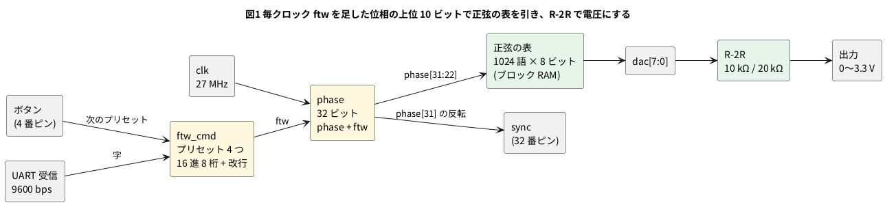

# 12-5 DDS の信号発生器

> [!WARNING]
> **この題は実機で組んでいない。** Verilog は Verilator で回して自分で合否を言う試験を通し、出した 65 536 点の値を Python で FFT してスペクトルを確かめた。
> yosys の `synth_gowin` で Tang Nano 9K の FPGA (GW1NR-9) 向けの合成と、nextpnr の配置配線・`gowin_pack` のビットストリームまで通した。書き込み・R-2R の出力・AD3 での測定はしていない。
> 「見るべき値」はシミュレーションの値と計算値 (R-2R とオシロの入力容量の値は見積り) で、測った値ではない。

**DDS** (Direct Digital Synthesis、直接デジタル合成) は、位相を表す数に毎クロック決まった数を足し続け、その位相で正弦の表を引いて波を作る方式である。
基礎は 10-8 (DDS — 位相を足し続けて正弦波を作る) の題で扱う (この題を書いた時点ではまだ無い)。この題では、それを 1 台の信号発生器にまとめる。

- Tang Nano 9K の **27 MHz** のクロックで、32 ビットの**位相アキュムレータ**を回す
- 位相の上位 10 ビットで、ブロック RAM に入れた **1024 語 × 8 ビットの正弦の表**を引く。表は Python で作り、`$readmemh` で読む (10-1・8-11)
- 8 本のピンから **R-2R の抵抗網** (10 kΩ と 20 kΩ) で 0〜3.3 V の電圧にする
- 周波数は、ボードのボタンで 4 つのプリセット (1 kHz・10 kHz・100 kHz・1 MHz) から選ぶか、PC から UART で 16 進 8 桁を送って決める
- 出た波を AD3 の Scope で見て、Spectrum で量子化とスプリアス (目的の周波数でない所に立つ線) を見る

## 決めたこと

| 項目 | 決め | 理由 |
| --- | --- | --- |
| 位相アキュムレータ | 32 ビット | 周波数の刻みが 27 MHz ÷ 2^32 = 0.00629 Hz になる。ふつうの用途では刻みを気にしなくてよい |
| 表 | 1024 語 × 8 ビット、1 周期ぶん (位相の上位 10 ビットで引く) | ブロック RAM 1 個 (8-11 の SPX9) に入る。10 ビットで切り捨てたときのスプリアスは約 −60 dBc で、8 ビットの量子化の雑音 (SINAD 49.9 dB) より小さい |
| DAC | 8 ビットの R-2R。R = 10 kΩ、2R = 20 kΩ (どちらも E24、1 % の金属皮膜) | ピンの出力抵抗 (数十 Ω) の影響が 20 kΩ に比べて小さい (下の「R-2R の値」) |
| 出す周波数の上限 | ブレッドボードでは 3 MHz 以下。この抵抗では 0.5 MHz あたりから振幅が落ちる | 帯域は R-2R の出力抵抗 (10 kΩ) とオシロの入力容量で決まる (下の「R-2R の値」) |
| 周波数の設定 | ボタン (4 番ピン) でプリセットを順に。UART (9600 bps) で `ftw` を 16 進 8 桁 + 改行 | ボタンは配線が要らない。UART は 7-2 の `uart_rx` を 27 MHz・9600 bps (7-6 の表で −0.12 %) で使う |
| 同期の出力 | `sync` = 位相の前半 (0〜π) で 1 の方形波を 32 番ピンに出す | オシロのトリガに使う。正弦が真ん中を上へ横切る所で立ち上がる |
| 電源 | USB-C から Tang Nano 9K へ。ブレッドボードに電源は配らない | R-2R はピンの 3.3 V で動かす。電源レールは GND だけ使う |

FPGA のピンは 3.3 V (0-3)。使うピンは全部 3.3 V の列で、1.8 V の `IO79`〜`IO86` は使わない。

### 周波数の決め方

位相アキュムレータを `phase`、1 クロックに足す数を `ftw` (frequency tuning word) とする。`phase` は 2^32 で 1 周する (位相の 2π)。
1 周に 2^32 ÷ `ftw` クロックかかるので、出る周波数 f<sub>out</sub> は

f<sub>out</sub> = `ftw` × f<sub>clk</sub> ÷ 2^32、`ftw` = round(f<sub>out</sub> × 2^32 ÷ f<sub>clk</sub>)

f<sub>clk</sub> = 27 MHz のとき、`ftw` を 1 増やすと f<sub>out</sub> は 0.006286 Hz 増える。これが周波数の分解能である。

| 出したい周波数 | `ftw` (10 進) | `ftw` (16 進) | 出る周波数 (計算値) |
| --- | --- | --- | --- |
| 440 Hz | 69 992 | 00011168 | 439.9996 Hz |
| 1 kHz (プリセット 0) | 159 073 | 00026D61 | 1000.0009 Hz |
| 10 kHz (プリセット 1) | 1 590 729 | 001845C9 | 10 000.0023 Hz |
| 100 kHz (プリセット 2) | 15 907 286 | 00F2B9D6 | 99 999.9982 Hz |
| 1 MHz (プリセット 3) | 159 072 863 | 097B425F | 1 000 000.0012 Hz |

標本化の定理から、出せるのは f<sub>clk</sub> の半分 (13.5 MHz) より下で、実際は 1 周期に 4 点以上 (6.75 MHz 以下) がひとつの目安になる。
この題ではブレッドボードの範囲 (3 MHz 以下) に絞る。

## ブロック図




- `phase` は 2^32 で折り返す。折り返しが 1 周期で、そのたびに `sync` が 1 回立ち上がる
- 表を引くのは `phase` の上位 10 ビット (`phase[31:22]`)。下の 22 ビットは周波数の細かさのためだけにある
- 表の出力はクロックに合わせて取り込む (8-11)。`dac` は `phase` より 1 クロック (37 ns) 遅れる

## 回路図

```circuit
# 回路図 (tommie-fence の circuit フェンス)
title: 図2 8 本のピンから R-2R の抵抗網で 0 から 3.3 V の電圧にする
parts:
  U1: tang-nano-9k 3,6 mirror
  G0: ground 1.5,9.5
  RT: resistor 5,3 5,5 20k
  GT: ground 5,5
  R0: resistor 7,3 7,5 20k
  R1: resistor 9,3 9,5 20k
  R2: resistor 11,3 11,5 20k
  R3: resistor 13,3 13,5 20k
  R4: resistor 15,3 15,5 20k
  R5: resistor 17,3 17,5 20k
  R6: resistor 19,3 19,5 20k
  R7: resistor 21,3 21,5 20k
  R8: resistor 7,3 9,3 10k
  R9: resistor 9,3 11,3 10k
  R10: resistor 11,3 13,3 10k
  R11: resistor 13,3 15,3 10k
  R12: resistor 15,3 17,3 10k
  R13: resistor 17,3 19,3 10k
  R14: resistor 19,3 21,3 10k
  SYNC: port 1,8.5
  AD:
    type: device
    at: 25,3
    label: AD3
    pins: [1+, 2+, 1-, 2-, GND]
  SYNC: port 23,2.75
  G1: ground 23.5,4
wires:
  - 5,3 -- 7,3
  - U1.IO40 -- 7,6.25 -- 7,5
  - U1.IO35 -- 9,6.5 -- 9,5
  - U1.IO41 -- 11,6.75 -- 11,5
  - U1.IO42 -- 13,7 -- 13,5
  - U1.IO51 -- 15,7.25 -- 15,5
  - U1.IO53 -- 17,7.5 -- 17,5
  - U1.IO54 -- 19,7.75 -- 19,5
  - U1.IO55 -- 21,8 -- 21,5
  - U1.IO32 -- 1,8.5
  - U1.GND -| 1.5,9.5
  - 21,3 -- 22,3 |- AD.1+
  - AD.2+ -- 23,2.75
  - AD.1- -- 23.5,3
  - AD.2- -- 23.5,3.25
  - AD.GND -- 23.5,3.5
  - 23.5,3 -- 23.5,3.25 -- 23.5,3.5 -- 23.5,4
```


- R-2R は、`dac[k]` から 20 kΩ (R<sub>k</sub>) で節に入り、節どうしを 10 kΩ (R<sub>8</sub>〜R<sub>14</sub>) でつなぐ。左端の節は 20 kΩ (R<sub>T</sub>) で GND へ落とす
- 右端の節の電圧は V<sub>out</sub> = 3.3 V × `dac` ÷ 256 (ピンの H が 3.3 V ちょうどのとき)。`dac` = 255 で 3.287 V、128 で 1.650 V
- どの節から左を見ても 20 kΩ ‖ 20 kΩ = 10 kΩ になるので、1 つ右の節へ行くたびに重みが 2 倍になる。出口から見た抵抗 (出力抵抗) は R = 10 kΩ
- U1 のピンの名前は Sipeed のピン配置図の FPGA のピン番号に `IO` を付けたもの (12-4 と同じ)。図は U1 を左右反転して、1〜24 番の列を右に出した
- AD3 は 1+ で出力、2+ で `sync` を見る。1− と 2− は GND
- 図に無いピン: 27 MHz のクロック (52 番)・ボタン (4 番)・USB シリアルの受信 (18 番) はボードの上で FPGA につながっている

### R-2R の値

抵抗を決める条件は 2 つある。

1. **ピンの出力抵抗**: FPGA のピンは理想の電圧源ではなく、数十 Ω の出力抵抗を持つ (25〜50 Ω と見積もった。Gowin の資料で確かめていない)。
   これが 2R に直列に入ると重みがずれる。8 本とも同じ出力抵抗が入るとして、節の式を解いた (計算値)
2. **帯域**: R-2R の出口は 10 kΩ (= R) の抵抗を通した電圧源に見える。そこへ AD3 の入力 (1 MΩ ‖ 24 pF、AD3 の仕様) とブレッドボード・線の容量 (数 pF、見積り) がつながる。
   合わせて約 30 pF として、1 次の低域通過の遮断周波数は f<sub>c</sub> = 1 ÷ (2π × R × 30 pF)

| R / 2R | ピンの出力抵抗 25 Ω の最大 DNL | 50 Ω の最大 DNL | f<sub>c</sub> (30 pF) | 1 MHz で | 3 MHz で |
| --- | --- | --- | --- | --- | --- |
| 10 kΩ / 20 kΩ (この題) | 0.10 LSB | 0.21 LSB | 531 kHz | −6.6 dB | −15.2 dB |
| 1.5 kΩ / 3 kΩ | 0.68 LSB (見積り) | 1.35 LSB (見積り) | 3.5 MHz | −0.3 dB | −2.4 dB |
| 1 kΩ / 2 kΩ | 1.02 LSB | 2.03 LSB | 5.3 MHz | −0.2 dB | −1.0 dB |

DNL (微分非直線性) は、隣どうしのコードの電圧差が 1 LSB (3.3 V ÷ 256 = 12.9 mV) からどれだけずれるかで、1 LSB を超えると 1 つ上のコードで電圧が下がる (単調でなくなる) ことがある。
この題は正確さを取って 10 kΩ / 20 kΩ にした。代わりに 1 MHz では振幅が半分 (−6.6 dB) になる。3 MHz まで平らに出したいときは 1.5 kΩ / 3 kΩ に替えるか、R-2R の後ろに帯域の広いバッファを置く (この題では扱わない)。
抵抗の誤差 1 % でも最上位のビットで約 1.3 LSB ずれ得る (128 LSB × 1 %) ので、DNL を詰めたいなら 0.1 % の抵抗にする。

## 部品表

| 部品 | 値・型番 | 数 | 役 |
| --- | --- | --- | --- |
| U1 | Sipeed Tang Nano 9K (GW1NR-9) | 1 | FPGA ボード。USB-C から給電、USB シリアルで PC とつながる |
| R0〜R7、RT | 20 kΩ (E24)、1 %、1/4 W | 9 | R-2R の 2R |
| R8〜R14 | 10 kΩ (E24)、1 %、1/4 W | 7 | R-2R の R |
| — | ブレッドボード (full、63 列) | 1 | |
| — | ジャンパ線 | 約 15 本 | |
| AD | Analog Discovery 3 | 1 | Scope の 1 で出力、2 で `sync` を見る。Spectrum で 1 を見る |

電源は教科書の既定の 5 V ではなく **3.3 V** (FPGA のピン)。FPGA のピンに 5 V を入れると壊れるため (0-3)。
ブレッドボードには電源を配らず、R-2R は FPGA のピンの 3.3 V で動かす。

## 実体配線図

```bread
# ブレッドボードの実体配線図 (tommie-fence の bread フェンス)
title: 図3 R-2R をブレッドボードの右半分に組む。電源は USB-C から Tang Nano 9K へ
board: full
parts:
  U1: tang-nano-9k @ b1
  R7: resistor e30 f30 20k
  R6: resistor e33 f33 20k
  R5: resistor e36 f36 20k
  R4: resistor e39 f39 20k
  R3: resistor e42 f42 20k
  R2: resistor e45 f45 20k
  R1: resistor e48 f48 20k
  R0: resistor e51 f51 20k
  RT: resistor d51 d54 20k
  R14: resistor c30 c33 10k
  R13: resistor b33 b36 10k
  R12: resistor c36 c39 10k
  R11: resistor b39 b42 10k
  R10: resistor c42 c45 10k
  R9: resistor b45 b48 10k
  R8: resistor c48 c51 10k
  AD:
    type: device
    at: top
    label: AD3
    pins: [GND, 2+, 1+, 1-, 2-]
wires:
  - a23 -- -t23 black
  - a54 -- -t54 black
  - j20 -- j30 purple
  - j19 -- j33 blue
  - j18 -- j36 green
  - j17 -- j39 yellow
  - j16 -- j42 orange
  - j15 -- j45 brown
  - j14 -- j48 gray
  - j13 -- j51 white
  - AD.GND -- -t20 black
  - AD.2+ -- a22 pink
  - AD.1+ -- a30 green
  - AD.1- -- -t27 black
  - AD.2- -- -t28 black
notes:
  - text: 給電は Tang Nano 9K の USB-C (5 V)。電源レールは GND (−) だけ使う
```


- Tang Nano 9K は溝をまたいで b 行と i 行に挿す (`@ b1`、12-4 と同じ)。1〜24 番が下の列で、j 行の 1 穴から線を取る
- R-2R は回路図と左右が逆に並ぶ。`dac[7]` (20 番ピン) の R<sub>7</sub> が左の 30 列、`dac[0]` (13 番ピン) の R<sub>0</sub> が右の 51 列。こうすると 8 本の線が入れ子になり、交わり方が少ない
- 2R (R<sub>0</sub>〜R<sub>7</sub>) は溝をまたいで縦に挿す。下の列 (f〜j) に FPGA から線が来て、上の列 (a〜e) が R-2R の節になる。節どうしを R (R<sub>8</sub>〜R<sub>14</sub>) が b 行と c 行で交互につなぐ
- R<sub>T</sub> は 51 列の節から 54 列へ。54 列を GND のレールへ落とす
- 出力は 30 列の節 (`dac[7]` の節) から AD3 の 1+ へ。`sync` は上の列の 22 列 (27 番ピン、`IO32`) から 2+ へ
- 線の色: 黒は GND だけ。FPGA から R-2R への 8 本は、`dac[0]` から順に白・灰・茶・橙・黄・緑・青・紫。赤は使わない (+ の電源が無い)
- 流れる電流は 1 本のピンで最大 0.11 mA ほど (3.3 V ÷ 30 kΩ)。信号は 3 MHz 以下で、ブレッドボードの範囲に収まる

## Verilog

12-4 の `tick.v` と `button.v` (ボタンを 10 ms ごとに読む)、7-2 の `uart_rx.v` はそのまま使う。新しく書くのは 3 つ。

### dds.v — 位相アキュムレータと正弦の表

```verilog
// DDS: 位相アキュムレータに毎クロック ftw を足し、位相の上位 AW ビットで正弦の表を引く。
// 出る周波数は ftw × CLK_HZ / 2^PW。表は sine.hex (sine.py で作る) をブロック RAM に入れる
module dds #(
    parameter PW = 32,      // 位相アキュムレータのビット数
    parameter AW = 10,      // 表の番地のビット数 (1024 語)
    parameter DW = 8        // DAC のビット数
) (
    input               clk,
    input               rst,
    input      [PW-1:0] ftw,      // 1 クロックに進む位相 (周波数の設定)
    output reg [DW-1:0] dac,      // R-2R へ出す値
    output              sync      // 位相の前半 (0〜π) だけ 1 の方形波。トリガに使う
);
    reg [PW-1:0] phase;

    (* rom_style = "block" *)
    reg [DW-1:0] sine [0:(1 << AW) - 1];

    initial $readmemh("sine.hex", sine);

    always @(posedge clk)
        if (rst) phase <= {PW{1'b0}};
        else     phase <= phase + ftw;

    // 読みをクロックに合わせる (8-11)。これでブロック RAM に入る
    always @(posedge clk)
        dac <= sine[phase[PW-1 -: AW]];

    assign sync = ~phase[PW-1];
endmodule
```

- `phase[PW-1 -: AW]` は「`PW-1` から下へ `AW` ビット」(= `phase[31:22]`) の書き方
- `(* rom_style = "block" *)` を付けたので、1024 語の表はブロック RAM 1 個になる (8-11 では、付けないと LUT に直された)
- `sync` は `~phase[31]`。`phase` が 0〜2^31 (位相 0〜π) の間だけ 1。表の 0 番地 (位相 0) で正弦が真ん中を上へ横切るので、`sync` の立ち上がりと正弦の上り坂の真ん中がそろう (`dac` の 1 クロックの遅れを除く)

### sine.py — 表を作る

```python
#!/usr/bin/env python3
"""DDS の正弦の表 (sine.hex) を作る。1 周期を 2^AW 語に分け、DW ビットの符号なしで書く。

    python3 sine.py            # 1024 語 × 8 ビットを sine.hex に
    python3 sine.py 12 8 out.hex

値は floor(M/2 + M/2 × sin(2π i / 2^AW) + 0.5)、M = 2^DW − 1。0 から M まで使う。
"""
import math
import sys


def table(aw: int, dw: int) -> list[int]:
    n = 1 << aw
    m = (1 << dw) - 1
    return [math.floor(m / 2 + m / 2 * math.sin(2 * math.pi * i / n) + 0.5) for i in range(n)]


def main() -> None:
    aw = int(sys.argv[1]) if len(sys.argv) > 1 else 10
    dw = int(sys.argv[2]) if len(sys.argv) > 2 else 8
    out = sys.argv[3] if len(sys.argv) > 3 else "sine.hex"
    digits = (dw + 3) // 4
    words = table(aw, dw)
    with open(out, "w", encoding="ascii") as f:
        f.write(f"// sine {1 << aw} x {dw} bit (sine.py)\n")
        for w in words:
            f.write(f"{w:0{digits}x}\n")
    print(f"{out}: {len(words)} words, min {min(words)}, max {max(words)}, "
          f"[0] {words[0]:x} [{len(words) // 4}] {words[len(words) // 4]:x}")


if __name__ == "__main__":
    main()
```

```bash
python3 sine.py
```

```text
sine.hex: 1024 words, min 0, max 255, [0] 80 [256] ff
```

0 番地が 0x80 (128 = 真ん中)、256 番地 (位相 π/2) が 0xFF (255 = 頂上)。

### ftw_cmd.v — 周波数を決める

```verilog
// 周波数の設定 (ftw) を決める。
//   UART: 16 進 8 桁のあとに改行 (CR か LF) が来たら、その 8 桁を ftw にする。8 桁より多ければ最後の 8 桁
//   ボタン: next が 1 になるたびに、4 つのプリセット (1 kHz・10 kHz・100 kHz・1 MHz) を順に選ぶ
module ftw_cmd #(
    parameter [31:0] P0 = 32'd159073,       // 1 kHz   (27 MHz のとき)
    parameter [31:0] P1 = 32'd1590729,      // 10 kHz
    parameter [31:0] P2 = 32'd15907286,     // 100 kHz
    parameter [31:0] P3 = 32'd159072863     // 1 MHz
) (
    input             clk,
    input             rst,
    input       [7:0] rx_data,
    input             rx_valid,
    input             next,
    output reg [31:0] ftw
);
    reg [31:0] acc;     // 受けた 16 進の桁を左から詰める
    reg [3:0]  ndig;    // 続けて受けた桁の数 (8 で止める)
    reg [1:0]  sel;     // いまのプリセット

    wire is_dec = (rx_data >= "0") && (rx_data <= "9");
    wire is_hex = is_dec || ((rx_data >= "a") && (rx_data <= "f"))
                         || ((rx_data >= "A") && (rx_data <= "F"));
    wire [3:0] nib = is_dec ? rx_data[3:0] : rx_data[3:0] + 4'd9;    // 'a' = 0x61 → 1 + 9 = 10
    wire is_eol = (rx_data == 8'h0d) || (rx_data == 8'h0a);

    function [31:0] preset(input [1:0] k);
        case (k)
            2'd0:    preset = P0;
            2'd1:    preset = P1;
            2'd2:    preset = P2;
            default: preset = P3;
        endcase
    endfunction

    always @(posedge clk)
        if (rst) begin
            ftw  <= P0;
            sel  <= 2'd0;
            acc  <= 32'd0;
            ndig <= 4'd0;
        end else if (next) begin
            sel <= sel + 2'd1;
            ftw <= preset(sel + 2'd1);
        end else if (rx_valid) begin
            if (is_hex) begin
                acc <= {acc[27:0], nib};
                if (ndig != 4'd8) ndig <= ndig + 4'd1;
            end else begin
                if (is_eol && ndig == 4'd8) ftw <= acc;
                ndig <= 4'd0;                 // 改行もほかの字も、桁の数を 0 に戻す
            end
        end
endmodule
```

- 16 進の字は `'0'`〜`'9'` (0x30〜0x39) と `'a'`〜`'f'` (0x61〜0x66)・`'A'`〜`'F'` (0x41〜0x46)。下 4 ビットが数字ならそのまま、英字なら 9 を足すと 10〜15 になる
- 8 桁そろわないうちに改行が来たら、何もしない (打ち間違いで周波数が飛ばない)
- 16 進でない字が来たら、それまでの桁を捨てる

### top.v — Tang Nano 9K に載せる最上位

```verilog
// Tang Nano 9K に載せる最上位。27 MHz で DDS を回し、8 本のピンから R-2R へ出す
module top (
    input        clk,        // 52 番ピン。ボードの 27 MHz
    input        btn_n,      // ボードのボタン (4 番ピン)。押すと 0。プリセットを次へ
    input        rxd,        // 18 番ピン。ボードの USB シリアル (BL702) から FPGA へ
    output [7:0] dac,        // R-2R へ。dac[7] が最上位 (40・35・41・42・51・53・54・55 番ピン)
    output       sync        // 32 番ピン。位相の前半だけ 1 (オシロのトリガ)
);
    reg [3:0] por;
    initial por = 4'd0;      // 電源を入れた直後の 15 クロックをリセットにする (12-4)
    always @(posedge clk)
        if (por != 4'hf) por <= por + 4'd1;
    wire rst = (por != 4'hf);

    wire en_btn, press;
    tick   #(.CLK_HZ(27_000_000), .TICK_HZ(100)) t_btn (.clk(clk), .rst(rst), .en(en_btn));
    button b_next (.clk(clk), .rst(rst), .sample(en_btn), .btn_n(btn_n), .press(press));

    wire [7:0] rx_data;
    wire       rx_valid;
    /* verilator lint_off PINCONNECTEMPTY */    // frame_err と sample は使わない
    uart_rx #(.CLK_HZ(27_000_000), .BAUD(9600)) u_rx (
        .clk(clk), .rst(rst), .rxd(rxd), .data(rx_data), .valid(rx_valid),
        .frame_err(), .sample());
    /* verilator lint_on PINCONNECTEMPTY */

    wire [31:0] ftw;
    ftw_cmd u_cmd (.clk(clk), .rst(rst), .rx_data(rx_data), .rx_valid(rx_valid), .next(press), .ftw(ftw));

    dds u_dds (.clk(clk), .rst(rst), .ftw(ftw), .dac(dac), .sync(sync));
endmodule
```

### ピンの割り当て (`dds.cst`)

```text
IO_LOC "clk" 52;
IO_PORT "clk" IO_TYPE=LVCMOS33 PULL_MODE=UP;
IO_LOC "btn_n" 4;
IO_PORT "btn_n" PULL_MODE=UP;
IO_LOC "rxd" 18;
IO_PORT "rxd" IO_TYPE=LVCMOS33 PULL_MODE=UP;
IO_LOC "dac[0]" 40;
IO_PORT "dac[0]" IO_TYPE=LVCMOS33 DRIVE=8;
IO_LOC "dac[1]" 35;
IO_PORT "dac[1]" IO_TYPE=LVCMOS33 DRIVE=8;
IO_LOC "dac[2]" 41;
IO_PORT "dac[2]" IO_TYPE=LVCMOS33 DRIVE=8;
IO_LOC "dac[3]" 42;
IO_PORT "dac[3]" IO_TYPE=LVCMOS33 DRIVE=8;
IO_LOC "dac[4]" 51;
IO_PORT "dac[4]" IO_TYPE=LVCMOS33 DRIVE=8;
IO_LOC "dac[5]" 53;
IO_PORT "dac[5]" IO_TYPE=LVCMOS33 DRIVE=8;
IO_LOC "dac[6]" 54;
IO_PORT "dac[6]" IO_TYPE=LVCMOS33 DRIVE=8;
IO_LOC "dac[7]" 55;
IO_PORT "dac[7]" IO_TYPE=LVCMOS33 DRIVE=8;
IO_LOC "sync" 32;
IO_PORT "sync" IO_TYPE=LVCMOS33 DRIVE=8;
```

- 52 番ピン (27 MHz) と 4 番ピン (ボタン) は 12-4 と同じ。18 番ピンはボードの USB シリアル (BL702) から FPGA への線で、Sipeed の例 (TangNano-9K-example の `uart`) と同じ番号
- `dac` の 8 本と `sync` は `DRIVE=8` (8 mA)。R-2R に流れる電流は 0.11 mA ほどなので、十分に大きい

## 動かす

### 周波数・ボタン・UART の試験

`tb_dds` は `top` をそのまま 27 MHz で回す。1 クロックを 27 MHz の 1 周期とみなし、`sync` の立ち上がりを数えて `ftw` から出る数と比べる。

```verilog
// top を 27 MHz のクロックで回し、周波数・ボタン・UART の設定を確かめる。
// 最後に 65 536 クロック分の dac を 1 MHz と 100 kHz の 2 通り書く (fft.py でスペクトルを見る)
module tb_dds;
    reg  clk = 0;
    reg  btn_n = 1;
    reg  rxd = 1;
    wire [7:0] dac;
    wire       sync;
    integer errors = 0;

    top dut (.clk(clk), .btn_n(btn_n), .rxd(rxd), .dac(dac), .sync(sync));

    always #1 clk = ~clk;                       // 1 周期 = 1 クロック (27 MHz とみなす)

    task clocks(input integer n);
        repeat (n) @(posedge clk);
    endtask

    // n クロックの間に sync が立ち上がった回数を数え、ftw から出る数と比べる
    task count_sync(input integer n, input [8*16-1:0] what);
        integer i, edges;
        reg prev;
        real want;
        begin
            edges = 0;
            prev  = sync;
            for (i = 0; i < n; i = i + 1) begin
                @(posedge clk);
                if (sync && !prev) edges = edges + 1;
                prev = sync;
            end
            want = n * (dut.ftw / 4294967296.0);
            if (edges < want - 1.0 || edges > want + 1.0) begin
                $display("NG %0s: ftw=%0d  %0d edges in %0d clocks (want %.2f)", what, dut.ftw, edges, n, want);
                errors = errors + 1;
            end else
                $display("ok %0s: ftw=%0d  %0d edges in %0d clocks (want %.2f) -> %.3f Hz",
                         what, dut.ftw, edges, n, want, dut.ftw * 27.0e6 / 4294967296.0);
        end
    endtask

    task expect_ftw(input [31:0] want, input [8*16-1:0] what);
        if (dut.ftw !== want) begin
            $display("NG %0s: ftw=%h (want %h)", what, dut.ftw, want);
            errors = errors + 1;
        end else
            $display("ok %0s: ftw=%h", what, dut.ftw);
    endtask

    // 押して 50 ms、離して 50 ms (12-4 と同じ)
    task press;
        begin
            btn_n = 0; clocks(27_000 * 50);
            btn_n = 1; clocks(27_000 * 50);
        end
    endtask

    // 9600 bps (1 ビット 2812 クロック) で 1 字送る
    task send(input [7:0] c);
        integer i;
        begin
            rxd = 0; clocks(2812);
            for (i = 0; i < 8; i = i + 1) begin rxd = c[i]; clocks(2812); end
            rxd = 1; clocks(2812 * 2);
        end
    endtask

    task send_str(input [8*20-1:0] s, input integer n);
        integer i;
        for (i = n - 1; i >= 0; i = i - 1) send(s[8*i +: 8]);
    endtask

    integer i, fd;
    reg [7:0] lo, hi;
    initial begin
        clocks(20);

        // 1. 電源を入れた直後は 1 kHz。1 周期で 0 から 255 まで出るか
        expect_ftw(32'd159073, "reset = 1 kHz");
        lo = 255; hi = 0;
        for (i = 0; i < 27_000; i = i + 1) begin
            @(posedge clk);
            if (dac < lo) lo = dac;
            if (dac > hi) hi = dac;
        end
        if (lo != 0 || hi != 255) begin
            $display("NG dac range: %0d..%0d", lo, hi); errors = errors + 1;
        end else
            $display("ok dac range: %0d..%0d", lo, hi);

        // 2. 4 つのプリセットの周波数を 0.1 s (2 700 000 クロック) で数える
        count_sync(2_700_000, "1 kHz");
        press; expect_ftw(32'd1590729,   "button 1");   count_sync(2_700_000, "10 kHz");
        press; expect_ftw(32'd15907286,  "button 2");   count_sync(2_700_000, "100 kHz");
        press; expect_ftw(32'd159072863, "button 3");   count_sync(2_700_000, "1 MHz");
        press; expect_ftw(32'd159073,    "button 4");

        // 3. UART: 16 進 8 桁 + CR LF。440 Hz を 1 s (27 000 000 クロック) で数える
        send_str("00011168\r\n", 10); clocks(100);
        expect_ftw(32'h00011168, "uart 440 Hz");
        count_sync(27_000_000, "440 Hz");

        // 4. 受け付けない形
        send_str("1234567\r", 8);   clocks(100); expect_ftw(32'h00011168, "7 digits");
        send_str("0001116G\r", 9);  clocks(100); expect_ftw(32'h00011168, "not hex");
        send_str("ffff097B0000\r", 13); clocks(100); expect_ftw(32'h097B0000, "last 8 of 12");

        // 5. ftw = 2427 × 65 536 (1.000 MHz に近い)。65 536 クロックで表をちょうど 2427 周する
        clocks(10);
        fd = $fopen("dds_samples.txt", "w");
        for (i = 0; i < 65536; i = i + 1) begin
            @(posedge clk);
            $fdisplay(fd, "%0d", dac);
        end
        $fclose(fd);
        $display("wrote dds_samples.txt (65536 samples, ftw=%h)", dut.ftw);

        // 6. ftw = 243 × 65 536 (100.1 kHz)。同じく dds_samples_100k.txt に
        send_str("00F30000\r", 9); clocks(100);
        expect_ftw(32'h00F30000, "uart 100.1 kHz");
        fd = $fopen("dds_samples_100k.txt", "w");
        for (i = 0; i < 65536; i = i + 1) begin
            @(posedge clk);
            $fdisplay(fd, "%0d", dac);
        end
        $fclose(fd);
        $display("wrote dds_samples_100k.txt (65536 samples, ftw=%h)", dut.ftw);

        if (errors == 0) $display("PASS");
        else             $display("FAIL: %0d", errors);
        $finish;
    end
endmodule
```

```bash
python3 sine.py
verilator --lint-only -Wall dds.v
verilator --lint-only -Wall ftw_cmd.v
verilator --lint-only -Wall --top-module top top.v dds.v ftw_cmd.v tick.v button.v uart_rx.v
verilator --binary --timing --top-module tb_dds tb_dds.v top.v dds.v ftw_cmd.v tick.v button.v uart_rx.v
./obj_dir/Vtb_dds
```

```text
ok reset = 1 kHz: ftw=00026d61
ok dac range: 0..255
ok 1 kHz: ftw=159073  100 edges in 2700000 clocks (want 100.00) -> 1000.001 Hz
ok button 1: ftw=001845c9
ok 10 kHz: ftw=1590729  1000 edges in 2700000 clocks (want 1000.00) -> 10000.002 Hz
ok button 2: ftw=00f2b9d6
ok 100 kHz: ftw=15907286  10000 edges in 2700000 clocks (want 10000.00) -> 99999.998 Hz
ok button 3: ftw=097b425f
ok 1 MHz: ftw=159072863  100000 edges in 2700000 clocks (want 100000.00) -> 1000000.001 Hz
ok button 4: ftw=00026d61
ok uart 440 Hz: ftw=00011168
ok 440 Hz: ftw=69992  440 edges in 27000000 clocks (want 440.00) -> 440.000 Hz
ok 7 digits: ftw=00011168
ok not hex: ftw=00011168
ok last 8 of 12: ftw=097b0000
wrote dds_samples.txt (65536 samples, ftw=097b0000)
ok uart 100.1 kHz: ftw=00f30000
wrote dds_samples_100k.txt (65536 samples, ftw=00f30000)
PASS
```

lint は 3 つとも警告 0 件。試験は全部 ok で `PASS` (手元の PC で 8 秒ほど)。

- 0.1 s で数えた `sync` の立ち上がりは、4 つのプリセットとも計算どおり (100・1000・10 000・100 000 回)。440 Hz は 1 s で 440 回
- 電源を入れた直後の 1 kHz で、1 周期の間に `dac` は 0 から 255 まで出る
- 7 桁で改行・16 進でない字 (`G`) では `ftw` が変わらない。12 桁送ると最後の 8 桁が入る

### スペクトルを見る

試験の最後の 5・6 で書いた 65 536 点の `dac` を FFT する。`ftw` を k × 65 536 にしてあるので、65 536 点にちょうど k 周期入り、窓を掛けずに済む
(k = 2427 で 0.999893 MHz、k = 243 で 100.113 kHz)。

```python
#!/usr/bin/env python3
"""tb_dds が書いた dds_samples.txt (DAC の値、27 MHz で 65 536 点) のスペクトルを見る。

    python3 fft.py [dds_samples.txt]

窓は掛けない (ftw = k × 65 536 にしてあるので、65 536 点にちょうど k 周期が入る)。
基本波・直流を除いた残りから SINAD と ENOB、いちばん高いスプリアスから SFDR を出し、
8 ビットの理想 (SINAD 49.9 dB) との差で合否を言う。
"""
import sys

import numpy as np

FS = 27e6
BITS = 8


def main() -> int:
    path = sys.argv[1] if len(sys.argv) > 1 else "dds_samples.txt"
    x = np.loadtxt(path)
    n = len(x)
    spec = np.abs(np.fft.rfft(x - x.mean())) ** 2
    k0 = int(np.argmax(spec))
    p_sig = spec[k0]
    rest = spec.copy()
    rest[0] = 0.0
    rest[k0] = 0.0
    p_noise = rest.sum()
    sinad = 10 * np.log10(p_sig / p_noise)
    enob = (sinad - 1.76) / 6.02
    order = np.argsort(rest)[::-1]
    print(f"samples {n}, fundamental bin {k0} = {k0 * FS / n / 1e6:.6f} MHz")
    print(f"SINAD {sinad:.2f} dB (ideal {6.02 * BITS + 1.76:.2f} dB for {BITS} bit), ENOB {enob:.2f} bit")
    print("largest spurs (dBc):")
    for k in order[:5]:
        print(f"  {k * FS / n / 1e6:9.6f} MHz  {10 * np.log10(rest[k] / p_sig):7.2f} dBc")
    sfdr = 10 * np.log10(p_sig / rest[order[0]])
    print(f"SFDR {sfdr:.2f} dBc")
    ok = enob > BITS - 0.5 and sfdr > 50.0
    print("PASS" if ok else "FAIL")
    return 0 if ok else 1


if __name__ == "__main__":
    sys.exit(main())
```

```bash
python3 fft.py dds_samples.txt
python3 fft.py dds_samples_100k.txt
```

```text
samples 65536, fundamental bin 2427 = 0.999893 MHz
SINAD 48.79 dB (ideal 49.92 dB for 8 bit), ENOB 7.81 bit
largest spurs (dBc):
   3.109268 MHz   -60.19 dBc
   1.109482 MHz   -60.21 dBc
   5.218643 MHz   -66.21 dBc
   3.218857 MHz   -66.22 dBc
  12.975540 MHz   -66.49 dBc
SFDR 60.19 dBc
PASS
```

```text
samples 65536, fundamental bin 243 = 0.100113 MHz
SINAD 48.79 dB (ideal 49.92 dB for 8 bit), ENOB 7.81 bit
largest spurs (dBc):
   5.584488 MHz   -60.19 dBc
   5.384262 MHz   -60.21 dBc
  11.068863 MHz   -66.21 dBc
  10.868637 MHz   -66.22 dBc
   4.074142 MHz   -66.49 dBc
SFDR 60.19 dBc
PASS
```

| 項目 | 0.999893 MHz | 100.113 kHz | 8 ビットの理想 |
| --- | --- | --- | --- |
| SINAD (信号 ÷ 雑音と歪みの全部) | 48.79 dB | 48.79 dB | 49.92 dB (6.02 × 8 + 1.76) |
| ENOB (有効ビット数) | 7.81 ビット | 7.81 ビット | 8 ビット |
| いちばん高いスプリアス | −60.19 dBc (3.109 MHz) | −60.19 dBc (5.584 MHz) | — |
| SFDR | 60.19 dBc | 60.19 dBc | — |

- **量子化**: 8 ビットの DAC は、理想でも信号の 49.9 dB 下に雑音が出る (SINAD の理想)。シミュレーションの 48.79 dB はそれより 1.1 dB 悪い。差は次のスプリアスの分
- **位相の切り捨て**: 32 ビットの位相のうち 10 ビットで表を引くので、捨てた 22 ビットの分だけ位相に周期的な誤差が出て、スプリアスになる。
  大きさの目安は −6.02 × 10 = −60.2 dBc で、シミュレーションの −60.19 dBc とよく合う。立つ周波数は `ftw` で変わる (1 MHz では 1.109 MHz と 3.109 MHz、100 kHz では 5.38 MHz と 5.58 MHz)
- 表を 4096 語 (12 ビット) にすると、同じ試験で SINAD 49.91 dB・SFDR 67.94 dBc になった (`dds.v` の `AW` を 12、`sine.py 12 8` で作り直して回した)。
  位相の切り捨てのスプリアスが消え、8 ビットの量子化だけが残る。ブロック RAM は 2 個 (yosys で SP × 2) になる

## 計器の設定

| 計器 | 設定 |
| --- | --- |
| Scope | 1 を R-2R の出力 (30 列の節)、2 を `sync` (22 列) につなぐ。1−・2− は GND。両方 1 V/div、トリガは 2 の立ち上がり 1.65 V |
| 100 kHz を見る | ボタンを 2 回押して 100 kHz にする (電源を入れた直後は 1 kHz)。時間軸 2 µs/div |
| Spectrum | 1 を見る。0〜10 MHz、FFT の点数 8192 (分解能 3.125 kHz)、窓は Flat Top、単位 dBm |
| スペクトルを見る周波数 | PC から UART で `097B0000` と改行を送る (0.999893 MHz。シミュレーションと同じ `ftw`) |

PC からは、Tang Nano 9K の USB シリアル (Linux では 2 つ出るうちの片方。`/dev/ttyUSB1` のことが多い。確かめていない) を 9600 bps にして送る。

```bash
stty -F /dev/ttyUSB1 9600 raw
printf '097B0000\r' > /dev/ttyUSB1
python3 -c "print(f'{round(440 * 2**32 / 27e6):08X}')"     # 440 Hz の ftw → 00011168
```

## Scope に見えるはずの画面

```scope
# オシロスコープの画面 (tommie-fence の scope フェンス)
title: 図4 100 kHz の正弦と sync。正弦は R-2R と入力容量で 10 度ほど遅れる
time: 2us/div
trigger: ch2 rising 1.65V at -5div
ch1: {wave: sine 100kHz 1.64V offset 1.64V | delay 37ns | rc 300ns, range: 1V/div, position: -2div}
ch2: {wave: square 100kHz 1.65V offset 1.65V, range: 1V/div, position: -2div}
cursors: [0, 2.8us]
measure: [vpp, avg, freq]
```


- CH1 は振幅 1.64 V (`dac` の 127.5 LSB × 12.9 mV) を、`dac` の 1 クロックの遅れ (37 ns) と、R-2R の 10 kΩ と 30 pF の 1 次の低域 (τ (タウ) = 300 ns、見積り) に通した理想の波
- 100 kHz では振幅が 0.15 dB だけ下がり (Vpp 3.29 V → 3.22 V)、位相が 10.7° (0.30 µs) 遅れる。カーソル X2 の 2.8 µs は、遅れが無ければ 2.5 µs (1/4 周期) にある頂上の位置
- 1 周期は 27 MHz の 270 クロックで、270 段の階段になっている。1 段は 37 ns で、10 kΩ と 30 pF の τ (300 ns) より短いので、オシロでは段は見えずなめらかな正弦に見える (見積り)。段を見たければ 1 kHz にして縦を 20 mV/div まで拡げる (1 段 12.9 mV)

## Spectrum に見えるはずの画面

```spectrum
# スペクトラムアナライザの画面 (tommie-fence の spectrum フェンス)
title: 図5 0.999893 MHz の線と、位相の切り捨てのスプリアス (見積り)
device: ad3
sweep: 0-10MHz
samples: 8192
window: flattop
unit: dBm
ref: 15dBm
floor: -75dBm
signal:
  - sine 999.893kHz 7.71dBm
  - sine 1.109482MHz -53.22dBm
  - sine 3.109268MHz -61.55dBm
markers: [999.893kHz, 1.109482MHz, 3.109268MHz]
```


各線の高さは、シミュレーションの dBc に次の 3 つを足した見積りである。

| 線 | シミュレーション (dBc) | R-2R と 30 pF の低域 | 保持の sinc | 図の高さ |
| --- | --- | --- | --- | --- |
| 0.999893 MHz (目的の線) | 0 | −6.58 dB | −0.02 dB | 7.71 dBm |
| 1.109482 MHz | −60.21 | −7.30 dB | −0.02 dB | −53.22 dBm |
| 3.109268 MHz | −60.19 | −15.48 dB | −0.19 dB | −61.55 dBm |

図のマーカーは 7.71・−53.21・−61.36 dBm と読む。3.109 MHz が 0.2 dB 高いのは、線が FFT の点の間にあり、Flat Top の窓の頂上がわずかに平らでないため (図の上の読みの差で、信号の差ではない)。

- 基準は、`dac` の振幅 1.64 V の正弦を 50 Ω の電力に直した 14.32 dBm (AD3 の Spectrum の dBm は電圧を 50 Ω で読み替えた値)
- **保持の sinc**: DAC は次のクロックまで同じ電圧を保つので、周波数 f の成分は sin(πf/f<sub>clk</sub>) ÷ (πf/f<sub>clk</sub>) 倍になる。1 MHz では −0.02 dB で小さい
- 床 (−75 dBm) は量子化の雑音を AD3 の 1 本の分解能の幅に割り振った見積り (−34.5 dBm を 13.5 MHz に一様に広げ、Flat Top の雑音帯域 11.8 kHz で読む → −65 dBm、1 MHz での低域 −7 dB とさらに高い所で下がる分を見込んだ)。実機では AD3 自身の床と比べて書き直す
- 図の外: 0 Hz に直流 (1.64 V) の線が立つ。27 MHz − 1 MHz = 26 MHz に**像** (イメージ) が立ち、sinc (−28.3 dB) と低域 (−33.8 dB) で −47.8 dBm ほど (見積り。AD3 の入力の帯域は数に入れていない)
- 5.2 MHz にも −66 dBc のスプリアスがあるが、低域で −20 dB 下がり、−72 dBm で床に埋もれる (見積り)

## 見るべき値

シミュレーションの値と計算値。実機では測っていない。

| 項目 | 値 | どこで得たか |
| --- | --- | --- |
| 周波数の分解能 | 27 MHz ÷ 2^32 = 0.006286 Hz | 計算 |
| 1 kHz・10 kHz・100 kHz・1 MHz のプリセット | 0.1 s に `sync` が 100・1000・10 000・100 000 回 | 試験 |
| UART で `00011168` | 1 s に 440 回 (439.9996 Hz) | 試験 |
| 1 周期の `dac` の範囲 | 0〜255 | 試験 |
| 出力の電圧 | 0〜3.287 V (振幅 1.64 V、真ん中 1.64 V) | 計算 (3.3 V × `dac` ÷ 256) |
| SINAD・ENOB | 48.79 dB・7.81 ビット (理想 49.92 dB) | FFT (`fft.py`) |
| 位相の切り捨てのスプリアス (SFDR) | −60.19 dBc (目安 −60.2 dBc) | FFT と計算 |
| 表を 4096 語にした SFDR | 67.94 dBc | FFT |
| R-2R の帯域 | f<sub>c</sub> = 531 kHz (30 pF の見積り) | 計算 |
| 100 kHz の Vpp | 3.22 V (図4) | scope の理想の波 |
| 0.999893 MHz の線の高さ | 7.71 dBm (図5、見積り) | 計算 |
| R-2R の最大 DNL (出力抵抗 25〜50 Ω) | 0.10〜0.21 LSB | 節の式を解いた計算 |

実機で確かめる数: 出力の Vpp と遅れ (100 kHz・1 MHz)、Spectrum の線の高さとスプリアス、AD3 の床。
測った CSV は題のファイルの隣に置いて、図4・図5 に `data:` で重ねる。

## シミュレーションでの確かめ (対象外を含む)

Verilator 5.042・Python 3.12 (numpy 1.26)・Yosys 0.33・Yosys 0.70+16・nextpnr-himbaechel 0.11.1-63 で、本文の Verilog と Python を取り出して走らせた。
置き場は `sim/05-dds.v` (`dds.v`)・`sim/05-dds-ftw-cmd.v` (`ftw_cmd.v`)・`sim/05-dds-top.v` (`top.v`)・`sim/05-dds-tb.v` (`tb_dds.v`)・
`sim/05-dds-sine.py` (`sine.py`)・`sim/05-dds-sine.hex` (`sine.hex`)・`sim/05-dds-fft.py` (`fft.py`)・`sim/05-dds.cst` (`dds.cst`)。
12-4 の `tick.v`・`button.v` と 7-2 の `uart_rx.v` の写しを `sim/05-dds-tick.v`・`sim/05-dds-button.v`・`sim/05-dds-uart-rx.v` に置いた (中身は元と同じ)。
動かすときは、写しを元の名前 (`dds.v` `sine.hex` など) にして 1 つのディレクトリに集める (`$readmemh` が `sine.hex` を読むため)。

| 項目 | 本文の数字 | 実行結果 | 判定 |
| --- | --- | --- | --- |
| lint (`-Wall`、`dds.v`・`ftw_cmd.v`・`top` を最上位) | 警告 0 件 | 0 件 / 0 件 / 0 件 | 合った |
| 試験 (`tb_dds`) | 16 行とも ok、PASS | 16 行とも ok、PASS (7.5 秒) | 合った |
| FFT (0.999893 MHz・100.113 kHz) | SINAD 48.79 dB、SFDR 60.19 dBc | 同じ、PASS | 合った |
| 表 4096 語 | SINAD 49.91 dB、SFDR 67.94 dBc | 同じ (別のディレクトリで `AW` を 12 にして回した) | 合った |
| 合成 (Yosys 0.33) | (下の表) | LUT 134 (26 + 30 + 30 + 48)、FF 170 (DFF 4 + DFFE 4 + DFFR 62 + DFFRE 85 + DFFS 4 + DFFSE 11)、ALU 123、SPX9 1、IBUF 3・OBUF 9 | 補足 |
| 合成 4096 語 (Yosys 0.33) | ブロック RAM 2 個 | SP × 2 (ほかは同じ数) | 合った |
| 配置配線 (`--freq 27`) | (本文に無い) | `Max frequency` 96.46〜103.95 MHz (`--seed` 1・2・3 と指定なしの 4 回、99.03 MHz が指定なし)、すべて PASS at 27.00 MHz。LUT4 341、ALU 148、DFF 170、BSRAM 1 / 26、IOB 12 | 補足 |
| `gowin_pack` | ビットストリームができる (書き込みは未実行) | `.fs` ができた | 合った |
| R-2R の DNL | 10 kΩ で 0.10・0.21 LSB、1 kΩ で 1.02・2.03 LSB | 8 節の節点方程式を numpy で解いた | 計算 |
| 図5 の高さ | 7.71・−53.22・−61.55 dBm | 14.32 dBm + dBc + 低域 + sinc | 計算 |

GW1NR-9 の LUT は 8640 個、フリップフロップは 6480 個なので、どちらも 2〜4 % に収まる。
確かめていない数: 実機の出力・ピンの出力抵抗 (25〜50 Ω)・入力容量 (30 pF)・図4・図5 の AD3 の測定。

## 出典

自作。

- Tang Nano 9K のクロック (52 番ピン)・ボタン (4 番ピン)・USB シリアルの受信 (18 番ピン): Sipeed の [TangNano-9K-example](https://github.com/sipeed/TangNano-9K-example) の `led/src/9K_LED_project.cst` と `uart/src/top.cst`
- AD3 の入力 (1 MΩ ‖ 24 pF): Digilent の Analog Discovery 3 の仕様
- DDS の位相の切り捨てのスプリアスの目安 (−6.02 dB × 表の番地のビット数): Analog Devices の「A Technical Tutorial on Digital Signal Synthesis」(1999)
- GW1NR-9 の LUT とフリップフロップの数: Sipeed の [Tang Nano 9K のページ](https://wiki.sipeed.com/hardware/en/tang/Tang-Nano-9K/Nano-9K.html)
