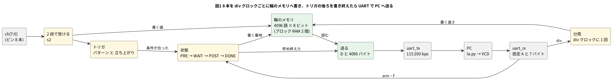

# 12-6 小さいロジックアナライザを作る

> [!WARNING]
> **この題は実機で組んでいない。** Verilog は Verilator と Icarus Verilog で回して自分で合否を言う試験を通し、FPGA が返したバイトを PC 側の Python で VCD にする試験も通した。
> yosys の `synth_gowin` で Tang Nano 9K の FPGA (GW1NR-9) 向けの合成と、nextpnr の配置配線・`gowin_pack` のビットストリームまで通した。書き込み・USB シリアルでのやり取り・AD3 との見比べはしていない。
> 「見るべき値」はシミュレーションの値と計算値で、測った値ではない。

この本でずっと使ってきた AD3 の Logic は、ピンの電圧を決まった速さで読んで**メモリに貯め**、条件 (**トリガ**) が来たら止めて画面に出す道具である。
この題では、その仕組みを Tang Nano 9K の中に作る。

- 8 本のピンを、27 MHz を分周した速さで読む (27 MS/s から)
- 読んだ値を FPGA の中の**ブロック RAM** (8-11) に輪のように書き続け、トリガが来たら後ろを決まった数だけ書いて止まる。トリガより前も残る (**プリトリガ**)
- トリガは「あるチャネルの立ち上がり」と「8 本の値のパターン」の 2 つと、その組み合わせ
- 貯めた 4096 個を UART でボードの USB シリアルへ送り、PC の Python で **VCD** (0-6 の波形の形式) に書き出す
- AD3 の **Patterns** で既知のパターンを入れ、同じ線を AD3 の **Logic** でも読んで、自作の物と見比べる

使う部品の題は次のとおり。

| 部品 | 題 | この題での役 |
| --- | --- | --- |
| 2 段で受ける | 9-2 | クロックと関係なく変わる入力を受ける |
| ブロック RAM | 8-11 | 4096 個のサンプルを貯める (読み書きの口が別の RAM。10-13) |
| UART の送信・受信 | 7-1・7-2 | 送信は 7-1 の `uart_tx`、受信は 7-2 の `uart_rx` をそのまま使う |
| ボーレートのずれ | 7-6 | 115 200 bps を 27 MHz で作ったときのずれが許されるか |
| VCD と波形ビューア | 0-6 | PC で受けた値を GTKWave で見る |

## 決めたこと

| 項目 | 決め | 理由 |
| --- | --- | --- |
| チャネル | 8 本。ヘッダの 13〜20 番 (FPGA の 40・35・41・42・51・53・54・55 番ピン)。どれも 3.3 V の入力 | 1 サンプルが 1 バイトになる。1.8 V の `IO79`〜`IO86` は使わない |
| 深さ | 4096 サンプル (4096 語 × 8 ビット) | ブロック RAM 2 個 (yosys で DP × 2)。26 個のうちの 2 個で、もっと深くもできる |
| サンプルの速さ | 27 MHz ÷ `div` (`div` = 1〜65 535)。27 MS/s・1 MS/s (27)・100 kS/s (270) など | 分周の数を 1 つ持つだけで済む。27 MHz を割り切れない速さ (10 MS/s など) は選べない |
| トリガ | パターン (`mask` が 1 のチャネルが `value` と同じ) かつ、選べば 1 本の立ち上がり。`F` で待たずに止める | 2 つの条件を AND にすれば「ch3 が立ち上がったとき ch0 が 1」も書ける |
| プリトリガ | 0〜4095 個。トリガのサンプルは並びの `pre` 番め | 輪のメモリなので、前を残すのに追加の回路が要らない |
| PC とのやり取り | ボードの USB シリアル (BL702) を 115 200 bps、8N1 | 4097 バイトを 0.36 s で送れる。9600 bps だと 4.3 s かかる |
| 入力の電圧 | 3.3 V だけ。AD3 の DIO を 3.3 V にしてじかにつなぐ (0-4) | FPGA のピンに 5 V を入れると壊れる (0-3) |
| 様子を見る | ボードの LED 2 つ (10・11 番ピン)。片方がトリガ待ち、もう片方が送信中 | 「トリガが来ない」がすぐ分かる |

### 115 200 bps のずれ

送信 (7-1 の `uart_tx`) は 1 ビットを 27 MHz の 234 クロックで作るので 115 385 bps (+0.16 %)。
受信 (7-2 の `uart_rx`) は 16 倍の刻みを 15 クロックで作るので 112 500 bps (−2.34 %)。7-6 の表のとおり、1 台で 2 % を超える。
7-6 のシミュレーションでは、受信が全部の字を読めた範囲は −4.35 % から +5.55 % だった。PC の側がずれていなければ −2.34 % は内側に入る。
PC から送るのは 1 回に 8 バイトだけなので、読み違えても設定し直せば済む。大量に送る FPGA → PC の向きは +0.16 % で余裕がある。

### PC とのやり取り

| 向き | バイト | 中身 |
| --- | --- | --- |
| PC → FPGA | `A` と 7 バイト | `div` の上・下、`mask`、`value`、`edge` (bit7 が 1 なら立ち上がりを見る、bit2〜0 がチャネル)、`pre` の上・下 |
| PC → FPGA | `F` | トリガを待たずに止める (トリガが来ないとき) |
| FPGA → PC | `D` と 4096 バイト | トリガの前 `pre` 個から順に。`pre` 番めがトリガのサンプル |

## ブロック図




- `arm` で書き始め、まず `pre` 個を貯める (PRE)。次に輪を回しながらトリガを待つ (WAIT)。トリガのサンプルを書いた番地を覚え、そこから 4095 − `pre` 個を書いて止まる (POST → DONE)
- 止まったとき、輪の中には「トリガの前 `pre` 個 + トリガ + 後ろ 4095 − `pre` 個」がちょうど 4096 個並ぶ。送るのは「トリガの番地 − `pre`」から 4096 個
- 書く速さは `div` で決まり、トリガもその速さで見る。2 段で受けるので、どのチャネルも 2 クロック (74 ns) 遅れる。遅れは 8 本とも同じなので、チャネルどうしの時刻はずれない

## 回路図

```circuit
# 回路図 (tommie-fence の circuit フェンス)
title: 図2 AD3 の DIO0 から DIO8 を FPGA の 9 本のピンにじかにつなぐ
parts:
  AD:
    type: device
    at: 4,7.25
    label: AD3
    pins: [DIO0, DIO1, DIO2, DIO3, DIO4, DIO5, DIO6, DIO7, DIO8, GND]
    turn: mirror
  U1: tang-nano-9k 9,6
  G1: ground 5.5,9.2
  G2: ground 10.5,9.3
wires:
  - AD.DIO0 -- U1.IO40
  - AD.DIO1 -- U1.IO35
  - AD.DIO2 -- U1.IO41
  - AD.DIO3 -- U1.IO42
  - AD.DIO4 -- U1.IO51
  - AD.DIO5 -- U1.IO53
  - AD.DIO6 -- U1.IO54
  - AD.DIO7 -- U1.IO55
  - AD.DIO8 -- U1.IO56
  - AD.GND -| 5.5,9.2
  - U1.GND -| 10.5,9.3
notes:
  - text 8,10.3 small: U1 の USB-C で PC へ (UART 115200 bps)
```


- AD3 の DIO0〜DIO7 が、FPGA の 8 本の入力 (`ch[0]`〜`ch[7]`) にじかにつながる。AD3 の Patterns がここへパターンを出し、同じ線を AD3 の Logic も読む
- DIO8 は FPGA の 21 番 (`IO56`) で、自作の物が PC へ送る UART (`txd`) の写しを読む。`txd` の本物 (17 番ピン) はボードの上で USB シリアルにつながっていて、ヘッダには出ていない
- 図に無いピン: 27 MHz のクロック (52 番)、USB シリアル (17 番・18 番)、LED (10 番・11 番) はボードの上で FPGA につながっている
- 抵抗は挟まない。FPGA の 8 本は入力で、AD3 の DIO も 3.3 V で出すので、電圧はそろっている。FPGA の側を間違えて出力にすると AD3 とぶつかるので、書き込む前に制約ファイルを確かめる

## 部品表

| 部品 | 値・型番 | 数 | 役 |
| --- | --- | --- | --- |
| U1 | Sipeed Tang Nano 9K (GW1NR-9) | 1 | FPGA ボード。USB-C から給電、USB シリアルで PC とつながる |
| — | ブレッドボード (half、30 列) | 1 | |
| — | ジャンパ線 | 約 12 本 | |
| AD | Analog Discovery 3 | 1 | Patterns で入力を出し、Logic で同じ線と `txd` の写しを読む |

電源は教科書の既定の 5 V ではなく **3.3 V** (FPGA のピン)。FPGA のピンに 5 V を入れると壊れるため (0-3)。
ブレッドボードには電源を配らない。

## 実体配線図

```bread
# ブレッドボードの実体配線図 (tommie-fence の bread フェンス)
title: 図3 AD3 の 10 本を Tang Nano 9K のピンの列にじかに挿す
board: half
parts:
  U1: tang-nano-9k @ b1
  AD:
    type: device
    at: bottom
    label: AD3
    pins: [DIO0, DIO1, DIO2, DIO3, DIO4, DIO5, DIO6, DIO7, DIO8, GND]
wires:
  - a23 -- -t23 black
  - -t30 -- -b30 black
  - AD.DIO0 -- j13 green
  - AD.DIO1 -- j14 green
  - AD.DIO2 -- j15 green
  - AD.DIO3 -- j16 green
  - AD.DIO4 -- j17 purple
  - AD.DIO5 -- j18 purple
  - AD.DIO6 -- j19 purple
  - AD.DIO7 -- j20 purple
  - AD.DIO8 -- j21 yellow
  - AD.GND -- -b26 black
notes:
  - text: 給電と PC への UART は Tang Nano 9K の USB-C から。電源レールは GND (−) だけ使う
```


- Tang Nano 9K は溝をまたいで b 行と i 行に挿す (`@ b1`、12-4 と同じ)。1〜24 番が下の列で、j 行の 1 穴から線を取る。13〜21 番が j13〜j21
- AD3 の線は j13〜j21 に挿す。DIO0〜DIO3 は緑、DIO4〜DIO7 は紫、`txd` の写しの DIO8 は黄。黒は GND だけ。赤は使わない (+ の電源が無い)
- FPGA の GND (26 番ピン、a23) を上の GND のレールへ、AD3 の GND を下のレールへつなぎ、2 本のレールを 30 列でつなぐ
- 流れる電流は FPGA の入力へ向かうごく小さなもの (プルダウンの数十 µA ほど、見積り)。信号は 3 MHz 以下にして、ブレッドボードの範囲に収める

## Verilog

7-1 の `uart_tx.v` と 7-2 の `uart_rx.v` はそのまま使う。新しく書くのは 3 つ。

### capture.v — 輪のメモリとトリガ

```verilog
// 8 チャネルを 1 本の輪のメモリ (2^AW 語) に貯め続け、トリガの後ろを決まった数だけ貯めて止まる。
// 止まったとき、輪の中には「トリガの前 pre 個 + トリガの 1 個 + 後ろ 2^AW − 1 − pre 個」が並ぶ
module capture #(
    parameter AW = 12                  // 2^12 = 4096 語
) (
    input               clk,
    input               rst,
    input         [7:0] din,           // ピンから。クロックと関係なく変わる
    input               arm,           // 1 クロック 1 で貯め始める
    input               force_trig,    // 1 クロック 1 でトリガを待たずに止まる方へ進む
    input        [15:0] div,           // div クロックに 1 回読む (1 で 27 MS/s)
    input         [7:0] mask,          // パターン: 1 のチャネルだけ比べる
    input         [7:0] value,         //           比べる値
    input               edge_en,       // 立ち上がりも条件にするか
    input         [2:0] edge_ch,       //           どのチャネルの立ち上がりか
    input      [AW-1:0] pre,           // トリガの前に残す数
    output              waiting,       // トリガを待っている (LED に出す)
    output              done,          // 貯め終えた
    output reg [AW-1:0] start,         // 貯めた並びの頭の番地 (= トリガの番地 − pre)
    input      [AW-1:0] ra,            // 読み出しの番地
    output reg    [7:0] rd             // 読み出した値 (1 クロック遅れ)
);
    localparam [2:0] S_IDLE = 3'd0, S_PRE = 3'd1, S_WAIT = 3'd2, S_POST = 3'd3, S_DONE = 3'd4;

    reg [7:0] mem [0:(1 << AW) - 1];

    // 2 段で受ける (9-2)
    reg [7:0] s1, s2;
    always @(posedge clk) begin
        s1 <= din;
        s2 <= s1;
    end

    // div クロックに 1 回だけ tick を 1 にする
    reg  [15:0] dcnt;
    wire        tick = (dcnt == 16'd0);
    always @(posedge clk)
        if (rst || arm || tick) dcnt <= (div == 16'd0) ? 16'd0 : div - 16'd1;
        else                    dcnt <= dcnt - 16'd1;

    reg [2:0]    state;
    reg [AW-1:0] wa;        // 次に書く番地
    reg [AW-1:0] n;         // PRE では貯めた数、POST では残りの数
    reg [7:0]    prev;      // 1 つ前に読んだ値 (立ち上がりを見る)
    reg          have_prev;
    reg          forced;    // force_trig を受けた (次の tick まで覚えておく)

    wire hit_pat  = ((s2 ^ value) & mask) == 8'd0;
    wire hit_edge = !edge_en || (have_prev && !prev[edge_ch] && s2[edge_ch]);
    wire hit      = hit_pat && hit_edge;

    assign waiting = (state == S_PRE) || (state == S_WAIT);
    assign done    = (state == S_DONE);

    always @(posedge clk) begin
        if (tick && (state == S_PRE || state == S_WAIT || state == S_POST))
            mem[wa] <= s2;
        rd <= mem[ra];
    end

    always @(posedge clk)
        if (rst) begin
            state     <= S_IDLE;
            wa        <= {AW{1'b0}};
            n         <= {AW{1'b0}};
            prev      <= 8'd0;
            have_prev <= 1'b0;
            start     <= {AW{1'b0}};
            forced    <= 1'b0;
        end else if (arm) begin
            state     <= (pre == {AW{1'b0}}) ? S_WAIT : S_PRE;
            wa        <= {AW{1'b0}};
            n         <= {AW{1'b0}};
            have_prev <= 1'b0;
            forced    <= 1'b0;
        end else if (force_trig && waiting) begin
            forced    <= 1'b1;
        end else if (tick) begin
            case (state)
                S_PRE: begin                              // トリガの前の pre 個を先に貯める
                    wa <= wa + 1'b1;
                    n  <= n + 1'b1;
                    if (n + 1'b1 == pre) state <= S_WAIT;
                end
                S_WAIT: begin                             // 輪を回しながらトリガを待つ
                    wa <= wa + 1'b1;
                    if (hit || forced) begin
                        start <= wa - pre;
                        n     <= ~pre;                    // 残り 2^AW − 1 − pre 個
                        state <= (pre == {AW{1'b1}}) ? S_DONE : S_POST;
                        forced <= 1'b0;
                    end
                end
                S_POST: begin
                    wa <= wa + 1'b1;
                    n  <= n - 1'b1;
                    if (n == {{(AW-1){1'b0}}, 1'b1}) state <= S_DONE;
                end
                default: ;
            endcase
            prev      <= s2;
            have_prev <= 1'b1;
        end
endmodule
```

- `mem` の書き (`mem[wa] <= s2`) と読み (`rd <= mem[ra]`) が別の番地なので、読み書きの口が 2 つある RAM になる (yosys で DP)。送るときは書いていないので、同時に同じ番地を触ることは無い
- `tick` は `div` クロックに 1 回だけ 1 になる。`div` = 1 なら毎クロック (27 MS/s)
- `hit_pat` は「`mask` が 1 のビットだけ `value` と比べて全部同じ」。`mask` = 0 なら、いつも成り立つ
- `hit_edge` は 1 つ前のサンプル `prev` が 0 で今が 1 のとき。`arm` の直後の 1 個目は `prev` が無いので、立ち上がりと見なさない
- トリガの後ろに書く数は 4095 − `pre` で、12 ビットのビットの反転 `~pre` と同じ
- `force_trig` は 1 クロックだけ来るので、`forced` に覚えて次の `tick` で使う (`div` が大きいと、`tick` と同じクロックに来るとは限らない)

### la.v — 設定を受け、貯めた物を送る

```verilog
// ロジックアナライザの本体。PC から設定を受けて capture を動かし、貯め終えたら UART で PC へ送る。
//   PC → FPGA: 'A' と 7 バイト = div (上・下)、mask、value、edge (bit7 が有効、bit2〜0 がチャネル)、pre (上・下)
//              'F' = トリガを待たずに止める
//   FPGA → PC: 'D' と 2^AW バイト (トリガの前 pre 個から順に)
module la #(
    parameter CLK_HZ = 27_000_000,
    parameter BAUD   = 115_200,
    parameter AW     = 12
) (
    input        clk,
    input        rst,
    input  [7:0] din,
    input        rxd,
    output       txd,
    output       waiting,     // トリガを待っている
    output       sending      // PC へ送っている
);
    // ---- 受信と、設定のバイトを並べる
    wire [7:0] rx_data;
    wire       rx_valid;
    /* verilator lint_off PINCONNECTEMPTY */    // frame_err と sample は使わない
    uart_rx #(.CLK_HZ(CLK_HZ), .BAUD(BAUD)) u_rx (
        .clk(clk), .rst(rst), .rxd(rxd), .data(rx_data), .valid(rx_valid),
        .frame_err(), .sample());
    /* verilator lint_on PINCONNECTEMPTY */

    reg [55:0] cfg;           // 受けた 7 バイト。最初のバイトが上
    reg [2:0]  ncfg;          // あと何バイト受けるか
    reg        arm;
    reg        force_trig;

    always @(posedge clk)
        if (rst) begin
            cfg        <= 56'd0;
            ncfg       <= 3'd0;
            arm        <= 1'b0;
            force_trig <= 1'b0;
        end else begin
            arm        <= 1'b0;
            force_trig <= 1'b0;
            if (rx_valid) begin
                if (ncfg != 3'd0) begin
                    cfg  <= {cfg[47:0], rx_data};
                    ncfg <= ncfg - 3'd1;
                    if (ncfg == 3'd1) arm <= 1'b1;   // 7 バイトそろった次のクロックで始める
                end else if (rx_data == "A")
                    ncfg <= 3'd7;
                else if (rx_data == "F")
                    force_trig <= 1'b1;
            end
        end

    wire [15:0] div     = cfg[55:40];
    wire [7:0]  mask    = cfg[39:32];
    wire [7:0]  value   = cfg[31:24];
    wire        edge_en = cfg[23];
    wire [2:0]  edge_ch = cfg[18:16];
    wire [AW-1:0] pre   = cfg[AW-1:0];   // 上の 16 − AW ビットは使わない

    // ---- 貯める
    wire          done;
    wire [AW-1:0] start;
    reg  [AW-1:0] ra;
    wire [7:0]    rd;

    capture #(.AW(AW)) u_cap (
        .clk(clk), .rst(rst), .din(din), .arm(arm), .force_trig(force_trig),
        .div(div), .mask(mask), .value(value), .edge_en(edge_en), .edge_ch(edge_ch),
        .pre(pre), .waiting(waiting), .done(done), .start(start), .ra(ra), .rd(rd));

    // ---- 送る: 'D' のあと、start から 2^AW バイト
    localparam [2:0] D_IDLE = 3'd0, D_HDR = 3'd1, D_RD = 3'd2, D_WAIT = 3'd3, D_SEND = 3'd4;

    reg  [2:0]  dstate;
    reg  [AW:0] left;         // 残りのバイト数
    reg  [7:0]  tx_data;
    reg         tx_start;
    wire        tx_busy;
    reg         done_d;

    uart_tx #(.CLK_HZ(CLK_HZ), .BAUD(BAUD)) u_tx (
        .clk(clk), .rst(rst), .data(tx_data), .start(tx_start), .txd(txd), .busy(tx_busy));

    assign sending = (dstate != D_IDLE);

    always @(posedge clk)
        if (rst) begin
            dstate   <= D_IDLE;
            left     <= {(AW+1){1'b0}};
            ra       <= {AW{1'b0}};
            tx_data  <= 8'd0;
            tx_start <= 1'b0;
            done_d   <= 1'b0;
        end else begin
            done_d   <= done;
            tx_start <= 1'b0;
            case (dstate)
                D_IDLE:
                    if (done && !done_d) dstate <= D_HDR;     // 貯め終えた瞬間に 1 回だけ送る
                D_HDR:
                    if (!tx_busy && !tx_start) begin
                        tx_data  <= "D";
                        tx_start <= 1'b1;
                        ra       <= start;
                        left     <= {1'b1, {AW{1'b0}}};
                        dstate   <= D_RD;
                    end
                D_RD:                                       // ra を出した。次のクロックで rd に出る
                    dstate <= D_WAIT;
                D_WAIT:
                    dstate <= D_SEND;
                default:                                    // D_SEND
                    if (!tx_busy && !tx_start) begin
                        tx_data  <= rd;
                        tx_start <= 1'b1;
                        ra       <= ra + 1'b1;
                        left     <= left - 1'b1;
                        dstate   <= (left == {{AW{1'b0}}, 1'b1}) ? D_IDLE : D_RD;
                    end
            endcase
        end
endmodule
```

- `A` の後ろの 7 バイトは `cfg` に左から詰める。7 バイトそろった次のクロックで `arm` を 1 にする
- 送るのは、`done` が 1 になった瞬間に 1 回だけ。`D` を送ってから、`start` の番地から 4096 回、読んで送る。RAM の読みは 1 クロック遅れるので、番地を出してから 2 クロック待つ (`D_RD` `D_WAIT`)
- `tx_start` は 7-1 と同じく 1 クロックだけ 1 にし、`uart_tx` が受け取って `busy` が 1 になるのを待つ

### top.v — Tang Nano 9K に載せる最上位

```verilog
// Tang Nano 9K に載せる最上位。8 本のピンを 27 MHz の分周で読み、ボードの USB シリアルで PC へ送る
module top (
    input        clk,        // 52 番ピン。ボードの 27 MHz
    input  [7:0] ch,         // 40・35・41・42・51・53・54・55 番ピン。3.3 V の入力
    input        rxd,        // 18 番ピン。PC → FPGA (ボードの BL702)
    output       txd,        // 17 番ピン。FPGA → PC
    output       txd_mon,    // 21 番ピン。txd と同じ物 (17 番はヘッダに出ていないので、AD3 で見るため)
    output [1:0] led_n       // 10・11 番ピン。ボードの LED (0 で点く)
);
    reg [3:0] por;
    initial por = 4'd0;      // 電源を入れた直後の 15 クロックをリセットにする (12-4)
    always @(posedge clk)
        if (por != 4'hf) por <= por + 4'd1;
    wire rst = (por != 4'hf);

    wire waiting, sending;
    la u_la (.clk(clk), .rst(rst), .din(ch), .rxd(rxd), .txd(txd), .waiting(waiting), .sending(sending));

    assign led_n   = ~{sending, waiting};
    assign txd_mon = txd;
endmodule
```

### ピンの割り当て (`la.cst`)

```text
IO_LOC "clk" 52;
IO_PORT "clk" IO_TYPE=LVCMOS33 PULL_MODE=UP;
IO_LOC "ch[0]" 40;
IO_PORT "ch[0]" IO_TYPE=LVCMOS33 PULL_MODE=DOWN;
IO_LOC "ch[1]" 35;
IO_PORT "ch[1]" IO_TYPE=LVCMOS33 PULL_MODE=DOWN;
IO_LOC "ch[2]" 41;
IO_PORT "ch[2]" IO_TYPE=LVCMOS33 PULL_MODE=DOWN;
IO_LOC "ch[3]" 42;
IO_PORT "ch[3]" IO_TYPE=LVCMOS33 PULL_MODE=DOWN;
IO_LOC "ch[4]" 51;
IO_PORT "ch[4]" IO_TYPE=LVCMOS33 PULL_MODE=DOWN;
IO_LOC "ch[5]" 53;
IO_PORT "ch[5]" IO_TYPE=LVCMOS33 PULL_MODE=DOWN;
IO_LOC "ch[6]" 54;
IO_PORT "ch[6]" IO_TYPE=LVCMOS33 PULL_MODE=DOWN;
IO_LOC "ch[7]" 55;
IO_PORT "ch[7]" IO_TYPE=LVCMOS33 PULL_MODE=DOWN;
IO_LOC "rxd" 18;
IO_PORT "rxd" IO_TYPE=LVCMOS33 PULL_MODE=UP;
IO_LOC "txd" 17;
IO_PORT "txd" IO_TYPE=LVCMOS33 PULL_MODE=UP;
IO_LOC "led_n[0]" 10;
IO_PORT "led_n[0]" PULL_MODE=UP DRIVE=8;
IO_LOC "led_n[1]" 11;
IO_PORT "led_n[1]" PULL_MODE=UP DRIVE=8;
IO_LOC "txd_mon" 56;
IO_PORT "txd_mon" IO_TYPE=LVCMOS33 DRIVE=8;
```

- 17 番・18 番ピンはボードの USB シリアル (BL702)、10 番・11 番はボードの LED (0 で点く)。Sipeed の例 (TangNano-9K-example の `uart` と `led`) と同じ番号
- 8 本の入力は `PULL_MODE=DOWN`。線を挿していないチャネルは 0 に読める

## 動かす

### FPGA の試験

`tb_la` は `top` を 27 MHz で回し、PC の代わりに設定を UART で送り、返ってきた 4097 バイトをビットの真ん中で読む。入力の模型を 4 通り用意した。

| 試験 | 入力 | 設定 | 確かめること |
| --- | --- | --- | --- |
| 1 | 1 µs ごとに 1 つ進むカウンタ (AD3 の Patterns と同じ物) | 1 MS/s、パターン `0x80`、`pre` 1024 | 1024 番めが 0x80、4096 個が 1 ずつ増える |
| 2 | ch3 に 300 クロックごとの 50 クロックの H、ch0 に 2.7 MHz | 27 MS/s、ch3 の立ち上がり、`pre` 100 | 100 番めで ch3 が 0 → 1、以後 300 サンプルごと |
| 3 | 0x55 のまま | パターン `0xAA` (来ない)、`pre` 2000 | 待ち続ける。`F` で止まり、4096 個とも 0x55 |
| 4 | ch0 に 10 kHz の方形波 | 100 kS/s、トリガ無し、`pre` 0 | 変わり目が 5 サンプルごと |

```verilog
// top を 27 MHz で回し、PC の代わりに設定を送って、返ってきた 4097 バイトを確かめる。
// 返ってきたバイトは la_dump<N>.txt に 16 進で書く (test_la.py が VCD にして確かめる)
module tb_la;
    reg        clk = 0;
    reg  [7:0] ch = 8'd0;
    reg        rxd = 1;
    wire       txd, txd_mon;
    wire [1:0] led_n;
    integer    errors = 0;

    top dut (.clk(clk), .ch(ch), .rxd(rxd), .txd(txd), .txd_mon(txd_mon), .led_n(led_n));

    always #1 clk = ~clk;

    localparam integer BIT = 234;             // 27 MHz ÷ 115 200 bps
    localparam integer N   = 4096;

    task clocks(input integer n);
        repeat (n) @(posedge clk);
    endtask

    // ---- PC からの送信
    task pc_send(input [7:0] c);
        integer i;
        begin
            rxd = 0; clocks(BIT);
            for (i = 0; i < 8; i = i + 1) begin rxd = c[i]; clocks(BIT); end
            rxd = 1; clocks(BIT);
        end
    endtask

    task arm(input [15:0] div, input [7:0] mask, input [7:0] value, input [7:0] edge_cfg, input [15:0] pre);
        begin
            pc_send("A");
            pc_send(div[15:8]);  pc_send(div[7:0]);
            pc_send(mask);       pc_send(value);    pc_send(edge_cfg);
            pc_send(pre[15:8]);  pc_send(pre[7:0]);
        end
    endtask

    // ---- PC での受信 (ビットの真ん中で読む)
    reg [7:0] got [0:N];
    integer   ngot = 0;
    always begin : rx_pc
        integer b;
        reg [7:0] c;
        @(negedge txd);
        clocks(BIT / 2);
        if (!txd) begin
            for (b = 0; b < 8; b = b + 1) begin clocks(BIT); c[b] = txd; end
            clocks(BIT);
            if (ngot <= N) got[ngot] = c;
            ngot = ngot + 1;
        end
    end

    task wait_dump(input integer timeout_clocks);
        integer t;
        begin
            t = 0;
            while (ngot < N + 1 && t < timeout_clocks) begin clocks(1000); t = t + 1000; end
            clocks(BIT * 2);
        end
    endtask

    task save(input [8*16-1:0] name);
        integer i, fd;
        begin
            fd = $fopen(name, "w");
            for (i = 0; i <= N; i = i + 1) $fdisplay(fd, "%02x", got[i]);
            $fclose(fd);
        end
    endtask

    task check(input cond, input [8*48-1:0] what);
        if (!cond) begin $display("NG %0s", what); errors = errors + 1; end
        else             $display("ok %0s", what);
    endtask

    // ---- 入力の模型
    integer mode = 0;                         // 1: カウンタ  2: パルス列  3: 一定  4: 10 kHz
    integer t_in = 0;
    always @(posedge clk) begin
        t_in <= t_in + 1;
        case (mode)
            1: if (t_in % 27 == 0) ch <= ch + 8'd1;                 // 1 µs ごとに 1 つ進むカウンタ
            2: ch <= {4'b0000, (t_in % 300) < 50, 2'b00, (t_in % 10) < 5};   // ch3 は 300 クロックに 50 クロックの H、ch0 は 2.7 MHz
            3: ch <= 8'h55;
            4: ch <= {7'd0, (t_in % 2700) < 1350};                  // ch0 に 10 kHz の方形波
            default: ch <= 8'd0;
        endcase
    end

    integer i, k, bad, rises, last, gap_bad;
    initial begin
        clocks(20);

        // 1. カウンタを 1 MS/s (div 27) で読み、0x80 になった所でトリガ。前に 1024 個残す
        mode = 1;
        ngot = 0; arm(16'd27, 8'hFF, 8'h80, 8'h00, 16'd1024);
        check(led_n[0] == 1'b0, "1: waiting LED on");
        wait_dump(40_000_000);
        save("la_dump1.txt");
        check(ngot == N + 1 && got[0] == "D", "1: header D + 4096 bytes");
        check(txd_mon === txd, "1: txd_mon = txd");
        check(got[1 + 1024] == 8'h80, "1: sample[1024] = 0x80 (trigger)");
        bad = 0;
        for (i = 0; i < N; i = i + 1) if (got[1 + i] !== 8'h80 + i[7:0]) bad = bad + 1;
        check(bad == 0, "1: 4096 samples count up by 1");
        $display("   sample[1020..1028] = %h %h %h %h %h %h %h %h %h", got[1021], got[1022], got[1023], got[1024],
                 got[1025], got[1026], got[1027], got[1028], got[1029]);

        // 2. 27 MS/s (div 1) で ch3 の立ち上がりにトリガ。前に 100 個
        mode = 2;
        ngot = 0; arm(16'd1, 8'h00, 8'h00, 8'h83, 16'd100);
        wait_dump(40_000_000);
        save("la_dump2.txt");
        check(ngot == N + 1, "2: 4097 bytes");
        check(got[1 + 99][3] == 1'b0 && got[1 + 100][3] == 1'b1, "2: ch3 rises at sample[100]");
        rises = 0; last = -1; gap_bad = 0;
        for (i = 1; i < N; i = i + 1)
            if (!got[i][3] && got[1 + i][3]) begin
                if (last >= 0 && i - last != 300) gap_bad = gap_bad + 1;
                last = i; rises = rises + 1;
            end
        $display("   ch3 rises: %0d (every 300 samples = 90 kHz)", rises);
        check(gap_bad == 0 && rises == 14, "2: ch3 rises every 300 samples, 14 times");

        // 3. 来ないパターン (0xAA) を待たせて、'F' で止める
        mode = 3;
        ngot = 0; arm(16'd1, 8'hFF, 8'hAA, 8'h00, 16'd2000);
        clocks(200_000);
        check(led_n[0] == 1'b0 && ngot == 0, "3: still waiting (0xAA never comes)");
        pc_send("F");
        wait_dump(40_000_000);
        bad = 0;
        for (i = 0; i < N; i = i + 1) if (got[1 + i] !== 8'h55) bad = bad + 1;
        check(ngot == N + 1 && bad == 0, "3: forced, 4096 x 0x55");

        // 4. 100 kS/s (div 270) で 10 kHz の方形波。変わり目は 5 サンプルごと
        mode = 4;
        ngot = 0; arm(16'd270, 8'h00, 8'h00, 8'h80, 16'd0);
        wait_dump(40_000_000);
        save("la_dump4.txt");
        k = 0; last = -1; gap_bad = 0;
        for (i = 1; i < N; i = i + 1)
            if (got[i][0] != got[1 + i][0]) begin
                if (last >= 0 && i - last != 5) gap_bad = gap_bad + 1;
                last = i; k = k + 1;
            end
        $display("   ch0 changes: %0d", k);
        check(got[1][0] == 1'b1 && gap_bad == 0 && k == 819, "4: 10 kHz at 100 kS/s = change every 5 samples");
        check(led_n == 2'b11, "4: LEDs off after sending");

        if (errors == 0) $display("PASS");
        else             $display("FAIL: %0d", errors);
        $finish;
    end
endmodule
```

```bash
verilator --lint-only -Wall capture.v
verilator --lint-only -Wall --top-module la la.v capture.v uart_tx.v uart_rx.v
verilator --lint-only -Wall --top-module top top.v la.v capture.v uart_tx.v uart_rx.v
verilator --binary --timing --top-module tb_la tb_la.v top.v la.v capture.v uart_tx.v uart_rx.v
./obj_dir/Vtb_la
```

```text
ok 1: waiting LED on
ok 1: header D + 4096 bytes
ok 1: txd_mon = txd
ok 1: sample[1024] = 0x80 (trigger)
ok 1: 4096 samples count up by 1
   sample[1020..1028] = 7c 7d 7e 7f 80 81 82 83 84
ok 2: 4097 bytes
ok 2: ch3 rises at sample[100]
   ch3 rises: 14 (every 300 samples = 90 kHz)
ok 2: ch3 rises every 300 samples, 14 times
ok 3: still waiting (0xAA never comes)
ok 3: forced, 4096 x 0x55
   ch0 changes: 819
ok 4: 10 kHz at 100 kS/s = change every 5 samples
ok 4: LEDs off after sending
PASS
```

lint は 3 つとも警告 0 件。試験は 12 行とも ok で `PASS` (手元の PC で 8 秒ほど)。Icarus Verilog (`iverilog -g2012`) でも同じ 12 行が ok で `PASS` になった (1 分半ほど)。

- 1 の `sample[1020..1028]` は 7c 7d 7e 7f 80 81 … で、トリガの 0x80 が 1024 番めに来た。プリトリガの 1024 個は、トリガが来る前に貯めた物である
- 2 の ch3 は 27 MS/s で 300 サンプル (11.1 µs、90 kHz) ごとに立ち上がり、4096 個の中に 14 回
- 4 の 10 kHz は 100 kS/s で 1 周期 10 サンプル、変わり目は 819 回 (4095 ÷ 5)

### PC の側 — la.py

```python
#!/usr/bin/env python3
"""Tang Nano 9K の小さいロジックアナライザ (12-6) を PC から動かし、VCD に書き出す。

    python3 la.py --port /dev/ttyUSB1 --rate 1M --trigger rise:3 --pre 1024 -o out.vcd
    python3 la.py --port COM5 --rate 27M --trigger pattern:xxxx1xx0 -o out.vcd

--rate は 27 MHz を割り切れる速さ (27M・13.5M・9M・…・1M・100k など)。
--trigger は rise:<ch> (立ち上がり)、pattern:<8 字> (左が ch7、0・1・x)、
両方を + でつなぐ (rise:3+pattern:xxxxxxx1)、none (すぐ止める) のどれか。
"""
from __future__ import annotations

import argparse
import sys
from dataclasses import dataclass
from typing import IO, Sequence

CLK_HZ = 27_000_000
BAUD = 115_200
DEPTH = 4096
CHANNELS = 8


@dataclass(frozen=True)
class Trigger:
    mask: int = 0          # 1 のチャネルだけ比べる
    value: int = 0         # 比べる値
    edge_ch: int | None = None   # 立ち上がりを見るチャネル (無ければ None)


def parse_rate(text: str) -> int:
    """'1M' '100k' '27000000' を分周の数 div にする。27 MHz を割り切れなければ ValueError。"""
    scale = {"k": 1e3, "K": 1e3, "M": 1e6}
    hz = float(text[:-1]) * scale[text[-1]] if text[-1] in scale else float(text)
    div = round(CLK_HZ / hz)
    if div < 1 or div > 0xFFFF or abs(CLK_HZ / div - hz) > hz * 1e-6:
        raise ValueError(f"{text}: 27 MHz を 1〜65535 で割った速さにする (近いのは {CLK_HZ / max(div, 1):.0f} Hz)")
    return div


def parse_trigger(text: str) -> Trigger:
    """rise:3 / pattern:xxxx1xx0 / rise:3+pattern:... / none を Trigger にする。"""
    mask = value = 0
    edge_ch = None
    if text == "none":
        return Trigger()
    for part in text.split("+"):
        kind, _, arg = part.partition(":")
        if kind == "rise":
            edge_ch = int(arg)
            if not 0 <= edge_ch < CHANNELS:
                raise ValueError(f"{part}: チャネルは 0〜7")
        elif kind == "pattern":
            if len(arg) != CHANNELS or any(c not in "01xX" for c in arg):
                raise ValueError(f"{part}: 0・1・x を 8 字 (左が ch7)")
            for i, c in enumerate(reversed(arg)):
                if c in "01":
                    mask |= 1 << i
                    value |= int(c) << i
        else:
            raise ValueError(f"{part}: rise:<ch> か pattern:<8 字>")
    return Trigger(mask, value, edge_ch)


def build_command(div: int, trig: Trigger, pre: int) -> bytes:
    """'A' と 7 バイト (div 上下・mask・value・edge・pre 上下) を作る。"""
    if not 0 <= pre < DEPTH:
        raise ValueError(f"pre は 0〜{DEPTH - 1}")
    edge = 0 if trig.edge_ch is None else 0x80 | trig.edge_ch
    return bytes([ord("A"), div >> 8, div & 0xFF, trig.mask, trig.value, edge, pre >> 8, pre & 0xFF])


def parse_dump(raw: bytes) -> list[int]:
    """FPGA から来た 'D' と 4096 バイトを、サンプルの並びにする。"""
    if len(raw) != DEPTH + 1 or raw[0] != ord("D"):
        raise ValueError(f"'D' と {DEPTH} バイトのはずが、{len(raw)} バイト (先頭 {raw[:1]!r})")
    return list(raw[1:])


def write_vcd(out: IO[str], samples: Sequence[int], div: int, pre: int) -> None:
    """サンプルを VCD に書く。時刻の単位は ps、0 が最初のサンプル。trig はトリガのサンプルで 1。"""
    ids = [chr(ord("!") + i) for i in range(CHANNELS)]
    trig_id = chr(ord("!") + CHANNELS)
    out.write("$date tommie-circuit-workbook 12-6 $end\n")
    out.write(f"$comment rate {CLK_HZ / div:.0f} Hz (27 MHz / {div}), trigger at sample {pre} $end\n")
    out.write("$timescale 1ps $end\n$scope module la $end\n")
    for i, ident in enumerate(ids):
        out.write(f"$var wire 1 {ident} ch{i} $end\n")
    out.write(f"$var wire 1 {trig_id} trig $end\n$upscope $end\n$enddefinitions $end\n")
    prev: int | None = None
    for n, s in enumerate(samples):
        t_ps = round(n * div * 1e12 / CLK_HZ)
        lines = [f"{(s >> i) & 1}{ident}" for i, ident in enumerate(ids)
                 if prev is None or ((s ^ prev) >> i) & 1]
        if n in (0, pre, pre + 1):
            lines.append(f"{int(n == pre)}{trig_id}")
        if lines:
            out.write(f"#{t_ps}\n" + "\n".join(lines) + "\n")
        prev = s
    out.write(f"#{round(len(samples) * div * 1e12 / CLK_HZ)}\n")


def capture(port: str, div: int, trig: Trigger, pre: int, timeout: float) -> list[int]:
    """設定を送り、貯め終えて返ってくる 4097 バイトを受ける。"""
    import serial  # pyserial。試験 (test_la.py) では使わない

    with serial.Serial(port, BAUD, timeout=timeout) as ser:
        ser.reset_input_buffer()
        ser.write(build_command(div, trig, pre))
        raw = ser.read(DEPTH + 1)
        if len(raw) == 0:
            ser.write(b"F")                       # トリガが来ないので止めさせる
            raw = ser.read(DEPTH + 1)
        elif len(raw) < DEPTH + 1:                # 待つ間の終わりに送り始めた
            raw += ser.read(DEPTH + 1 - len(raw))
    return parse_dump(raw)


def main(argv: Sequence[str] | None = None) -> int:
    ap = argparse.ArgumentParser(description="Tang Nano 9K の小さいロジックアナライザ")
    ap.add_argument("--port", required=True)
    ap.add_argument("--rate", default="1M")
    ap.add_argument("--trigger", default="none")
    ap.add_argument("--pre", type=int, default=DEPTH // 4)
    ap.add_argument("--timeout", type=float, default=10.0, help="トリガを待つ秒数。過ぎたら F で止める")
    ap.add_argument("-o", "--out", default="la.vcd")
    args = ap.parse_args(argv)
    try:
        div = parse_rate(args.rate)
        trig = parse_trigger(args.trigger)
        samples = capture(args.port, div, trig, args.pre, args.timeout)
    except (ValueError, OSError, ImportError) as e:
        print(f"la.py: {e}", file=sys.stderr)
        return 1
    with open(args.out, "w", encoding="ascii") as f:
        write_vcd(f, samples, div, args.pre)
    print(f"{args.out}: {len(samples)} samples at {CLK_HZ / div:.0f} Hz, trigger at {args.pre}")
    return 0


if __name__ == "__main__":
    sys.exit(main())
```

- `--rate` は 27 MHz を割り切れる速さだけ受け付ける (`10M` は 27 MHz ÷ 2.7 で断る)
- `--trigger pattern:10000000` は「ch7 だけ 1、ほかは 0」。左の字が ch7 で、AD3 の Logic のバスの表示と同じ向き
- VCD の時刻は ps (ピコ秒) にした。1 MS/s の 1 サンプルは 1 000 000 ps、27 MS/s の 1 サンプルは 37 037.037 ps で、四捨五入の誤差は 0.5 ps 以下
- VCD は負の時刻を書けないので、最初のサンプルを 0 にし、トリガのサンプルで 1 になる `trig` の線を足した
- トリガが `--timeout` 秒 (既定 10 秒) 来なければ `F` を送って止める

### PC の側の試験 — test_la.py

`tb_la` が書いた `la_dump1.txt`・`la_dump2.txt`・`la_dump4.txt` (FPGA が返した 4097 バイト) を `la.py` で VCD にし、読み戻して時刻を確かめる。
シリアルの線は通らないが、FPGA の Verilog から VCD までを 1 本の流れで確かめられる。

```python
#!/usr/bin/env python3
"""la.py の試験。PC の側だけで回る試験と、tb_la が書いた la_dump<N>.txt を VCD にして読み戻す試験。

    python3 test_la.py           # la_dump*.txt が無ければ後ろの 3 つは飛ばす
"""
import importlib.util
import io
import os
import sys
import unittest

HERE = os.path.dirname(os.path.abspath(__file__))


def load_la():
    for name in ("la.py", "06-la.py"):          # 題の名前と、sim/ に置いた名前
        path = os.path.join(HERE, name)
        if os.path.exists(path):
            spec = importlib.util.spec_from_file_location("la", path)
            mod = importlib.util.module_from_spec(spec)
            sys.modules["la"] = mod                # dataclass が自分のモジュールを引くので先に登録する
            spec.loader.exec_module(mod)
            return mod
    raise FileNotFoundError("la.py")


la = load_la()


def read_vcd(text):
    """VCD を {名前: [(時刻 ps, 値), ...]} にする (この試験で書く形だけ読む)。"""
    names, changes, t = {}, {}, 0
    for line in text.splitlines():
        if line.startswith("$var"):
            f = line.split()
            names[f[3]] = f[4]
            changes[f[4]] = []
        elif line.startswith("#"):
            t = int(line[1:])
        elif line and line[0] in "01" and line[1:] in names:
            changes[names[line[1:]]].append((t, int(line[0])))
    return changes


def load_dump(n):
    path = os.path.join(HERE, f"la_dump{n}.txt")
    if not os.path.exists(path):
        return None
    with open(path, encoding="ascii") as f:
        return bytes(int(x, 16) for x in f.read().split())


class TestParse(unittest.TestCase):
    def test_rate(self):
        self.assertEqual(la.parse_rate("27M"), 1)
        self.assertEqual(la.parse_rate("1M"), 27)
        self.assertEqual(la.parse_rate("100k"), 270)
        with self.assertRaises(ValueError):
            la.parse_rate("10M")               # 27 MHz ÷ 2.7 は割り切れない

    def test_trigger(self):
        self.assertEqual(la.parse_trigger("rise:3"), la.Trigger(0, 0, 3))
        self.assertEqual(la.parse_trigger("pattern:1xxxxxx0"), la.Trigger(0x81, 0x80, None))
        self.assertEqual(la.parse_trigger("rise:0+pattern:xxxx1xxx"), la.Trigger(0x08, 0x08, 0))
        for bad in ("rise:8", "pattern:10", "fall:1"):
            with self.assertRaises(ValueError):
                la.parse_trigger(bad)

    def test_command(self):
        cmd = la.build_command(270, la.Trigger(0x81, 0x80, 3), 1024)
        self.assertEqual(cmd, bytes([0x41, 0x01, 0x0E, 0x81, 0x80, 0x83, 0x04, 0x00]))


class TestVcd(unittest.TestCase):
    def test_changes_only(self):
        out = io.StringIO()
        la.write_vcd(out, [0x00, 0x01, 0x01, 0x03], div=27, pre=1)
        ch = read_vcd(out.getvalue())
        self.assertEqual(ch["ch0"], [(0, 0), (1_000_000, 1)])          # 1 µs ごと
        self.assertEqual(ch["ch1"], [(0, 0), (3_000_000, 1)])
        self.assertEqual(ch["trig"], [(0, 0), (1_000_000, 1), (2_000_000, 0)])


@unittest.skipIf(load_dump(1) is None, "la_dump*.txt が無い (tb_la を先に回す)")
class TestFromSimulation(unittest.TestCase):
    def vcd(self, n, div, pre):
        out = io.StringIO()
        la.write_vcd(out, la.parse_dump(load_dump(n)), div, pre)
        return read_vcd(out.getvalue())

    def test_counter_1msps(self):
        # 1. カウンタ (1 µs ごとに +1) を 1 MS/s で。ch0 は毎サンプル、ch7 は 128 サンプルごとに変わる
        ch = self.vcd(1, div=27, pre=1024)
        self.assertEqual(len(ch["ch0"]), 4096)
        self.assertEqual(ch["ch7"][:3], [(0, 1), (128_000_000, 0), (256_000_000, 1)])
        self.assertEqual(ch["trig"][1], (1_024_000_000, 1))

    def test_edge_27msps(self):
        # 2. ch3 の立ち上がりは 100 サンプルめ (3.704 µs)、以後 300 サンプル (11.111 µs) ごと
        ch = self.vcd(2, div=1, pre=100)
        rises = [t for t, v in ch["ch3"][1:] if v == 1]
        self.assertEqual(rises[0], round(100 * 1e12 / 27e6))
        self.assertEqual(rises[1] - rises[0], round(400 * 1e12 / 27e6) - round(100 * 1e12 / 27e6))
        self.assertEqual(len(rises), 14)

    def test_square_100ksps(self):
        # 4. 10 kHz の方形波を 100 kS/s で。変わり目は 50 µs ごと
        ch = self.vcd(4, div=270, pre=0)
        times = [t for t, _ in ch["ch0"]]
        gaps = {b - a for a, b in zip(times[1:], times[2:])}
        self.assertEqual(gaps, {50_000_000})


if __name__ == "__main__":
    unittest.main(verbosity=2)
```

```bash
./obj_dir/Vtb_la          # la_dump*.txt を書く
python3 test_la.py
```

```text
test_counter_1msps (__main__.TestFromSimulation.test_counter_1msps) ... ok
test_edge_27msps (__main__.TestFromSimulation.test_edge_27msps) ... ok
test_square_100ksps (__main__.TestFromSimulation.test_square_100ksps) ... ok
test_command (__main__.TestParse.test_command) ... ok
test_rate (__main__.TestParse.test_rate) ... ok
test_trigger (__main__.TestParse.test_trigger) ... ok
test_changes_only (__main__.TestVcd.test_changes_only) ... ok

----------------------------------------------------------------------
Ran 7 tests in 0.011s

OK
```

7 つとも ok。`la_dump*.txt` が無いところで回すと、後ろの 3 つを飛ばして 4 つが ok になる。

## 計器の設定

| 計器 | 設定 |
| --- | --- |
| Patterns | DIO0〜DIO7 を Clock にし、周波数を DIO0 500 kHz・DIO1 250 kHz・… と半分ずつ (DIO7 3.906 25 kHz)。8 本の位相をそろえると、1 µs ごとに 1 つ進む 8 ビットのカウンタになる。電圧は 3.3 V (0-4) |
| Logic | DIO0〜DIO8 を読む。標本化 10 MS/s、時間軸 2 µs/div。トリガは DIO7 の立ち上がり (= カウンタが 0x80 になる所)。DIO0〜DIO7 をバス (DIO7 が上位) にして 16 進で出す |
| 自作の物 | `python3 la.py --port /dev/ttyUSB1 --rate 1M --trigger pattern:10000000 --pre 1024 -o counter.vcd` (ポートの名前は PC で変わる。確かめていない) |
| `txd` の写し | Logic の DIO8。時間軸 30 µs/div、Protocol の UART (115 200 bps) で読み下す |

AD3 の Logic の 10 MS/s は、見る一番速い変化 (DIO0 の 1 µs) の 10 倍にした。自作の物の 1 MS/s は、DIO0 の変わり目ごとにちょうど 1 サンプルになる。
**自作の物の速さは、見る一番速い変化の 4 倍以上にする**のが目安 (instrument-screen の流儀)。1 MS/s でカウンタの各値を 1 回ずつ読めるのは、Patterns と FPGA のクロックの位相がたまたま合っているときだけで、実機では読み損ねる値が出得る。
確かめるときは自作の物も 27 MS/s (`--rate 27M`) にして、1 つの値が 27 サンプルずつ続くのを見る。

## Logic に見えるはずの画面

### Patterns のカウンタを AD3 の Logic で

```logic
# ロジックアナライザの画面 (tommie-fence の logic フェンス)
title: 図4 AD3 の Patterns が出す 1 MHz の 8 ビットのカウンタ。D7 の立ち上がりで 0x80
device: ad3
time: 2us/div
start: -10us
sample: 10MHz
signals:
  D0: dio0 pattern 01010101010101010101 bit 1us from -10us
  D1: dio1 pattern 11001100110011001100 bit 1us from -10us
  D2: dio2 pattern 11000011110000111100 bit 1us from -10us
  D3: dio3 pattern 00111111110000000011 bit 1us from -10us
  D4: dio4 pattern 11111111110000000000 bit 1us from -10us
  D5: dio5 pattern 11111111110000000000 bit 1us from -10us
  D6: dio6 pattern 11111111110000000000 bit 1us from -10us
  D7: dio7 pattern 00000000001111111111 bit 1us from -10us
buses:
  Count: D7..D0 hex
cursors: [-0.5us, 0.5us]
trigger: D7 rising at 0s
```


カーソル X1 (−0.5 µs) でバスが 0x7F、X2 (0.5 µs) で 0x80。トリガ (D7 の立ち上がり) の所でカウンタが 0x80 になる。
自作の物で同じパターンを `pattern:10000000` のトリガ・プリトリガ 1024 で読むと、VCD の 1024 µs (1024 番め) が 0x80 で、その前後も 1 ずつ増える (試験 1 と同じ)。
GTKWave で `ch7`〜`ch0` をまとめて 16 進で出すと、図4 と同じ並びになるはずである。

### 自作の物が PC へ送るバイト

```logic
# ロジックアナライザの画面 (tommie-fence の logic フェンス)
title: 図5 自作の物が PC へ送る頭の 3 バイト (D・0x80・0x81) を DIO8 で見る
device: ad3
time: 30us/div
sample: 10MHz
signals:
  TXD: dio8 pattern 110001000101000000001101000000111111 bit 8.667us
decode:
  Serial: uart TXD baud 115385 8N1 hex
cursors: [21.667us, 30.333us]
trigger: TXD falling at 17.333us
```


- 頭の `D` (0x44) の後ろに、サンプルの 0 番め (0x80 − 1024 の下 8 ビット = 0x80) と 1 番め (0x81) が続く
- 1 ビットは 8.667 µs (27 MHz の 234 クロック、115 385 bps)。カーソルはスタートビットとビット 0 の真ん中に置いた。ΔX は 1 ビットの長さ
- 字と字の間はほとんど空かない (RAM を読む 2 クロックと `start` の 1 クロック、合わせて 0.11 µs)。4097 バイトで 4097 × 10 × 8.667 µs = 0.355 s

## 見るべき値

シミュレーションの値と計算値。実機では測っていない。

| 項目 | 値 | どこで得たか |
| --- | --- | --- |
| 深さ | 4096 サンプル (ブロック RAM 2 個) | 合成 (DP × 2)・配置配線 (BSRAM 2 / 26) |
| いちばん速いサンプル | 27 MS/s (37.04 ns ごと) | 試験 2 |
| 1 MS/s のカウンタ、トリガ 0x80、`pre` 1024 | 1024 番めが 0x80、4096 個が 1 ずつ増える | 試験 1・図4 |
| ch3 の立ち上がりのトリガ (27 MS/s、`pre` 100) | 100 番めで 0 → 1、300 サンプルごとに 14 回 | 試験 2 |
| `F` で止める | 4096 個とも 0x55 | 試験 3 |
| 10 kHz を 100 kS/s で | 変わり目が 5 サンプルごと、819 回 | 試験 4 |
| PC へ送る時間 | 0.355 s (4097 バイト、115 385 bps) | 計算・図5 |
| 送信・受信のずれ | +0.16 %・−2.34 % (7-6 の範囲 −4.35〜+5.55 % の内側) | 計算 |
| VCD の時刻 | 1 MS/s で 1 µs ごと、トリガは 1 024 000 000 ps | `test_la.py` |
| 配置配線の速さ | 121.5〜127.4 MHz で、27 MHz に余裕 | nextpnr |

実機で確かめる数: 自作の物と AD3 の Logic の VCD が同じ並びになるか、USB シリアルで 115 200 bps が通るか、27 MS/s で値の変わり目が ±1 サンプルに収まるか。

## シミュレーションでの確かめ (対象外を含む)

Verilator 5.042・Icarus Verilog・Python 3.12・Yosys 0.33・Yosys 0.70+16・nextpnr-himbaechel 0.11.1-63 で、本文の Verilog と Python を取り出して走らせた。
置き場は `sim/06-la-capture.v` (`capture.v`)・`sim/06-la.v` (`la.v`)・`sim/06-la-top.v` (`top.v`)・`sim/06-la-tb.v` (`tb_la.v`)・`sim/06-la.cst` (`la.cst`)・
`sim/06-la.py` (`la.py`)・`sim/06-la-test.py` (`test_la.py`)。7-1 の `uart_tx.v` と 7-2 の `uart_rx.v` の写しを `sim/06-la-uart-tx.v`・`sim/06-la-uart-rx.v` に置いた (中身は元と同じ)。
`test_la.py` は、隣に `la.py` が無ければ `06-la.py` を読むので、`sim/` の名前のままでも回る。

| 項目 | 本文の数字 | 実行結果 | 判定 |
| --- | --- | --- | --- |
| lint (`-Wall`、`capture.v`・`la` を最上位・`top` を最上位) | 警告 0 件 | 0 件 / 0 件 / 0 件 | 合った |
| 試験 (`tb_la`、Verilator) | 12 行とも ok、PASS | 12 行とも ok、PASS (7.5 秒) | 合った |
| 試験 (`tb_la`、Icarus Verilog) | 12 行とも ok、PASS | 12 行とも ok、PASS (1 分 28 秒) | 合った |
| `test_la.py` | 7 つとも ok | 7 つとも ok (`la_dump*.txt` 無しでは 4 つ ok・3 つ飛ばす) | 合った |
| 合成 (Yosys 0.33) | (本文に無い) | LUT 373 (125 + 65 + 80 + 103)、FF 270 (DFF 70 + DFFE 4 + DFFR 9 + DFFRE 176 + DFFS 2 + DFFSE 9)、ALU 135、DP 2、IBUF 10・OBUF 4 | 補足 |
| 配置配線 (`--freq 27`) | 121.5〜127.4 MHz | `Max frequency` 121.48〜127.39 MHz (`--seed` 1・2・3 と指定なしの 4 回、127.39 MHz が指定なし)、すべて PASS at 27.00 MHz。LUT4 507、ALU 162、DFF 270、BSRAM 2 / 26、IOB 14 | 合った |
| `gowin_pack` | ビットストリームができる (書き込みは未実行) | `.fs` ができた | 合った |
| 図4・図5 の読み | X1 0x7F・X2 0x80、読み下し 0x44・0x80・0x81 | `logic-fence check` の読みと同じ | 合った |

GW1NR-9 の LUT は 8640 個、フリップフロップは 6480 個なので、どちらも 5 % ほどに収まる。
確かめていない数: 実機の USB シリアル (BL702 が 115 200 bps を通すか)・入力のプルダウンの電流・AD3 の Logic との見比べ。

## 出典

自作。

- Tang Nano 9K のクロック (52 番ピン)・USB シリアル (17 番が FPGA → PC、18 番が PC → FPGA)・LED (10 番・11 番ピン): Sipeed の [TangNano-9K-example](https://github.com/sipeed/TangNano-9K-example) の `uart/src/top.cst` と `led/src/9K_LED_project.cst`
- VCD の形式: IEEE 1364-2005 の 18 章 (Value change dump (VCD) files)
- GW1NR-9 の LUT とフリップフロップの数: Sipeed の [Tang Nano 9K のページ](https://wiki.sipeed.com/hardware/en/tang/Tang-Nano-9K/Nano-9K.html)
