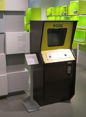
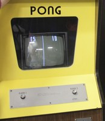
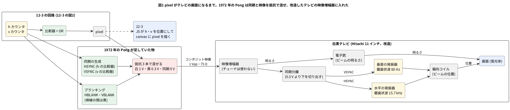

# 12-7 Pong とテレビの画面 — 1972 年の回路の規模と NTSC の走査

この題は実体配線図と Analog Discovery 3 の図を付けない。組まない題 (歴史と、テレビの信号の読み解き) だから。

12-3 では、カウンタと比較器だけの Pong を Verilog で書き、ブラウザの soft-fpga で遊んだ。この題は、その元になった
1972 年の Pong を 3 つの面から見る。ビデオゲームの歴史の中の位置、TTL の IC で組んだ回路の規模、
そして回路が出す `pixel` が白黒テレビの画面になるまで (NTSC の走査と同期) である。どれも 12-3 の回路の数と並べて比べる。

## Pong の歴史的な位置

Pong (1972) は、ビデオゲームが産業になる入口にあったゲームである。前と後を、年と数で短く並べる (出典は末尾)。

### Pong より前

| 年 | もの | 作り | 位置づけ |
| --- | --- | --- | --- |
| 1958 | Tennis for Two (W. Higinbotham、ブルックヘブン国立研究所) | アナログ計算機とオシロスコープ | 研究所の見学者向けの展示。特許も取らず、産業にはつながらなかった |
| 1962 | Spacewar! (MIT の学生、DEC PDP-1) | 計算機のプログラム | 大学や研究所の計算機でしか遊べない。多くの学生が見て、のちの作り手 (N. Bushnell) の源になった |
| 1971 | Computer Space (Bushnell・Dabney) | TTL の論理回路 (CPU なし) | 最初の業務用ビデオゲーム。商業的には振るわなかった (Wikipedia) |
| 1972 | Magnavox Odyssey (R. Baer の設計) | ダイオードとトランジスタの論理 (ディスクリート部品) | 最初の家庭用機。卓球のゲームを Bushnell が 5 月に遊び、Pong のもとになった |

### Pong (1972)

- Atari の Allan Alcorn が、Bushnell に与えられた練習課題として作った。**CPU もプログラムも無く、7400 系の TTL だけで組んだ** (Alcorn 本人の話)
- 酒場 (Andy Capp's Tavern) に置いた試作は、最初の 2 週間で、これを遊ぶために人が来るほどになった (同じく Alcorn)
- 1972 年 11 月 29 日に、北米で業務用が発売された (Wikipedia)

[](03-pong-photo-cabinet.jpg)
[](03-pong-photo-screen.jpg)

(写真をクリックすると、元の大きさで開く)

- 写真1 (左) Atari Pong の筐体 (コンピュータゲーム博物館、ベルリン)。木目の筐体の上に、黄色の前面と白黒テレビの画面、ラケットを動かす 2 つのつまみ、コイン投入口が付く
- 写真2 (右) Pong の画面と操作盤。白黒テレビに、左の点 (15)・ネットの点線・右の点 (10) が出ている。操作は PLAYER 1 と PLAYER 2 のつまみ 1 つずつだけで、回すとラケットが縦に動く

写真の出どころとライセンスは、末尾の出典にある。

**動画** (外部のサイトなので、リンクが切れることがある):

- [Atari Pong Video Arcade Game (1972) — Vimeo、93 秒](https://vimeo.com/427804665): 黄色の筐体で子どもたちが遊ぶ映像。投稿者の説明は 1972 年の Atari Pong。機体が当時の物か復元品かは、確かめていない
- [The Evolution of Video Games: Pong's 50-Year Legacy — YouTube (The Sydney Morning Herald と The Age、2022 年)](https://www.youtube.com/watch?v=763CFRuxovo): Pong の 50 年を扱った解説。業務用から家庭用への流れ
- [50 Years of Fun With Pong — Computer History Museum の記事](https://computerhistory.org/blog/50-years-of-fun-with-pong/): 試作機は同館が所蔵している (Alcorn の 2012 年のインタビュー [The Register](https://www.theregister.com/2012/03/05/pong_anniversary_al_alcorn/) による)

### Pong より後

| 年 | できごと | 意味 |
| --- | --- | --- |
| 1973〜74 | 1973 年までに 2 500 台の注文、1974 年末までに 8 000 台超 (Wikipedia) | 業務用のビデオゲームが商売になった。Ramtek・Nutting などの「Pong のそっくりさん」が数か月で出た |
| 1974〜76 | Magnavox が特許で Atari などを提訴。Atari は 1976 年に 150 万ドル (8 回の分割) のライセンスで和解 (Wikipedia) | ゲームの回路そのものに特許と権利金が付く時代になった |
| 1975 | 家庭用の Home Pong (Sears の Tele-Games、98.95 ドル)。その年の年末商戦で約 15 万台 (Wikipedia) | 回路を 1 個の LSI にまとめた (開発費は約 5 万ドル)。家庭にゲーム機が入った |
| 1975 | Gun Fight (Midway)。業務用で最初にマイクロプロセッサ (Intel 8080) を使ったゲーム | 論理回路を配線して作る時代から、**CPU とプログラム**で作る時代へ。以後、CPU とプログラムで作る業務用のゲームが増えた |
| 1976 | General Instrument の AY-3-8500 (ボールとパドルのゲーム 1 個入りの LSI)。Coleco Telstar など 200 種ほどの家庭機が使った | 「Pong の回路」が部品として買えるようになり、同じ遊びの家庭機があふれた |

12-3 の回路は、**1972 年のやり方** (カウンタと比較器だけ。CPU もプログラムも無い) を、FPGA の中の Verilog で作り直したものである。
つまり、Pong 以後に CPU へ移っていった流れの手前の、ゲートだけで遊びを作っていた時代の作り方を、そのまま追っている。

## 実際の Pong の回路の規模

| 項目 | 1972 年の Pong | 12-3 の回路 |
| --- | --- | --- |
| 部品の数 | **7400 系の TTL の IC が 60 数個〜75 個ほど** (下の注) | yosys で LUT 342〜758 個 (道具の版による)、ALU 494〜578 個、フリップフロップ 75 個 (音を足す前は 310〜536、483〜573、69) |
| CPU・プログラム | 無い | 無い |
| 画面 | 白黒テレビ (家庭用の Hitachi、75 ドル) に、走査に同期した信号を出す | 160 × 120 画素、1 クロック 1 画素。VGA や HDMI の同期は含まない |
| ラケット | 高さ 16 走査線。当たった位置で球の縦の速さが変わる (そのために、高価な IC の 1 つの 4 ビット加算器を足した) | 高さ 16 画素。端の 4 画素で縦に速くなる |
| 点数 | 画面に 7 セグの形の数字で表示。Fairchild の点数用の MOS チップは 1 個 5 ドルで高すぎ、7 セグの各線を TTL で組んだ | 7 セグの形を比較器で描く (1-8 のデコーダと同じ) |
| 音 | 同期のカウンタの矩形波を、出来事の間だけ通す。ヒットは 491 Hz (16 ms)、壁で返したときと点は 246 Hz (壁は 16 ms、点は 555 のタイマーの長さ) | 同じ手。ヒット 450 Hz・壁と点 225 Hz (比は同じ 2 : 1)。ヒットと壁は 1 画面、点は 16 画面 (約 0.27 s) |
| 部品の原価 | 目標 15 ドル、実際は約 20 ドル | — |

- **IC の数は資料で違う**。Alcorn 本人は「出来上がったときには 75 個ほど」と話し、基板を数えた資料は「60 数個」「66 個」と書く。話した時期と数え方 (試作と量産、数える IC の範囲) の違いかもしれないが、確かめていない
- **1 個の IC の大きさは一定でない**。74 シリーズは、2 入力のゲーム 4 個入りから、4 ビットのカウンタ 1 個まで幅がある。LUT (4 入力の関数 1 個) と IC の数を、1 対 1 で比べることはできない。規模の感じをつかむ目安である
- 1972 年の Pong も、Alcorn の説明では、画面に描くものを「球」「ラケット」「点数の数字」「ネットなどの固定物」「音」に分け、それぞれを論理回路で作って足し合わせている。12-3 も同じ分け方で、画面のカウンタ (水平・垂直) → 形に入ったかの比較器 → OR → 画素、とした。球とラケットの位置は 1 画面に 1 回だけ更新する (テレビなら帰線の時間に当たる。1972 年の回路は、位置をレジスタに持たず、タイマーとカウンタの周期の差で動かしていた。「1 画面のタイミング」)

## pixel がテレビの画面になるまで (NTSC)

12-3 の図2 (ブロック図) の `pixel` は、12-3 では JS が `<canvas>` に並べる。1972 年の Pong では、同じ信号をそのまま**白黒テレビ**に入れていた。
画面のメモリ (フレームバッファ) は、ゲームの側にもテレビの側にも無い。ブラウン管のテレビは、電子ビームで画面を左上から右へ、
1 行ずつ下へとなぞり (走査)、**そのときの映像の電圧の高さで、その点の明るさを決める**だけである。
だから「どこに描くか」は「いつ 1 を出すか」と同じことになり、ビームの位置を数えるカウンタ (`h` `v`) と比較器があれば絵が描ける。
12-3 の `h` `v` のカウンタは、1972 年には**テレビのビームの位置そのもの**だった。描き方が走査と同じ順なのは、この名残である。

### テレビの走査と同期

米国の白黒テレビ (NTSC) は、1 行 (走査線) を 63.5 µs (1 秒に 15 734 行)、1 画面を 1/60 s で描く。
放送は 525 行を 2 回に分けて (奇数行と偶数行を交互に、飛び越し走査)、1 回を 262.5 行にする。
Pong は 262 行で 1 画面にし、飛び越さない。毎回同じ行の上をなぞるので、行と行の間に隙間のある粗い画面になる (写真2 の画面はこれ)。

ビームを振るのは、テレビの中の 2 つの鋸歯状波の発振器 (水平 15.7 kHz・垂直 60 Hz) である。
これがゲームのカウンタと同じ歩調で回らないと、絵が横に流れ、縦に転がる。歩調を合わせるのが**同期パルス** (HSYNC・VSYNC) で、
映像の電圧の「黒より下」の段に埋め込んで同じ 1 本の線で送る。テレビは同期分離回路でそれを切り出し、発振器の位相を引き込む。
ビームが右端から左端へ、下から上へ戻る間 (帰線) は、映像を黒にして消す (ブランキング)。




- 黄がカウンタと発振器 (時間を作る物)、緑が比較器、赤が混ぜる所。1972 年の Pong は、この図の真ん中の列を 7400 系の TTL で作った
  (HSYNC・VSYNC・HBLANK・VBLANK は、`h` `v` のカウンタの出力をゲートで組んだ比較器。12-3 の壁やネットと同じ作り)
- テレビの中は、1 本の線で入った信号を**同期**と**明るさ**に分け、同期は 2 つの発振器 (位置) へ、明るさは電子銃へ送る。
  画面の点は、ビームがそこを通った瞬間の明るさで光る。次に通るのは 1/60 s 後で、それまで蛍光体の残光と目の残像で見えている
- Alcorn は、75 ドルの Hitachi のテレビのアンテナ端子の板を外し、映像と音を直接入れられるように改造した。
  チューナと中間周波の回路は使わず、ゲームの信号を映像増幅器へ入れる。家庭用の機械は、RF に変調してアンテナ端子に入れるのが普通だった

### コンポジット映像の電圧

1 本の線で送る映像信号 (コンポジット映像) は、75 Ω の負荷に 1 Vpp で、電圧の段で意味が決まる。

| 電圧 (目安) | 意味 | 12-3 の信号 |
| --- | --- | --- |
| 0 V | 同期パルス (黒より下。テレビはここだけを切り出す) | HSYNC・VSYNC (無い) |
| 0.3 V | ブランキング = 黒 (ビームを消す) | `pixel` = 0 |
| 1.0 V | 白 | `pixel` = 1 |

Pong は、球・ラケット・ネットを OR した VIDEO と、点の映像、そして HSYNC と VSYNC を XOR した複合同期の 3 つを、
**抵抗 3 本で足し合わせて**この 3 段を作った (Holden)。TTL の H と L は 2 値なので、抵抗の比で 0 V・0.3 V・1 V に割り付ける。
D/A 変換器も発振器も無い。12-3 で `pixel` を 1 ビットにしてあるのは、この作りをそのまま写しているからである。

### 1 行のタイミング

図2 は、12-3 の図4 (「画面に見えるはずのもの」) の 59 行めの `pixel` を、NTSC の 1 行に置き直したものである。
1 行 63.56 µs のうち映像に使えるのは 53.3 µs で、12-3 の 160 画素をそこに並べると 1 画素は 0.333 µs になる。
時刻は、HSYNC の立ち下がりを 0 とした。

```logic
# ロジックアナライザの画面 (tommie-fence の logic フェンス)
title: 図2 1 行 63.56 µs。HSYNC の後にビームが左から右へ走り、pixel が 1 の間だけ白く光る
device: generic
time: 10us/div
start: -10us
signals:
  HSYNC: edges -10us=1 0s=0 5.08us=1 63.56us=0 68.64us=1
  HBLANK: edges -10us=0 -1.27us=1 8.89us=0 62.29us=1 72.45us=0
  PIXEL: edges -10us=0 -4.4us=1 -3.4us=0 10.9us=1 11.9us=0 34.9us=1 35.9us=0 59.2us=1 60.2us=0 74.5us=1 75.5us=0
cursors: [0s, 5.08us, 8.89us, 63.56us]
```


図3 は、図2 の HSYNC のまわり (ブランキングの 10.2 µs) を 2 µs/div に広げたもの。フロントポーチ・同期・バックポーチの 3 つの間が見える。

```logic
# ロジックアナライザの画面 (tommie-fence の logic フェンス)
title: 図3 ブランキングの中。フロントポーチ 1.27 µs → HSYNC 5.08 µs → バックポーチ 3.81 µs
device: generic
time: 2us/div
start: -4us
signals:
  HSYNC: edges -4us=1 0s=0 5.08us=1
  HBLANK: edges -4us=0 -1.27us=1 8.89us=0
  PIXEL: edges -4us=1 -3.4us=0 10.9us=1 11.9us=0
cursors: [-1.27us, 0s, 5.08us, 8.89us]
```


| 図2 の印 | 図3 の印 | 時刻 (µs) | 何が起きるか | 米国の規格 (Holden が引く値) | 1972 年の Pong |
| --- | --- | --- | --- | --- | --- |
| — | X1〜X2 | −1.27〜0 | フロントポーチ (ブランキングが始まり、同期の前の間) | 1.27 µs | — (同期の位置が規格とずれていた。下の注) |
| X1〜X2 | X2〜X3 | 0〜5.08 | **HSYNC**。ビームが右端から左端へ戻る (水平の帰線) | 5.08 µs | 32H = 4.5 µs |
| X2〜X3 | X3〜X4 | 5.08〜8.89 | バックポーチ (帰線の揺れが収まるまで黒のまま) | 3.81 µs | — |
| X3〜X4 | — | 8.89〜62.29 | **映像**。ビームが左端から右端へ走り、`pixel` の 1 が白い点になる | 53.3 µs | 375H = 52.4 µs |
| (X4 の直前) | (X1〜X2 と同じ) | 62.29〜63.56 | フロントポーチ (次の行) | 1.27 µs | — |
| X4 | — | 63.56 | 次の HSYNC。1 行 = 63.56 µs = 1/15 734 Hz | 63.5 µs | 455H = 63.6 µs (15 731 Hz) |

- ビームの横の位置は、映像の始まり (8.89 µs) からの**経過時間に比例する**。左のラケット (`h` = 6〜8) は 10.9〜11.9 µs、
  球 (78〜80) は 34.9〜35.9 µs、右のラケット (151〜153) は 59.2〜60.2 µs に 1 µs ずつ白が出る
- 印は表の時刻に置いた。図2 の読み値の ΔX は X1 (HSYNC の始まり) からの差で、X2 までの 5.08 µs が同期の幅、X3 までの 8.89 µs が同期からブランキングの終わりまで、
  X4 までの 63.56 µs が 1 行。その 1/ΔX が水平同期の周波数 15.73 kHz。フロントポーチ (1.27 µs) は図2 では X4 の直前の 7.6 px に当たり、札が重なるので図3 に置いた
- HSYNC は**負論理** (ふだん 1、同期の間だけ 0)。t = 0 が立ち下がり、5.08 µs が立ち上がり。図4 の 0 V の段がこれで、Pong の信号名も (not)HSYNC
- 窓の左端 (−10 µs) に見える白は、前の行 (58 行め) の右のラケット。ブランキング (HBLANK) の間は `pixel` が 1 でも黒に落とす
- 1972 年の Pong は、ブランキングの幅 (80H = 11.2 µs) は規格 (10.2 µs) に近かったが、
  HSYNC をブランキングの中の右寄りに出していたため、絵が左に寄った。テレビの H. Hold のつまみで直して使い、
  4 人用の Pong Doubles で位置を直した (Holden)

映像の電圧そのものを、オシロで見た形にすると図4 になる。

```scope
# オシロスコープの画面 (tommie-fence の scope フェンス)
title: 図4 コンポジット映像の 1 行 (59 行め)。同期 0 V・黒 0.3 V・白 1 V の 3 段
time: 10us/div
# HSYNC は負論理。t = 0 で 0.3 V から 0 V へ落ちる (立ち下がり) のが同期の始まりで、トリガもこの立ち下がりに掛ける
trigger: ch1 falling 0.15V at -4div
ch1: {wave: "= 0.3V - 0.3V*(step(t)-step(t-5.08us)+step(t-63.56us)-step(t-68.64us)) + 0.7V*(step(t-10.9us)-step(t-11.9us)+step(t-34.9us)-step(t-35.9us)+step(t-59.2us)-step(t-60.2us))", range: 500mV/div, position: 0div}
cursors: [0, 63.56us]
measure: [vmax, vmin]
notes:
  - text 0 0.3V: 立ち下がり
  - band 0 5.08us
  - text 5.08us 0V: HSYNC 0 V (帯の 5.08 µs)
  - text 40us 0.3V: 黒 (ブランキング)
  - text 35.4us 1V: 白 (球)
```


- t = 0 で 0.3 V から 0 V へ落ちる**立ち下がり**が HSYNC の始まりで、0 V が 5.08 µs 続いて 0.3 V へ戻る (立ち上がり)。
  テレビの同期分離回路は、0.3 V より下だけを取り出して水平の発振器に渡す。図のトリガ (Trig CH1 ↓ 150 mV) も、この立ち下がりに掛けてある
- X1・X2 は 2 つの立ち下がり (0 と 63.56 µs) に置いた。ΔX の 63.56 µs が 1 行で、1/ΔX が 15.73 kHz。
  カーソルの電圧の読み (270 mV・210 mV) は、段の途中に当たった値で意味は無い (段の上は 0.3 V、下は 0 V)
- 白い点は 1 µs 幅 (3 画素) の 1 V のパルス。黒い所は 0.3 V のまま。Vmax 1 V・Vmin 0 V で 1 Vpp
- この波形は 12-3 の `pixel` (160 画素) を置いたもので、1972 年の Pong の 1 行 (375 クロックの映像) とは画素の刻みが違う。
  形の作り方は同じで、ラケットは 4H (0.56 µs) 幅、球は 4 走査線の高さ (Holden)

### 1 画面のタイミング

縦も同じ作りである。垂直の帰線の間に VSYNC を出し、その前後をブランキングにする。図5 は 1972 年の Pong の数 (Holden) で描いた。
ラケットと球の縦の窓 (Pong の信号の名で VPAD と VVID) は、`v` の比較器の出力そのもので、横の窓 (図2 の PIXEL) との AND が画面の形になる。

```logic
# ロジックアナライザの画面 (tommie-fence の logic フェンス)
title: 図5 1 画面 = 262 行 = 16.65 ms。VBLANK 16 行の中に VSYNC 4 行
device: generic
time: 2ms/div
start: -1ms
signals:
  VSYNC: edges -1ms=1 254us=0 508us=1 16.904ms=0 17.158ms=1
  VBLANK: edges -1ms=0 0s=1 1.016ms=0 16.65ms=1 17.666ms=0
  VPAD1: edges -1ms=0 7.627ms=1 8.644ms=0
  VVID: edges -1ms=0 6.356ms=1 6.61ms=0
cursors: [0s, 16.65ms]
```


| 時刻 (ms) | 何が起きるか | 1972 年の Pong |
| --- | --- | --- |
| 0〜1.016 | **VBLANK**。ビームが下端から上端へ戻る (垂直の帰線)。16 行ぶん | 16V = 1 016 µs (規格は約 833 µs) |
| 0.254〜0.508 | **VSYNC**。4 行ぶんの 1 つの箱形のパルス (規格の鋸歯状の切れ込みは無い) | 4V = 254 µs (規格は約 190 µs) |
| 1.016〜16.65 | 映像。246 行。行ごとに図2 が繰り返す | 262 − 16 行 |
| 16.65 | 次の VBLANK。1 画面 = 262 行 × 63.56 µs = 16.65 ms = 1/60.04 Hz | 262H = 60.04 Hz |

- VPAD1 (左のラケットの縦の窓) は 16 行 = 1.016 ms。ここでは 120 行めから置いた。VVID (球の縦の窓) は 4 行 = 254 µs。
  位置は例で、動く物は毎画面ずれる。12-3 では、ラケットは `pl <= v < pl + 16`、球は `by <= v < by + 3` の比較器に当たる
- 1972 年の Pong は、位置を「レジスタに足す」のではない。ラケットは、VBLANK の始まりで 555 のタイマーを起動し、つまみで決まる時間が過ぎてから 16 行を数える
  (つまみの抵抗がそのままラケットの高さになる)。球は、専用の位置カウンタが 1 画面を 262 ± 3 行、1 行を 455 ± 1 クロックで数え、
  同期のカウンタとの周期の差だけ毎画面ずれていく (Holden)。「どこに描くか」を時間の差で持つ作りで、12-3 の `frame_end` で足す作りとは違う
- 1972 年の Pong の音 (12-3 の「音のつくり」) が垂直カウンタの 16V と 32V のビットなのは、この図の VBLANK の 16 行 (16V) と同じ信号を使っているからである

### 1972 年の Pong と 12-3 の数

| | 1972 年の Pong (Holden) | 12-3 |
| --- | --- | --- |
| クロック | 14.318 MHz の水晶を 2 で割った 7.159 MHz (1H = 0.14 µs) | 約 1.15 MHz (ブラウザの描き替えに合わせた値。12-3 の「Logic Analyzer で見る」) |
| 1 行 | 455 クロック = 63.6 µs。映像 375、ブランキング 80 (HSYNC 32) | 160 クロック。全部が映像 |
| 1 画面 | 262 行 = 16.65 ms (60.04 Hz)。映像 246、ブランキング 16 (VSYNC 4) | 120 行 = 19 200 クロック。全部が映像 |
| 画素 | 横は 1 クロック (0.14 µs)、縦は 1 走査線 | 1 クロック = 1 画素 |
| ラケット | 横 4H × 縦 16 走査線 | 3 × 16 画素 |
| 球 | 縦 4 走査線 | 3 × 3 画素 |
| 同期 | 回路が作り、テレビの発振器が従う | 無い。JS が 1 画面ずつ `<canvas>` に並べる |
| 出力 | コンポジット映像 1 Vpp (抵抗 3 本)。テレビの映像増幅器へ | `pixel` の 1 ビット |

12-3 の回路を本物のテレビにつなぐなら、`h` を 160 で止めずに 455 まで数えさせ、160 から先をブランキングにし、その中の決めた所で HSYNC を 0 V に落とす。
`v` も 262 まで数え、120 から先の 16 行に VSYNC を入れる。`pixel`・HSYNC・VSYNC の 3 本を、抵抗で 0 V・0.3 V・1 V に割り付けて 75 Ω へ出せばよい。
足す物は比較器が数個と抵抗 3 本で、12-3 の「FPGA に載せるとき」に書いた VGA や HDMI よりずっと少ない。1972 年の回路が TTL 60 数個で済んだのは、テレビがこの形の信号を受けてくれたからでもある。

## 見るべき値

1972 年の Pong の数は Holden の回路解析、規格の値は同じ資料が引く米国の規格による (出典)。12-3 の回路の数は 12-3 で確かめた値。

| 見る所 | 値 | 図 |
| --- | --- | --- |
| 1 行 | 63.56 µs (水平同期 15.73 kHz)。1972 年の Pong は 455 クロック = 63.6 µs (15 731 Hz) | 図2・図4 の ΔX |
| HSYNC の幅 | 5.08 µs (規格)。1972 年の Pong は 32H = 4.5 µs | 図2・図3 |
| ブランキングの幅 | 10.2 µs (フロントポーチ 1.27 µs・同期 5.08 µs・バックポーチ 3.81 µs)。1972 年の Pong は 80H = 11.2 µs | 図3 |
| コンポジット映像の段 | 同期 0 V・黒 0.3 V・白 1 V (1 Vpp、75 Ω) | 図4 の Vmax・Vmin |
| 1 画面 | 262 行 = 16.65 ms (60.04 Hz)。VBLANK 16 行 = 1 016 µs、VSYNC 4 行 = 254 µs | 図5 |
| 部品の数 | 1972 年の Pong は 7400 系の TTL の IC が 60 数個〜75 個ほど。12-3 の回路は LUT 342〜758 個・FF 75 個 | 「実際の Pong の回路の規模」の表 |

この題の図は、規格と Holden の数から描いた見えるはずの波形で、本物の Pong の基板やテレビを測ったものではない。

## 出典

自作 (12-3 の回路と 1972 年の Pong を比べる解説)。数字の出典 (2026-10-16 に確かめた):

- 1972 年の Pong の数 (水晶 14.318 MHz を 2 で割る、水平 455 カウント = 15 731 Hz、垂直 262 行 = 60.04 Hz で飛び越さない、HBLANK 80H = 11.2 µs、HSYNC 32H = 4.5 µs、VBLANK 16V = 1 016 µs、VSYNC 4V = 254 µs、映像と点と複合同期を抵抗 3 本で混ぜる、ラケットは 4H 幅で 16 行、球は 4 行、HSYNC の位置のずれと Pong Doubles での修正、ラケットの 555 と球の位置カウンタ、Hitachi 11 インチのテレビの受信回路を殺して映像増幅器に入れたこと、音のヒット 491.6 Hz と壁・点の 246 Hz) と、規格の値 (フロントポーチ 1.27 µs・同期 5.08 µs・バックポーチ 3.81 µs・ブランキング 10.2 µs、垂直の同期 約 190 µs・ブランキング 約 833 µs): H. Holden の回路解析 [ATARI PONG E CIRCUIT ANALYSIS & LAWN TENNIS](https://www.pong-story.com/LAWN_TENNIS.pdf)。
  コンポジット映像の 3 段の電圧 (1 Vpp・75 Ω、同期の先端 0 V・ブランキング 約 0.3 V・白 1 V) は Wikipedia の [Composite video](https://en.wikipedia.org/wiki/Composite_video) の項。
  テレビの改造 (75 ドルの Hitachi、アンテナ端子の板を映像と音の入力にした): 下の Alcorn の話
- Allan Alcorn 本人の話 (IC 75 個ほど、7400 系、マイクロプロセッサ無し、原価、テレビ、ラケット 16 走査線、4 ビット加算器、酒場の試作): Engineering and Technology History Wiki の [First-Hand: The Development of Pong](https://ethw.org/First-Hand:The_Development_of_Pong:_Early_Days_of_Atari_and_the_Video_Game_Industry)
- 発売日・販売台数・Home Pong・特許訴訟・クローン: Wikipedia の [Pong](https://en.wikipedia.org/wiki/Pong)
- 基板の IC の数 (60 数個、66 個): [PONG in a picture frame (e-basteln)](https://www.e-basteln.de/arcade/pong/pong/)、[Pong (Atari, 1972) — Arcade Archive](https://arcadearchive.miraheze.org/wiki/Pong_(Atari,_1972))
- Magnavox Odyssey がダイオードとトランジスタの論理であること: Wikipedia の [Magnavox Odyssey](https://en.wikipedia.org/wiki/Magnavox_Odyssey)
- Gun Fight が業務用で最初にマイクロプロセッサを使ったこと: [Guinness World Records](https://www.guinnessworldrecords.com/world-records/98521-first-arcade-game-to-use-a-microprocessor)、Wikipedia の [Gun Fight](https://en.wikipedia.org/wiki/Gun_Fight)
- AY-3-8500 と Coleco Telstar: Wikipedia の [Coleco Telstar series](https://en.wikipedia.org/wiki/Coleco_Telstar_series)
- 写真 (Wikimedia Commons。写真ごとの権利は撮影者にあり、この教科書の CC BY 4.0 とは別):
  - 写真1: Hanno Böck 撮影、CC0 (パブリックドメイン相当)。[Computerspielemuseum-pong.jpg](https://commons.wikimedia.org/wiki/File:Computerspielemuseum-pong.jpg)。筐体の部分を切り出して縮小した
  - 写真2: [Digital Game Museum](https://commons.wikimedia.org/wiki/File:Atari_Pong_and_Computer_Space.jpg) 撮影の "Atari Pong and Computer Space"、[CC BY 2.0](https://creativecommons.org/licenses/by/2.0/)。画面と操作盤の部分を切り出して縮小した (元の写真には右に Computer Space の筐体が写っている)
- Computer Space の回路が TTL で CPU が無いこと、Tennis for Two、Spacewar!: 上の Wikipedia の Pong と、[Computer Space の解説 (pinrepair)](https://www.pinrepair.com/arcade/cspace.htm)。**Computer Space の IC の数は確かめられなかった**
