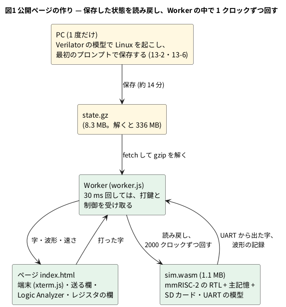
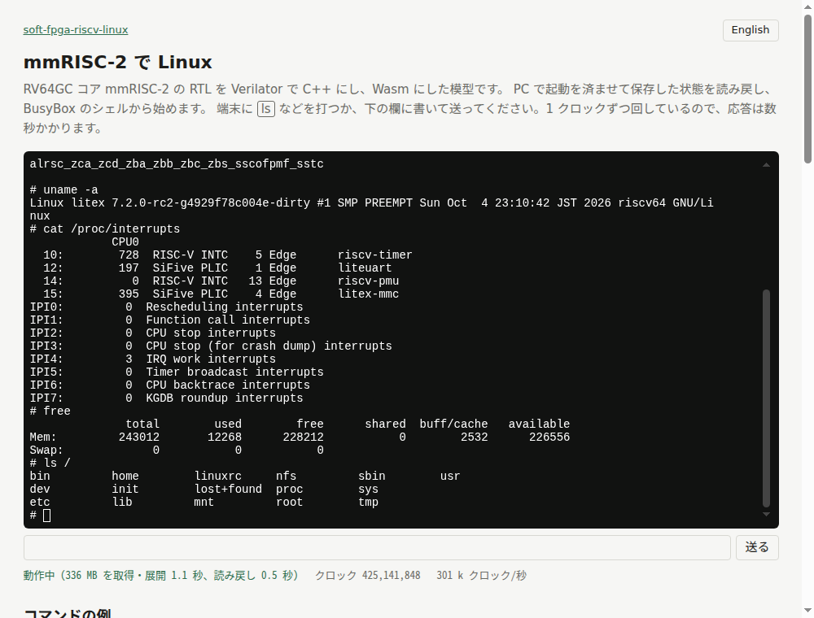

# 13-1 ブラウザで RISC-V の Linux に触る — 保存した所から BusyBox のシェル

この題は実体配線図と Analog Discovery 3 とオシロの図を付けない。ブラウザの中で動く組まない題で、組む物が無いから。

> [!NOTE]
> この題の数は、公開ページをブラウザ (Playwright の Chromium 149、Linux の PC) で開いて取った (2026-11-11)。
> 実物の FPGA のボードでは動かしていない。速さは PC とブラウザで変わる。

第 11 章では、CPU を自分で作り、8 ビットの機械で BASIC や CP/M を動かした (11-8・11-9)。
この章では、既製の 64 ビットの RISC-V のコアで Linux を起こし、その中を覗く。
コアは [mmRISC-2](https://github.com/munetomo-maruyama/mmRISC-2) (RV64GC、仮想記憶は Sv39) で、
実物では FPGA のボード (Digilent Arty A7-100T) に載せて Linux を動かすために作られた RTL である。
この章では FPGA を使わず、4-1 と同じ道 (Verilog → Verilator → C++ → Emscripten → ブラウザ) で、RTL を 1 クロックずつ計算する。

最初の題は、できあがった物に触る。公開ページ
<https://tommie-jp.github.io/soft-fpga-riscv-linux/mmrisc2/> を開くと、2 秒ほどで BusyBox のシェルのプロンプト `#` が出る。
`ls /` と打てば、約 10 秒で答えが返る。この 10 秒の間、ブラウザは CPU の RTL を約 318 万クロック計算している。

この題では、

1. ページを開いてシェルを使う
2. 開いてからプロンプトが出るまでに何が起きているかを知る
3. コマンド 1 つにかかる秒数とクロック数を測り、実物のボードならどれだけかを計算する
4. `/proc` を読んで、動いているのが本物の Linux だと確かめる

をする。作り方は次の題から順に追う (13-2 起動、13-6 保存と読み戻し、13-8 Wasm、13-9 からが Logic Analyzer)。

## ページの作り




- **起動は見せない**。PC で Linux を起こすと、シェルまで約 3.3 億クロック、約 14 分かかる (13-2)。ブラウザで毎回これを待つのは無理なので、
  PC で 1 度だけ起動し、最初のプロンプトが出た瞬間の模型の状態 (レジスタ・キャッシュ・主記憶・SD カードの模型の中身) を全部ファイルに書く。
  ページはこのファイルを読み戻して、続きから始める (13-6)
- 保存した状態は生で 336 MB ある。主記憶 256 MB と SD カードの大半が 0 なので、gzip で 8.3 MB になる (13-7)。
  ブラウザは `fetch` したバイト列を [DecompressionStream](https://developer.mozilla.org/en-US/docs/Web/API/DecompressionStream) で解く
- 模型は Web Worker の中で回る (4-9 と同じ理由。画面を止めない)。Worker は 30 ms 回しては手を止め、打った字と Logic Analyzer の制御を受け取る
- 端末は [xterm.js](https://github.com/xtermjs/xterm.js)。打った字は UART の受信へ、UART から出た字は端末へ行く (13-5)。
  シェルが打った字を送り返す (エコー) ので、字が画面に出るのは CPU がその字を受け取って送り返した後になる

[](01-browser-linux-shell-page.png)

端末の下の 1 行が、読み戻しにかかった時間・今のクロック数・模型の速さである。

## 手順

1. <https://tommie-jp.github.io/soft-fpga-riscv-linux/mmrisc2/> を開く (目次は 1 つ上の
   <https://tommie-jp.github.io/soft-fpga-riscv-linux/>)。右上のボタンで日本語と英語を切り替えられる
2. 端末の下の表示が「Wasm を読み込み中」「保存した状態 (state.gz) を取得・展開中」「読み戻し中」と進み、「動作中」になると端末に `#` が出る
3. 端末をクリックして `ls /` と打ち、Enter を押す。または、端末の下の欄に書いて「送る」を押すか、「コマンドの例」のボタンを押す
4. 答えが返るまで待つ。その間、「クロック」の数が増えていく。前後の数を引くと、そのコマンドにかかったクロック数になる
5. 続けて `cat /proc/cpuinfo`・`uname -a`・`cat /proc/interrupts`・`free` を打つ

- 打った字はすぐには出ない。1 字ごとに、UART の割り込み → カーネル → シェル → 送り返し、を CPU が計算し終えてから出る (13-9 でこの道を波形で見る)
- ページを開き直すと、また同じ保存した所から始まる。作ったファイルは残らない (SD カードの模型は主記憶の上にあり、ページの外へ書き戻さない)
- 幅が 640 px 以下の画面では端末が 80 桁になり、横に送って見る作りになっている (スマホの実機では、この題では確かめていない)

## 読めること

### 開いてからプロンプトまで

端末の下に「動作中 (336 MB を取得・展開 1.1 秒、読み戻し 0.5 秒)」と出た。

- 取ってくるのは 8.3 MB (8 297 821 バイト) で、解くと 336 MB になる。1.1 秒は、取得と gzip を解く時間の合計 (回線とキャッシュで変わる)
- 読み戻しの 0.5 秒は、336 MB のバイト列を模型の変数へ写す時間。写し終えた模型は、PC で保存した瞬間 (3 億 3432 万 8446 クロックめ) とビットまで同じ状態になる
- 端末の最初の `#` は、ページが自分で出している。本物のプロンプトは保存する前に UART から出てしまっていて、読み戻した模型からはもう出ないため

### コマンド 1 つの長さ

答えが返ってプロンプトが戻るまでを、ブラウザで測った。「送る欄に書いて Enter」からなので、コマンドの字を 1 字ずつ受け取る時間も入っている。

| コマンド | 秒 | クロック数 | 50 MHz のボードなら (計算値) |
| --- | --- | --- | --- |
| `ls /` (1 回め) | 9.7 | 3 182 000 | 64 ms |
| `cat /proc/cpuinfo` | 12.3 | 3 808 972 | 76 ms |
| `uname -a` | 21.8 | 6 626 125 | 133 ms |
| `cat /proc/interrupts` | 12.9 | 4 122 000 | 82 ms |
| `free` | 12.4 | 3 793 502 | 76 ms |
| `ls /` (2 回め) | 8.7 | 2 498 539 | 50 ms |

- クロック数は、ページの「クロック」の表示の前後の差。表示は 1 秒ごとにしか変わらないので、数十万クロックのずれがある (測り方の粗さ)
- ページの速さの表示は 292〜318 k クロック/秒だった。mmRISC-2 を載せるボードのクロックは 50 MHz なので、ブラウザは実物の約 1/160 の速さで回っている (50 000 000 ÷ 310 000 ≒ 161)
- どのコマンドも数百万クロックかかる。実物なら 0.1 秒で、人には一瞬に見える長さである。
  その間に CPU は、打った字ごとの割り込み、`fork` と `exec`、SD カードからのファイルの読み、ページフォールト、答えの字の送り出しをしている (13-10 で見る)
- `ls /` は 2 回めのほうが短い。1 回めに読んだディレクトリがカーネルのキャッシュに残るためと見られる (どの読みが減ったかは確かめていない)

### 動いているのは Linux

```text
# uname -a
Linux litex 7.2.0-rc2-g4929f78c004e-dirty #1 SMP PREEMPT Sun Oct  4 23:10:42 JST 2026 riscv64 GNU/Linux
# cat /proc/cpuinfo
processor       : 0
hart            : 0
isa             : rv64imafdc_zicboz_zicntr_zicond_zicsr_zifencei_zihintntl_zihintpause_zihpm_zaamo_zalrsc_zca_zcd_zba_zbb_zbc_zbs_sscofpmf_sstc
mmu             : sv39
uarch           : mmrisc,mmrisc-2
# cat /proc/interrupts
            CPU0
  10:        728  RISC-V INTC    5 Edge      riscv-timer
  12:        197  SiFive PLIC    1 Edge      liteuart
  14:          0  RISC-V INTC   13 Edge      riscv-pmu
  15:        395  SiFive PLIC    4 Edge      litex-mmc
# free
              total        used        free      shared  buff/cache   available
Mem:         243012       12268      228212           0        2532      226556
```

(端末は 100 桁で折り返す。上は折り返しを戻し、`/proc/cpuinfo` と `/proc/interrupts` は一部の行を省いた。)

- `isa` の `rv64imafdc` が RV64GC。整数 (I)・乗除算 (M)・アトミック (A)・単精度と倍精度の浮動小数点 (F・D)・16 ビットの短い命令 (C) を持つ。
  11-13〜11-15 で作る RV32I の CPU は、このうち I の 32 ビット版だけである
- `mmu : sv39` は 39 ビットの仮想番地の 3 段のページテーブル。MMU があるので、プロセスごとに別の番地の空間を持つふつうの Linux が動く
- カーネルの名乗りと `isa` の並びは、mmRISC-2 のリポジトリに入っているカーネルの像 (`Image`) がそのまま動いていることを示す。この題のためにカーネルを作り直してはいない
- `/proc/interrupts` の `liteuart` は UART の割り込みの回数。字を打つたびに増える (打つ前後で `cat /proc/interrupts` を比べると分かる)。
  `litex-mmc` は SD カードの割り込みで、起動のときの読みが大半 (13-12)
- `free` の `total` は 243 012 KB。模型の主記憶は 256 MB で、カーネル自身と予約の分を引いた残りがこの数になる。
  使っているのは 12 MB ほどで、BusyBox のシェル 1 つしか動いていない

### 何も打たない間

何も打たなくても「クロック」は 1 秒に約 31 万ずつ増え続ける。ブラウザのコンソール (開発者ツール) には、1000 万クロックごとに模型の記録が出る。

```text
@@PC 340000000 ffffffff805d3ab0 retired 129171229
@@PC 350000000 ffffffff805d3ab0 retired 129241036
@@PC 360000000 ffffffff805d3ab0 retired 129320085
```

- `@@PC` の行は、クロック数・最後に終えた命令の番地・終えた (退役した) 命令の数 (読み方は 13-3)
- 1000 万クロックの間に退役した命令は約 7 万 (129 241 036 − 129 171 229 = 69 807)。143 クロックに 1 命令しか進んでいない
- 番地はずっと同じ。カーネルは、する事が無いと `wfi` (割り込みを待つ命令) で CPU を止め、タイマーの割り込みで起きては、また寝る。
  ここがその場所と見られる (番地をカーネルのシンボルと突き合わせてはいない)
- CPU が寝ていても、模型は毎クロック全部の回路を計算する。だから、待っている間も PC の CPU のコア 1 つを使い切る

## 見るべき値

公開ページ (gh-pages の cbd8b53、道具は soft-fpga-riscv-linux の fd1efd5、mmRISC-2 は Rev.02-4-gc9587f7) を、Linux の PC の Chromium 149 (Playwright) で開いた (2026-11-11)。

| 見る所 | 値 | 種類 |
| --- | --- | --- |
| 取ってくる状態 | 8 297 821 バイト (解くと 336 024 967 バイト) | ページの作り (大きさは確かめた) |
| 取得と展開 | 1.1 秒 | ブラウザで確かめた |
| 読み戻し | 0.5 秒 | ブラウザで確かめた |
| 模型の速さ | 292〜318 k クロック/秒 | ブラウザで確かめた |
| `ls /` | 8.7〜9.7 秒、250〜318 万クロック | ブラウザで確かめた |
| `cat /proc/cpuinfo` | 12.3 秒、`rv64imafdc…`・`sv39` | ブラウザで確かめた |
| `uname -a` | 21.8 秒、`Linux litex 7.2.0-rc2-… riscv64` | ブラウザで確かめた |
| 何も打たない間に進む命令 | 1000 万クロックに約 7 万 | ブラウザで確かめた |
| 50 MHz のボードとの比 | 約 1/160 | 計算値 |
| 50 MHz のボードでの `ls /` | 50〜64 ms | 計算値 (ボードでは測っていない) |

## シミュレーションでの確かめ (対象外を含む)

ブラウザの手順は、公開ページを Playwright の Chromium で開いて、上の値を取った (2026-11-11)。
同じ模型 (`sim.wasm`) と同じ保存した状態を、手元で Node 24 でも回した (soft-fpga-riscv-linux の fd1efd5 で
`make wasm-restore LINES="'ls /' 'cat /proc/cpuinfo'"`)。

| 項目 | 本文の数字 | 実行結果 | 判定 |
| --- | --- | --- | --- |
| 公開ページの `state.gz` | 8 297 821 バイト | HTTP の `content-length` が 8 297 821。手元で作った物と同じ大きさ | 合った |
| 読み戻した時点 | 3 億 3432 万 8446 クロックめ | Node の表示が `restored at cycle 334328446` | 合った |
| `ls /` の答え | 15 個の名前 (`bin` 〜 `tmp`) | Node でもブラウザでも同じ並び | 合った |
| `cat /proc/cpuinfo` | `rv64imafdc…`・`sv39`・`mmrisc,mmrisc-2` | Node でもブラウザでも同じ | 合った |
| 2 つのコマンドの長さ | ブラウザで 318 万 + 381 万 = 699 万クロック | Node は 4 464 130 クロック (12.9 秒、345 569 クロック/秒) | 違う (下) |
| 50 MHz との比 | 約 1/160 | 50 000 000 ÷ 310 000 = 161 | 合った (計算) |
| ボードでの `ls /` | 50〜64 ms | 2 498 539 ÷ 50 MHz = 50 ms、3 182 000 ÷ 50 MHz = 64 ms | 合った (計算) |
| 実物のボードでの動き | — | ボードが要る | 対象外 |

- 2 つのコマンドのクロック数は、Node のほうが 250 万ほど少ない。Node の台本は、プロンプトが出たクロックで次の行をまとめて受信の待ち行列に入れ、
  最後のプロンプトで止めて数える。ブラウザのほうは、ページの 1 秒ごとの表示で数え、字が Worker に届くまでの待ちも入る。
  同じ量を測っていないので、合わなくてよい。答えの字は同じである
- ブラウザの速さ (292〜318 k クロック/秒) は Node (346 k) の約 0.9 倍。Logic Analyzer の記録と画面への写しの分、遅い (13-8)

## 出典

- 自作。ページと道具は [tommie-jp/soft-fpga-riscv-linux](https://github.com/tommie-jp/soft-fpga-riscv-linux) (Apache-2.0) の `web/` と `sim/wasm/`。
  公開ページは <https://tommie-jp.github.io/soft-fpga-riscv-linux/>。mmRISC-2 を使った個人の試みで、mmRISC-2 の作者の公認ではない
- CPU の RTL と起動の物一式 (カーネルの像・OpenSBI): [mmRISC-2](https://github.com/munetomo-maruyama/mmRISC-2) (Munetomo Maruyama、Apache-2.0)。使った版は Rev.02-4-gc9587f7
- 保存した状態に入っている物: Linux カーネル (GPL-2.0。ソースは [mmRISC-2 の Release](https://github.com/munetomo-maruyama/mmRISC-2/releases/tag/linux-src-4929f78c004e))、
  [OpenSBI](https://github.com/riscv-software-src/opensbi) (BSD-2-Clause)、BusyBox 1.37.0 (GPL-2.0。Debian の [busybox](https://packages.debian.org/source/trixie/busybox) の `busybox-static`)
- 模型を作る道具: [Verilator](https://github.com/verilator/verilator) 5.042。端末は [xterm.js](https://github.com/xtermjs/xterm.js) (MIT)。
  Logic Analyzer は [tommie-jp/soft-fpga](https://github.com/tommie-jp/soft-fpga) の rtlscope (MIT)
