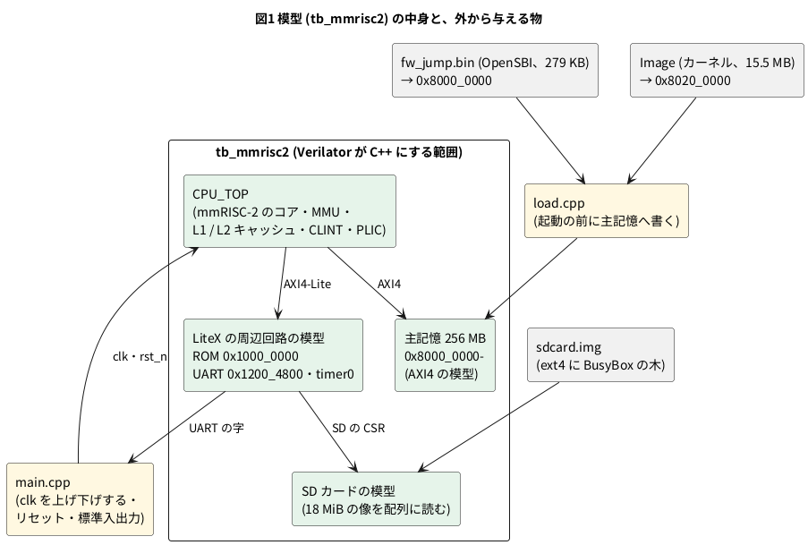

# 13-2 Verilator で Linux を起こす — シェルまで 3.3 億クロック、約 14 分

この題は実体配線図と Analog Discovery 3 とオシロの図を付けない。PC の中で動く組まない題で、組む物が無いから。

> [!NOTE]
> この題の数は、soft-fpga-riscv-linux の fd1efd5 を PC (Intel Core Ultra 9 285K、WSL2、Verilator 5.042) で回して取った (2026-11-11)。
> 実物の FPGA のボードでは動かしていない。

13-1 のページは、起動を済ませた所から始まった。この題では、その起動を PC で最初からやる。
mmRISC-2 の RTL を Verilator で C++ にし、電源を入れた直後の状態から 1 クロックずつ計算して、BusyBox のシェルのプロンプトが出るまで回す。

11-9 の CP/M は、`A>` が出るまで 31 万 T ステートだった。Linux はシェルまで約 3.3 億クロックかかる。
1 秒に約 39 万クロックの模型で、約 14 分である。この数が、13-1 のページが「起動を見せず、保存した所から始める」形になった理由である。

この題では、

1. 模型に入っている物 (CPU・主記憶・周辺回路) と、起動の順 (ROM → OpenSBI → カーネル → init → シェル) を知る
2. 道具を揃えて `make linux-sd` で起こす
3. かかった実時間とクロック数から、模型の速さを出す
4. 模型がどこで止まるか (プロンプトを見て止める) を知る

をする。起動の記録の読み方は 13-3 に分けた。

## 模型に入っている物




- **Verilator が C++ にするのは、CPU だけではない**。主記憶・UART・SD カードも Verilog で書いた模型で、CPU と一緒に 1 クロックずつ計算される。
  CPU の側から見ると、実物のボードの SoC ([LiteX](https://github.com/enjoy-digital/litex) で組んだ物) と同じ番地に同じレジスタが見える。だから、実物と同じカーネルの像がそのまま動く
- CPU の RTL は 22 100 行 (mmRISC-2 の `RTL/` の SystemVerilog)。Verilator が出す C++ は 16 ファイル、約 13.5 万行になる。
  4-2 のカウンタは 1 行の足し算だった。規模の違いが、そのまま 1 クロックの重さの違いになる (3-16・5-6)
- 主記憶は 256 MB。64 ビットの語の配列で、模型のプロセスのメモリの大半を占める
- 外から与える物は 3 つ。OpenSBI の像 (`fw_jump.bin`)、カーネルの像 (`Image`)、SD カードの像 (`sdcard.img`)。
  前の 2 つは mmRISC-2 のリポジトリに入っている物を使う。実物のボードでは、ROM の中の BIOS が SD カードからこの 2 つを主記憶へ読む。
  模型ではその手間を省き、`load.cpp` が起動の前に主記憶へ直に書く (BIOS が読み終えた後と同じ状態から始める)
- カーネルに機械の構成を教える device tree は、OpenSBI の像の中に埋め込んである (mmRISC-2 の作り)

## 起動の順

| 段 | 動く物 | 特権 | すること |
| --- | --- | --- | --- |
| 1 | ROM のスタブ (5 命令) | M | `a0` (hart の番号) と `a1` を 0 にして、0x8000_0000 へ飛ぶ |
| 2 | OpenSBI | M | 機械の初期化。名乗りを出し、割り込みと例外の一部を S モードへ任せ (委譲)、0x8020_0000 へ S モードで飛ぶ |
| 3 | Linux カーネル | S | メモリ管理・割り込み・ドライバの初期化。SD カードを見つけ、2 つめの区画の ext4 を root に mount する |
| 4 | `/sbin/init` (BusyBox) | U | `/etc/inittab` に従って `/proc` などを mount し、シェル (`ash`) を起こす |
| 5 | `ash` | U | プロンプト `#` を出して、字を待つ |

- RISC-V の特権は 3 段ある。M (machine) がいちばん強く、OpenSBI がここに居続ける。カーネルは S (supervisor)、プログラムは U (user) で動く。
  カーネルが機械を再起動するときなどは、`ecall` 命令で OpenSBI を呼ぶ ([RISC-V の Linux の起動の決まり](https://docs.kernel.org/arch/riscv/boot.html))
- 11-9 の CP/M と並べると、ROM のスタブと OpenSBI が BIOS、カーネルが BDOS、`ash` が CCP に当たる。
  違いは、層の境が特権と MMU で守られていること。CP/M のプログラムは BDOS の番地を書き潰せたが、U モードのプログラムはカーネルのメモリに触れない
- root のファイルシステムは SD カードの像の中にある。像は 18 MiB で、区画が 2 つあり、2 つめが ext4。中身は `make rootfs` が作る BusyBox の木 (BusyBox 1 個と設定のファイル) が主である

## 手順

要る物は、Verilator 5.042、python3、fakeroot、cpio、e2fsprogs (`mke2fs`)、fdisk (`sfdisk`)、dpkg (`dpkg-deb`)、curl。
RISC-V のクロスコンパイラは要らない (カーネルと OpenSBI は作り済みの像を使い、BusyBox は Debian の riscv64 の `busybox-static` を取ってくる)。

```bash
git clone --recurse-submodules https://github.com/tommie-jp/soft-fpga-riscv-linux.git
cd soft-fpga-riscv-linux
make rootfs                 # BusyBox の木を作る (Debian の .deb を取ってきて、sha256 を確かめる)
make linux-sd < /dev/null   # 模型を作り、SD カードの像を作り、シェルのプロンプトまで回す
```

1. `--recurse-submodules` で、mmRISC-2 (`cores/mmrisc2/upstream/`) が一緒に取れる
2. `make rootfs` は `build/rootfs/rv64-busybox/initramfs/` に木を作る。`bin/busybox` と `init` へのリンク、`etc/inittab`、`etc/profile` の 4 つが要点
3. `make linux-sd` は、初回に Verilator で模型を作る (`build/mmrisc2/obj/Vtop`)。続けて mmRISC-2 の Makefile で SD カードの像を作り、模型を走らせる
4. 標準入力を `/dev/null` にすると、最初のプロンプトで止まる。端末のまま走らせると、プロンプトの後に字を打てる (13-5)

SD カード無しで、カーネルが root を待つ所までを見るなら `make linux < /dev/null`。

走らせると、OpenSBI の名乗り、カーネルの記録、`#` の順に字が出て、最後に模型のまとめが出る。

```text
OpenSBI v1.9
   ____                    _____ ____ _____
  ...
[    0.000000] Booting Linux on hartid 0
[    0.000000] Machine model: mmRISC-2 on Digilent Arty A7-100T
  ...
[    2.675088] EXT4-fs (mmcblk0p2): mounted filesystem ... r/w with ordered data mode. Quota mode: disabled.
[    2.727134] Run /sbin/init as init process
  ...
BusyBox v1.37.0 (Debian 1:1.37.0-6+b9) built-in shell (ash)
Enter 'help' for a list of built-in commands.

#
==========================================================
 LINUX RUN ENDED : the shell prompt
 334348446 cycles, 129116476 retired, 6156 traps, pc of the last retired ffffffff803ea3a4
==========================================================
 stop_code=1, cycle 334348446, 334348446 cycles in 857.7 s, 389826 cycles/s
```

## 読めること

### かかった時間と速さ

| 走らせ方 | 止まった所 | クロック数 | 実時間 | 速さ |
| --- | --- | --- | --- | --- |
| `make linux-sd` | シェルのプロンプト | 334 348 446 | 857.7 秒 (14 分 18 秒) | 389 826 クロック/秒 |
| `make linux` | root を待つ (`Waiting for root device`) | 152 411 650 | 399.5 秒 (6 分 40 秒) | 381 492 クロック/秒 |

- シェルまで約 3.3 億クロック。ボードのクロック 50 MHz なら 6.7 秒で済む長さである。模型はその約 1/128 の速さで回る (50 000 000 ÷ 389 826)
- 退役した (終えた) 命令は約 1.29 億。1 命令に平均 2.6 クロックかかっている計算になるが、これは CPU が遅いのではない。
  起動の後ろ半分で、カーネルが SD カードの読みを寝て待つ時間が長いためである (13-3・13-12)
- 13-1 のブラウザの 31 万クロック/秒と比べると、PC のネイティブの模型は約 1.3 倍速い (13-8 で分けて測る)
- 模型のプロセスは 1 スレッドで、メモリは約 350 MB 使う (`make linux` を `/usr/bin/time -v` で測って 350 352 KB)。主記憶 256 MB と SD カードの像を配列で持つため
- 最初の約 11 秒は字が出ない。OpenSBI が名乗る前の初期化 (約 400 万クロック) で、止まっているのではない

### プロンプトを見て止める

模型は、いつ起動が終わったかを自分では知らない。UART から出た字の最後の 3 字が改行・`#`・空白になったら「プロンプトが出た」と見て、止める合図 (`stop_code`) を出す。
`main.cpp` はこの合図を毎クロック見て、標準入力に渡す行が無ければ止める。

- Debian の BusyBox の既定のプロンプトは `~ #` で、この 3 字と一致しない。そのため `make rootfs` は `/etc/profile` に `PS1='# '` を書いている。
  これが無いと、プロンプトが出ても模型は止まらず、上限まで空回りする (2026-10-29 に、mmRISC-2 のもとの試験台で実際に起きた)
- 上限は `+maxcycles` で、`make linux-sd` は 4 億クロックにしてある。プロンプトを見逃しても、約 17 分で止まる
- ほかに止まるのは、UART に `Kernel panic` が出た時と、SD カード無しで `Waiting for root device` が出た時 (`make linux` はここで止まる)

### なぜ遅いか

1 クロックに、CPU のコア・キャッシュ・MMU・周辺回路の全部の組み合わせ回路を計算し直し、全部のレジスタを書き換える。
命令を 1 つずつ真似るエミュレータ (QEMU など) は、命令の結果だけを計算するので、桁違いに速い (この題では比べて測っていない)。
RTL の模型は、その代わりに、パイプラインの各段・キャッシュのミス・TLB のミス・割り込みの線の 1 クロックごとの動きを全部持っている。
13-9 からは、その中身を Logic Analyzer で見る。4-14 で 8080 の T ステートを数えたのと同じ理由で、この遅さには見返りがある。

## 見るべき値

soft-fpga-riscv-linux の fd1efd5 (mmRISC-2 は Rev.02-4-gc9587f7) を Verilator 5.042 でビルドし、PC (Intel Core Ultra 9 285K、WSL2) で回した (2026-11-11)。

| 見る所 | 値 | 種類 |
| --- | --- | --- |
| シェルのプロンプトまで | 334 348 446 クロック、857.7 秒 (14 分 18 秒) | 動かして確かめた |
| その間に退役した命令 | 129 116 476 | 動かして確かめた |
| その間のトラップ (割り込みと例外) | 6 156 | 動かして確かめた |
| 模型の速さ | 389 826 クロック/秒 | 動かして確かめた |
| root を待つ所まで (`make linux`) | 152 411 650 クロック、399.5 秒 (6 分 40 秒) | 動かして確かめた |
| 模型のプロセスのメモリ | 約 350 MB | 動かして確かめた (`make linux` で) |
| CPU の RTL | 22 100 行。Verilator の出す C++ は約 13.5 万行 | 数えた |
| 50 MHz のボードでのシェルまで | 6.7 秒 | 計算値 (ボードでは測っていない) |
| ボードとの速さの比 | 約 1/128 | 計算値 |

## シミュレーションでの確かめ (対象外を含む)

| 項目 | 本文の数字 | 実行結果 | 判定 |
| --- | --- | --- | --- |
| `make linux-sd` がプロンプトで止まる | `LINUX RUN ENDED : the shell prompt` | 出た | 合った |
| クロック数・退役・トラップ | 334 348 446・129 116 476・6 156 | 模型のまとめの行のとおり | 合った |
| 13-1 のページが読み戻す時点 | 3 億 3432 万 8446 クロックめ | 334 348 446 − 20 000 = 334 328 446。模型はプロンプトを見てから、行の残りを出すために 2 万クロック回して止まる。保存はプロンプトを見たクロックでする (13-6) | 合った |
| `make linux` が root 待ちで止まる | `Waiting for root device` | カーネルの時計 2.562408 秒の行に出て、`stop_code=3` で止まった。93 076 694 命令、4 332 トラップ | 合った |
| ボードでのシェルまで | 6.7 秒 | 334 348 446 ÷ 50 MHz = 6.69 秒 | 合った (計算) |
| `make rootfs` と SD カードの像を作る所 | 手順のとおり | 今日は作り直していない (2026-10-30 に作った木と像を使った) | 対象外 |
| 実物のボードでの起動 | — | ボードが要る | 対象外 |

## 出典

- 自作。模型を回す道具 (`sim/main.cpp`・`cores/mmrisc2/`・`rootfs/rv64-busybox/make-rootfs.sh`) は
  [tommie-jp/soft-fpga-riscv-linux](https://github.com/tommie-jp/soft-fpga-riscv-linux) (Apache-2.0)。mmRISC-2 を使った個人の試みで、mmRISC-2 の作者の公認ではない
- CPU の RTL、主記憶と SD カードの模型、もとの試験台 (`SIM/SIM_BIOS/tb_BIOS.sv`)、カーネルと OpenSBI の像:
  [mmRISC-2](https://github.com/munetomo-maruyama/mmRISC-2) (Munetomo Maruyama、Apache-2.0)。Verilator で Linux をシェルまで起こす道 (`make linux-sd`) は mmRISC-2 に元からある。
  soft-fpga-riscv-linux の模型は、それを保存と読み戻しができる形に作り替えた物 (13-4)
- Linux カーネル (GPL-2.0): ソースは [mmRISC-2 の Release](https://github.com/munetomo-maruyama/mmRISC-2/releases/tag/linux-src-4929f78c004e)。
  起動の決まりは [RISC-V Kernel Boot Requirements and Constraints](https://docs.kernel.org/arch/riscv/boot.html)
- [OpenSBI](https://github.com/riscv-software-src/opensbi) (BSD-2-Clause)。BusyBox 1.37.0 (GPL-2.0) は Debian の [busybox](https://packages.debian.org/source/trixie/busybox) の `busybox-static`
- SoC の周辺回路の番地とレジスタは [LiteX](https://github.com/enjoy-digital/litex) の物。模型を作る道具は [Verilator](https://verilator.org/guide/latest/)
