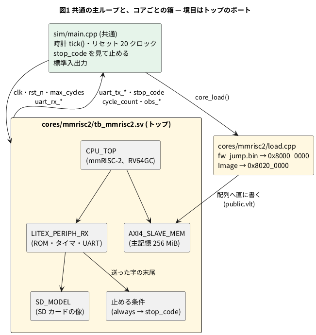

# 13-4 --timing を外して時計を C++ で回す — クロック単位で同じ動き

この題は実体配線図と Analog Discovery 3 とオシロの図を付けない。PC の中で動く題で、組む物が無いから。

13-2 では、mmRISC-2 に付いてくる試験台 (`SIM/SIM_BIOS` の `tb_BIOS.sv`) をそのまま Verilator でビルドして Linux を起こした。
あの試験台は `always #5 clk = ~clk;` で時計を作る。`#5` のような遅延や `@(posedge clk)` で待つ文を Verilator で動かすには、
`--timing` を付けてビルドする (中で C++20 のコルーチンを使う)。

この章の目標は、起動した Linux の状態を保存して読み戻すこと (13-6) と、同じ模型をブラウザで回すこと (13-8) である。
どちらも、模型を外から 1 クロックずつ進められる形が要る。待っている途中のコルーチンは保存の対象に入らないし、
ブラウザでは Worker が「何クロック回すか」を決めたい。そこで、3-1 の試験台と同じ形に戻す。
時計とリセットは C++ が与え、Verilog の側は `always @(posedge clk)` だけにする。

この題では、

1. 元の試験台が `--timing` に頼っている所を数える (3 か所)
2. その 3 か所を C++ の主ループ (`sim/main.cpp`) に移し、トップをポートだけの箱にする
3. 移した後の模型が、元の試験台とクロック単位で同じ動きをすることを数で確かめる
4. コアを差し替えられるように、トップのポートを共通の約束にする

をする。

## --timing に頼っている所

元の試験台と、その中の模型 (`LITEX_PERIPH.sv`・`SD_MODEL.sv`・`AXI4_SLAVE_MEM.sv`) で、遅延か待ちを使う文は `tb_BIOS.sv` の 3 か所だけである。

| 所 | 元の書き方 | 移した先 |
| --- | --- | --- |
| 時計 | `always #5 clk = ~clk;` | `clk` を入力ポートにし、`main.cpp` の `tick()` が上げ下げする |
| 主記憶の読み込み | `initial begin #1; … $readmemh …` | `load.cpp` が最初の `eval()` の後に、バイナリのまま配列へ書く |
| リセットと止める条件 | `repeat (20) @(posedge clk)`、`while (…) @(posedge clk)`、`repeat (20000) @(posedge clk)` | リセットの 20 クロックと残りの 20 000 クロックは `main.cpp` の `for`。止める条件は `always @(posedge clk)` で `stop_code` に出す |

- 2 つめの `#1` は時間を待ちたいのではない。主記憶の模型が自分の `initial` で配列を連番で埋めるので、その後に読み込むための順番付けである。
  C++ では「最初の `eval()` (`initial` が走る) の後に書く」と書けば同じ順になる
- 残りの文は `always @(posedge clk)` と `$display` で、`--timing` が無くても動く
- 主記憶は `$readmemh` をやめ、`fw_jump.bin` と `Image` をバイナリのまま写す。13-2 の最初の 12 秒 (32 MB の hex を読む時間) が縮む

## 構成




- 緑が、どのコアでも同じ物。黄色が、コアごとに書く物 (`cores/<コア>/`)
- `main.cpp` は模型のポートだけを触る。Verilator が付ける階層の名前 (`rootp->tb_mmrisc2__DOT__u_mem__DOT__mem` のような名前、4-15) は `load.cpp` にだけ書く
- `load.cpp` が書く 2 つの配列 (主記憶と ROM) は、`public.vlt` で外から見えるようにする。上流のファイルは書き換えない。
  全部の信号を外へ出す `--public-flat-rw` は使わない (最適化が効きにくくなる)

## 主ループ

`main.cpp` の時計は次の 8 行である。1 回呼ぶと 1 クロック進む。

```cpp
constexpr uint64_t kHalfPeriod = 5;   // 元: always #5 (timescale 1ns)

void tick(VerilatedContext& ctx, Vtop& top) {
    top.clk = 1;
    top.eval();
    ctx.timeInc(kHalfPeriod);
    top.clk = 0;
    top.eval();
    ctx.timeInc(kHalfPeriod);
}
```

`timeInc()` で進める時刻は、回路の動きには関わらない (`$time` を使う表示のためで、元と同じ 10 ns の周期にしてある)。
主ループは次の順に回す。

1. `clk = 0`、`rst_n = 0` で `eval()` を 1 回呼ぶ。ここで `initial` が走る
2. `core_load()` が主記憶と ROM を書く
3. `rst_n = 0` のまま `tick()` を 20 回
4. `rst_n = 1` にして、`stop_code` が 0 以外になるまで `tick()` を繰り返す
5. 止める条件の後、`tick()` を 20 000 回 (UART に残った行を出し切る)
6. `final()` を呼ぶ。試験台の `final` が、クロック数・退役した命令の数・トラップの数を出す

```logic
# ロジックアナライザの画面 (tommie-fence の logic フェンス)
title: 図2 リセットの 20 クロック — rst_n を上げた次の立ち上がりから cycle_count が数え始める
device: generic
window: 300ns
signals:
  clk: dio0 clock 100MHz
  rst_n: dio1 edges 0s=0 195ns=1
  cnt: dio2..dio5 counter on clk rising sequence 0 0 0 0 0 0 0 0 0 0 0 0 0 0 0 0 0 0 0 0 1 2 3 4 5 6 7 8 9 10
buses:
  cycle_count: cnt3..cnt0 dec
cursors: [0ns, 200ns]
```


- `clk` の立ち上がりは 0、10、20 ns … にある。`tick()` を 20 回呼び終えると時刻は 200 ns で、X1 から X2 までがリセットの 20 クロック
- `rst_n` は、20 回めの `tick()` から戻った後、次の `tick()` が `clk` を上げる前に 1 にする (模型の時刻ではどちらも 200 ns。図では立ち上がりと重ならないよう 195 ns に描いた)。
  その立ち上がり (200 ns) で `cycle_count` が 1 になる
- `cycle_count` はリセットが明けてからのクロックを数える。この章で「3.3 億クロック」と言うのはこの数である

## 止める条件

元の試験台は `initial` の中の `while (…) @(posedge clk)` で、UART が送った字の末尾 (`tx_tail`) を毎クロック比べていた。
これを `always @(posedge clk)` に書き直し、結果を 8 ビットの `stop_code` に出す。`main.cpp` は理由を知らずに、0 以外なら止める。

| `stop_code` | 止める理由 | 見る字 |
| --- | --- | --- |
| 0 | 走り続ける | — |
| 1 | シェルのプロンプト | 末尾の 3 字が改行・`#`・空白 |
| 2 | カーネルが止まった | `Kernel panic` |
| 3 | root の装置を待っている (SD カード無し、13-2 の `make linux`) | `Waiting for root device` |
| 4 | root を mount できない | `VFS: Unable to mount` |
| 5 | 上限に達した | `cycle_count` が `max_cycles` 以上 |

```logic
# ロジックアナライザの画面 (tommie-fence の logic フェンス)
title: 図3 止める条件はレジスタを 1 段通る — 字が出た次の立ち上がりで stop_code が 1 になる
device: generic
window: 80ns
signals:
  clk: dio0 clock 100MHz
  uart_tx_valid: dio1 edges 0s=0 20ns=1 30ns=0
  tail_match: dio2 edges 0s=0 30ns=1
  stop_code: dio3 edges 0s=0 40ns=1
cursors: [30ns, 40ns]
```


- `uart_tx_valid` は「次の立ち上がりで 1 字が出る」の合図。図では、プロンプトの最後の空白が 30 ns の立ち上がり (X1) で出る
- `tail_match` は説明のために描いた線で、ポートには無い。`tx_tail` の末尾 3 字がプロンプトと一致している間の 1
- `stop_code` は `tail_match` を見て次の立ち上がり (X2) で 1 になる。元の試験台は `tail_match` を直に見て止まったので、こちらは 1 クロック遅れて止まる。
  下の「見るべき値」でクロック数だけ 1 多いのはこのため
- 判定を C++ でなく Verilog に置いたのは、元の比べ方 (`tx_tail` の末尾と文字列) をそのまま使えるのと、何で止まるかはコアと OS で決まるからである
- `stop_code` が 1 の間に次の字 (打った字のエコー) が出ると、0 に戻る。13-5 は、これで「シェルが入力を待っている」を知る

## 手順

公開リポジトリ ([tommie-jp/soft-fpga-riscv-linux](https://github.com/tommie-jp/soft-fpga-riscv-linux)) を取り、13-2 と同じ道具 (Verilator 5.042 など) で回す。

```bash
git clone --recurse-submodules https://github.com/tommie-jp/soft-fpga-riscv-linux.git
cd soft-fpga-riscv-linux
make rootfs                 # BusyBox の木 (1 度だけ)
make linux < /dev/null      # SD カード無しで、カーネルが root を待つ所まで (約 6.5 分)
make linux-sd < /dev/null   # SD カードの模型から BusyBox のシェルまで (約 14 分)
```

終わると、試験台の `final` と `main.cpp` が次の形の行を出す (下は `make linux-sd` の終わり。数は「見るべき値」)。

```text
 LINUX RUN ENDED : the shell prompt
 334348446 cycles, 129116476 retired, 6156 traps, pc of the last retired ffffffff803ea3a4
…
 stop_code=1, cycle 334348446, 334348446 cycles in 851.5 s, 392658 cycles/s
```

元の試験台と比べるには、サブモジュールの `cores/mmrisc2/upstream/SIM/SIM_BIOS` で上流の `make linux-sd` を回す (13-2 の手順)。
同じ SD カードの像で回し、最後の `cycles`・`retired`・`traps`・`pc` の 4 つを比べる。

## 読めること

### クロック単位で同じ

時計の作り方を変えても、回路は同じ立ち上がりで同じ値を取るはずである。確かめるには、長く走らせた後の数を比べる。
Linux の起動は 3.3 億クロックで 1.29 億命令を退役し、その間に割り込みを含むトラップが 6 千回入る。
途中で 1 クロックでもずれると、タイマ割り込みが別の命令の所に入り、退役した命令の数も最後の PC も変わる。

2026-10-29 に、同じ SD カードの像で上流の試験台とこの模型を回した結果は、退役した命令の数・トラップの数・最後の PC が一致した。
クロック数は 1 だけ多い (図3 の 1 段)。SD カード無しの `make linux` でも同じく一致した。

### どれだけ速くなったか

実時間は約 8 % 縮んだ (909 秒 → 837〜841 秒)。うち約 1.5 秒は hex の代わりにバイナリを読んだ分で、残りは `--timing` の仕組みを外した分である。
C++ の最適化の旗は上流 (`--binary` の既定) と同じにしてあるので、差は `--timing` の有無と読み込みだけから来る。
速さの測り方は 3-16 と同じ (クロック数 ÷ 実時間)。

8 % は大きくない。`--timing` を外す目的は速さではなく、13-6 の `--savable` と 13-8 の Wasm に進める形にすることである。

### 模型の中の変数と、外から渡す値

`+maxcycles` (上限) は、元は `initial` の `$value$plusargs` で模型の中の変数に読んでいた。
これをトップの入力ポート `max_cycles` に替え、`main.cpp` が引数を読んで毎回渡す。
模型の中の変数は 13-6 で保存の対象になり、読み戻すと保存した時の値に戻ってしまうからである。
「外から決めたい物はポートにする」は、時計とリセットに限らない。

## コアを差し替えられる形

RISC-V の Verilog のコアはほかにもある。主ループと、後の題で作る Wasm の口・ブラウザのページを共通にするため、
トップ (`cores/<コア>/tb_<コア>.sv`) のポートを約束にする。

| ポート | 向き | 中身 |
| --- | --- | --- |
| `clk`、`rst_n` | 入 | 時計とリセット |
| `uart_tx_valid`、`uart_tx_data[7:0]` | 出 | 次の立ち上がりで 1 字送る |
| `uart_rx_valid`、`uart_rx_data[7:0]`、`uart_rx_ready` | 入・入・出 | 1 字受け取らせる (13-5) |
| `max_cycles[63:0]` | 入 | 上限。`cycle_count` が達したら `stop_code` を 5 にする |
| `stop_code[7:0]` | 出 | 0 で走り続け、0 以外で止まる |
| `cycle_count[63:0]` | 出 | リセットが明けてからのクロック数 |
| `obs_*` | 出 | Logic Analyzer で見る信号 (13-9〜13-11)。退役・PC・命令・特権モード・トラップ・TLB ミス・主記憶の読み書きなど |
| `reg_sel[7:0]`、`reg_val[63:0]` | 入・出 | レジスタを読む窓 (13-11)。時計を動かさずに `eval()` だけで読む |

- `obs_*` の名前と幅はコアに依らない。出せない信号は 0 にする。そうすれば、ページの信号の定義も共通にできる
- コアごとに書くのは、トップの `.sv`・`core.mk` (ソースの一覧と `make` の的)・`load.cpp` (番地と配列の名前) の 3 つ。
  カーネル・OpenSBI・device tree もコアごとに替わる。rootfs は ISA の幅 (RV64) で共通にできる
- `cycle_count` は 64 ビットにしてある。元の `int` (32 ビット) では約 21 億クロックで溢れ、この PC では 1.5 時間ほどで届く
- 今あるコアは mmRISC-2 だけである。2 つめのコアを差して約束が足りるかは確かめていない

## 見るべき値

上の表は 2026-10-29 に、下の表の終わりの 2 行は 2026-10-30 と 2026-11-11 に測った。PC は Intel Core Ultra 9 285K (WSL2)、Verilator 5.042、1 スレッド。
mmRISC-2 は `Rev.02-4-gc9587f7`。

| 見る所 | 上流の試験台 (`--timing`) | この模型 (`--timing` 無し) | 種類 |
| --- | --- | --- | --- |
| `linux-sd` のクロック数 | 331 360 232 | 331 360 233 (1 多い) | 2026-10-29 に同じ像で測った |
| 退役した命令の数 | 129 033 288 | 同じ | 同上 |
| トラップの数 | 6 147 | 同じ | 同上 |
| 最後に退役した命令の PC | — | 上流と同じ | 同上 |
| プロンプトで止まるまでの実時間 | 909.1 秒 | 837.0 秒・841.2 秒 (2 回) | 同上 |
| 模擬の速さ | 365 k クロック/秒 | 396 k・394 k クロック/秒 | 同上 |
| 最大の常駐メモリ | 334 MB | 350 MB | 同上 |
| `linux` (SD カード無し) のクロック数 | 152 411 649 | 152 411 650 (1 多い) | 同上。退役 93 076 694・トラップ 4 332 は同じ |
| `linux` の実時間 | 426.9 秒 | 397.9 秒 | 同上 |

| 見る所 | 値 | 種類 |
| --- | --- | --- |
| `--timing` に頼る所 | 3 か所 (時計・主記憶の読み込み・リセットと止める条件) | ソースを読んだ |
| リセット | 20 クロック (200 ns) | ソースを読んだ |
| 止める条件の後に回す分 | 20 000 クロック | ソースを読んだ |
| 止める条件の遅れ | 1 クロック | 上の表のクロック数の差 |
| 公開した版 (fd1efd5) の `linux-sd` | 334 348 446 クロック、退役 129 116 476、トラップ 6 156、851.5 秒、393 k クロック/秒 | 2026-10-30 に測った |
| 同じ版を 2026-11-11 に回した `linux-sd` | クロック・退役・トラップ・最後の PC は 10-30 と同じ。857.7 秒、390 k クロック/秒 | 動かして確かめた |

- 最大の常駐メモリが 16 MB 増えたのは、`load.cpp` がファイルを一度メモリに読んでから主記憶へ写すため
- 公開した版のクロック数が 10-29 の数と違うのは、その後に模型を変え (UART の受信、`obs_*` のポート)、SD カードの像も作り直したため。
  どちらがどれだけ効いたかは分けて確かめていない。上流との突き合わせは 10-29 の版でしかしていない
- 一致を見たのは終わりの 4 つの数 (クロック・退役・トラップ・最後の PC) である。途中の全クロックの信号を比べてはいない

## シミュレーションでの確かめ (対象外を含む)

公開リポジトリの fd1efd5 を Verilator 5.042 でビルドした手元の模型で、2026-11-11 に `make linux-sd < /dev/null` を回した。

| 項目 | 本文の数字 | 実行結果 | 判定 |
| --- | --- | --- | --- |
| `linux-sd` がプロンプトで止まる | `stop_code=1` | `LINUX RUN ENDED : the shell prompt`、`stop_code=1` | 合った |
| クロック数・退役・トラップ・最後の PC | 334 348 446・129 116 476・6 156・`ffffffff803ea3a4` (10-30) | 4 つとも同じ | 合った |
| 実時間と速さ | 851.5 秒、393 k クロック/秒 (10-30) | 857.7 秒、390 k クロック/秒 (同じ PC でほかの模擬を並べて回していた) | 合った (0.7 % の差) |
| 上限 `max_cycles` がポートで効く | `stop_code` が 5 | 保存した所から `+maxcycles=335000000` で回し、`stop_code=5, cycle 335020001` (上限の次のクロックで 5 になり、残りの 20 000 クロックを回した) | 合った |
| 止める条件の遅れ 1 クロック | 331 360 233 − 331 360 232 = 1 | 計算 | 合った (計算) |
| 8 % 縮んだ | 909.1 → 837.0・841.2 秒 | 1 − 837.0 ÷ 909.1 = 7.9 %、1 − 841.2 ÷ 909.1 = 7.5 % | 合った (計算) |
| 上流の試験台との一致 | 退役・トラップ・最後の PC | 上流の `make linux-sd` (約 15 分) は今日は回していない | 対象外 (2026-10-29 の記録) |
| `linux` (SD カード無し) | 152 411 650 クロック | 152 411 650 (13-2 が 2026-11-11 に公開リポジトリで回した値) | 合った |

## 出典

自作。道具は [tommie-jp/soft-fpga-riscv-linux](https://github.com/tommie-jp/soft-fpga-riscv-linux) (Apache-2.0) の `sim/main.cpp`・`sim/core.h`・`cores/mmrisc2/`。

- コアと元の試験台: [mmRISC-2](https://github.com/munetomo-maruyama/mmRISC-2) (Munetomo Maruyama、Apache-2.0) の `Rev.02-4-gc9587f7`。
  `tb_mmrisc2.sv` は `SIM/SIM_BIOS/tb_BIOS.sv` から派生した物で、変えた所はファイルの頭に書いてある。
  mmRISC-2 を使った個人の試みで、mmRISC-2 の作者の公認ではない
- 模型が起こす Linux (GPL-2.0) と OpenSBI (BSD-2-Clause) は mmRISC-2 のリポジトリに入っている物、BusyBox (GPL-2.0) は Debian の `busybox-static`
- `--timing` と `--savable`: Verilator の手引きの [verilator Arguments](https://verilator.org/guide/latest/exe_verilator.html)。
  C++ から時計を与える書き方は [Connecting to Verilated Models](https://verilator.org/guide/latest/connecting.html)
