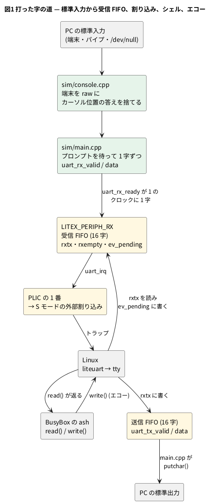

# 13-5 UART の受信を模型に足す — 打った字がシェルに届くまで

この題は実体配線図と Analog Discovery 3 とオシロの図を付けない。PC の中で動く題で、組む物が無いから。

13-4 までの模型は、Linux を起こしてシェルのプロンプトを出す所で止まる。プロンプトの先へ進むには、字を打てなければならない。
ところが mmRISC-2 の試験台に付いてくる周辺回路の模型 (`LITEX_PERIPH.sv`) は UART の送信だけを持ち、受信は「いつも空」を返す。
起動を確かめるための模型なので、それで足りていた。

この題では、

1. 周辺回路の模型に受信の FIFO を足す (`periph/litex/LITEX_PERIPH_RX.sv`)
2. `main.cpp` で、PC の標準入力をその FIFO につなぐ
3. 打った 1 字が、割り込み → カーネル → シェル → エコーと進むクロックを数える

をする。7-1・7-2 で作った UART は、1 ビットずつ線に出して、16 倍のクロックで真ん中を読んだ。
ここで足すのはその先、CPU のバスから見えるレジスタと FIFO と割り込みの側である。線の上のビットは模型にしない (下の「ビットの線は無い」)。

## 受信の作り

LiteX の SoC の UART (liteuart) は、CPU から次の 8 つのレジスタに見える。mmRISC-2 の SoC では `0x1200_4800` から 4 バイトおきに並ぶ。

| 番地 (+) | 名前 | 読むと | 書くと |
| --- | --- | --- | --- |
| `00` | `rxtx` | 受信 FIFO の頭の字 | 送信 FIFO に 1 字入れる |
| `04` | `txfull` | 送信 FIFO が満杯なら 1 | — |
| `08` | `rxempty` | 受信 FIFO が空なら 1 | — |
| `0C` | `ev_status` | bit 0 送信に空きがある、bit 1 受信に字がある | — |
| `10` | `ev_pending` | 同じ値 | bit 1 に 1 を書くと、受信 FIFO から 1 字抜ける |
| `14` | `ev_enable` | 割り込みを許す事象 (bit 0 送信、bit 1 受信) | 同じ |
| `18` | `txempty` | 送信 FIFO が空なら 1 | — |
| `1C` | `rxfull` | 受信 FIFO が満杯なら 1 | — |

足したのは、16 字の FIFO と、表の受信の側の読み書きである。FIFO の出し入れは次の 5 行で済む。

```systemverilog
// 1 クロックに 1 字まで受け取る
if (rx_valid && rx_ready) rx_fifo[rx_rd + 4'(rx_count)] <= rx_data;
if (rx_pop && !rx_empty)  rx_rd <= rx_rd + 4'd1;
rx_count <= rx_count + ((rx_valid && rx_ready) ? 5'd1 : 5'd0)
                     - ((rx_pop && !rx_empty) ? 5'd1 : 5'd0);
```

- `rx_valid`・`rx_data`・`rx_ready` は、トップのポート `uart_rx_*` (13-4 の表) につながる。`rx_ready` は FIFO が満杯でない間 1
- `rx_pop` は、CPU が `ev_pending` の bit 1 に 1 を書いたクロックで 1 になる
- 割り込みの線は `uart_irq = |(ev_status & ev_enable)`。FIFO に字がある間、受信の事象は立ち続ける (水準で見る割り込み)。
  この線は PLIC (割り込みをまとめる回路) の 1 番につながり、カーネルには S モードの外部割り込み (原因 9) として届く

Linux のドライバ (`drivers/tty/serial/liteuart.c`) は、割り込みが来ると `rxempty` が 0 の間、`rxtx` を読んでは `ev_pending` に受信のビットを書く。
読むだけでは FIFO は進まず、書いて初めて次の字が頭に来る。模型はこの手順に合わせてある。




### ビットの線は無い

この模型の UART には、スタートビットもストップビットも無い。字は 1 クロックの受け渡し (`valid` と `ready`) で FIFO に入り、
送る側は `+uart_cycles` で決めたクロックごとに 1 字が FIFO から出る。

| | 実物の SoC (50 MHz、115 200 bps) | この模型 |
| --- | --- | --- |
| 送信の 1 字 | 4 340 クロック (上流の既定の `+uart_cycles`。10 ビットで 86.8 µs (マイクロ秒)) | 20 クロック (`+uart_cycles=20`) |
| 受信の 1 字 | 同じ | 1 クロック |

- 送信を 217 倍速くしてあるのは、起動の記録を出す時間を縮めるため (上流の `make linux` と同じ値)。カーネルは送信 FIFO の空きを見て書くので、速くても字は落ちない
- 受信は 1 クロックに 1 字入る。FIFO は 16 字で、満杯の間は `uart_rx_ready` が 0 になり、`main.cpp` は次の字を渡さずに待つ。字は落ちない
- ビットの幅が効く話 (ボーレートのずれ、7-6) は、この模型では試せない

## 標準入力の渡し方

`main.cpp` は、最初のプロンプトが出るまで字を渡さない (起動中のカーネルに読ませない)。その後の渡し方は、標準入力の種類で 3 通りある。

| 標準入力 | 動き | 使いどころ |
| --- | --- | --- |
| 空 (`< /dev/null`) | 最初のプロンプトで止まる | 起動の時間を測る (13-2) |
| パイプかファイル | プロンプトが出るたびに 1 行渡し、全部渡した後のプロンプトで止まる | 決まった行を打って数を取る |
| 端末 | raw にして、打った字をそのまま渡す。`Ctrl-]` で終わる | 対話 |

プロンプトを待つのには、13-4 の `stop_code` を使う。送った字の末尾がプロンプト (改行・`#`・空白) の間だけ 1 で、次の字が出ると 0 に戻る。
1 行を渡す条件は「`stop_code` が 1」だけでは足りない。渡した行の最初の字のエコーが出るまでは、前のプロンプトがまだ末尾に残っているからである。
そこで「最後に字を渡した後で、`stop_code` が 0 の時を一度見た」を条件に足してある。これが無いと、2 行めを早く渡してしまい、その後のプロンプトで「全部渡した」と止まる
(1 行めは通り、2 行めの出力が出ないまま終わる)。

端末のエコーは Linux がする。PC の端末は raw にして、打った字を自分では表示しない。打った字が画面に出るまでの時間が、そのまま模型の速さになる。

### カーソル位置の答えを渡さない

BusyBox の ash は、プロンプトを出すたびに端末へカーソルの位置を問う (`ESC[6n`)。端末は `ESC[行;桁R` と答える。
この答えを模型に渡すと、その直後に打った字がしばらく捨てられ、最初の行が消えた。
答えを渡してから模型の時間で 130 万クロック以内に打った字は捨てられ、400 万クロック後なら通った (2026-10-30 に測った)。
境は 50 ms (250 万クロック) 前後で、ash の行編集が答えの後に待つ時間と見ている (BusyBox の中は確かめていない)。

実物なら、人が 50 ms の間に打つことはまず無い。模擬は実物の約 130 倍遅いので、PC では 6 秒ほど、打った字が消える時間になる。
`console.cpp` は、端末から来た字のうち `ESC[数字;数字R` の形の物を捨てる。答えが無くても ash は普通に動く。

## 手順

13-4 と同じ公開リポジトリで回す。起動から打つと 14 分待つので、13-6 の保存した所から始める手順を先に使う (保存ファイルの作り方は 13-6)。

```bash
printf 'ls /\ncat /proc/cpuinfo\n' | make restore   # 2 行を打って、最後のプロンプトで止まる
make restore                                         # 端末から対話。Ctrl-] で終わる
```

1 字のクロックを数えるには、この題の `sim/05-uart-rx-key.mjs` を使う。Wasm 版の模型 (13-8) を Node で 1 クロックずつ回し、
Logic Analyzer 用の記録 (13-9) から受信・割り込みの線・トラップ・特権モード・送信を読む。

```bash
make wasm-restore            # Wasm 版の模型と、gzip した保存ファイルを作る (1 度だけ)
REPO=$PWD node <この題の sim>/05-uart-rx-key.mjs 'ls /'
```

```text
mmrisc2-67c16bf6.state.gz: restored at cycle 334328446, first char at cycle 337328446 (SETTLE 3000000)
+0      rx  'l' enters the RX FIFO (clock 0 after the send)
+1  irq lines 0000 -> 1000 (bit 3 S ext, 2 M ext, 1 M timer, 0 M soft), priv 1
+134  trap interrupt cause 9, to S, from priv 1, epc 805d583e
+881  irq lines 1000 -> 0000 (bit 3 S ext, 2 M ext, 1 M timer, 0 M soft), priv 1
+13961  irq lines 0000 -> 1000 (bit 3 S ext, 2 M ext, 1 M timer, 0 M soft), priv 1
+14870  trap interrupt cause 9, to S, from priv 1, epc 805ddc58
+15704  irq lines 1000 -> 0000 (bit 3 S ext, 2 M ext, 1 M timer, 0 M soft), priv 1
+32210  priv S -> U
+32540  trap exception cause 8, to S, from priv 0, epc b5922
+32541  priv U -> S
+36490  priv S -> U
+37339  trap exception cause 8, to S, from priv 0, epc b5922
+37340  priv U -> S
+40762  irq lines 0000 -> 1000 (bit 3 S ext, 2 M ext, 1 M timer, 0 M soft), priv 1
+41731  trap interrupt cause 9, to S, from priv 1, epc 805ddc58
+42636  irq lines 1000 -> 0000 (bit 3 S ext, 2 M ext, 1 M timer, 0 M soft), priv 1
+43608  tx  'l' leaves the TX FIFO (echo)
first char: irq +1, trap +134, echo +43608 clocks (5 traps before the echo)
rest of the line: 4 chars entered the RX FIFO in 4 consecutive clocks: yes
newline at cycle 337372059; first output +48857, prompt +2757246 clocks; 178 chars out
```

`SETTLE` は、読み戻してから 1 字めを渡すまでに回すクロックである。既定の 300 万クロック待つと、シェルは `read()` で寝ていて、CPU は割り込みを待っている。
頭の `+` の数は、字が受信 FIFO に入った立ち上がりから数えたクロック。

## 読めること

### 字が入ってからトラップまで

```logic
# ロジックアナライザの画面 (tommie-fence の logic フェンス)
title: 図2 字が FIFO に入り、次のクロックで割り込みの線が立ち、134 クロックめにトラップに入る
device: generic
window: 3us
start: -200ns
signals:
  uart_rx_valid: dio0 edges -200ns=0 -20ns=1 0s=0
  rx_has_char: dio1 edges -200ns=0 0s=1
  irq_s_ext: dio2 edges -200ns=0 20ns=1
  trap: dio3 edges -200ns=0 2.68us=1 2.7us=0
cursors: [0s, 2.68us]
```


図の時刻は、SoC が前提にする 50 MHz (1 クロック 20 ns) で描いた。13-4 の図の 10 ns は試験台の `$time` の刻みで、回路の動きには関わらない。
時計の線は、150 クロックが 1 枚に入ると塗りつぶしになるので描いていない。

- `uart_rx_valid` は `main.cpp` が 1 クロックだけ立てる。0 s の立ち上がり (X1) で字が FIFO に入り、`rx_has_char` (`ev_status` の bit 1。説明のための線) が 1 になる
- `irq_s_ext` (コアへの S モードの外部割り込みの線、`obs_irq` の bit 3) は次のクロックで立つ。PLIC の中でレジスタを 1 段通る分
- `trap` は 134 クロックめ (2.68 µs、X2)。原因 9 (S モードの外部割り込み) で S モードへ入る。
  割り込みの線が立ってからトラップまでの 133 クロックの内訳 (寝ているコアが起きる時間、パイプラインに入っている命令の始末) は分けて確かめていない
- 13-9 は、同じ所をブラウザの Logic Analyzer の波形で見る

### トラップからエコーまで

```logic
# ロジックアナライザの画面 (tommie-fence の logic フェンス)
title: 図3 字が入ってからエコーが出るまで 43608 クロック — 割り込みが 3 回、ユーザーモードが 2 回
device: generic
window: 1ms
start: -50us
signals:
  irq_s_ext: dio0 edges -50us=0 20ns=1 17.62us=0 279.22us=1 314.08us=0 815.24us=1 852.72us=0
  user_mode: dio1 edges -50us=0 644.2us=1 650.82us=0 729.8us=1 746.8us=0
  uart_tx: dio2 edges -50us=0 872.16us=1
cursors: [0s, 872.16us]
```


| クロック | 時刻 (50 MHz) | 出来事 |
| --- | --- | --- |
| 0 (X1) | 0 | `l` が受信 FIFO に入る |
| +1 | 20 ns | S モードの外部割り込みの線が立つ |
| +134 | 2.68 µs | トラップ (原因 9)。カーネルの割り込みの入口へ |
| +881 | 17.62 µs | 割り込みの線が下がる (ドライバが字を読み、FIFO から抜いた) |
| +13 961〜+15 704 | 279〜314 µs | 2 回めの外部割り込み (トラップは +14 870) |
| +32 210 | 644.2 µs | ユーザーモードへ戻る (ash が `read()` から起きる) |
| +32 540 | 650.8 µs | ユーザーモードからの `ecall` (原因 8)。330 クロックだけ走って、またカーネルへ |
| +36 490〜+37 339 | 730〜747 µs | 2 回めのユーザーモードと `ecall` |
| +40 762〜+42 636 | 815〜853 µs | 3 回めの外部割り込み (トラップは +41 731) |
| +43 608 (X2) | 872.16 µs | `l` が送信 FIFO から出る (エコー) |

- `user_mode` は、最後に退役した命令の特権モードが U の間の 1。`uart_tx` はエコーの字が出た立ち上がりから 1 に描いた (実際の `uart_tx_valid` は 1 クロックのパルス)
- 1 字のエコーに 43 608 クロック、50 MHz の実物なら 0.87 ms かかる。そのうちユーザーモードは 330 + 849 = 1 179 クロック (2.7 %) で、残りはカーネルの中にいる
- 2 回の `ecall` がどのシステムコールかは確かめていない (ash が、読んだ字を `write()` で返していると読める)。
  2 回め・3 回めの外部割り込みの出どころも確かめていない (PLIC の 1 番が UART なので、送信の事象と見ている)
- PC では 1 秒に約 39 万クロック回るので、43 608 クロックは約 0.11 秒。打った字はほぼすぐ画面に出る

### 1 行を打つ

残りの 4 字 (`s`、空白、`/`、改行) は、続く 4 クロックで FIFO に入った。人が打つ速さとは桁が違うが、16 字の FIFO に収まる間は落ちない。
改行が入ってから `ls /` の最初の字が出るまで 48 857 クロック (0.98 ms)、次のプロンプトまで 2 757 246 クロック (55 ms) かかった。
PC では約 7 秒である。エコーは速く、コマンドは遅い。`ls` はディスクからプログラムを読み込み、新しいプロセスを作るからで、その中は 13-10 で見る。

## 見るべき値

公開リポジトリの fd1efd5 (mmRISC-2 は `Rev.02-4-gc9587f7`) を Verilator 5.042 でビルドし、保存した状態 `mmrisc2-67c16bf6.state` から回した (2026-11-11)。

| 見る所 | 値 | 種類 |
| --- | --- | --- |
| 受信 FIFO の深さ | 16 字 | ソースを読んだ |
| 受信の 1 字 | 1 クロック。4 字が続く 4 クロックで入った | 動かして確かめた |
| 送信の 1 字 | 20 クロック (`+uart_cycles=20`)。上流の既定は 4 340 クロック | ソースを読んだ |
| 字が入ってから割り込みの線まで | 1 クロック | 動かして確かめた |
| 字が入ってからトラップまで | 134 クロック (2.68 µs)、原因 9、S モードへ | 動かして確かめた |
| 字が入ってからエコーまで | 43 608 クロック (0.87 ms)、その間のトラップ 5 回 (割り込み 3、`ecall` 2) | 動かして確かめた |
| そのうちユーザーモード | 1 179 クロック (2.7 %) | 動かして確かめた |
| 改行から `ls /` の最初の字まで | 48 857 クロック (0.98 ms) | 動かして確かめた |
| 改行から次のプロンプトまで | 2 757 246 クロック (55 ms)、出た字は 178 | 動かして確かめた |
| `ls /` と `cat /proc/cpuinfo` の 2 行 (PC、`make restore`) | 4 484 130 クロック、11.7 秒、383 k クロック/秒 | 動かして確かめた |
| 読み戻した直後 (`SETTLE=0`) に打った 1 字 | 割り込みの線 +2 219、トラップ +13 241、エコー +59 202 クロック | 動かして確かめた |
| カーソル位置の答えの後、打った字が捨てられる間 | 130 万クロックでは捨てられ、400 万クロックでは通る | 2026-10-30 に同じ模型で測った |

- 最後から 2 行めは、保存した所 (プロンプトの最後の字を出した直後) からすぐ打った場合。シェルもカーネルもまだ動いていて、割り込みが許されるまで待たされる。
  待ってから打った場合 (上の行) と数が大きく違うので、数を比べるときは打つ時点をそろえる
- 模型は決まった動きをする。同じ保存ファイルから同じ時点で打てば、何度回しても同じ数になる (2 回回して確かめた)
- 時刻は 50 MHz の実物に直した計算値で、実物の基板では確かめていない

## シミュレーションでの確かめ (対象外を含む)

| 項目 | 本文の数字 | 実行結果 | 判定 |
| --- | --- | --- | --- |
| プロンプトの後に 2 行が通る | `ls /` の一覧と `cat /proc/cpuinfo` | `bin dev etc …` の 3 行と、`isa : rv64imafdc_…`・`mmu : sv39` が出て `stop_code=1` | 合った |
| 図2 の 2 つの数 | 割り込みの線 +1、トラップ +134 | `05-uart-rx-key.mjs` を 2 回回して同じ | 合った |
| 図3 の表 | +881 … +43 608 | 同じ (上の出力) | 合った |
| ユーザーモードのクロック | 330 + 849 = 1 179、1 179 ÷ 43 608 = 2.7 % | (32 540 − 32 210) + (37 339 − 36 490) | 合った (計算) |
| 時刻 | 134 × 20 ns = 2.68 µs、43 608 × 20 ns = 872.16 µs、2 757 246 × 20 ns = 55.1 ms | 計算 | 合った (計算) |
| 送信の倍率 | 4 340 ÷ 20 = 217 倍 | 計算 | 合った (計算) |
| 4 340 クロックと 115 200 bps | 50 MHz ÷ 115 200 × 10 ビット = 4 340 クロック、86.8 µs | 計算 | 合った (計算) |
| PC での時間 | 43 608 ÷ 383 k = 0.11 秒、2 757 246 ÷ 383 k = 7.2 秒 | 計算 | 合った (計算) |
| 端末からの対話と `Ctrl-]` | 手順のとおり | 端末が要る | 対象外 |
| カーソル位置の答え | 130 万・400 万クロック | 今日は回していない | 対象外 (2026-10-30 の記録) |

## 出典

自作。道具は [tommie-jp/soft-fpga-riscv-linux](https://github.com/tommie-jp/soft-fpga-riscv-linux) (Apache-2.0) の `periph/litex/LITEX_PERIPH_RX.sv`・`sim/main.cpp`・`sim/console.cpp`。

- 元の周辺回路の模型: [mmRISC-2](https://github.com/munetomo-maruyama/mmRISC-2) (Munetomo Maruyama、Apache-2.0) の `SIM/SIM_BIOS/LITEX_PERIPH.sv` (`Rev.02-4-gc9587f7`)。
  足した所は `LITEX_PERIPH_RX.sv` の頭に書いてある。mmRISC-2 を使った個人の試みで、mmRISC-2 の作者の公認ではない
- レジスタの並びと受信の抜き方: LiteX の [`litex/soc/cores/uart.py`](https://github.com/enjoy-digital/litex/blob/master/litex/soc/cores/uart.py) (BSD-2-Clause) と、
  Linux の [`drivers/tty/serial/liteuart.c`](https://github.com/torvalds/linux/blob/master/drivers/tty/serial/liteuart.c) (GPL-2.0)。どちらも読んで合わせただけで、写していない
- 模型が起こす Linux (GPL-2.0) と OpenSBI (BSD-2-Clause) は mmRISC-2 のリポジトリに入っている物、BusyBox (GPL-2.0) は Debian の `busybox-static`
