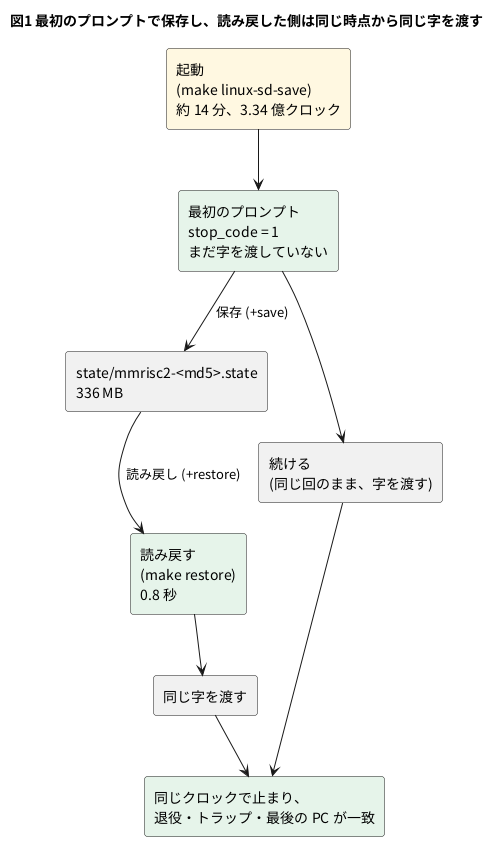

# 13-6 模型を保存して読み戻す — --savable と、続けた場合との一致

この題は実体配線図と Analog Discovery 3 とオシロの図を付けない。PC の中で動く題で、組む物が無いから。

13-2 で測ったとおり、この模型で Linux を起こすと、シェルのプロンプトまで PC で約 14 分かかる。
`ls` を 1 回試すたびに 14 分待つのでは、中を覗く話 (13-9 から) に進めない。ブラウザではもっと遅い。

回路の「今」は、全部のレジスタとメモリの中身で決まる。それを 1 つ残らずファイルに書いておき、後で書き戻せば、起動をやり直さずに同じ所から続けられる。
Verilator にはそのための `--savable` がある。この題では、

1. `--savable` で模型をビルドし、最初のプロンプトで保存する (`+save`)
2. 保存した所から始める (`+restore`)
3. 読み戻して続けた場合と、保存せずに続けた場合が、クロック単位で同じ動きになることを数で確かめる

をする。13-4 で `--timing` を外したのは、このためである。

## 何を保存するか

`--savable` を付けると、Verilator は模型のクラスに、全部の変数を順に書き出す関数と読み込む関数を作る。
呼ぶ側は、`verilated_save.h` の `VerilatedSave` と `VerilatedRestore` に `<<` と `>>` で流すだけでよい。`main.cpp` の保存は次のとおり。

```cpp
bool save_state(const std::string& path, VerilatedContext& ctx, Vtop& top) {
    VerilatedSave os;
    os.open(path);
    if (!os.isOpen()) return false;
    os << &ctx;   // 模型の時刻など
    os << top;    // 模型の全部の変数
    os.close();
    return true;
}
```

| 保存する物 | 大きさ | 中身 |
| --- | --- | --- |
| 主記憶 (`AXI4_SLAVE_MEM` の配列) | 256 MiB | カーネル・ページキャッシュ・プロセスのメモリ |
| SD カードの像 (`SD_MODEL` の配列) | 64 MiB | 像のファイルは 18 MiB で、残りは 0 |
| そのほかの変数 | 約 0.5 MB | CPU のレジスタと CSR、キャッシュと TLB、周辺回路、試験台の数え |
| `VerilatedContext` | 小さい | 模型の時刻 |

- 主記憶も SD カードも、模型の中の配列である。だから、ファイルの中身やプロセスの状態を別に保存する必要が無い。C++ の側に残る状態は無い
- 合わせて 336 MB になる。小さくする話は 13-7
- PC の側の物は入らない。標準入力にまだ残っている字や、端末の設定は、保存した時点では空か、読み戻した側で作り直す




## 保存と読み戻しの決まり

動かしてみて決めた物が 4 つある。

### 保存する時点は、字を渡す前

保存するのは、最初のプロンプトを見たクロック (13-4 の `stop_code` が初めて 1 になった所) で、標準入力の字をまだ 1 つも渡していない時である。
読み戻した側は、同じ時点から同じ字を渡す。保存した回がそのまま続けた場合と、渡すクロックまで同じになる。

### 読み戻す前にも、最初の eval を済ませる

読み戻す時も、模型を作って最初の `eval()` (`initial` が走る) を済ませてから、その上に書き戻す。
`initial` を後から走らせると、主記憶の模型が配列を連番で埋め直し、読み戻した中身を消してしまう。
主記憶の読み込み (`load.cpp`) とリセットの 20 クロックは、読み戻す時にはしない。

### 模型の中の変数は、保存した時の値に戻る

当たり前だが、はまった。上限の `+maxcycles` を `initial` で模型の中の変数に読んでいた時は、読み戻した後に別の値を渡しても効かなかった。
保存した回の値 (4 億クロック) に戻るからである。13-4 のとおりトップの入力ポート `max_cycles` に替え、`main.cpp` が毎回渡すようにして直した。

`+uart_cycles` (送信の 1 字のクロック、13-5) と `+pcmon` (1 000 万クロックごとに PC を出す) は、今も模型の中の変数で、保存した時の値のままになる。
読み戻した後に替えたくなったら、同じくポートにする。

### 保存ファイルは模型に縛られる

保存ファイルは、変数を決まった順に並べただけの物である。Verilog を変えて変数が 1 つ増えれば、順がずれて読めない。
そこで、ファイルの名前に模型の出どころを入れる。

```make
MODEL_HASH := $(shell cat $(CORE_SRCS) | md5sum | cut -c1-8)
STATE      ?= $(ROOT)/state/$(CORE)-$(MODEL_HASH).state
```

- `CORE_SRCS` は Verilator に渡す Verilog のソースの全部。その中身をつないだ md5 の頭 8 桁を名前に入れる。今の模型は `mmrisc2-67c16bf6.state`
- Verilog を変えると名前が変わり、古い保存は読まれない (`make restore` は「ファイルが無い」で止まる)。保存し直す
- git の版で分ける案もあったが、文書だけのコミットでも名前が変わってしまう。保存ファイルが縛られる相手 (模型) そのものから名前を作った
- C++ (`main.cpp` など) は保存の中身に入らないので、md5 に入れない。コメントだけを直した時も md5 は変わるが、模型は同じなので、新しい名前に付け替えれば読める
- Verilator の版にも縛られる。ファイルの頭には `verilatorsave02` の印があり、違えば Verilator が止める。同じ 5.042 でも、変数の並びを変える旗を替えれば読めなくなる。
  ほかの版で保存した物が読めるかは確かめていない

### --savable が通らない書き方

`--savable` は、保存の関数を作れない物があるとビルドで止まる。この模型で当たったのは 1 つだけだった。

| 書き方 | 結果 | 直し方 |
| --- | --- | --- |
| `string` 型の変数 (`SD_MODEL` の像のファイル名) | 通る | — |
| unpacked の構造体 (`typedef struct { longint line; longint cyc; }`) | C++ のコンパイルで止まる (`<<` の演算子が無い) | `struct packed` にする |
| `--timing` (遅延や待ちの途中の状態) | 13-4 で外した | 時計を C++ で回す |

ほかに、`--coverage` と一緒には使えない。SystemVerilog の動的な `new` があっても通らない (この模型の RTL には無い)。

## 手順

13-4 と同じ公開リポジトリで回す。

```bash
make linux-sd-save < /dev/null   # 起動して最初のプロンプトで state/ に保存 (PC で約 14 分、1 度だけ)
make restore < /dev/null         # 保存した所から始め、すぐ止まる (残りの 20 000 クロックだけ回す)
printf 'ls /\ncat /proc/cpuinfo\n' | make restore   # 2 行を打って、最後のプロンプトで止まる
```

保存した回は、保存の行を出してそのまま続ける。

```text
main: saved …/state/mmrisc2-67c16bf6.state, 336024967 bytes, cycle 334328446, in 0.8 s
…
 334348446 cycles, 129116476 retired, 6156 traps, pc of the last retired ffffffff803ea3a4
```

読み戻した回は、読み戻しの行から始まる。

```text
main: restored …/state/mmrisc2-67c16bf6.state, 336024967 bytes, cycle 334328446, in 0.8 s
ls /
bin         home        linuxrc     nfs         sbin        usr
dev         init        lost+found  proc        sys
etc         lib         mnt         root        tmp
# cat /proc/cpuinfo
processor : 0
hart      : 0
isa       : rv64imafdc_zicboz_zicntr_zicond_zicsr_zifencei_zihintntl_zihintpause_zihpm_zaamo_zalrsc_zca_zcd_zba_zbb_zbc_zbs_sscofpmf_sstc
mmu       : sv39
uarch     : mmrisc,mmrisc-2
…
 338812576 cycles, 131545728 retired, 6580 traps, pc of the last retired ffffffff805d3aba
…
 stop_code=1, cycle 338812576, 4484130 cycles in 11.7 s, 382980 cycles/s
```

最初の `ls /` の前にプロンプトの `#` が無いのは、プロンプトを出した後で保存したからである (プロンプトは保存した回の画面に出ている)。

## 読めること

### 続けた場合と一致する

確かめ方は 13-4 と同じで、長く走らせた後の 4 つの数 (止まったクロック・退役した命令の数・トラップの数・最後に退役した命令の PC) を比べる。
読み戻しで 1 ビットでも違えば、その後の何百万クロックのどこかで分かれ、数が変わる。

| 回 | 渡した行 | 止まったクロック | 退役 | トラップ | 最後の PC |
| --- | --- | --- | --- | --- | --- |
| 保存してそのまま続けた (2026-10-30) | 無し | 334 348 446 | 129 116 476 | 6 156 | `ffffffff803ea3a4` |
| 保存せずに起動から続けた (2026-11-11、`make linux-sd`) | 無し | 334 348 446 | 129 116 476 | 6 156 | `ffffffff803ea3a4` |
| 読み戻した (2026-11-11) | 無し | 334 348 446 | 129 116 476 | 6 156 | `ffffffff803ea3a4` |
| 読み戻した 1 回め (2026-11-11) | `ls /`、`cat /proc/cpuinfo` | 338 812 576 | 131 545 728 | 6 580 | `ffffffff805d3aba` |
| 読み戻した 2 回め (2026-11-11) | 同じ | 338 812 576 | 131 545 728 | 6 580 | `ffffffff805d3aba` |

- 1〜3 行め: 行を渡さない場合。保存した回は保存の後に 20 000 クロック回して終わり、読み戻した回も 20 000 クロック回して終わる。4 つとも一致した。
  2 行めは保存をしない `make linux-sd` で、保存という操作そのものが模型を乱していないことも分かる
- 4・5 行め: 2 行を渡した場合。読み戻しを 2 回して、4 つとも一致した。出た字も同じ
- 「2 行を渡して、保存せずに続けた回」との突き合わせは、今の模型ではしていない。1 つ前の模型では 2026-10-30 に行い、
  出た字・止まったクロック (335 790 496)・退役 (131 435 843)・トラップ (6 561) が一致している
- 1 行めと 2・3 行めは、12 日あけた別の実行である。模型には乱数も PC の時計も入っていないので、同じ入力なら同じクロックで同じ事が起こる

### 読み戻した後に効く物と効かない物

読み戻した後に `+maxcycles=335000000` を渡して 1 行を打つと、`stop_code=5` (上限) で止まった。止まったクロックは 335 020 001 で、
上限に達した次の立ち上がりで `stop_code` が 5 になり (13-4 の 1 段)、残りの 20 000 クロックを回した数である。ポートにした物は、読み戻した後でも外から決められる。

### どれだけ得をしたか

保存は 0.8 秒、読み戻しも 0.8 秒で済む。起動の約 14 分 (850 秒) が 0.8 秒になるので、約 1 000 倍である。
`ls /` と `cat /proc/cpuinfo` の 2 行は、読み戻してから 11.7 秒で終わる。

読み戻しが速いのは、336 MB をそのままメモリへ写すだけだからで、ディスクが遅ければその分かかる (上の 0.8 秒は、ファイルが OS のキャッシュに載っている時の値)。

### 同じ保存を別の模型で読む

保存ファイルの中身は固定幅の値の並びなので、同じ Verilog から作った模型なら、PC のネイティブでも Wasm でも読める。
PC で保存した物を Wasm の模型 (13-8) で読み戻して同じ 2 行を打つと、出た字は同じで、止まったクロックは 338 792 576 だった。
PC より 20 000 少ないのは、Wasm の側は止める条件の後の「残りの 20 000 クロック」を回さないためである。

## 見るべき値

公開リポジトリの fd1efd5 (mmRISC-2 は `Rev.02-4-gc9587f7`) を Verilator 5.042 でビルドした模型。PC は Intel Core Ultra 9 285K (WSL2)。

| 見る所 | 値 | 種類 |
| --- | --- | --- |
| 保存ファイルの大きさ | 336 024 967 バイト | 動かして確かめた |
| うち主記憶と SD カードの配列 | 268 435 456 + 67 108 864 = 335 544 320 バイト。残りは 480 647 バイト | 計算値 |
| 保存したクロック | 334 328 446 | 2026-10-30 に測った (読み戻しの行でも同じ数が出る) |
| 保存にかかる時間 | 0.8 秒 | 2026-10-30 に測った |
| 読み戻しにかかる時間 | 0.8 秒 | 動かして確かめた |
| 読み戻して行を渡さない | 334 348 446 クロックで止まる。退役 129 116 476、トラップ 6 156 | 動かして確かめた (保存した回と一致) |
| 読み戻して 2 行を渡す | 338 812 576 クロックで止まる。退役 131 545 728、トラップ 6 580 | 動かして確かめた (2 回で一致) |
| 2 行にかかる時間 | 4 484 130 クロック、11.7 秒、383 k クロック/秒 | 動かして確かめた |
| 読み戻した後の上限 | `+maxcycles=335000000` で `stop_code=5`、335 020 001 クロック | 動かして確かめた |
| Wasm の模型で読み戻して 2 行 | 出た字は同じ、338 792 576 クロック (20 000 少ない) | 動かして確かめた |
| 保存ファイルの名前 | `mmrisc2-67c16bf6.state` (Verilog の md5 の頭 8 桁) | 動かして確かめた |

- 「残り 480 647 バイト」は引き算で、中の内訳 (キャッシュの配列が何バイトか、など) は数えていない
- 一致を見たのは終わりの 4 つの数と出た字である。読み戻した直後の全部の変数を、保存した回の同じクロックの値と 1 つずつ比べてはいない

## シミュレーションでの確かめ (対象外を含む)

2026-11-11 に、手元の公開リポジトリ (fd1efd5) で `state/mmrisc2-67c16bf6.state` (2026-10-30 に `make linux-sd-save` で作った物) を読み戻して回した。

| 項目 | 本文の数字 | 実行結果 | 判定 |
| --- | --- | --- | --- |
| 読み戻しの行 | 336 024 967 バイト、cycle 334 328 446、0.8 秒 | `main: restored …, 336024967 bytes, cycle 334328446, in 0.8 s` | 合った |
| 行を渡さない (`make restore < /dev/null`) | 334 348 446・129 116 476・6 156・`…803ea3a4` | 同じ。10-30 の保存した回の終わりの行とも同じ | 合った |
| 保存せずに起動から続ける (`make linux-sd < /dev/null`、857.7 秒) | 同じ 4 つの数 | 同じ | 合った |
| 2 行を渡す (2 回) | 338 812 576・131 545 728・6 580・`…805d3aba` | 2 回とも同じ | 合った |
| 出た字 | `ls /` の 3 行と `/proc/cpuinfo` | `isa : rv64imafdc_…`、`mmu : sv39`、`uarch : mmrisc,mmrisc-2` | 合った |
| 読み戻した後の上限 | `stop_code=5`、335 020 001 | `stop_code=5, cycle 335020001` | 合った |
| Wasm で読み戻す (`make wasm-restore`) | 338 792 576 | `stop_code=1, cycle 338792576`、出た字は PC と同じ | 合った |
| 20 000 の差 | 338 812 576 − 338 792 576 | 20 000 (`main.cpp` の `kTailCycles`) | 合った (計算) |
| 保存ファイルの名前 | `67c16bf6` | `make state-name` が `…/state/mmrisc2-67c16bf6.state` | 合った |
| 配列の大きさ | 335 544 320、残り 480 647 | 256 × 2²⁰ + 64 × 2²⁰、336 024 967 − 335 544 320 | 合った (計算) |
| 約 1 000 倍 | 850 秒 ÷ 0.8 秒 | 1 063 | 合った (計算) |
| 保存そのもの (`make linux-sd-save`) | 0.8 秒、334 328 446 | 約 14 分かかり、手元の保存ファイルを書き換えるので今日は回していない | 対象外 (2026-10-30 の記録) |
| 2 行を渡して保存せずに続けた回との一致 | 335 790 496 ほか | 1 つ前の模型での記録 | 対象外 (2026-10-30 の記録) |

## 出典

自作。道具は [tommie-jp/soft-fpga-riscv-linux](https://github.com/tommie-jp/soft-fpga-riscv-linux) (Apache-2.0) の `sim/main.cpp`・`sim/Makefile`・`cores/mmrisc2/core.mk`。

- コアと元の試験台: [mmRISC-2](https://github.com/munetomo-maruyama/mmRISC-2) (Munetomo Maruyama、Apache-2.0) の `Rev.02-4-gc9587f7`。
  mmRISC-2 を使った個人の試みで、mmRISC-2 の作者の公認ではない
- 保存した状態の中の Linux (GPL-2.0) と OpenSBI (BSD-2-Clause) は mmRISC-2 のリポジトリに入っている物、BusyBox (GPL-2.0) は Debian の `busybox-static`
- `--savable` と保存・読み戻しの呼び方: Verilator の手引きの [verilator Arguments](https://verilator.org/guide/latest/exe_verilator.html) と
  [Simulating (Verilated-Model Runtime)](https://verilator.org/guide/latest/simulating.html) の「Save/Restore」
