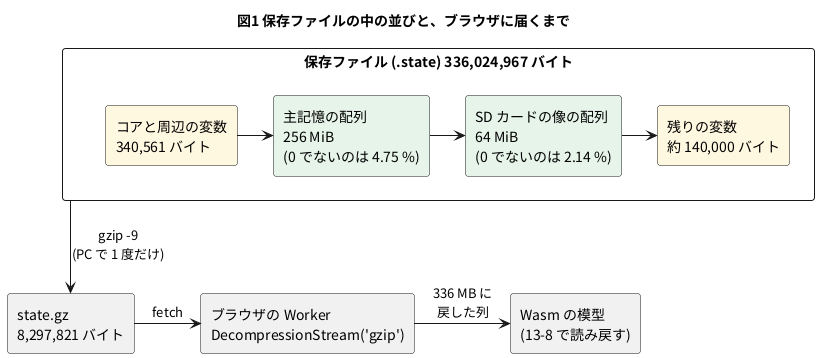

# 13-7 保存ファイルを小さくする — 336 MB が gzip で 8.3 MB

この題は実体配線図と Analog Discovery 3 とオシロの図を付けない。PC の中で動く題で、組む物が無いから。

13-6 で、シェルのプロンプトまで起こした模型を 1 つのファイルに保存した。大きさは 336,024,967 バイト (約 336 MB) ある。
PC の中で読み戻すだけならこのままでよいが、ブラウザで開くページ (13-1) に置くには大きすぎる。

- 10 Mbps の回線で取ると、336 MB は約 4 分半かかる (計算値)。ページを開いてからシェルが出るまで待てる長さではない
- GitHub は 100 MB を超えるファイルを受け付けないので、GitHub Pages に 1 つのファイルとしては置けない

この題では、保存ファイルの中身を数えて「ほとんどが 0」であることを確かめ、圧縮だけで 8.3 MB に縮むことを見る。
縮め方を 6 通り比べ、配る形を gzip に決めた理由を書く。

## 保存ファイルの中身

保存ファイルに入るのは、模型の全部の変数である (13-6)。主記憶と SD カードの像も Verilog の配列なので、そのまま入る。




- 主記憶は 256 MiB (64 ビット × 32 M 語)、SD カードの像は 64 MiB の配列。この 2 つで 320 MiB、ファイルの 99.86 % を占める
- 並びは、中身の分かっているバイト列を探して確かめた。OpenSBI (`fw_jump.bin`) の頭がファイルの 340,561 バイト目にあり、
  カーネル (`Image`) の頭がそのちょうど 2 MiB 後ろにある (主記憶の番地 `0x8000_0000` と `0x8020_0000` に当たる)。
  SD カードの像の頭は 268,915,313 バイト目にある
- Verilator が変数を書く順は模型の版で変わる。上の番地は、この模型 (保存ファイルの名前の `67c16bf6`) だけの値

## 手順

soft-fpga-riscv-linux を取ってきて、13-6 の手順で保存ファイルを作っておく (`make linux-sd-save`、約 14 分)。
数えるスクリプトはこの題の `sim/07-state-stats.py`。保存ファイルは読むだけで、書き換えない。

```bash
STATE=$(make -s -C soft-fpga-riscv-linux/sim state-name)   # state/mmrisc2-<md5>.state
python3 sim/07-state-stats.py "$STATE" --compress \
  --region mem:340561:268435456 --region sd:268915313:67108864
```

```text
size            336024967 bytes (320.5 MiB)
zero bytes      321585680 (95.70 %)
non-zero bytes  14439287 (13.8 MiB)
4 KB pages      82038, all-zero 75827 (92.43 %), used 6211 (24.3 MiB)
1 MiB blocks    321, with any non-zero byte 41
non-zero bytes per 16 MiB: 8.74 2.03 0.34 0.00 0.00 0.00 0.00 0.00 0.00 0.00 0.00 0.00 0.00 0.00 0.00 1.19 1.47 0.00 0.00 0.00 0.00
region mem   268435456 bytes at 340561, non-zero 12759088 (4.75 %)
region sd    67108864 bytes at 268915313, non-zero 1434853 (2.14 %)
outside regions 480647 bytes
gzip -1      9999166 bytes ( 9.54 MiB, 1/33.6)  compress   0.8 s  decompress 0.83 s
gzip -6      8330573 bytes ( 7.94 MiB, 1/40.3)  compress   1.2 s  decompress 1.11 s
gzip -9      8297798 bytes ( 7.91 MiB, 1/40.5)  compress   2.2 s  decompress 1.13 s
zstd -3      7962255 bytes ( 7.59 MiB, 1/42.2)  compress   0.2 s  decompress 0.41 s
zstd -19     6714812 bytes ( 6.40 MiB, 1/50.0)  compress   7.8 s  decompress 0.58 s
xz -6        6155192 bytes ( 5.87 MiB, 1/54.6)  compress   7.8 s  decompress 0.83 s
```

配る形は `make state-gz` が作る (`gzip -9 -k`)。ブラウザ版を揃える `make web` は、これを `state.gz` の名前で置く。

## 読めること

### ほとんどが 0

保存ファイルの 95.70 % が 0 のバイトである。0 でないのは 14,439,287 バイト (13.8 MiB) しか無い。

```graph
# グラフ (tommie-fence の graph フェンス)
title: 図2 保存ファイルの 4 MiB ごとの、0 でないバイトの量
x: ファイルの中の位置 MiB 0..324
y: ゼロ以外のバイト MiB 0..4
lines:
  ゼロ以外 MiB:
    - 0 2.02
    - 4 3.81
    - 8 1.94
    - 12 0.97
    - 16 0.17
    - 20 0.69
    - 24 0.47
    - 28 0.70
    - 32 0.34
    - 36 0
    - 248 0
    - 252 1.19
    - 256 0.11
    - 260 0.47
    - 264 0.89
    - 268 0
    - 320 0
notes:
  - text 130 3MiB: 主記憶 (0.3〜256.3 MiB)
  - text 286 2MiB: SD (256.5 MiB〜)
```


- 横軸の 1 点は 4 MiB のかたまりの始まり。全部が 0 でなければ縦は 4 になる。一番詰まっている 4〜8 MiB でも 3.81 で、そこにカーネルの本体 (15,464,960 バイトの `Image`、2.3 MiB 目から) がある
- 主記憶は、頭の 36 MiB と、最後の 4 MiB (252〜256 MiB) だけが使われている。間の 216 MiB は 1 バイトも書かれていない。
  起動したばかりの Linux が使うメモリは、カーネルの本体と、起動のあいだに確保した分だけだからである
  (ブラウザの `free` でも、243 MB のうち 228 MB が空きと出る。13-1)
- 主記憶の最後の 4 MiB に何があるかは確かめていない (カーネルが高い番地から取る物と見ている)
- SD カードの像は 64 MiB の配列に 18 MiB の像を読み込んだ物で、0 でないのは 1.4 MiB。中身は BusyBox の 1 本 (1.6 MB) と ext4 の管理の領域がほとんど

4 KB ごとに区切って数えると、82,038 ページのうち 75,827 ページ (92.43 %) が全部 0 だった。
1 バイトでも 0 でないページは 6,211 (24.3 MiB)。

### 圧縮だけで足りた

始めに考えた手は 2 つあった。

1. ファイルの全体を圧縮する
2. 主記憶と SD カードを保存の対象から外し、書かれたページだけを別に書く (SD カードは元の像との差だけを持つ)

2 は模型と保存の作りを変える仕事になる。1 を先に試すと、目安にしていた 30 MB を大きく下回ったので、2 はやらなかった。

| 縮め方 | 大きさ | 元の何分の 1 か | 縮める時間 | 戻す時間 |
| --- | --- | --- | --- | --- |
| 生 | 336,024,967 バイト | 1 | — | — |
| gzip -1 | 9,999,166 バイト (9.54 MiB) | 1/33.6 | 0.8 秒 | 0.8 秒 |
| gzip -6 | 8,330,573 バイト (7.94 MiB) | 1/40.3 | 1.2 秒 | 1.1 秒 |
| gzip -9 (配る形) | 8,297,798 バイト (7.91 MiB) | 1/40.5 | 2.2 秒 | 1.1 秒 |
| zstd -3 | 7,962,255 バイト (7.59 MiB) | 1/42.2 | 0.2 秒 | 0.4 秒 |
| zstd -19 | 6,714,812 バイト (6.40 MiB) | 1/50.0 | 7.8 秒 | 0.6 秒 |
| xz -6 | 6,155,192 バイト (5.87 MiB) | 1/54.6 | 7.8 秒 | 0.8 秒 |

- 時間は、コマンドにパイプで渡して受け取るまでを 1 回測った値。ほかの模擬を回している PC で取ったので、目安として読む
- 配っている `state.gz` は 8,297,821 バイトで、表の gzip -9 より 23 バイト多い。ファイルから作ると、gzip が頭に元のファイルの名前 (22 字と終わりの 1 バイト) を書くためである
- gzip でも 0 でないバイト (13.8 MiB) より小さくなる。0 でない所も、カーネルの機械語や字の並びで、もともと縮むからである。
  つまり 2 の手 (書かれたページだけを生で持つ、24.3 MiB) だけでは gzip に負ける。2 をやるなら、その上でさらに圧縮することになる
- 0 の続きはどの縮め方でも小さくなるが、0 にはならない。gzip の中の Deflate は 1 つの一致を 258 バイトまでしか表せないので、
  0 が 216 MiB 続く所にも、およそ 1/1000 の大きさが残る (見積り。216 MiB で 0.2 MiB ほど)

### 配る形を gzip にした理由

一番小さいのは xz、縮めるのも戻すのも速いのは zstd -3 である。それでも gzip にしたのは、ブラウザが標準で解けるからである。

```javascript
// web/worker.js (soft-fpga-riscv-linux、Apache-2.0) から
async function fetchGunzip(url) {
    const res = await fetch(url);
    if (!res.ok) throw new Error(`${url}: ${res.status}`);
    const stream = res.body.pipeThrough(new DecompressionStream('gzip'));
    return new Uint8Array(await new Response(stream).arrayBuffer());
}
```

- `DecompressionStream` はブラウザの標準の口で、`gzip` はどのブラウザでも解ける。解くためのライブラリをページに足さずに済む
- zstd -19 にすれば 1.6 MB 減るが、解くための Wasm か JS を別に配ることになり、差が縮む。8.3 MB で待てる長さに収まったので、足さなかった
- 解いた 336 MB は、ブラウザのメモリに 1 度だけ丸ごと載る。模型に読ませ終えたら手放す (13-8)
- Node で試すときは `zlib` の `gunzipSync` で同じ物を解く。8.3 MB を読んで解くまで 0.4 秒だった

サーバーが HTTP の `Content-Encoding: gzip` で送る手もあるが、使っていない。GitHub Pages がどのファイルを縮めて送るかはこちらで決められないので、
縮めたファイルをそのまま置き、ページの側で解く形にした。

### どれだけ得をしたか

| 回線 | 生 (336 MB) | state.gz (8.3 MB) |
| --- | --- | --- |
| 10 Mbps | 約 269 秒 | 約 6.6 秒 |
| 100 Mbps | 約 27 秒 | 約 0.7 秒 |

どちらも大きさ ÷ 回線の速さの計算値。ブラウザ版に要る物は、この `state.gz` と Wasm の模型 (約 1 MB) で、合わせて 10 MB を切る。

## 見るべき値

soft-fpga-riscv-linux の fd1efd5 (mmRISC-2 は Rev.02-4-gc9587f7) を Verilator 5.042 でビルドした模型の保存ファイル
`mmrisc2-67c16bf6.state` を、2026-11-11 に数えた。

| 見る所 | 値 | 種類 |
| --- | --- | --- |
| 保存ファイルの大きさ | 336,024,967 バイト (320.5 MiB) | 動かして確かめた |
| 主記憶と SD カードの配列 | 256 MiB + 64 MiB = 335,544,320 バイト (99.86 %) | 計算値 (配列の大きさ) |
| そのほかの変数 | 480,647 バイト | 計算値 (引き算) |
| 0 のバイト | 321,585,680 (95.70 %) | 動かして確かめた |
| 0 でないバイト | 14,439,287 (13.8 MiB)。主記憶に 12,759,088、SD に 1,434,853 | 動かして確かめた |
| 全部が 0 の 4 KB のページ | 82,038 のうち 75,827 (92.43 %) | 動かして確かめた |
| gzip -9 | 8,297,798 バイト。名前つきの `state.gz` は 8,297,821 バイト (元の 1/40.5) | 動かして確かめた |
| zstd -19・xz -6 | 6,714,812 バイト・6,155,192 バイト | 動かして確かめた |
| Node で `state.gz` を読んで解く | 0.4 秒 | 動かして確かめた |
| ブラウザで `state.gz` を取って解く | 0.7〜1.6 秒 (手元の HTTP) | 2026-10-30 に同じ作りの模型で測った |
| 10 Mbps で取る時間 | 生 269 秒、`state.gz` 6.6 秒 | 計算値 |

## シミュレーションでの確かめ (対象外を含む)

`sim/07-state-stats.py` を上の手順のとおりに回し、本文の数と突き合わせた (2026-11-11)。
縮めた物は、どの縮め方でも戻して元と同じバイト列になることをスクリプトの中で確かめている。

| 項目 | 本文の数字 | 実行結果 | 判定 |
| --- | --- | --- | --- |
| 保存ファイルの大きさ | 336,024,967 バイト | 同じ | 合った |
| 0 のバイトの割合 | 95.70 % | 321,585,680 ÷ 336,024,967 = 95.70 % | 合った |
| 主記憶・SD・そのほかの和 | 0 でないバイト 14,439,287 | 12,759,088 + 1,434,853 + 245,346 = 14,439,287 | 合った |
| 全部が 0 のページ | 75,827 / 82,038 | 同じ | 合った |
| 図 2 の点 | 4 MiB ごとの 13 個の 0 でない値 | スクリプトと同じ数え方で出した値と同じ | 合った |
| `state.gz` は `gzip -9` の出力 | 8,297,821 バイト | `gzip -9 -c` の出力と 1 バイトも違わない | 合った |
| 名前の分の 23 バイト | 8,297,821 − 8,297,798 | `mmrisc2-67c16bf6.state` は 22 字、終わりの 0 が 1 バイト | 合った (計算) |
| OpenSBI とカーネルの場所 | 340,561 バイト目と、その 2 MiB 後ろ | `fw_jump.bin` と `Image` の頭の 4 KB を探して、1 か所ずつ見つかった | 合った |
| SD カードの像の場所 | 268,915,313 バイト目 | 像の中の BusyBox の頭から逆算し、像の頭の 512 バイトが一致 | 合った |
| 回線での時間 | 269 秒・6.6 秒 | 336,024,967 × 8 ÷ 10⁷ = 268.8 秒、8,297,821 × 8 ÷ 10⁷ = 6.6 秒 | 合った (計算) |
| Deflate の一致の長さ | 258 バイトまで | RFC 1951 の 3.2.5 | 文書で確かめた |
| ブラウザで取って解く時間 | 0.7〜1.6 秒 | ブラウザが要る | 対象外 |

## 出典

- 自作。保存ファイルを作る道具と `worker.js` は [tommie-jp/soft-fpga-riscv-linux](https://github.com/tommie-jp/soft-fpga-riscv-linux) (Apache-2.0)。
  ブラウザ版は [公開ページ](https://tommie-jp.github.io/soft-fpga-riscv-linux/)
- コア: [mmRISC-2](https://github.com/munetomo-maruyama/mmRISC-2) (Munetomo Maruyama、Apache-2.0)。保存した状態には、そこに入っている Linux (GPL-2.0)・OpenSBI (BSD-2-Clause) と、
  Debian の BusyBox (GPL-2.0) が入る
- 保存と読み戻し: Verilator の説明書の [Save/Restore](https://verilator.org/guide/latest/checkpoint.html)
- ブラウザで解く口: MDN の [DecompressionStream](https://developer.mozilla.org/en-US/docs/Web/API/DecompressionStream)
- gzip と Deflate の形: [RFC 1952](https://www.rfc-editor.org/rfc/rfc1952) (頭に元のファイルの名前を書ける)、[RFC 1951](https://www.rfc-editor.org/rfc/rfc1951) (一致の長さは 3〜258 バイト)
- ファイルの大きさの上限: GitHub の [About large files on GitHub](https://docs.github.com/en/repositories/working-with-files/managing-large-files/about-large-files-on-github) (100 MB を超えるファイルは受け付けない)
