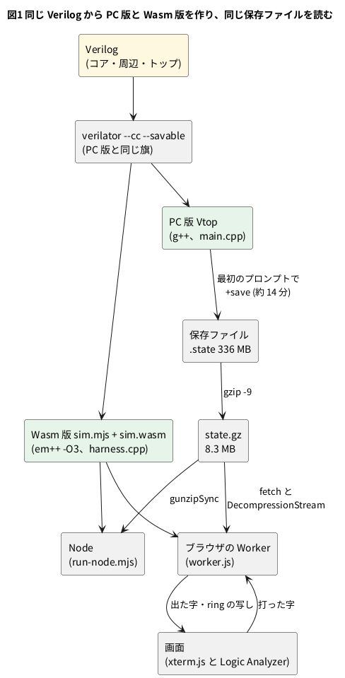

# 13-8 Wasm で回す — PC の約 0.9 倍の速さ

この題は実体配線図と Analog Discovery 3 とオシロの図を付けない。PC とブラウザの中で動く題で、組む物が無いから。

13-6 で起動済みの模型を保存し、13-7 でそれを 8.3 MB にした。残るのは、ブラウザの中で読み戻して回すことである。
4-1 で見たとおり、soft-fpga は Verilator が出した C++ を Emscripten で WebAssembly (Wasm) にしてブラウザで回す。
カウンタや 8080 では数千行だった C++ が、ここでは RV64GC のコアと 256 MiB の主記憶になる。それでも同じ手順で通るか、どれだけ遅くなるかを確かめる。

この題では、

1. PC 版と同じ Verilog・同じ旗で Verilate し、`em++` で Wasm にする
2. PC で保存した状態を、Wasm の模型でそのまま読み戻す
3. 同じ 2 行 (`ls /` と `cat /proc/cpuinfo`) を PC と Wasm で打ち、出力と速さを比べる
4. ブラウザでは Worker で回し、合間に打鍵を受ける

をする。Wasm は遅いと見込んで、始めは PC の 1/1.5〜1/2 と見積もっていた。測ると約 0.9 倍だった。

## 作り




### ビルド

`make wasm` がすることは 2 つである。

1. PC 版と同じソース・同じ旗で `verilator --cc` を回す (`--savable` も付ける)。実行ファイルは作らず、C++ を出すだけ
2. `sim/wasm/build.sh` が、出た C++ と Verilator のランタイムと `harness.cpp` を `em++ -O3` でコンパイルしてつなぐ

4-1 の soft-fpga と違うのは、メモリと保存の 2 か所だけである。

| 所 | この模型での書き方 | 理由 |
| --- | --- | --- |
| メモリ | `INITIAL_MEMORY=536870912` (512 MiB)、`ALLOW_MEMORY_GROWTH=1`、`MAXIMUM_MEMORY=2147483648` | 主記憶の配列が 256 MiB、SD カードの像が 64 MiB ある。初めから 512 MiB 取る |
| 保存 | Verilator の `verilated_save.cpp` も一緒にコンパイルする | 読み戻しに要る |
| ランタイム | `verilated.cpp` に `wasm_compat.h` を `-include` し、`verilatedos_c.h` を差し替える | スレッドと波形の口を外す (soft-fpga と同じ。5-13 が Pico 2 でやるのと同じ種類の仕事) |
| 口 | `EXPORTED_FUNCTIONS` に `_sim_restore` `_sim_run` `_sim_send` など | JS から呼ぶ関数 |
| 出し方 | `MODULARIZE=1`、`EXPORT_ES6=1`、`ENVIRONMENT=node,web,worker` | 同じ `sim.mjs` を Node でも Worker でも読む |

- `verilated.cpp` は、いったん別の場所へ写してからコンパイルする。末尾の `#include "verilatedos_c.h"` は引用符なので、
  同じ場所にある本物が先に見つかり、Wasm に無い `pthread_getaffinity_np` を呼んでしまうためである。写した先に差し替えのヘッダを並べる
- できた物は `sim.wasm` が 1,080,480 バイト、`sim.mjs` が 63,191 バイト。PC 版の実行ファイル (1,826,552 バイト) より小さい
- メモリは伸びなかった。2 行を打ち終えた後も、Wasm のヒープは 512 MiB のままだった

### JS から見た口

`harness.cpp` は、PC 版の `main.cpp` と同じく、模型をトップのポートだけで触る。違いは、自分では回り続けないことである。
JS が「あと何クロック」と頼み、その分だけ回って返る。

| 関数 | すること |
| --- | --- |
| `sim_restore()` | `Module.stateBytes` に置かれた保存データから読み戻す。0 なら成功 |
| `sim_run(n)` | 最大 n クロック回す。止める合図 (`stop_code`) が変わったらそこで返す。返り値は `stop_code` |
| `sim_send(ch)` | UART に渡す字を 1 つ足す。受信の FIFO (13-5) が空き次第、模型に入る |
| `sim_out_ptr()` `sim_out_len()` `sim_out_clear()` | UART から出た字のたまり場を読む・捨てる |
| `sim_cycle()` | 模型のクロック数 |
| `get_ring_ptr()` ほか | Logic Analyzer の ring と制御 (13-9 から) |

起動の口は無い。Wasm 版は読み戻しからしか始められない。起動から回すと、13-2 の約 14 分より長くかかるからである。

### 336 MB を 256 KB ずつ読む

Verilator の読み戻し (`VerilatedRestore`) はファイルから読む。ブラウザにはファイルが無いので、同じ親 (`VerilatedDeserialize`) を継いだ `JsRestore` を書き、
バッファが空くたびに JS の配列から続きを写すようにした。

```cpp
// sim/wasm/harness.cpp (soft-fpga-riscv-linux、Apache-2.0) から
// Module.stateBytes の続きを dst に最大 max バイト写し、写した数を返す (尽きたら 0)
EM_JS(int, js_state_read, (uint8_t* dst, int max), {
    const src = Module.stateBytes;
    const off = Module.stateOffset || 0;
    const n = Math.min(max, src.length - off);
    HEAPU8.set(src.subarray(off, off + n), dst);
    Module.stateOffset = off + n;
    return n;
});
```

- Verilator のバッファは 256 KB (`verilated_save.h` の `bufferSize()`)。336 MB は JS の側の `Uint8Array` に置いたまま、256 KB ずつ Wasm のメモリへ写る
- こうしないと、保存データを Wasm のヒープに丸ごと写すことになり、読み戻しのあいだだけ 512 MiB のヒープに 336 MB が余分に要る
- 読み終えたら JS が `sim.stateBytes = null` として手放す
- ファイルシステム (Emscripten の MEMFS) は使わない。Node でもブラウザでも同じ道を通る

PC で保存した状態を、32 ビットの Wasm でそのまま読めた。保存の中身が、幅の決まった値 (`uint64_t` や模型の変数) を順に並べただけで、
ポインタや `size_t` を含まないからである。Verilator の版と模型 (Verilog) が同じであることは要る (13-6)。

### ブラウザでは Worker で回す

模型を画面と同じスレッドで回すと、回しているあいだ画面が固まる (4-9)。`worker.js` は Worker の中で次を繰り返す。

1. 30 ms のあいだ、`sim_run(2000)` を呼び続ける (`SLICE_MS` と `RUN_CYCLES`)
2. たまった字を画面へ送る。Logic Analyzer の ring の写しも送る (動いている間は 100 ms ごと)
3. `setTimeout(slice, 0)` で 1 度手を離す。この合間に、打鍵と Logic Analyzer の制御のメッセージを受け取る

- 1 秒に約 30 万クロック (13-1) なら、30 ms で約 9,000 クロック進む。打った字は長くても 30 ms 待って模型に渡る
- 保存した時点のプロンプト (`#` と空白) は、保存の前に出し終えているので、読み戻した模型からは出ない。ページが先に画面へ書いておく
- ash はプロンプトのたびに端末へカーソルの位置を問い合わせ (`ESC[6n`)、xterm.js は答え (`ESC[行;桁R`) を返す。ページはこの答えを模型に渡さない。
  渡すと、その後しばらく打った字が捨てられ、最初の 1 行が消えた。答えが無くても ash は動く
- `sim.HEAPU8` は使うたびに読み直す。メモリが伸びると古いビューが切れるからである (4-10)。この模型では伸びなかったが、書き方は同じにしてある

## 手順

soft-fpga-riscv-linux を取ってきて、13-6 の手順で保存ファイルを作っておく。Wasm 版には [emsdk](https://emscripten.org/docs/getting_started/downloads.html) (`em++`) と Node.js が要る。

```bash
make wasm                        # build/mmrisc2/wasm/sim.mjs と sim.wasm
make wasm-restore LINES="'ls /' 'cat /proc/cpuinfo'"   # 保存した所から Node で回す
make web-serve                   # ブラウザ版を http://localhost:8059/ で配る
```

PC 版と比べるには、この題の `sim/08-speed.sh` を使う。PC 版と Wasm 版に同じ 2 行を打ち、出た字と速さを並べる。

```bash
sh sim/08-speed.sh soft-fpga-riscv-linux 3
```

```text
pc: stop_code=1, cycle 338812576, 4484130 cycles in 11.7 s, 382045 cycles/s, 573 chars
wasm: gunzip 0.38 s, restore 0.63 s, stop cycle 338792576, 4464130 cycles in 13.0 s, 343488 cycles/s, 587 chars, sha256 7a4310c55273a1d7, heap 512 MiB
output: same (573 chars without CR)
wasm la-off: gunzip 0.37 s, restore 0.65 s, stop cycle 338792576, 4464130 cycles in 13.1 s, 340784 cycles/s, 587 chars, sha256 7a4310c55273a1d7, heap 512 MiB
```

(3 回のうちの 1 回目。`wasm la-off` は Logic Analyzer の記録を止めた回)

## 読めること

### 出力は同じ

PC 版と Wasm 版で、出た字は 1 字も違わなかった (行末の CR を除いて 573 字)。`ls /` の一覧も、`cat /proc/cpuinfo` の `isa` の長い行も同じである。
Wasm 版の出力は、何回回しても SHA-256 が同じだった。模型は計算だけでできていて、PC の時計や乱数を見ないからである。

### 止まるクロックが 20,000 違う

| | 止まったクロック | 読み戻してから |
| --- | --- | --- |
| PC 版 | 338,812,576 | 4,484,130 |
| Wasm 版 | 338,792,576 | 4,464,130 |

差はちょうど 20,000 で、模型の動きの違いではない。PC 版の `main.cpp` は、最後のプロンプトを見た後に 20,000 クロック余分に回す (`kTailCycles`。行の残りを出し切るため)。
Wasm 版の `run-node.mjs` は、最後のプロンプトを見た所で止める。プロンプトを見たクロックはどちらも 338,792,576 である。

### 速さは PC の約 0.9 倍

同じ PC (Intel Core Ultra 9 285K、WSL2、Node 24) で 5 回ずつ回した。

| 版 | 速さ [クロック/秒] (5 回) | 平均 | PC との比 |
| --- | --- | --- | --- |
| PC (g++) | 382,045・384,320・382,695・378,044・384,252 | 約 382,000 | 1 |
| Wasm (Node) | 343,488・345,875・339,534・341,283・343,477 | 約 343,000 | 0.90 |
| Wasm、Logic Analyzer の記録を止めた | 340,784・345,669・345,188・343,119・347,941 | 約 345,000 | 0.90 |

- ばらつきは PC で ±1 %、Wasm で ±1 % ほど。比の 0.90 は、この幅より十分大きい差である
- 記録を止めても速さは変わらなかった (差はばらつきの中)。止まるのは ring へ書く所だけで、毎クロック 17 語に詰める所は残るからである。
  PC 版はこの詰める仕事をしていないので、0.90 の中にはその分も入っている (分けて測ってはいない)
- 見込み (1/1.5〜1/2) より速かった理由は調べていない。この模型の 1 クロックは、ほとんどが 64 ビットの整数の計算と配列の読み書きで、
  Wasm が苦手とする物 (例外・多くのスレッド・ファイル) を含まない、とは言える
- ブラウザ (Chromium) では 292〜318 k クロック/秒だった (13-1 で測った値)。Node の約 0.9 倍、PC の約 0.8 倍である。30 ms ごとに手を離して字と ring の写しを送る分と見ている (分けて測ってはいない)

実物のボード (50 MHz) と比べると、PC でも約 1/130、ブラウザで約 1/160 の速さである。

### ls は何クロックか

Node の Wasm 版で `ls` の 1 行だけを打つと、行を渡してから次のプロンプトまで 1,576,084 クロックだった。

| 所 | かかる時間 | 種類 |
| --- | --- | --- |
| 実物のボード (50 MHz) | 31.5 ms | 計算値 |
| Node の Wasm 版 | 4.6 秒 | 動かして確かめた |
| ブラウザ | `ls /` で 8.7〜9.7 秒 | 13-1 で測った (行の字を 1 字ずつ受け取る時間を含む。クロック数は 250 万〜318 万) |

`ls` の 1 回で、シェルは子のプロセスを作り (fork)、`/bin/ls` (BusyBox) を読み込み (exec)、ディレクトリを読んで字を出す。
その 150 万クロックの中で何が起きているかは、13-10 で Logic Analyzer を使って見る。

## 見るべき値

soft-fpga-riscv-linux の fd1efd5 (mmRISC-2 は Rev.02-4-gc9587f7) を Verilator 5.042 と Emscripten 5.0.7 の `em++` でビルドし、
保存ファイル `mmrisc2-67c16bf6.state` (保存したクロックは 334,328,446) から回した (2026-11-11)。

| 見る所 | 値 | 種類 |
| --- | --- | --- |
| `sim.wasm` と `sim.mjs` の大きさ | 1,080,480 バイト・63,191 バイト | 動かして確かめた |
| Wasm のヒープ | 512 MiB (伸びない) | 動かして確かめた |
| `state.gz` を解く・読み戻す (Node) | 0.4 秒・0.6 秒 | 動かして確かめた |
| PC 版の読み戻し | 0.7〜0.8 秒 | 動かして確かめた |
| 2 行を打ち終えるまで | PC 11.7 秒 (4,484,130 クロック)、Wasm 13.0 秒 (4,464,130 クロック) | 動かして確かめた |
| 止まったクロックの差 | 20,000 (PC 版が後ろに回す分) | 動かして確かめた |
| 出た字 | PC と Wasm で同じ (573 字) | 動かして確かめた |
| 速さ | PC 約 382,000、Wasm (Node) 約 343,000 クロック/秒 (0.90 倍) | 動かして確かめた |
| ブラウザでの速さ | 292〜318 k クロック/秒 (PC の約 0.8 倍) | 13-1 でブラウザで測った |
| `ls` の 1 行 | 1,576,084 クロック (50 MHz なら 31.5 ms、Node で 4.6 秒) | 動かして確かめた・計算値 |
| Worker の 1 回 | 30 ms で約 9,000 クロック | 計算値 |

## シミュレーションでの確かめ (対象外を含む)

`sim/08-speed.sh` を 5 回ぶん回し (3 回と、1 回を 2 度)、`ls` の 1 行は `sim/08-wasm-speed.mjs` に行を渡して回した (2026-11-11)。

| 項目 | 本文の数字 | 実行結果 | 判定 |
| --- | --- | --- | --- |
| PC と Wasm の出力 | 同じ (573 字) | `cmp` で一致。Wasm の SHA-256 は 12 回とも同じ | 合った |
| 止まったクロック | 338,812,576 と 338,792,576 | 毎回同じ | 合った |
| 差の 20,000 | `kTailCycles` | `sim/main.cpp` の `kTailCycles = 20000` と、`run-node.mjs` が最後のプロンプトで抜けることをソースで確かめた | 合った |
| 速さの比 | 0.90 | 343,000 ÷ 382,000 = 0.90 | 合った (計算) |
| 記録を止めても同じ | 約 345,000 | 5 回の平均 344,540。記録ありは 342,731 | 合った (差 0.5 %、ばらつきの中) |
| ボードとの比 | 約 1/130・約 1/160 | 50 × 10⁶ ÷ 382,000 = 131、50 × 10⁶ ÷ 310,000 = 161 | 合った (計算) |
| `ls` の時間 | 31.5 ms | 1,576,084 ÷ (50 × 10⁶) = 31.5 ms | 合った (計算) |
| Worker の 1 回 | 約 9,000 クロック | 300,000 × 0.03 = 9,000 | 合った (計算) |
| バッファ 256 KB | `bufferSize()` | Verilator 5.042 の `verilated_save.h` で `256 * 1024L` | 合った |
| ブラウザでの速さと `ls /` の時間 | 292〜318 k クロック/秒、8.7〜9.7 秒 | 13-1 の値を引いた。この題では測っていない | 対象外 |
| カーソルの位置の答えを渡すと最初の行が消える | 渡さない作りにしてある | 2026-10-30 に同じ作りの模型で確かめた事。今日は試していない | 対象外 |

## 出典

- 自作。`harness.cpp`・`build.sh`・`run-node.mjs`・`worker.js` は [tommie-jp/soft-fpga-riscv-linux](https://github.com/tommie-jp/soft-fpga-riscv-linux) (Apache-2.0)。
  ブラウザ版は [公開ページ](https://tommie-jp.github.io/soft-fpga-riscv-linux/)
- Wasm にする手順と `wasm_compat.h`・`verilatedos_c.h`・`rtlscope_ring.h`: [tommie-jp/soft-fpga](https://github.com/tommie-jp/soft-fpga) (MIT) から写した物
- コア: [mmRISC-2](https://github.com/munetomo-maruyama/mmRISC-2) (Munetomo Maruyama、Apache-2.0)。保存した状態には、そこに入っている Linux (GPL-2.0)・OpenSBI (BSD-2-Clause) と、
  Debian の BusyBox (GPL-2.0) が入る
- 保存と読み戻しの口: Verilator の説明書の [Save/Restore](https://verilator.org/guide/latest/checkpoint.html)
- Emscripten の設定 (`INITIAL_MEMORY` `ALLOW_MEMORY_GROWTH` `MODULARIZE` など): [Emscripten の Settings Reference](https://emscripten.org/docs/tools_reference/settings_reference.html)。
  C++ から JS を呼ぶ `EM_JS`: [Interacting with code](https://emscripten.org/docs/porting/connecting_cpp_and_javascript/Interacting-with-code.html)
