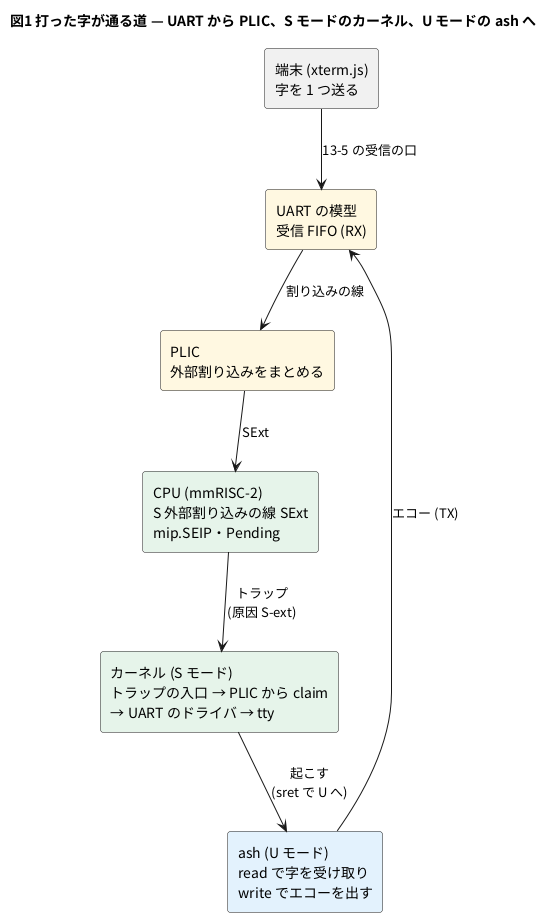

# 13-9 打鍵から割り込みまでを波形で見る

この題は実体配線図と Analog Discovery 3 とオシロの図を付けない。ブラウザと PC の中で動く組まない題で、組む物が無いから。

> [!NOTE]
> この題の数は、公開リポジトリの Wasm の模型を Node で回して取った (2026-11-11、`sim/09-key-to-irq.mjs`)。
> ブラウザの画面での手順は 2026-10-30 に公開ページで確かめた物で、今日は開き直していない。実物の FPGA のボードでは動かしていない。

13-1 のページで字を 1 つ打つと、しばらくして画面にその字が出る。その間に CPU の中で起きることを、この題で順に追う。

11-10 では、自作の 8 ビット CPU に割り込みを足し、線が上がったら決まった番地へ飛ぶ所を見た。
Linux の動く CPU でも骨組みは同じだが、間に挟まる物が増える。

- UART は割り込みの線を CPU に直につながず、**PLIC** (Platform-Level Interrupt Controller、外部割り込みをまとめる回路) に渡す
- CPU には特権モードが 3 つある。**M** (OpenSBI)、**S** (カーネル)、**U** (ユーザーのプログラム)。UART の割り込みは S モードのカーネルが受ける
- カーネルは割り込みを受けない区間を持つ。`sstatus` の **SIE** のビットが 0 の間、S モードは割り込みでトラップに入らない
- 字を待っているシェル (ash) は U モードのプログラムで、寝ている。カーネルが起こして、はじめて字を読む

この題では、

1. 字が UART の受信 FIFO に入ってから、割り込みのトラップに入るまでのクロックを数える
2. その間にある「`wfi` から起きる」「SIE が上がる」の 2 段を波形で見る
3. トラップの後、カーネルが PLIC から割り込みを受け取り、ash を起こし、字がエコーで戻るまでを表にする

をする。

## 打った字が通る道




- UART の受信の口は 13-5 で足した物。字は模型の `uart_rx_valid` と `uart_rx_data` から受信 FIFO に入る
- `mip` は「待っている割り込み」のレジスタで、SEIP (ビット 9) が S 外部割り込み。`mie` で許された割り込みが待っていると **Pending** が 1 になる
- Logic Analyzer (4-2) の信号は、模型のトップのポート `obs_*` を 1 クロックに 1 サンプル記録した物。この題で使う信号は次の表

| 信号 (画面の名前) | 意味 |
| --- | --- |
| `RX` | 打った字が UART の受信 FIFO に入った (1 クロック) |
| `SExt` | PLIC から CPU への S 外部割り込みの線 |
| `Pending` | 許された割り込みが待っている。`wfi` から起きる条件 |
| `SIE` | `mstatus` の SIE。1 の間、S モードは割り込みを受ける |
| `Trap`・`Cause` | トラップに入ったクロックと、その原因 (`S-ext`・`ecall-U` など) |
| `Retire`・`PC`・`Insn`・`Priv` | 命令が 1 つ退役したクロックと、その番地・命令・特権 |
| `Claim` | カーネルが PLIC から割り込みを受け取った (claim) |
| `TX`・`Char` | UART が 1 字送ったクロックと、その字 |

## 手順

### ブラウザで見る

1. 公開ページ <https://tommie-jp.github.io/soft-fpga-riscv-linux/mmrisc2/> を開き、プロンプト `#` が出るまで待つ (13-1)
2. 「CPU の中 (Logic Analyzer)」の「⚙ Trigger ▾」を開き、プリセットから「打鍵 / Key press」を選ぶ。欄に信号 `RX`、条件「↑ 立ち上がり」、post `6000` が入る。**Set** を押す (トリガーの使い方は 12-10 と同じ)
3. 端末をクリックして `l` を 1 つ打つ。字が入ったクロックで発火し、その後 6000 サンプルを記録して止まる
4. 赤い縦線 (発火の位置) の右を拡大し、`SExt` `Pending` `SIE` `Trap` `Cause` の行を見る。`Trap` のパルスの所で `Cause` が `S-ext` になる
5. 下の「トラップの記録」の `S-ext` の行を押すと、マーカー A がそこに置かれる。T の欄が発火からのサンプル数
6. 再開は「▶ Thaw」。やめるときは「Clear」

### PC で数える

公開リポジトリを取ってきて Wasm の模型と保存ファイルを作り (13-6・13-8)、この題のスクリプトに場所を渡す。

```bash
git clone --recurse-submodules https://github.com/tommie-jp/soft-fpga-riscv-linux.git
cd soft-fpga-riscv-linux
make rootfs && make linux-sd-save < /dev/null && make state-gz && make wasm   # 起動して保存 (PC で約 14 分)
node <教科書>/06-fpga/13-linux/sim/09-key-to-irq.mjs .
```

スクリプトは、保存した所から 300 万クロック空回しして CPU を寝かせ、`l` を 1 つ送る。
ring (4-8) には直近 16384 サンプルしか残らないので、8000 クロックずつ回しては新しいサンプルを読む (`sim/09-trace-lib.mjs`)。
字が入ったクロックを T = 0 として、事象が最初に起きた T を出す。

```text
state mmrisc2-67c16bf6.state.gz restored at cycle 334328446
idle 3000000 clocks: 46969 retired, wfi 6, traps {"S-ext":3,"ecall-U":4,"S-timer":6}
T=     0  RX  char "l"  (retired 0)
T=     1  SExt rises  (retired 0)
T=     1  Pending rises  (retired 0)
T=     5  first retire  805d3ab0 wfi  (retired 1)
T=   131  SIE rises  (retired 85)
T=   134  Trap S-ext  to S, epc 805d583e  (retired 86)
T=   880  PLIC claim  (retired 459)
T=   881  SExt falls  (retired 459)
T=  8288  first sret  (retired 3488)
T= 32210  first U-mode retire  pc 805df006  (retired 13509)
T= 32540  Trap ecall-U  to S, epc b5922  (retired 13550)
T= 43608  TX (echo)  char "l"  (retired 17993)
T= 64818  last retire before the kernel sleeps in wfi again  (retired 27733)
T=337060  wfi retires again (woken by the next interrupt)  (retired 27733)
T<=6000: 2493 retired, DTLB-miss clocks 224, memory reads 32
until the next wake: {"traps":{"S-ext":4,"ecall-U":3},"sret":7,"sretToU":3,"dtlb":1429,"memRd":214,"retiredU":515,"retiredS":27218,"retiredM":0}
```

## 読めること

### トラップまでの 134 クロック

トラップまでを図にする。図は 1 クロックを 1 µs (マイクロ秒) と置いた仮の目盛である (模型のクロックは 50 MHz で、本当の 1 クロックは 20 ns)。
`wfi` は、`wfi` の命令が退役したクロックに 1 クロックのパルスを置いた、図のための行 (画面では `Retire` と `Insn` の行で読む)。

```logic
# ロジックアナライザの画面 (tommie-fence の logic フェンス)
title: 図2 字が入ってから 134 クロックでトラップ — wfi から起き、SIE が上がるのを待つ
device: generic
window: 150us
start: -15us
signals:
  RX: dio0 pulse 0 1us
  SExt: dio1 edges -15us=0 1us=1
  Pending: dio2 edges -15us=0 1us=1
  wfi: dio3 pulse 5us 1us
  SIE: dio4 edges -15us=0 131us=1 135us=0
  Trap: dio5 pulse 134us 1us
cursors: [0us, 134us]
trigger: RX rising at 0us
```


| T [クロック] | 起きたこと |
| --- | --- |
| 0 (X1) | `l` が UART の受信 FIFO に入る。CPU は S モードで `wfi` (割り込み待ち) に入って止まっている |
| 1 | PLIC が S 外部割り込みの線 `SExt` を上げる。`mip` が `0200` (SEIP) になり、`Pending` が 1 |
| 5 | `wfi` が退役する。CPU が起きて、次の命令から進み始める |
| 5〜131 | カーネルが 85 命令を退役する。この間 `SIE` は 0 で、割り込みは待ったまま |
| 131 | `csrsi sstatus,2` が退役し、`SIE` が 1 になる |
| 134 (X2) | トラップに入る。原因は `S-ext`、行き先は S モード。戻り先 (`EPC`) は `csrsi` の次の命令 |
| 135 | トラップに入ったので `SIE` が 0 に戻る (トラップの中は割り込みを受けない) |

- `wfi` から起きるのに SIE は要らない。RISC-V の決まりでは、`wfi` は許された割り込みが待っていれば (`Pending`)、全体の許可 (SIE) が 0 でも先へ進む。Linux は割り込みを止めたまま `wfi` で寝て、起きてから許可を出す
- だから「割り込みの線が上がる」と「トラップに入る」の間は 133 クロック空く。11-10 の小さな CPU では、線が上がった次の命令の切れ目で飛んだ。ここでは、飛ぶ時を決めているのはカーネルの `csrsi` である
- `SIE` が上がってからトラップまでは 3 クロック。この 3 クロックがパイプラインのどの段かは確かめていない
- 134 という数は、寝ていた所から起きる時の物。カーネルが動いている最中に字が入れば、SIE が 1 の区間ならもっと早く、0 の区間ならそれが終わるまで待つ (この題では測っていない)

### トラップの後 — エコーまで 4 万クロック

| T [クロック] | 起きたこと | 模型の時間 (50 MHz) |
| --- | --- | --- |
| 134 | S 外部割り込みのトラップ (カーネルの入口へ) | 2.7 µs |
| 880 | カーネルが PLIC から claim する。次のクロックで `SExt`・`Pending` が下がる | 17.6 µs |
| 8 288 | 最初の `sret`。割り込まれたのはカーネル自身 (寝ていた所) なので、戻り先も S モード | 0.17 ms |
| 32 210 | `sret` で U モードへ。ash が動き始める | 0.64 ms |
| 32 540 | ash の最初の `ecall` (トラップの原因 `ecall-U`)。ここから 13-10 の話 | 0.65 ms |
| 43 608 | UART が `l` を送る (エコー) | 0.87 ms |
| 64 818 | 最後の命令が退役し、カーネルがまた `wfi` で寝る | 1.30 ms |

- 字 1 つで、寝るまでに 27 732 命令が退役した。U モード (ash) は 515 命令で、残りの 27 217 命令 (98%) はカーネル
- トラップは 7 回。`S-ext` が 4 回、`ecall-U` が 3 回。`sret` は 7 回で、そのうち U モードへ戻ったのは 3 回
- `S-ext` の 2〜4 回目 (T = 14 870・41 731・47 668) は、字の受信の後に UART が出した割り込みである。送信側の割り込みと見ているが、UART のレジスタは確かめていない
- プリセット「打鍵」の post は 6000。T = 6000 までに退役するのは 2 493 命令で、DTLB ミス (ページ表を引いている間) が 224 クロック、主記憶への読みが 32 回。ash が動き出す所 (T = 32 210) は 6000 の外なので、そこを見るなら 13-10 のプリセット「U モード」を使う
- ブラウザは 1 秒に約 30 万クロック回す (13-8)。打ってからエコーまでの 43 608 クロックは約 0.15 秒 (計算値)。実物のボード (50 MHz) なら 0.87 ms

## 見るべき値

公開リポジトリの fd1efd5 (mmRISC-2 は Rev.02-4-gc9587f7) の Wasm の模型を Node 24 で回し、保存ファイル `mmrisc2-67c16bf6.state.gz` から始めた (2026-11-11)。

| 見る所 | 値 | 種類 |
| --- | --- | --- |
| 字が入ってから `SExt`・`Pending` が上がるまで | 1 クロック | 動かして確かめた |
| `wfi` が退役するまで | 5 クロック | 動かして確かめた |
| `SIE` が上がるまで | 131 クロック (その間に 85 命令) | 動かして確かめた |
| トラップ (`S-ext`、S モードへ) に入るまで | 134 クロック | 動かして確かめた |
| PLIC の claim | 880 クロック。881 で `SExt` が下がる | 動かして確かめた |
| ash が U モードで動き始める | 32 210 クロック | 動かして確かめた |
| エコーの `l` が UART から出る | 43 608 クロック | 動かして確かめた |
| カーネルがまた `wfi` で寝る | 64 818 クロック、退役 27 732 命令 (U モードは 515) | 動かして確かめた |
| 模型の時間でのトラップまで・エコーまで | 2.7 µs・0.87 ms | 計算値 (50 MHz) |
| ブラウザでのエコーまで | 約 0.15 秒 | 計算値 (1 秒に 30 万クロック) |
| 空回しの 300 万クロック | `S-timer` のトラップ 6 回 (50 万クロックに 1 回 = HZ 100) | 動かして確かめた |
| ブラウザのプリセット「打鍵」で `ls` を打つ | 打鍵の 133〜139 サンプル後に `S-ext` のトラップ | 2026-10-30 にブラウザで確かめた |

- 同じ保存ファイルから同じ手順で回すと、出力は毎回同じになる (2 回回して一致)。ブラウザでは字を打つ時が毎回違うので、タイマーの刻みとの位置がずれ、T = 134 より後の数は変わる
- 空回しの間の `S-ext` 3 回と `ecall-U` 4 回は、保存した直後の ash がプロンプトを出し終える分

## シミュレーションでの確かめ

`sim/09-key-to-irq.mjs` を、公開リポジトリの fd1efd5 を `make wasm` した模型で回した (Node 24.14、2026-11-11)。

| 項目 | 本文の数字 | 実行結果 | 判定 |
| --- | --- | --- | --- |
| 図2 と表の T (0・1・5・131・134・135) | 左のとおり | 同じ | 合った |
| トラップの後の表の T | 880・8 288・32 210・32 540・43 608・64 818 | 同じ | 合った |
| 退役した命令と内訳 | 27 732 (U 515、S 27 217) | `retiredU` 515 + `retiredS` 27 218 から、起きた後の `wfi` 1 つを引く | 合った |
| トラップと `sret` の回数 | `S-ext` 4・`ecall-U` 3・`sret` 7 (U へ 3) | 同じ | 合った |
| T = 6000 まで | 2 493 命令、DTLB ミス 224 クロック、主記憶の読み 32 回 | 同じ | 合った |
| タイマーの刻み | 300 万クロックに `S-timer` 6 回 | 同じ。3 000 000 ÷ 6 = 500 000 クロック = 10 ms | 合った (計算) |
| 模型の時間 | 134 × 20 ns = 2.7 µs、43 608 × 20 ns = 0.87 ms | 計算 | 合った (計算) |
| 図2 の読み値 | X1 = 0、X2 = 134 µs (仮の目盛)、ΔX = 134 µs | `npm run check` の読み値と同じ | 合った |
| ブラウザでの手順 (プリセット・Set・トラップの記録) | 手順のとおり | ブラウザが要る。2026-10-30 の確かめを引いた | 対象外 |
| SIE からトラップまでの 3 クロックの中身 | 確かめていない | RTL の中を追っていない | 対象外 |

## 出典

自作。

- 道具・ページ・ハーネス (`sim/wasm/harness.cpp`)・信号の定義 (`web/la-defs.js`): [tommie-jp/soft-fpga-riscv-linux](https://github.com/tommie-jp/soft-fpga-riscv-linux) (Apache-2.0)。公開ページは <https://tommie-jp.github.io/soft-fpga-riscv-linux/>
- Logic Analyzer の画面と ring: [tommie-jp/soft-fpga](https://github.com/tommie-jp/soft-fpga) (MIT) の rtlscope
- CPU の RTL: [mmRISC-2](https://github.com/munetomo-maruyama/mmRISC-2) (Munetomo Maruyama、Apache-2.0)。動いている Linux カーネルは GPL-2.0、OpenSBI は BSD-2-Clause、BusyBox は GPL-2.0
- `wfi`・`sstatus` の SIE・`mip` の決まり: [The RISC-V Instruction Set Manual, Volume II: Privileged Architecture](https://github.com/riscv/riscv-isa-manual)
- PLIC の claim: [RISC-V Platform-Level Interrupt Controller Specification](https://github.com/riscv/riscv-plic-spec)
