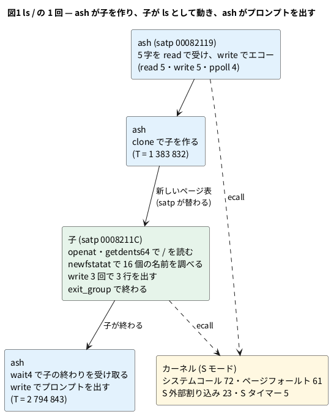

# 13-10 ls が U モードで動く所を見る — システムコールと sret

この題は実体配線図と Analog Discovery 3 とオシロの図を付けない。ブラウザと PC の中で動く組まない題で、組む物が無いから。

> [!NOTE]
> この題の数は、公開リポジトリの Wasm の模型を Node で回して取った (2026-11-11、`sim/10-ls-privilege.mjs`)。
> ブラウザの画面での手順は 2026-10-30 に公開ページで確かめた物で、今日は開き直していない。実物の FPGA のボードでは動かしていない。

13-9 では、打った字が割り込みでカーネルに届き、ash が U モードで動き始める所まで見た。
この題はその先で、`ls /` と打って Enter を押してから、一覧が出てプロンプトが戻るまでを見る。

`ls` はユーザーのプログラムで、U モードで動く。U モードのプログラムは、ディスクも画面も直には触れない。
ディレクトリを読むのも字を出すのも、**システムコール**でカーネルに頼む。RISC-V では次の決まりになっている。

- プログラムは、頼む仕事の番号をレジスタ `a7` に、引数を `a0`〜`a5` に置いて、`ecall` の命令を実行する
- `ecall` は退役せず、トラップになる (原因は `ecall-U`)。CPU は S モードに替わり、カーネルの入口へ飛ぶ
- カーネルは仕事を済ませ、答えを `a0` に置いて、`sret` の命令で U モードへ戻る。プログラムは `ecall` の次の命令から続く

11-9 の CP/M では、プログラムは `CALL 0005h` で BDOS を呼んだ。あれはただのサブルーチンの呼び出しで、プログラムも OS も同じ権限で動いた。
ここでは、行きは必ずトラップ、帰りは必ず `sret` で、そのたびに特権が替わる。

この題では、

1. `ls /` の 1 回で、命令が U モードと S モードでいくつ退役するかを数える
2. システムコールを 1 つずつ拾い、どのプロセスが何を頼んだかを順に並べる
3. いちばん短いシステムコール (`getpid`) の 1 往復を、クロックの単位で図にする
4. ring に入り切らない長い出来事を、トリガーと「事象のあるクロックだけ」で見る手順を決める

をする。

## 2 つのプロセスと 72 回のシステムコール




- T は、最初の字 `l` が UART に入ったクロックからの数。Node のスクリプトは `ls /` と改行の 5 字をまとめて送る
- `satp` はページ表の根を指すレジスタで、プロセスごとに違う。Logic Analyzer の `satp` の行が替わった所が、動くプロセスの替わった所である
- **`execve` は 1 度も出なかった**。普通のシェルは、子を作ってから `execve` で別のプログラムに入れ替える。ここの `ls` は BusyBox の中の機能 (アプレット) で、ash は子の中からそれをそのまま呼んでいると見ている (BusyBox の設定とソースは確かめていない)
- OpenSBI (M モード) へのトラップは 0 回だった。タイマーも S モードのカーネルが直に受ける (CPU に Sstc の拡張があるため)

## 手順

### ブラウザで見る

公開ページ <https://tommie-jp.github.io/soft-fpga-riscv-linux/mmrisc2/> を開き、プロンプトが出てから始める (13-1)。トリガーの使い方は 12-10、信号の名前は 13-9 の表。

1. **U モードに入る所**: 「⚙ Trigger ▾」のプリセットから「U モード / U-mode」を選ぶ。欄に信号 `Priv`、条件 `==`、value `0`、post `4000` が入る。**Set** を押し、端末で字を 1 つ打つ。ash が U モードで動き始めた所で発火する。`Priv` の行が `S` から `U` に替わり、`PC` が小さい番地 (ユーザーのプログラム) になる
2. **システムコール**: プリセット「システムコール / System call」(`Cause` `==` `08`、post `6000`) を Set して字を打つ。`ecall-U` のトラップで発火する。発火の直前の `Asm` の行に、`a7` へ番号を入れる命令が見える
3. **U へ戻る所**: プリセット「sret (U へ戻る) / sret」(`Insn` `==` `10200073`、post `4000`) を Set する。`sret` が退役したクロックで発火する
4. **長く見る**: 「記録」を「事象のあるクロックだけ」に替えてから、上のどれかを Set する。同じ 16384 サンプルに、約 3 倍のクロックが入る (下の「読めること」)。サンプルの間のクロック数は、`Clock` の行 (Clock の組を開いて表示する) で読む

- `sret` は割り込みからカーネルへ戻る時にも使う。プリセット「sret」で止まった所の `Priv` が `S` のままなら、それは U へ戻る `sret` ではない (下の表で 160 回のうち 28 回)
- `ecall` は退役しないので、`Insn` の値を条件にしても止まらない。だからプリセット「システムコール」は `Cause` を見ている
- `ls` の全体 (約 280 万クロック) は ring に入らない。見たい所の近くで発火する条件を選ぶ。`ls` の子が動き出す所なら、`ls /` と打ってから「U モード」を Set し直すより、`satp` の値の変わり目を目で探す方が早い

### PC で数える

用意は 13-9 と同じ。

```bash
node <教科書>/06-fpga/13-linux/sim/10-ls-privilege.mjs <soft-fpga-riscv-linux の場所> --zoom getpid
```

スクリプトは ring のサンプルを全部読み (13-9 の `sim/09-trace-lib.mjs`)、退役・トラップ・`sret`・`satp` を数える。
システムコールの番号は、`ecall` のトラップの時点の `a7` である。`a7` の値そのものは ring に無いので、
書き戻しの記録 (退役した命令が書いたレジスタと値。13-11) を始めから追って求める。`-v` を付けると 72 回を 1 行ずつ出す。

```text
--- zoom getpid: T=0 is the ecall trap (ls T=1787411), a7=172
  t=0  trap ecall-U to S epc 10634 | retire #1 10630 li a7,172 [U]
  t=1  SIE=0
  t=22  retire #2 805dee18 csrrw tp,sscratch,tp [S]
  t=26  retire #3 805dee1c bnez tp,0x805deeb6 [S]
  t=206  SIE=1
  t=577  SIE=0
  t=765  SIE=1 | retire #290 805df006 sret [U]
  t=772  back in U after 290 kernel insns
ls / : 2802469 clocks from the first key to the prompt, 179 chars out
samples in the events-only mode: 869799 (3.22 clocks per sample)
retired {"U":87485,"S":738717,"M":0} total 826202
traps {"S-ext":23,"ecall-U":72,"S-timer":5,"s-page":27,"i-page":14,"l-page":20} to M: 0
sret 160 (to U 132, to S 28)
U-mode runs: 131, median 123 insns, max 8292, first 42
system calls 72 {"newfstatat":17,"ioctl":12,"write":9,"rt_sigaction":6,"read":5,"ppoll":4,"rt_sigprocmask":3,"setpgid":2,"wait4":2,"getdents64":2,"clock_nanosleep":1,"clone":1,"set_robust_list":1,"getpid":1,"prctl":1,"openat":1,"fstat":1,"close":1,"exit_group":1,"rt_sigreturn":1}
ecall -> back in U: median 4030 clocks, min 534, max 1202663
satp 00082119: first U retire T=33302 pc b5926, 20395 U insns
satp 0008211c: first U retire T=1664524 pc 102d76, 66958 U insns
```

出力には、模型が 1000 万クロックごとに出す `@@` で始まる行が挟まる (上では省いた)。`clone` などの行も省いた。

## 読めること

### 1 割が U モード、9 割がカーネル

| 特権 | 退役した命令 | 割合 |
| --- | --- | --- |
| U (ash) | 20 395 | 2.5% |
| U (子 = `ls`) | 66 958 | 8.1% |
| U へ戻る `sret` (退役したサンプルの `Priv` はもう U) | 132 | — |
| S (カーネル) | 738 717 | 89.4% |
| M (OpenSBI) | 0 | 0% |
| 合わせて | 826 202 | 280 万クロックで。1 命令に平均 3.4 クロック |

- U モードは 131 回に分かれ、1 回に続けて退役するのは中央値で 123 命令。いちばん長くて 8 292 命令。`ls` はほとんどの時間をカーネルに頼んで過ごす
- トラップは 161 回 (システムコール 72、ページフォールト 61、S 外部割り込み 23、S タイマー 5)。`sret` は 160 回で、1 つ少ないのは `exit_group` が戻らないから
- ページフォールト 61 回 (命令 14・読み 20・書き 27) は、子を作った後に多い。`clone` は親のページを写さずに共有し、書いた時 (`s-page`) にはじめて写す

### システムコールの順

| T [クロック] | プロセス | システムコール | していること |
| --- | --- | --- | --- |
| 33 588〜128 992 | ash | `read`・`write`・`ppoll` を 5 巡 | 1 字読み、エコーを書き、次の字を待つ。5 字で `read` 5・`write` 5・`ppoll` 4 |
| 147 537 | ash | `clock_nanosleep` | 約 120 万クロック (模型の時間で 24 ms) 寝る。理由は確かめていない |
| 1 353 125〜 | ash | `ioctl` 3・`rt_sigaction`・`rt_sigprocmask` | 端末の設定とシグナルの用意 |
| 1 383 832 | ash | `clone` | 子を作る。ash に戻るまで 132 483 クロック |
| 1 628 214 | ash | `wait4` | 子の終わりを待つ |
| 1 664 524 | 子 | (U モードで最初の命令) | `satp` が `0008211C` に替わる |
| 1 787 411 | 子 | `getpid` | いちばん素直な 1 往復 (下の図2) |
| 1 997 552 | 子 | `openat`・`fstat` | `/` を開く |
| 2 015 069 | 子 | `getdents64` | ディレクトリの中身を読む。SD カードの模型から読むので、戻るまで 35 082 クロック |
| 2 080 542〜2 308 592 | 子 | `newfstatat` 16 回 | 16 個の名前を 1 つずつ調べる |
| 2 314 654 | 子 | `getdents64`・`close` | 続きは無い (2 回目)。閉じる |
| 2 407 982〜2 480 247 | 子 | `write` 3 回 | 一覧の 3 行を出す |
| 2 527 625 | 子 | `exit_group` | 終わる |
| 2 734 225〜 | ash | `rt_sigreturn`・`wait4`・`ioctl` 6 | 子が終わった知らせ (シグナル) を受け、端末を戻す |
| 2 794 843 | ash | `write` | プロンプト `#` を出す |

- `newfstatat` は 17 回。`/` そのものに 1 回と、一覧に出た 16 個 (`bin` から `tmp` まで) に 1 回ずつで、数が合う
- 番号と名前の対応は Linux の `asm-generic` の表 (riscv64 はこの表を使う)。`getpid` は 172、`write` は 64、`clone` は 220

### getpid の 1 往復

`getpid` は自分のプロセスの番号を聞くだけで、待つ物が無い。図は 1 クロックを 1 µs (マイクロ秒) と置いた仮の目盛である (模型のクロックは 50 MHz で、本当の 1 クロックは 20 ns)。
`U` は `Priv` が U の間 1、`S` は S の間 1 にした、図のための行 (画面では `Priv` の 1 行に `U` `S` の字で出る)。

```logic
# ロジックアナライザの画面 (tommie-fence の logic フェンス)
title: 図2 getpid の 1 往復 — ecall のトラップから sret まで 765 クロック
device: generic
window: 1ms
start: -100us
signals:
  U: dio0 edges -100us=1 1us=0 765us=1
  S: dio1 edges -100us=0 1us=1 765us=0
  SIE: dio2 edges -100us=1 1us=0 206us=1 577us=0 765us=1
cursors: [0us, 765us]
```


| t [クロック] | 起きたこと |
| --- | --- |
| 直前 | U モードで `li a7,172` が退役する (172 = `getpid`) |
| 0 (X1) | `ecall` がトラップになる。原因 `ecall-U`、行き先は S モード、`EPC` は `ecall` の番地 |
| 1 | `Priv` が S に替わり、`SIE` が 0 になる (トラップに入ると割り込みを受けなくなる) |
| 22 | カーネルの入口の最初の命令 `csrrw tp,sscratch,tp` が退役する |
| 206〜577 | カーネルが `SIE` を 1 にして仕事をする (この間は割り込みを受けられる) |
| 765 (X2) | `sret` が退役する。`SIE` が 1 に戻り、このサンプルから `Priv` は U |
| 772 | `ecall` の次の命令が U モードで退役する |

- 往復で 765 クロック、カーネルの中で退役したのは 289 命令 (`sret` を含む)。「番号を返すだけ」の仕事でも、レジスタを全部しまって戻す手間が掛かる
- トラップから最初の命令の退役まで 22 クロック空く。カーネルの入口の命令を取ってくる時間と見ているが、内訳 (キャッシュか TLB か) は確かめていない
- 72 回のうち、いちばん短いのは `set_robust_list` の 534 クロック、中央値は 4 030 クロック。長い物は、カーネルが別のプロセスに切り替えた分を含む (`clone` の 132 483、`clock_nanosleep` の 1 202 663)

### ring に入るのは全体の 2% まで

| 記録 | 16384 サンプルに入るクロック | `ls /` (2 802 469 クロック) に対して |
| --- | --- | --- |
| 毎クロック | 16 384 | 0.58% |
| 事象のあるクロックだけ | 約 52 800 (1 サンプルに平均 3.22 クロック) | 1.9% |

- 「事象のあるクロックだけ」は、退役・トラップ・UART のあるクロックと、遅い信号 (割り込みの線・TLB ミス・主記憶・SD など) が変わったクロックだけを ring に書く。CPU が待っているクロックを飛ばすので、同じ ring に約 3.2 倍の長さが入る
- それでも全体は入らない。だから Logic Analyzer は「全部を録って後で探す」のではなく、12-10 と同じく、見たい出来事にトリガーを掛けて待つ使い方になる
- 模型の時間で 2 802 469 クロックは 56 ms。ブラウザ (1 秒に約 30 万クロック、13-8) では約 9.3 秒掛かる (計算値)。13-1 でブラウザで数えた値より少ないのは、ここでは 5 字をまとめて送っていて、字と字の間が無いため

## 見るべき値

公開リポジトリの fd1efd5 (mmRISC-2 は Rev.02-4-gc9587f7) の Wasm の模型を Node 24 で回し、保存ファイル `mmrisc2-67c16bf6.state.gz` から 300 万クロック空回しして `ls /` を送った (2026-11-11)。

| 見る所 | 値 | 種類 |
| --- | --- | --- |
| 最初の字からプロンプトまで | 2 802 469 クロック、出した字 179 | 動かして確かめた |
| 退役した命令 | 826 202 (U 87 485、S 738 717、M 0) | 動かして確かめた |
| トラップ | `ecall-U` 72、ページフォールト 61、`S-ext` 23、`S-timer` 5。M モードへ 0 | 動かして確かめた |
| `sret` | 160 回 (U へ 132、S へ 28) | 動かして確かめた |
| システムコール | 72 回、20 種類。`execve` は 0 回 | 動かして確かめた |
| プロセス | `satp` が 2 通り。ash 20 395 命令、子 66 958 命令 (U モード) | 動かして確かめた |
| `getpid` の 1 往復 | 765 クロック、カーネルの 289 命令 | 動かして確かめた |
| `ecall` から `sret` まで | 最短 534、中央値 4 030 クロック | 動かして確かめた |
| 「事象のあるクロックだけ」の間引き | 1 サンプルに平均 3.22 クロック | 動かして確かめた |
| 模型の時間・ブラウザの時間 | 56 ms・約 9.3 秒 | 計算値 (50 MHz・1 秒に 30 万クロック) |
| プリセット「U モード」と「事象のあるクロックだけ」 | `ls` が U モードで動き始め、数十命令で `ecall-U` のトラップに入る | 2026-10-30 にブラウザで確かめた |
| プリセット「システムコール」 | `mv a7,t3` の次に `ecall-U` のトラップで止まる | 2026-10-30 にブラウザで確かめた |

## シミュレーションでの確かめ

`sim/10-ls-privilege.mjs` を、公開リポジトリの fd1efd5 を `make wasm` した模型で回した (Node 24.14、2026-11-11)。

| 項目 | 本文の数字 | 実行結果 | 判定 |
| --- | --- | --- | --- |
| クロックと出した字 | 2 802 469・179 | 同じ。出力は `ls /` のエコー・3 行の一覧・`#` | 合った |
| 退役の内訳 | U 87 485 = 20 395 + 66 958 + 132 | 87 485 | 合った (計算) |
| 割合 | 2.5%・8.1%・89.4%、1 命令に 3.4 クロック | 20 395 ÷ 826 202、66 958 ÷ 826 202、738 717 ÷ 826 202、2 802 469 ÷ 826 202 = 3.39 | 合った (計算) |
| トラップと `sret` | 72 + 61 + 23 + 5 = 161、`sret` 160 | 同じ。差の 1 は `exit_group` | 合った |
| システムコールの種類と回数 | 表のとおり (`newfstatat` 17 = 1 + 16) | `-v` の 72 行と同じ。一覧の名前は 16 個 | 合った |
| 図2 と表の t | 0・1・22・206・577・765・772 | `--zoom getpid` と同じ。`Priv` がトラップの次のクロックで S に替わることは、ring の `Priv` の変わり目を別に読んで確かめた | 合った |
| 図2 の読み値 | X1 = 0、X2 = 765 µs (仮の目盛)、ΔX = 765 µs | `npm run check` の読み値と同じ | 合った |
| ring に入るクロック | 16 384 × 3.22 = 約 52 800、1.9% | 2 802 469 ÷ 869 799 = 3.22、52 800 ÷ 2 802 469 = 1.9% | 合った (計算) |
| 模型の時間・ブラウザの時間 | 56 ms・9.3 秒 | 2 802 469 × 20 ns = 56.0 ms、2 802 469 ÷ 300 000 = 9.3 s | 合った (計算) |
| S タイマー | 5 回 | 2 802 469 ÷ 500 000 = 5.6 回ぶんの長さ (刻みは 13-9) | 合った (計算) |
| ブラウザでの手順 (プリセット 3 つ・記録の切り替え) | 手順のとおり | ブラウザが要る。2026-10-30 の確かめを引いた | 対象外 |
| `execve` が出ない理由・`clock_nanosleep` の理由 | 確かめていない | BusyBox のソースと設定を見ていない | 対象外 |

## 出典

自作。

- 道具・ページ・ハーネス (`sim/wasm/harness.cpp`)・信号の定義とプリセット (`web/la-defs.js`): [tommie-jp/soft-fpga-riscv-linux](https://github.com/tommie-jp/soft-fpga-riscv-linux) (Apache-2.0)。公開ページは <https://tommie-jp.github.io/soft-fpga-riscv-linux/>
- Logic Analyzer の画面と ring: [tommie-jp/soft-fpga](https://github.com/tommie-jp/soft-fpga) (MIT) の rtlscope
- CPU の RTL: [mmRISC-2](https://github.com/munetomo-maruyama/mmRISC-2) (Munetomo Maruyama、Apache-2.0)。動いている Linux カーネルは GPL-2.0、OpenSBI は BSD-2-Clause、BusyBox ([busybox.net](https://busybox.net/)) は GPL-2.0
- `ecall`・`sret`・`satp` の決まり: [The RISC-V Instruction Set Manual, Volume II: Privileged Architecture](https://github.com/riscv/riscv-isa-manual)
- システムコールの番号: Linux の [include/uapi/asm-generic/unistd.h](https://github.com/torvalds/linux/blob/master/include/uapi/asm-generic/unistd.h)。一覧は [syscalls(2)](https://man7.org/linux/man-pages/man2/syscalls.2.html)
